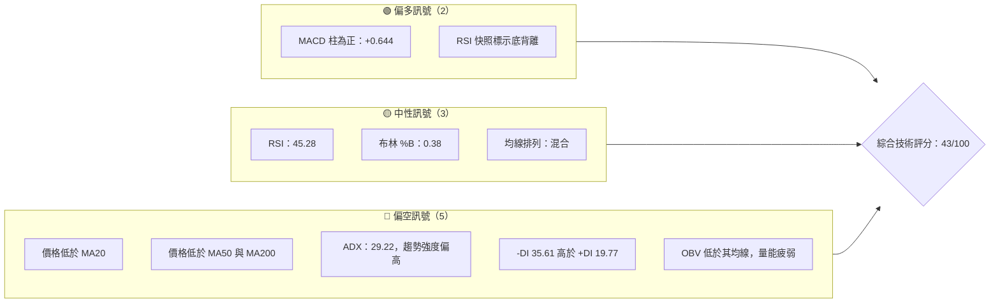
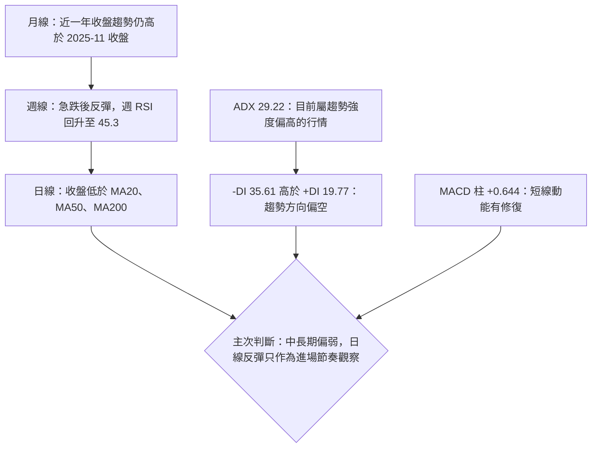
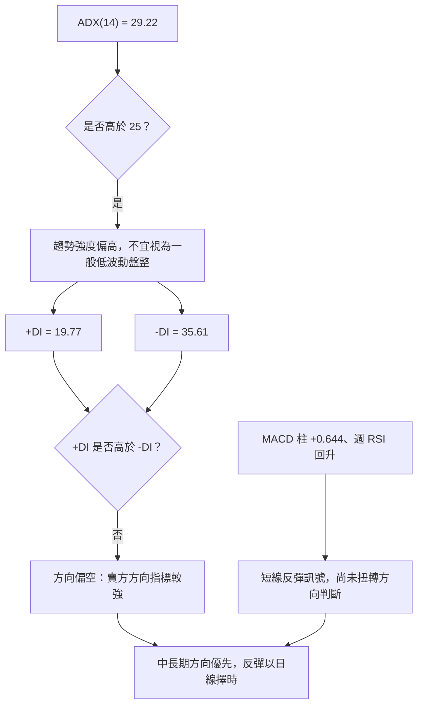
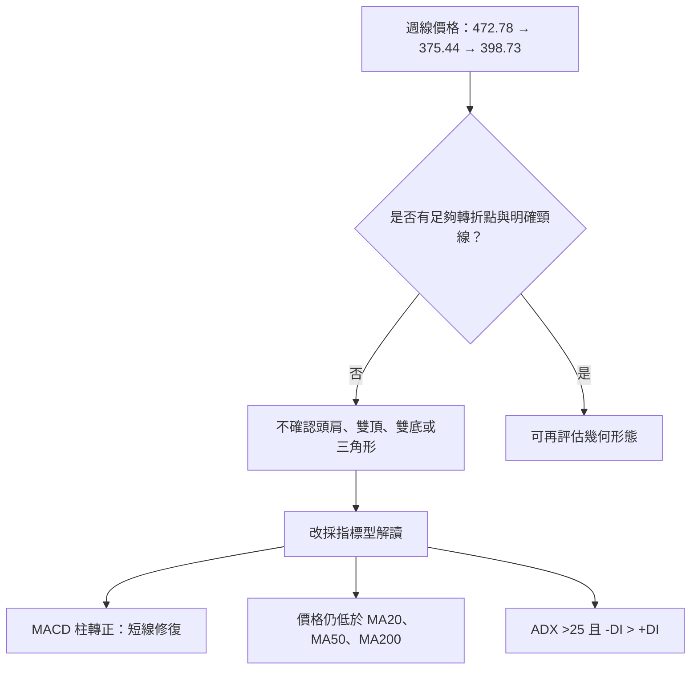
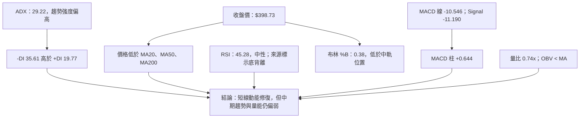
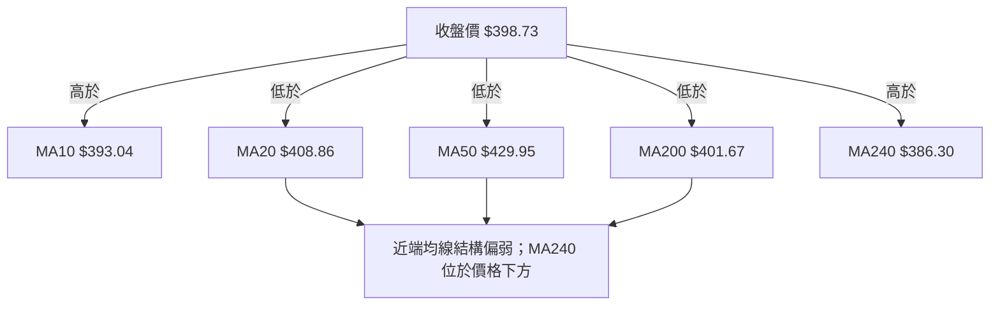
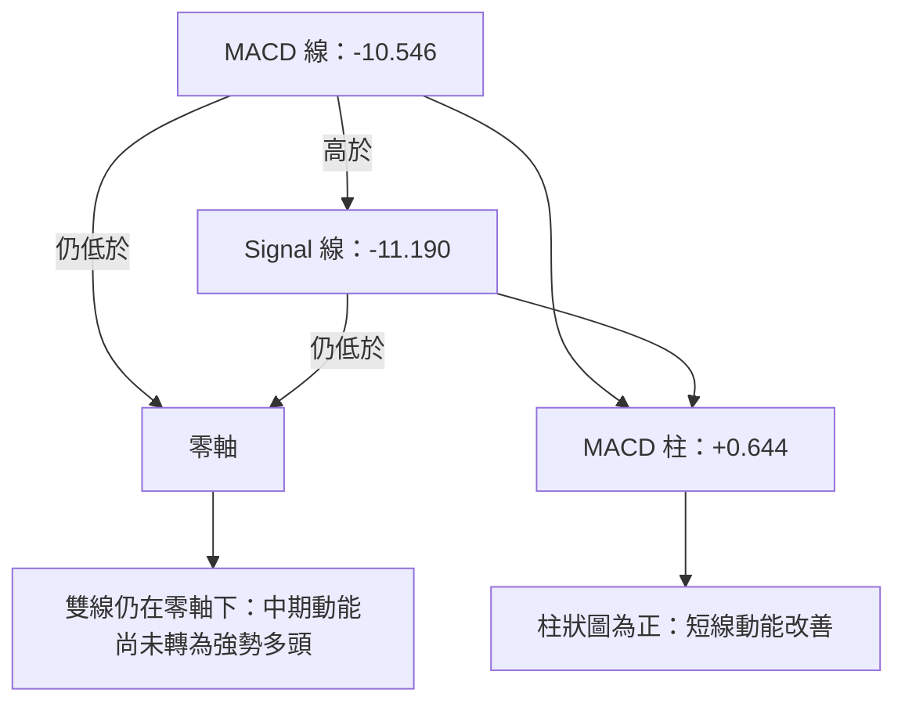
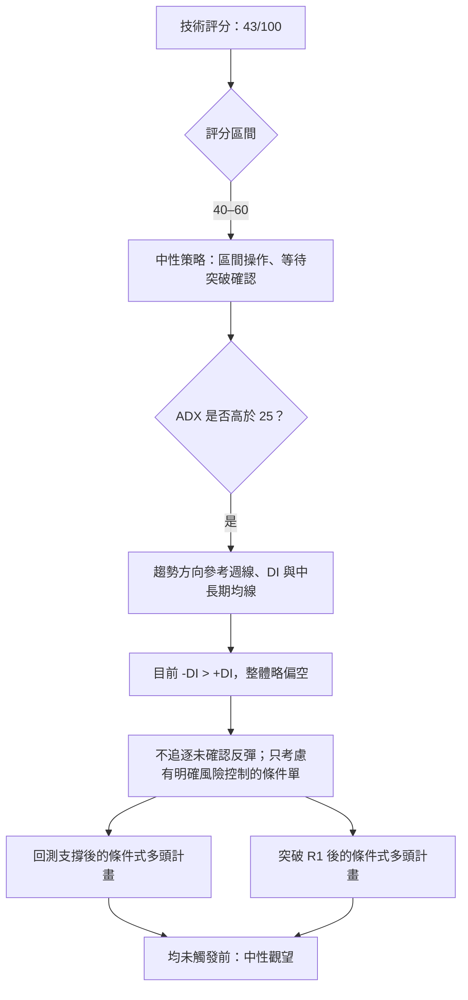
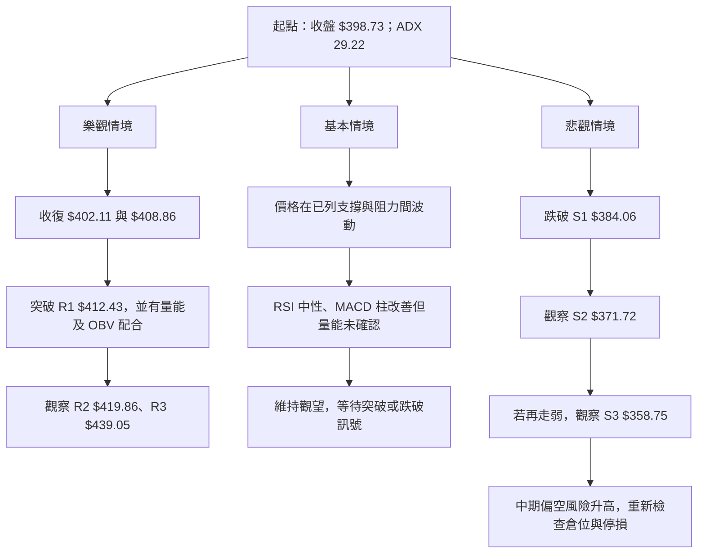

# TSM 技術分析報告

> **報告日期**：2026-11-14 ｜ **語言**：繁體中文 ｜ **數據來源**：使用者提供之 Yahoo Finance 技術數據 ｜ **當前價格**：**$398.73**

---

## 目錄

| 章節 | 內容 |
|------|------|
| 1. 技術面概覽 | 訊號儀表板、核心指標、評分卡 |
| 2. 趨勢分析 | 多時框趨勢、長中短期走勢 |
| 3. 圖表形態分析 | 形態識別、K線組合、目標價 |
| 4. 支撐與阻力 | 關鍵價位、斐波那契回調 |
| 5. 技術指標深度解讀 | MA、RSI、MACD、布林、成交量 |
| 6. 動能與波動率 | 動能評估、ATR、Beta |
| 7. 多時框架總結 | 時框架評分矩陣 |
| 8. 交易策略建議 | 區間／突破條件、風險報酬比 |
| 9. 風險提示與監控 | 監控指標、風險場景 |

---

## 1. 技術面概覽

### 🎯 技術訊號儀表板

目前訊號並非單向一致：中期均線與 ADX 方向偏空，短線 MACD 柱回升且 RSI 有數據來源標示的底背離；但 OBV、相對成交量與價格相對均線位置尚未確認反彈已轉為趨勢反轉。



### 📊 核心指標速覽表

| 指標類別 | 指標名稱 | 當前數值 | 訊號 | 解讀 |
|----------|----------|----------:|------|------|
| 價格 | 收盤價 | **$398.73** | 🟡 | 報告日提供的最新收盤價 |
| 趨勢 | MA20 | $408.86 | 🔴 | 收盤價低於 MA20 $10.13 |
| 趨勢 | MA50 | $429.95 | 🔴 | 收盤價低於 MA50 $31.22 |
| 趨勢 | MA200 | $401.67 | 🔴 | 收盤價低於 MA200 $2.94 |
| 趨勢 | MA240 | $386.30 | 🟢 | 收盤價高於 MA240 $12.43 |
| 動能 | RSI(14) | 45.28 | 🟡 | 中性區，未達超賣 |
| 動能 | MACD 線 / Signal | -10.546 / -11.190 | 🟡 | MACD 線仍為負，但高於訊號線 |
| 動能 | MACD 柱 | +0.644 | 🟢 | 柱狀圖轉正，代表短線動能改善 |
| 趨勢強度 | ADX(14) | 29.22 | 🔴 | 高於 25；趨勢強度偏高，方向由 -DI 主導 |
| 波動 | ATR(14) | $17.11 | 🟡 | 約為價格的 4.29%，單日波動幅度較大 |
| 成交量 | 量比 | 0.74x | 🔴 | 最新量低於 20 日均量 |
| 成交量 | OBV | OBV < MA | 🔴 | 量能尚未確認價格反彈 |

### 🏆 技術評分卡

評分採 0–100 分制，六個維度以算術平均計算。六項合計為 255 分，平均 **42.5 分**，依四捨五入規則，綜合評分為 **43/100**。

```text
╔══════════════════════════════════════════════════════════════════╗
║                 技術評分卡 — TSM（2026-11-14）                    ║
╠══════════════════════════════════════════════════════════════════╣
║ 趨勢強度      ▓▓▓▓░░░░░░  42/100  🔴                            ║
║ 動能指標      ▓▓▓▓▓░░░░░  48/100  🟡                            ║
║ 支撐穩定度    ▓▓▓▓▓▓░░░░  58/100  🟡                            ║
║ 成交量配合    ▓▓▓░░░░░░░  35/100  🔴                            ║
║ 形態完整度    ▓▓▓▓░░░░░░  40/100  🔴                            ║
║ 均線排列      ▓▓▓░░░░░░░  32/100  🔴                            ║
╠══════════════════════════════════════════════════════════════════╣
║ 綜合評分      ▓▓▓▓░░░░░░  43/100  🟡 中性偏弱                    ║
║ 計算： (42 + 48 + 58 + 35 + 40 + 32) ÷ 6 = 42.5 → 43          ║
╚══════════════════════════════════════════════════════════════════╝
```

**評分解讀：**

- **趨勢強度 42/100**：ADX 顯示趨勢強度偏高，但 -DI 高於 +DI，且價格仍低於 MA20、MA50、MA200，因此強度不等於多頭趨勢。
- **動能指標 48/100**：RSI 屬中性，MACD 柱翻正提供短線改善訊號；但 MACD 與訊號線都在零軸下，Stoch %K 低於 %D。
- **支撐穩定度 58/100**：目前下方有 S1、S2、50% 斐波那契等已列出的參考價位，但尚未有足夠資料估算支撐被測試後的統計守住機率。
- **成交量配合 35/100**：最新量比 0.74x、OBV 低於均線，反彈的成交量確認不足。
- **形態完整度 40/100**：近期價格有急跌與反彈，但資料不足以確認典型頭肩、雙底或三角形。
- **均線排列 32/100**：收盤價低於 MA20、MA50、MA200；長期 MA240 雖在收盤價下方，但整體排列仍混合。

---

## 2. 趨勢分析

### 🌐 多時框趨勢分析



**多時框解讀：**

1. **月線／長期：🟡 長期升勢中的顯著回檔。**  
   2025-11 月收盤為 $288.46，2026-11 月收盤為 $398.73，兩個月度收盤數值相較上升約 38.23%。但 2026-06 月收盤 $476.29 至 2026-11 月收盤 $398.73，回落約 16.28%。由於提供的是月度收盤序列，無法從該序列單獨認定每個月的盤中高低點或長期趨勢線位置。

2. **週線／中期：🔴 急跌後反彈，尚未轉為明確多頭結構。**  
   2026-11-06 週收盤 $375.44，2026-11-13 週收盤 $398.73，週收盤上升約 6.20%。同時週 RSI 從 36.3 回升至 45.3、MACD 柱由 -6.302 轉為 +0.644，顯示週線短期動能明顯修復；然而最新週收盤仍低於 2026-10-02 的 $472.78，且 ADX 方向指標仍由 -DI 主導。

3. **日線／短期：🟡 反彈修復與下跌趨勢並存。**  
   收盤價 $398.73 低於 MA20 $408.86、MA50 $429.95、MA200 $401.67；但高於 MA10 $393.04 與 MA240 $386.30。價格目前在短期反彈區域內，尚未收復多條均線形成的上方壓力。

### 📈 長期趨勢 — 12個月走勢圖

以下選取 **2025-12 至 2026-11** 共 12 個月的月收盤價。2026-11 為截至報告日的月度數據，尚非完整月度。

```text
TSM 月線收盤走勢（每個 ● 對應一個月；圖形為方向示意，價格見下表）

$480 ┤                                      ●
$460 ┤                                             ●
$440 ┤
$420 ┤                                ●  ●       ●
$400 ┤                                                    ●
$380 ┤                       ●
$360 ┤
$340 ┤                         ●
$320 ┤            ●
$300 ┤ ●
$280 ┤
$260 ┤
     └──────────────────────────────────────────────────────
      25-12  26-01  26-02  26-03  26-04  26-05  26-06  26-07
                                               26-08  26-09  26-10  26-11
```

| 月份 | 收盤價 | 階段特徵 |
|------|------:|----------|
| 2025-12 | $301.52 | 近一年序列起點 |
| 2026-01 | $327.98 | 月收盤走高 |
| 2026-02 | $371.66 | 延續上升 |
| 2026-03 | $336.26 | 從前月回落 |
| 2026-04 | $394.08 | 再度反彈 |
| 2026-05 | $416.36 | 延續上升 |
| 2026-06 | $476.29 | 12 個月月收盤最高值 |
| 2026-07 | $403.17 | 明顯回落 |
| 2026-08 | $414.21 | 小幅修復 |
| 2026-09 | $456.19 | 再度上行 |
| 2026-10 | $406.13 | 回落 |
| 2026-11 | $398.73 | 截至報告日的月收盤 |

**月線階段分析：**

- **2025-12 至 2026-02：**月收盤由 $301.52 升至 $371.66，呈現上行。
- **2026-03：**回落至 $336.26，升勢出現修正。
- **2026-04 至 2026-06：**月收盤持續走高，2026-06 收於 $476.29，為這 12 個月序列最高月收盤。
- **2026-07 至 2026-11：**價格波動擴大；截至 2026-11 的月收盤 $398.73，低於 2026-06 的月收盤高點，但仍高於 2025-12 的月收盤。

**長期判斷：**月度收盤序列支持「近一年仍高於起點、近期由高位回檔」的描述；不代表短中期回檔已結束，也不能單憑月收盤序列確認月線趨勢轉折。

### 📊 中期趨勢（週線分析）

```text
週線收盤與已列關鍵位示意（非比例圖）

$487.47 ───────────── 52 週高
$472.78 ── 10/02 週收盤
$453.31 ── 10/09
$412.61 ── 10/16
$418.51 ── 10/23
$406.13 ── 10/30
$398.73 ── 11/13 ───── 最新收盤
$384.06 ───────────── S1
$375.44 ── 11/06 週收盤
$371.72 ───────────── S2
$358.75 ───────────── S3
$351.19 ── 11/05 日內低點（近10根日K）
$264.03 ───────────── 52 週低
```

週線序列呈現從 2026-10 初高位急速下跌、2026-11-06 大量下跌後反彈的結構。最新一週收盤上升，但周成交量由 104,001,100 降至 66,693,500；換言之，價格反彈同時伴隨週成交量下降，買方確認力度仍有限。

### ⚡ 趨勢強度評估（ADX 解讀）



| ADX 區間 | 常見技術解讀 | 本次讀數 |
|----------|--------------|----------|
| < 20 | 趨勢較弱，盤整機率偏高 | 不適用 |
| 20–25 | 趨勢形成或方向未穩 | 不適用 |
| > 25 | 趨勢強度增加，須再判讀 +DI / -DI | **29.22** |
| +DI > -DI | 上行方向力量較強 | 不符合；19.77 < 35.61 |
| -DI > +DI | 下行方向力量較強 | **符合** |

**結論：**按提供的 ADX > 25，採用「趨勢行情」收斂規則；方向由 -DI 主導，故中長期方向優先判為偏空。日線 MACD 柱與 RSI 修復只作為短線擇時資訊，不能凌駕於中期方向訊號之上。

---

## 3. 圖表形態分析

### 🔍 形態識別系統

近 20 週收盤資料顯示，價格由 2026-10-02 的 $472.78 下跌至 2026-11-06 的 $375.44，之後反彈至 $398.73。現有資料不足以證明形成具有明確頸線、等高雙峰／雙底或收斂邊界的傳統幾何形態，因此不將反彈直接定義為雙底、頭肩底或其他已完成形態。



| 形態／訊號 | 信心度 | 判斷依據 | 完成度 | 目標價 |
|-------------|-------:|----------|--------|--------|
| 典型雙底 | 低於 50%；不確認 | 近週線中可見 $375.44 週收盤後反彈，但缺乏第二個可確認的相近低點與明確頸線 | 不適用 | **不適用；訊號不足，未確認形態** |
| 頭肩底／頭肩頂 | 低於 50%；不確認 | 提供的週線收盤序列及近 8 根週K不足以建立可靠的肩、頭、頸線幾何結構 | 不適用 | **不適用；訊號不足，未確認形態** |
| 三角形／旗形 | 低於 50%；不確認 | 未提供足以辨識收斂趨勢線或旗桿後整理區間的完整點位序列 | 不適用 | **不適用；訊號不足，未確認形態** |
| 趨勢型反彈修復 | 60%（指標型描述，非傳統形態） | 週收盤由 $375.44 升至 $398.73；週 RSI 36.3 升至 45.3；MACD 柱 -6.302 轉為 +0.644 | 尚未確認反轉 | 不以形態高度推算目標 |
| 布林區間位置 | 75%（指標型狀態） | %B = 0.38，價格位於布林中軌以下、且高於下軌 | 持續觀察 | 參考已列關鍵價位；不另造形態目標 |

### 🕯️ 重要 K 線形態分析

以下判斷只使用提供的近 10 根日K與近 8 根週K的開、高、低、收。若將某根 K 線描述為「類錘頭」或「長下影」，只是對單根 K 棒幾何特徵的描述，不代表形態已獲後續價格確認。

| 日期（日K／週K） | 開 | 高 | 低 | 收 | K線形態與判斷依據 | 解讀 | 訊號 |
|------|------:|------:|------:|------:|------------------|------|------|
| 2026-11-02 日K | $412.52 | $414.76 | $398.29 | $398.63 | 長實體陰線；收盤接近當日低位 | 賣方主導，當日未見明顯收復 | 🔴 |
| 2026-11-03 日K | $404.99 | $408.37 | $403.03 | $404.80 | 小實體、短上下影 | 方向性訊息有限 | 🟡 |
| 2026-11-04 日K | $400.64 | $410.59 | $391.61 | $395.75 | 陰線、上下影均存在 | 當日區間擴大，收盤偏弱 | 🔴 |
| 2026-11-05 日K | $379.75 | $380.78 | $351.19 | $353.10 | 長陰線；實體 $26.65，收近低位 | 顯示強烈下行壓力；不能僅據單日推斷反轉 | 🔴 |
| 2026-11-06 日K | $380.56 | $380.72 | $367.95 | $375.44 | 實體約 $5.12、長下影約 $7.49 | 出現低位承接的外觀，但需後續確認 | 🟡 |
| 2026-11-09 日K | $382.50 | $394.39 | $380.33 | $388.62 | 陽線，收盤高於開盤 | 急跌後的反彈延續 | 🟢 |
| 2026-11-10 日K | $388.42 | $400.21 | $387.20 | $396.48 | 陽線，實體大於上下影 | 買方延續反彈，但非均線反轉確認 | 🟢 |
| 2026-11-11 日K | $415.25 | $416.80 | $407.03 | $413.35 | 小陰實體、下影較長 | 波動與供需拉鋸；該日收盤高於前幾日但非單根定勢 | 🟡 |
| 2026-11-12 日K | $394.62 | $411.77 | $393.91 | $405.49 | 陽線、實體較大 | 反彈延續，但上影反映盤中賣壓 | 🟢 |
| 2026-11-13 日K | $407.60 | $408.09 | $391.50 | $398.73 | 陰線、下影較長 | 當日回落，低位有一定承接但收盤仍低於開盤 | 🟡 |
| 2026-10-02 週K | $448.39 | $474.79 | $443.11 | $472.78 | 強勢週陽線 | 近 8 根週K中此前的強勢上行週 | 🟢 |
| 2026-10-09 週K | $478.77 | $487.47 | $449.75 | $453.31 | 長陰線，收盤低於開盤 | 高位賣壓增強，周內波動擴大 | 🔴 |
| 2026-10-16 週K | $453.55 | $454.40 | $407.13 | $412.61 | 長陰實體 | 下跌延續，收盤靠近周內低位 | 🔴 |
| 2026-10-30 週K | $418.07 | $440.88 | $400.12 | $406.13 | 陰線、上影較長 | 反彈受阻後收低，仍未建立高點上移結構 | 🔴 |
| 2026-11-06 週K | $412.52 | $414.76 | $351.19 | $375.44 | 大幅下跌週、長下影 | 周內曾大幅下探後收回部分跌幅；仍是下跌週 | 🔴 |
| 2026-11-13 週K | $382.50 | $416.80 | $380.33 | $398.73 | 陽線、上影較長 | 週收盤反彈，但周內高位遭遇賣壓 | 🟡 |

### 📉 ASCII 走勢形態示意圖

以下圖形表示週線收盤序列的方向，不將其命名為已確認的幾何形態。

```text
週線收盤序列與觀察重點（非比例示意）

$472.78  ●  2026-10-02
          \
$453.31    ●  2026-10-09
             \
$412.61       ●  2026-10-16
                \    ● $418.51（10/23）
                 \  /
$406.13            ● 2026-10-30
                     \
$375.44                ● 2026-11-06
                        \
$398.73                   ● 2026-11-13
                            ↑
                   反彈修復；未確認趨勢反轉
```

### 🎯 形態目標價計算

- **傳統形態目標價：不提供。** 目前沒有足夠資料確認頭肩、雙底、雙頂、三角形或旗形的關鍵幾何高度與頸線，因此不以形態高度推算目標價。
- **可用的技術價位：** 使用第 4 章已提供的支撐、阻力與斐波那契數值作情境關卡；這些是資料區塊中已列值，不是重新估算的形態目標。
- **短線反彈並不等同反轉：** 週 RSI 和 MACD 柱回升提供修復訊號，但價格仍低於 MA20、MA50、MA200，ADX 方向指標仍偏空。

---

## 4. 支撐與阻力

### 🗺️ 關鍵價位分布圖

以下支撐與阻力均引用技術數據提供的波段高低點聚類；斐波那契價位則直接引用已提供的計算結果。

```text
TSM 價位結構分布圖（美元；由高至低排列）

$487.47 ║ 52W 高／斐波那契 0.0%
$451.76 ║ 布林上軌（技術指標參考值）
$439.05 ║ R3：近一年波段高點聚類
$434.74 ║ 斐波那契 23.6%
$429.95 ║ MA50
$419.86 ║ R2：近一年波段高點聚類
$412.43 ║ R1：近一年波段高點聚類
$408.86 ║ 布林中軌／MA20
$402.11 ║ 斐波那契 38.2%
$401.67 ║ MA200
$398.73 ╠══ 現價（2026-11-13 收盤）══
$386.30 ║ MA240
$384.06 ║ S1：近一年波段低點聚類
$375.75 ║ 斐波那契 50.0%
$371.72 ║ S2：近一年波段低點聚類
$365.95 ║ 布林下軌
$358.75 ║ S3：近一年波段低點聚類
$349.38 ║ 斐波那契 61.8%
$311.84 ║ 斐波那契 78.6%
$264.03 ║ 52W 低／斐波那契 100.0%
```

現價 $398.73 低於 $402.11 的 38.2% 回調位，但高於 $375.75 的 50.0% 回調位。因此，現價位於已提供的 **50.0% 與 38.2% 回調位之間**。同時，價格位於布林中軌 $408.86 下方，並略低於 MA200 $401.67，反映短線仍需收復上方技術位才能改善趨勢結構。

### 🚧 阻力位分析表

| 阻力級別 | 價位 | 形成原因 | 突破難度 | 重要性 |
|----------|------:|----------|----------|--------|
| R1 | **$412.43** | 近一年波段高點聚類；亦高於布林中軌 $408.86 | 中 | 近期第一個關鍵供給區；收復後才較能確認短線反彈延續 |
| R2 | **$419.86** | 近一年波段高點聚類 | 中至高 | 與 R1 構成上方連續壓力，需關注突破時的成交量確認 |
| R3 | **$439.05** | 近一年波段高點聚類 | 高 | 高於 R1、R2，屬更上方的波段阻力參考 |

> 阻力位為技術參考價位，不代表價格必然在該位置反轉；數據未提供各價位的歷史測試次數或成交量分布，故不虛構精確突破機率。

### 🛡️ 支撐位分析表

| 支撐級別 | 價位 | 形成原因 | 守住機率 | 重要性 |
|----------|------:|----------|----------|--------|
| S1 | **$384.06** | 近一年波段低點聚類；接近現價下方 | N/A（數據未提供） | 第一個近端支撐觀察位 |
| S2 | **$371.72** | 近一年波段低點聚類 | N/A（數據未提供） | 重要中段支撐；接近 50% 斐波那契 $375.75，但兩者為不同來源的價位 |
| S3 | **$358.75** | 近一年波段低點聚類 | N/A（數據未提供） | 若 S2 失守，觀察下一個已列支撐 |
| 52W 低 | **$264.03** | 52 週低點及斐波那契 100% | N/A（數據未提供） | 長週期參考，不是近端交易止損點 |

### 📐 斐波那契回調位分析

| 回調位 | 價格 | 對現價的相對位置 |
|--------|------:|------------------|
| 0.0%（52W 高） | $487.47 | 高於現價 |
| 23.6% | $434.74 | 高於現價 |
| 38.2% | $402.11 | 高於現價 |
| 50.0% | $375.75 | 低於現價 |
| 61.8% | $349.38 | 低於現價 |
| 78.6% | $311.84 | 低於現價 |
| 100.0%（52W 低） | $264.03 | 低於現價 |

- 現價 $398.73 位於 **50.0% $375.75 與 38.2% $402.11** 之間，並低於 38.2% 回調位 $402.11。
- 若價格重新收復 $402.11，較能改善短線回檔結構；但上方仍須觀察已列阻力 $412.43 與 $419.86。
- 若失守下方支撐，首先觀察 S1 $384.06、S2 $371.72；不以斐波那契位置取代已列的支撐結構。

---

## 5. 技術指標深度解讀

### 🎛️ 指標訊號總覽



### 📈 移動平均線排列分析



| 均線 | 數值 | 收盤價相對位置 | 技術解讀 |
|------|------:|----------------|----------|
| MA5 | $400.53 | 收盤低於 MA5 | 最新收盤稍低於短期均線，短線反彈有回吐 |
| MA10 | $393.04 | 收盤高於 MA10 | 短線價格仍略高於 MA10 |
| MA20 | $408.86 | 收盤低於 MA20 | 近端趨勢仍未收復 |
| MA50 | $429.95 | 收盤低於 MA50 | 中短期壓力仍在上方 |
| MA60 | $427.62 | 收盤低於 MA60 | 中期均線壓力 |
| MA120 | $425.78 | 收盤低於 MA120 | 中期價格仍低於較長均線 |
| MA200 | $401.67 | 收盤低於 MA200 | 僅低於該均線 $2.94，仍須觀察是否收復 |
| MA240 | $386.30 | 收盤高於 MA240 | 長期均線附近有支撐性參考，但不等同確認底部 |

**均線整合判讀：**收盤價同時低於 MA20、MA50、MA60、MA120、MA200，但高於 MA10 與 MA240。資料標示均線排列為「混合排列」，與此一致：不是完整的多頭排列，也不是單靠 MA240 上揚即可確認多頭反轉。由於 ADX 顯示趨勢強度偏高，且 -DI 主導，現階段均線分布支持「中期偏弱、短線反彈觀察」的結論。

### 📉 RSI(14) 分析

```text
RSI(14) = 45.28

0        20        30        50        70        80       100
|---------|---------|---------|---------|---------|---------|
                              ▲
                            45.28

區間：中性（30–70）
強度：█████░░░░░  45.28/100
```

- **位置：**RSI 45.28，位於 30–70 的常見中性區，沒有進入傳統超賣區（低於 30），也沒有進入超買區（高於 70）。
- **方向：**近期週 RSI 從 2026-11-06 的 36.3 回升到 2026-11-13 的 45.3，顯示動能由偏弱區域回升。
- **背離：**提供數據明確標示 RSI 底背離，判定依據是「僅比較近 20 根K棒首尾的價格與 RSI 方向」。因此可記錄為**數據來源標示的底背離**，但因未提供完整近 20 根日K RSI 與價格逐點資料，無法獨立驗證背離的轉折點、發生區間及強度。
- **權重：**底背離是潛在的反彈訊號，不等於趨勢反轉。價格仍低於多條均線，且 -DI > +DI，故不能僅憑 RSI 背離改判為中期多頭。

### 📊 MACD(12/26/9) 訊號解讀



- MACD 線 **-10.546** 高於 Signal 線 **-11.190**，兩線差為 **+0.644**，與 MACD 柱的正值一致。
- **正柱狀圖是短線正向訊號**，表示 MACD 線相對訊號線改善。
- 但 MACD 線和訊號線都在零軸下方，代表中期動能尚未回到正值區。
- 週線 MACD 柱由 2026-11-06 的 **-6.302** 回升到 2026-11-13 的 **+0.644**，短線修復明顯；但若缺乏價格收復均線及量能確認，仍應視為反彈中的動能改善。
- **MACD 背離判斷：**資料未提供 MACD 背離判定或完整每日 MACD 序列，故結論為 **N/A（數據未提供）**，不宣稱存在頂背離或底背離。

### 📦 布林通道分析

```text
布林通道（20 日；數值依資料提供）

$451.76  ─────────────── 上軌
                       │
$429.95  ─────────────── MA50（額外均線參考）
$408.86  ─────────────── 中軌／MA20
                       │
$402.11  ─────────────── 斐波那契 38.2%
$401.67  ─────────────── MA200
$398.73  ─────── ● ───── 現價；%B = 0.38
                       │
$386.30  ─────────────── MA240
$375.75  ─────────────── 斐波那契 50.0%
$365.95  ─────────────── 下軌
```

- **%B = 0.38**，代表價格位於布林通道中軌以下，且仍在通道範圍內。
- 現價 $398.73 與中軌 $408.86 相差 $10.13；收復中軌會是短線轉強的觀察條件之一，但不是單獨的買入確認。
- 下軌 $365.95 是通道參考，不是資料中的波段支撐位；同時另有已列 S2 $371.72、S3 $358.75。
- 目前沒有提供布林通道帶寬的歷史序列，因此**無法判斷帶寬正在擴張或收縮**，不推定波動收斂或擠壓突破。

### 💹 成交量分析（量價配合度）

- 最新成交量 **10,712,000**，低於 20 日均量 **14,470,080**，量比 **0.74x**；也低於 50 日均量 **12,272,076**。
- OBV 趨勢標示為 **OBV < MA → 量能疲弱**，表示目前尚未有足夠量能訊號確認反彈。
- 週線比較：2026-11-06 週收盤 $375.44、週成交量 104,001,100；2026-11-13 週收盤 $398.73、週成交量 66,693,500。後一週價格反彈約 6.20%，但週成交量較前一週低約 35.87%。這表示價格反彈伴隨成交量下降，量價確認偏弱。
- **整合結論：**MACD 柱與週 RSI 修復偏多，但量比低於 1、OBV 低於均線，以及週反彈量縮，三者共同限制反彈訊號的可信度。

---

## 6. 動能與波動率

### ⚡ 動能評估四象限

此處的「動能」依 RSI、MACD 柱、週 RSI 變化與 +DI/-DI 綜合判讀；「波動」以 ATR 占價格比例和 Beta 作為參考，不等同完整的歷史波動率分位數。

| 象限 | 動能 | 波動 | 當前狀態 | 評估 |
|------|------|------|----------|------|
| Q1 | 強 | 低 | — | 順勢、波動較低，通常較易管理風險 |
| Q2 | 弱 | 低 | — | 缺乏動能但波動有限 |
| Q3 | 強 | 高 | 部分符合 | MACD 柱轉正、週 RSI 回升；ATR 比率 4.29%，波動偏高 |
| Q4 | 弱 | 高 | **部分符合** | -DI 主導、價格低於多條均線；波動仍大，需防範反覆掃損 |

**當前定位：**位於「高波動、方向偏弱但短線動能修復」的混合狀態。由於訊號不是純粹的弱勢延續，亦未確認趨勢反轉，較合理的操作方式是等待價位確認，而不是假設單一方向必然延伸。

### 📊 ATR 波動率分析

| 項目 | 數值 | 解讀 |
|------|------:|------|
| ATR(14) | **$17.11** | 依資料提供的 Wilder ATR |
| ATR／收盤價 | **4.29%** | 單日平均真實波動相對於價格偏大 |
| 0.5 ATR | $8.555 | 波動尺度參考；不是指定止損價 |
| 1.0 ATR | $17.11 | 常用波動尺度參考；不是指定止損價 |
| 1.5 ATR | $25.665 | 較寬的波動尺度參考；不是指定止損價 |

**ATR 的用途與限制：**

- ATR 衡量近期平均真實波幅，**不提供方向**。
- ATR 約佔收盤價 4.29%，意味著緊貼現價設定很窄的固定百分比停損，容易受到正常波動影響。
- 本報告交易策略的停損使用資料中已提供的支撐或斐波那契價位；上表 ATR 倍數只作波動尺度參考，不另造支撐、阻力或止損價。
- 在高波動環境，倉位應與止損距離配合調整；同一止損距離下，若不降低倉位，潛在帳戶風險會增加。

### 📐 Beta 與市場相關性

| 指標 | 數值 | 解讀 |
|------|------:|------|
| Beta | **1.233** | 歷史上相對市場的系統性波動敏感度高於 1 |
| Short Ratio | 2.78 | 提供的空頭回補天數指標 |
| Short % Float | 0.7% | 空頭占流通股比例較低 |

Beta 1.233 可作為相對市場敏感度的參考，但**不代表** TSM 與大盤相關係數為 1.233，也不能單憑 Beta 推算個別交易日漲跌幅。資料未提供特定市場指數、相關係數或 Beta 的估算期間，故市場相關係數為 **N/A（數據未提供）**。

---

## 7. 多時框架總結

### 📋 時框架評分表

| 時框架 | 趨勢方向 | 動能 | 均線排列 | 形態 | 綜合評分 | 建議 |
|--------|----------|------|----------|------|----------|------|
| 月線／長期 | 🟡 近一年收盤高於起點，近期回檔 | N/A（未提供月線動能指標） | N/A（未提供月線均線值） | 未確認傳統形態 | 50/100（中性） | 不以長期月收盤表現否定短中期風險 |
| 週線／中期 | 🔴 跌勢後反彈，-DI 主導 | 🟡 RSI、MACD 柱改善 | 🟡 最新收盤仍低於多條中長期均線 | 未確認底部形態 | 43/100 | 中期偏弱，等待阻力收復與量能確認 |
| 日線／短期 | 🟡 急跌後反彈修復 | 🟡 RSI 中性、MACD 柱為正 | 🔴 價格低於 MA20、MA50、MA200 | 未確認反轉形態 | 43/100 | 以條件式區間／突破交易為主 |

> 月線評分為定性參考；月線的 RSI、MACD、均線與 ADX 數據未提供，不以其他時框推算補足。日線與週線的 43 分參照第 1 章六項評分卡的整體技術評分，避免另行改寫綜合評分。

### 🔲 綜合訊號矩陣

| 訊號維度 | 短期（日線） | 中期（週線） | 長期（月度價格序列） | 收斂判斷 |
|----------|--------------|--------------|----------------------|----------|
| 價格方向 | 近期反彈後回落 | 近週反彈 | 高於 2025-11 收盤，但低於 2026-06 月收盤 | 長期較強、中期回檔 |
| 動能 | MACD 柱 +0.644 | 週 RSI 回升、MACD 柱轉正 | N/A（數據未提供） | 短線修復，不足以扭轉中期 |
| 趨勢強度 | ADX 29.22 | -DI 35.61 > +DI 19.77 | N/A（數據未提供） | 中期方向偏空 |
| 均線 | 低於 MA20、MA50、MA200 | 收盤低於 MA50、MA200 | N/A（數據未提供） | 均線仍構成上方壓力 |
| 量能 | 最新量比 0.74x | 反彈週成交量低於前一週 | N/A（數據未提供） | 量能確認不足 |
| 技術綜合 | 🟡 | 🔴 | 🟡 | **中性偏弱** |

### ⚖️ 多時框收斂結論

1. **行情分類：趨勢強度偏高。** ADX(14) 為 29.22，高於 25。
2. **主導方向：中期／週線與均線結構優先。** +DI 為 19.77、-DI 為 35.61，且價格低於 MA20、MA50、MA200。
3. **日線訊號定位：**MACD 柱轉正、RSI 回升與數據來源標示的 RSI 底背離，代表下跌後有反彈修復可能，但尚未確認中期反轉。
4. **唯一方向性結論：中性觀望、略偏空。** 綜合評分 **43/100**，屬中性區間；趨勢強度偏高時，依規則以中長期方向為主，故不將短線反彈提升為偏多主判斷。
5. **第 8 章策略一致性：**主策略採「等待突破確認的條件式區間操作」，不以無條件追多或追空為主。

---

## 8. 交易策略建議

### 🗺️ 策略決策流程圖



### 🧭 策略路由

**當前主策略方向 = 中性區間操作、等待突破確認（依評分 43/100）。**

依規定 40–60 分為中性區間策略。由於 ADX 高於 25，方向選擇仍優先參考週線與中長期指標：目前 -DI 高於 +DI，價格低於多條均線，故主策略不等同積極做多；下面兩個多頭方案均為**有條件觸發的反彈／突破交易計畫**，未達條件時保持觀望。

### 🎯 價格情境階梯（Price Scenarios）

| 觸發條件 | 下一目標 | 後續延伸 | 情境含義 |
|----------|----------|----------|----------|
| 收盤有效突破 R1 **$412.43** | R2 **$419.86** | R3 **$439.05** | 短線轉強的必要觀察條件之一；仍須成交量確認 |
| 價格維持在現價與已列支撐／阻力之間 | — | — | 方向不明，等待區間邊界或均線收復 |
| 跌破 S1 **$384.06** | S2 **$371.72** | S3 **$358.75** | 中期轉弱風險提高 |
| 若價格位於斐波那契 50% **$375.75** 與 38.2% **$402.11** 之間 | — | — | 現價所在區間；需觀察是收復 $402.11 或下探較低支撐 |

### 📊 情境機率分佈

以下為依目前技術指標制定的**主觀情境權重**，不是歷史回測勝率或保證結果；三項合計為 100%。

| 情境 | 機率 | 主要依據 |
|------|------:|----------|
| 繼續上行／反彈 | **25%** | MACD 柱 +0.644、週 RSI 從 36.3 回升至 45.3、資料來源標示 RSI 底背離；但價格仍低於多條均線，OBV 與成交量未確認 |
| 區間震盪 | **35%** | RSI 45.28、布林 %B 0.38、均線排列混合；目前價格位於斐波那契 50% 與 38.2% 之間 |
| 回落／再探底 | **40%** | ADX 29.22、-DI 35.61 高於 +DI 19.77、價格低於 MA20／MA50／MA200，且 OBV < MA、量比 0.74x |

### 🟢 主策略詳情

以下價格均取自已列的當前收盤、支撐／阻力、斐波那契數值。策略 A 與策略 B 是**不同觸發條件下的替代計畫**，不應同時全額執行。風險報酬比按同欄價格計算，進場皆為單一價位，無須使用區間中點。

| 策略要素 | 策略 A：支撐回測反彈 | 策略 B：R1 突破確認 |
|----------|-----------------------|-----------------------|
| 進場條件 | 價格回測 S1，且出現止跌／反彈確認；未確認不掛單追入 | 收盤確認突破 R1，且量能需改善；若量能未配合則等待 |
| 進場價格 | **$384.06**（S1） | **$412.43**（R1） |
| 止損價格 | **$371.72**（S2） | **$402.11**（斐波那契 38.2%） |
| 目標價 T1 | **$412.43**（R1） | **$419.86**（R2） |
| 目標價 T2 | **$419.86**（R2） | **$439.05**（R3） |
| 風險報酬比（以 T1 計） | **1 : 2.30**；收益 $28.37 ÷ 風險 $12.34 | **1 : 0.72**；收益 $7.43 ÷ 風險 $10.32 |
| 風險報酬比（以 T2 計） | **1 : 2.90**；收益 $35.80 ÷ 風險 $12.34 | **1 : 2.58**；收益 $26.62 ÷ 風險 $10.32 |
| 成功機率 | N/A（數據未提供）；不以主觀數字冒充回測勝率 | N/A（數據未提供）；不以主觀數字冒充回測勝率 |
| 建議倉位 | N/A（須依帳戶風險上限與止損距離計算） | N/A（須依帳戶風險上限與止損距離計算） |

**風險報酬比驗算：**

- 策略 A：T1 收益 $412.43 − $384.06 = **$28.37**；止損風險 $384.06 − $371.72 = **$12.34**；$28.37 ÷ $12.34 = **2.30**。
- 策略 A（T2）：$419.86 − $384.06 = **$35.80**；$35.80 ÷ $12.34 = **2.90**。
- 策略 B：T1 收益 $419.86 − $412.43 = **$7.43**；止損風險 $412.43 − $402.11 = **$10.32**；$7.43 ÷ $10.32 = **0.72**。
- 策略 B（T2）：$439.05 − $412.43 = **$26.62**；$26.62 ÷ $10.32 = **2.58**。

策略 B 的 T1 風險報酬比低於 1，表示只以 R2 作第一目標時報酬不足以覆蓋單位風險；若使用此計畫，應重新審視是否值得進場，而不能只因突破 R1 就機械式下單。策略 A 的比值較高，但須等待價格回測 S1 並出現反應，不能把 S1 價位當作必然守住。

### 🔴 反向風險觸發點（對沖提示）

以下是對主策略構成風險的觀察點，並非完整的反向交易建議：

- **收盤跌破 S1 $384.06：**支撐結構轉弱，需重新評估策略 A，不宜自動假設價格必然反彈。
- **進一步跌破 S2 $371.72：**下一個已列參考為 S3 $358.75；若支撐失守，區間反彈交易的風險上升。
- **無法收復 $402.11、$408.86 或 R1 $412.43：**價格仍受斐波那契、布林中軌及波段阻力限制，反彈延續性不足。
- **若 R1 突破但成交量持續偏低、OBV 仍低於均線：**需要警惕假突破，避免將短暫越位視為趨勢反轉。
- **中期方向訊號未改變：**只要 -DI 仍高於 +DI、價格仍低於 MA50 和 MA200，技術面不宜升級為強勢多頭主張。

### ⭐ 整體訊號強度評星

```text
做多訊號強度：★★☆☆☆  (2/5 星)
做空訊號強度：★★★☆☆  (3/5 星)
整體可信度：  ★★★☆☆  (3/5 星)
```

評星反映目前訊號的方向與一致性，不是策略勝率。空頭評星略高，原因是 ADX、DI、均線與成交量結構偏弱；但 RSI 與 MACD 柱正在修復，因此不將空頭評為高度確信。

---

## 9. 風險提示與監控

### ✅ 關鍵監控指標 Checklist

```text
╔══════════════════════════════════════════════════════════════╗
║            TSM 技術監控清單 — 2026-11-14                    ║
╠══════════════════════════════════════════════════════════════╣
║ □ 收盤是否站回 R1 $412.43？                                  ║
║ □ 突破 R1 時成交量是否高於近期均量？                         ║
║ □ OBV 是否重新站回其均線？                                  ║
║ □ 收盤是否站回布林中軌／MA20 $408.86？                      ║
║ □ 價格是否收復 MA200 $401.67？                              ║
║ □ +DI 是否上穿或改善至接近 -DI？                            ║
║ □ RSI 是否持續高於 50，且避免再次轉弱？                     ║
║ □ MACD 是否延續柱狀圖改善，並向零軸靠近？                   ║
║ □ S1 $384.06 是否守住？                                     ║
║ □ 若失守 S1，是否進一步測試 S2 $371.72？                    ║
║ □ ATR $17.11 是否進一步變化，導致持倉風險擴大？             ║
╠══════════════════════════════════════════════════════════════╣
║ 判讀原則：價格突破須與成交量、OBV、DI 方向相互確認。        ║
╚══════════════════════════════════════════════════════════════╝
```

### ⚠️ 風險場景分析



| 情境 | 觸發條件 | 可能技術解讀 | 應對重點 |
|------|----------|--------------|----------|
| 樂觀 | 收復 $402.11、$408.86，進一步突破 R1 $412.43，且成交量與 OBV 改善 | 短線反彈獲得更多確認；仍需觀察 R2、R3 | 以條件式交易管理，分段確認，不預設 R3 必達 |
| 基本 | 在現價附近波動，未有效突破 R1，也未跌破 S1 | 多空訊號維持拉鋸；價格仍處於指標修復與趨勢偏弱之間 | 避免在區間中段追價，等待邊界及成交量訊號 |
| 悲觀 | 跌破 S1 $384.06，進一步失守 S2 $371.72 | 中期偏空結構延續的風險增加 | 執行既定風險上限，不因 RSI 底背離而取消止損 |

### 🛡️ 風險管理重要提醒

1. **ADX 高於 25，但它衡量的是趨勢強度，不是方向。**本次方向由 -DI 35.61 高於 +DI 19.77 顯示偏空；因此不應將「ADX 高」解讀為看多。
2. **短線反彈訊號尚未獲成交量充分確認。**量比為 0.74x，OBV 低於均線，週線反彈量也低於前一週；若單看 MACD 柱轉正，可能高估反彈可靠性。
3. **價格與多條均線之間仍有距離。**收盤低於 MA20、MA50、MA200；只有在價格收復並維持在這些參考位上方後，才較能改善趨勢結構。
4. **ATR 顯示短線波動顯著。**ATR 為 $17.11、佔股價 4.29%；倉位大小須納入止損距離，避免正常波動就造成超出預期的帳戶損失。
5. **交易策略不是成功率承諾。**資料未提供策略回測、交易成本、滑價、股息處理或勝率統計，故策略成功機率與建議倉位標示 N/A。
6. **避免把支撐價位當成保證底部。**S1、S2、S3 是價格結構參考，不代表支撐必然有效；若價格跌破支撐，需依事前風險規則處理，而不是任意加碼。
7. **事件與市場風險可能使技術價位失效。**半導體產業消息、公司公告、財報、宏觀利率變化、地緣政治與市場風險偏好，都可能造成跳空或快速波動；技術位不保證能以預期價格成交。

---

## 📋 報告總結

```text
TSM 技術分析報告總結
══════════════════════════════════════════════════════════════════
報告日期：2026-11-14
當前價格：$398.73
分析評級：🟡 中性偏弱；綜合評分 43/100

關鍵結論：
├─ 長期趨勢：🟡 近一年月收盤仍高於 2025-11，但自 2026-06 高位回檔
├─ 中期趨勢：🔴 ADX 29.22，且 -DI 35.61 > +DI 19.77
├─ 短期趨勢：🟡 MACD 柱轉正、週 RSI 回升，但量能確認不足
├─ 關鍵支撐：S1 $384.06；其下為 S2 $371.72、S3 $358.75
├─ 關鍵阻力：R1 $412.43；其上為 R2 $419.86、R3 $439.05
└─ 分析師共識目標：$586.69（外部分析師平均值；非本報告技術目標）

最優策略組合：
1. 🥇 條件式支撐回測：僅在 S1 $384.06 附近出現止跌確認後評估；
   參考止損 S2 $371.72，T1 R1 $412.43。
2. 🥈 突破確認策略：收盤突破 R1 $412.43 且量能改善後再評估；
   T1 R2 $419.86，T2 R3 $439.05；T1 風險報酬比僅 1:0.72，需謹慎。
3. 🥉 保守選擇：暫不追價，等待價格、成交量、OBV 與 DI 訊號收斂；
   綜合評分為 43/100，主要結論為中性觀望、略偏空。
══════════════════════════════════════════════════════════════════
```

> ⚠️ **免責聲明**：本報告為依據使用者提供之歷史價格與技術指標產生的技術分析，僅供研究與學術參考，不構成任何投資建議或獲利保證。技術指標與價位可能失效，市場價格可能跳空或快速波動；投資人應自行評估風險，並依自身財務狀況制定交易與風險管理計畫。

*報告生成時間：2026-11-14 ｜ 數據來源：使用者提供之 Yahoo Finance 數據 ｜ 分析框架：多時框技術分析*