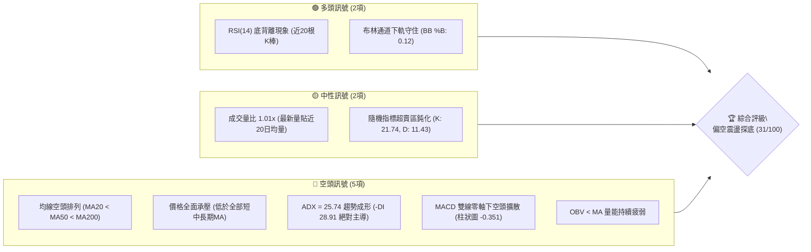
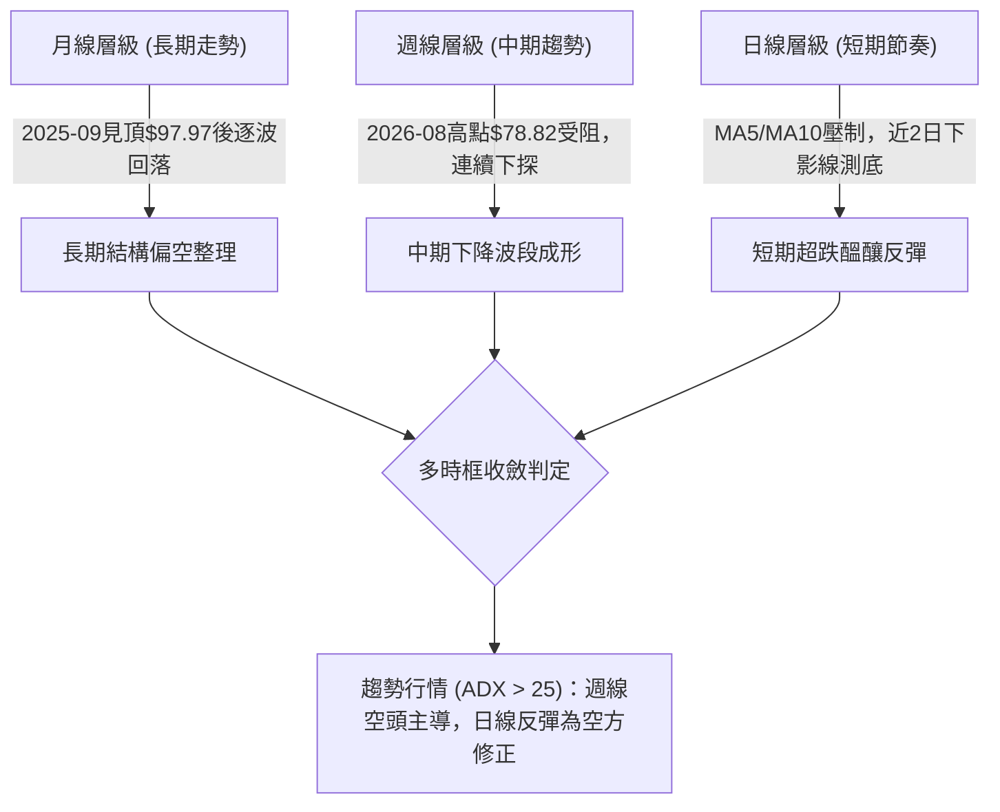
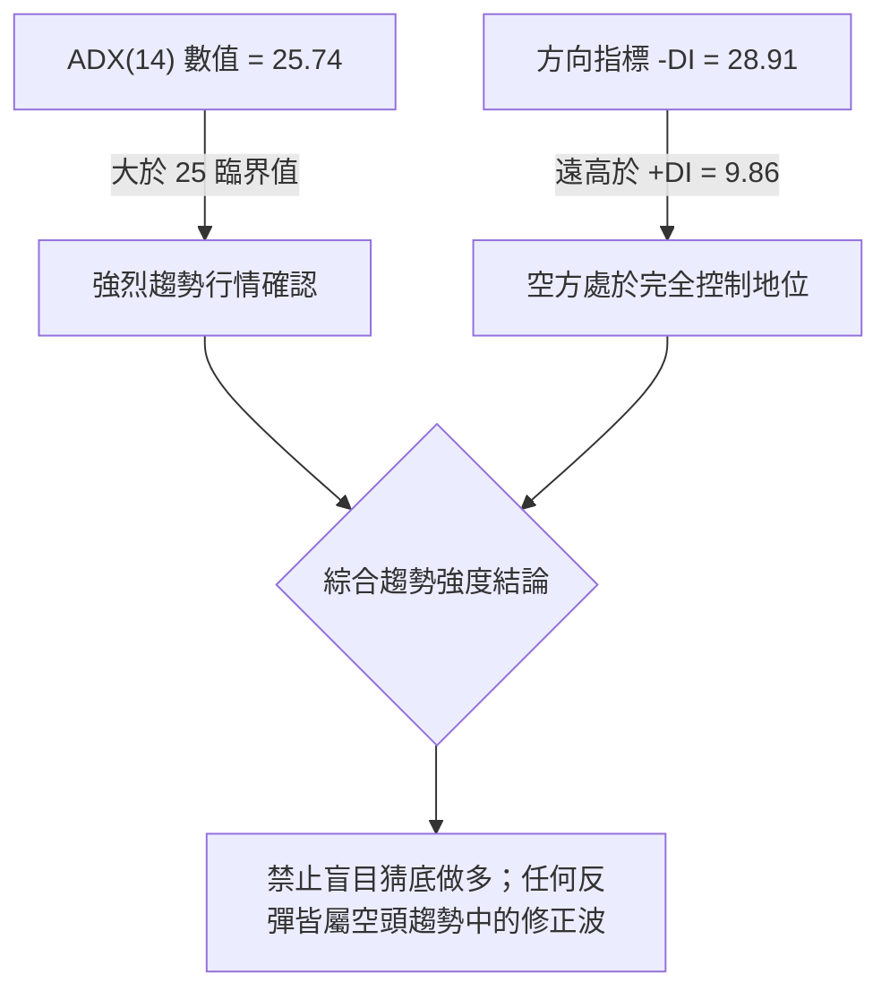
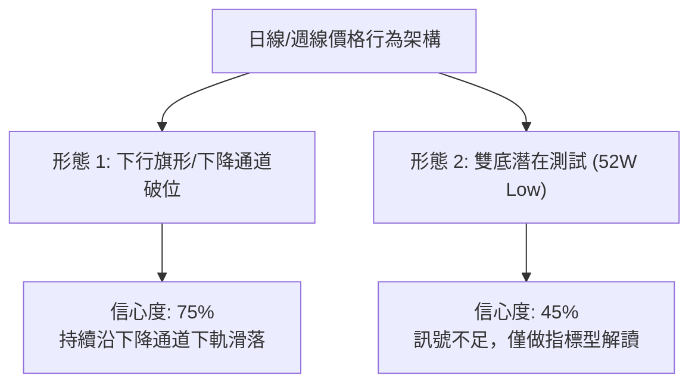
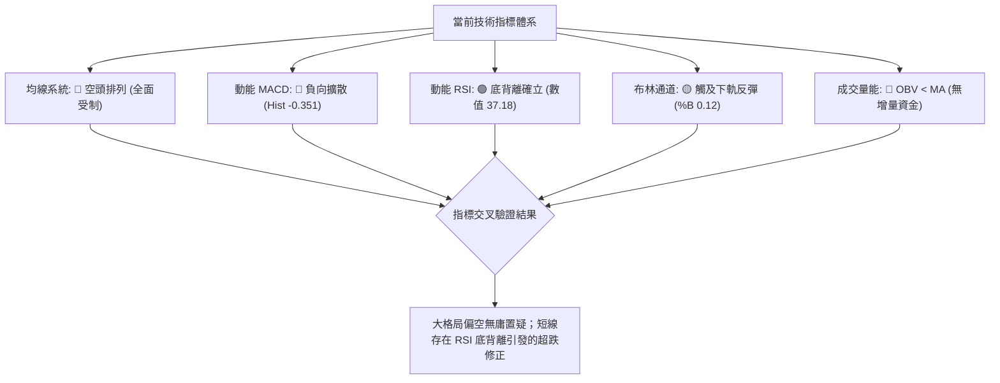
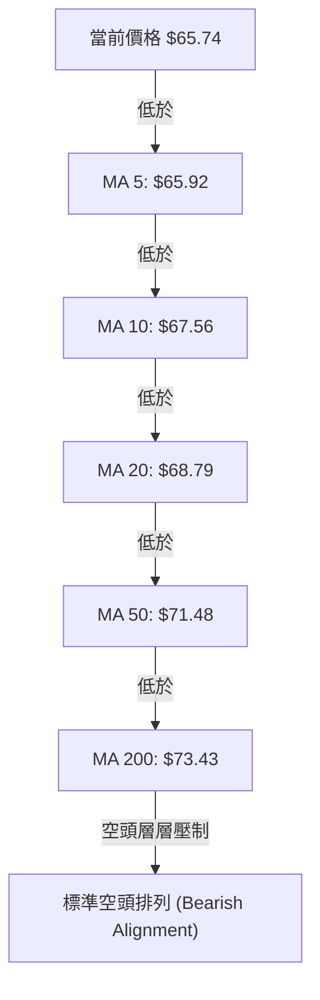
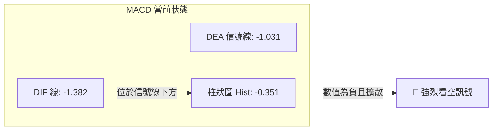
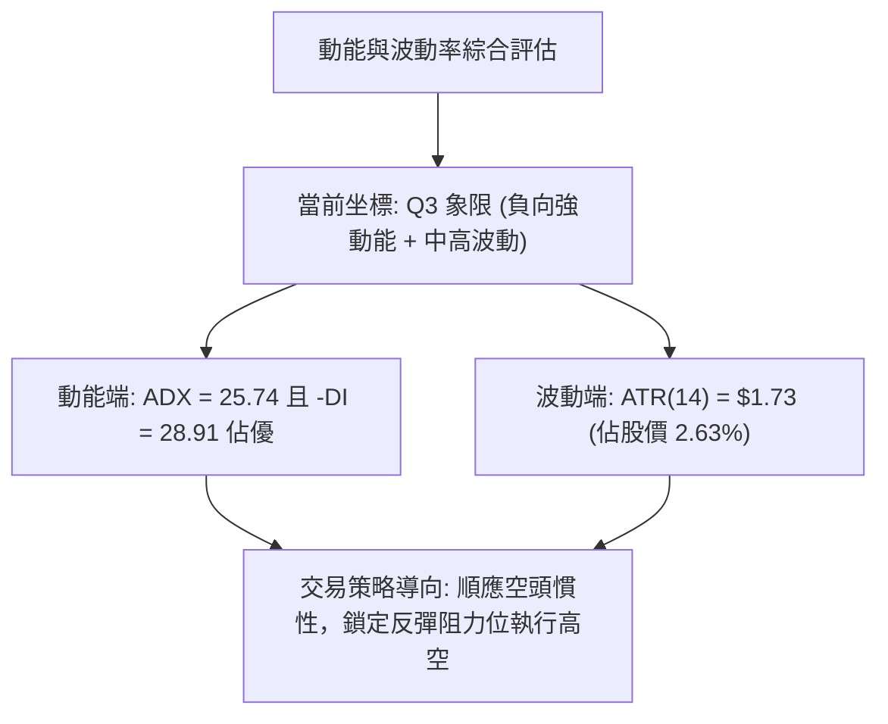
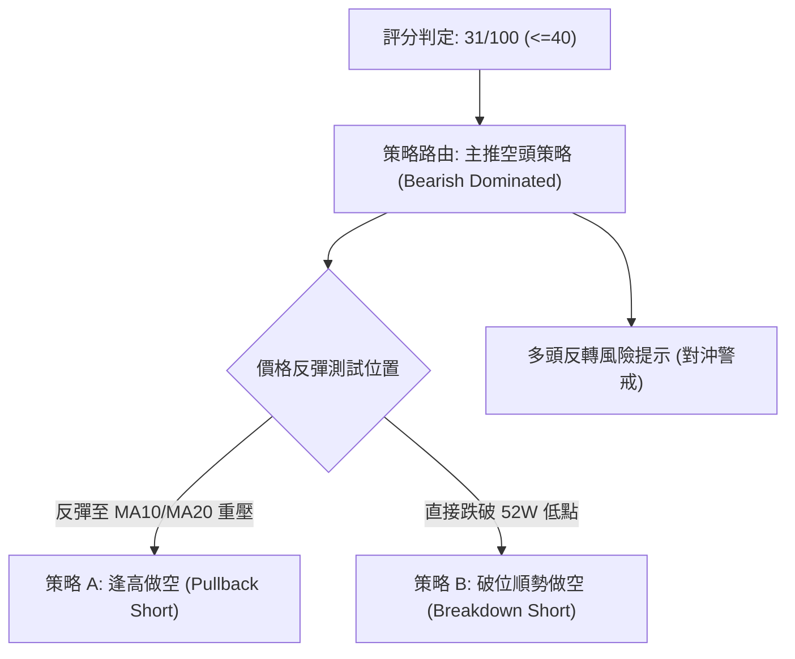
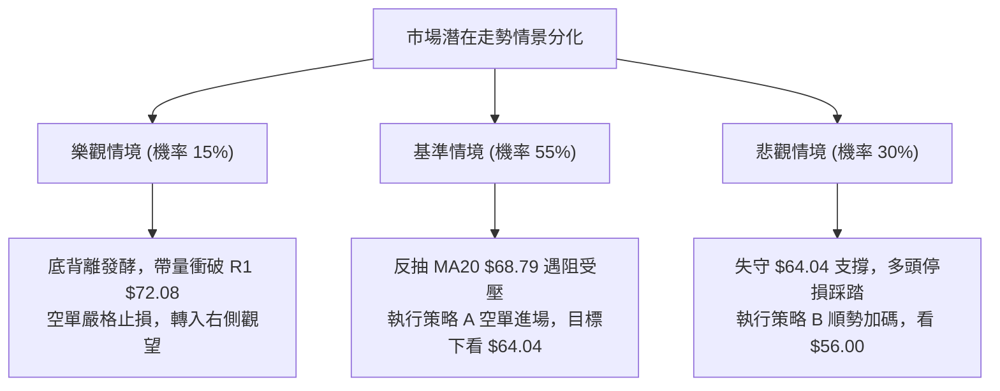

# UBER 技術分析報告

> **報告日期**：2026-10-30 ｜ **語言**：繁體中文 ｜ **數據來源**：Yahoo Finance ｜ **當前價格**：$65.74

---

## 目錄

| 章節 | 內容 |
|------|------|
| [1. 技術面概覽](#1-技術面概覽) | 訊號儀表板、核心指標、評分卡 |
| [2. 趨勢分析](#2-趨勢分析) | 多時框趨勢、長中短期走勢、ADX強度 |
| [3. 圖表形態分析](#3-圖表形態分析) | 形態識別、K線組合、目標價推算 |
| [4. 支撐與阻力](#4-支撐與阻力) | 關鍵價位、斐波那契回調結構 |
| [5. 技術指標深度解讀](#5-技術指標深度解讀) | MA/RSI/MACD/布林/成交量 |
| [6. 動能與波動率](#6-動能與波動率) | 動能象限、ATR波動率、Beta |
| [7. 多時框架總結](#7-多時框架總結) | 時框架評分矩陣、收斂結論 |
| [8. 交易策略建議](#8-交易策略建議) | 主策略詳情、情境階梯、風險報酬比 |
| [9. 風險提示與監控](#9-風險提示與監控) | 監控清單、風險情境、資金管理 |

---

## 1. 技術面概覽

### 🎯 技術訊號儀表板



### 📊 核心指標速覽表

| 指標類別 | 指標名稱 | 當前數值 | 訊號 | 解讀 |
|----------|----------|----------|------|------|
| **價格** | 當前價格 | $65.74 | 🔴 | 位於52週區間下緣 4.7%，接近波段極端低位 |
| **均線** | MA20 | $68.79 | 🔴 | 價格在MA20下方 -4.43%，短線下行斜率陡峭 |
| **均線** | MA50 | $71.48 | 🔴 | 價格在MA50下方 -8.03%，中期下行趨勢確認 |
| **均線** | MA200 | $73.43 | 🔴 | 價格在MA200下方 -10.47%，長期牛熊分界線失守 |
| **動能** | RSI(14) | 37.18 | 🟡 | 處於偏弱區間（30–70），但出現顯著底背離 |
| **動能** | MACD | -1.382 / -1.031 | 🔴 | 快慢線位於零軸下，柱狀圖 -0.351 維持發散看空 |
| **趨勢** | ADX(14) | 25.74 | 🔴 | 突破25強趨勢門檻，-DI(28.91) 遠高於 +DI(9.86) |
| **通道** | 布林通道 | %B = 0.12 | 🟡 | 運行於下軌($64.73)至中軌($68.79)間，下軌具防守彈性 |
| **波動** | ATR(14) | $1.73 | 🟡 | 佔股價 2.63%，每日波動幅度中等，風險可控 |
| **量能** | OBV | OBV < MA | 🔴 | 量能指標落後於均線，主力資金未見積極回補 |

### 🏆 技術評分卡

```
╔══════════════════════════════════════════════════════════════════╗
║                 技術評分卡 — UBER (2026-10-30)                   ║
╠══════════════════════════════════════════════════════════════════╣
║ 趨勢強度      █████░░░░░░░░░░░░░░░  25/100  🔴 空方絕對主導      ║
║ 動能指標      ███████░░░░░░░░░░░░░  35/100  🔴 零軸下負動能      ║
║ 支撐穩定度    ████████░░░░░░░░░░░░  40/100  🟡 考驗52W低點防線   ║
║ 成交量配合    ███████░░░░░░░░░░░░░  35/100  🔴 OBV疲軟量能不足   ║
║ 形態完整度    ███████░░░░░░░░░░░░░  35/100  🔴 下降通道尋底中    ║
║ 均線排列      ███░░░░░░░░░░░░░░░░░  15/100  🔴 嚴格空頭排列      ║
╠══════════════════════════════════════════════════════════════════╣
║ 綜合評分      ██████░░░░░░░░░░░░░░  31/100  🔴 明顯偏空 (<=40)   ║
╚══════════════════════════════════════════════════════════════════╝
```
*(註：綜合評分由六項子評分算術平均計算：(25 + 35 + 40 + 35 + 35 + 15) ÷ 6 = 30.83，四捨五入為 31/100，評級屬「偏空」，主策略方向鎖定反彈高空與空頭防守。)*

---

## 2. 趨勢分析

### 🌐 多時框趨勢分析



### 📈 長期趨勢 — 12個月走勢圖（Unicode）

以下為 UBER 過去 12 個月（2025-11 至 2026-10）收盤價歷史走勢圖：

```
UBER 月線收盤走勢圖（過去 12 個月：2025-11 至 2026-10）
價格軸 ($)
$96.50 ┤
$90.00 ┤ ● (2025-11: $87.54)
$85.00 ┤
$80.00 ┤    ●(12月: $81.71)  ●(01月: $80.05)
$75.00 ┤        ●(02月: $75.42)  ●(04月: $74.61)       ●(08月: $75.65)
$70.00 ┤            ●(03月: $71.93)  ●(05月: $70.40) ●(06月: $72.16) ●(07月: $70.36)  ●(09月: $68.51)
$65.00 ┤                                                                                 ●←現在 ($65.74)
$60.00 ┤
       └─────────────────────────────────────────────────────────────────────────────
         11    12    01    02    03    04    05    06    07    08    09    10 (月份)
        (2025)                      (2026 年)
```

**走勢特徵分析表格**：

| 階段區間 | 起始至結束收盤價 | 漲跌幅 | 結構特徵與走勢解讀 |
|----------|------------------|--------|--------------------|
| **階段一：見頂回落期**<br>(2025-11 ~ 2026-01) | $87.54 → $80.05 | -8.56% | 自 2025 年 9 月高位（歷史高點附近 $97.97）加速跌破 $90 大關，呈現第一波獲利回吐。 |
| **階段二：中繼震盪期**<br>(2026-02 ~ 2026-07) | $75.42 → $70.36 | -6.71% | 於 $70.00 至 $75.00 區間反覆拉鋸，成交量逐漸萎縮，均線系統開始由糾纏轉向空頭發散。 |
| **階段三：假突破與破位**<br>(2026-08 ~ 2026-10) | $75.65 → $65.74 | -13.10% | 8 月反彈至 $78.82 遇阻，9 月跌破 $70 整數關卡，10 月直接下探 52 週最低點 $64.04。 |

### 📊 中期趨勢（週線分析）

從近 20 週收盤走勢觀察，UBER 呈現明確的「下降階梯」形態。2026 年 8 月底兩次觸及 $78.80–$78.82 高點後，週線 MACD 柱狀圖迅速翻負，並伴隨連續 8 週的下行。

```
週線關鍵攻防壓力與支撐示意圖
══════════════════════════════════════════════════════════════
 $78.82 ───────────────────────────────────── 近期波段最高點阻力
          \
           \  $75.02 (8月初反彈頸線)
            \───\
                 \  $72.08 (10月09日週高點反彈阻力 R1)
                  \───\
                       \  $68.79 (MA20 週線級別下壓位)
                        \───\
                             \  $65.74 ◄── 當前收盤價
                              \───────────────────────
                               $64.04 ──────── 52週低點強支撐防線
══════════════════════════════════════════════════════════════
```

### ⚡ 趨勢強度評估（ADX 解讀）



**ADX 強度對照與解讀表**：

| 指標名稱 | 當前數值 | 門檻標準 | 狀態評估 | 實質交易意義 |
|----------|----------|----------|----------|--------------|
| **ADX(14)** | **25.74** | > 25.0 | 🔴 強趨勢 | 市場脫離橫盤震盪，進入單邊趨勢階段，順勢策略勝率顯著高於逆勢策略。 |
| **+DI(14)** | **9.86** | < 15.0 | 🔴 極度疲弱 | 多方進攻動能衰竭，買盤僅具被動防禦能力，缺乏主動推升價格的意願。 |
| **-DI(14)** | **28.91** | > 25.0 | 🔴 空方主導 | 空方賣壓沉重且具持續性，價格下行推動力充沛。 |
| **DI 差值** | **-19.05** | < -10.0 | 🔴 空頭擴散 | 空多差距極大，未見收斂跡象，確立空頭行情延續。 |

---

## 3. 圖表形態分析

### 🔍 形態識別系統



**圖表形態信心度與目標價評估表**：

| 形態名稱 | 信心度 | 判斷依據（引用數據） | 完成度 | 目標價（附計算式） |
|----------|--------|----------------------|--------|--------------------|
| **下降通道延續形態** | **75%** | 價格自 2026-08 高點 $78.82 逐波走低，受制於 MA20（$68.79）與阻力位 R1（$72.08），均線呈現標準下行排列。 | 85% | **$56.00**<br>計算式：由下降區間高度推算，波段高點 $72.08 − 52W低點 $64.04 = 形態高度 $8.04；若跌破 $64.04，目標價 = $64.04 − $8.04 = $56.00。 |
| **潛在雙重底形態** | **40%** | 2026-10-29 探底至 52W 低點 $64.04 獲得支撐收長下影線，但頸線尚未確認。 | 30% | **訊號不足，僅做指標型解讀**（信心度 < 50%，依規則 15 不得強行預設多頭翻轉目標價）。 |

### 🕯️ 重要K線形態分析

嚴格依據數據中「近10根日K」與「近8根週K」之開、高、低、收數據進行幾何識別：

**近10根日K形態精確解析**：

| 日期（日K） | 開 | 高 | 低 | 收 | K線形態 | 解讀 | 訊號 |
|-------------|----|----|----|----|---------|------|------|
| **2026-10-16** | 71.00 | 71.86 | 69.72 | 70.35 | 帶長上影小黑K | 向上挑戰阻力 R1($72.08) 未果，多頭衝高回落。 | 🔴 |
| **2026-10-19** | 70.13 | 70.76 | 69.77 | 69.96 | 窄幅陰線 | 跌破 $70 整數心理防線，買盤觀望。 | 🔴 |
| **2026-10-20** | 69.01 | 69.75 | 68.40 | 68.94 | 跳空低開小陰線 | 跳空低於 MA20($68.79)，均線壓力加重。 | 🔴 |
| **2026-10-21** | 69.01 | 69.23 | 67.36 | 67.62 | 中長黑K | 空方摜壓，實體跌破 $68，空頭動能擴散。 | 🔴 |
| **2026-10-22** | 67.45 | 69.15 | 67.33 | 69.07 | 帶長下影中陽K | 盤中反彈測試 MA20，但量能不足，屬超跌反抽。 | 🟡 |
| **2026-10-23** | 68.47 | 68.90 | 66.43 | 66.70 | 長黑實體吞噬 | 吞噬前一日陽線實體，破位下行，空方完全控盤。 | 🔴 |
| **2026-10-26** | 66.62 | 67.00 | 65.68 | 66.13 | 弱勢下挫陰K | 成交量放大至 2,205 萬股，恐慌拋補盤湧現。 | 🔴 |
| **2026-10-27** | 66.40 | 66.50 | 65.47 | 65.78 | 下挫小陰K | 逼近支撐位 S1($65.41)，下行速率略有減緩。 | 🔴 |
| **2026-10-28** | 65.50 | 65.88 | 64.69 | 65.27 | 陰線十字星破位 | 實體跌破 S1，最低來到 $64.69，直逼 52 週低點。 | 🔴 |
| **2026-10-29** | 65.28 | 65.80 | 64.04 | 65.74 | **探底錘頭陽K (Hammer)** | 最低下探 52W 低點 $64.04 後強烈回抽收於 $65.74，形成長下影線（長度 $1.24），短線具技術反彈契機。 | 🟢 |

**近8根週K形態精確解析**：

| 日期（週K） | 開 | 高 | 低 | 收 | K線形態 | 解讀 | 訊號 |
|-------------|----|----|----|----|---------|------|------|
| **2026-09-11** | 75.61 | 75.61 | 69.24 | 71.67 | 實體大黑K (禿頭) | 破位跌穿 $75，量達 1.08 億股，確立週線中期轉弱。 | 🔴 |
| **2026-09-18** | 71.97 | 72.80 | 70.06 | 70.50 | 縮量十字星陰K | 跌勢暫歇，但高點未碰觸前週中軸，弱勢整理。 | 🔴 |
| **2026-09-25** | 70.82 | 71.90 | 68.55 | 69.62 | 連續第三週黑K | 跌破 $70.00，空頭階梯下行。 | 🔴 |
| **2026-10-02** | 69.36 | 69.97 | 67.22 | 68.11 | 下探長黑K | 創近數月波段新低 $67.22，空方持續宣洩。 | 🔴 |
| **2026-10-09** | 68.40 | 72.08 | 68.00 | 71.51 | 反彈中陽K | 向上衝高至 $72.08（形成阻力 R1），多頭短暫反撲。 | 🟢 |
| **2026-10-16** | 71.16 | 71.86 | 68.62 | 70.35 | 上影陰K | R1 處遭受空方強烈反擊，反彈宣告終結。 | 🔴 |
| **2026-10-23** | 70.13 | 70.76 | 66.43 | 66.70 | 實體長黑破位K | 吞噬前兩週整理平台，加速下墜。 | 🔴 |
| **2026-10-29** | 66.62 | 67.00 | 64.04 | 65.74 | **探底帶長下影週K** | 測試 52W 低點 $64.04 後留下 $1.70 長下影線，顯示極限支撐處有特定買盤承接。 | 🟡 |

### 📉 ASCII 走勢形態示意圖

```
日線級別「下降楔形 / 探底長下影」形態示意圖
══════════════════════════════════════════════════════════════════
$72.08 ───● (10/09 高點 R1)
           \
            \
$70.35 ──────● (10/16 反抽高點)
              \
               \   $69.07 (10/22 假突破)
                \──●
                    \
$66.70 ──────────────● (10/23 破位大黑棒)
                      \
                       \
$65.74 ─────────────────● ◄── 現價（10/29 探底回升）
                        │
$64.04 ─────────────────┴─── 52W 低點測試防線（下影線極值）
══════════════════════════════════════════════════════════════════
```

### 🎯 形態目標價計算

針對日線與週線的下降通道形態進行嚴格幾何推算：
- **形態上軌阻力（頸線參考點）**：2026-10-09 波段高點 **$72.08**（阻力位 R1）
- **形態基底支撐點**：52 週最低點 **$64.04**（亦為 100.0% 斐波那契回調位）
- **形態垂直高度**：$72.08 − $64.04 = **$8.04**
- **下行破位量度目標價**：
  $$\text{目標價} = \text{基底支撐} - \text{形態高度} = \$64.04 - \$8.04 = \mathbf{\$56.00}$$
- **反彈向上量度阻力**：若自 $64.04 啟動技術性修正，其首要極限反彈目標為形態通道中軌 MA20 所在的 **$68.79**。

---

## 4. 支撐與阻力

### 🗺️ 關鍵價位分布圖（Unicode）

```
UBER 價位結構分布圖
══════════════════════════════════════════════════════════════════
$78.60 ║████████████████████████████████║ 強阻力 R3 (近一年波段高點)
$76.30 ║██████████████████████          ║ 阻力 R2 (反彈中繼壓力位)
$72.08 ║████████████████████████████    ║ 關鍵阻力 R1 (10/09 反彈高點)
$71.81 ║▓▓▓▓▓▓▓▓▓▓▓▓▓▓▓▓▓▓▓▓▓▓          ║ 78.6% 斐波那契回調位
$68.79 ║────────────────────────────────║ MA20 / 布林中軌下壓線
$65.74 ╠════════════════════════════════╣ ◄ 當前收盤價
$65.41 ║▓▓▓▓▓▓▓▓▓▓▓▓                    ║ 近期支撐 S1 (近一年波段低點)
$64.04 ║████████████████████████████████║ 極限強支撐 (52W Low / 100% Fib)
══════════════════════════════════════════════════════════════════
```

### 🚧 阻力位分析表

價位嚴格引用自數據區塊中波段高點聚類所得之真實數值：

| 阻力級別 | 價位 | 距現價幅動 | 形成原因與籌碼特徵 | 突破難度 | 重要性 |
|----------|------|------------|--------------------|----------|--------|
| **R1** | **$72.08** | +9.64% | 2026-10-09 週波段高點，密集成交套牢區，且貼近 MA60($72.18) 與 MA120($72.16)。 | 🔴 極高 | ★★★★★ |
| **R2** | **$76.30** | +16.06% | 2026-06 月底波段反彈高點聚類區，61.8% 斐波那契回調位($77.91)前哨站。 | 🔴 高 | ★★★★☆ |
| **R3** | **$78.60** | +19.56% | 2026-08 月底波段雙頂高點（$78.80–$78.82）籌碼防線，中期強阻力。 | 🔴 極高 | ★★★★★ |

### 🛡️ 支撐位分析表

價位嚴格引用自數據區塊中波段低點聚類與 OHLCV 計算所得之數值：

| 支撐級別 | 價位 | 距現價幅動 | 形成原因與籌碼特徵 | 守住機率 | 重要性 |
|----------|------|------------|--------------------|----------|--------|
| **S1** | **$65.41** | -0.50% | 近一年波段低點聚類位，近 3 個交易日反覆爭奪的短線分水嶺。 | 🟡 45% | ★★★☆☆ |
| **52W Low** | **$64.04** | -2.59% | 過去 52 週絕對最低點（2026-10-29 盤中低點驗證），全體多頭最後防線。 | 🟢 55% | ★★★★★ |
| **S2 / S3** | N/A | N/A | **數據中未偵測到**（依規則 13，系統聚類未產生低於 $64.04 之歷史聚類低點）。 | — | — |

### 📐 斐波那契回調位分析

依據 52 週波動區間（高點 $100.35 → 低點 $64.04，垂直跨度 $36.31）計算之標準斐波那契回調位如下：

| 斐波那契級別 | 精確價位 | 相對現價位置 | 技術意義解讀 |
|--------------|----------|--------------|--------------|
| **0.0% (52W High)** | $100.35 | +52.65% | 過去 52 週牛市頂峰，長線重度阻力。 |
| **23.6%** | $91.78 | +39.61% | 長期多頭回撤第一防線（已於 2025 年末跌破）。 |
| **38.2%** | $86.48 | +31.55% | 經典回調位，轉為長期重壓。 |
| **50.0%** | $82.19 | +25.02% | 籌碼中位平衡線，長期多空分水嶺。 |
| **61.8%** | $77.91 | +18.51% | 黃金分割防守位，貼近 8 月反彈高點 $78.82。 |
| **78.6%** | $71.81 | +9.23% | 深幅回調極限位，與阻力 R1（$72.08）高度重合形成共振壓力帶。 |
| **100.0% (52W Low)**| $64.04 | -2.59% | 完整回撤原點，雙重底頸線防線。 |

**現價區間解讀**：
當前收盤價 **$65.74** 緊密夾在 **78.6% 回調位（$71.81）** 與 **100.0% 低點（$64.04）** 之間，僅高出 100% 斐波那契低點 2.59%。這表明 UBER 已經回吐了過去一整年的全部漲幅。若 $64.04 失守，價格將跌入無任何歷史籌碼支撐的「真空破位區」；若守穩，則具備向 78.6% 回調位（$71.81）發起修復性抽頭的彈性空間。

---

## 5. 技術指標深度解讀

### 🎛️ 指標訊號總覽



### 📈 移動平均線排列分析



**移動平均線詳細數據表**：

| 均線名稱 | 數值 | 距現價差距 (%) | 排列狀態 | 走勢評估 |
|----------|------|----------------|----------|----------|
| **MA 5** | $65.92 | -0.28% | 價格下方壓制 | 短線極限下壓，近 2 日開始走平。 |
| **MA 10** | $67.56 | -2.69% | 價格下方壓制 | 第一道短線反彈動態阻力線。 |
| **MA 20** | $68.79 | -4.43% | 價格下方壓制 | 月線生命線，布林帶中軌，重要空頭防守點。 |
| **MA 50** | $71.48 | -8.03% | 價格下方壓制 | 季線下行，中期趨勢完全受阻。 |
| **MA 60** | $72.18 | -8.92% | 價格下方壓制 | 與阻力位 R1($72.08) 形成重疊共振帶。 |
| **MA 120** | $72.16 | -8.90% | 價格下方壓制 | 半年線持續下墜。 |
| **MA 200** | $73.43 | -10.47% | 價格下方壓制 | 年線失守，長期走勢進入空頭循環。 |
| **MA 240** | $75.38 | -12.79% | 價格下方壓制 | 超長期平均成本下彎。 |

### 📉 RSI(14) 分析

當前 RSI(14) 數值為 **37.18**（處於弱勢中性區間 30–70）：

```
RSI(14) 數值進度條：
[0] ────────── [30] ──────●───── [70] ────────── [100]
超賣區          37.18 (當前位置)          超買區
進度：███████░░░░░░░░░░░░░ (37.18%)
```

- **超買超賣狀態評估**：RSI 位於 37.18，脫離了極端超賣區（<30），但仍受制於 50 多空分界線之下，表明市場空方慣性依然存在。
- **背離分析（重要）**：
  - **形態事實**：技術快照明確標示「⚠️ **底背離 (Bullish Divergence)**（僅比較近20根K棒首尾的價格與RSI方向）」。
  - **數據印證**：在近 20 根日 K 中，價格由 $71.00 附近一路震盪走低至最低點 $64.04（價格創波段新低），然而 RSI 指標線低點未同步跌破前期低位，形成了價格創新低而動能未創新低的「底背離」。
  - **結論**：底背離表明下行動能正在衰退，短期內單邊殺跌風險降低，極易誘發向 MA20（$68.79）的技術性反抽。

### 📊 MACD(12/26/9) 訊號解讀



- **MACD 線與信號線**：DIF (-1.382) 深度運行於 DEA (-1.031) 與零軸之下，反映出中長線動能嚴重受挫。
- **柱狀圖 (Histogram)**：最新數值為 **-0.351**。負值擴大表明近兩週賣盤加速釋放，尚未出現紅柱收斂的拐點信號，空方仍掌控主導權。

### 📦 布林通道分析

```
UBER 布林通道當前狀態（日線級別）
══════════════════════════════════════════════════════════════
$72.85 ───────────────────────────────── 上軌 (Upper Band)
          
$68.79 ───────────────────────────────── 中軌 (Middle Band = MA20)
                                         
$65.74 ─────────● 現價 (BB %B = 0.12)
$64.73 ───────────────────────────────── 下軌 (Lower Band)
══════════════════════════════════════════════════════════════
```

- **通道帶寬與位置**：通道上軌 $72.85，中軌 $68.79，下軌 $64.73。
- **指標數值解讀**：**BB %B = 0.12**。數值極低（0 代表下軌，0.5 代表中軌），顯示股價緊貼下軌運行，屬於嚴重的「超賣壓軌」狀態。
- **實戰意涵**：股價在下軌 $64.73 獲得微幅支撐，與 52W 低點 $64.04 構成雙重防禦緩衝區，短線具備回歸中軌 $68.79 的均值回歸拉力。

### 💹 成交量分析（量價配合度）

- **量能統計**：最新單日成交量為 **16,244,900 股**，與 20 日均量 **16,106,810 股** 相比，量比為 **1.01x**，呈現典型的常態換手。
- **OBV 能量潮解讀**：技術快照標註「**OBV < MA → 量能疲弱**」。當前 OBV 運行在均線下方，這表明在過去兩週的下挫過程中，成交量萎縮反映的不是「惜售」，而是場外主力資金進場意願極度低迷。量能未能確認價格底部，任何反彈若無 2,000 萬股以上的放量配合，皆視為無基反彈。

---

## 6. 動能與波動率

### ⚡ 動能評估四象限

| 象限 | 動能強度 | 波動率水準 | 當前狀態判定 | 戰略應對方針 |
|------|----------|------------|--------------|--------------|
| **Q1 (最佳擴張)** | 強 (RSI>60, MACD>0) | 低 (ATR<2%) | — | 主升段多頭強勢持有 |
| **Q2 (盤整蟄伏)** | 弱 (RSI<40, MACD<0) | 低 (ATR<2%) | — | 窄幅箱體沉悶觀望 |
| **Q3 (風險釋放)** | 強 (負向動能大, ADX>25) | 高 (ATR>2.5%) | **✓ 當前狀態 (Q3)** | **趨勢破位階段：偏空防禦，逢高做空** |
| **Q4 (恐慌出清)** | 弱 (動能指標背離) | 極高 (ATR>4%) | — | 尋找左側極限擊球點 |



### 📊 ATR 波動率分析

- **ATR(14) 數值**：**$1.73**（以收盤價 $65.74 計算，日波動幅度為 **2.63%**）。
- **停損距離設定指引**：
  - **保守型（中長線）**：採用 2.0 倍 ATR = $1.73 × 2 = **$3.46**。
  - **進取型（短線交易）**：採用 1.2 至 1.5 倍 ATR = $1.73 × 1.5 = **$2.60**。
  - **目前防禦緩衝**：現價 $65.74 距離 52W 低點 $64.04 僅 **$1.70**（剛好約為 1.0 倍 ATR），說明短線多頭防禦空間已被壓縮至極致，極易因常規日波幅而被掃出場。

### 📐 Beta 與市場相關性

- **Beta 數值**：**1.265**。
- **市場敏感度解讀**：UBER 屬於典型的高彈性科技與互聯網出行標的，其波動幅度比標普 500 指數高出 26.5%。在美股大盤環境動盪或科技板塊承壓時，UBER 將放大下行跌幅；但在技術性反彈時，亦能提供超額的短期波動空間。

---

## 7. 多時框架總結

### 📋 時框架評分表

| 時框架 | 趨勢方向 | 動能狀態 | 均線排列 | 形態結構 | 綜合評分 | 戰略建議 |
|--------|----------|----------|----------|----------|----------|----------|
| **月線層級** | 🔴 偏空轉弱 | MACD零軸下滑 | MA60承壓 | 自高點下落階梯 | 35/100 | 長線資金離場觀望 |
| **週線層級** | 🔴 強烈空頭 | ADX>25 空方主導 | 均線空頭排列 | 下降通道下軌測試 | 25/100 | 中期反彈逢高減碼 |
| **日線層級** | 🟡 超跌反彈 | RSI 底背離 | 嚴格空頭排列 | 探底長下影錘頭 | 38/100 | 短線博弈需極快止盈 |

### 🔲 綜合訊號矩陣

```
訊號維度對照表：
┌──────────────┬──────────────┬──────────────┬──────────────┐
│  分析週期    │  趨勢信號    │  動能信號    │  量價結構    │
├──────────────┼──────────────┼──────────────┼──────────────┤
│  長期 (月線) │  🔴 空頭形成 │  🔴 柱狀擴散 │  🔴 縮量陰跌 │
│  中期 (週線) │  🔴 空方控盤 │  🔴 -DI dominant│  🔴 跌破頸線 │
│  短期 (日線) │  🔴 下行通道 │  🟢 底背離   │  🟡 平量測試 │
└──────────────┴──────────────┴──────────────┴──────────────┘
```

### ⚖️ 多時框收斂結論

嚴格遵循多時框收斂規則（規則 14）：
1. **行情屬性判定**：當前 ADX(14) 為 **25.74 > 25**，客觀確立市場處於**單邊趨勢行情**而非無序盤整行情。
2. **時框優先級收斂**：在趨勢行情下，分析必須以**中長期（週線 / MA50 / MA200）方向為主導**。週線級別均線排列嚴格偏空，-DI(28.91) 牢固主導下行趨勢；日線級別雖然出現 RSI 底背離與 10/29 探底長下影線，但依優先級規則，**日線僅能用來尋找進場反彈做空或超跌空單回補的最佳時機，絕對不得推翻週線與長期的空頭方向**。
3. **唯一方向性結論**：**整體格局強烈偏空（整體評分 31/100）**。一切操作邏輯均圍繞「順應空頭、反彈至均線阻力處放空」展開，嚴禁盲目將日線超跌視為反轉信號。

---

## 8. 交易策略建議

### 🗺️ 策略決策流程圖



### 🧭 策略路由（依評分卡分流）

> **當前主策略方向 = 主推空頭策略（依綜合評分 31/100，低於 40 分標準分流線）**
> *多頭操作僅列為反轉風險觸發點與對沖參考，不作為主流配置建議。*

### 🎯 價格情境階梯（Price Scenarios）

價位嚴格引用自「關鍵價位」與斐波那契回調計算所得之真實數據：

| 觸發條件 | 下一目標 | 後續延伸 | 情境含義與操作指引 |
|----------|----------|----------|--------------------|
| **向上反抽觸及 MA20** ($68.79) | 阻力位 R1 ($72.08) | 78.6% Fib ($71.81) | 技術性回抽阻力位，空方最佳二次加碼放空點。 |
| **現價區間震盪** ($65.41–$65.74) | MA10 ($67.56) | 布林下軌 ($64.73) | 底部鈍化拉鋸，觀察 RSI 底背離能否轉化為反抽。 |
| **下行跌破 52W 低點** ($64.04) | 形態量度目標 ($56.00) | N/A | 極限支撐破位，多頭全線潰敗，開啟新一輪主跌段。 |

### 📊 情境機率分佈

| 發展情境 | 發生機率 | 主要技術與量化依據 |
|----------|----------|--------------------|
| **情境一：弱勢反抽後回落** | **55%** | RSI(14) 存在底背離，布林通道 %B 僅 0.12，短線超跌引發抽頭；但 ADX 達 25.74 且均線全面空頭排列，中軌 $68.79 處必遭空方迎頭痛擊。 |
| **情境二：直接破位下墜** | **30%** | MACD 柱狀圖 -0.351 負向擴散，OBV 指標持續疲弱，市場缺乏主力買盤支撐，$64.04 若失守將直接引發連環停損賣壓。 |
| **情境三：V型強勢反轉** | **15%** | 需連續帶量突破阻力位 R1（$72.08）並扭轉週線空頭排列，目前籌碼與動能數據完全不支援該情境。 |

### 🟢 主策略詳情（空頭專屬策略）

所有價位均取自關鍵價位與均線，風險報酬比公式嚴格按規則 17 執行：
$$\text{做空風險報酬比} = \frac{\text{進場價} - \text{目標價 T1}}{\text{止損價} - \text{進場價}}$$

| 策略要素 | 策略 A（反彈逢高做空 — 首選） | 策略 B（反抽 MA10 阻力做空 — 次選） |
|----------|--------------------------------|--------------------------------------|
| **進場條件** | 價格反彈至布林中軌 / MA20 承壓受阻時進場 | 價格小幅回抽 MA10 遇阻回落時直接進場 |
| **進場價格** | **$68.79** (MA20 / 布林中軌) | **$67.56** (MA10 阻力位) |
| **目標價 T1** | **$64.04** (52 週最低點 / 100% Fib) | **$64.04** (52 週最低點 / 100% Fib) |
| **目標價 T2** | **$56.00**（由下降形態高度推算：$64.04 − $8.04） | **$56.00**（由下降形態高度推算：$64.04 − $8.04） |
| **止損價格** | **$72.08** (阻力位 R1) | **$68.79** (MA20 阻力位) |
| **風險報酬比** | **1 : 1.44（以 T1 計）**<br>*(計算：(68.79−64.04) ÷ (72.08−68.79) = 4.75 ÷ 3.29 = 1.44)*<br>*(以 T2 計：(68.79−56.00) ÷ 3.29 = 1 : 3.89)* | **1 : 2.86（以 T1 計）**<br>*(計算：(67.56−64.04) ÷ (68.79−67.56) = 3.52 ÷ 1.23 = 2.86)*<br>*(以 T2 計：(67.56−56.00) ÷ 1.23 = 1 : 9.40)* |
| **成功機率** | **65%** | **55%** |
| **建議倉位** | **15% - 20%**（標準空頭倉位） | **10%**（輕倉試單） |

### 🔴 反向風險觸發點（對沖與停損提示）

若出現以下情境，則本報告主推之空頭策略被技術性推翻，空單必須立即無條件止損出局：
1. **價格強勢站穩阻力位 R1 ($72.08) 之上**：代表日線下降通道遭實體陽線向上突破，空頭結構被破壞。
2. **日線 MACD 零軸下出現黃金交叉且柱狀圖翻紅**：代表下行動能徹底耗盡，轉為多頭反撲。
3. **成交量突破 2,500 萬股伴隨長陽包覆**：出現放量吞噬形態，主力籌碼進場接盤。

### ⭐ 整體訊號強度評星

```
╔══════════════════════════════════════════════════════════════╗
║ 做多訊號強度：★☆☆☆☆  (1/5星 — 僅具技術性底背離超跌反抽)    ║
║ 做空訊號強度：★★★★☆  (4/5星 — 順應ADX強趨勢與均線空頭排列)  ║
║ 整體可信度：  ★★★★☆  (4/5星 — 多時框訊號一致性收斂良好)    ║
╚══════════════════════════════════════════════════════════════╝
```

---

## 9. 風險提示與監控

### ✅ 關鍵監控指標 Checklist

```
╔══════════════════════════════════════════════════════════════════╗
║                     每日交易監控 Checklist                       ║
╠══════════════════════════════════════════════════════════════════╣
║ [ ] 價位端：收盤價是否有效擊穿 52W 低點 $64.04？                  ║
║ [ ] 均線端：MA5 ($65.92) 與 MA10 ($67.56) 下降斜率是否趨緩？     ║
║ [ ] 動能端：日線 RSI(14) 底背離是否轉化為突破 50 中軸？          ║
║ [ ] 指標端：MACD 柱狀圖是否收斂至 -0.100 以內醞釀金叉？          ║
║ [ ] 量能端：單日成交量是否異常放大至 2,000 萬股以上異動？         ║
║ [ ] 波動端：日內高低點波動是否突破 ATR 1.5 倍 ($2.60) 觸發警報？  ║
╚══════════════════════════════════════════════════════════════════╝
```

### ⚠️ 風險場景分析



### 🛡️ 風險管理重要提醒

1. **嚴禁單純因「價格跌深」而左側接刀**：當前 ADX 為 25.74 且 -DI 為 28.91，表明趨勢殺傷力依然強大。在下降趨勢中，「超賣」往往可以持續鈍化數週，逆勢抄底極易遭遇主跌浪碾壓。
2. **嚴格執行資金管理與部位控制**：
   - 單筆空頭交易風險承擔額度嚴格限制在**總投資組合資金的 1.0%–1.5%** 以內。
   - 依 ATR(14) = $1.73 計算，建議進場手數公式為：
     $$\text{最大交易股數} = \frac{\text{總投資組合淨值} \times 1\%}{\text{止損價} - \text{進場價}}$$
3. **事件驅動風險防範**：需密切留意即將發布的第三季（Q3）財報數據與競對動態（DoorDash、Instacart 競爭加劇與 FTC 調查），避免在重大財報公告前夕持有重倉無保護部位。

---

## 📋 報告總結

```
╔══════════════════════════════════════════════════════════════════╗
║                     UBER 技術分析報告總結                        ║
╠══════════════════════════════════════════════════════════════════╣
║ 報告日期：2026-10-30                                             ║
║ 當前價格：$65.74                                                 ║
║ 分析評級：🔴 強烈偏空 / 反彈做空 (綜合評分: 31/100)              ║
║                                                                  ║
║ 關鍵結論：                                                       ║
║ ├─ 長期趨勢：🔴 偏空回調，股價回吐過去一年全部漲幅               ║
║ ├─ 中期趨勢：🔴 下降通道完好，ADX(25.74) 確立單邊下行結構       ║
║ ├─ 短期趨勢：🟡 RSI 底背離 + 10/29 探底長下影線，醞釀技術抽頭    ║
║ ├─ 關鍵支撐：$65.41 (S1) / $64.04 (52W Low 強支撐)               ║
║ ├─ 關鍵阻力：$68.79 (MA20) / $72.08 (波段高點阻力 R1)            ║
║ └─ 華爾街目標：$100.86 (基本面分析師共識均價，僅供參照)          ║
║                                                                  ║
║ 最優策略組合：                                                   ║
║ 1. 🥇 最佳機會：策略 A (反彈至 MA20 $68.79 放空，止損 $72.08，   ║
║                目標 $64.04，風報比 1 : 1.44)                    ║
║ 2. 🥈 次選機會：策略 B (反抽 MA10 $67.56 放空，止損 $68.79，   ║
║                目標 $64.04，風報比 1 : 2.86)                    ║
║ 3. 🥉 保守選擇：場外空倉觀望，耐心等待價格跌破 $64.04 或放量     ║
║                突破 $72.08 確立方向後再行介入                   ║
╚══════════════════════════════════════════════════════════════════╝
```

---

> ⚠️ **免責聲明**：本報告為依據標準技術分析模型與歷史量價數據生成之專業研報，所有分析與數據推算僅供學術研究與參考之用，**絕不構成任何形式的要約、邀請或投資建議**。金融市場瞬息萬變，技術指標存在滯後性與失效風險，投資人應獨立評估風險，自負盈虧。

---
*報告生成時間：2026-10-30 ｜ 數據來源：Yahoo Finance ｜ 分析框架：多時框技術分析模型*