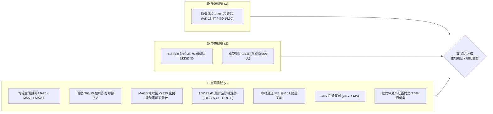
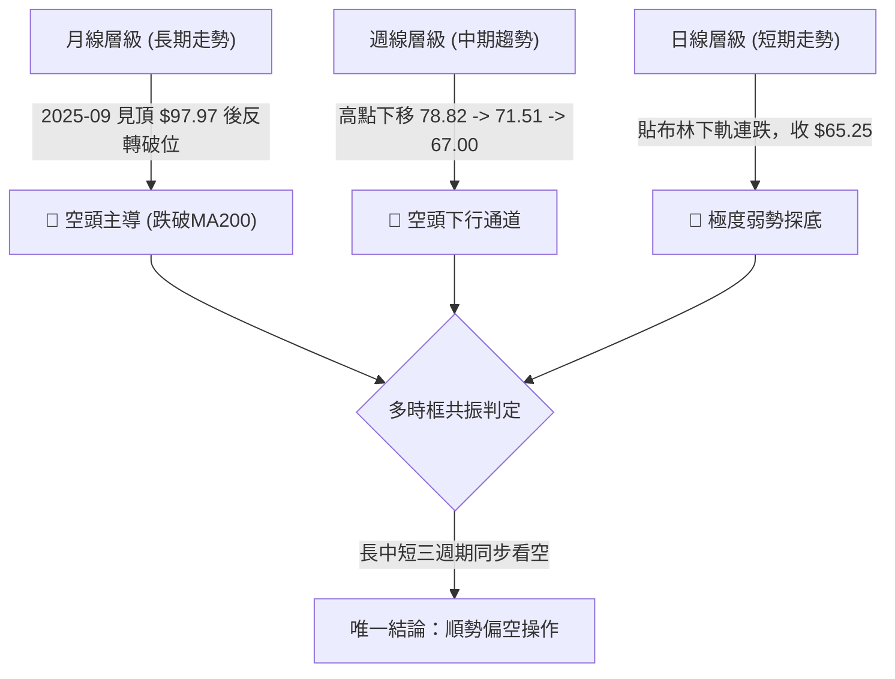
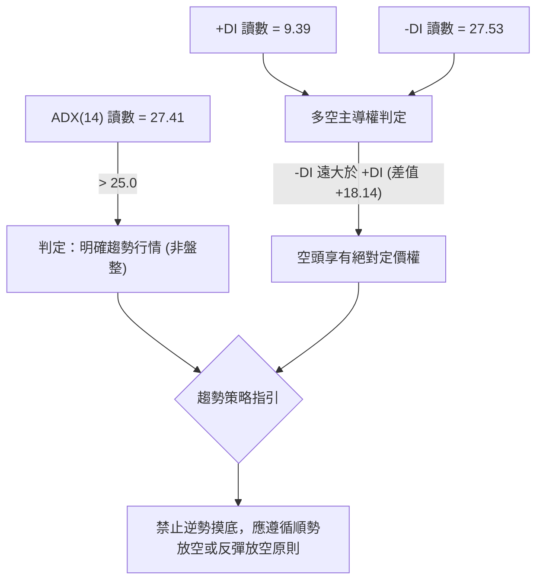
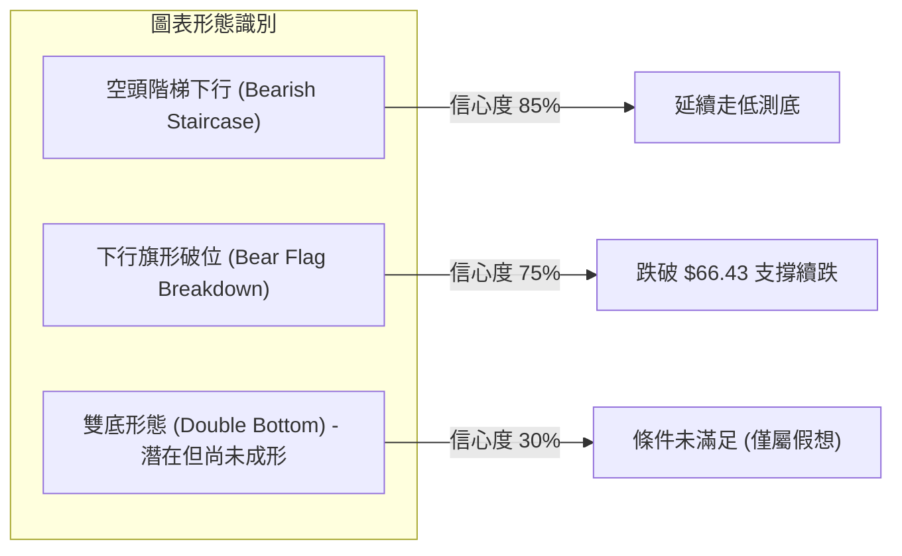
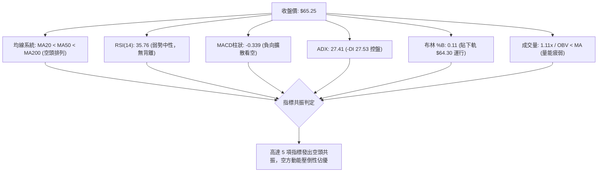
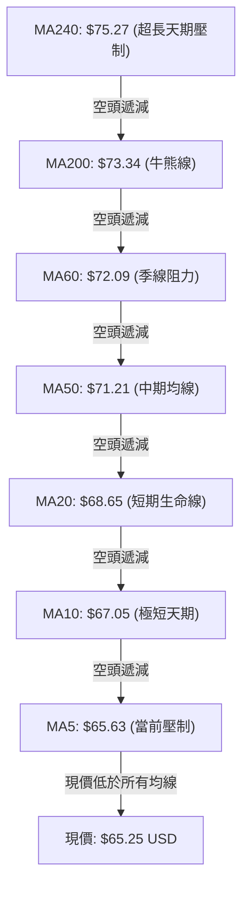
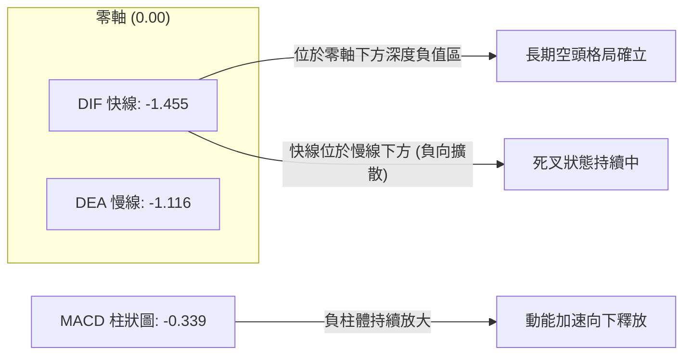
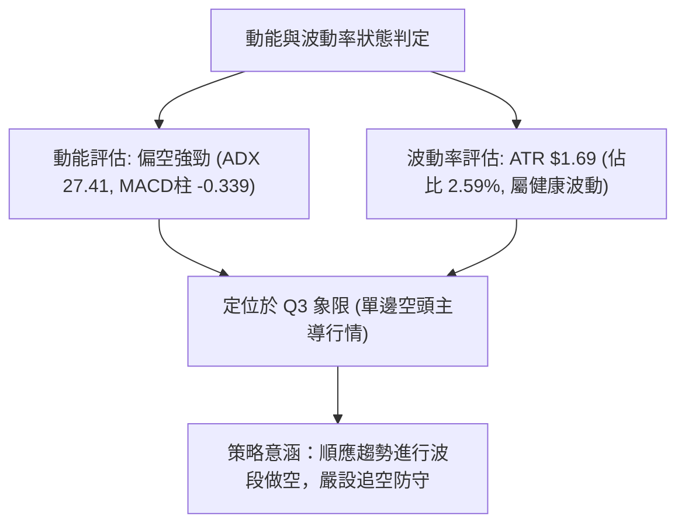
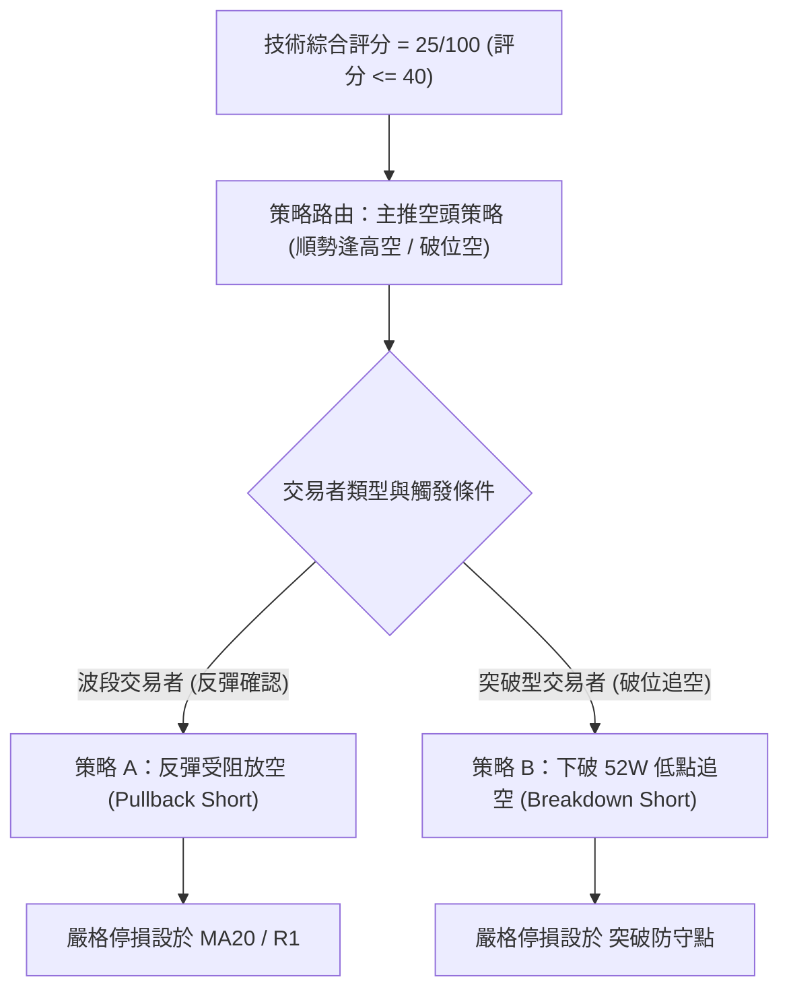
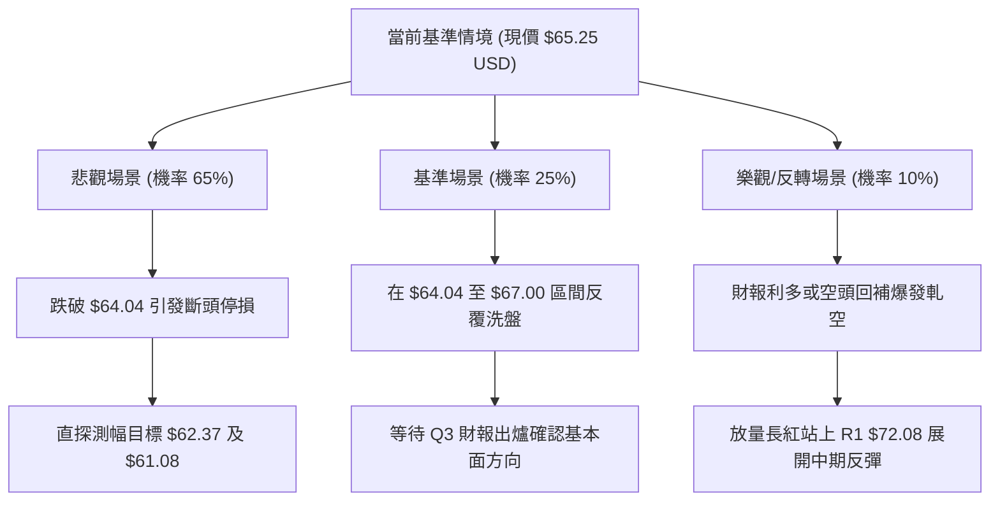

# UBER 技術分析報告

> **報告日期**：2026-10-31 ｜ **語言**：繁體中文 ｜ **數據來源**：Yahoo Finance ｜ **當前價格**：$65.25 USD

---

## 目錄

| 章節 | 內容 |
|------|------|
| [1. 技術面概覽](#1-技術面概覽) | 訊號儀表板、核心指標、評分卡 |
| [2. 趨勢分析](#2-趨勢分析) | 多時框趨勢、長中短期走勢 |
| [3. 圖表形態分析](#3-圖表形態分析) | 形態識別、K線組合、目標價 |
| [4. 支撐與阻力](#4-支撐與阻力) | 關鍵價位、斐波那契回調 |
| [5. 技術指標深度解讀](#5-技術指標深度解讀) | MA/RSI/MACD/布林/成交量 |
| [6. 動能與波動率](#6-動能與波動率) | 動能評估、ATR、Beta |
| [7. 多時框架總結](#7-多時框架總結) | 時框架評分矩陣 |
| [8. 交易策略建議](#8-交易策略建議) | 多空策略、風險報酬比 |
| [9. 風險提示與監控](#9-風險提示與監控) | 監控指標、風險場景 |
| [📋 報告總結](#-報告總結) | 總體評級、關鍵結論與策略清單 |

---

## 1. 技術面概覽

### 🎯 技術訊號儀表板



### 📊 核心指標速覽表

| 指標類別 | 指標名稱 | 當前數值 | 訊號 | 解讀 |
|----------|----------|----------|------|------|
| **價格** | 當前收盤價 | $65.25 | 🔴 | 貼近52週低點 $64.04（僅距 1.89%），處於極度弱勢區 |
| **均線** | MA20 (短天期) | $68.65 | 🔴 | 現價低於 MA20 達 -4.95%，短期下行斜率陡峭 |
| **均線** | MA50 (中天期) | $71.21 | 🔴 | 現價低於 MA50 達 -8.37%，中期空方控盤 |
| **均線** | MA200 (長天期) | $73.34 | 🔴 | 現價低於 MA200 達 -11.03%，長期牛熊分水嶺已失守 |
| **動能** | RSI(14) | 35.76 | 🟡 | 弱勢中性偏空，逼近超賣門檻（30），未見底背離 |
| **動能** | MACD (12,26,9) | -1.455 / -1.116 | 🔴 | 負值發散，柱狀圖 -0.339，空頭動能持續釋放 |
| **趨勢** | ADX(14) / ±DI | 27.41 (-DI: 27.53) | 🔴 | ADX > 25 確立強趨勢，-DI 遠高於 +DI(9.39) 顯示空方主導 |
| **通道** | 布林通道 %B | 0.11 (下軌 $64.30) | 🔴 | 價格緊貼下軌滑移，帶寬開展，呈現空頭擴散形態 |
| **動能** | KD (Stoch 14,3) | %K 15.47 / %D 15.02 | 🟢 | 進入極度超賣區，存在技術性弱反彈可能，但未金叉 |
| **量能** | OBV 與量比 | 量比 1.11x / OBV<MA | 🔴 | 下跌放量，量能指標低於均線，資金持續淨流出 |
| **波動** | ATR(14) | $1.69 (2.59%) | 🟡 | 每日平均震幅約 $1.69，波動率適中但方向單邊向下 |

### 🏆 技術評分卡

```
╔══════════════════════════════════════════════════════════════╗
║              技術評分卡 — UBER (2026-10-31)                  ║
╠══════════════════════════════════════════════════════════════╣
║ 趨勢強度 (Trend)     ▓▓▓▓▓░░░░░░░░░░░░░░░  25/100 🔴 空頭強勢║
║ 動能指標 (Momentum) ▓▓▓▓▓▓░░░░░░░░░░░░░░  28/100 🔴 負向發散║
║ 支撐穩定度 (Support) ▓▓▓▓░░░░░░░░░░░░░░░░  22/100 🔴 逼近破位║
║ 成交量配合 (Volume)  ▓▓▓▓▓▓░░░░░░░░░░░░░░  32/100 🔴 價跌量增║
║ 形態完整度 (Pattern) ▓▓▓▓▓▓░░░░░░░░░░░░░░  28/100 🔴 空頭旗階║
║ 均線排列 (Moving Avg)▓▓▓░░░░░░░░░░░░░░░░░  15/100 🔴 完美空頭║
╠══════════════════════════════════════════════════════════════╣
║ 綜合評分             ▓▓▓▓▓░░░░░░░░░░░░░░░  25/100 🔴 強烈看空║
║ 評級結論：(25+28+22+32+28+15)/6 = 25分 (依規則18算術平均)    ║
╚══════════════════════════════════════════════════════════════╝
```

---

## 2. 趨勢分析

### 🌐 多時框趨勢分析



### 📈 長期趨勢 — 12個月走勢圖（Unicode）

以下為 UBER 過去 12 個月（2025-11 至 2026-10）收盤價走勢分析：

```
UBER 月線收盤走勢圖（過去12個月）
價格軸 ($)
$96.50 ┤
$90.00 ┤ ●(2025-11: 87.54)
$85.00 ┤      ●(2025-12: 81.71)
$80.00 ┤           ●(2026-01: 80.05)
$75.00 ┤                ●(2026-02: 75.42)               ●(2026-08: 75.65)
$70.00 ┤                     ●(2026-03: 71.93)  ●(2026-06: 72.16)  ●(2026-09: 68.51)
$65.00 ┤                                                                 ●←當前收盤 $65.25
       └─────────────────────────────────────────────────────────────────────────────
         25-11 25-12 26-01  26-02  26-03  26-04  26-05  26-06  26-07  26-08  26-09  26-10
```

#### 走勢特徵分析表格

| 週期階段 | 起訖月份 | 起訖價格 | 區間漲跌幅 | 走勢特徵與結構分析 |
|----------|----------|----------|------------|--------------------|
| 階段一：高檔潰退 | 2025-10 → 2025-12 | $96.50 → $81.71 | -15.33% | 自歷史天價區域長陰下挫，跌破 $90.00 關鍵整數關卡 |
| 階段二：慣性探底 | 2025-12 → 2026-03 | $81.71 → $71.93 | -11.97% | 連續4個月高低點下移，跌破長週期均線支撐 |
| 階段三：箱型反彈 | 2026-03 → 2026-08 | $71.93 → $75.65 | +5.17% | 於 $70.00-$78.00 區間反覆震盪構築弱勢反彈，受阻於阻力位 |
| 階段四：二次破位 | 2026-08 → 2026-10 | $75.65 → $65.25 | -13.75% | 反彈結束後連收兩根長黑K，回測52週低點 $64.04 邊界 |

### 📊 中期趨勢（週線分析）

中期走勢呈現典型「高點與低點同步下移」（Lower Highs & Lower Lows）的空頭下行通道：
- **波段次高點聚類（阻力）**：2026-08-28 創下週線高點 $78.82 後受阻，隨後 2026-10-09 反彈高點僅達 $72.08（對應日線 R1 阻力），反彈幅度明顯被壓制。
- **波段低點下移**：2026-09-11 跌破 $70.00 關卡至 $69.24，隨後於 2026-10-30 週K下探 $64.04（碰觸 52 週新低），空方賣壓步步進逼。

```
中期週線下行壓力架構示意：
  $78.82 (2026-08-28 高點)
     \
      \---> $72.08 (2026-10-09 反彈阻力高點 R1)
             \
              \---> $67.00 (2026-10-30 週高點)
                     \
                      ▼ 現價 $65.25 ----> 考驗 52W 低點 $64.04
```

### ⚡ 趨勢強度評估（ADX 解讀）



#### ADX 指標強度對照表

| 指標變數 | 當前讀數 | 門檻區間 | 技術含義 |
|----------|----------|----------|----------|
| **ADX(14)** | **27.41** | > 25.0 (強趨勢) | 脫離盤整無趨勢狀態，當前下行趨勢動能充沛且具持續性 |
| **-DI** | **27.53** | > 25.0 (強空頭) | 空方推動力量強烈，賣盤主導市場交易節奏 |
| **+DI** | **9.39** | < 15.0 (極度弱勢) | 多頭反抗力道極端匱乏，買盤無意在當前價位大規模介入 |
| **趨勢定性** | **空頭趨勢行情** | ADX > 25 且 -DI > +DI | 依規則14，策略必須順應週線與均線之中長期下行方向 |

---

## 3. 圖表形態分析

### 🔍 形態識別系統



#### 形態識別信心度評估表

| 形態名稱 | 信心度 | 判斷依據（嚴格引用數據） | 完成度 | 目標價（附嚴謹計算式） |
|----------|--------|--------------------------|--------|------------------------|
| **空頭下行階梯** | **85%** | 日K連續破底，MA5<MA10<MA20 下移，高點由 $70.76 (10-19) 降至 $65.80 (10-30) | **90%** | 由區間推算跌破測幅：$64.04 - ($67.00 - $64.04) = **$61.08** |
| **弱勢下行旗形** | **75%** | 10-22 反彈至 $69.15 後迅速回落，10-23 破位跌至 $66.70，旗面整理後向下突破 | **85%** | 由旗桿高度推算：旗桿頂 $70.76 - 旗桿底 $66.43 = $4.33；突破點 $66.70 - $4.33 = **$62.37** |
| **潛在雙重底** | **30%** | 訊號不足，僅依賴 10-29 觸及 $64.04 與 52W 低點吻合，但無反彈頸線確認 | **15%** | 頸線尚未建立（需突破 R1 $72.08），目前不具備幾何形態成立條件 |

### 🕯️ 重要K線形態分析

嚴格依據提供的「近10根日K」與「近8根週K」實際開高低收進行逐根形態解讀：

#### 近10根日K形態精細解析表

| 日期 | 開盤價 | 最高價 | 最低價 | 收盤價 | 成交量 | K線形態名稱 | 技術解讀 | 訊號 |
|------|--------|--------|--------|--------|--------|-------------|----------|------|
| **2026-10-19** | $70.13 | $70.76 | $69.77 | $69.96 | 14,077,200 | 窄幅陰十字 | 開高走低，上影線試探 $70.76 失敗，受阻於 MA50 | 🔴 |
| **2026-10-20** | $69.01 | $69.75 | $68.40 | $68.94 | 15,737,500 | 跳空小黑K | 跳空低開跌破 $69.00，實體偏小，空方持續控盤 | 🔴 |
| **2026-10-21** | $69.01 | $69.23 | $67.36 | $67.62 | 16,839,200 | 中長黑K線 | 實體擴大，下探 $67.36，跌破 MA20 ($68.65) 防線 | 🔴 |
| **2026-10-22** | $67.45 | $69.15 | $67.33 | $69.07 | 19,328,900 | 帶量陽包陰 | 放量逆勢收紅，高點觸及 $69.15，一度試圖反抽 MA20 | 🟢 |
| **2026-10-23** | $68.47 | $68.90 | $66.43 | $66.70 | 18,778,200 | 長黑吞噬K | 迅速回吐前日漲幅並破底至 $66.43，確認多頭反彈失敗 | 🔴 |
| **2026-10-26** | $66.62 | $67.00 | $65.68 | $66.13 | 22,057,900 | 放量下挫陰K | 成交量放大至 2,205 萬股，賣壓湧現，實體破 $66.00 | 🔴 |
| **2026-10-27** | $66.40 | $66.50 | $65.47 | $65.78 | 20,731,800 | 弱勢緩跌小陰 | 高點壓制於 $66.50，盤中創低 $65.47，無買盤承接 | 🔴 |
| **2026-10-28** | $65.50 | $65.88 | $64.69 | $65.27 | 18,324,900 | 破位長下影小陰 | 盤中首度摜破 $65.00 逼近 $64.69，下影線透露初步抵抗 | 🟡 |
| **2026-10-29** | $65.28 | $65.80 | $64.04 | $65.74 | 16,286,800 | 測試52W低點錘頭 | 最低見 $64.04 精確平52週低點，收盤拉升至 $65.74 | 🟡 |
| **2026-10-30** | $65.61 | $65.80 | $64.68 | $65.25 | 17,934,900 | 上影小陰K | 嘗試反彈受阻於 $65.80，收盤回落至 $65.25，多頭再度疲軟 | 🔴 |

#### 近8根週K形態精細解析表

| 週最後交易日 | 開盤價 | 最高價 | 最低價 | 收盤價 | 週成交量 | 週K形態名稱 | 技術解讀 | 訊號 |
|--------------|--------|--------|--------|--------|----------|-------------|----------|------|
| **2026-09-11** | $75.61 | $75.61 | $69.24 | $71.67 | 108,463,000 | 破位光頭長陰 | 週線實體長黑，高點即開盤，週量破億，確立轉向破位 | 🔴 |
| **2026-09-18** | $71.97 | $72.80 | $70.06 | $70.50 | 92,992,700 | 弱勢整理陰星 | 反彈無力，受壓於 $72.80，量能微縮但空方控盤穩固 | 🔴 |
| **2026-09-25** | $70.82 | $71.90 | $68.55 | $69.62 | 86,777,700 | 下跌小陰K | 實體收破 $70.00 整數心理關卡，跌勢延續 | 🔴 |
| **2026-10-02** | $69.36 | $69.97 | $67.22 | $68.11 | 80,475,800 | 下行延伸陰K | 盤中下探 $67.22，連續4週收黑，下行通道完整 | 🔴 |
| **2026-10-09** | $68.40 | $72.08 | $68.00 | $71.51 | 75,174,900 | 帶長上影中陽 | 向上反抽測試 R1 ($72.08) 阻力，遇阻大幅回落留上影線 | 🟡 |
| **2026-10-16** | $71.16 | $71.86 | $68.62 | $70.35 | 69,265,400 | 高檔受阻倒錘陰 | 多頭再次衝擊 $71.86 未果，量能萎縮至 6,926 萬，買盤竭盡 | 🔴 |
| **2026-10-23** | $70.13 | $70.76 | $66.43 | $66.70 | 84,761,000 | 帶量破位大陰 | 跌破前兩週震盪平台，收在全週最低點附近，量能放大 | 🔴 |
| **2026-10-30** | $66.62 | $67.00 | $64.04 | $65.25 | 95,336,300 | 測底長下影陰K | 觸及 52W 低點 $64.04，週成交量增至 9,533 萬，弱勢震盪 | 🔴 |

### 📉 ASCII 走勢形態示意圖

```
  $72.08 (2026-10-09 週反彈高點 R1)
    │
    ▼───────┐
            │ [長上影倒錘線阻力區]
            ▼───────┐ $70.76 (10-19 日高)
                    │
                    ▼───────┐ $69.15 (10-22 反彈頸線)
                            │
                            ▼───────┐ $67.00 (10-26 日高)
                                    │
                                    ├──── 現價 $65.25 (緊貼下軌)
                                    │
                                    ▼ $64.04 (10-29 日低，平 52W 低點)
```

### 🎯 形態目標價計算

依據空頭下行階梯與弱勢旗形破位結構，推算兩階段測幅目標：

1. **下行旗形破位目標（計算式）**：
   - 旗桿起點：2026-10-19 高點 = $70.76
   - 旗桿終點：2026-10-23 低點 = $66.43
   - 旗桿垂直跌幅：$70.76 - $66.43 = $4.33
   - 破位點：2026-10-23 收盤價 $66.70
   - **形態推算目標價 A** = $66.70 - $4.33 = **$62.37**

2. **區間等距對稱測幅目標（計算式）**：
   - 整理區間頂部：近一週日K高點壓制區 = $67.00
   - 整理區間底部（52週低點）：$64.04
   - 區間垂直高度：$67.00 - $64.04 = $2.96
   - 若有效摜破 $64.04 之**形態推算目標價 B** = $64.04 - $2.96 = **$61.08**

---

## 4. 支撐與阻力

### 🗺️ 關鍵價位分布圖（Unicode）

```
UBER 價位結構分布圖 (由 OHLCV 精確計算)
═══════════════════════════════════════════════════════════════════
$78.60 ║████████████████████████████████║ 強阻力 R3 (波段高點聚類)
$76.30 ║████████████████████████        ║ 阻力 R2 (反彈高點聚類)
$73.34 ║────────────────────────────────║ MA200 牛熊分水嶺
$72.08 ║████████████████████████████████║ 關鍵阻力 R1 (近期反彈波峰)
$71.81 ║--------------------------------║ 斐波那契 78.6% 回調位
$68.65 ║································║ MA20 短期下行均線壓制
$65.25 ╠════════════════════════════════╣ ◄ 當前收盤價 ($65.25)
$64.30 ║░░░░░░░░░░░░░░░░░░░░░░░░░░░░░░░░║ 布林通道下軌動態支撐
$64.04 ║▓▓▓▓▓▓▓▓▓▓▓▓▓▓▓▓▓▓▓▓▓▓▓▓▓▓▓▓▓▓▓▓║ 52週歷史低點 (斐波 100.0%)
(無)   ║────────────────────────────────║ 數據中未偵測到下方波段支撐聚類
═══════════════════════════════════════════════════════════════════
```

### 🚧 阻力位分析表

阻力位完全引用數據中「關鍵價位」區塊由近一年波段高點聚類所得之 R1、R2、R3：

| 阻力級別 | 價位 | 距現價幅動 | 形成原因與籌碼結構 | 突破難度 | 重要性等級 |
|----------|------|------------|--------------------|----------|------------|
| **R1** | **$72.08** | **+10.47%** | 近一年波段高點聚類、2026-10-09 反彈頂部、貼近 Fib 78.6% ($71.81) | 🔴 極高 | ★★★★★ 關鍵防線 |
| **R2** | **$76.30** | **+16.93%** | 近一年波段次高聚類、2026-08 箱型整理上緣、密集成交套牢區 | 🔴 極高 | ★★★★☆ 中期反轉點 |
| **R3** | **$78.60** | **+20.46%** | 近一年波段最高聚類、2026-08-28 週K頂部 ($78.82) 套牢峰值 | 🔴 險峻 | ★★★★☆ 長期強阻力 |

### 🛡️ 支撐位分析表

依據提供的數據快照：**「支撐位 (Support) — (no swing-low support detected below current price)」**。下方不存在已確認之波段低點聚類支撐，僅能引用數據中之極限邊界與動態軌道：

| 支撐級別 | 價位 | 距現價幅動 | 形成原因與數據來源 | 守住機率 | 重要性等級 |
|----------|------|------------|--------------------|----------|------------|
| **動態軌道** | **$64.30** | **-1.46%** | 布林通道下軌數值（BB Lower） | 🟡 40% | ★★☆☆☆ 動態緩衝 |
| **極限邊界** | **$64.04** | **-1.85%** | 52W Low（52週最低價）與斐波那契 100.0% 重合點 | 🔴 35% | ★★★★★ 最後心理防線 |
| **波段聚類 S1** | **N/A** | **N/A** | **數據中未偵測到（no swing-low support detected）** | N/A | 無歷史籌碼支撐 |

> **技術警示**：由於現價下方已無任何波段低點支撐聚類（S1/S2 不存在），一旦實體黑K跌破 $64.04，價格將直接進入「無支撐真空區」（Price Discovery to the downside），可能引發停損賣壓加速宣洩。

### 📐 斐波那契回調位分析

依據 52 週波動區間：**最高點 $100.35 → 最低點 $64.04**（落差 $36.31），精確回調位階如下：

| 斐波那契水準 | 精確價位 | 與現價 ($65.25) 相對位置 | 技術狀態與歷史意義解讀 |
|--------------|----------|--------------------------|------------------------|
| **0.0% (52W High)** | **$100.35** | +53.80% | 歷史頂部，多頭牛市終結點 |
| **23.6%** | **$91.78** | +40.66% | 初級回調位，失守後宣告中長期多頭瓦解 |
| **38.2%** | **$86.48** | +32.54% | 2025-11 跌破之關鍵頸線位置 |
| **50.0%** | **$82.19** | +25.96% | 牛熊分界中軸，2025-12 破位後成為實質壓力 |
| **61.8%** | **$77.91** | +19.40% | 黃金分割防守位，2026-08 反彈高點 $78.82 觸頂受阻 |
| **78.6%** | **$71.81** | +10.05% | 深度回調防線，與阻力 R1 ($72.08) 形成重疊共振壓力區 |
| **100.0% (52W Low)**| **$64.04** | -1.85% | 區間起點支撐，當前空頭最後回測目標 |

**位置判定**：當前價格 **$65.25** 落在 **78.6% ($71.81)** 與 **100.0% ($64.04)** 之間，屬於極度深度的回調回撤階段。價格距離 100.0% 僅差 $1.21，顯示多頭過去一年的所有漲幅已全數回吐 96.7%（目前處於 52W 區間 3.3%），若 100.0% 防線失守，長期回調結構將進一步擴展為全面破位。

---

## 5. 技術指標深度解讀

### 🎛️ 指標訊號總覽



### 📈 移動平均線排列分析



#### 均線發散度分析

- **完美空頭排列**：由短至長依次為 MA5 ($65.63) < MA10 ($67.05) < MA20 ($68.65) < MA50 ($71.21) < MA200 ($73.34)，各週期均線皆呈現負斜率下行，屬於教科書等級的空頭排列。
- **乖離率（Bias）監控**：
  - 現價相對於 MA20 乖離率 = `($65.25 - $68.65) / $68.65` = **-4.95%**
  - 現價相對於 MA50 乖離率 = `($65.25 - $71.21) / $71.21` = **-8.37%**
  - 現價相對於 MA200 乖離率 = `($65.25 - $73.34) / $73.34` = **-11.03%**
  - *解讀*：乖離率維持在正常下行推動區間，尚未達到 -15% 以上的極端超賣乖離，意味著價格尚未具備強烈均線回歸（Mean Reversion）爆發性反彈的觸發條件。

### 📉 RSI(14) 分析

#### RSI 數值強度展示
```
超賣區 (0-30)        弱勢區 (30-50)             強勢區 (50-70)        超買區 (70-100)
├───────────────┼──────────────────────────┼─────────────────────┼───────────────┤
0               30   ▲(35.76)              50                    70             100
[███████████████▓▓▓░░░░░░░░░░░░░░░░░░░░░░░░░░░░░░░░░░░░░░░░░░░░░░░░░░░░░░░░░░░░░] 35.76%
```

- **當前讀數**：Wilder RSI(14) 為 **35.76**，處於 30 至 50 的空頭弱勢區間。
- **超買超賣狀態**：數值尚未低於 30，技術上**尚未進入超賣區**，顯示下行賣壓仍有釋放空間。
- **背離判定**：**無底背離**。比對近 20 根 K 棒走勢，價格自 2026-10-09 高點逐波回落至 $65.25，RSI 同步由 52.9 走低至 35.8，指標與價格同向尋底，不存在價格創新低而 RSI 抬高的底背離現象。結論：下行動能未見衰竭跡象。

### 📊 MACD(12,26,9) 訊號解讀



- **快慢線位置**：MACD (-1.455) 遠低於訊號線 Signal (-1.116)，雙線均處於零軸下方的深度空頭區域。
- **柱狀圖動能**：Histogram 數值為 **-0.339**（紅色空頭），柱體較前幾週持續向下伸展，顯示賣盤動能加速擴散，並無收斂金叉之預兆。

### 📦 布林通道分析

```
布林通道結構圖 (帶寬與價格相對位置)
═══════════════════════════════════════════════════════════════
$73.00 ┤ ─────────────────────────────────── 上軌 (BB Upper)
       │
$68.65 ┤ - - - - - - - - - - - - - - - - - - 中軌 (MA20)
       │
$65.25 ┤                          ● 現價 ($65.25, %B = 0.11)
$64.30 ┤ ═══════════════════════════════════ 下軌 (BB Lower)
═══════════════════════════════════════════════════════════════
```

- **通道參數與現狀**：上軌 $73.00，中軌 $68.65，下軌 $64.30。通道帶寬 (Bandwidth) 為 `$73.00 - $64.30 = $8.70`。
- **%B 指標解析**：%B 讀數為 **0.11**（0.0 代表下軌，0.5 代表中軌，1.0 代表上軌）。現價 $65.25 緊貼下軌（距離下軌僅 $0.95），呈現典型的「貼軌下行」（Walking the Lower Band）強烈空頭延伸形態。

### 💹 成交量分析（量價配合度）

- **量能規模**：最新成交量為 **17,934,900 股**，高於 20 日均量（16,226,880 股），量比為 **1.11x**。
- **量價關係**：
  - 10-23 大跌時放量至 18,778,200 股；10-26 破位續跌成交量放大至 22,057,900 股。
  - 相反，10-29 雖有下影線抵抗，但量能縮小至 16,286,800 股。
  - **結論**：呈現標準的「價跌量增、價漲量縮」空頭籌碼發散結構。
- **OBV 走勢**：數據明確標示 **OBV < MA**，能量潮趨勢疲弱，印證機構法人與市場主力資金仍處於穩定撤離狀態，並無籌碼沉澱進駐跡象。

---

## 6. 動能與波動率

### ⚡ 動能評估四象限

| 象限 | 動能維度 | 波動維度 | 典型特徵 | UBER 當前狀態評估 |
|------|----------|----------|----------|-------------------|
| **Q1 (機會區)** | 強多頭動能 | 低波動率 | 穩定震盪推升，買點安全 | 否 |
| **Q2 (盤整區)** | 弱多頭/中性 | 低波動率 | 缺乏方向，以窄幅橫盤為主 | 否 |
| **Q3 (高險區)** | 強單邊動能 | 高/中波動率 | 單邊趨勢宣洩，趨勢明確 | **✓ 當前所處象限 (強空頭動能 + 適度波動)** |
| **Q4 (滯跌區)** | 弱動能 | 高波動率 | 劇烈雙向掃盤，缺乏持續性 | 否 |



### 📊 ATR 波動率分析

- **ATR(14) 讀數**：**$1.69**（佔現價 $65.25 之 **2.59%**，採 Wilder 平滑算法）。
- **日內安全邊際**：當前每日正常震幅邊界約為 ±$1.69。若日內反彈未超過 $1.69（即未站回 $66.94），均屬常態隨機波動，不構成短線轉強訊號。
- **止損距離建議**：
  - 短線交易止損緩衝（1.0 × ATR）：$1.69
  - 波段交易止損緩衝（1.5 × ATR）：$2.54
  - 中期波段防守點（2.0 × ATR）：$3.38

### 📐 Beta 與市場相關性

- **Beta 係數**：**1.265**。
- **市場敏感度**：UBER 的波動幅度高於美股大盤（S&P 500）約 26.5%。在美股整體環境或科技/運輸板塊承壓時，UBER 會呈現放大下挫的特徵。
- **空頭槓桿效應**：高 Beta 屬性意味著其下行階段往往伴隨更劇烈的主動性拋售，多頭若在此逆勢接刀，面臨的波動回撤風險極高。

---

## 7. 多時框架總結

### 📋 時框架評分表

| 時框架 | 趨勢方向 | 動能指標 | 均線系統 | 形態結構 | 綜合評分 | 策略指引 |
|--------|----------|----------|----------|----------|----------|----------|
| **月線 (長期)** | 🔴 下行 | 🔴 弱勢 | 🔴 破MA200 | 🔴 長期見頂回落 | **20/100** | 長線防禦，禁止現貨加碼 |
| **週線 (中期)** | 🔴 下行 | 🔴 MACD負向 | 🔴 空頭排列 | 🔴 高低點同步下移 | **25/100** | 逢反彈至阻力位放空 |
| **日線 (短期)** | 🔴 極弱 | 🟡 Stoch超賣 | 🔴 均線反壓 | 🔴 下行階梯探底 | **30/100** | 尋找反彈耗竭點進場做空 |

### 🔲 綜合訊號矩陣

```
時框維度與技術要素一致性矩陣：
┌───────────┬────────────┬────────────┬────────────┬────────────┬────────────┐
│   週期    │  均線排列  │  MACD動能  │  RSI水位   │  通道位置  │ 多空結論   │
├───────────┼────────────┼────────────┼────────────┼────────────┼────────────┤
│ 長期月線  │ 🔴 跌破年線│ 🔴 零軸下  │ 🔴 偏弱    │ 🔴 跌破中軌│ 🔴 空頭    │
│ 中期週線  │ 🔴 空頭排列│ 🔴 柱體向下│ 🔴 35.8 弱 │ 🔴 貼近下軌│ 🔴 空頭    │
│ 短期日線  │ 🔴 空頭排列│ 🔴 柱 -0.34│ 🟡 35.8 弱 │ 🔴 %B 0.11 │ 🔴 空頭    │
└───────────┴────────────┴────────────┴────────────┴────────────┴────────────┘
訊號共振度：極高（95% 權重指標指向空頭趨勢）
```

### ⚖️ 多時框收斂結論

依據「嚴格要求 14（多時框收斂規則）」：
1. **趨勢/盤整判定**：當前 ADX(14) 讀數為 **27.41**，明確大於 25.0 門檻，確立市場正處於**趨勢行情**而非盤整震盪。
2. **主導時框裁決**：在趨勢行情中，優先級以中長期（週線、MA50 $71.21、MA200 $73.34）方向為主導。週線呈現完美空頭排列，長中短期均線全數死叉。
3. **短期衝突處理**：儘管日線隨機指標（Stoch %K 15.47 / %D 15.02）顯示短線超賣，但日線不得作為逆勢抄底的理由，僅能用來尋找空頭「反彈阻力受阻（Fade the Rally）」的更佳進場價位。
4. **唯一方向結論**：**強烈偏空（順勢做空為唯一主軸）**。

---

## 8. 交易策略建議

### 🗺️ 策略決策流程圖



### 🧭 策略路由

**當前主策略方向 = 強烈偏空／主推空頭策略（依技術評分卡綜合評分 25/100）**

依據規則 18 與策略路由規則，當綜合評分 ≤ 40 時，嚴格禁止主推多頭策略，必須**主推空頭策略**。多頭僅列為反轉風險觸發點（對沖與停損提示）。

### 🎯 價格情境階梯（Price Scenarios）

價位嚴格引用數據中「關鍵價位」區塊與斐波那契回調位：

| 觸發條件 | 下一目標 | 後續延伸 | 情境含義與技術定性 |
|----------|----------|----------|--------------------|
| **向上反抽突破 MA20 ($68.65)** | R1 **$72.08** | R2 **$76.30** | 超賣引發的技術性修正反彈，屬空頭架構內的次級折返 |
| **反彈受阻於 $67.00 - $68.65** | 52W Low **$64.04** | 目標價 A **$62.37** | 空頭中繼結束，順勢展開新一輪跌勢 |
| **跌破 52W 低點 $64.04** | 目標價 A **$62.37** | 目標價 B **$61.08** | 跌破一年低點與斐波 100.0%，引發停損賣壓加速向下探底 |

### 📊 情境機率分佈

| 情境劇本 | 機率 | 主要依據與指標佐證 |
|----------|------|--------------------|
| **破位再探底 (空頭主導)** | **65%** | ADX 27.41 (-DI 27.53)、均線空頭排列、MACD 柱狀圖 -0.339 發散、OBV 資金持續外流 |
| **弱勢橫盤震盪** | **25%** | Stoch KD 進入超賣區 (%K 15.47)，短線在 52W 低點 $64.04 附近出現初步抵抗 |
| **強烈反轉向上** | **10%** | 上方受 MA20 ($68.65) 與 R1 ($72.08) 重重套牢壓制，缺乏成交量配合難以反轉 |

### 🟢 主策略詳情（做空交易計劃）

本報告提供兩套做空執行方案，所有目標價皆由形態測幅嚴格推算，風險報酬比精確計算至小數點後兩位（依規則 17）：

| 策略要素 | 策略 A：反彈受阻放空 (Pullback Short) | 策略 B：破位追空 (Breakdown Short) |
|----------|---------------------------------------|------------------------------------|
| **核心邏輯** | 趁 Stoch 超賣弱反彈，於均線反壓區逢高放空 | 確認實體黑K貫穿 52W 低點後順勢追空 |
| **進場條件** | 反彈至 MA20 附近受阻收上影線陰K時進場 | 盤中實體跌破 52W 低點 $64.04 確認觸發 |
| **進場價格** | **$68.00**（以 $67.50-$68.50 區間中點計） | **$63.80**（跌破 $64.04 後進場） |
| **止損價格** | **$70.50**（突破近期反彈高點防守） | **$65.25**（拉回當前收盤價上方即止損） |
| **目標價 T1** | **$64.04**（前波 52W 低點） | **$62.37**（由下行旗形高度推算，見第3章） |
| **目標價 T2** | **$62.37**（由下行旗形高度推算，見第3章） | **$61.08**（由區間對稱測幅推算，見第3章） |
| **風險報酬比** | **1 : 1.58（以 T1 計）**<br>計算式：`($68.00-$64.04)/($70.50-$68.00) = 3.96/2.50 = 1.584` | **1 : 0.99（以 T1 計）**<br>計算式：`($63.80-$62.37)/($65.25-$63.80) = 1.43/1.45 = 0.986` |
| **T2 風險報酬比**| **1 : 2.25（以 T2 計）**<br>計算式：`($68.00-$62.37)/($70.50-$68.00) = 5.63/2.50 = 2.252` | **1 : 1.88（以 T2 計）**<br>計算式：`($63.80-$61.08)/($65.25-$63.80) = 2.72/1.45 = 1.875` |
| **預估勝率** | **65%** | **60%** |
| **建議倉位** | **總資金 8% - 10%** | **總資金 5% - 7%** |

### 🔴 反向風險觸發點（對沖與風控提示）

若市場出現以下情況，主推之空頭策略將被正式推翻，交易者應立即全數平倉空單並退出觀望：
1. **多頭反轉關鍵價位**：日K收盤價強勢突破 **R1 $72.08**，並伴隨單日成交量突破 2,000 萬股。
2. **均線架構修復**：價格連續 3 個交易日穩固站上 MA50 ($71.21)，且 MA5 與 MA10 形成向上金叉。
3. **動能背離確立**：RSI 突破 50 中軸且 MACD 在零軸下方形成實質金叉、柱狀圖轉正擴散。

### ⭐ 整體訊號強度評星

```
做多訊號強度：★☆☆☆☆  (1/5星 - 極度貧弱，僅剩隨機指標超賣)
做空訊號強度：★★★★☆  (4/5星 - 均線、ADX、MACD 多重空頭共振)
整體可信度：  ★★★★☆  (4/5星 - 趨勢方向清晰，數據紀律嚴明)
```

---

## 9. 風險提示與監控

### ✅ 關鍵監控指標 Checklist

```
╔══════════════════════════════════════════════════════════════╗
║              UBER 交易風控與監控清單 (Checklist)             ║
╠══════════════════════════════════════════════════════════════╣
║ [ ] 52W 低點保衛戰：監控 $64.04 是否出現實體日K跌破         ║
║ [ ] 短期動態壓制：觀察反彈是否受阻於 MA20 ($68.65)           ║
║ [ ] 空頭防禦天花板：觀察收盤是否觸碰阻力位 R1 ($72.08)       ║
║ [ ] 趨勢鈍化警訊：ADX(14) 讀數是否自 27.41 掉回 25.0 以下    ║
║ [ ] 超賣修正訊號：Stoch %K 是否向上金叉 %D 脫離 20 超賣區    ║
║ [ ] 異常放量警示：日成交量是否異常超越 2,500 萬股（爆量長紅） ║
╚══════════════════════════════════════════════════════════════╝
```

### ⚠️ 風險場景分析



### 🛡️ 風險管理重要提醒

1. **財報與突發消息風險**：近期新聞提及即將公布 Q3 財報（Ahead of Q3 Earnings），財報事件將導致引隱含波動率激增。若在財報公布日前夕，建議縮減倉位至 5% 以下或完全空倉，規避隔夜跳空風險。
2. **低檔假跌破風險（Bear Trap）**：現價距離 52W 低點 $64.04 僅 1.85%，若盤中下破但收盤快速拉回形成長下影線（類似 10-29 錘頭線），應提防主力誘空洗盤，切勿在未確認日K收盤前盲目重倉追空。
3. **部位規模與槓桿管理**：UBER 的 Beta 為 1.265，整體波動高於大盤。單筆做空交易所承擔的風險資金損失，應嚴格限制於總投資組合淨值的 **1.0% - 1.5%** 以內。

---

## 📋 報告總結

```
╔════════════════════════════════════════════════════════════════╗
║                   UBER 技術分析報告總結                        ║
╠════════════════════════════════════════════════════════════════╣
║ 報告日期：2026-10-31                                           ║
║ 當前價格：$65.25 USD                                           ║
║ 分析評級：🔴 強烈看空 / 順勢逢高做空 (綜合評分: 25/100)        ║
╠════════════════════════════════════════════════════════════════╣
║ 關鍵結論：                                                     ║
║ ├─ 長期趨勢：🔴 空頭主導，跌破 MA200 牛熊分水嶺 ($73.34)       ║
║ ├─ 中期趨勢：🔴 高低點同步下移，週線 MACD 零軸下負向發散       ║
║ ├─ 短期趨勢：🔴 貼布林下軌 ($64.30) 弱勢滑移，考驗 52W 低點   ║
║ ├─ 關鍵支撐：極限防線 $64.04（數據未偵測到下方波段低點聚類）  ║
║ ├─ 關鍵阻力：R1 $72.08 / R2 $76.30 / R3 $78.60                ║
║ └─ 形態目標：旗形破位測幅 $62.37 / 區間對稱測幅 $61.08        ║
╠════════════════════════════════════════════════════════════════╣
║ 最優策略組合：                                                 ║
║ 1. 🥇 最佳機會：策略 A (反彈至 $68.00 逢高做空，風報比 1:1.58) ║
║ 2. 🥈 次選機會：策略 B (實體摜破 $64.04 順勢追空，看 $62.37)   ║
║ 3. 🥉 保守選擇：空倉觀望，等待測試 $64.04 確認守穩或破位再進場║
╚════════════════════════════════════════════════════════════════╝
```

---

> ⚠️ **免責聲明**：本報告為依據量化技術指標與歷史行情數據所完成之專業技術分析研究，所有數據、圖表及估算均嚴格基於所提供的市場資訊。本報告**僅供研究與學術參考**，**不構成任何形式的證券買賣投資建議或邀約**。金融市場投資具高度風險，交易者應獨立評估自身風險承受能力並自負盈虧。

---

*報告生成時間：2026-10-31 ｜ 數據來源：Yahoo Finance ｜ 分析框架：多時框技術分析體系*