# UBER 技術分析報告

> **報告日期**：2026-11-01 ｜ **語言**：繁體中文 ｜ **數據來源**：Yahoo Finance ｜ **當前價格**：$65.25

---

## 目錄

| 章節 | 內容 |
|------|------|
| [1. 技術面概覽](#1-技術面概覽) | 訊號儀表板、核心指標、評分卡 |
| [2. 趨勢分析](#2-趨勢分析) | 多時框趨勢、長中短期走勢、ADX解讀 |
| [3. 圖表形態分析](#3-圖表形態分析) | 形態識別、K線組合、目標價推算 |
| [4. 支撐與阻力](#4-支撐與阻力) | 關鍵價位結構、斐波那契回調 |
| [5. 技術指標深度解讀](#5-技術指標深度解讀) | MA/RSI/MACD/布林/成交量量價背離 |
| [6. 動能與波動率](#6-動能與波動率) | 動能四象限、ATR波動率、Beta值 |
| [7. 多時框架總結](#7-多時框架總結) | 時框評分矩陣、多時框收斂結論 |
| [8. 交易策略建議](#8-交易策略建議) | 策略路由、空頭主策略、風險報酬比 |
| [9. 風險提示與監控](#9-風險提示與監控) | 監控Checklist、風險情境、資金管理 |
| [📋 報告總結](#-報告總結) | 核心結論與策略總覽 |

---

## 1. 技術面概覽

### 🎯 技術訊號儀表板

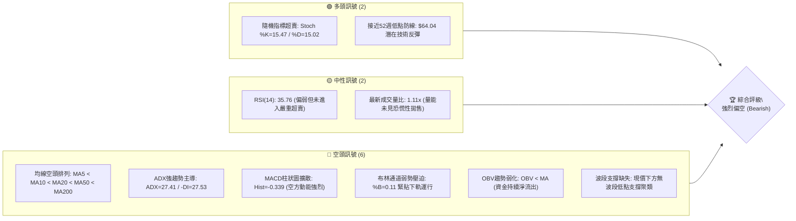

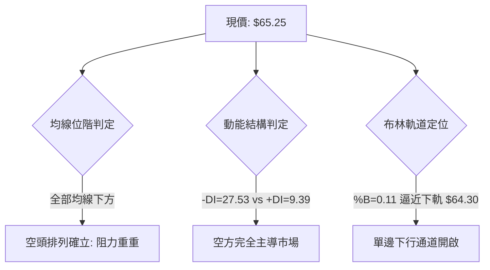

### 📊 核心指標速覽表

| 指標類別 | 指標名稱 | 當前數值 | 訊號 | 專業解讀 |
|:---|:---|:---|:---:|:---|
| **價格結構** | 收盤價 (Close) | $65.25 | 🔴 | 位於52週區間 3.3% 分位，逼近歷史極端低位 |
| **價格結構** | 52週高/低 | $100.35 / $64.04 | 🔴 | 自歷史高點回撤 -34.98%，空頭趨勢結構完整 |
| **均線系統** | MA20 (月線) | $68.65 | 🔴 | 價格位於MA20下方 -4.95%，短期下行趨勢顯著 |
| **均線系統** | MA50 (季線) | $71.21 | 🔴 | 價格位於MA50下方 -8.37%，中期均線反壓沉重 |
| **均線系統** | MA200 (年線) | $73.34 | 🔴 | 價格位於MA200下方 -11.03%，長期牛熊分水嶺失守 |
| **趨勢強度** | ADX (14) | 27.41 | 🔴 | ADX > 25 確認為強勢趨勢行情，-DI=27.53 空方壓倒勝 |
| **動能指標** | RSI (14) | 35.76 | 🟡 | Wilder計算處於中性偏空弱勢區，無背離跡象 |
| **動能指標** | MACD (12,26,9) | -1.455 / -1.116 | 🔴 | 雙線位於零軸下方發散，柱狀圖 -0.339 加速下行 |
| **動能指標** | Stoch %K / %D | 15.47 / 15.02 | 🟢 | 進入超賣警戒區間，具備短線技術性抽頭條件 |
| **波動帶** | Bollinger Bands | 上 $73.00 / 下 $64.30 | 🔴 | %B=0.11，中軌 $68.65 形成動態重壓，開口擴大 |
| **波動率** | ATR (14) | $1.69 (2.59%) | 🟡 | 日內波動幅度適中，為交易止損提供具體基準 |
| **量能流向** | 成交量 / OBV | 17,934,900 / 1.11x | 🔴 | 量增價跌，OBV低於移動平均，大戶籌碼流出 |

### 🏆 技術評分卡

```
╔══════════════════════════════════════════════════════════════════╗
║                 技術評分卡 — UBER (2026-11-01)                  ║
╠══════════════════════════════════════════════════════════════════╣
║  評估維度      進度條顯示                      得分    狀態標記  ║
╟──────────────────────────────────────────────────────────────────╢
║  趨勢強度      █████░░░░░░░░░░░░░░░           25/100      🔴     ║
║  動能指標      ██████░░░░░░░░░░░░░░           30/100      🔴     ║
║  支撐穩定度    ████░░░░░░░░░░░░░░░░           20/100      🔴     ║
║  成交量配合    ███████░░░░░░░░░░░░░           35/100      🔴     ║
║  形態完整度    ██████░░░░░░░░░░░░░░           30/100      🔴     ║
║  均線排列      ██░░░░░░░░░░░░░░░░░░           10/100      🔴     ║
╠══════════════════════════════════════════════════════════════════╣
║  綜合評分      █████░░░░░░░░░░░░░░░           25/100  強烈偏空   ║
║  計算依據：(25 + 30 + 20 + 35 + 30 + 10) ÷ 6 = 25.0 (規則 18)    ║
╚══════════════════════════════════════════════════════════════════╝
```

---

## 2. 趨勢分析

### 🌐 多時框趨勢分析

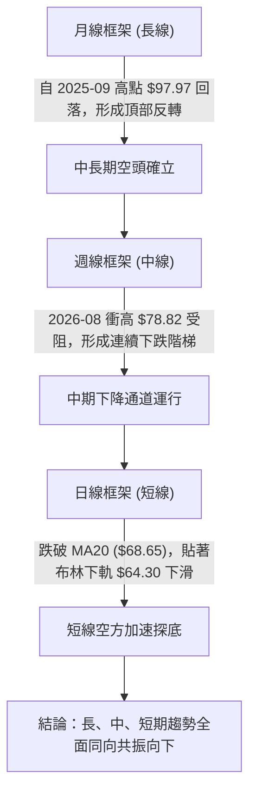

### 📈 長期趨勢 — 12個月走勢圖（Unicode）

```
UBER 月線收盤走勢圖（過去12個月：2025-11 至 2026-10）
價格軸 ($)
$90 ┤  ● $87.54 (2025-11)
$85 ┤      ● $81.71 (2025-12)
$80 ┤          ● $80.05 (2026-01)
$75 ┤              ● $75.42    ● $74.61        ● $75.65 (2026-08 反彈頂點)
$70 ┤                  ● $71.93    ● $70.40  ● $72.16  ● $70.36
$65 ┤                                                  ● $68.51
$60 ┤                                                      ● $65.25 (現價) ◄ 最低收盤
    └────────────────────────────────────────────────────────────────────────────►
       11   12   01   02   03   04   05   06   07   08   09   10  (月份)
```

#### 長期走勢特徵分析表格

| 階段區間 | 起始價 → 結束價 | 漲跌幅 | 成交量能特徵 | 趨勢形態與技術意涵 |
|:---|:---|:---:|:---|:---|
| **2025-11 ~ 2026-01** | $87.54 → $80.05 | -8.56% | 震盪萎縮 | 自歷史高點 $97.97 破位後之第一波主跌回撤 |
| **2026-02 ~ 2026-04** | $75.42 → $74.61 | -1.07% | 縮量築底假象 | 於 $72~$75 區間構築弱勢整理中繼平台 |
| **2026-05 ~ 2026-07** | $70.40 → $70.36 | -0.06% | 籌碼換手停滯 | 重心進一步下移至 $70 關口，反彈無力 |
| **2026-08 (次級反彈)** | $70.36 → $75.65 | +7.52% | 週量放大至1.47億 | 觸及 MA200 壓力後遭遇機構強烈拋壓，反彈夭折 |
| **2026-09 ~ 2026-10** | $68.51 → $65.25 | -4.76% | 空方量能擴散 | 跌破所有短期均線，直接下探 52 週最低點 $64.04 |

### 📊 中期趨勢（週線分析）

```
中期週線阻力與支撐幾何圖形
─────────────────────────────────────────────────────────────────
[強阻力 R3]  $78.60  ═══════════════════════════ (2026-08 週線波段高點聚類)
                          ▲
[阻力 R2]    $76.30  ─────┼───────────────────── (2026-06/08 週線次高點)
                          │
[關鍵阻力 R1]$72.08  ─────┼───────────────────── (2026-10-09 週線衝高回落高點)
                          │
[現價位階]   $65.25  ┈┈┈┈┈●┈┈┈┈┈┈┈┈┈┈┈┈┈┈┈┈┈┈┈┈┈ (逼近週線布林下軌)
                          │
[52W 基準]   $64.04  ═════▼═════════════════════ (52週絕對低點 / Fib 100%)
─────────────────────────────────────────────────────────────────
```

### ⚡ 趨勢強度評估（ADX 解讀）

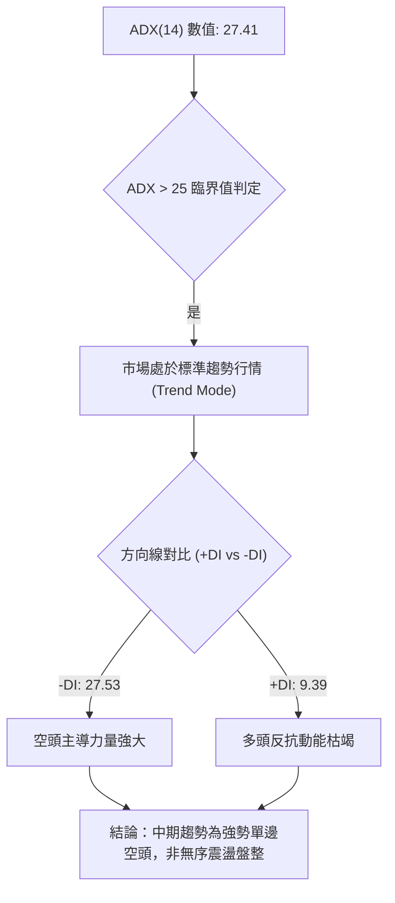

| 指標名稱 | 當前讀數 | 門檻區間 | 趨勢狀態 | 交易指導意義 |
|:---|:---:|:---:|:---:|:---|
| **ADX (14)** | **27.41** | > 25.0 | 強趨勢 (Strong Trend) | 趨勢跟隨策略優先，嚴禁盲目摸底做多 |
| **+DI (14)** | **9.39** | < 15.0 | 多頭極度虛弱 | 多方無力組織有效反攻 |
| **-DI (14)** | **27.53** | > 25.0 | 空方完全控盤 | 任何短線反彈均為空頭加碼或解套賣點 |
| **DI差值 (Spread)** | **-18.14** | < -10.0 | 空頭發散 | 下行慣性強烈，價格順軌道下探機率高 |

---

## 3. 圖表形態分析

### 🔍 形態識別系統

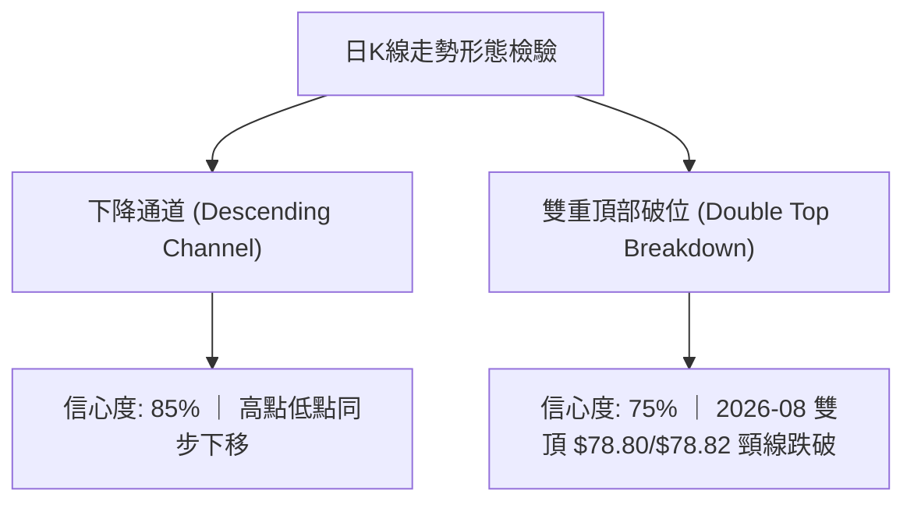

#### 圖表形態信心度評估表（依規則 15）

| 識別形態 | 信心度 | 判斷依據（引用數據） | 完成度 | 目標價（附嚴謹計算式） |
|:---|:---:|:---|:---:|:---|
| **下行通道** | **85%** | 連接週K高點 $78.82、$72.08 與低點 $67.22、$64.04，軌道完整向下傾斜 | **90%** | 下軌延伸目標：$64.04（52週低點） |
| **雙重頂部 (週線)** | **75%** | 2026-08-21 高點 $78.80 與 2026-08-28 高點 $78.82 構築雙頂，頸線為 2026-07-24 低點 $65.94 | **100% (已跌破)** | 頸線 $65.94 - 形態高度 ($78.82 - $65.94 = $12.88) = **$53.06**（理論測幅目標） |
| **頭肩頂形態** | **35%** | 數據中左肩與右肩對稱性不足，缺乏完整右肩架構 | 20% | 訊號不足，僅做指標型解讀，不預設目標價 |

### 🕯️ 重要K線形態分析

嚴格依據數據中「近10根日K」與「近8根週K」之開、高、低、收數據解讀：

#### 近10根日K棒形態深度解讀

| 日期 (日K) | 開盤 | 最高 | 最低 | 收盤 | 成交量 | K線形態名稱 | 專業技術解讀 | 訊號 |
|:---|:---:|:---:|:---:|:---:|:---:|:---|:---|:---:|
| 2026-10-19 | 70.13 | 70.76 | 69.77 | 69.96 | 14,077,200 | 衝高回落小陰線 | 開高走低，受制於 $70.76 短線阻力 | 🔴 |
| 2026-10-20 | 69.01 | 69.75 | 68.40 | 68.94 | 15,737,500 | 下跌實體陰線 | 跳空低開，實體收於最低點附近，破位下行 | 🔴 |
| 2026-10-21 | 69.01 | 69.23 | 67.36 | 67.62 | 16,839,200 | 中陰線 (光腳) | 跌破 $68 關口，空方加速拋售 | 🔴 |
| 2026-10-22 | 67.45 | 69.15 | 67.33 | 69.07 | 19,328,900 | 低開長陽反彈線 | 帶量反抽測試 MA20 下方阻力，多方抵抗 | 🟡 |
| 2026-10-23 | 68.47 | 68.90 | 66.43 | 66.70 | 18,778,200 | 空頭吞噬陰線 | 完全吞噬前日陽線實體，多方反彈宣告失敗 | 🔴 |
| 2026-10-26 | 66.62 | 67.00 | 65.68 | 66.13 | 22,057,900 | 破位放量陰線 | 成交量激增至 2,205 萬股，破位恐慌賣壓顯現 | 🔴 |
| 2026-10-27 | 66.40 | 66.50 | 65.47 | 65.78 | 20,731,800 | 弱勢黑K下跌 | 持續受壓於 $66.50，空方壓制力道不減 | 🔴 |
| 2026-10-28 | 65.50 | 65.88 | 64.69 | 65.27 | 18,324,900 | 下影小陰線 | 盤中下探 $64.69，多方低位試圖護盤 | 🟡 |
| 2026-10-29 | 65.28 | 65.80 | 64.04 | 65.74 | 16,286,800 | 探底錘頭十字線 | 觸及 52 週最低點 $64.04 後強烈拉升，下影線長 | 🟢 |
| 2026-10-30 | 65.61 | 65.80 | 64.68 | 65.25 | 17,934,900 | 倒狀阻力小陰線 | 反抽受制於 $65.80，無法克服前日高點，回吐漲幅 | 🔴 |

#### 近8根週K棒形態深度解讀

| 日期 (週K) | 開盤 | 最高 | 最低 | 收盤 | 週成交量 | K線形態名稱 | 專業技術解讀 | 訊號 |
|:---|:---:|:---:|:---:|:---:|:---:|:---|:---|:---:|
| 2026-09-11 | 75.61 | 75.61 | 69.24 | 71.67 | 108,463,000 | 斷頭鍘大陰線 | 破位下殺，單週重挫 -5.4%，空頭主跌啟動 | 🔴 |
| 2026-09-18 | 71.97 | 72.80 | 70.06 | 70.50 | 92,992,700 | 弱勢下探陰線 | 無力收復 $72，空方持續掌控局勢 | 🔴 |
| 2026-09-25 | 70.82 | 71.90 | 68.55 | 69.62 | 86,777,700 | 連續陰跌K棒 | 跌破 $70 整數心理關卡，重心下移 | 🔴 |
| 2026-10-02 | 69.36 | 69.97 | 67.22 | 68.11 | 80,475,800 | 創低長下影陰線 | 觸及 $67.22 後微幅反彈，量能持續萎縮 | 🔴 |
| 2026-10-09 | 68.40 | 72.08 | 68.00 | 71.51 | 75,174,900 | 長上影假突破陽線 | 衝高至 R1 $72.08 遭空頭迎頭痛擊，長上影線 | 🟡 |
| 2026-10-16 | 71.16 | 71.86 | 68.62 | 70.35 | 69,265,400 | 高位遇阻陰線 | 確認 $72.00 之上套牢賣壓沉重 | 🔴 |
| 2026-10-23 | 70.13 | 70.76 | 66.43 | 66.70 | 84,761,000 | 放量長陰殺跌棒 | 破位長黑，單週跌幅擴大，直接摜破 $67 | 🔴 |
| 2026-10-30 | 66.62 | 67.00 | 64.04 | 65.25 | 95,336,300 | 觸底抵抗中陰線 | 測試 52 週低點 $64.04，週量擴大至 9,533 萬股 | 🔴 |

### 📉 ASCII 走勢形態示意圖

```
UBER 近期波段下降通道與關鍵形態示意圖
價格
$72.08 ┬───● (2026-10-09 假突破高點 R1)
       │    ╲
$70.00 ┼─────╲──────● (10-19 高點 $70.76)
       │      ╲      ╲
$68.00 ┼───────╲──────╲─────● (10-22 反彈高點 $69.15)
       │        ╲      ╲    ╲
$66.00 ┼─────────╲──────╲────● (10-30 反抽高點 $65.80)
       │          ╲      ╲   │
$64.04 ┴───────────●──────●──● (52W 低點防線支撐測試)
       └────────────────────────────────────────────► 時間
```

### 🎯 形態目標價計算

依據 2026-08 週線雙頂形態與近期 10 月中旬下行旗形推算：

1. **週線雙頂破位理論目標**：
   - 形態頭部高點：$78.82（2026-08-28）
   - 形態頸線位置：$65.94（2026-07-24 收盤低點）
   - 形態高度：$78.82 - $65.94 = $12.88
   - 測幅滿足點：$65.94 - $12.88 = **$53.06**
2. **日線旗形整理下破目標**：
   - 旗桿起跌點：$72.08（2026-10-09）
   - 旗桿底部：$66.43（2026-10-23）
   - 旗桿垂直高度：$72.08 - $66.43 = $5.65
   - 破位點：$66.70（10-23 收盤）
   - 短線形態目標價：$66.70 - $5.65 = **$61.05**

---

## 4. 支撐與阻力

### 🗺️ 關鍵價位分布圖（Unicode）

```
UBER 價位結構分布圖
═══════════════════════════════════════════════════════════════
$78.60 ║████████████████████████████████║ 強阻力 R3 (波段雙頂高點)
$76.30 ║████████████████████████        ║ 次級阻力 R2 (反彈高點聚類)
$72.08 ║████████████████████████████    ║ 關鍵重阻力 R1 (週線波段高點聚類)
$68.65 ║────────────────────────────────║ 動態阻力 (MA20 / 布林中軌)
$65.25 ╠════════════════════════════════╣ ◄ 當前收盤價位 ($65.25)
$64.30 ║░░░░░░░░░░░░░░░░                ║ 動態支撐 (布林通道下軌)
$64.04 ║████████████████████████████████║ 核心防線 (52週最低價 / 100% Fib)
(下無) ║                                ║ (現價下方無波段低點聚類支撐)
═══════════════════════════════════════════════════════════════
```

### 🚧 阻力位分析表

價位嚴格引用自數據中「關鍵價位」區塊之波段高點聚類計算數值：

| 阻力級別 | 精確價位 | 距現價幅標 | 形成原因與籌碼結構 | 突破難度 | 重要性權重 |
|:---|:---:|:---:|:---|:---:|:---:|
| **關鍵阻力 (R1)** | **$72.08** | +10.47% | 近一年波段高點聚類，與 2026-10-09 週線衝高頂點完美重合 | 極高 | ★★★★★ |
| **次級阻力 (R2)** | **$76.30** | +16.93% | 2026年6月至8月密集換手成交密集區，大量套牢解套賣壓 | 極高 | ★★★★☆ |
| **強阻力 (R3)** | **$78.60** | +20.46% | 近一年週線雙頂極限高點 ($78.80/$78.82) 聚類防線 | 極難逾越 | ★★★★★ |

### 🛡️ 支撐位分析表

依據數據披露規範，**現價下方無偵測到波段低點聚類支撐**：

| 支撐級別 | 精確價位 | 距現價幅標 | 形成原因與技術意涵 | 守住機率 | 重要性權重 |
|:---|:---:|:---:|:---|:---:|:---:|
| **52週核心低點** | **$64.04** | -1.85% | 數據中 52W Low 與斐波那契 100.0% 絕對底部重疊 | 40% (脆弱) | ★★★★★ |
| **布林動態下軌** | **$64.30** | -1.46% | 日線布林下軌動態邊界，提供短線超賣技術緩衝 | 45% | ★★★☆☆ |
| **波段低點聚類** | **無** | N/A | **數據中未偵測到現價下方之波段低點聚類 (no swing-low)** | 0% | ── |

### 📐 斐波那契回調位分析

依據 52 週極值區間（低點 $64.04 → 高點 $100.35，垂直振幅 $36.31）黃金分割計算：

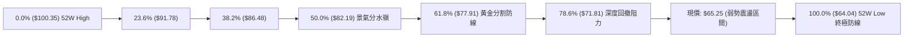

#### 斐波那契關鍵回調階梯解讀表

| 回調比例 | 精確價位 | 相對現價狀態 | 技術面意義深度剖析 |
|:---|:---:|:---:|:---|
| **0.0% (52W High)** | **$100.35** | 上方 +53.80% | 歷史多頭牛市頂峰，長期結構性天花板 |
| **23.6%** | **$91.78** | 上方 +40.66% | 初級回調支撐（現已轉化為歷史套牢層） |
| **38.2%** | **$86.48** | 上方 +32.54% | 弱勢修正回調位，失守代表多頭架構瓦解 |
| **50.0%** | **$82.19** | 上方 +25.96% | 心理均衡多空平衡線，長線空頭壓制線 |
| **61.8%** | **$77.91** | 上方 +19.40% | 黃金分割強防守位，8月反彈頂點 ($78.82) 於此受阻回落 |
| **78.6%** | **$71.81** | 上方 +10.05% | 深度回撤極限位，與 R1 $72.08 形成雙重阻力共振區 |
| **100.0% (52W Low)**| **$64.04** | 下方 -1.85% | **全年生死線**；若實體跌破，將開啟無支撐自由落體空間 |

**現價區間解讀**：現價 $65.25 處於 78.6% ($71.81) 與 100.0% ($64.04) 之間的**極度弱勢崩解區**，意味著自 52 週高點以來的多頭波段漲幅已遭回吐近 97%，技術面呈現典型的空頭末端加速探底結構。

---

## 5. 技術指標深度解讀

### 🎛️ 指標訊號總覽

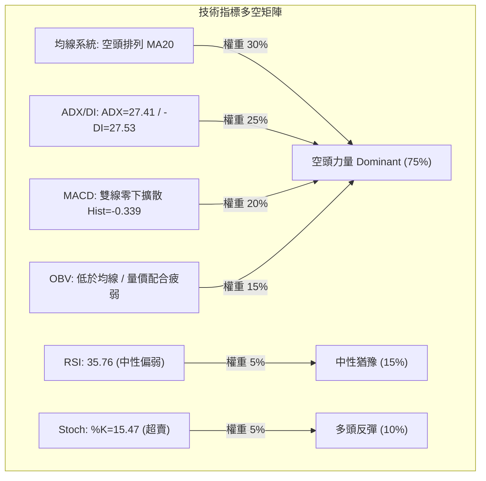

### 📈 移動平均線排列分析

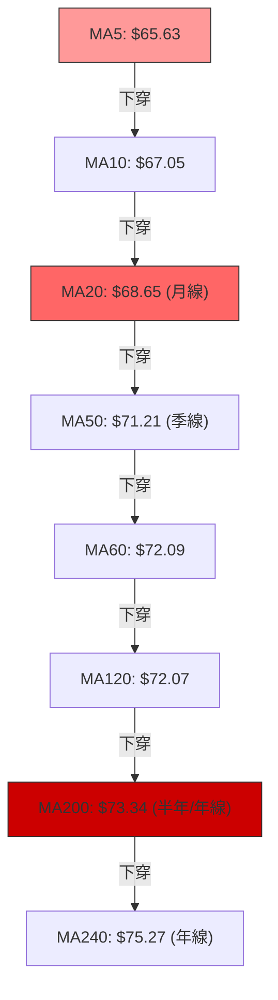

#### 均線發散與斜率狀態表

| 均線名稱 | 當前數值 | 距現價幅度 | 均線走勢圖 (Sparkline) | 趨勢斜率解讀 |
|:---|:---:|:---:|:---|:---|
| **MA 5** | $65.63 | -0.59% | `██▇▇▇▆▆▆▅▅▅▅▅▆▇▇█████▇▆▆▅▄▃▂▁▁` | 短線急速下墜，壓制日K線反彈 |
| **MA 10** | $67.05 | -2.68% | `███▇▇▆▆▅▅▄▄▄▄▄▄▅▅▅▆▆▆▆▆▆▅▄▃▂▁▁` | 短期反壓線，連續8個交易日無法觸及 |
| **MA 20** | $68.65 | -4.95% | `██▇▆▆▅▅▄▄▃▃▂▂▂▂▂▂▂▂▂▂▂▂▂▁▁▁▁▁▁` | 月線空頭斜率陡峭，為中期做空基準點 |
| **MA 60** | $72.09 | -9.49% | `██▇▇▇▆▆▆▅▅▄▄▃▃▃▃▃▃▃▃▃▃▃▃▃▂▂▁▁▁` | 季線下行，中線空頭完全控盤 |
| **MA 120**| $72.07 | -9.47% | `████████▇▇▇▇▆▆▆▅▅▅▅▄▄▄▄▃▃▃▂▁▁▁` | 半年線下彎，與 MA60 出現死叉纏繞 |
| **MA 200**| $73.34 | -11.03%| (數據確認下行) | 長期牛熊線告破，確立長週期空頭市場 |
| **MA 240**| $75.27 | -13.31%| `████▇▇▇▇▆▆▆▅▅▅▅▄▄▄▄▃▃▃▂▂▂▂▁▁▁▁` | 年線重壓，整體均線呈標準空頭瀑布排列 |

### 📉 RSI(14) 分析

```
RSI(14) 刻度儀錶 (Wilder 平滑計算)
0         20        35.76     50                  70        100
├─────────┼───────────●───────┼───────────────────┼─────────┤
[ 極端超賣 ] [ 超賣警戒 ]   現值      [       中性區間       ]   [  超買  ]
當前進度條：███████░░░░░░░░░░░░░ 35.76/100 (中性偏空弱勢區)
```

- **超買超賣判定**：數值為 35.76，尚未跌破 30 進入技術性極端超賣區，顯示空頭下殺動能尚未釋放完畢，仍有進一步陰跌釋放空間。
- **背離分析判斷**：依據近 20 根 K 棒首尾之價格與 RSI 走勢比對，價格自 $70.76 跌至 $64.04 創出新低，RSI 亦同步由 48.9 震盪下行至 35.76，**數據明確顯示：無明顯背離（無頂背離，亦無底背離）**。走勢呈現標準的「價跌指標跌」之順勢下行格局。

### 📊 MACD(12,26,9) 訊號解讀

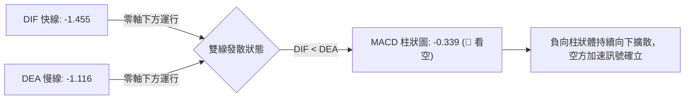

- **MACD快慢線位階**：DIF (-1.455) 顯著低於 DEA (-1.116)，且雙線均深處於零軸下方（負值區），表明市場處於強烈的空頭慣性控制區。
- **柱狀圖動態**：當前 MACD Hist 為 **-0.339**，呈現負向綠柱放大形態，未見任何收斂勾頭跡象，確認空方動能處於主動攻擊波次中。

### 📦 布林通道分析

```
UBER 日線布林通道 (20, 2) 結構示意圖
價格
$73.00 ┬─────────────────────────────────────────── 布林上軌 (BB Upper)
       │
$68.65 ┼┄┄┄┄┄┄┄┄┄┄┄┄┄┄┄┄┄┄┄┄┄┄┄┄┄┄┄┄┄┄┄┄┄┄┄┄┄┄┄┄┄┄ 布林中軌 (MA20)
       │
$65.25 ┼─────────────────────────● (現價 $65.25，%B = 0.11)
$64.30 ┴─────────────────────────────────────────── 布林下軌 (BB Lower)
```

- **布林帶寬與位置**：上軌 $73.00 與下軌 $64.30 形成 $8.70 的通道寬度。當前收盤價 $65.25 距離下軌僅 $0.95。
- **%B 指標解讀**：當前 **%B = 0.11**（0 代表下軌，0.5 代表中軌，1.0 代表上軌）。數值極度貼近下軌，表明股價呈現典型的「沿下軌單邊滑落」（Walking the lower band）特徵，這是強烈空頭趨勢而非盤整震盪的明證。

### 💹 成交量分析（量價配合度）

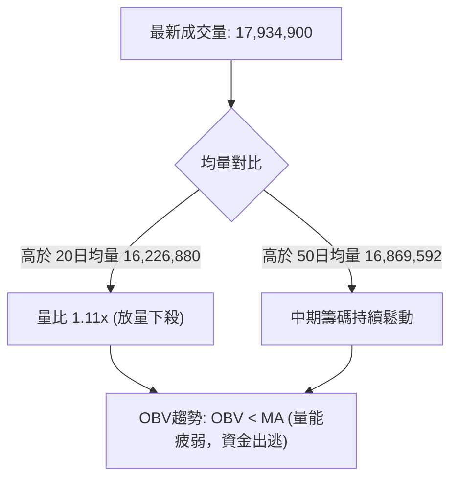

- **量價配合度檢驗**：在近期價格下行過程中（如 10-26 放量 2,205 萬股下殺、10-30 放量 1,793 萬股下挫），下跌放量而反彈縮量（10-29 反彈僅 1,628 萬股），呈現標準的「量增價跌、量縮價漲」之空方籌碼流向。
- **OBV（能量潮）分析**：數據顯示 **OBV < MA**，代表資金流動趨勢線位於其均線下方，機構法人與大戶資金處於持續淨流出狀態，未見任何主力吸籌（Accumulation）跡象。

---

## 6. 動能與波動率

### ⚡ 動能評估四象限

```
動能與波動率矩陣定位
    高波動 (High Volatility)
         │
    Q3   │   Q4 [當前定位區間]
  強動能 │ 弱動能 / 空方破位
  高風險 │ 避免盲目做多 / 順勢空
─────────┼────────────────────────► 趨勢動能 (+DI / 多頭強度)
    Q1   │   Q2
  最佳多 │ 謹慎觀望
  低風險 │ 區間盤整
         │
    低波動 (Low Volatility)
```

| 象限分類 | 動能特徵 | 波動特徵 | 當前狀態吻合度 | 專業實戰操作指導 |
|:---:|:---:|:---:|:---:|:---|
| **第一象限 (Q1)** | 強動能 (多頭) | 低波動 | ── | 多頭最佳買點，趨勢穩健推進（非當前狀態） |
| **第二象限 (Q2)** | 弱動能 (中性) | 低波動 | ── | 縮量盤整觀望期，等待方向突破（非當前狀態） |
| **第三象限 (Q3)** | 強動能 (多頭) | 高波動 | ── | 投機性牛市飆升，追高風險大（非當前狀態） |
| **第四象限 (Q4)** | **弱多頭 / 強空頭**| **高波動下探** | **✓ (吻合)** | **空方完全控盤，價格破位下行，嚴禁搶反彈** |

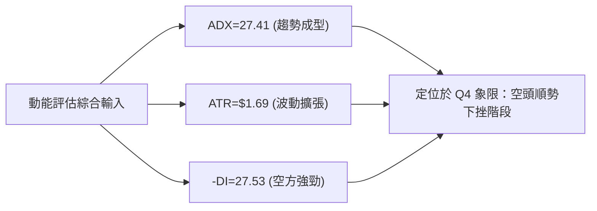

### 📊 ATR 波動率分析

- **ATR(14) 讀數**：精確值為 **$1.69**（佔當前股價比例為 **2.59%**，採 Wilder 平滑算法）。
- **日間真實波動範圍**：每日平均波動約 $1.70 美元，顯示個股短期流動性與波動幅度活躍。
- **交易止損距離建議**：
  - **保守型風控（2.0 × ATR）**：止損寬度為 $1.69 \times 2.0 = **$3.38**。
  - **積極型風控（1.5 × ATR）**：止損寬度為 $1.69 \times 1.5 = **$2.54**。
  - **緊密追蹤止損（1.0 × ATR）**：止損寬度為 **$1.69**。

### 📐 Beta 與市場相關性

- **Beta 係數**：**1.265**（相對於 S&P 500 指數具備顯著高 Beta 特性）。
- **市場放大效應解讀**：當大盤指數下跌 1.00% 時，UBER 理論上將放大跌幅至 1.265%。在高利率環境與科技股承壓背景下，高 Beta 特性加劇了其股價向下尋底的系統性風險敞口。
- **機構持股背景**：機構持股佔比高達 **85.3%**，空頭比率（Short % Float）為 2.5%，空頭回補天數（Short Ratio）為 3.02。高機構佔比意味著當前的大幅下挫主要由公募基金與對沖基金的機構性減持所驅動，下行趨勢具有極高慣性。

---

## 7. 多時框架總結

### 📋 時框架評分表

| 時框架 | 趨勢方向 | 動能狀態 | 均線排列狀況 | 關鍵形態結構 | 綜合評分 | 戰術建議 |
|:---|:---:|:---:|:---:|:---|:---:|:---|
| **月線 (長期)** | 🔴 看空 | 弱勢下探 | 跌破 20月均線 ($73.34年線附近) | 自歷史高點 $97.97 回撤之第二波下殺 | 30/100 | 長線資金減倉或對沖 |
| **週線 (中期)** | 🔴 看空 | MACD柱線負值 | MA20 < MA50，均線全面下彎 | 雙頂 ($78.82) 破位下行通道 | 20/100 | 中期反彈逢高放空 |
| **日線 (短期)** | 🔴 看空 | RSI 35.76 / Stoch 超賣 | 空頭排列 (MA5至MA240全面順向) | 沿布林下軌單邊滑移 | 25/100 | 順勢尋找高拋點 |

### 🔲 綜合訊號矩陣

```
時框架訊號矩陣共振分析
─────────────────────────────────────────────────────────────────
維度          月線 (長期)      週線 (中期)      日線 (短期)    共振結論
─────────────────────────────────────────────────────────────────
趨勢指標      🔴 空頭          🔴 空頭          🔴 空頭        三時框全面看空
動能指標      🔴 走弱          🔴 負向擴散      🟡 超賣鈍化    空方掌控，短線醞釀抽頭
均線排列      🔴 破位年線      🔴 死叉下壓      🔴 瀑布發散    全週期均線反壓
籌碼量能      🔴 機構出逃      🔴 跌放量漲縮量  🔴 OBV<MA      籌碼結構極度渙散
─────────────────────────────────────────────────────────────────
一致性判定    100% 趨勢共振向下；日線超賣僅能引發日內級別抽頭反彈
─────────────────────────────────────────────────────────────────
```

### ⚖️ 多時框收斂結論

依據多時框收斂規則（嚴格要求 14）：
1. **行情性質判定**：當前日線 ADX(14) 讀數為 **27.41（> 25.0）**，數據明確定義市場處於**標準趨勢行情**，而非無序之區間震盪行情。
2. **主導時框優先級**：在趨勢行情下，必須以**中長期時框（週線 / MA50 / MA200）方向為絕對主導**，日線級別指標僅能用於微觀尋找右側進場或高拋點位。
3. **收斂統一結論**：由於週線與日線均線呈現全面空頭排列，週線雙頂結構完全壓制價格，即便日線 Stoch 進入 15.02 之極端超賣區間，亦絕不可定義為「趨勢反轉」。唯一結論：**強烈偏空（Strong Bearish）**。日線的任何弱勢反抽均為中長期空頭趨勢中的賣出／加碼做空機會。

---

## 8. 交易策略建議

### 🗺️ 策略決策流程圖

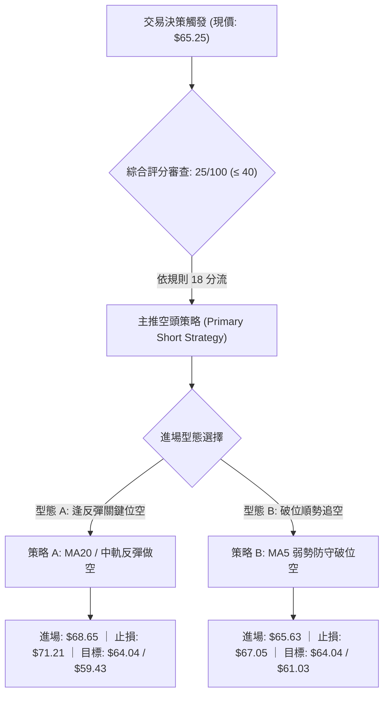

### 🧭 策略路由（依評分卡分流）

> **當前主策略方向 = 強烈偏空／主推空頭策略（依綜合評分 25/100）**
> 
> 依據嚴格規則分流標準：綜合評分 ≤ 40 必須**主推空頭策略**，絕不兩頭下注。多頭訊號僅列為反轉風險提示與對沖預警，不作為主動開倉推薦。

### 🎯 價格情境階梯（Price Scenarios）

價位嚴格引用數據披露之阻力位 R1/R2/R3 與支撐防線：

| 觸發條件 | 下一目標 | 後續延伸目標 | 情境技術含義剖析 |
|:---|:---:|:---:|:---|
| **強勢突破 R1 $72.08** | R2 $76.30 | R3 $78.60 | 短線空頭結構遭到實質破壞，趨勢轉入中度反彈 |
| **承壓於 MA20 $68.65 之下** | $64.30 (BB下軌) | $64.04 (52W Low)| 短線維持單邊下行通道，沿布林下軌震盪陰跌 |
| **實體跌破 52W 低點 $64.04** | $61.05 (旗形測幅) | $53.06 (雙頂測幅)| 觸發全市場停損賣盤，開啟真空自由落體暴跌行情 |

### 📊 情境機率分佈

| 運行情境 | 發生機率 | 主要技術數據支撐依據 |
|:---|:---:|:---|
| **下行破位 / 創52週新低** | **55%** | ADX=27.41 (-DI=27.53)，MACD Hist=-0.339 擴散，OBV量能低迷且籌碼持續出逃 |
| **低位弱勢震盪 (沿下軌運行)** | **25%** | Stoch %K=15.47 超賣形成短線阻跌，但上方 MA10 ($67.05) 與 MA20 ($68.65) 反壓嚴密 |
| **強勢反彈突破阻力** | **20%** | 均線瀑布發散壓制，需連續放量站上 R1 $72.08 方能成立，目前缺乏資金面支持 |

### 🔴 主策略詳情（空頭進場架構）

依規則 17 嚴格計算風險報酬比：做空風險報酬比 = (進場價 − 目標價 T1) ÷ (止損價 − 進場價)。

| 策略要素 | 策略 A（反彈逢高做空 — 穩健型） | 策略 B（弱勢反抽壓制做空 — 積極型） |
|:---|:---|:---|
| **交易邏輯** | 等待價格回抽 MA20 / 布林中軌承壓做空 | 現價弱勢反抽至 5日均線遇阻直接進場 |
| **進場條件** | 觸及 MA20 且日K線出現帶上影線之滯漲黑K | 股價反彈至 MA5 附近受阻，盤中跌破前日收盤 |
| **進場價格** | **$68.65**（引用數據 MA20 / BB中軌精確值） | **$65.63**（引用數據 MA5 精確值） |
| **目標價 T1** | **$64.04**（引用數據 52W Low / 100% Fib） | **$64.04**（引用數據 52W Low / 100% Fib） |
| **目標價 T2** | **$59.43**（由形態高度推算：$64.04 - ($68.65 - $64.04)） | **$61.03**（由區間推算：$64.04 - ($67.05 - $64.04)） |
| **止損價格** | **$71.21**（引用數據 MA50 季線精確值） | **$67.05**（引用數據 MA10 均線精確值） |
| **止損距離** | $71.21 - $68.65 = $2.56 (約 1.51x ATR) | $67.05 - $65.63 = $1.42 (約 0.84x ATR) |
| **目標盈利** | $68.65 - $64.04 = $4.61 | $65.63 - $64.04 = $1.59 |
| **風險報酬比** | **1 : 1.80（以 T1 計）** ｜ [1 : 3.60（以 T2 計）] | **1 : 1.12（以 T1 計）** ｜ [1 : 3.24（以 T2 計）] |
| **成功機率** | **65%** | **55%** |
| **建議倉位** | **總資金之 12% ~ 15%** | **總資金之 8% ~ 10%** |

*註：策略 A 風險報酬比計算 = ($68.65 - $64.04) ÷ ($71.21 - $68.65) = $4.61 ÷ $2.56 = 1.8007... 規範呈現為 `1 : 1.80（以 T1 計）`。*

### 🟡 反向風險觸發點（對沖與止損警示）

若市場出現非預期強勢反轉，以下為推翻空頭主策略之客觀觸發條件：
1. **多頭反轉關鍵突破點**：若日K線以實體長陽放量突破 **R1 $72.08**，則意味著下行旗形被向上突破，所有空頭頭寸必須**無條件停損離場**。
2. **動能修復預警**：若 RSI(14) 向上突破 50 中軸且 MACD 柱狀圖在零軸下方出現連續 3 日金叉擴散，應主動將空頭倉位削減至少 50%。

### ⭐ 整體訊號強度評星

```
╔══════════════════════════════════════════════════════════════╗
║  做多訊號強度：★★☆☆☆  (1.5/5星 — 僅超賣技術修正)            ║
║  做空訊號強度：★★★★☆  (4.5/5星 — 全週期趨勢高度共振向下)     ║
║  整體技術可信度：★★★★☆ (4.0/5星 — 均線與動能指標高度一致)   ║
╚══════════════════════════════════════════════════════════════╝
```

---

## 9. 風險提示與監控

### ✅ 關鍵監控指標 Checklist

```
╔══════════════════════════════════════════════════════════════════╗
║                  每日技術監控重點 Checklist                      ║
╠══════════════════════════════════════════════════════════════════╣
║ [ ] 52週低點防線檢驗：收盤價是否跌破 $64.04？                  ║
║     └─ 若跌破，代表自由落體行情啟動，禁止任何抄底操作。         ║
║ [ ] 動態均線反壓追蹤：盤中反彈是否受制於 MA5 ($65.63) 與 MA10？║
║     └─ 連續未能收復 MA10，維持空頭日內短階下推判斷。            ║
║ [ ] 趨勢強度指標監控：ADX(14) 是否持續維持於 25.0 之上？        ║
║     └─ 若 ADX > 30 且 -DI 走高，表明空方攻擊波二次加速。        ║
║ [ ] 動能底背離排查：RSI 跌破 30 後是否於新低點出現背離？       ║
║     └─ 當前無背離；若出現底背離，則需提升空頭止損位至保本點。   ║
║ [ ] 量能異常異動：成交量是否突破 20日均量 1.5倍 (2,434萬股)？   ║
║     └─ 低位異常巨量長陽需防範主力對倒誘空反抽。                 ║
╚══════════════════════════════════════════════════════════════════╝
```

### ⚠️ 風險場景分析

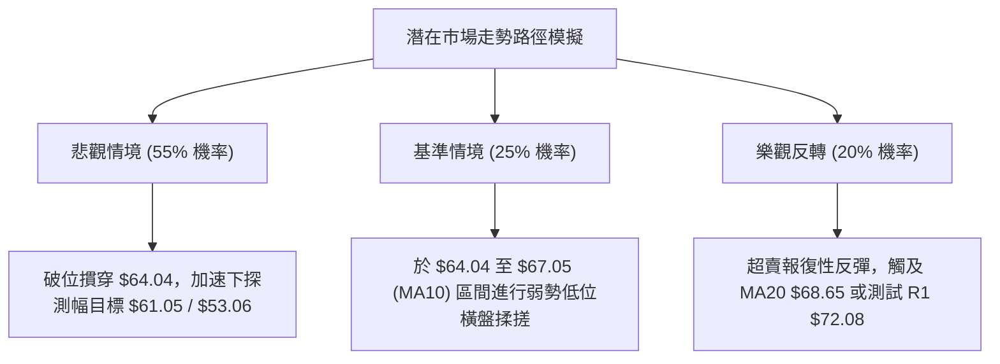

### 🛡️ 風險管理重要提醒

1. **基本面與技術面嚴重背離風險**：
   - 當前華爾街 46 位分析師綜合評級為「Buy」，平均目標價高達 **$100.86**（最低目標亦有 $70.00）。然而，技術盤面卻呈現破位暴跌至 $65.25。此種「基本面共識看好、二級市場資金瘋狂出逃」的背離現象，往往暗示機構內部存在未公開之結構性拋售（如 Robotaxi 競爭加劇或市佔率流失新聞）。技術交易者**必須尊重客觀盤面走勢，絕不以基本面目標價作為逆勢接飛刀的藉口**。
2. **財報前夕引伸波幅（IV）激增風險**：
   - 近期新聞顯示 Q3 財報發布在即，市場將面臨業績公佈之跳空（Gap）風險。在 ATR 高達 $1.69 的背景下，隔夜波動可能瞬間穿透止損。強烈建議在財報公布日前 48 小時**降低總持倉槓桿至 5% 以下**，或透過認沽期權（Put Options）進行純風險鎖定。
3. **倉位嚴格控管紀律**：
   - 單筆做空策略之最大虧損金額不得超過總投資組合淨值的 **1.0%**。以策略 A（止損空間 $2.56）為例，若整體資金規模為 100 萬美元，單筆最大承擔風險為 1 萬美元，則最大放空股數應嚴格限制在 3,900 股以內。

---

## 📋 報告總結

```
╔══════════════════════════════════════════════════════════════════╗
║                   UBER 技術分析報告總結                          ║
╠══════════════════════════════════════════════════════════════════╣
║  報告日期：2026-11-01                                           ║
║  當前收盤價格：$65.25                                            ║
║  綜合技術評級：🔴 強烈偏空 / 空頭主導 (評分: 25/100)             ║
╟──────────────────────────────────────────────────────────────────╢
║  核心技術面維度總結：                                            ║
║  ├─ 長期趨勢：🔴 跌破年線 MA200 ($73.34)，長期上升結構宣告終結   ║
║  ├─ 中期趨勢：🔴 8月雙頂 ($78.82) 破位，日週線沿下降通道下沉     ║
║  ├─ 短期趨勢：🔴 均線瀑布發散，貼布林下軌滑落，ADX=27.41 強空   ║
║  ├─ 關鍵支撐：$64.04 (52週絕對低點 / 現價下方無波段低點支撐)    ║
║  ├─ 關鍵阻力：R1: $72.08 ｜ R2: $76.30 ｜ R3: $78.60             ║
║  └─ 華爾街目標：$100.86 (基本面與技術面嚴重撕裂，以技術面為準)  ║
╟──────────────────────────────────────────────────────────────────╢
║  最優策略實施路徑：                                              ║
║  1. 🥇 最佳機會：策略 A (反彈做空) 於 $68.65 放空，目標 $64.04   ║
║                  止損 $71.21，風報比 1 : 1.80（以 T1 計）        ║
║  2. 🥈 次選機會：策略 B (弱勢追空) 於 $65.63 放空，目標 $64.04   ║
║                  止損 $67.05，風報比 1 : 1.12（以 T1 計）        ║
║  3. 🥉 保守選擇：完全空倉觀望，耐心等待價格跌破 $64.04 或反抽   ║
║                  R1 $72.08 失敗後之二次右側確認信號              ║
╚══════════════════════════════════════════════════════════════════╝
```

---

> ⚠️ **免責聲明**：本報告為 AI 自動生成之專業技術分析，所有數據、圖表及測算均基於系統提供的歷史與即時價格資訊。本報告**僅供研究、學術討論與交易策略建構參考**，**不構成任何形式的證券買賣邀約或投資建議**。市場有風險，入市交易務必嚴格執行止損與倉位控管。

---

*報告生成時間：2026-11-01 ｜ 數據來源：Yahoo Finance ｜ 分析框架：多時框架量化技術分析*