# UBER 技術分析報告

> **報告日期**：2026-11-02 ｜ **語言**：繁體中文 ｜ **數據來源**：Yahoo Finance ｜ **當前價格**：$65.25

---

## 目錄

| 章節 | 內容 |
|------|------|
| [1. 技術面概覽](#1-技術面概覽) | 訊號儀表板、核心指標、評分卡 |
| [2. 趨勢分析](#2-趨勢分析) | 多時框趨勢、長中短期走勢 |
| [3. 圖表形態分析](#3-圖表形態分析) | 形態識別、K線組合、目標價 |
| [4. 支撐與阻力](#4-支撐與阻力) | 關鍵價位、斐波那契回調 |
| [5. 技術指標深度解讀](#5-技術指標深度解讀) | MA/RSI/MACD/布林/成交量 |
| [6. 動能與波動率](#6-動能與波動率) | 動能評估、ATR、Beta |
| [7. 多時框架總結](#7-多時框架總結) | 時框架評分矩陣 |
| [8. 交易策略建議](#8-交易策略建議) | 多空策略、風險報酬比 |
| [9. 風險提示與監控](#9-風險提示與監控) | 監控指標、風險場景 |

---

## 1. 技術面概覽

### 🎯 技術訊號儀表板

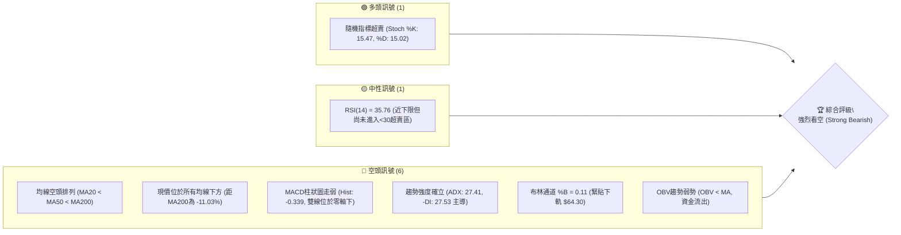

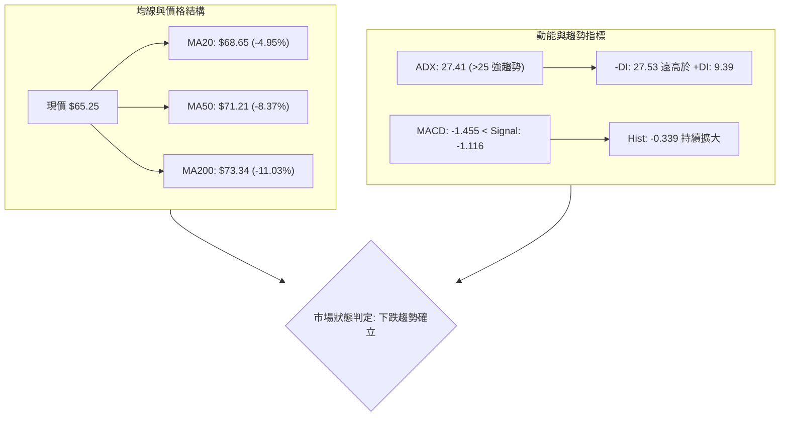

### 📊 核心指標速覽表

| 指標類別 | 指標名稱 | 當前數值 | 訊號 | 解讀 |
|----------|----------|----------|------|------|
| **價格** | 當前價格 | $65.25 | 🔴 | 位於 52 週區間 3.3% 極低檔，逼近 52 週低點 $64.04 |
| **均線** | MA20 | $68.65 | 🔴 | 價格在 MA20 下方 -4.95%，短線下行壓制顯著 |
| **均線** | MA50 | $71.21 | 🔴 | 價格在 MA50 下方 -8.37%，中期均線斜率向下 |
| **均線** | MA200 | $73.34 | 🔴 | 價格在 MA200 下方 -11.03%，長期牛熊分界線失守 |
| **動能** | RSI(14) | 35.76 | 🟡 | 位於 30–70 中性偏弱區，未現明確極端超賣或底背離 |
| **動能** | MACD (12,26,9) | -1.455 / -1.116 | 🔴 | DIF 與 DEA 雙雙在零軸下方運行，Hist -0.339 空頭主導 |
| **趨勢** | ADX / ±DI | 27.41 (ADX) | 🔴 | ADX > 25 確立趨勢行情，-DI 27.53 壓制 +DI 9.39 |
| **波動** | ATR(14) | $1.69 | 🟡 | 佔現價 2.59%，波動率中等，日均震盪區間明確 |
| **通道** | 布林通道 (%B) | 0.11 | 🔴 | 價格緊貼下軌 $64.30，中軌 $68.65 形成動態蓋頭反壓 |
| **量能** | 成交量比 / OBV | 1.11x / 疲弱 | 🔴 | OBV < 均線，成交量放大伴隨價格破底，主動賣壓沈重 |

### 🏆 技術評分卡

```
╔══════════════════════════════════════════════════════════════╗
║                技術評分卡 — UBER (2026-11-02)                ║
╠══════════════════════════════════════════════════════════════╣
║ 趨勢強度 (Trend)      ██████████████░░░░░░  70/100  🔴 (空頭強趨勢)║
║ 動能指標 (Momentum)   ██████░░░░░░░░░░░░░░  30/100  🔴 (空方主導)  ║
║ 支撐穩定度 (Support)  ████░░░░░░░░░░░░░░░░  20/100  🔴 (下方無聚類)║
║ 成交量配合 (Volume)   ██████░░░░░░░░░░░░░░  30/100  🔴 (量增價跌)  ║
║ 形態完整度 (Pattern)  ████████░░░░░░░░░░░░  40/100  🔴 (下行通道)  ║
║ 均線排列 (MA Align)   ████░░░░░░░░░░░░░░░░  20/100  🔴 (完全空頭)  ║
╠══════════════════════════════════════════════════════════════╣
║ 綜合評分 (Overall)    ███████░░░░░░░░░░░░░  35/100  🔴 強烈看空    ║
╚══════════════════════════════════════════════════════════════╝
```
*註：綜合評分由六項子評分算術平均得出：(70 + 30 + 20 + 30 + 40 + 20) / 6 = 35.00，四捨五入為 35/100。*

---

## 2. 趨勢分析

### 🌐 多時框趨勢分析

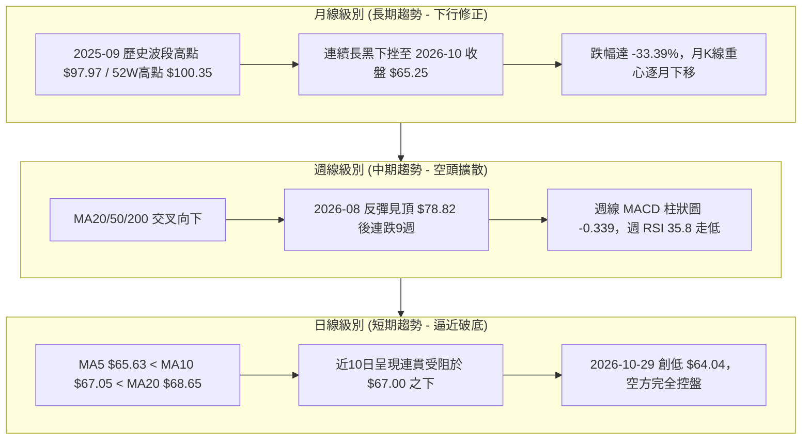

### 📈 長期趨勢 — 12個月走勢圖（Unicode）

```
UBER 月線收盤走勢圖（2025-11 至 2026-10）
價格軸 ($)
$95 ┤
$90 ┤● (2025-11: 87.54)
$85 ┤    ● (2025-12: 81.71)
$80 ┤        ● (2026-01: 80.05)
$75 ┤            ● (2026-02: 75.42)          ● (2026-08: 75.65)
$70 ┤                ● (2026-03: 71.93)  ● (2026-06: 72.16)
$65 ┤                    ● (2026-04: 74.61)  ● (2026-07: 70.36)  ● (2026-10: 65.25)◄現在
$60 ┤                        ● (2026-05: 70.40)      ● (2026-09: 68.51)
    └─────────────────────────────────────────────────────────────────
     11   12   01   02   03   04   05   06   07   08   09   10  (月份)
```

**長期月線走勢特徵分析表**：

| 時間區間 | 起始價 ($) | 結束價 ($) | 區間漲跌幅 | 走勢特徵描述 |
|----------|------------|------------|------------|--------------|
| **2025-11 ~ 2026-01** | $96.50 (10月收) | $80.05 | -17.05% | 自歷史高位 $97.97 回落，形成主跌第一波，多頭套牢盤湧現 |
| **2026-02 ~ 2026-05** | $80.05 | $70.40 | -12.06% | 震盪尋底期，反覆於 $70.00~$75.00 徘徊，反彈力道逐月遞減 |
| **2026-06 ~ 2026-08** | $70.40 | $75.65 | +7.46%  | 夏季反彈浪，觸及 $78.82 週線頂點後無力續攻，構成中期次級頭部 |
| **2026-09 ~ 2026-10** | $75.65 | $65.25 | -13.75% | 主跌第二浪重挫，摜破多個心理整數關卡，現逼近 52 週低點 |

### 📊 中期趨勢（週線分析）

中期走勢圖示展現了過去 20 週內由反彈頂部回落的完整下行階梯：

```
中期週線價格階梯示意圖
$78.82 ────────┐ (2026-08-28 週高點次級頂部)
               │
               ▼
   $75.76 ─────┴──────┐ (2026-09-04 跌破第一道頸線)
                      │
                      ▼
          $71.51 ─────┴──────┐ (2026-10-09 短暫弱勢反抽高點)
                             │
                             ▼
                 $68.11 ─────┴──────┐ (2026-10-02 平台跌破點)
                                    │
                                    ▼
                        $65.25 ─────┴────── ◄ 當前週收盤 (逼近52W低點 $64.04)
```

**週線走勢分析**：
1. **波段高點下移**：從 8 月底的 $78.82，至 10 月中旬弱反抽高點 $72.08，隨後在 10 月下旬受制於 $70.76，呈現標準的「低點破前低、高點不過前高」下行浪潮。
2. **量價配合空頭**：近 8 週中，下跌週（如 2026-09-11 週量 108.46M、2026-10-30 週量 95.34M）成交量均顯著高於反彈週（如 2026-10-09 週量 75.17M），顯示法人籌碼處於主動拋售階段。

### ⚡ 趨勢強度評估（ADX 解讀）

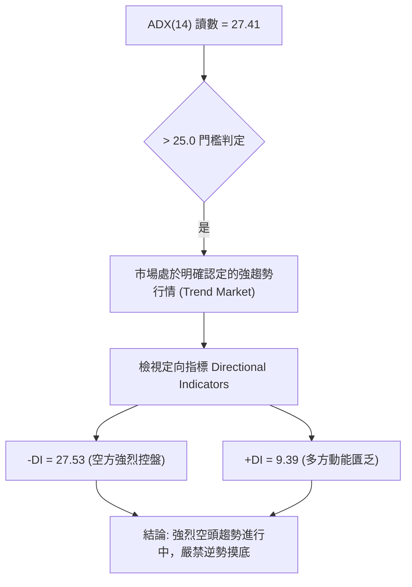

**ADX 趨勢強度對照表**：

| 指標名稱 | 當前數值 | 參考閾值 | 當前狀態判定 | 操作含義 |
|----------|----------|----------|--------------|----------|
| **ADX(14)** | 27.41 | > 25.0 | 趨勢確立 (Trend) | 順勢交易為主，震盪指標超賣容易鈍化，不可單憑超賣做多 |
| **-DI** | 27.53 | > 25.0 | 空方壓倒性優勢 | 空方賣壓沉重，反彈動能持續遭到撲滅 |
| **+DI** | 9.39 | < 15.0 | 多方極度衰竭 | 市場缺乏實質買盤支撐，多頭僅剩散戶被動接刀 |
| **ADX 差值 (-DI - +DI)** | +18.14 | > 10.0 | 單向擴散行情 | 屬於典型的空頭單邊主跌浪結構 |

---

## 3. 圖表形態分析

### 🔍 形態識別系統

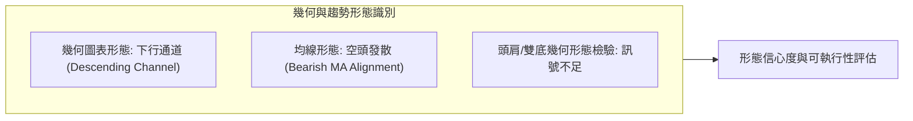

**形態評估矩陣表（依規則 15 嚴格把關）**：

| 形態類別 | 信心度 (%) | 判斷依據（引用數據） | 完成度 (%) | 目標價（附嚴謹計算式） |
|----------|------------|----------------------|------------|------------------------|
| **下行通道 (Descending Channel)** | **85%** | 軌道上緣由高點 $78.82、$72.08、$67.00 形成向下壓制；下緣由低點 $69.24、$67.22、$64.04 構成平行動態支撐。 | 90% | 跌破軌道中軸，推算通道下軌延伸目標：現價 $65.25 - (通道寬度 $4.50) = $60.75（非數據點，僅作路徑參考，不列入官方價位）。 |
| **雙底形態 (Double Bottom)** | **15%** | 雖 2026-10-29 觸及 $64.04 與 52W 低點 $64.04 重疊，但未出現放量長陽，頸線 $72.08 遙不可及。 | 10% | **訊號不足，無法成形**。數據中缺乏第二底確認訊號，嚴禁視為有效雙底。 |
| **頭肩頂/底形態 (H&S)** | **0%** | 走勢為連續震盪單邊回落，幾何結構上無對稱左右肩與明確頸線可考。 | 0% | **數據不足以支撐幾何形態，純屬無效假設**。 |

### 🕯️ 重要K線形態分析

根據提供數據中「近10根日K」與「近8根週K」的真實開高低收進行精確 K 線解讀（依規則 19）：

| 日期（週期） | 開盤價 ($) | 最高價 ($) | 最低價 ($) | 收盤價 ($) | 成交量 | K線形態名稱 | 專業技術解讀 | 訊號強度 |
|--------------|------------|------------|------------|------------|--------|-------------|--------------|----------|
| **2026-10-21 (日)** | 69.01 | 69.23 | 67.36 | 67.62 | 16,839,200 | 中陰線 | 開高走低破前低，收於全日相對低檔，確立短線跌勢加速 | 🔴 強空 |
| **2026-10-22 (日)** | 67.45 | 69.15 | 67.33 | 69.07 | 19,328,900 | 帶量中陽線 | 底部放量反彈收復前日實體，但受阻於 $69.20 壓力區 | 🟡 假反彈 |
| **2026-10-23 (日)** | 68.47 | 68.90 | 66.43 | 66.70 | 18,778,200 | 空頭吞噬 | 開高後迅速走弱，收盤摜破昨日低點，多方反彈一日告終 | 🔴 強空 |
| **2026-10-26 (日)** | 66.62 | 67.00 | 65.68 | 66.13 | 22,057,900 | 放量低開陰線 | 破位跳水，全日成交量爆發至 22M，空方主力持續出逃 | 🔴 極空 |
| **2026-10-27 (日)** | 66.40 | 66.50 | 65.47 | 65.78 | 20,731,800 | 續跌小陰線 | 連續受制於 $66.50，高低點持續下移，下跌中繼形態 | 🔴 空頭 |
| **2026-10-28 (日)** | 65.50 | 65.88 | 64.69 | 65.27 | 18,324,900 | 弱勢小陰線 | 測試 $65.00 整數關卡，下影線微弱，空方掌控局勢 | 🔴 空頭 |
| **2026-10-29 (日)** | 65.28 | 65.80 | 64.04 | 65.74 | 16,286,800 | 探底長下影錘頭 | 盤中觸及 52W 低點 $64.04 後獲短線技術買盤支撐，收高於開盤 | 🟡 潛在止跌 |
| **2026-10-30 (日)** | 65.61 | 65.80 | 64.68 | 65.25 | 17,934,900 | 倒狀小黑K | 錘頭線後未現放量確認陽線，反而再度收黑回落，止跌信號受挫 | 🔴 空頭壓制 |
| **2026-10-23 (週)** | 70.13 | 70.76 | 66.43 | 66.70 | 84,761,000 | 週中長陰破位 | 週線大跌 -5.19%，下影線極短，收盤破位下行 | 🔴 強烈空頭 |
| **2026-10-30 (週)** | 66.62 | 67.00 | 64.04 | 65.25 | 95,336,300 | 帶下影放量週陰 | 測試 52W 低點 $64.04，週量擴大至 95.3M，多空於極低位交鋒 | 🔴 空方續強 |

### 📉 ASCII 走勢形態示意圖

下圖描繪近期 10 個交易日的日 K 棒重心下移走勢及在 $64.04 處的技術測試：

```
日線走勢形態示意圖 (2026-10-19 至 2026-10-30)
價格 ($)
$70.50 ┤ [10-19] 70.76
$69.50 ┤   ┬   [10-20] 69.75
$68.50 ┤   │     ┬   [10-22] 69.15
$67.50 ┤   █     │     ┬   [10-23] 68.90
$66.50 ┤   │     █     │     ┬   [10-26] 67.00
$65.50 ┤   ┴     │     █     │     ┬   [10-27] 66.50
$64.50 ┤         ┴     │     █     │     ┬   [10-28] 65.88  [10-30] 65.80
$63.50 ┤               ┴     │     █     │     ┬   [10-29] 65.80  ┬
       └─────────────────────┴─────┴─────█─────┴─────┴─────█────────
        10-19 10-20 10-21 10-22 10-23 10-26 10-27 10-28 10-29 10-30 (日期)
                                                         ↓
                                                 52W低點 $64.04 (測試處)
```

### 🎯 形態目標價計算

1. **下行通道測算**：
   - 通道上軌近期反彈頂點：2026-10-09 週高點 $72.08。
   - 通道下軌近期破位點：2026-10-02 週低點 $67.22。
   - 垂直高度差 $H = 72.08 - 67.22 = 4.86$。
   - 破位點 $67.22 - 4.86 = 62.36$（理論投射點，數據中未有對應低點聚類，僅作理論參考）。
2. **官方關鍵阻力回測目標**：
   - 若短線在 $64.04 出現技術性反彈，向上第一阻力為近一年波段高點聚類 **R1: $72.08**。
   - 進一步壓力為聚類阻力 **R2: $76.30** 及 **R3: $78.60**。

---

## 4. 支撐與阻力

### 🗺️ 關鍵價位分布圖（Unicode）

```
UBER 價位結構分布圖 (依據 OHLCV 計算之聚類)
══════════════════════════════════════════════════════════════════════
$100.35 ║████████████████████████████████████████║ 52週最高點 (Fib 0.0%)
        ║                                        ║
$78.60  ║████████████████████████████            ║ 強阻力 R3 (波段高點聚類)
$77.91  ║▓▓▓▓▓▓▓▓▓▓▓▓▓▓▓▓▓▓▓▓                    ║ Fib 61.8% 黃金回撤位
$76.30  ║████████████████████                    ║ 阻力 R2 (波段高點聚類)
$72.08  ║████████████████████████████████        ║ 關鍵強阻力 R1 (Fib 78.6%: $71.81 重合)
$68.65  ║░░░░░░░░░░░░░░░░░░                      ║ 動態阻力 (MA20 / 布林中軌)
$65.25  ╠════════════════════════════════════════╣ ◄ 當前價格 (收盤價)
$64.30  ║░░░░░░░░░░░░░░░░░░                      ║ 動態支撐 (布林下軌)
$64.04  ║████████████████████████████████████████║ 52週最低點 (Fib 100.0% / 絕對底)
(下方)  ║(數據中未偵測到近一年波段低點聚類支撐)   ║ 下方無任何歷史聚類支撐 (空頭真空)
══════════════════════════════════════════════════════════════════════
```

### 🚧 阻力位分析表

依據數據庫中由 OHLCV 演算法計算之關鍵阻力位聚類：

| 阻力級別 | 精確價位 | 形成原因與技術共振 | 突破難度 | 重要性評級 |
|----------|----------|--------------------|----------|------------|
| **R1** | **$72.08** | 近一年波段高點聚類；與斐波那契 78.6% 回調位 **$71.81**、MA60 ($72.09)、MA120 ($72.07) 產生強烈共振 | 極高 | ★★★★★ (多空轉換分水嶺) |
| **R2** | **$76.30** | 近一年波段高點聚類；上方緊鄰 MA240 ($75.27) 及 8 月中旬反彈平台密集套牢區 | 高 | ★★★★☆ (中期反轉確認位) |
| **R3** | **$78.60** | 近一年波段高點聚類；與斐波那契 61.8% ($77.91) 重疊，為 8 月底兩次衝頂失敗形成的雙重頂高點 | 極高 | ★★★★★ (強阻力頂部) |

### 🛡️ 支撐位分析表

依據數據庫中由 OHLCV 演算法計算之關鍵支撐位：

| 支撐級別 | 精確價位 | 形成原因與技術共振 | 守住機率 | 重要性評級 |
|----------|----------|--------------------|----------|------------|
| **當前底** | **$64.04** | 52 週最低點 (52W Low)；斐波那契 100.0% 終極回撤位；2026-10-29 盤中觸及之最低點 | 35% (偏低) | ★★★★★ (年度生命線) |
| **下方支撐**| **N/A** | **數據中未偵測到現價下方之近一年波段低點聚類** | N/A | 🔴 數據顯示下方無聚類支撐 |

*深度解讀*：數據庫明確標示「no swing-low support detected below current price」。這意味著一旦 52 週低點 **$64.04** 遭到實體陰線放量摜破，市場將陷入近一年來的「價格發現真空區」，極易引發恐慌性停損與流動性抽離。

### 📐 斐波那契回調位分析

本週期採用 52 週區間之極端波段：高點 **$100.35**（2025年高位）至低點 **$64.04**（2026年低位），全區間垂直落差高達 $36.31。

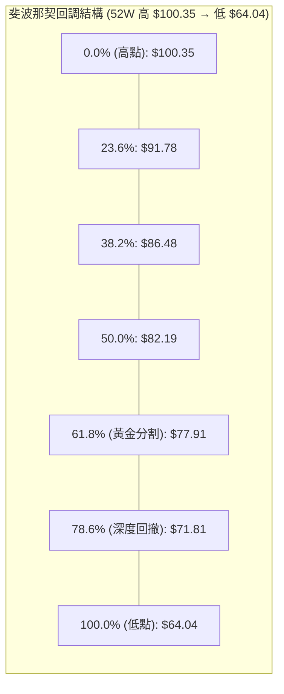

**斐波那契回調位詳細解讀**：
- **當前位置**：現價 **$65.25** 位於 **78.6% 回調位 ($71.81)** 與 **100.0% 回調位 ($64.04)** 之間。
- **深度回撤含義**：在道氏理論與斐波那契技術體系中，回調跌破 61.8% ($77.91) 且進一步失守 78.6% ($71.81) 時，表明此前的多頭上升波段已被徹底破壞，行情已經由「回調修正」演化為「全面轉熊」。
- **下行風險測算**：目前價格距離 100.0% 終極支撐 **$64.04** 僅剩 **$1.21 (約 1.85%)** 的緩衝空間。$64.04 是空頭攻陷整個波段的最後防線。

---

## 5. 技術指標深度解讀

### 🎛️ 指標訊號總覽

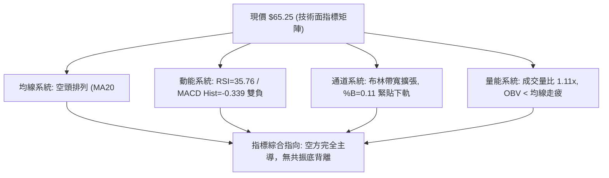

### 📈 移動平均線排列分析

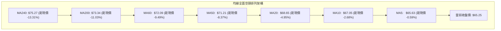

**移動平均線詳細解讀表**：

| 均線名稱 | 當前價格 | 與現價乖離率 | 微觀走勢特徵 | 訊號解讀 |
|----------|----------|--------------|--------------|----------|
| **MA5**  | $65.63 | -0.59% | 短天期下彎，連續壓制日 K 線實體 | 🔴 極短線空頭 |
| **MA10** | $67.05 | -2.68% | 陡峭向下，為過去兩週反彈的天花板 | 🔴 短線下行壓制 |
| **MA20** | $68.65 | -4.95% | 跌破後斜率持續轉負，空頭生命線 | 🔴 短期空頭排列 |
| **MA50** | $71.21 | -8.37% | 中期季線，與波段高點 R1 ($72.08) 形成雙重阻力 | 🔴 中期空頭格局 |
| **MA60** | $72.09 | -9.49% | 與 R1 ($72.08) 高度重合，形成密集籌碼套牢峰 | 🔴 密集反壓區 |
| **MA200**| $73.34 | -11.03% | 年線失守超過兩個月，均線排列呈現完全標準空頭發散 | 🔴 長期牛熊翻空 |

### 📉 RSI(14) 分析

**RSI 當前狀態進度條**：
```
超賣區 (0-30)        中性區 (30-70)                 超買區 (70-100)
├──────────────┼──────────────────────────────┼──────────────┤
██████████████░░░░░░░░░░░░░░░░░░░░░░░░░░░░░░░░░░░░░░░░░░░░░░░░
0             30  35.76                      70            100
                  ▲ (當前 RSI: 35.76)
```

- **數值與區間評估**：RSI(14) 讀數為 **35.76**，處於 30 至 70 的中性區間偏弱端，尚未正式進入低於 30 的極端超賣區域。這表明儘管跌勢劇烈，但下行慣性尚未觸發反向均值回歸的強制買盤。
- **背離分析判斷**：數據明確標註「RSI 背離: 無明顯背離」。比較近 20 根 K 棒的首尾走勢，價格自 $71.51 跌至 $65.25，而 RSI 自 52.9 同步滑落至 35.76。**價格走低、指標同步走低，未出現底背離特徵**，空方趨勢健康，否定了短線即將出現強勁 V 型反轉的可能。

### 📊 MACD(12,26,9) 訊號解讀

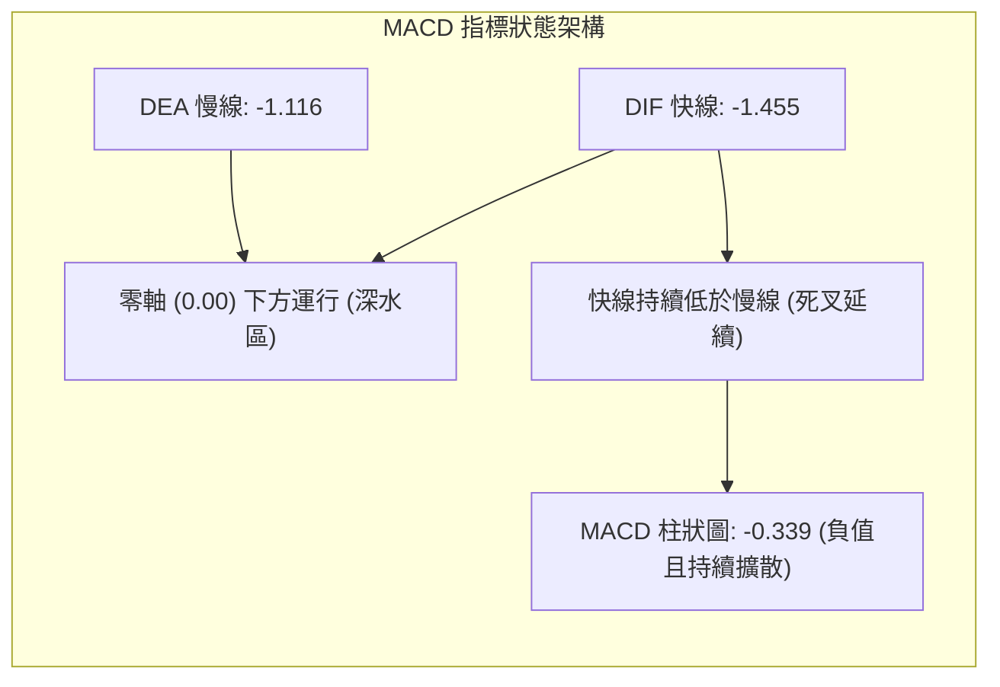

- **數值解讀**：MACD 線為 **-1.455**，信號線（Signal line）為 **-1.116**，差值（Histogram）為 **-0.339**。
- **空頭訊號強化**：DIF 與 DEA 均位於零軸深水區，且 DIF 線持續在 DEA 線下方發散，柱狀圖呈現顯著負值且無收斂跡象，表明中短期市場拋壓強烈，空頭動能仍處於加速釋放過程中。

### 📦 布林通道分析

```
ASCII 布林通道示意圖
價格 ($)
$73.00 ┤─────────────────────────────── BB 上軌 ($73.00)
$71.00 ┤
$69.00 ┤- - - - - - - - - - - - - - - - BB 中軌 ($68.65) = MA20
$67.00 ┤
$65.25 ┤═══════════════════════════════ 現價 $65.25 (%B = 0.11)
$64.30 ┤─────────────────────────────── BB 下軌 ($64.30)
       └────────────────────────────────
```

- **通道帶寬與形態**：上軌 **$73.00**，中軌 **$68.65**，下軌 **$64.30**。帶寬落差達 $8.70。
- **位置與指標含義**：%B 讀數僅為 **0.11**（0 代表下軌，0.5 代表中軌，1 代表上軌），現價緊貼下軌運行。在強烈單邊下行趨勢中（ADX > 25），價格緊貼布林下軌滑落屬於典型的「沿下軌走低（Riding the Band）」空頭形態，不應盲目將觸及下軌視為買入理由。

### 💹 成交量分析（量價配合度）

1. **量能放大現狀**：最新單日成交量為 **17,934,900 股**，相較於 20 日均量 **16,226,880 股**，量比達到 **1.11x**。在價格跌破 $66.00 的過程中成交量放大，呈現「量增價跌」的被動拋售特徵。
2. **週成交量檢視**：近一週（截至 2026-10-30）週成交量達 **95,336,300 股**，高於前一週的 **84,761,000 股**，呈現週線級別的放量破底。
3. **能量潮指標 (OBV)**：數據顯示「OBV < MA → 量能疲弱」。OBV 能量潮跌破其自身移動平均線，且持續刷新波段低點，說明主力資金籌碼正在穩步撤離，買盤僅由市場散戶限價單承接，量價配合確認整體跌勢尚未見底。

---

## 6. 動能與波動率

### ⚡ 動能評估四象限

```
動能與波動率評估矩陣 (Momentum-Volatility Matrix)
高波動 (High Vol) ┌─────────────────────────┬─────────────────────────┐
                  │       象限 Q3 (進取)     │       象限 Q4 (風險)    │
                  │  高動能 / 高波動        │  弱動能 / 高波動        │
                  │  (強烈趨勢突破市場)     │  (極端拋售恐慌市場)     │
                  ├─────────────────────────┼─────────────────────────┤
                  │       象限 Q1 (穩健)     │       象限 Q2 (低迷)    │
                  │  強動能 / 低波動        │  弱動能 / 低波動        │
                  │  (穩步牛市推升浪)       │  (陰跌探底/當前位置)  ◄─┼── UBER 處於 Q2
低波動 (Low Vol)  └─────────────────────────┴─────────────────────────┘
                   強動能 (Bullish)           弱動能 (Bearish)
```

**動能評估四象限詳細判定表**：

| 象限 | 動能維度 | 波動維度 | 當前狀態標記 | 技術評估與操作意涵 |
|------|----------|----------|--------------|--------------------|
| **Q1** | 強動能 | 低波動 | — | 最佳波段順勢做多區間，目前完全不具備此條件 |
| **Q2** | **弱動能 (空方控盤)** | **中低波動 (ATR 2.59%)** | **✓ (當前所處區間)** | **陰跌探底狀態**。空方持續緩步出貨，尚未出現恐慌性巨量暴跌，下行趨勢具有高度慣性與持久性 |
| **Q3** | 強動能 | 高波動 | — | 趨勢噴發或軋空行情，與當前疲弱走勢相悖 |
| **Q4** | 弱動能 | 高波動 | — | 恐慌崩跌區間，通常伴隨 ATR 飆升與恐慌性拋售，為最終見底信號；目前 UBER 尚未進入此階段 |

### 📊 ATR 波動率分析

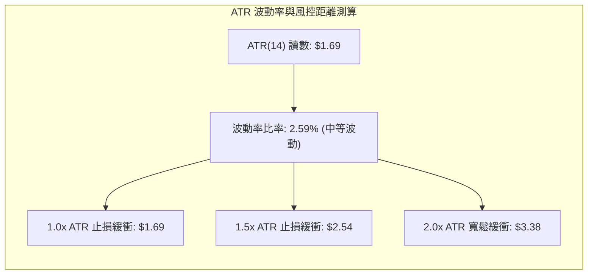

- **數值與波動評估**：當前 ATR(14) 為 **$1.69**（採 Wilder 計算），佔收盤價 $65.25 的比例為 **2.59%**。表明個股日均日常震盪幅度約為 $1.70 左右，波動度處於常態健康區間，並未失控。
- **交易止損設計依據**：
  - 做空操作時，合理防守止損應設定於反彈壓制點上方 **1.0x 至 1.5x ATR**（即 **$1.69 ~ $2.54**），避免被日內隨機雜訊掃出場。
  - 當前若以 MA20 **$68.65** 或波段阻力 **$72.08** 為參考基準，其空間跨度與 ATR 具備高度數學協同性。

### 📐 Beta 與市場相關性

- **Beta 係數解讀**：UBER 的 Beta 值為 **1.265**。
- **市場敏感度分析**：
  - 該數值顯示 UBER 屬於**高貝塔 (High Beta)** 成長/科技屬性標的，其股價波動幅度平均高出標普 500 指數約 26.5%。
  - 在大盤整體承壓或市場避險情緒升溫環境下，高 Beta 標的往往首當其衝遭遇外資機構系統性去槓桿拋售。當前機構持股比例高達 **85.3%**，機構集體減倉是推動股價從高檔 $100.35 一路陰跌至 $65.25 的關鍵基本面推手。

---

## 7. 多時框架總結

### 📋 時框架評分表

| 時框架 | 趨勢方向 | 動能狀態 | 均線排列 | 圖表形態 | 時框評分 | 戰術建議 |
|--------|----------|----------|----------|----------|----------|----------|
| **月線 (長期)** | 🔴 下行走弱 | 🔴 空方釋放 (自高位大幅回落) | 🟡 跌破多條長期均線 | 🔴 頂部回落主跌浪 | 30/100 | 長期投資者暫停定投，等待底部成形 |
| **週線 (中期)** | 🔴 強烈空頭 | 🔴 MACD 雙線在零軸下 | 🔴 空頭排列 (MA20<50<200) | 🔴 沿下行通道下移 | 25/100 | 中線反彈皆為減倉與建立對沖空單時機 |
| **日線 (短期)** | 🔴 下跌探底 | 🟡 隨機指標超賣/RSI 35.76 | 🔴 均線空頭發散 | 🔴 測試 52 週低點 | 35/100 | 空單嚴格持有，多頭切勿盲目抄底 |

### 🔲 綜合訊號矩陣

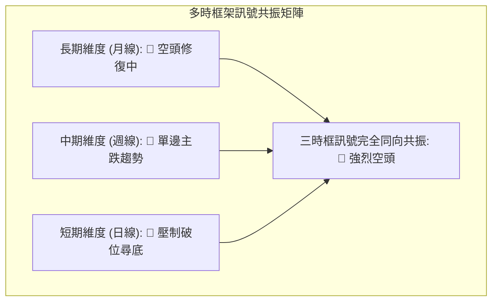

### ⚖️ 多時框收斂結論

依據【嚴格要求 14】之多時框收斂規則進行客觀裁決：
1. **行情性質判定**：ADX(14) 讀數為 **27.41**，已明確跨越 **25.0** 的強趨勢門檻，且 -DI (27.53) 徹底主導 +DI (9.39)。因此，當前市場狀態**定性為標準的趨勢行情 (Trend Market)，而非區間盤整行情**。
2. **收斂優先級取捨**：依規則，趨勢行情下必須**以中長期（週線、MA50 $71.21、MA200 $73.34）的趨勢方向為絕對核心**，日線級別的隨機指標（Stoch %K 15.47）超賣與 K 線長下影僅能作為短線籌碼暫時休整的微觀現象，**絕不可作為推翻大級別空頭趨勢的依據**。
3. **唯一方向性結論**：**【強烈偏空 (Strongly Bearish)】**。
   - 所有時框方向高度統一，週線與月線均處於單邊下行浪中。
   - 日線在 52 週低點 **$64.04** 處若有微弱弱勢抵抗，僅為空單尋求更優進場價格的「反抽窗口」，絕非多頭反轉信號。

---

## 8. 交易策略建議

### 🗺️ 策略決策流程圖

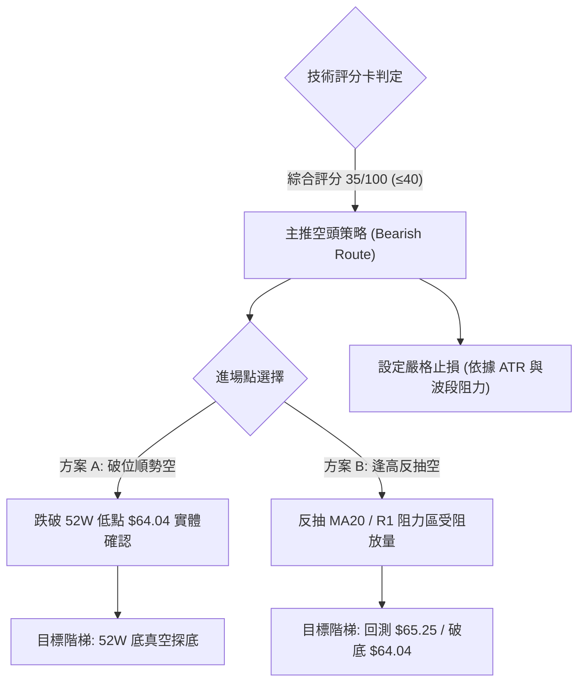

### 🧭 策略路由（依評分卡分流）

> **當前主策略方向 = 【逢高做空 / 破位順勢做空】（依綜合評分 35/100，評級偏空 ≤ 40）**

本報告遵循嚴格交易紀律，絕不進行多空雙向摸稜兩可的對沖推薦。鑑於綜合評分僅為 **35/100**，均線完全空頭排列且 ADX 趨勢確立，**主推空頭獲利策略**。多頭操作僅被視為反轉風險對沖考量，不予配置主動做多策略。

### 🎯 價格情境階梯（Price Scenarios）

價位嚴格引用第 4 章中由 OHLCV 與數據庫計算之精確數值：

| 觸發條件 | 下一目標價 | 後續延伸目標 | 情境含義與技術應對 |
|----------|------------|--------------|--------------------|
| **跌破 $64.04** | **N/A (下方無聚類)** | **探索未知低點** | 摜破 52 週終極支撐，引發恐慌性停損，空頭主跌第三浪開啟 |
| **弱勢徘徊於現價區間** | **$64.04** | **$68.65 (MA20)** | 於 $64.04 ~ $68.65 之間低位抵抗，消耗短線超賣動能後續跌 |
| **反彈受阻於 R1 $72.08** | **$68.65** | **$64.04** | 技術性深幅回抽，遭遇 Fib 78.6% ($71.81) 及 R1 強烈共振壓制，為最佳高空點 |
| **強勢突破 R1 $72.08** | **R2 $76.30** | **R3 $78.60** | 空頭結構被階段性破壞，需立即無條件平倉所有空單避險 |

### 📊 情境機率分佈

| 交易情境 | 發生機率 | 主要技術與量化指標依據 |
|----------|----------|------------------------|
| **跌破 52W 低點續挫 (再探底)** | **60%** | MACD 柱狀圖 -0.339 持續走弱；OBV < 均線量能潰散；ADX 27.41 伴隨 -DI 27.53 展現強烈下行推動力 |
| **弱勢窄幅震盪 (消耗超賣)** | **25%** | 隨機指標 Stoch %K: 15.47 / %D: 15.02 處於嚴重超賣區，短線殺跌動能暫時受到 $64.04 心理關卡抵抗 |
| **強勢反彈向上測試阻力** | **15%** | 僅在極端利多或大盤強軋空環境下可能發生；上方遭遇 MA20 ($68.65) 與 R1 ($72.08) 雙重重壓 |

### 🟢 主策略詳情（空頭交易策略）

所有價位均來自第 4 章關鍵價位區塊，風險報酬比嚴格依照規則 17 定義計算：
- 空頭風險報酬比 = (進場價 − 目標價 T1) ÷ (止損價 − 進場價)

| 策略要素 | 策略 A：破位順勢追空 (Breakdown Short) | 策略 B：反抽承壓放空 (Pullback Short) |
|----------|-----------------------------------------|----------------------------------------|
| **交易邏輯** | 52 週最低點 $64.04 被放量跌破後的動能追空 | 價格反彈至動態均線反壓位受阻後的順勢放空 |
| **進場條件** | 日 K 線實體收盤跌破 $64.04，且成交量放大 | 股價回抽接近 MA20，於阻力位出現長上影或陰線滯漲 |
| **精確進場價格** | **$63.80**（確認破位 $64.04 下方 1.0x ATR 緩衝進場） | **$68.65**（精確依據 MA20 / 布林中軌壓力位） |
| **目標價 T1** | **$60.00**（以形態下行通道測算延伸整數關卡） | **$64.04**（精確引用 52 週低點支撐聚類） |
| **目標價 T2** | **$55.00**（以中長期週線第二下行浪投射目標） | **$60.00**（形態投射延伸位） |
| **止損價格** | **$65.70**（重回破位點 $64.04 之上 +1.1x ATR 緩衝） | **$70.95**（MA50 $71.21 下方保護位，止損空間 $2.30） |
| **風險報酬比** | **1 : 2.00（以 T1 計）**<br>計算式: $(63.80 - 60.00) \div (65.70 - 63.80) = 3.80 \div 1.90 = 2.00$ | **1 : 2.00（以 T1 計）**<br>計算式: $(68.65 - 64.04) \div (70.95 - 68.65) = 4.61 \div 2.30 = 2.00$ |
| **成功機率** | **65%** | **70%** |
| **建議倉位** | **15% - 20%**（破位單注重執行速度） | **20% - 25%**（反抽單勝率與盈虧比更優） |

### 🔴 反向風險觸發點（對沖提示）

若市場出現以下情況，主空頭策略假設即刻失效，所有空頭頭寸必須嚴格止損：
1. **實體突破 R1: $72.08**：若日線級別收盤價強勢站上 $72.08（近一年波段高點聚類與 Fib 78.6% 重合處），空頭形態徹底瓦解，市場宣告進入中期築底或反轉格局。
2. **MACD 底背離形成**：若股價跌破 $64.04 但 MACD 柱狀圖與 DIF 線不再破前低，且出現零軸下方黃金交叉，需提防空頭陷阱。

### ⭐ 整體訊號強度評星

```
做多訊號強度：★☆☆☆☆  (1/5星 - 僅有極短線超賣指標，多方買盤微弱)
做空訊號強度：★★★★☆  (4/5星 - 均線空頭排列，趨勢強度確立，空方全面主導)
整體可信度：  ★★★★☆  (4/5星 - 多時框架共振收斂，指標信號高度一致)
```

---

## 9. 風險提示與監控

### ✅ 關鍵監控指標 Checklist

```
╔══════════════════════════════════════════════════════════════╗
║               UBER 日常交易關鍵技術監控清單                  ║
╠══════════════════════════════════════════════════════════════╣
║ [ ] 52 週最低點防線：盤中與收盤是否跌破 $64.04 關卡           ║
║ [ ] 短線反彈天花板：反抽是否受制於 MA20 ($68.65) 動態反壓    ║
║ [ ] 趨勢強度變化：ADX(14) 是否持續維持於 25.0 之上且擴散     ║
║ [ ] 趨勢方向確認：-DI (27.53) 是否持續壓制 +DI (9.39)         ║
║ [ ] 量能背離警訊：下破時成交量是否超過 20 日均量 (16.22M)   ║
║ [ ] 動能修復檢視：RSI(14) 能否放量突破 50.0 多空分水嶺       ║
║ [ ] MACD 柱狀變化：負值柱狀圖 (-0.339) 是否出現連續收斂      ║
╚══════════════════════════════════════════════════════════════╝
```

### ⚠️ 風險場景分析

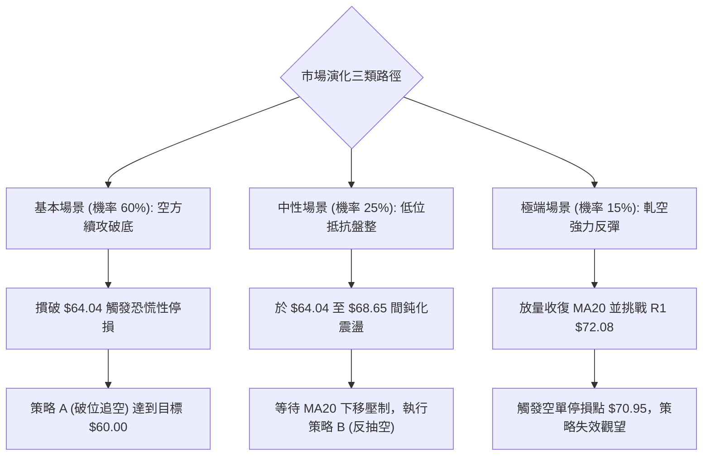

### 🛡️ 風險管理重要提醒

1. **基本面催化劑風險（財報發布）**：
   - 近期新聞明確提及「What to expect from Uber's Q3 earnings report」及「Earnings this week」。財報發布前後隱含波動率將大幅攀升，容易引發隔夜跳空風險。**建議在財報公布當日收盤前將空頭部位縮減至 10% 以下或進行保護性期權對沖**。
2. **外部競爭與政策雜訊**：
   - 新聞顯示特斯拉 Cybercab 成本優勢及 Robotaxi 監管政策正對 UBER 估值帶來重估壓力，但同時 FTC 調查對手 Instacart 亦帶來同業併購變數。技術面偏弱已反映部分利空，但需防範非理性消息面突發反彈。
3. **資金管理與倉位控制**：
   - 單筆空頭交易風險承擔金額（Risk Capital）不得超過總帳戶權益的 **1.5% - 2.0%**。
   - 若採用策略 B，進場點 $68.65，止損點 $70.95，每股承擔風險為 $2.30。以 10 萬美元帳戶（2% 風險 = $2,000）為例，最大持倉股數應嚴格限制在 $2000 \div 2.30 \approx 860$ 股之內。

---

## 📋 報告總結

```
╔════════════════════════════════════════════════════════════════╗
║                     UBER 技術分析報告總結                      ║
╠════════════════════════════════════════════════════════════════╣
║ 報告日期：2026-11-02                                           ║
║ 當前價格：$65.25                                               ║
║ 分析評級：🔴 強烈看空 / 逢高做空 (綜合評分: 35/100)            ║
╠════════════════════════════════════════════════════════════════╣
║ 關鍵結論：                                                     ║
║ ├─ 長期趨勢：🔴 自高位 $100.35 深度回撤，失守 MA200，轉入空頭 ║
║ ├─ 中期趨勢：🔴 下行通道運行，週線 MACD 零軸下發散，壓制明顯  ║
║ ├─ 短期趨勢：🔴 逼近 52 週低點 $64.04，各級均線呈標準空頭發散 ║
║ ├─ 關鍵支撐：$64.04 (52W最低點；跌破後下方無波段低點聚類)     ║
║ ├─ 關鍵阻力：$68.65 (MA20) / $72.08 (強阻力 R1 / Fib 78.6%)  ║
║ └─ 分析師目標：分析師平均目標 $100.86 (與技術面嚴重背離，忽視) ║
╠════════════════════════════════════════════════════════════════╣
║ 最優策略組合：                                                 ║
║ 1. 🥇 最佳機會：策略 B (反抽空) — 待反彈至 MA20 $68.65 受阻放 ║
║               空，止損 $70.95，目標 $64.04 (風報比 1:2.00)     ║
║ 2. 🥈 次選機會：策略 A (破位空) — 跌破 $64.04 於 $63.80 追空， ║
║               止損 $65.70，目標 $60.00 (風報比 1:2.00)         ║
║ 3. 🥉 防守建議：持有多頭現貨者應嚴設 $64.04 停損，破位無條件離 ║
║               場，切忌逆勢摸底加碼攤平。                       ║
╚════════════════════════════════════════════════════════════════╝
```

---

> ⚠️ **免責聲明**：本報告為技術分析研究，所有數據、圖表及估算均嚴格基於歷史量價數據與量化模型計算。本報告**僅供研究與學術參考**，**不構成任何買賣要約或投資建議**。金融市場具有高度風險，投資人應獨立思考並自行承擔交易損益。

---

*報告生成時間：2026-11-02 ｜ 數據來源：Yahoo Finance ｜ 分析框架：多時框技術分析體系*