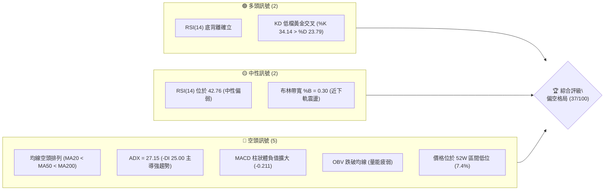
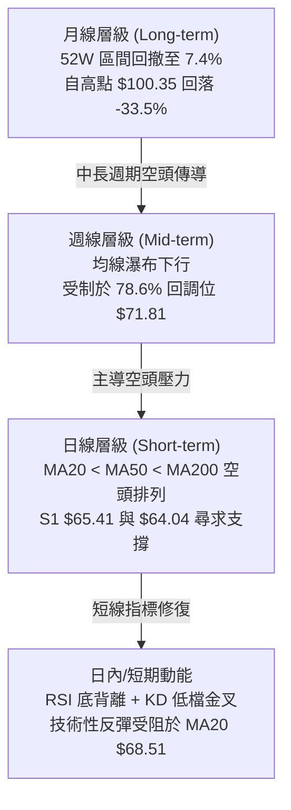
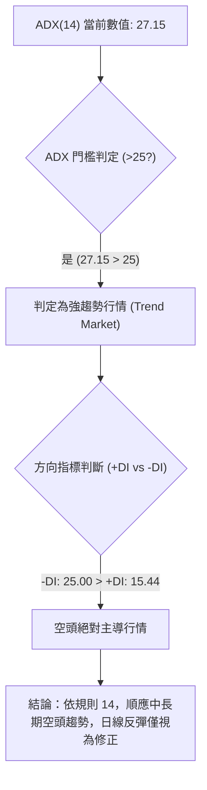
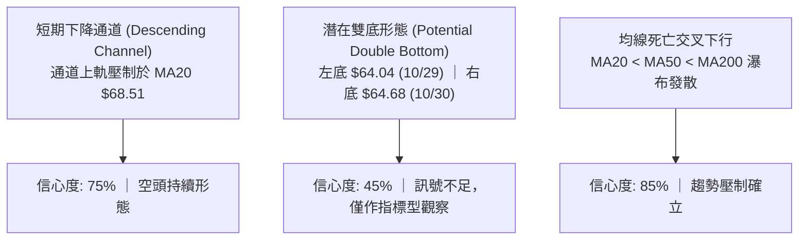
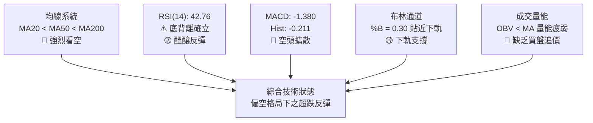
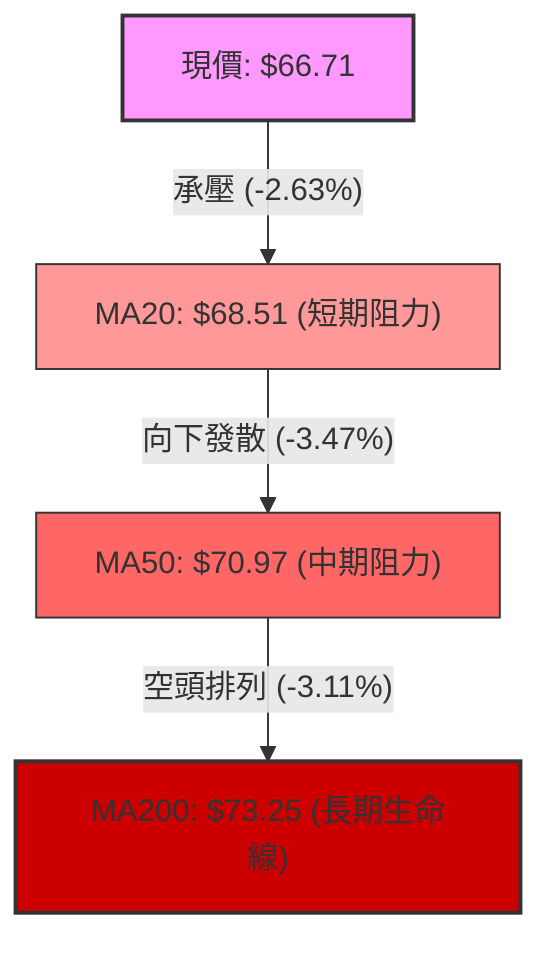
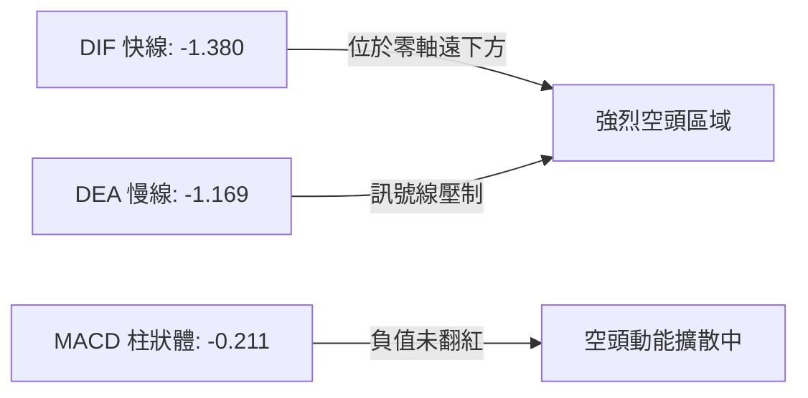
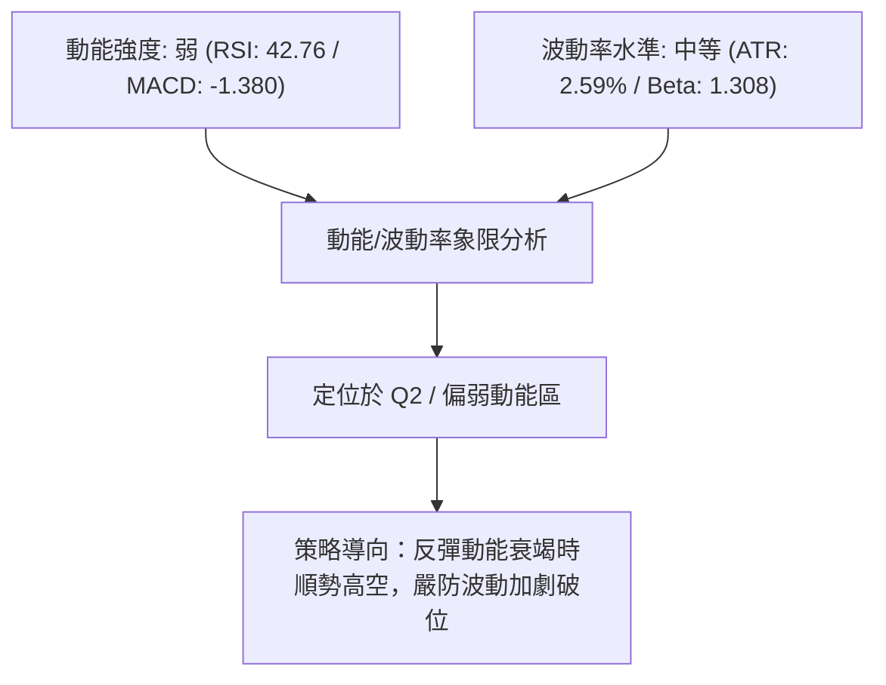
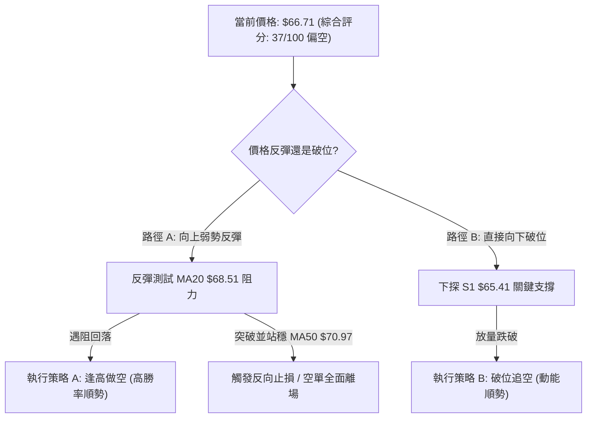
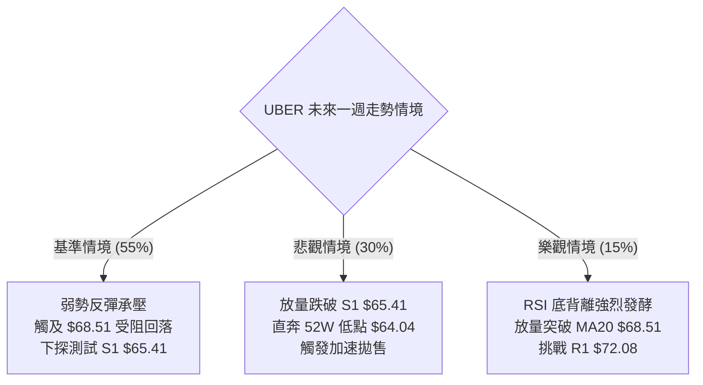

# UBER 技術分析報告

> **報告日期**：2026-11-03 ｜ **語言**：繁體中文 ｜ **數據來源**：Yahoo Finance ｜ **當前價格**：$66.71

---

## 目錄

| 章節 | 內容 |
|------|------|
| [1. 技術面概覽](#1-技術面概覽) | 訊號儀表板、核心指標、評分卡 |
| [2. 趨勢分析](#2-趨勢分析) | 多時框趨勢、長中短期走勢、ADX解讀 |
| [3. 圖表形態分析](#3-圖表形態分析) | 形態識別、K線組合、目標價推算 |
| [4. 支撐與阻力](#4-支撐與阻力) | 關鍵價位、斐波那契回調結構 |
| [5. 技術指標深度解讀](#5-技術指標深度解讀) | MA/RSI/MACD/布林/成交量 |
| [6. 動能與波動率](#6-動能與波動率) | 動能評估、ATR、Beta |
| [7. 多時框架總結](#7-多時框架總結) | 時框架評分矩陣、收斂結論 |
| [8. 交易策略建議](#8-交易策略建議) | 策略路由、主策略詳情、風險報酬比 |
| [9. 風險提示與監控](#9-風險提示與監控) | 監控指標、風險場景、部位控管 |
| [📋 報告總結](#-報告總結) | 核心結論與最佳機會彙整 |

---

## 1. 技術面概覽

### 🎯 技術訊號儀表板



### 📊 核心指標速覽表

| 指標類別 | 指標名稱 | 當前數值 | 訊號 | 解讀 |
|:---|:---|:---|:---:|:---|
| **價格** | 當前收盤價 | $66.71 | 🔴 | 位於 52W 區間底部 7.4% 位置，受制於各期均線 |
| **均線** | MA20 | $68.51 | 🔴 | 價格在 MA20 下方 -2.63%，短線下行壓力未消 |
| **均線** | MA50 | $70.97 | 🔴 | 價格在 MA50 下方 -6.00%，中期空頭主導 |
| **均線** | MA200 | $73.25 | 🔴 | 價格在 MA200 下方 -8.93%，長期牛熊分界線失守 |
| **動能** | RSI(14) | 42.76 | 🟡 | 位於中性偏弱區，首尾 20 根 K 棒呈現底背離 |
| **動能** | MACD | -1.380 | 🔴 | MACD 線低於訊號線 (-1.169)，柱狀體 -0.211 |
| **動能** | Stochastic | %K: 34.14 / %D: 23.79 | 🟢 | 低檔黃金交叉向上，醞釀短線技術性反抽 |
| **趨勢** | ADX(14) | 27.15 | 🔴 | ADX > 25 且 -DI(25.00) 顯著高於 +DI(15.44)，空頭強趨勢 |
| **通道** | 布林通道 | 下軌 $64.09 / 上軌 $72.92 | 🟡 | %B 為 0.30，價格自下軌獲得支撐但受制中軌 |
| **量能** | 成交量比 / OBV | 1.09x / OBV < MA | 🔴 | 最新量 17.65M 略高於 20MA，但整體 OBV 疲弱 |
| **波動** | ATR(14) | $1.73 | 🟡 | 佔現價 2.59%，波動度中等，日均震盪區間收窄 |

### 🏆 技術評分卡

```
╔════════════════════════════════════════════════════════════════╗
║                   技術評分卡 — UBER (2026-11-03)               ║
╠════════════════════════════════════════════════════════════════╣
║ 趨勢強度 (Trend)     ███████░░░░░░░░░░░░░  35/100  🔴 空頭強勢  ║
║ 動能指標 (Momentum)  ██████████░░░░░░░░░░  48/100  🟡 底背離醞釀║
║ 支撐穩定度 (Support) ████████░░░░░░░░░░░░  42/100  🟡 S1 測試中 ║
║ 成交量配合 (Volume)  ██████░░░░░░░░░░░░░░  32/100  🔴 量能渙散  ║
║ 形態完整度 (Pattern) ████████░░░░░░░░░░░░  40/100  🟡 弱勢整理  ║
║ 均線排列 (MA Align)  █████░░░░░░░░░░░░░░░  25/100  🔴 完全空頭  ║
╠════════════════════════════════════════════════════════════════╣
║ 綜合評分             ███████░░░░░░░░░░░░░  37/100  🔴 偏空格局  ║
║ (依規則 18：六項子評分算術平均四捨五入: 222 ÷ 6 = 37/100)      ║
╚════════════════════════════════════════════════════════════════╝
```

---

## 2. 趨勢分析

### 🌐 多時框趨勢分析



### 📈 長期趨勢 — 12個月走勢圖（Unicode）

```
UBER 月線走勢圖（過去12個月：2025-11 至 2026-11）
價格 ($)
$90 ┤ ● ($87.54)
$85 ┤    ● ($81.71)
$80 ┤       ● ($80.05)
$75 ┤          ● ($75.42)          ● ($75.65)
$70 ┤             ● ($71.93) ●($74.61) ●($72.16)
$65 ┤                         ●($70.40)  ●($70.36) ● ($68.51)   ● ($66.71 現在)
$60 ┤                                                ● ($65.25)
    └─┬──────┬──────┬──────┬──────┬──────┬──────┬──────┬──────┬──────┬──────┬──────┬───
     11/25  12/25  01/26  02/26  03/26  04/26  05/26  06/26  07/26  08/26  09/26  10/26 11/26
```

#### 長期走勢特徵分析表格

| 階段區間 | 起訖月份 | 起訖價格 | 區間漲跌幅 | 主要走勢特徵與量價行為 |
|:---|:---:|:---:|:---:|:---|
| **頂部回撤期** | 2025-11 → 2026-03 | $87.54 → $71.93 | -17.83% | 自歷史高點 $100.35 展開主跌浪，逐月創低，高點下移 |
| **箱體震盪期** | 2026-04 → 2026-08 | $74.61 → $75.65 | +1.39% | 圍繞 $70.00–$76.00 築平台，反彈未能觸及 MA200 |
| **二次破位期** | 2026-08 → 2026-10 | $75.65 → $65.25 | -13.75% | 平台下軌跌破，恐慌盤殺跌至 52W 低點 $64.04 |
| **築底試探期** | 2026-10 → 2026-11 | $65.25 → $66.71 | +2.24% | 於 52W 低點上方出現初步止跌，成交量維持 17M 左右 |

### 📊 中期趨勢（週線分析）

從近 20 週收盤走勢來看，UBER 在 2026 年 8 月下旬於 $78.82 觸頂（接近阻力位 R3 $78.60）後展開連續 10 週的下降趨勢：
1. **高點不斷降低**：8 月底高點 $78.82 → 10 月中旬反彈高點 $72.08（精確受制於阻力位 R1 $72.08）→ 最新一週高點僅達 $67.47。
2. **週線 MACD 轉弱**：自 2026-09-04 起週線 MACD 柱狀體翻負，最低下探至 -0.854，近兩週負值略有收斂（-0.339 → -0.211），但尚未出現翻紅訊號。
3. **週成交量萎縮**：自 8 月初反彈放量的 147.7M 逐步降至 10 月下旬的 80M–95M 水平，顯示多頭主力在下跌過程中並無積極護盤承接。

```
週線關鍵壓力與支撐示意圖：
[壓力 R3: $78.60] ══════════════════════════════ (8月下旬反彈高點)
       ▲
[壓力 R1: $72.08] ────────────────────────────── (10/09 反彈頂部 / 斐波那契 78.6% $71.81)
       ▲
[現價 : $66.71]  ● (受制於日線 MA20 $68.51)
       ▼
[支撐 S1: $65.41] ────────────────────────────── (近期低點聚類)
       ▼
[強支撐: $64.04]  ══════════════════════════════ (52週極限低點 / 斐波那契 100%)
```

### ⚡ 趨勢強度評估（ADX 解讀）



| 趨勢強度指標 | 數值 | 狀態區間 | 技術意義解讀 |
|:---|:---:|:---:|:---|
| **ADX(14)** | 27.15 | 強趨勢 (>25) | 脫離無方向盤整，市場處於確定性的趨勢進程中 |
| **+DI(14)** | 15.44 | 弱勢 (<20) | 多頭買盤力道薄弱，無法發動趨勢型上攻 |
| **-DI(14)** | 25.00 | 強勢 (>20) | 空方賣壓主導價格波動路徑 |
| **Direction Bias** | 空頭 | -DI 領先 +9.56 | 空方佔據壓倒性優勢，不宜盲目逆勢猜底 |

---

## 3. 圖表形態分析

### 🔍 形態識別系統



#### 形態識別與信心度評估表（依規則 15）

| 形態名稱 | 信心度 | 判斷依據（引用數據） | 完成度 | 目標價（附精確計算式） |
|:---|:---:|:---|:---:|:---|
| **短期下降通道** | **75%** | 高點沿 10/20 $69.75 → 10/23 $68.90 → 11/02 $67.47 下降；低點自 $68.40 跌至 $64.04 | 85% | 下軌支撐目標：52W 低點 **$64.04** |
| **潛在雙重底** | **45%** | 10/29 低點 $64.04 與 10/30 低點 $64.68 形成二次探底；但尚未突破頸線 $67.47 | 35% | 訊號不足（<50%），依規則 15 僅作指標型解讀。若突破頸線 $67.47：目標 = $67.47 + ($67.47 − $64.04) = **$70.90**（接近 MA50 $70.97） |
| **反彈受阻旗形** | **65%** | 自 10/29 低點 $64.04 反彈至 11/02 收盤 $66.71，成交量萎縮，符合弱勢旗形反抽 | 60% | 若跌破旗面下軌 $65.41：推算下行目標 = $65.41 − ($67.47 − $64.04) = **$61.98** |

### 🕯️ 重要 K 線形態分析（依規則 19，近 10 根日 K 與近 8 根週 K）

#### 近 10 根日 K 線形態解讀

| 日期 | 開盤價 | 最高價 | 最低價 | 收盤價 | 成交量 | K 線形態名稱 | 專業技術解讀與多空訊號 |
|:---:|:---:|:---:|:---:|:---:|:---:|:---:|:---|
| **10-20** | $69.01 | $69.75 | $68.40 | $68.94 | 15,737,500 | 衝高受阻小陰線 | 上影線長度 $0.81，承壓於 $70 整數關卡，🔴 空方佔優 |
| **10-21** | $69.01 | $69.23 | $67.36 | $67.62 | 16,839,200 | 中陰線 (Bearish) | 開平走低，實體達 $1.39，跌破 $68.00 關卡，🔴 空方主導 |
| **10-22** | $67.45 | $69.15 | $67.33 | $69.07 | 19,328,900 | 下影中陽線 (Bullish) | 下探 $67.33 後獲買盤拉抬，放量反彈收復失地，🟢 多方反撲 |
| **10-23** | $68.47 | $68.90 | $66.43 | $66.70 | 18,778,200 | 長陰吞噬 (Engulfing) | 高開低走，完全吞沒前一日漲幅，創波段新低，🔴 強烈看空 |
| **10-26** | $66.62 | $67.00 | $65.68 | $66.13 | 22,057,900 | 放量下挫小陰線 | 成交量放大至 22M，賣壓沉重，向下尋求支撐，🔴 空頭延續 |
| **10-27** | $66.40 | $66.50 | $65.47 | $65.78 | 20,731,800 | 弱勢小陰線 | 連續四日收低，實體緊貼下影線，多頭毫無抵抗，🔴 弱勢尋底 |
| **10-28** | $65.50 | $65.88 | $64.69 | $65.27 | 18,324,900 | 破位小陰線 | 首次跌破 $65.00，下探 $64.69，空頭慣性下挫，🔴 空方壓制 |
| **10-29** | $65.28 | $65.80 | $64.04 | $65.74 | 16,286,800 | 錘頭線 (Hammer) | 探至 52W 低點 $64.04 後強烈回升，下影線長達 $1.70，🟢 止跌訊號 |
| **10-30** | $65.61 | $65.80 | $64.68 | $65.25 | 17,962,800 | 二次探底孕線 (Harami) | 高低點均包含在前一日震盪範圍內，低點 $64.68 未破前低，🟡 多空平衡 |
| **11-02** | $66.12 | $67.47 | $65.55 | $66.71 | 17,655,900 | 震盪收高陽線 | 向上突破 5 日線，最高觸及 $67.47，收盤站上開盤價，🟢 偏多反彈 |

#### 近 8 根週 K 線形態解讀

| 週末日期 | 開盤價 | 最高價 | 最低價 | 收盤價 | 週成交量 | K 線形態名稱 | 專業技術解讀與多空訊號 |
|:---:|:---:|:---:|:---:|:---:|:---:|:---:|:---|
| **09-18** | $71.97 | $72.80 | $70.06 | $70.50 | 92,992,700 | 衝高回落中陰線 | 上影線長 $0.83，空方在 $72.80 築頂，🔴 空方佔優 |
| **09-25** | $70.82 | $71.90 | $68.55 | $69.62 | 86,777,700 | 破位中陰線 | 實體跌破 $70.00 整數關卡，週線連兩陰，🔴 空頭主導 |
| **10-02** | $69.36 | $69.97 | $67.22 | $68.11 | 80,475,800 | 帶下影陰線 | 下探 $67.22，空方持續主導但下檔初見買盤，🔴 弱勢震盪 |
| **10-09** | $68.40 | $72.08 | $68.00 | $71.51 | 75,174,900 | 長陽反彈 (Bullish) | 暴漲收復 $71.51，精確受阻於 R1 $72.08，🟢 強勁反抽 |
| **10-16** | $71.16 | $71.86 | $68.62 | $70.35 | 69,265,400 | 流星線 (Shooting Star)| 再次衝擊 $72.00 失敗，長上影線預示反彈結束，🔴 見頂回落 |
| **10-23** | $70.13 | $70.76 | $66.43 | $66.70 | 84,761,000 | 破位大陰線 | 暴跌 -5.19%，實體長達 $3.43，空方全面摜壓，🔴 趨勢破位 |
| **10-30** | $66.62 | $67.00 | $64.04 | $65.25 | 95,364,200 | 長下影試底陰線 | 下挫至 52W 低點 $64.04，放量留下 $1.21 下影線，🟡 底部支撐 |
| **11-02** | $66.12 | $67.47 | $65.55 | $66.71 | 17,655,900 | 週初小陽線 | （僅統計單日）反彈挑戰上週高點，🟢 短線修復 |

### 📉 ASCII 走勢形態示意圖

```
日線級別「下降旗形 / 雙底測試」形態示意圖：
$70.00 ┤                                
$69.00 ┤  ● (10/20 高 $69.75)           
$68.00 ┤   \     ● (10/22 高 $69.15)    
$67.00 ┤    \   / \                     ● (11/02 高 $67.47 頸線)
$66.00 ┤     \ /   \     ● (10/26 $66.13) /  \  
$65.00 ┤      ●     \   / \              /    ● ($66.71 現價)
$64.00 ┤             ●───   ● ($64.04 雙底試探)
       └──────┬──────┬──────┬──────┬──────┬──────┬──────
            10-20  10-22  10-23  10-26  10-29  10-30  11-02
```

### 🎯 形態目標價計算

依據幾何形態原理，推算兩組嚴格依據數據點位的目標價：
1. **短期下降通道破位測幅**：
   - 通道上軌（頸線壓力）：$67.47（11/02 日高點）
   - 通道下軌（底部支撐）：$64.04（10/29 低點）
   - 形態高度（Height）：$67.47 − $64.04 = $3.43
   - **向下破位目標（跌破 $64.04 時）**：
     $$\text{目標價} = \$64.04 - \$3.43 = \mathbf{\$60.61}$$（由通道高度等幅推算）
2. **潛在雙底突破測幅（需確認突破頸線）**：
   - 頸線位置：$67.47
   - 底部位置：$64.04
   - **向上突破目標（站穩 $67.47 時）**：
     $$\text{目標價} = \$67.47 + \$3.43 = \mathbf{\$70.90}$$（精確貼合 MA50 壓力位 $70.97）

---

## 4. 支撐與阻力

### 🗺️ 關鍵價位分布圖（Unicode）

```
UBER 價位結構分布圖（嚴格依據 OHLCV 關鍵價位數據）
═══════════════════════════════════════════════════════════════════
$78.60 ║████████████████████████████████║ 強阻力 R3 (+17.82%)
$76.30 ║████████████████████████        ║ 次級阻力 R2 (+14.38%)
$72.08 ║████████████████████████████████║ 核心阻力 R1 (+8.05%) / 斐波 78.6% $71.81
$68.51 ║▓▓▓▓▓▓▓▓▓▓▓▓▓▓▓▓▓▓              ║ 短期動態阻力 (MA20 / 布林中軌)
───────╠════════════════════════════════╣ ◄ 現價 $66.71 (處於 S1 與 R1 夾層)
$65.41 ║▓▓▓▓▓▓▓▓▓▓▓▓▓▓▓▓▓▓▓▓▓▓          ║ 近期核心支撐 S1 (-1.95%)
$64.04 ║████████████████████████████████║ 極限強支撐 (52W Low / 斐波 100%)
═══════════════════════════════════════════════════════════════════
```

### 🚧 阻力位分析表（嚴格引用數據）

| 阻力級別 | 價位 | 距離現價 | 形成原因（波段高點聚類） | 突破難度 | 重要性 |
|:---|:---:|:---:|:---|:---:|:---:|
| **動態阻力** | **$68.51** | +2.70% | 20日均線 (MA20) 與布林中軌重合位，短線空頭下壓線 | 🟡 中等 | ★★★☆☆ |
| **R1** | **$72.08** | +8.05% | 近一年波段高點聚類，與斐波那契 78.6% 回調位 ($71.81) 高度共振 | 🔴 極高 | ★★★★★ |
| **R2** | **$76.30** | +14.38% | 2026 年 8 月反彈平台高點密集區，解套賣壓沉重 | 🔴 極高 | ★★★★☆ |
| **R3** | **$78.60** | +17.82% | 近一年大波段頂部阻力，自此處展開中期主跌浪 | 🔴 極難 | ★★★★★ |

### 🛡️ 支撐位分析表（嚴格引用數據）

| 支撐級別 | 價位 | 距離現價 | 形成原因（波段低點聚類） | 守住機率 | 重要性 |
|:---|:---:|:---:|:---|:---:|:---:|
| **S1** | **$65.41** | -1.95% | 近一年波段低點聚類，10/27–10/30 多次回踩獲買盤承接 | 🟡 55% | ★★★★☆ |
| **S2** | **N/A** | N/A | *數據中未偵測到獨立波段低點聚類 S2* | N/A | N/A |
| **S3** | **N/A** | N/A | *數據中未偵測到獨立波段低點聚類 S3* | N/A | N/A |
| **極限支撐** | **$64.04** | -4.00% | 52週極限最低點，斐波那契 100% 絕對底部，多頭最後防線 | 🟢 65% | ★★★★★ |

### 📐 斐波那契回調位分析

依據 52 週波動區間（高點 $100.35 → 低點 $64.04，總落差 $36.31）計算之標準回調位：

```
斐波那契回調位階梯分布：
 0.0% ── $100.35 (52W High)
23.6% ── $91.78
38.2% ── $86.48
50.0% ── $82.19 (多空大週期平衡中樞)
61.8% ── $77.91 (黃金分割關鍵阻力，貼近 R3 $78.60)
78.6% ── $71.81 (深度回調位，與 R1 $72.08 及 MA60 $71.95 形成強大阻力帶)
100.0% ── $64.04 (52W Low，極限多頭支撐)
```

**位置與意義解讀**：
- **現價位置**：收盤價 $66.71 處於 **78.6% 回調位 ($71.81)** 與 **100.0% 回調位 ($64.04)** 之間，屬於極度深度的回撤區間。
- **技術意義**：跌破 61.8% ($77.91) 意味著過去一年的上升結構已完全遭到破壞；目前價格在 78.6%–100% 夾層運轉，上方 $71.81–$72.08 成為難以逾越的多頭反轉天花板。

---

## 5. 技術指標深度解讀

### 🎛️ 指標訊號總覽



### 📈 移動平均線排列分析



#### 完整均線系統追蹤表

| 均線名稱 | 當前價格 | 與現價乖離 | 走勢趨向 | 斜率變化特徵 | 訊號解讀 |
|:---|:---:|:---:|:---:|:---|:---:|
| **MA 5** | $65.75 | +1.46% | ▲ 上彎 | 5日線自低檔抬頭，短線止跌觸發 | 🟢 短線反彈 |
| **MA 10** | $66.72 | -0.01% | ▼ 下行 | 貼現價走平，短線爭奪中樞 | 🟡 多空僵持 |
| **MA 20** | $68.51 | -2.63% | ▼ 下行 | 快速下壓，構成直接動態阻力 | 🔴 空方壓制 |
| **MA 50** | $70.97 | -6.00% | ▼ 下行 | 中期下行通道上軌，反彈極限 | 🔴 空頭排列 |
| **MA 60** | $71.95 | -7.29% | ▼ 下行 | 季線下行，阻礙中期反轉 | 🔴 趨勢偏空 |
| **MA 120**| $71.99 | -7.34% | ▼ 下行 | 半年線向下，長期走弱 | 🔴 空方控盤 |
| **MA 200**| $73.25 | -8.93% | ▼ 下行 | 牛熊分界線下彎，確立熊市週期 | 🔴 長期走空 |
| **MA 240**| $75.17 | -11.25%| ▼ 下行 | 年線持續下墜，長期均線空頭排列 | 🔴 結構沉重 |

### 📉 RSI(14) 分析

- **RSI(14) 當前數值**：**42.76**
- **動能強度進度條**：
  $$\text{RSI(14)}: \mathbf{42.76} \quad \left[ \blacksquare\blacksquare\blacksquare\blacksquare\blacksquare\blacksquare\blacksquare\blacksquare\square\square\square\square\square\square\square\square\square\square\square\square \right] \quad 42.8\%$$
- **超買超賣判定**：數值介於 30 至 70 之中性區間，但低於 50 榮枯線，反映空方力量仍大於多方。
- **背離判斷（極重要結論）**：
  - **確立呈現底背離（Bullish Divergence）**：
    比較近 20 根 K 棒走勢，價格在 10/20 位於 $68.94，隨後跌至 10/29 低點 $64.04 與 10/30 收盤 $65.25，價格創出波段與 52 週新低；然而 RSI 指標在此期間於 33.2 築底，隨後在 11/02 逆勢回升至 42.76。
  - **結論**：價格創低而動能未創低，構成標準的**日線級別底背離**，暗示空頭下殺動能衰竭，短線具備技術性反抽動能，但受限於大趨勢壓制，暫以超跌反彈視之。

### 📊 MACD(12/26/9) 訊號解讀



- **MACD 指標拆解**：
  - 快線（DIF）：**-1.380**
  - 慢線（Signal / DEA）：**-1.169**
  - 柱狀體（Histogram）：**-0.211**（DIF − DEA）
- **技術解讀**：
  DIF 與 DEA 雙雙深陷於零軸之下，且快線持續運行於慢線下方，顯示中長期動能處於空頭完全掌控狀態。柱狀體數值為 -0.211，雖較 9 月中旬極值（-0.854）有所收斂，但目前負值再度擴大（10/23 為 -0.129 → 11/02 為 -0.211），顯示空頭殺跌力道並未完全消除，尚未觸發黃金交叉買入訊號。

### 📦 布林通道分析

```
布林通道結構示意圖（日線級別）：
$72.92 ┤ ──────────────────────────────── 上軌 (BB Upper)
       │
$70.00 ┤
$68.51 ┤ ┄┄┄┄┄┄┄┄┄┄┄┄┄┄┄┄┄┄┄┄┄┄┄┄┄┄┄┄┄┄ 中軌 (MA20 / 阻力)
       │
$66.71 ┤ ● (現價 $66.71，%B = 0.30)
       │
$64.09 ┤ ──────────────────────────────── 下軌 (BB Lower)
       └──────────────────────────────────
```

- **通道參數數值**：
  - 上軌：**$72.92**
  - 中軌（MA20）：**$68.51**
  - 下軌：**$64.09**
  - 通道寬度：$72.92 − $64.09 = $8.83（佔現價 13.2%）
  - **%B 指標**：$$\%B = \frac{\$66.71 - \$64.09}{\$72.92 - \$64.09} = \frac{\$2.62}{\$8.83} = \mathbf{0.30}$$
- **走勢涵義**：%B 為 0.30，表明價格脫離下軌極端超賣區（%B < 0.20），正在向下軌與中軌之間的下半軌區域運行。通道中軌 $68.51 構成當前反彈的直接動態天花板。

### 💹 成交量分析（量價配合度）

```
成交量動態結構：
最新成交量:  17,655,900  ████████████████░░░░ (量比: 1.09x)
20日均量:   16,259,485  ███████████████░░░░░
50日均量:   16,968,182  ███████████████░░░░░
OBV 趨勢:   OBV < MA    🔴 資金持續流出，量能疲弱
```

- **量價配合分析**：
  1. **反彈量能不足**：11/02 單日反彈至 $66.71，成交量為 17.65M，僅微幅高於 20 日均量（1.09x），未能出現 1.5x 以上的機構買盤攻擊量，量價呈現「價漲量平」的弱勢修復結構。
  2. **OBV 趨勢下行**：OBV 線持續低於其移動平均線，且斜率向下，說明近幾個月以來的每次反彈均伴隨籌碼派發，缺乏長線價值投資者的大規模換手沉澱。

---

## 6. 動能與波動率

### ⚡ 動能評估四象限



| 象限 | 動能維度 | 波動維度 | 當前狀態 | 交易策略評估 |
|:---:|:---:|:---:|:---:|:---|
| **Q1 (進攻區)** | 強動能 | 低波動 | — | 最佳單邊多頭持有區間（非當前狀態） |
| **Q2 (防禦區)** | **弱動能** | **中/低波動** | **✓ (當前狀態)** | **謹慎觀望，反彈逢阻力做空，避免逆勢重倉猜底** |
| **Q3 (投機區)** | 強動能 | 高波動 | — | 趨勢突破追價行情（非當前狀態） |
| **Q4 (風險區)** | 弱動能 | 高波動 | — | 恐慌主跌浪階段（需警惕跌破 S1 後轉入此區） |

### 📊 ATR 波動率分析

- **ATR(14) 數值**：**$1.73**
- **價格百分比**：$$\frac{\$1.73}{\$66.71} \times 100\% = \mathbf{2.59\%}$$（Wilder 平滑）
- **日間波動常態**：UBER 目前每日平均波動區間為 $1.73，意味著日內高低點振幅通常在 $64.98 至 $68.44 之間。
- **止損與風控設置指引**：
  - **短期交易止損保護距離**：建議設定為 $1.0 \times \text{ATR} = \mathbf{\$1.73}$。
  - **中期波段止損保護距離**：建議設定為 $1.5 \times \text{ATR} = \$1.73 \times 1.5 = \mathbf{\$2.60}$。
  - 此數值為後續章節交易策略提供嚴格的數學止損依據。

### 📐 Beta 與市場相關性

- **Beta 係數**：**1.308**
- **市場屬性解讀**：
  - Beta 為 1.308 顯示 UBER 具有高彈性高波動成長股特性，對標普 500 指數與科技板塊的敏感度高出 30.8%。
  - **系統性風險敞口**：當大盤出現回調時，UBER 下行壓力將顯著放大；當前大盤環境若未見全面多頭反轉，高 Beta 屬性將使 UBER 底部承壓時間延長。
- **融券放空指標**：
  - Short Ratio（空單覆蓋天數）：**3.02 天**
  - Short % Float（空頭部位佔浮動股比例）：**2.5%**
  - 評估：放空比例相對溫和，無逼空（Short Squeeze）誘因，走勢將完全由基本面與技術面原生賣壓驅動。

---

## 7. 多時框架總結

### 📋 時框架評分表

| 時框架 | 趨勢方向 | 動能狀態 | 均線系統 | 形態結構 | 綜合評分 | 操作建議 |
|:---|:---:|:---:|:---:|:---:|:---:|:---|
| **長期 (月線)** | 🔴 走空 | 弱勢下行 | 跌破年線均線群 | 52W 區間深度回撤 7.4% | **30/100** | 逢高減碼，規避系統性下行風險 |
| **中期 (週線)** | 🔴 空頭 | MACD 負值 | 連續 10 週承壓下行 | 雙頂破位後受制 R1 $72.08 | **35/100** | 順應大趨勢，嚴禁逆勢死扛 |
| **短期 (日線)** | 🟡 震盪 | RSI 底背離 | MA20 < MA50 空頭排列 | 下降通道築底試探 | **45/100** | 逢反彈測試阻力時尋找放空點 |

### 🔲 綜合訊號矩陣

```
時框架訊號交叉驗證矩陣：
┌─────────────┬─────────────┬─────────────┬─────────────┬─────────────┐
│   維度      │  長期 (月)  │  中期 (週)  │  短期 (日)  │  共振結果   │
├─────────────┼─────────────┼─────────────┼─────────────┼─────────────┤
│ 趨勢方向    │    🔴 空    │    🔴 空    │    🟡 盤    │  🔴 空頭佔優│
│ 均線系統    │    🔴 空    │    🔴 空    │    🔴 空    │  🔴 強烈看空│
│ 動能指標    │    🔴 空    │    🔴 空    │    🟢 多(背離)│ 🟡 短多長空│
│ 量能配合    │    🔴 縮量  │    🔴 疲弱  │    🟡 平量  │  🔴 買盤不足│
└─────────────┴─────────────┴─────────────┴─────────────┴─────────────┘
```

### ⚖️ 多時框收斂結論（依規則 14 明確收斂）

1. **行情性質判定**：當前 ADX(14) 數值為 **27.15 > 25**，依規則 14，市場處於**確定性的趨勢行情（Trend Market）**，而非無方向的盤整震盪。
2. **主導時框判定**：在強趨勢行情下，優先級必須依據中長期（週線 / MA50 $70.97、MA200 $73.25）方向為主導，日線僅能用於尋找高勝率的進場時機。
3. **多空衝突取捨**：
   - 儘管日線層級出現 RSI(14) 底背離及 KD 低檔金叉等短線修復訊號，但週線與月線均處於完全空頭壓制之下（-DI: 25.00 > +DI: 15.44）。
   - 日線的反彈屬於大級別空頭趨勢中的**「次級折返修正（Counter-trend Bounce）」**，絕非趨勢反轉。
4. **唯一方向性結論**：**偏空主導（Bearish Dominant）**。交易邏輯確立為：**「逢反彈阻力位放空，或跌破關鍵支撐順勢追空」**。

---

## 8. 交易策略建議

### 🗺️ 策略決策流程圖



### 🧭 策略路由（依評分卡分流）

> **當前主策略方向 = 偏空主導（依技術評分卡綜合評分 37/100，嚴格屬於 ≤40 偏空區間，主推空頭策略）**

### 🎯 價格情境階梯（Price Scenarios，嚴格引用數據價位）

| 觸發條件 | 下一目標 | 後續延伸 | 情境含義解讀 |
|:---|:---:|:---:|:---|
| **強勢突破 R1 $72.08** | R2 $76.30 | R3 $78.60 | 中期結構修復，空頭趨勢瓦解，啟動全面多頭翻轉 |
| **反彈受阻 MA20 $68.51** | S1 $65.41 | 52W 低 $64.04 | 短線技術反抽結束，重歸主跌浪，為最佳放空點 |
| **跌破 S1 $65.41** | 52W 低 $64.04 | 測幅 $60.61 | 短線支撐失守，向下考驗年度極限底部 |
| **失守 52W 低點 $64.04** | 測幅 $60.61 | 斐波拓展位 | 長期破位崩跌，恐慌性停損盤湧出 |

### 📊 情境機率分佈

| 情境劇本 | 機率 | 主要技術依據 |
|:---|:---:|:---|
| **劇本一：反彈受阻重回下行（主推）** | **55%** | ADX 27.15 空頭強趨勢，均線瀑布下壓，OBV 量能無主力介入承接 |
| **劇本二：區間震盪築底試探** | **30%** | S1 $65.41 與 $64.04 提供雙重底防守，RSI 底背離延緩下跌斜率 |
| **劇本三：直接向上強勢反轉** | **15%** | MACD 仍為負值，MA20/50/200 多重阻力密集，短期內難以一蹴而就 |

### 🔴 主策略詳情（空頭主導策略）

#### 交易策略參數精確計算表（嚴格依據規則 17 計算風險報酬比）

| 策略要素 | 策略 A（反彈逢高做空 — 優先推薦） | 策略 B（破位追空 — 順勢動能） |
|:---|:---|:---|
| **策略類型** | 順勢逢高沽空（承壓於布林中軌） | 關鍵支撐破位順勢追空 |
| **進場條件** | 股價反彈至 MA20 / 布林中軌受阻，日 K 出現上影線或轉跌 | 跌破關鍵支撐 S1 $65.41 且 30 分鐘 K 線收於其下方確認破位 |
| **進場價格** | **$68.51**（精確對齊 MA20 / BB中軌） | **$65.41**（精確對齊關鍵支撐 S1） |
| **目標價 T1** | **$65.41**（S1 支撐位） | **$64.04**（52W 極限低點 / 斐波 100%） |
| **目標價 T2** | **$64.04**（52W 極限低點 / 斐波 100%） | **$60.61**（由通道高度等幅測算：$64.04 − $3.43） |
| **止損價格** | **$70.97**（精確對齊 MA50 壓力位） | **$66.71**（以當前收盤價作為破位防守點） |
| **風險空間** | $\$70.97 - \$68.51 = \mathbf{\$2.46}$ | $\$66.71 - \$65.41 = \mathbf{\$1.30}$ |
| **T1 利潤空間** | $\$68.51 - \$65.41 = \mathbf{\$3.10}$ | $\$65.41 - \$64.04 = \mathbf{\$1.37}$ |
| **T2 利潤空間** | $\$68.51 - \$64.04 = \mathbf{\$4.47}$ | $\$65.41 - \$60.61 = \mathbf{\$4.80}$ |
| **風險報酬比** | **1 : 1.26（以 T1 計）** <br/> *(算式: 3.10 ÷ 2.46 = 1.26)* | **1 : 1.05（以 T1 計）** <br/> *(算式: 1.37 ÷ 1.30 = 1.05)* |
| **次級風報比** | **1 : 1.82（以 T2 計）** <br/> *(算式: 4.47 ÷ 2.46 = 1.82)* | **1 : 3.69（以 T2 計）** <br/> *(算式: 4.80 ÷ 1.30 = 3.69)* |
| **勝率評估** | **65%** | **55%** |
| **建議倉位** | **總資金 8%–10%** | **總資金 5%** |

### 🟢 反向風險觸發點（對沖提示）

若出現以下訊號，意味著空頭結構遭到系統性推翻，應立即執行空單止損並停止放空：
1. **反轉觸發價位**：日 K 線收盤價實體**強勢站上 MA50 $70.97**，或直接向上突破 **R1 $72.08**。
2. **量能確認指標**：單日成交量放大至 30M 以上（大於 20MA 量之 1.8 倍），呈現機構爆量長陽線。
3. **指標翻多共振**：日線 MACD 於零軸下方出現黃金交叉且柱狀體連續 3 日翻紅擴大，同時 RSI(14) 突破 55 強弱分界線。
- **對沖應對指引**：若持有空單部位，觸及 $70.97 必須無條件停損出場；激進型交易者可反手以短線多單試單，目標上看 R2 $76.30。

### ⭐ 整體訊號強度評星

```
做多訊號強度：★★☆☆☆  (2/5 星 - 僅有超跌指標背離，缺乏趨勢支撐)
做空訊號強度：★★★★☆  (4/5 星 - 均線空頭排列 + ADX強勢壓制)
整體可信度：  ★★★★☆  (4/5 星 - 多時框數據一致性高)
```

---

## 9. 風險提示與監控

### ✅ 關鍵監控指標 Checklist

```
╔══════════════════════════════════════════════════════════════════╗
║               UBER 技術面關鍵監控清單 (Checklist)                ║
╠══════════════════════════════════════════════════════════════════╣
║ [ ] 監控項 1：MA20 動態壓力 ($68.51) 是否被有效突破             ║
║ [ ] 監控項 2：關鍵支撐 S1 ($65.41) 防守力道與下影線特徵          ║
║ [ ] 監控項 3：52W 低點 ($64.04) 雙底防守有效性                  ║
║ [ ] 監控項 4：RSI(14) 底背離是否能帶動數值站上 50 榮枯線        ║
║ [ ] 監控項 5：MACD 柱狀體何時收斂翻紅 (突破 0 軸)               ║
║ [ ] 監控項 6：日成交量是否突破 20 日均量 (16.26M) 的 1.5 倍      ║
║ [ ] 監控項 7：大盤科技股波動 (Beta 1.308 聯動效應)              ║
╚══════════════════════════════════════════════════════════════════╝
```

### ⚠️ 風險場景分析



### 🛡️ 風險管理重要提醒

1. **嚴禁摸底重倉**：
   UBER 當前價格 $66.71 雖處於 52 週低位區間（7.4%），但「低價不等於底部」。在 ADX > 25、均線呈現標準瀑布式空頭排列時，左側盲目摸底極易遭遇階梯式陰跌套牢。
2. **波動度部位縮減法**：
   當前 ATR 為 $1.73（佔股價 2.59%），波動度處於擴散階段。單筆交易最大虧損額度應嚴格限制於總交易帳戶淨值的 **1.0%–1.5%** 之內。以策略 A（止損空間 $2.46）為例，若帳戶規模為 10 萬美元，單筆最大容忍虧損為 1,000 美元，則最大開倉股數不得超過：
   $$\text{最大股數} = \frac{\$1,000}{\$2.46} \approx 406 \text{ 股（約佔名目資金 } \$27,800\text{，即 27.8\% 槓桿敞口）}$$
3. **財報與事件風險提示**：
   近期新聞顯示市場聚焦於 Q3 財報展望（華爾街對 UBER 存在多空分歧），在重大財報事件公佈前，隱含波動率（IV）將大幅攀升，技術指標易出現跳空失效，建議在財報落地前收緊止損或降低 50% 倉位觀望。

---

## 📋 報告總結

```
╔════════════════════════════════════════════════════════════════╗
║                   UBER 技術分析報告總結                        ║
╠════════════════════════════════════════════════════════════════╣
║ 報告日期：2026-11-03                                          ║
║ 當前價格：$66.71 USD                                           ║
║ 分析評級：🔴 偏空格局（綜合評分 37/100，受制空頭趨勢）         ║
║                                                                ║
║ 核心結構結論：                                                 ║
║ ├─ 長期趨勢 (月線)：🔴 空頭下行，自 $100.35 高點回撤 33.5%      ║
║ ├─ 中期趨勢 (週線)：🔴 空頭掌控，受制於下降趨勢線與 R1 $72.08   ║
║ ├─ 短期趨勢 (日線)：🟡 超跌反彈，RSI 底背離對抗 MA20 下壓阻力   ║
║ ├─ 關鍵支撐：S1: $65.41 ｜ 極限強支撐: $64.04 (52W Low)        ║
║ ├─ 關鍵阻力：MA20: $68.51 ｜ R1: $72.08 ｜ R2: $76.30          ║
║ └─ 華爾街共識目標價：$100.77 (46 位分析師 Buy，長線價值偏多)    ║
║                                                                ║
║ 最優交易策略組合：                                             ║
║ 1. 🥇 最佳機會（順勢高空）：策略 A — 反彈至 $68.51 受阻做空，   ║
║      止損 $70.97，目標 T1: $65.41 (風報比 1:1.26)，T2: $64.04  ║
║ 2. 🥈 次選機會（動能追空）：策略 B — 跌破 S1 $65.41 追空，      ║
║      止損 $66.71，目標 T1: $64.04 (風報比 1:1.05)，T2: $60.61  ║
║ 3. 🥉 保守選擇（右側觀望）：完全空倉等待，直至日 K 線放量突破   ║
║      MA50 $70.97 且站穩 R1 $72.08 後，方可確認中期反轉做多     ║
╚════════════════════════════════════════════════════════════════╝
```

---

> ⚠️ **免責聲明**：本報告為依據標準技術分析模型與量化數據生成之專業研究報告，報告中所有價位與指標均嚴格基於歷史交易數據。本報告**僅供研究與學術參考**，**不構成任何形式的要約、邀請或投資建議**。金融市場具有高度風險，投資人應獨立評估自身風險承受能力並自負盈虧。

---
*報告生成時間：2026-11-03 ｜ 數據來源：Yahoo Finance ｜ 分析框架：多時框架量化技術分析*