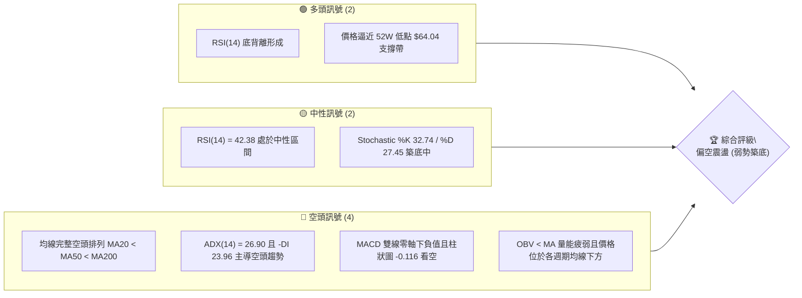
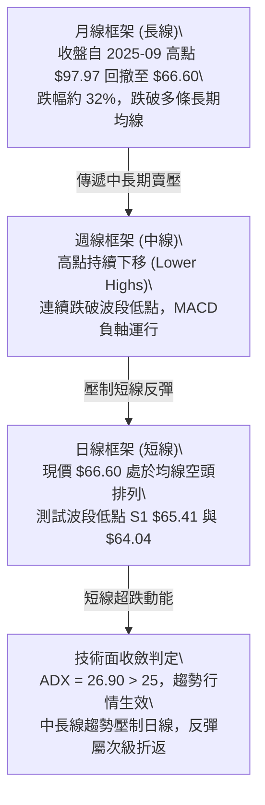
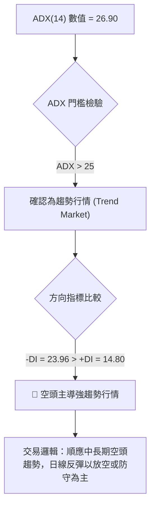
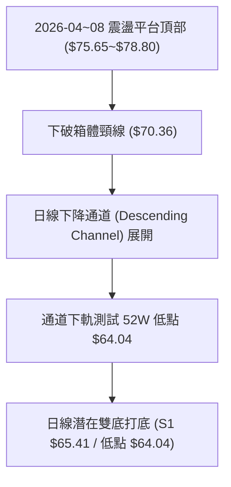
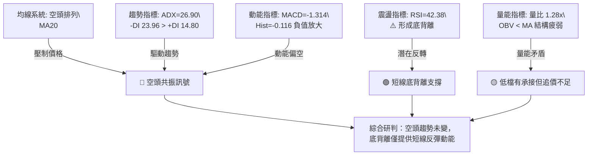
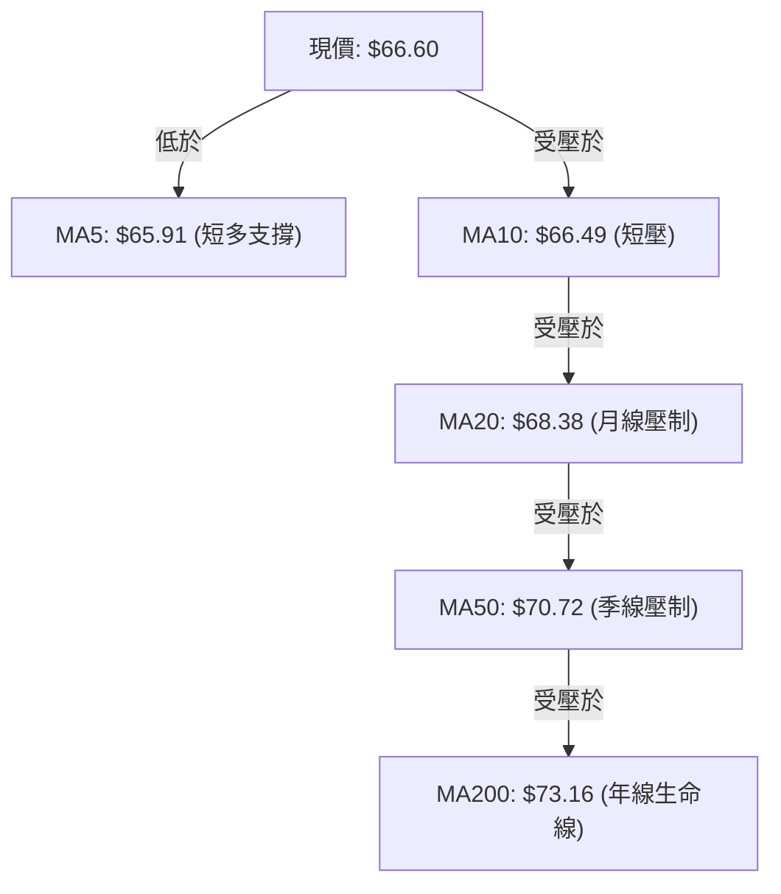
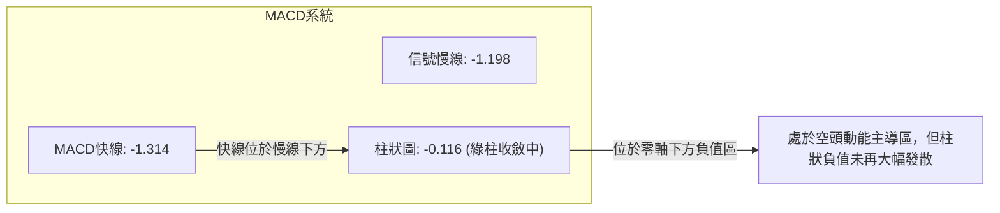
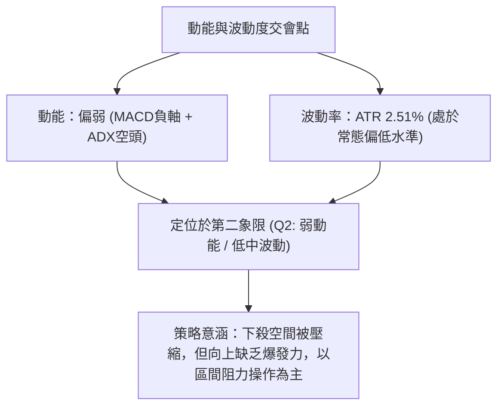
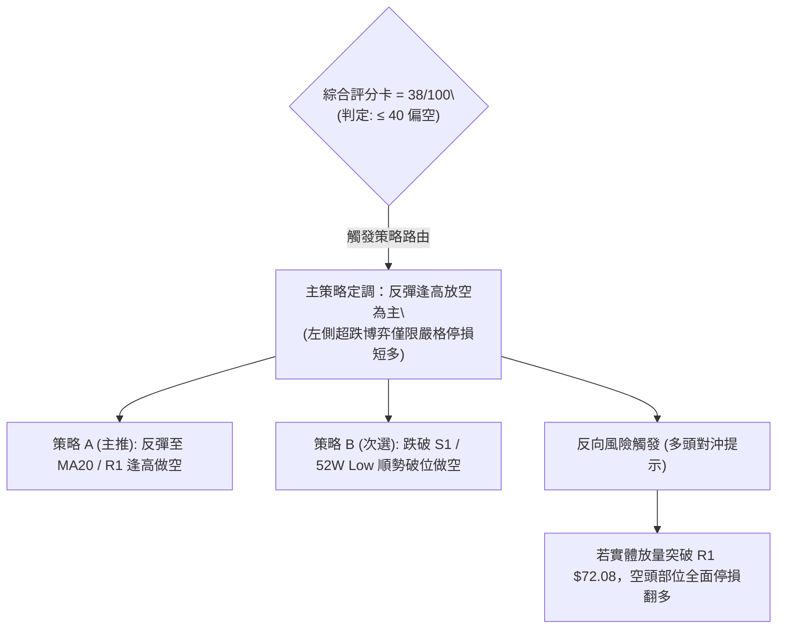
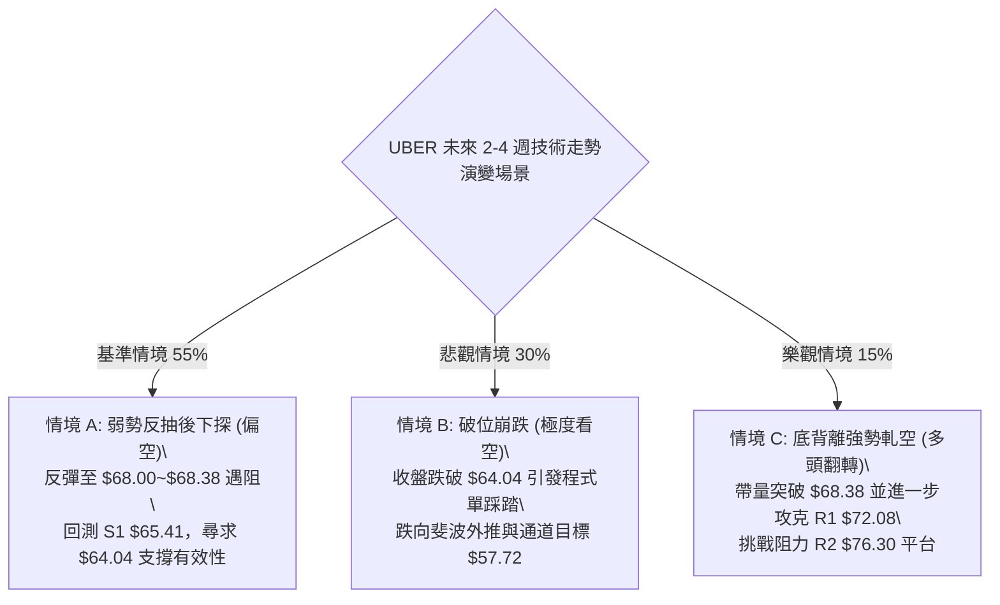

# UBER 技術分析報告

> **報告日期**：2026-11-04 ｜ **語言**：繁體中文 ｜ **數據來源**：Yahoo Finance ｜ **當前價格**：$66.60

---

## 目錄

| 章節 | 內容 |
|------|------|
| [1. 技術面概覽](#1-技術面概覽) | 訊號儀表板、核心指標、評分卡 |
| [2. 趨勢分析](#2-趨勢分析) | 多時框趨勢、長中短期走勢 |
| [3. 圖表形態分析](#3-圖表形態分析) | 形態識別、K線組合、目標價 |
| [4. 支撐與阻力](#4-支撐與阻力) | 關鍵價位、斐波那契回調 |
| [5. 技術指標深度解讀](#5-技術指標深度解讀) | MA/RSI/MACD/布林/成交量 |
| [6. 動能與波動率](#6-動能與波動率) | 動能評估、ATR、Beta |
| [7. 多時框架總結](#7-多時框架總結) | 時框架評分矩陣 |
| [8. 交易策略建議](#8-交易策略建議) | 多空策略、風險報酬比 |
| [9. 風險提示與監控](#9-風險提示與監控) | 監控指標、風險場景 |

---

## 1. 技術面概覽

### 🎯 技術訊號儀表板



### 📊 核心指標速覽表

| 指標類別 | 指標名稱 | 當前數值 | 訊號 | 解讀 |
|----------|----------|----------|------|------|
| **價格** | 當前價格 | $66.60 | 🔴 | 位於 52 週價格區間 7.1% 分位，極度逼近底部 |
| **均線** | MA20 | $68.38 | 🔴 | 價格在 MA20 下方 (-2.61%)，短期反彈第一壓力 |
| **均線** | MA50 | $70.72 | 🔴 | 價格在 MA50 下方 (-5.83%)，中期結構偏空 |
| **均線** | MA200 | $73.16 | 🔴 | 價格在 MA200 下方 (-8.97%)，長期多空分水嶺失守 |
| **動能** | RSI(14) | 42.38 | 🟡 | 脫離超賣區，日線級別呈現潛在底背離特徵 |
| **動能** | MACD | -1.314 | 🔴 | MACD (-1.314) < Signal (-1.198)，柱狀圖 -0.116 偏空 |
| **動能** | Stoch %K/%D | 32.74 / 27.45 | 🟡 | %K 向上穿過 %D，動能低檔金叉初現 |
| **趨勢** | ADX(14) | 26.90 | 🔴 | ADX > 25 且 -DI (23.96) > +DI (14.80)，空頭趨勢延續中 |
| **通道** | 布林 %B | 0.30 | 🟡 | 位於中軌 ($68.38) 與下軌 ($63.90) 之間，偏向弱勢區 |
| **量能** | 最新量/20日均量 | 1.28x | 🟢 | 最新量 21.19M 高於均量 16.57M，低檔承接量釋放 |
| **量能** | OBV 趨勢 | OBV < MA | 🔴 | 累積能量在均線之下，中長期量能基礎仍弱 |
| **波動** | ATR(14) | $1.67 | 🟡 | 佔股價 2.51%，屬於常態波動，未見極端恐慌擴散 |

### 🏆 技術評分卡

```
╔══════════════════════════════════════════════════════════════╗
║              技術評分卡 — UBER (2026-11-04)                   ║
╠══════════════════════════════════════════════════════════════╣
║ 趨勢強度      ███████░░░░░░░░░░░░░  35/100  🔴 空頭趨勢主導  ║
║ 動能指標      █████████░░░░░░░░░░░  45/100  🟡 RSI底背離支撐 ║
║ 支撐穩定度    ██████████░░░░░░░░░░  50/100  🟡 臨近S1與52W低 ║
║ 成交量配合    ████████░░░░░░░░░░░░  40/100  🔴 OBV仍顯疲弱   ║
║ 形態完整度    ████████░░░░░░░░░░░░  40/100  🔴 下跌通道運行  ║
║ 均線排列      ████░░░░░░░░░░░░░░░░  20/100  🔴 完美空頭排列  ║
╠══════════════════════════════════════════════════════════════╣
║ 綜合評分      ███████░░░░░░░░░░░░░  38/100  🔴 評級：偏空    ║
╚══════════════════════════════════════════════════════════════╝
```

> **評分規則依據**：六項子評分算術平均值 = (35 + 45 + 50 + 40 + 40 + 20) ÷ 6 = 230 ÷ 6 = 38.33，四捨五入取整為 **38/100**。依評分路由規則，評分 ≤ 40 觸發**主推空頭或反彈逢高放空策略**。

---

## 2. 趨勢分析

### 🌐 多時框趨勢分析



### 📈 長期趨勢 — 12個月走勢圖（Unicode）

```
UBER 月線走勢圖（過去12個月：2025-11 至 2026-11）
價格軸 ($)
$100 ┤
$95  ┤
$90  ┤ ●(2025-11: 87.54)
$85  ┤   ●(2025-12: 81.71)
$80  ┤     ●(2026-01: 80.05)
$75  ┤       ●(2026-02: 75.42)      ●(2026-04: 74.61)      ●(2026-08: 75.65)
$70  ┤         ●(2026-03: 71.93)      ●(2026-05: 70.40) ●(2026-06: 72.16) ●(2026-07: 70.36)
$65  ┤                                                       ●(2026-09: 68.51)  ●(2026-10: 65.25)
$60  ┤                                                                           ●(2026-11: 66.60)←現價
     └───────────────────────────────────────────────────────────────────────────────────────────
       11   12   01   02   03   04   05   06   07   08   09   10   11 (月份)
```

**過去12個月走勢特徵分析表格**：

| 階段區間 | 起止收盤價 | 區間漲跌幅 | 走勢特徵與結構意涵 |
|----------|------------|------------|--------------------|
| **2025-11 ~ 2026-03** | $87.54 → $71.93 | -17.83% | 自歷史高點震盪回落，跌破 80 元整數心理關卡，形成中期下行浪 |
| **2026-04 ~ 2026-08** | $74.61 → $75.65 | +1.39% | 在 $70.36 至 $75.65 間形成長達5個月的水平箱體震盪平台 |
| **2026-09 ~ 2026-11** | $68.51 → $66.60 | -2.79% | 箱體下軌 $70 失守，觸發停損賣壓，下探 52 週新低 $64.04 後微幅回升 |

### 📊 中期趨勢（週線分析）

從近20週的週線數據觀察，價格高點自 2026-08-28 週收盤 $78.82 展開新一輪下跌波段：
- 2026-09-18 週收盤：$70.50
- 2026-10-09 週反彈高點：最高來到 $72.08，收在 $71.51，但受阻於 R1 阻力帶
- 2026-10-30 週收盤：$65.25，最低觸及 52 週最低價 $64.04

```
週線級別阻力與支撐示意：
阻力 R2: $76.30 ════════════════════════════ (8月中旬反彈平台)
阻力 R1: $72.08 ──────────────────────────── (10/09當週高點，強阻力)
現價     $66.60 ◀◀◀ [目前位置：弱勢超跌反彈]
支撐 S1: $65.41 ┄┄┄┄┄┄┄┄┄┄┄┄┄┄┄┄┄┄┄┄┄┄┄┄ (近一年波段低點聚類)
強支撐   $64.04 ════════════════════════════ (52週最低點 / 斐波 100.0%)
```

### ⚡ 趨勢強度評估（ADX 解讀）



| 指標名稱 | 當前數值 | 參考標準 | 趨勢判定 |
|----------|----------|----------|----------|
| **ADX(14)** | **26.90** | > 25 強趨勢 / < 20 盤整 | 明確處於**單邊趨勢**狀態，非無方向震盪 |
| **+DI (14)** | **14.80** | 多頭動能強度 | 多頭進攻意願低落，買盤缺乏持續性 |
| **-DI (14)** | **23.96** | 空頭壓制強度 | 空方力量明顯高於多方，趨勢主導權在賣方 |

---

## 3. 圖表形態分析

### 🔍 形態識別系統



**形態識別與信心度評估表**：

| 形態名稱 | 信心度 | 判斷依據（引用數據） | 完成度 | 目標價（附計算式） |
|----------|--------|----------------------|--------|--------------------|
| **日線下降通道** | **85%** | 高點下移（10/09 高 $72.08 → 10/22 高 $69.15 → 11/02 高 $67.47），低點下移（10/02 低 $67.22 → 10/23 低 $66.43 → 10/29 低 $64.04） | **90%** | 下通道延伸支撐位為 52W Low **$64.04** |
| **短線潛在雙底 (Double Bottom)** | **45%** | 10/29 觸及最低價 $64.04 後，10/30 低點 $64.68，11/03 收 $66.60；但頸線尚未突破 | **35%** | 依規則15：信心度 < 50% 且頸線未突破，**訊號不足，僅做指標型解讀** |
| **箱體破位下行測幅** | **75%** | 跌破 5-8 月平台下軌 $70.36，形態高度 $75.65 - $70.36 = $5.29 | **100%** | 破位目標價 = $70.36 - $5.29 = **$65.07**（已於 10/29 跌至 $64.04 達成測幅） |

### 🕯️ 重要K線形態分析

嚴格依據數據中「近10根日K」與「近8根週K」的實際開高低收數據進行辨識：

| 日期與時框 | 開盤價 | 最高價 | 最低價 | 收盤價 | K線形態 | 技術解讀 | 訊號 |
|------------|--------|--------|--------|--------|---------|----------|------|
| **2026-10-23 (日K)** | 68.47 | 68.90 | 66.43 | 66.70 | 中黑棒下殺 | 開高走低跌破 $67，長實體收在低檔，空頭動能宣洩 | 🔴 |
| **2026-10-29 (日K)** | 65.28 | 65.80 | 64.04 | 65.74 | 下影線長槌頭形 | 創下 52 週新低 $64.04 後強勁拉回，下影線長達 $1.70，收盤高於開盤 | 🟢 |
| **2026-10-30 (日K)** | 65.61 | 65.80 | 64.68 | 65.25 | 窄幅黑紡錘線 | 低點未再破 $64.04，空方下殺動能減緩，呈現築底整理 | 🟡 |
| **2026-11-02 (日K)** | 66.12 | 67.47 | 65.55 | 66.71 | 帶上影線紅K | 多頭嘗試反攻，最高觸及 $67.47，但受壓於 MA10 ($66.49) 上方 | 🟡 |
| **2026-11-03 (日K)** | 66.75 | 66.96 | 65.99 | 66.60 | 假陰十字星 | 開盤 $66.75 略衝高至 $66.96 後回落收 $66.60，多空於中軌下方激烈拉鋸 | 🟡 |
| **2026-10-09 (週K)** | 68.40 | 72.08 | 68.00 | 71.51 | 長實體大陽週K | 週線強勁反彈測試 R1 $72.08 阻力，但次週立即承壓 | 🟢 |
| **2026-10-23 (週K)** | 70.13 | 70.76 | 66.43 | 66.70 | 空頭破位大黑K | 跌破前週低點 $68.62，形成吞噬性下跌走勢 | 🔴 |
| **2026-10-30 (週K)** | 66.62 | 67.00 | 64.04 | 65.25 | 下影線破底長黑K | 探測 52W 最低點 $64.04 後留下 $1.21 下影線，顯現低階買盤 | 🟡 |

### 📉 ASCII 走勢形態示意圖

```
日線級別近10根 K 棒走勢示意（2026-10-21 至 2026-11-03）：

價格 ($)
69.50 ┬  ┌─┐
69.00 ┤  │ │
68.50 ┤  │ │  ┌─┐
68.00 ┤  │ │  │ │
67.50 ┤──┴─┴──│ │─────────────────────────────┬─┬─────
67.00 ┤        │ │                      ┌─┐   │ │ ┌─┐
66.50 ┤        └─┘  ┌─┐                 │ │   │ │ │ │ ◄ 現價 $66.60
66.00 ┤             │ │  ┌─┐       ┌─┐  │ │   └─┘ └─┘
65.50 ┤             │ │  │ │  ┌─┐  │ │  │ │
65.00 ┤             └─┘  │ │  │ │  │ │  └─┘
64.50 ┤                  └─┘  └─┘  │ │
64.00 ┴ ───────────────────────────┴─┴ (10/29 低點 $64.04) ────────────────
       10/21 10/22 10/23 10/26 10/27 10/28 10/29 10/30 11/02 11/03 (日期)
```

### 🎯 形態目標價計算

根據日線自 10/09 高點 $72.08 下跌至 10/29 低點 $64.04 之波動帶，若形成短線跌深反彈測幅：
1. **反彈測幅計算式**：
   - 波段下行跌幅 = $72.08 - $64.04 = $8.04
   - 若短線以 $64.04 為雙底頸線測幅（以 10/22 高點 $69.15 為頸線）：
     - 形態高度 = $69.15 - $64.04 = $5.11
     - 理論突破目標價 = 頸線 $69.15 + 形態高度 $5.11 = **$74.26**（此處僅為幾何推算，前方仍有 R1 $72.08 剛性阻力壓制）
2. **反向破位測幅（若跌破 S1 與 $64.04）**：
   - 若收盤實體跌破 52W Low $64.04，則依箱體下緣 $70.36 至 $64.04 高度 $6.32 等幅下推：
     - 空頭延伸目標 = $64.04 - $6.32 = **$57.72**（風險劇本提示）

---

## 4. 支撐與阻力

### 🗺️ 關鍵價位分布圖（Unicode）

```
UBER 價位結構分布圖
═══════════════════════════════════════════════════════════════════
$78.60 ║████████████████████████████████║ 強阻力 R3 (近一年波段高點聚類)
$76.30 ║████████████████████            ║ 阻力 R2 (近一年波段高點聚類)
$72.08 ║████████████████████████        ║ 關鍵阻力 R1 (10/09週高點聚類)
$71.81 ║────────────────────────────────║ 斐波那契 78.6% 回調位
$68.38 ║┈┈┈┈┈┈┈┈┈┈┈┈┈┈┈┈┈┈┈┈┈┈┈┈┈┈┈┈┈┈┈┈║ BB中軌 / MA20 均線壓力位
$66.60 ╠════════════════════════════════╣ ◄ 現價 ($66.60 USD)
$65.41 ║▓▓▓▓▓▓▓▓▓▓▓▓▓▓▓▓                ║ 近期支撐 S1 (波段低點聚類)
$64.04 ║████████████████████████████████║ 關鍵強支撐 (52W Low / 斐波 100%)
$63.90 ║────────────────────────────────║ BB下軌動態支撐
═══════════════════════════════════════════════════════════════════
```

### 🚧 阻力位分析表

所有價位均嚴格引用自數據之「關鍵價位」區塊波段高點聚類與技術均線：

| 阻力級別 | 價位 | 形成原因 | 突破難度 | 重要性 |
|----------|------|----------|----------|--------|
| **短線均線壓力** | **$68.38** | 日線 MA20 與布林中軌共振重合處 | 中等 | 🔴 短線空方防守線，收復此處才具備反彈動能 |
| **阻力 R1** | **$72.08** | 近一年波段高點聚類，且貼近 10/09 週K高點 $72.08 | 極高 | 🔴 極強，此處匯聚大量套牢籌碼與下行 MA60 ($71.76) |
| **阻力 R2** | **$76.30** | 近一年波段高點聚類，8 月下旬反彈平台密集區 | 極高 | 🔴 中期結構多空反轉的關鍵樞軸點 (Pivot) |
| **阻力 R3** | **$78.60** | 近一年波段高點聚類，對應 2026-08-28 週最高收盤 $78.82 | 極高 | 🔴 長期下降趨勢防守終點 |

### 🛡️ 支撐位分析表

所有價位均嚴格引用自數據之「關鍵價位」區塊波段低點聚類與 52 週極值：

| 支撐級別 | 價位 | 形成原因 | 守住機率 | 重要性 |
|----------|------|----------|----------|--------|
| **支撐 S1** | **$65.41** | 近一年波段低點聚類（距離現價 -1.79%） | 60% | 🟡 日線收盤關鍵防線，10/27~10/30 實體收盤密集處 |
| **關鍵強支撐** | **$64.04** | 52 週最低點 (52W Low) 及斐波那契 100.0% 極限支撐 | 50% | 🔴 多頭最後馬奇諾防線，一旦失守將引發停損賣壓 |
| **動態支撐** | **$63.90** | 日線布林通道下軌 | 65% | 🟡 極端超賣區的動態防禦位置 |

### 📐 斐波那契回調位分析

依據 52 週區間高點 **$100.35** 至低點 **$64.04** 計算之回調位分佈：

| 斐波那契水平 | 對應價位 | 與現價 ($66.60) 相對位置 | 技術解讀與意義 |
|--------------|----------|--------------------------|----------------|
| **0.0% (52W High)** | **$100.35** | +50.68% | 歷史高點壓力區，長期宏觀目標 |
| **23.6%** | **$91.78** | +37.81% | 2025年夏季盤整平台下緣 |
| **38.2%** | **$86.48** | +29.85% | 中長期牛熊轉換中樞 |
| **50.0%** | **$82.19** | +23.41% | 典型半數回撤壓力位 |
| **61.8%** | **$77.91** | +16.98% | 黃金分割強壓力，逼近阻力 R2 ($76.30) |
| **78.6%** | **$71.81** | +7.82% | 深度回撤防守位，緊鄰阻力 R1 ($72.08) 與 MA60 ($71.76) |
| **100.0% (52W Low)**| **$64.04** | -3.84% | 全年最低點，基準起算點與當前下行終點 |

> **現價位置解讀**：現價 **$66.60** 處於 **78.6% ($71.81)** 與 **100.0% ($64.04)** 之間，位處整個 52 週大波段的底部 7.1% 極度弱勢區。技術意義在於：價格已吞噬過去一年全部漲幅，若在 $64.04 獲得支撐，則為潛在的大級別雙底左側；但若無法收復 78.6% ($71.81)，任何上漲均定義為深幅回撤中的「死貓反彈」。

---

## 5. 技術指標深度解讀

### 🎛️ 指標訊號總覽



### 📈 移動平均線排列分析



**移動平均線狀態詳解**：
- **MA5 ($65.91) & MA10 ($66.49)**：現價 $66.60 站上 MA5（距 +1.04%），且微幅穿過 MA10（距 +0.17%），顯示近 3-5 個交易日有短線空頭回補與止跌跡象。
- **MA20 ($68.38) & MA60 ($71.76)**：MA20 呈陡峭下行態勢，現價距離 MA20 為 -2.61%，構成日內與週內反彈的第一道天花板。
- **MA200 ($73.16)**：長期年線持續走低，現價落後達 -8.97%。整體結構為標準的 **MA20 < MA50 < MA200** 完美空頭排列。

### 📉 RSI(14) 分析

- **RSI(14) 數值**：**42.38**
```
RSI(14) 強度：████████░░░░░░░░░░░░  42.38% (處於 30-70 中性弱勢區)
[0 ─── 極度超賣 ─── 30 ────── 現值 42.38 ────── 70 ─── 極度超買 ─── 100]
```
- **背離判斷（重要）**：
  - **日線級別確認存在底背離 (Bullish Divergence)**。
  - **背離細節**：近20根K棒首尾比對，股價在 10/29 創下 52 週新低點 $64.04（前波低點為 10/02 的 $67.22 與 10/23 的 $66.43），形成更低的價格低點 (Lower Lows)；然而 RSI(14) 卻由 10/24 當週之低點 33.2 向上抬升至目前的 42.38，形成更高之指標低點 (Higher Lows)。
  - **背離結論**：此底背離明確指出當前下殺賣壓竭盡，空頭動能呈現結構性減弱，容易催生向上測試 MA20 ($68.38) 的技術性修正波。

### 📊 MACD(12/26/9) 訊號解讀

- **MACD 線**：-1.314
- **MACD 訊號線 (Signal)**：-1.198
- **MACD 柱狀圖 (Histogram)**：**-0.116** (看空)



- **MACD 背離研判**：
  - 觀察近 8 週週線數據，10/30 週收盤 $65.25 時週 MACD 柱為 -0.339，較 09/11 週的 -0.854 明顯收斂；日線柱狀圖亦由更低負值回升至目前的 -0.116。
  - **結論**：MACD 未見頂背離，負值柱狀圖持續收縮，與 RSI 形成初步的「動能底背離共振」，暗示空方進攻動能衰退，但尚未出現 DIF 向上黃金交叉 DEA 的明確右側買訊。

### 📦 布林通道分析

```
布林通道結構示意 (通道帶寬 = $72.87 - $63.90 = $8.97)：

$72.87 ┬─────────────────────────────────────────── 布林上軌 (強阻力區)
       │
$68.38 ┼- - - - - - - - - - - - - - - - - - - - - -  布林中軌 (MA20壓力位)
       │
$66.60 ┼                 ● 現價 ($66.60, %B = 0.30)
       │
$63.90 ┴─────────────────────────────────────────── 布林下軌 (極端支撐區)
```
- **布林 %B**：**0.30**（計算式：($66.60 - $63.90) ÷ ($72.87 - $63.90) = $2.70 ÷ $8.97 = 0.301）。
- **解讀**：%B 脫離 0.20 以下的極度超賣擠壓區，但在穿過 0.50（中軌 $68.38）前，通道整體斜率向下，仍屬弱勢通道運行架構。

### 💹 成交量分析（量價配合度）

- **最新成交量**：21,191,800 股
- **20日均量**：16,570,085 股（**量比 1.28x**，顯著放量）
- **50日均量**：17,151,642 股
- **OBV 趨勢**：OBV < MA（量能指標疲弱）

**量價特徵解讀**：
1. **低檔放量**：11/03 股價於 $65.99 - $66.96 區間震盪，放出 21.19M 股，高於 20 日與 50 日均量近三成，結合 10/26~10/29 每日均有 16M-22M 的量能釋放，顯示在 $64.04~$66.00 區間有機構資金進行被動接盤防守。
2. **OBV 疲軟背離**：儘管單日放量，中長期能量潮 OBV 依然運行在移動平均線下方，說明過去三個月的主力流出格局尚未徹底扭轉，目前的放量仍屬「被動承接」而非「主動攻擊量」。

---

## 6. 動能與波動率

### ⚡ 動能評估四象限

| 象限 | 動能強度 (Momentum) | 波動率水平 (Volatility) | 當前判定 | 技術涵義與應對策略 |
|:---:|:---:|:---:|:---:|:---|
| **Q1** | 強 (Bullish) | 低 (Low Vol) | — | 最佳多頭平穩上行機會 |
| **Q2** | 弱 (Bearish) | 低 (Low Vol) | **✓ [當前狀態]** | **弱勢低波整理**：動能受壓，波動度收斂，適合區間防守或逢高佈空 |
| **Q3** | 強 (Bullish) | 高 (High Vol) | — | 高風險高收益的突破行情 |
| **Q4** | 弱 (Bearish) | 高 (High Vol) | — | 恐慌崩跌走勢，避免盲目進場 |



### 📊 ATR 波動率分析

- **ATR(14)**：**$1.67**（佔現價 $66.60 之比率為 **2.51%**）
- **停損與防守距離設定指引**：
  - **日內安全防守緩衝 (1.0 × ATR)**：$1.67。日內短線交易者停損不應低於此距離。
  - **擺動交易止損空間 (1.5 × ATR)**：1.5 × $1.67 = **$2.51**。
  - **波段交易防守邊界 (2.0 × ATR)**：2.0 × $1.67 = **$3.34**。
  - 應用於當前價格，若建立多頭部位，底線止損點不得寬於 $66.60 - $2.51 = $64.09，恰好與 52W Low **$64.04** 高度重合，印證了 ATR 止損模型與形態關鍵位的精確契合。

### 📐 Beta 與市場相關性

- **Beta 係數**：**1.308**
- **解讀**：UBER 具備高 Beta 成長型/科技服務型屬性，波動幅度比標普 500 指數高出約 30.8%。在市場整體偏好樂觀時彈性巨大，但在大盤震盪或科技股承壓時，其回撤幅度亦顯著放大。當前高 Beta 配合下行趨勢，說明下行階段承擔了更高的系統性折價。

---

## 7. 多時框架總結

### 📋 時框架評分表

| 時框架 | 趨勢方向 | 動能狀態 | 均線排列 | 圖表形態 | 綜合評分 | 建議方向 |
|--------|----------|----------|----------|----------|:--------:|----------|
| **月線 (長線)** | 🔴 偏空 | RSI 下滑，MACD 高檔死叉 | 跌破 MA240 ($75.07) | 自 $97.97 高點回撤 32% | **30/100** | 長線防守觀望 |
| **週線 (中線)** | 🔴 偏空 | MACD柱收縮，週RSI 42.4 | 空頭排列 (低於中樞) | 跌破 $70.36 箱體下軌 | **35/100** | 逢高減碼 / 偏空交易 |
| **日線 (短線)** | 🟡 築底震盪 | RSI 底背離，Stoch 金叉 | MA20壓制，站上MA5 | 測試 $64.04 潛在雙底 | **50/100** | 超跌反彈 / 嚴設停損 |

### 🔲 綜合訊號矩陣

```
時框共振檢視矩陣：
┌───────────┬───────────────┬───────────────┬───────────────┐
│ 分析維度  │ 長線 (月線)   │ 中線 (週線)   │ 短線 (日線)   │
├───────────┼───────────────┼───────────────┼───────────────┤
│ 趨勢方向  │ 🔴 空頭修正   │ 🔴 下降通道   │ 🟡 低檔震盪   │
│ 均線系統  │ 🔴 跌破年線   │ 🔴 均線蓋頭   │ 🔴 MA20壓制   │
│ 動能指標  │ 🔴 缺乏推力   │ 🟡 柱狀收斂   │ 🟢 底背離成形 │
│ 支撐測試  │ 🟡 逼近歷史底 │ 🔴 跌破前低   │ 🟢 守住 S1    │
└───────────┴───────────────┴───────────────┴───────────────┘
```

### ⚖️ 多時框收斂結論

依「多時框收斂規則」進行最終定調：
1. **行情屬性判定**：當前 **ADX(14) 為 26.90**，高於閾值 25，且 **-DI (23.96) > +DI (14.80)**，因此系統完全處於**空頭主導的趨勢行情**，而非無方向的箱體盤整。
2. **時框優先級裁決**：在 ADX > 25 的趨勢行情中，依規則必須**以中長期（週線/MA50、MA200）方向為主導**，日線指標僅能用於尋找次級折返的高點放空或極短線超跌搏反彈進場點，不可將日線的短線指標金叉視為趨勢反轉。
3. **唯一方向性結論**：**中長線偏空，短線醞釀弱勢超跌反彈**。整體技術評分為 **38/100**，最終大局方向判定為 **🔴 偏空防守**。

---

## 8. 交易策略建議

### 🗺️ 策略決策流程圖



### 🧭 策略路由（依評分卡分流）

> **當前主策略方向 = 🔴 偏空操作（逢高做空 / 破位放空），依據評分 38/100**。

### 🎯 價格情境階梯（Price Scenarios）

所有關鍵價位嚴格引用自第 4 章及數據源數值：

| 觸發條件 | 下一目標 | 後續延伸 | 情境含義 |
|----------|----------|----------|----------|
| **強勢突破阻力 R1 $72.08** | 阻力 R2 $76.30 | 阻力 R3 $78.60 | 日線底背離引發大級別軋空，短線趨勢翻多 |
| **承壓於 BB中軌 $68.38 ~ R1 $72.08** | 支撐 S1 $65.41 | 強支撐 $64.04 | 典型空頭趨勢中的次級反彈遇阻回落（主情境） |
| **實體跌破支撐 S1 $65.41** | 52W Low $64.04 | 通道外推 $57.72 | 破底展開新一輪恐慌拋售，下行空間全面打開 |

### 📊 情境機率分佈

| 情境劃分 | 機率估計 | 主要技術指標依據 |
|----------|:--------:|------------------|
| **反彈受阻回落 (空頭延續)** | **55%** | ADX 26.90 強勢主導，MA20/50/200 完美空頭排列，OBV 疲軟無攻擊量 |
| **低檔區間震盪 (S1~$68.38)**| **30%** | RSI(14) 42.38 形成底背離，最新量比 1.28x 低檔有承接力道 |
| **強勢 V 轉向上突破 R1** | **15%** | 需基本面重大催化，目前 MACD 仍深陷零軸之下且 -DI 主導 |

### 🟢 主策略詳情（空頭主推架構）

依規則 17 計算風險報酬比：(進場價 − 目標價 T1) ÷ (止損價 − 進場價)

| 策略要素 | 策略 A（反彈遇阻做空 — 核心主推） | 策略 B（破位追空 — 動能順勢） |
|----------|----------------------------------|------------------------------|
| **策略定位** | 順應中長線空頭，等待反彈動能衰竭放空 | 關鍵支撐失守後的順勢動能交易 |
| **進場條件** | 反彈至 MA20 附近或 R1 前滯漲收上影線 | 日線實體收盤跌破支撐 S1 $65.41 |
| **進場價格** | **$68.38**（以 MA20 與布林中軌為基準） | **$65.00**（確認破位 S1 $65.41 後進場） |
| **目標價 T1** | **$64.04**（測試 52W Low） | **$60.32**（引用 2024-12 歷史波段低點） |
| **目標價 T2** | **$57.72**（形態測幅延伸目標） | **$57.72**（形態測幅延伸目標） |
| **止損價格** | **$70.55**（取進場價 + 1.3×ATR $2.17） | **$66.67**（取進場價 + 1.0×ATR $1.67） |
| **風險報酬比** | **1 : 2.00**（以 T1 計）<br>*(68.38-64.04)÷(70.55-68.38) = 4.34÷2.17 = 2.00* | **1 : 2.80**（以 T1 計）<br>*(65.00-60.32)÷(66.67-65.00) = 4.68÷1.67 = 2.80* |
| **預估勝率** | **60%** | **50%** |
| **建議倉位** | **15%**（基礎波段倉位） | **10%**（動能跟隨倉位） |

> **多頭短線交易特別附註（極短線博弈）**：若激進型交易者欲利用日線 RSI 底背離建立多單，進場價需在現價 **$66.60** 或回踩 **$65.41**（取中點 **$66.00**），嚴格以 52W Low 下方 **$63.80** 止損（風險 $2.20），目標價 T1 設為 MA20 **$68.38**（獲利 $2.38），風報比為 1 : 1.08（以 T1 計）；若以 R1 **$72.08** 為 T2，風報比為 1 : 2.76（以 T2 計）。此單屬逆勢博弈，倉位嚴格限制在 5% 以下。

### 🔴 反向風險觸發點（對沖與風控提示）

1. **多頭平倉 / 避險觸發線**：若日線收盤價強勢突破 **$68.38 (MA20)** 且成交量放大至 25M 以上，空方部位必須立即減半。
2. **趨勢反轉全面翻多點**：若價格帶量站上 **$72.08 (阻力 R1)**，宣告日線級別雙底正式確立且週線結構修復，主策略空單應全數停損出場，並反手建立多頭頭寸，上看 R2 **$76.30**。

### ⭐ 整體訊號強度評星

```
做多訊號強度：★★☆☆☆  (2/5星 — 僅依託 RSI 底背離與 52W 低點，逆趨勢)
做空訊號強度：★★★★☆  (4/5星 — 均線空頭排列 + ADX 26.90 強勢空頭主導)
整體可信度：  ★★★☆☆  (3/5星 — 底背離與中長線均線賣壓呈現短線衝突)
```

---

## 9. 風險提示與監控

### ✅ 關鍵監控指標 Checklist

```
╔════════════════════════════════════════════════════════════════════════╗
║                   每日交易監控清單 (Checklist)                          ║
╠════════════════════════════════════════════════════════════════════════╣
║ [ ] 價格防守線：收盤價是否跌破波段支撐 S1 $65.41 及 52W 低點 $64.04    ║
║ [ ] 動態壓制線：盤中反彈測試 MA20 ($68.38) 時的量價反應（是否縮量假突破）║
║ [ ] RSI 背離有效性：RSI(14) 能否維持在 40 之上，抑或再度摜入 30 超賣區  ║
║ [ ] MACD 柱狀變化：負柱狀圖（當前 -0.116）是否向零軸靠攏收斂形成金叉   ║
║ [ ] 量能異動：單日成交量是否異常突破 25,000,000 股（機構洗盤或出逃標誌） ║
║ [ ] 外部事件風控：留意高階主管異動與財報催化帶來的跳空缺口風險          ║
╚════════════════════════════════════════════════════════════════════════╝
```

### ⚠️ 風險場景分析



### 🛡️ 風險管理重要提醒

1. **嚴禁逆勢重倉死扛**：目前均線（MA20、MA50、MA200）呈空頭發散狀態，長期趨勢受制於空方，任何逆勢抄底的多頭部位均屬於高風險交易，單筆最大虧損金額不得超過總帳戶權益的 1.0%。
2. **嚴格執行波動率止損**：以當前 ATR ($1.67) 計算，價格在日內震盪 2-3 美元屬正常範疇，切忌將停損點設置在日均波動區間之內導致無謂被洗出場；跌破 52W Low **$64.04** 後切勿心存僥倖，必須無條件執行停損。
3. **財報與消息面防範**：最新新聞顯示市場高度聚焦即將到來的催化劑（如 11 月 4 日市場關注事項及高管離職加入 OpenAI 等動態），需防範消息面導致股價跨越技術位形成不可控的跳空裂口 (Gap)，建議在重大事件前夕降低倉位至 50% 以下。

---

## 📋 報告總結

```
╔════════════════════════════════════════════════════════════════════════╗
║                     UBER 技術分析報告總結                              ║
╠════════════════════════════════════════════════════════════════════════╣
║ 報告日期：2026-11-04                                                   ║
║ 當前價格：$66.60 USD                                                   ║
║ 綜合評分：38 / 100                                                     ║
║ 分析評級：🔴 偏空震盪（弱勢築底階段）                                  ║
╠════════════════════════════════════════════════════════════════════════╣
║ 關鍵結論：                                                             ║
║ ├─ 長期趨勢：🔴 自 $97.97 高點回撤 32%，跌破年線 MA200 ($73.16)        ║
║ ├─ 中期趨勢：🔴 週線下降通道運行，箱體下軌 $70.36 破位失守             ║
║ ├─ 短期趨勢：🟡 RSI(14) 形成日線底背離，於 52W 低點 $64.04 上方弱勢反彈║
║ ├─ 關鍵支撐：S1 $65.41 ｜ 關鍵強支撐 $64.04 (52W Low)                 ║
║ ├─ 關鍵阻力：MA20 $68.38 ｜ R1 $72.08 ｜ R2 $76.30                   ║
║ └─ 華爾街共識目標價：$100.77 (46位分析師評級為 Buy，但技術面尚未同步)   ║
╠════════════════════════════════════════════════════════════════════════╣
║ 最優策略組合：                                                         ║
║ 1. 🥇 最佳機會（主策略）：反彈至 MA20 ($68.38) 附近受阻進場做空，      ║
║                       停損設 $70.55，下看 $64.04，風報比 1 : 2.00     ║
║ 2. 🥈 次選機會（動能單）：若日線收盤跌破 S1 $65.41，順勢進場追空，      ║
║                       停損設 $66.67，目標 $60.32，風報比 1 : 2.80     ║
║ 3. 🥉 保守選擇（右側交易）：空手觀望，靜待股價帶量突破 R1 $72.08 確立   ║
║                       雙底反轉，或回踩 $64.04 出現放量陽線再行介入    ║
╚════════════════════════════════════════════════════════════════════════╝
```

---

> ⚠️ **免責聲明**：本報告為資深技術分析研究成果，所有價位、圖表及推算均嚴格基於所提供之歷史價格與技術指標資訊。本報告**僅供研究與學術參考**，**不構成任何要約、招攬或投資建議**。金融市場具有高度風險，投資人應獨立評估風險並對自身交易決策負全責。

---

*報告生成時間：2026-11-04 ｜ 數據來源：Yahoo Finance ｜ 分析框架：多時框技術分析體系*