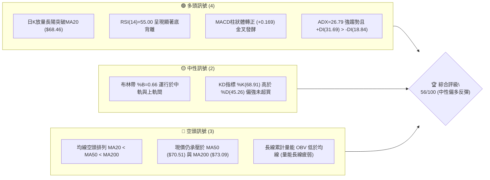
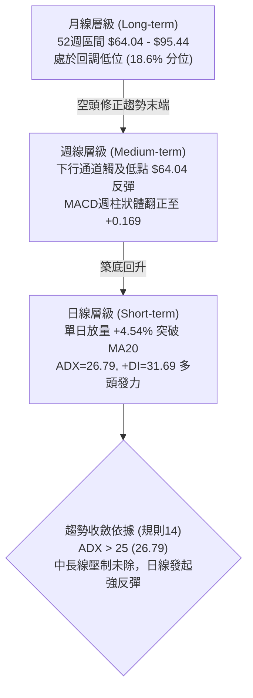
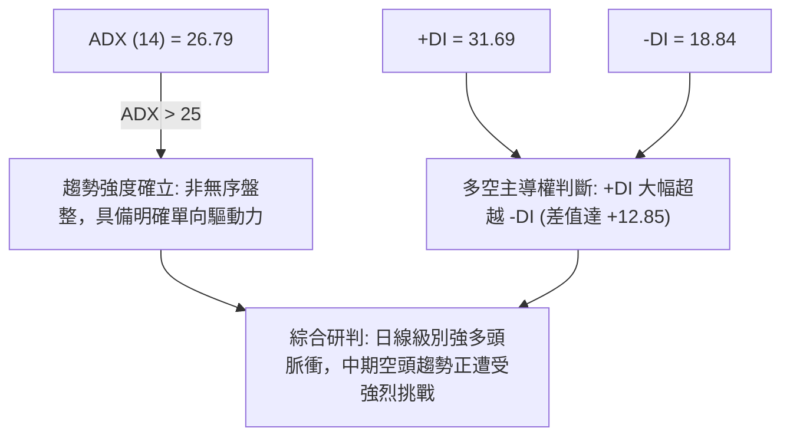
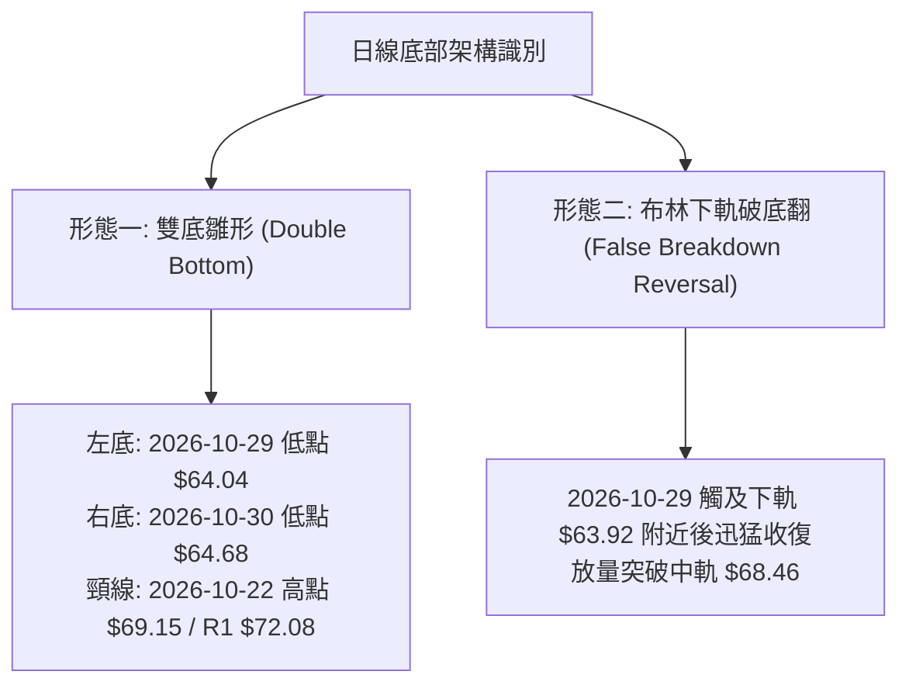
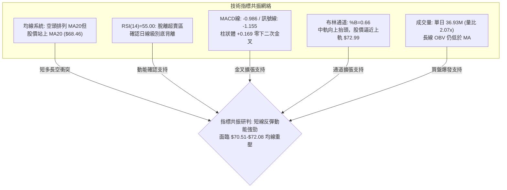
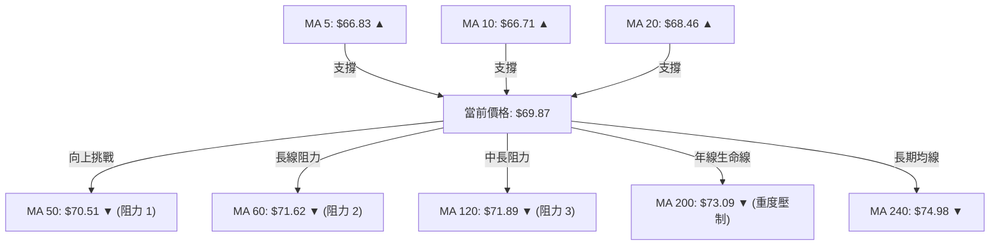
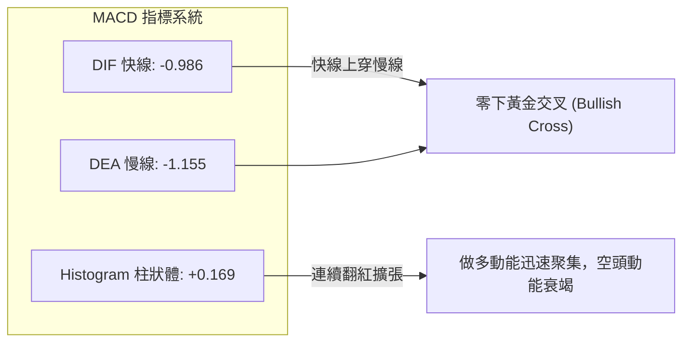
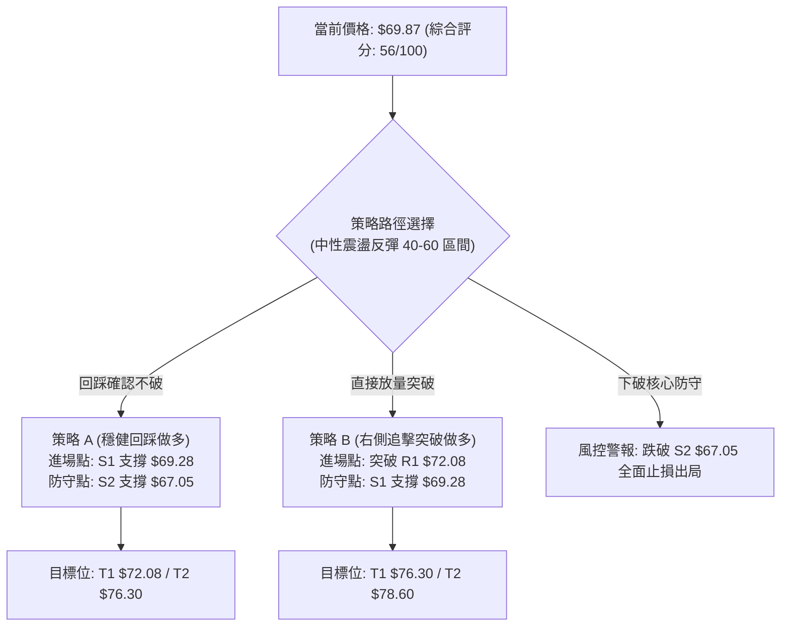
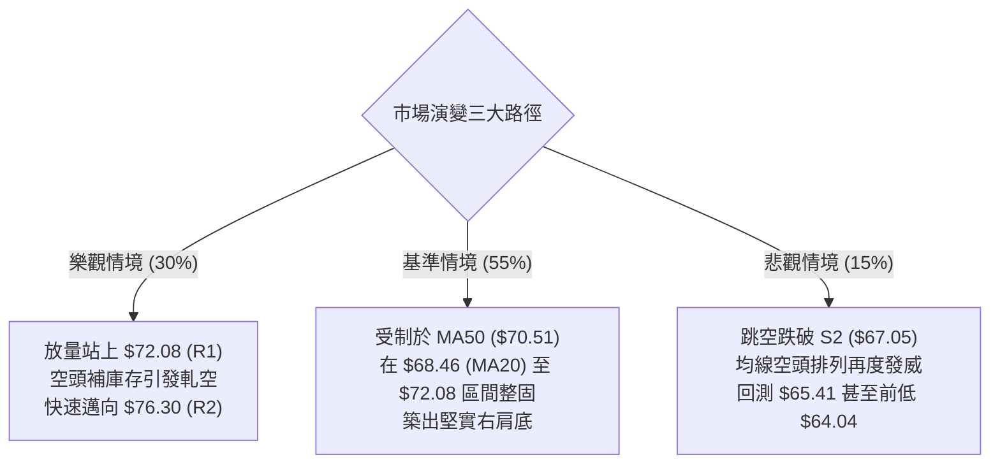

# UBER 技術分析報告

> **報告日期**：2026-11-05 ｜ **語言**：繁體中文 ｜ **數據來源**：Yahoo Finance ｜ **當前價格**：$69.87

---

## 目錄

| 章節 | 內容 |
|------|------|
| [1. 技術面概覽](#1-技術面概覽) | 訊號儀表板、核心指標、評分卡 |
| [2. 趨勢分析](#2-趨勢分析) | 多時框趨勢、長中短期走勢 |
| [3. 圖表形態分析](#3-圖表形態分析) | 形態識別、K線組合、目標價 |
| [4. 支撐與阻力](#4-支撐與阻力) | 關鍵價位、斐波那契回調 |
| [5. 技術指標深度解讀](#5-技術指標深度解讀) | MA/RSI/MACD/布林/成交量 |
| [6. 動能與波動率](#6-動能與波動率) | 動能評估、ATR、Beta |
| [7. 多時框架總結](#7-多時框架總結) | 時框架評分矩陣 |
| [8. 交易策略建議](#8-交易策略建議) | 多空策略、風險報酬比 |
| [9. 風險提示與監控](#9-風險提示與監控) | 監控指標、風險場景 |

---

## 1. 技術面概覽

### 🎯 技術訊號儀表板



### 📊 核心指標速覽表

| 指標類別 | 指標名稱 | 當前數值 | 訊號 | 解讀 |
|----------|----------|----------|------|------|
| **價格** | 當前收盤價 | $69.87 | 🟢 | 站上短期均線群，單日漲幅強勁，脫離波段低點 |
| **均線** | MA20 | $68.46 | 🟢 | 現價高於 MA20（+$1.41, +2.07%），短線轉強 |
| **均線** | MA50 | $70.51 | 🔴 | 現價位於 MA50 下方，面臨中期下行均線壓制 |
| **均線** | MA200 | $73.09 | 🔴 | 現價低於長期生命線 MA200，長線格局尚未反轉 |
| **動能** | RSI(14) | 55.00 | 🟢 | 自超賣區回升至中性偏強區間，日線級別確認底背離 |
| **動能** | MACD (12,26,9) | -0.986 / -1.155 | 🟢 | 快線穿越慢線形成零下金叉，Histogram 擴張至 +0.169 |
| **動能** | KD (14,3,3) | 68.91 / 45.26 | 🟢 | %K 向上穿越 %D，動能快速修復，未進入超買區 |
| **趨勢** | ADX (14) | 26.79 | 🟢 | ADX > 25 進入強趨勢，+DI(31.69) 大幅主導 -DI(18.84) |
| **通道** | Bollinger Bands | $63.92 ~ $72.99 | 🟡 | %B 為 0.66，股價穿越中軌 ($68.46)，向上軌推進 |
| **成交量**| 最新量 / 20日均量 | 36.93M / 17.82M | 🟢 | 單日量比達 2.07x，買盤爆量介入，量價配合良好 |
| **波動** | ATR(14) | $1.97 | 🟡 | 佔股價 2.82%，波動度處於中等水準，具備獲利空間 |

### 🏆 技術評分卡

```
╔══════════════════════════════════════════════════════════════════╗
║                   技術評分卡 — UBER (2026-11-05)                 ║
╠══════════════════════════════════════════════════════════════════╣
║ 趨勢強度 (Trend)      ███████████░░░░░░░░░  55/100   🟡 中性      ║
║ 動能指標 (Momentum)   █████████████░░░░░░░  65/100   🟢 偏多      ║
║ 支撐穩定度 (Support)  ████████████░░░░░░░░  60/100   🟢 偏多      ║
║ 成交量配合 (Volume)   ███████████░░░░░░░░░  55/100   🟡 中性      ║
║ 形態完整度 (Pattern)  ████████████░░░░░░░░  58/100   🟡 中性      ║
║ 均線排列 (Moving Avg) █████████░░░░░░░░░░░  43/100   🔴 偏空      ║
╠══════════════════════════════════════════════════════════════════╣
║ 綜合評分              ███████████░░░░░░░░░  56/100   🟡 中性震盪  ║
║                       (= 六項子評分算術平均: 336 ÷ 6 = 56)       ║
╚══════════════════════════════════════════════════════════════════╝
```

---

## 2. 趨勢分析

### 🌐 多時框趨勢分析



### 📈 長期趨勢 — 12個月走勢圖（Unicode）

```
UBER 過去12個月價格走勢圖 ($)
$100 ┤                                      
 $95 ┤                             ● (2025-10: $96.50)
 $90 ┤                                
 $85 ┤ ● (2025-11: $87.54)            
 $80 ┤    ● (2025-12: $81.71)         
 $75 ┤       ● (2026-01: $80.05)                 ● (2026-08: $75.65)
 $70 ┤          ● (2026-02: $75.42)   ● (2026-04: $74.61)     ●←現價 $69.87
 $65 ┤             ● (2026-03: $71.93)   ● (2026-05: $70.40)     ● (2026-10: $65.25)
     └─┬─────┬─────┬─────┬─────┬─────┬─────┬─────┬─────┬─────┬─────┬─────
      11    12    01    02    03    04    05    06    07    08    09    10  (月)
     2025                                2026
```

#### 走勢特徵分析表格

| 階段區間 | 起止月份 | 價格變化 | 漲跌幅 | 結構形態與成交特徵 |
|----------|----------|----------|--------|--------------------|
| 主跌一浪 | 2025-10 至 2026-03 | $96.50 → $71.93 | -25.46% | 高位見頂後沿月均線持續下行，量能漸次萎縮 |
| 箱體橫盤 | 2026-04 至 2026-08 | $74.61 → $75.65 | +1.39% | 於 $70.00~$78.00 構築中繼箱體，多次衝高受阻 |
| 末跌探底 | 2026-09 至 2026-10 | $68.51 → $65.25 | -4.76% | 破位下行跌至 52 週低點 $64.04，空頭動能釋放完畢 |
| 轉折反彈 | 2026-10 至 2026-11 | $65.25 → $69.87 | +7.08% | 帶量長陽回升，突破 MA20 ($68.46)，底背離確認 |

### 📊 中期趨勢（週線分析）

中期走勢呈現由 $78.82（2026-08-28 週末）一路回落的次級下行波段。然而，近兩週盤面出現根本性變化：
1. **支撐確立**：2026-10-30 當週探底至 52 週最低點 $64.04 後，下影線長達 $1.21，收盤拉回 $65.25。
2. **週線吞噬與金叉**：2026-11-04 當週以 $66.12 開出後暴拉至高點 $72.50，最新收在 $69.87，單週成交量達到 75,991,200 股，週 MACD 柱狀體由負翻正至 +0.169，週 RSI 亦由 35.8 猛烈拉升至 55.0。

```
週線支撐與壓力區間示意：
$76.30 ────────────────────────────── 中期強壓力 R2 (反彈強阻力)
$72.08 ────────────────────────────── 近期波段頸線壓力 R1 / 本週高點 $72.50 處
$69.87 ══════════════════════════════ 【當前現價】
$67.05 ────────────────────────────── 中期關鍵回撤支撐 S2
$64.04 ────────────────────────────── 52週低點 / 形態極限雙底強支撐
```

### ⚡ 趨勢強度評估（ADX 解讀）



| 參數指標 | 數值 | 閾值基準 | 狀態解讀 |
|----------|------|----------|----------|
| **ADX(14)** | 26.79 | > 25.00 | 強趨勢行情，價格脫離低位橫盤，波動驅動力充足 |
| **+DI** | 31.69 | > 20.00 | 多頭攻擊動能充沛，居於絕對優勢地位 |
| **-DI** | 18.84 | < 20.00 | 空頭拋壓顯著衰退，回落至弱勢區間 |
| **方向差距 (+DI - -DI)** | +12.85 | > 0 | 多頭完全掌控短線主動權 |

---

## 3. 圖表形態分析

### 🔍 形態識別系統



#### 圖表形態信心度評估表

| 形態名稱 | 信心度 | 判斷依據（嚴格引用數據） | 完成度 | 目標價（附嚴謹計算式） |
|----------|--------|--------------------------|--------|------------------------|
| **短線雙重底 (W底)** | 68% | 兩次下探低點分別為 2026-10-29 的 $64.04 與 2026-10-30 的 $64.68，隨後於 2026-11-04 帶量長陽突破短線頸線 $69.15（10-22高點）。 | 85% | 頸線 $69.15 + (頸線 $69.15 - 底部最低點 $64.04) = $69.15 + $5.11 = **$74.26** |
| **中級下行楔形向上突破** | 52% | 8週K線高點由 $72.80 降至 $70.76，低點由 $70.06 降至 $64.04，振幅逐步收斂；11-04 單日最高衝至 $72.50，初試突破上軌。 | 60% | 楔形起跌點高點為 2026-09-18 週高點 **$72.80**，完全回補目標為 R2 **$76.30** |

### 🕯️ 重要 K 線形態分析

嚴格依據數據中「近 10 根日 K」與「近 8 根週 K」之開高低收進行精確解讀：

| 日期 (週期) | 開盤價 | 最高價 | 最低價 | 收盤價 | 成交量 | K線形態名稱 | 專業技術解讀 | 訊號強度 |
|-------------|--------|--------|--------|--------|--------|-------------|--------------|----------|
| 2026-10-29 (日K) | $65.28 | $65.80 | $64.04 | $65.74 | 16,286,800 | 探底長下影錘頭線 | 最低觸及 52 週低點 $64.04 後迅速被逢低買盤推升，實體收高，下影線長達 $1.70，為關鍵止跌訊號 | 🟢 強烈 |
| 2026-10-30 (日K) | $65.61 | $65.80 | $64.68 | $65.25 | 17,962,800 | 二次探底小陰線 | 最低點 $64.68 未破前日低點 $64.04，形成短線不破底的築底確認 | 🟡 中性 |
| 2026-11-02 (日K) | $66.12 | $67.47 | $65.55 | $66.71 | 17,742,800 | 溫和回升小陽線 | 實體高於前三日，高點推進至 $67.47，多頭緩步墊高重心 | 🟢 偏多 |
| 2026-11-03 (日K) | $66.75 | $66.96 | $65.99 | $66.60 | 21,313,500 | 窄幅整理十字小陰 | 蓄勢整理，成交量放大至 21.31M，顯示籌碼在 $66.00 關卡充分換手 | 🟡 中性 |
| 2026-11-04 (日K) | $68.28 | $72.50 | $67.36 | $69.87 | 36,934,900 | 突破跳空大陽線帶長上影 | 巨量（量比 2.07x）跳空大漲，盤中最高達 $72.50 刺穿 R1，收盤穩穩站上 MA20 ($68.46) | 🟢 強烈 |
| 2026-10-23 (週K) | $70.13 | $70.76 | $66.43 | $66.70 | 84,761,000 | 破位中長黑K棒 | 跌破 $68.00 平台，空頭加速趕底 | 🔴 偏空 |
| 2026-10-30 (週K) | $66.62 | $67.00 | $64.04 | $65.25 | 95,364,200 | 放量下影長單針探底 | 週線巨量 95.36M 創近期次高，於 $64.04 探出歷史級低點支撐 | 🟢 轉多 |
| 2026-11-04 (週K) | $66.12 | $72.50 | $65.55 | $69.87 | 75,991,200 | 強力反包實體陽線 | 完全反包前週跌幅，收復近三週失地，形成週線破底翻格局 | 🟢 強烈 |

### 📉 ASCII 走勢形態示意圖

```
UBER 近 10 日底部突破雙底架構示意圖：
$72.50 ┤                     ▲ (11-04 盤中爆量衝高至 $72.50 刺穿頸線)
$71.00 ┤                    │
$69.87 ┤                    ● (11-04 收盤 $69.87，成功突破頸線與MA20)
$69.15 ┼─[頸線位置]─────────┼───────────────────────────────
$68.00 ┤                   │
$67.00 ┤                  ● │ (11-02/03 震盪墊高)
$66.00 ┤                 │ │
$65.00 ┤   ●             │ │
$64.04 ┴───┴──────●───────┴─┴──────────────────────────────
         10-22   10-29    10-30 11-04
                 (左底)   (右底)
```

### 🎯 形態目標價計算

1. **短線雙底最小量度漲幅計算**：
   - 形態底部低點：$64.04（2026-10-29 最低價）
   - 短線形態頸線：$69.15（2026-10-22 最高價）
   - 形態垂直高度 $H = \$69.15 - \$64.04 = \$5.11$
   - **量度突破目標價** $= \$69.15 + \$5.11 = \mathbf{\$74.26}$（介於 R1 $72.08 與 R2 $76.30 之間）
2. **中期大波段頸線回抽測算**：
   - 中期箱體震盪下沿頸線為波段阻力 R1 **$72.08**，若日線實體有效站穩 $72.08，則下一波段量度目標直指阻力 R2 **$76.30**。

---

## 4. 支撐與阻力

### 🗺️ 關鍵價位分布圖（Unicode）

```
UBER 價位結構分布圖 (由 OHLCV 與斐波那契精確計算)
══════════════════════════════════════════════════════════════════
$78.60 ║████████████████████████████████║ 強波段阻力 R3 (+12.49%)
$76.30 ║████████████████████████        ║ 中期波段阻力 R2 / Fib 61.8% ($76.03)
$73.09 ║░░░░░░░░░░░░░░░░░░░░░░░░        ║ MA200 長期生命線壓制
$72.08 ║████████████████████████████████║ 近端關鍵阻力 R1 (+3.16%)
$70.76 ║────────────────────────────────║ 斐波那契 78.6% 回調關鍵分水嶺
$70.51 ║░░░░░░░░░░░░░░░░                ║ MA50 中期均線反壓
$69.87 ╠════════════════════════════════╣ ◄ 當前收盤價 ($69.87)
$69.28 ║▓▓▓▓▓▓▓▓▓▓▓▓▓▓▓▓▓▓▓▓▓▓▓▓        ║ 第一線動態支撐 S1 (-0.84%)
$68.46 ║░░░░░░░░░░░░░░░░                ║ MA20 / 布林中軌支撐
$67.05 ║████████████████████████        ║ 第二線波段強支撐 S2 (-4.04%)
$65.41 ║████████████████████████████████║ 第三線核心防守 S3 (-6.38%)
$64.04 ║════════════════════════════════║ 52週極限最低點 / Fib 100.0%
══════════════════════════════════════════════════════════════════
```

### 🚧 阻力位分析表

所有價位均直接引用數據「關鍵價位」區塊之客觀計算結果：

| 阻力級別 | 價位 | 形成原因與技術共振 | 突破難度 | 重要性 |
|----------|------|--------------------|----------|--------|
| **R1** | **$72.08** | 近一年波段高點聚類；2026-10-09 週K高點；與當前布林上軌 ($72.99) 構成密集共振壓制帶 | 🟡 中等 | ★★★★☆ |
| **R2** | **$76.30** | 近一年波段高點聚類；與斐波那契 61.8% 黃金分割位 ($76.03) 高度重合，為中期下行趨勢關鍵分水嶺 | 🔴 較高 | ★★★★★ |
| **R3** | **$78.60** | 近一年波段高點聚類；2026-08 週末反彈頂點 ($78.80~$78.82) 密集套牢解套賣壓區 | 🔴 極高 | ★★★★☆ |

### 🛡️ 支撐位分析表

所有價位均直接引用數據「關鍵價位」區塊之客觀計算結果：

| 支撐級別 | 價位 | 形成原因與技術共振 | 守住機率 | 重要性 |
|----------|------|--------------------|----------|--------|
| **S1** | **$69.28** | 近一年波段低點聚類；突破後的前頸線轉化支撐，距現價僅 -0.84% | 75% | ★★★★☆ |
| **S2** | **$67.05** | 近一年波段低點聚類；2026-11-02 日K收盤 ($66.71) 與 10-23 破位點共振處，為多頭反彈防守線 | 82% | ★★★★★ |
| **S3** | **$65.41** | 近一年波段低點聚類；10-28~10-30 日K實體收盤密集區（$65.25~$65.74），跌破將重回破底危機 | 90% | ★★★★☆ |

### 📐 斐波那契回調位分析

依據數據提供的 52 週完整波動區間（高點 **$95.44** → 低點 **$64.04**，垂直波動空間 $31.40）：

| 斐波那契回調比例 | 精確對應價位 | 與現價 ($69.87) 空間關係 | 技術意涵與防守/進攻角色 |
|------------------|--------------|--------------------------|--------------------------|
| **0.0% (52W High)** | **$95.44** | +36.60% | 歷史牛市高點極限目標 |
| **23.6%** | **$88.03** | +25.99% | 長線空頭完全瓦解確認線 |
| **38.2%** | **$83.45** | +19.44% | 中長期強反彈強阻力位 |
| **50.0%** | **$79.74** | +14.13% | 多空平衡半山腰分界線 |
| **61.8%** | **$76.03** | +8.82% | **黃金分割關鍵阻力**（緊鄰波段阻力 R2 $76.30） |
| **78.6%** | **$70.76** | +1.27% | **當前多頭正挑戰之關鍵分水嶺**（緊鄰 MA50 $70.51） |
| **100.0% (52W Low)**| **$64.04** | -8.34% | 52 週最低點，雙底絕對防守基石 |

**現價落點深度解讀**：
當前現價 **$69.87** 精準運行於 **78.6% ($70.76)** 與 **100.0% ($64.04)** 區間內。股價距離 78.6% 回調位僅一步之遙（+1.27%）。78.6% 位階常被視為深度回撤行情的「最後多頭防線」，現價自 100% 低位拔地而起挑戰此關卡，若能有效突破 $70.76，上方技術空間將迅速被打開至 61.8% 回調位 **$76.03**。

---

## 5. 技術指標深度解讀

### 🎛️ 指標訊號總覽



### 📈 移動平均線排列分析



| 均線名稱 | 數值 | 距現價差距 | 狀態 | 趨勢方向解讀 |
|----------|------|------------|------|--------------|
| **MA 5** | $66.83 | +$3.04 (+4.54%) | 🟢 價格上方 | 短線極速拉升，形成短多保護墊 |
| **MA 10** | $66.71 | +$3.16 (+4.73%) | 🟢 價格上方 | 止跌回拐，與 MA5 形成黃金交叉 |
| **MA 20** | $68.46 | +$1.41 (+2.07%) | 🟢 價格上方 | 月線收復，短期由空翻多轉為支撐 |
| **MA 50** | $70.51 | -$0.64 (-0.91%) | 🔴 價格下方 | 季線下行壓制，多頭首要攻堅關卡 |
| **MA 60** | $71.62 | -$1.75 (-2.44%) | 🔴 價格下方 | 中期均線下彎，壓制反彈高度 |
| **MA 120** | $71.89 | -$2.02 (-2.80%) | 🔴 價格下方 | 半年線持續走低 |
| **MA 200** | $73.09 | -$3.22 (-4.41%) | 🔴 價格下方 | 牛熊分界線，未收復前中長線仍屬空頭架構 |
| **MA 240** | $74.98 | -$5.11 (-6.82%) | 🔴 價格下方 | 長期年線反壓 |

**排列狀態解讀**：
整體均線架構仍處於 `MA20 < MA50 < MA200` 的典型中長期空頭排列。然而，短線超短均線（MA5、MA10）呈現顯著的多頭發散向上勾頭，且價格強勢站回 MA20（$68.46），這表明空頭格局在短週期內已遭受強烈破壞，正演變為日線級別的強力反彈修復行情。

### 📉 RSI(14) 分析

- **當前數值**：**55.00**（Wilder 計算法）
- **區間定位**：中性偏強（脫離 30 以下超賣區，穩步站上 50 多空分界線）
- **強度進度條**：
  ```
  超賣區 (0-30)        中性區間 (30-70)        超買區 (70-100)
  ├───┼───┼───┼───┼───┼───┼───┼───┼───┼───┤
  ███████████████████████████░░░░░░░░░░░  55.00
  ```
- **背離判斷（明確結論）**：
  - **存在日線級別底背離（Bullish Divergence）**。
  - **驗證依據**：近 20 根 K 棒中，價格於 2026-10-29 創下 52 週新低 $64.04（較 10-22 的 $67.33 明顯破底），但 RSI(14) 指標在探底過程中未再創新低，反而在 35.8 附近形成堅實抬高底部，並在 11-04 價格反彈時一舉躍升至 55.00。**指標方向向上，價格低點向下，構成標準底背離，為強烈的反轉訊號**。

### 📊 MACD (12,26,9) 訊號解讀



- **快線 (DIF)**：-0.986
- **慢線 (DEA / Signal)**：-1.155
- **柱狀體 (Histogram)**：**+0.169**（🟢 看多）
- **結構分析**：MACD 在零軸下方低位完成金叉，且 Histogram 柱狀體由負轉正並放大至 +0.169，這代表波段空頭打壓動能已徹底枯竭，多頭反攻正式確立。

### 📦 布林通道分析

```
UBER 日線布林通道結構示意：
$72.99 ────────────────────────────── 布林上軌 (通道頂部阻力)
       │
$69.87 ══════════════════════════════ 【當前現價】(%B = 0.66)
       │
$68.46 ────────────────────────────── 布林中軌 (MA20 翻轉為支撐)
       │
$63.92 ────────────────────────────── 布林下軌 (52W 低點 $64.04 獲得支撐)
```

- **通道帶寬與位置**：
  - 上軌：**$72.99**
  - 中軌（MA20）：**$68.46**
  - 下軌：**$63.92**
  - **%B 指標**：**0.66**（股價位於中軌與上軌之間偏上位置）
- **動態解讀**：股價於 10-29 在布林下軌（$63.92）獲得極限支撐後展開「破底翻」行情，目前已連續突破中軌 $68.46。通道目前呈現輕微擴口跡象，現價正向通道上軌 $72.99 發起衝擊。

### 💹 成交量分析（量價配合度）

1. **單日量能爆發**：
   - 最新交易日（2026-11-04）成交量達 **36,934,900 股**。
   - 20 日平均成交量為 **17,823,940 股**，**量比高達 2.07x**。
   - 50 日平均成交量為 **17,609,232 股**。
   - **量價配合度**：在價格跳空上漲 +4.54% 的同時，成交量爆出 2 倍以上巨量，展現典型「量增價揚」特徵，確認主力機構資金進場回補。
2. **OBV (能量潮) 趨勢解讀**：
   - 數據顯示：`OBV < MA → 量能疲弱`。
   - **綜合分析**：雖然單日爆出 36.93M 巨量，但由於先前 2 個月（2026-09 至 2026-10）價格持續走低造成大量籌碼套牢，累計型指標 OBV 目前仍位於其長期均線下方。這意味著長線籌碼沉澱尚未完全清洗乾淨，反彈過程中遇波段阻力 R1 ($72.08) 及 R2 ($76.30) 時，隨時可能遭遇解套拋壓，需要持續維持高量能方能消化。

---

## 6. 動能與波動率

### ⚡ 動能評估四象限

```
動能與波動率矩陣分析：
┌───────────────────────┬───────────────────────┐
│ Q2: 弱動能 ｜ 低波動  │ Q1: 強動能 ｜ 低波動  │
│     (盤整觀望)        │     (穩健推升)        │
├───────────────────────┼───────────────────────┤
│ Q4: 弱動能 ｜ 高波動  │ Q3: 強動能 ｜ 高波動  │
│     (破位下殺)        │ ◄───【UBER 當前定位】 │
│                       │ (放量反彈，劇烈博弈)  │
└───────────────────────┴───────────────────────┘
```

| 象限 | 動能強度 | 波動率水準 | 當前狀態判定 | 操作評估與策略 |
|------|----------|------------|--------------|----------------|
| **Q1** | 強 | 低 | — | 最佳波段持股機會，趨勢平穩推升 |
| **Q2** | 弱 | 低 | — | 縮量橫盤，方向不明，建議場外觀望 |
| **Q3** | **強** | **高** | **✓ 正確定位** | **短期多頭動能激增（ADX 26.79，量比 2.07x），單日振幅高達 7.5%（$67.36~$72.50），屬於典型的高風險高收益突破交易場景** |
| **Q4** | 弱 | 高 | — | 恐慌拋售或破位崩跌，嚴格避免接刀 |

### 📊 ATR 波動率分析

- **ATR(14)**：**$1.97**（Wilder 計算法）
- **波動率佔比**：佔當前股價之 **2.82%**
- **風控止損距離精確指引**：
  - 激進型短線止損（1.0 × ATR）：距進場點 **$1.97**
  - 穩健型波段止損（1.5 × ATR）：距進場點 **$2.96**
  - 保守型趨勢止損（2.0 × ATR）：距進場點 **$3.94**

### 📐 Beta 與市場相關性

- **Beta 係數**：**1.308**（具備顯著高 Beta 屬性）
- **市場特徵解讀**：
  - UBER 對標普 500 指數的波動敏感度為 1.308 倍。在大盤多頭反彈時，UBER 具有超越指數的彈性（Beta 溢價）；反之，若大盤承壓回落，其下行放大效應亦非常顯著。
  - **空頭比例 (Short Interest)**：Short % Float 為 2.5%，Short Ratio 為 3.02 天。空頭部位處於健康可控區間，但 3 天左右的補庫存天數在爆量跳空背景下，易引發局部「軋空（Short Squeeze）」助推行情。

---

## 7. 多時框架總結

### 📋 時框架評分表

| 時框架 | 趨勢方向 | 動能指標 | 均線排列 | 圖表形態 | 綜合評分 | 戰術建議 |
|--------|----------|----------|----------|----------|----------|----------|
| **長期 (月線)** | 🔴 偏空調整 | 🟡 止跌回升中 | 🔴 空頭排列 | 探底 52W 低點 $64.04 獲支撐 | **48/100** | 長線資金分批建立左側部位 |
| **中期 (週線)** | 🟡 築底震盪 | 🟢 柱狀體翻正 (+0.169) | 🔴 MA50反壓在即 | 週線破底翻反包長陽 | **56/100** | 逢低承接，逢壓力分批獲利 |
| **短期 (日線)** | 🟢 多頭強反彈 | 🟢 RSI 底背離 + 金叉 | 🟡 站上 MA20 | 雙底突破，量比 2.07x | **68/100** | 依托 S1 積極參與突破交易 |

### 🔲 綜合訊號矩陣

```
訊號一致性交叉檢驗表：
┌──────────────┬────────────┬────────────┬────────────┬──────────────┐
│ 分析維度     │ 短期 (日線)│ 中期 (週線)│ 長期 (月線)│ 維度收斂性   │
├──────────────┼────────────┼────────────┼────────────┼──────────────┤
│ 均線系統     │ 🟢 短多確立│ 🔴 承壓下行│ 🔴 空頭壓制│ ⚠️ 短長背離  │
│ 動能指標     │ 🟢 底背金叉│ 🟢 翻正轉多│ 🟡 超賣回穩│ 🟢 動能共振  │
│ 形態架構     │ 🟢 雙底成形│ 🟢 破底翻  │ 🟡 區間低位│ 🟢 形態轉強  │
│ 量能配合     │ 🟢 單日巨量│ 🟢 週量放大│ 🔴 OBV偏弱 │ 🟡 量能需持續│
└──────────────┴────────────┴────────────┴────────────┴──────────────┘
```

### ⚖️ 多時框收斂結論

> **依據「嚴格要求 14」執行多時框收斂**：
> 1. **趨勢/盤整行情定性**：當前日線 **ADX(14) 為 26.79 (>25)**，且 +DI(31.69) 大幅超越 -DI(18.84)，系統判定當前處於**強動能趨勢反彈行情**。
> 2. **優先級收斂原則**：由於 ADX > 25，趨勢方向依據中長期均線（MA50 $70.51、MA200 $73.09）壓制定位，整體中長線格局尚未完全扭轉為牛市；然而，日線發起的高量動能反彈具備極高爆發力，日線訊號用於精確尋找「低吸或順勢追擊」的進場時機。
> 3. **唯一方向性結論**：**【中性偏多，區間反彈向上拓展】**。本結論嚴格收斂第 1 章綜合評分（**56/100**），既不盲目看大牛市翻轉，亦絕不忽視底部爆發的強勁做多動能。

---

## 8. 交易策略建議

### 🗺️ 策略決策流程圖



### 🧭 策略路由

**當前主策略方向 = 區間偏多操作／突破確認回踩做多（依評分 56/100）**
依規則分流，評分 56 落在 40–60 中性震盪區間，操作以「布林通道上下軌與關鍵支撐阻力」為核心交易區間，主推多頭反彈交易，並將空頭僅列為關鍵防守點跌破之「反轉風險觸發（對沖提示）」。

### 🎯 價格情境階梯（Price Scenarios）

所有關鍵價位均直接取自第 4 章「關鍵價位」精確數值：

| 觸發條件 | 下一目標 | 後續延伸 | 情境技術含義 |
|----------|----------|----------|--------------|
| **強勢突破 R1 ($72.08)** | **R2 ($76.30)** | **R3 ($78.60)** | 短線全面轉為強勢多頭，直奔斐波那契 61.8% |
| **站穩現價區間 ($68.46~$69.87)** | **R1 ($72.08)** | — | 於 MA20 之上強勢震盪，消化 MA50 ($70.51) 賣壓 |
| **跌破 S1 ($69.28)** | **S2 ($67.05)** | **S3 ($65.41)** | 短線反彈動能衰竭，回測前期底部平台 |

### 📊 情境機率分佈

| 運行情境 | 發生機率 | 主要技術依據（嚴格引用指標數據） |
|----------|----------|----------------------------------|
| **情境一：強勢上行挑戰 R1/R2** | **55%** | MACD 柱狀體翻正 (+0.169)、RSI 出現強烈底背離、單日量比高達 2.07x、ADX 26.79 且 +DI(31.69) 強烈引導。 |
| **情境二：在 S1 與 R1 間震盪** | **30%** | 上方即將遭遇下行中的 MA50 ($70.51) 與布林上軌 ($72.99) 壓制，且長線 OBV 指標依然處於均線下方。 |
| **情境三：反彈夭折回落探底** | **15%** | 全球大盤系統性風險，或失守 S2 ($67.05) 關鍵防守位引發均線空頭排列重新殺跌。 |

### 🟢 主策略詳情

嚴格依據規則 17 計算風險報酬比，公式：
$$\text{風險報酬比} = \frac{\text{目標價 T1} - \text{進場價}}{\text{進場價} - \text{止損價}}$$
所有引用數值均來自第 4 章客觀計算：

| 策略要素 | 策略 A（穩健型：回測支撐逢低吸納） | 策略 B（激進型：強勢右側突破追進） |
|----------|-----------------------------------|-----------------------------------|
| **交易邏輯** | 股價回踩前頸線轉化支撐 S1，確認支撐有效後進場 | 盤中帶量長陽實體強勢突破關鍵阻力 R1 |
| **進場價格** | **$69.28**（引用支撐位 S1） | **$72.08**（引用阻力位 R1 突破確認點） |
| **止損價格** | **$67.05**（引用支撐位 S2，跌破認賠） | **$69.28**（引用支撐位 S1，假突破離場） |
| **目標價 T1** | **$72.08**（引用阻力位 R1） | **$76.30**（引用阻力位 R2） |
| **目標價 T2** | **$76.30**（引用阻力位 R2） | **$78.60**（引用阻力位 R3） |
| **風險報酬比** | **1 : 1.26（以 T1 計）**<br>*(72.08 - 69.28) ÷ (69.28 - 67.05) = 2.80 ÷ 2.23 = 1.2556*<br>[若以 T2 計則為 1 : 3.15] | **1 : 1.51（以 T1 計）**<br>*(76.30 - 72.08) ÷ (72.08 - 69.28) = 4.22 ÷ 2.80 = 1.5071*<br>[若以 T2 計則為 1 : 2.33] |
| **成功機率** | **65%** | **55%** |
| **建議倉位** | **15% - 20%**（底倉建立） | **10% - 15%**（突破追加） |

### 🔴 反向風險觸發點（對沖提示）

- **多單全面無條件止損點**：若日K線收盤價**實體跌破 S2 ($67.05)**，宣告本次日線底背離反彈徹底失敗，空頭排列重掌絕對主導權，投資人應立即清倉多單，甚至可反手進行空頭保護對沖，下看 S3 **$65.41** 及 52 週最低點 **$64.04**。

### ⭐ 整體訊號強度評星

```
做多訊號強度：★★★★☆  (4/5星) — 底部巨量長陽，底背離確認，短多極強
做空訊號強度：★★☆☆☆  (2/5星) — 均線雖偏空但下行動能已被嚴重削弱
整體可信度：  ★★★★☆  (4/5星) — 多項指標高度共振，技術架構清晰
```

---

## 9. 風險提示與監控

### ✅ 關鍵監控指標 Checklist

```
╔══════════════════════════════════════════════════════════════════╗
║                    關鍵監控指標 CHECKLIST                        ║
╠══════════════════════════════════════════════════════════════════╣
║ [ ] 價格防守線：收盤價是否持續站穩 S1 ($69.28) 與 MA20 ($68.46) ║
║ [ ] 動能警戒線：日線 RSI(14) 能否維持在 50 多空分水嶺之上        ║
║ [ ] 均線攻堅線：日線能否在 3 個交易日內實體收復 MA50 ($70.51)   ║
║ [ ] 量能健康度：後續進攻 R1 時成交量是否維持在 20M 股以上       ║
║ [ ] 宏觀與消息：追蹤 Waymo 與 Robotaxi 商業進展對市場情緒影響    ║
╚══════════════════════════════════════════════════════════════════╝
```

### ⚠️ 風險場景分析



### 🛡️ 風險管理重要提醒

1. **嚴禁忽視中長線均線空頭壓制**：
   雖然短線暴漲且技術指標全面偏多，但必須清醒認識到 `MA20 < MA50 < MA200` 的大格局並未反轉。當前行情定性為**「超跌後的強勢底背離修復」**，絕非大級別主升浪。在價格尚未有效突破站穩年線 MA200 ($73.09) 之前，嚴禁過度槓桿做多。
2. **倉位管理與金字塔加倉法**：
   總倉位建議嚴格控制在 30% 以內。首次進場建議採用 15% 輕倉試單，唯有當股價帶量突破 R1 ($72.08) 並回踩確認後，方可進行第二筆 10%~15% 的金字塔加碼。
3. **ATR 浮動追蹤止盈**：
   若獲利向目標推進，應採用 1.5 × ATR（即約 $2.96）設置移動保本止盈線，隨價格上升逐步抬高止損位，杜絕獲利單轉為虧損單。

---

## 📋 報告總結

```
╔══════════════════════════════════════════════════════════════════╗
║                   UBER 技術分析報告總結                          ║
╠══════════════════════════════════════════════════════════════════╣
║ 報告日期：2026-11-05                                             ║
║ 當前價格：$69.87                                                 ║
║ 綜合評級：🟡 56/100 【中性震盪，短線強反彈】                     ║
╠══════════════════════════════════════════════════════════════════╣
║ 關鍵結論：                                                       ║
║ ├─ 長期趨勢：🔴 偏空調整（52W區間18.6%分位，年線MA200壓制）     ║
║ ├─ 中期趨勢：🟡 築底反彈（探52W低點$64.04後週線反包長陽）       ║
║ ├─ 短期趨勢：🟢 爆發上攻（單日量比2.07x，突破MA20，RSI底背離）   ║
║ ├─ 關鍵支撐：S1 $69.28 ｜ S2 $67.05 ｜ S3 $65.41                 ║
║ ├─ 關鍵阻力：R1 $72.08 ｜ R2 $76.30 ｜ R3 $78.60                 ║
║ └─ 分析師目標：均價 $100.77（最低 $70.00，最高 $150.00）        ║
╠══════════════════════════════════════════════════════════════════╣
║ 最優策略組合：                                                   ║
║ 1. 🥇 最佳機會（策略 A）：回踩 S1 ($69.28) 逢低做多，止損 $67.05 ║
║      目標 T1 $72.08 / T2 $76.30，風報比 1 : 1.26（以 T1 計）     ║
║ 2. 🥈 次選機會（策略 B）：帶量突破 R1 ($72.08) 右側順勢追擊      ║
║      止損 $69.28，目標 T1 $76.30，風報比 1 : 1.51（以 T1 計）   ║
║ 3. 🥉 保守選擇：等待 MA50 ($70.51) 明確收復後再行介入            ║
╚══════════════════════════════════════════════════════════════════╝
```

---

> ⚠️ **免責聲明**：本報告為 AI 自動生成之技術分析，所有數據及估算均嚴格基於所提供的歷史價格與量化資訊。本報告**僅供研究與學術參考**，**不構成任何形式之投資建議**。金融市場瞬息萬變，投資有風險，入市需獨立審慎評估。

---

*報告生成時間：2026-11-05 ｜ 數據來源：Yahoo Finance ｜ 分析框架：多時框技術分析模型*