# UBER 技術分析報告

> **報告日期**：2026-11-06 ｜ **語言**：繁體中文 ｜ **數據來源**：Yahoo Finance ｜ **當前價格**：$68.78

---

## 目錄

| 章節 | 內容 |
|------|------|
| [1. 技術面概覽](#1-技術面概覽) | 訊號儀表板、核心指標、評分卡 |
| [2. 趨勢分析](#2-趨勢分析) | 多時框趨勢、長中短期走勢、ADX強度 |
| [3. 圖表形態分析](#3-圖表形態分析) | 形態識別、K線組合、目標價推算 |
| [4. 支撐與阻力](#4-支撐與阻力) | 關鍵價位結構、斐波那契回調位解讀 |
| [5. 技術指標深度解讀](#5-技術指標深度解讀) | 均線系統、RSI、MACD、布林通道、OBV |
| [6. 動能與波動率](#6-動能與波動率) | 動能四象限、ATR波動率、Beta市場敏感度 |
| [7. 多時框架總結](#7-多時框架總結) | 時框架矩陣、訊號收斂優先級結論 |
| [8. 交易策略建議](#8-交易策略建議) | 策略路由、主策略、情境階梯、風報比 |
| [9. 風險提示與監控](#9-風險提示與監控) | 監控指標Checklist、情境路徑、風控規則 |
| [📋 報告總結](#-報告總結) | 核心技術結論與策略精要 |

---

## 1. 技術面概覽

### 🎯 技術訊號儀表板

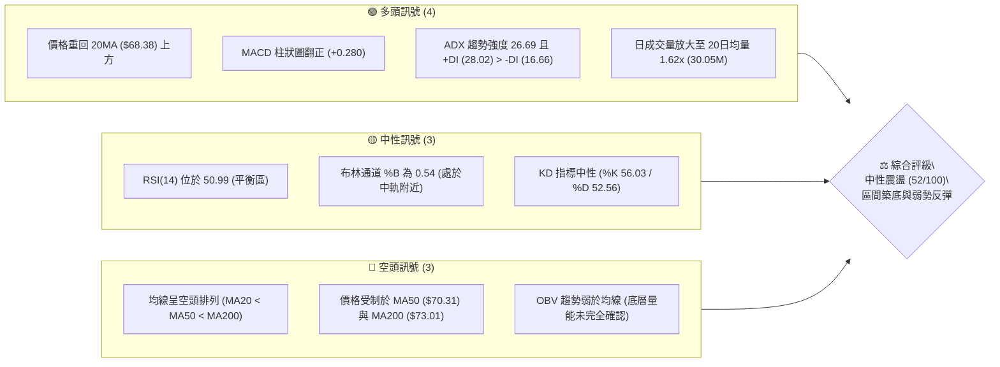

### 📊 核心指標速覽表

| 指標類別 | 指標名稱 | 當前數值 | 訊號 | 解讀 |
|----------|----------|----------|------|------|
| **價格** | 當前收盤價 | $68.78 | 🟡 | 位於52週區間 15.1% 處，自低點 $64.04 展開反彈 |
| **均線** | 短期 MA20 | $68.38 | 🟢 | 現價站上 MA20，短期趨勢翻多 |
| **均線** | 中期 MA50 | $70.31 | 🔴 | 位於 MA50 之下，中期下行壓力仍存 |
| **均線** | 長期 MA200 | $73.01 | 🔴 | 位於年線之下，長期趨勢屬弱勢修正架構 |
| **動能** | RSI(14) | 50.99 | 🟡 | 脫離超賣區進入中性區域，多空處於拉鋸均衡 |
| **動能** | MACD (12,26,9) | 柱狀圖 +0.280 | 🟢 | MACD 快線 (-0.805) 向上穿過訊號線 (-1.085) 呈金叉 |
| **動能** | KD (9,3,3) | %K 56.03 / %D 52.56 | 🟢 | 金叉擴張，短期動能向上修復 |
| **趨勢** | ADX (14) | 26.69 (+DI 28.02) | 🟢 | 趨勢強度 > 25，多方動能佔優 (+DI > -DI) |
| **波動** | ATR(14) | $2.07 (3.01%) | 🟡 | 日內平均振幅約 $2.07，屬中等波動率 |
| **通道** | 布林通道 | 中軌 $68.38 / %B 0.54 | 🟡 | 價格貼近中軌震盪，通道帶寬處於收斂後初升段 |
| **成交量** | 最新成交量 | 30,055,600 | 🟢 | 量比 1.62x，高於 20日均量 (18.60M) 與 50日均量 |
| **能量潮** | OBV | OBV < MA | 🔴 | 能量潮指標尚未穿過其均線，中長線量能確認度仍弱 |

### 🏆 技術評分卡

```
╔══════════════════════════════════════════════════════════════╗
║              技術評分卡 — UBER (2026-11-06)                   ║
╠══════════════════════════════════════════════════════════════╣
║ 趨勢強度 (ADX & DI)     ██████████░░░░░░░░░░  52/100   🟡 中性║
║ 動能指標 (RSI & MACD)   ████████████░░░░░░░░  60/100   🟢 偏多║
║ 支撐穩定度 (S1/S2/S3)   █████████████░░░░░░░  65/100   🟢 偏多║
║ 成交量配合 (Vol & OBV)  ██████████░░░░░░░░░░  48/100   🟡 中性║
║ 形態完整度 (打底與K線)  ██████████░░░░░░░░░░  50/100   🟡 中性║
║ 均線排列 (MA排列狀態)   ███████░░░░░░░░░░░░░  37/100   🔴 偏空║
╠══════════════════════════════════════════════════════════════╣
║ 綜合評分                ██████████░░░░░░░░░░  52/100   🟡 中性║
║ 評級結論：區間築底 / 弱勢反彈架構 (算術平均四捨五入: 52分)     ║
╚══════════════════════════════════════════════════════════════╝
```

---

## 2. 趨勢分析

### 🌐 多時框趨勢分析

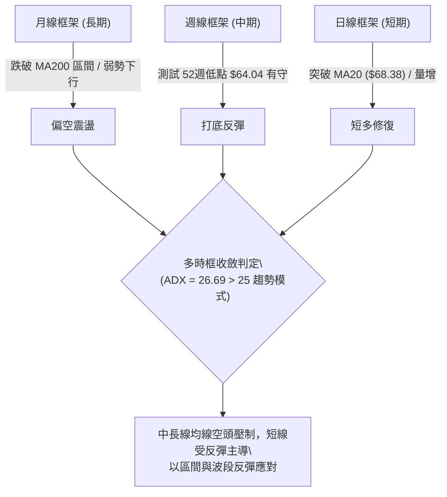

### 📈 長期趨勢 — 12個月走勢圖（Unicode）

UBER 過去 12 個月自 2025 年 11 月的 $87.54 高位一路震盪下行，並在 2026 年 10 月下探 $64.04（52週低點），當前 2026 年 11 月迎來弱勢反彈至 $68.78。

```
UBER 月線收盤走勢圖（2025-11 至 2026-11）
價格 ($)
$90.00 ┤  ● (87.54)
$85.00 ┤      ● (81.71)
$80.00 ┤          ● (80.05)
$75.00 ┤              ● (75.42)      ● (75.65)
$70.00 ┤                  ● (71.93)●(74.61)●(70.40)●(72.16)●(70.36)          ●←現價 $68.78
$65.00 ┤                                                ● (68.51)● (65.25)
$60.00 ┤                                                    ●(低點 $64.04)
       └─────────────────────────────────────────────────────────────────
       25-11 25-12 26-01 26-02 26-03 26-04 26-05 26-06 26-07 26-08 26-09 26-10 26-11
```

#### 走勢特徵分析表格

| 階段區間 | 時間跨度 | 起訖收盤價 | 區間幅度 | 核心特徵與技術解讀 |
|----------|----------|------------|----------|-------------------|
| 高位崩落期 | 2025-11 ~ 2026-03 | $87.54 → $71.93 | -17.83% | 跌破多條長期均線，量能萎縮，空方動能主導 |
| 中期平台期 | 2026-04 ~ 2026-08 | $74.61 → $75.65 | +1.39% | 橫盤拉鋸，反彈高點受制於 $78.80-$78.82 阻力區 |
| 二次探底期 | 2026-09 ~ 2026-10 | $68.51 → $65.25 | -4.76% | 摜破平台下緣，最低探至 52週低點 $64.04 |
| 築底反彈期 | 2026-10 ~ 2026-11 | $65.25 → $68.78 | +5.41% | 觸底 $64.04 後帶量長紅，突破短期 MA20 進入反彈 |

### 📊 中期趨勢（週線分析）

中期走勢呈現典型「階梯式下跌後的底部放量回升」。近 8 週 K 棒顯示：
- 2026-10-30 週收盤 $65.25，最低觸及 $64.04 形成 52週最低點。
- 2026-11-05 週長紅上漲至 $68.78，最高觸及 $72.50（逼近 R1 $72.08 與週線壓力），成交量擴大至 106,064,500 股，週 MACD 柱狀圖由 -0.339 翻正至 +0.280，週 RSI 從 35.8 迅速回升至 51.0。

```
近期週線壓力與支撐結構
$76.30 ════════════════════════════════════════ (R2 強阻力位 / 61.8% 斐波那契回調)
  ▲
$72.08 ---------------------------------------- (R1 近期波段高點阻力 / 週高點 $72.50 承壓)
  │      ┌──┐
  │      │  │ ← 2026-11-05 週高點 $72.50 衝高回落上影線
  ▼      └──┘
$68.78 ════════════════════════════════════════ (當前收盤價)
  ▲
$67.05 ---------------------------------------- (S1 短期支撐 / 5日均線 $67.44 重合區)
  │
$64.04 ════════════════════════════════════════ (S3 / 52週絕對低點，強支撐基石)
```

### ⚡ 趨勢強度評估（ADX 解讀）

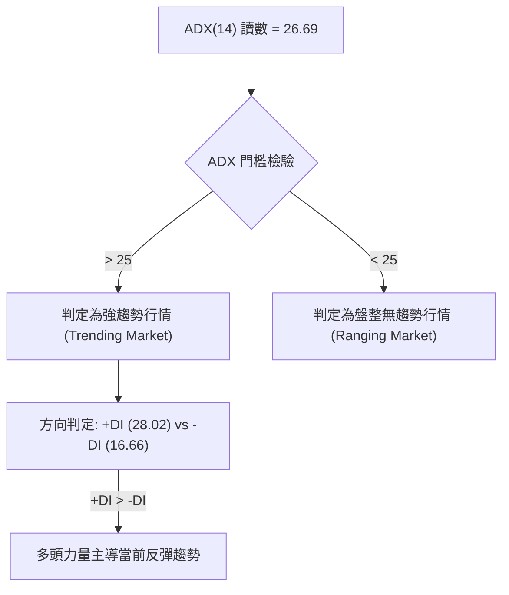

#### ADX 指標狀態與判斷對照表

| 指標變數 | 當前讀數 | 門檻區間 | 技術解讀 |
|----------|----------|----------|----------|
| **ADX (14)** | **26.69** | > 25.00 | 脫離盤整無序區，正式確立具方向性的趨勢結構 |
| **+DI (多方方向)** | **28.02** | 擴張中 | 短期買盤積極推升，多方動能佔據主導優勢 |
| **-DI (空方方向)** | **16.66** | 收斂中 | 空方賣壓顯著減弱，未對短線反彈構成壓制 |
| **行情型態結論** | **趨勢反彈** | +DI 顯著大於 -DI | 短期處於明確的多頭推升浪潮，但須提防高檔均線壓制 |

---

## 3. 圖表形態分析

### 🔍 形態識別系統

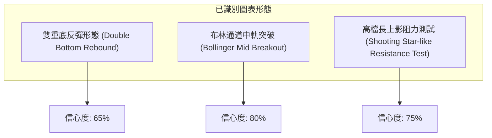

#### 形態識別與信心度評估表

| 形態名稱 | 信心度 | 判斷依據（引用數據） | 完成度 | 目標價（附嚴謹計算式） |
|----------|--------|----------------------|--------|------------------------|
| **雙重底反彈** | 65% | 2026-10-29 最低價 $64.04 守住 52週低點 S3 ($64.04)，與 10-30 低點 $64.68 形成微幅雙底架構；隨後帶量拉升突破 S1 ($67.05) | 70% | 頸線 S1 ($67.05) + 形態高度 ($67.05 - $64.04 = $3.01) = **$70.06**（已於 11-04 盤中達成，下一級推算目標為 R1 **$72.08**） |
| **布林帶突破** | 80% | 收盤價 $68.78 正式越過布林中軌 MA20 ($68.38)，%B 達到 0.54，自下軌 $63.92 展開標準中軌穿越 | 85% | 目標價為布林上軌：**$72.84**（數據中布林上軌精確值） |
| **箱型整理下緣支撐** | 55% | 10-28 至 10-30 連續於 S2 ($65.41) 與 S3 ($64.04) 區間獲買盤承接，未向下破位 | 90% | 箱型上緣目標指向近期波段高點 R1：**$72.08** |

### 🕯️ 重要K線形態分析

嚴格依據近 10 根日 K 與近 8 根週 K 之開、高、低、收數據進行客觀解讀：

#### 近 10 根日 K 線形態解讀

| 日期 | 開盤價 | 最高價 | 最低價 | 收盤價 | 成交量 | K線形態識別 | 技術解讀與訊號 | 訊號 |
|------|--------|--------|--------|--------|--------|-------------|----------------|------|
| 2026-10-23 | 68.47 | 68.90 | 66.43 | 66.70 | 18,778,200 | 中黑棒 | 跌破 $67.00，賣壓湧現 | 🔴 |
| 2026-10-26 | 66.62 | 67.00 | 65.68 | 66.13 | 22,057,900 | 帶下影黑棒 | 空方下壓，下影線透露買盤抵抗 | 🔴 |
| 2026-10-27 | 66.40 | 66.50 | 65.47 | 65.78 | 20,731,800 | 續跌黑棒 | 緩步下探 S2 ($65.41) 支撐 | 🔴 |
| 2026-10-28 | 65.50 | 65.88 | 64.69 | 65.27 | 18,324,900 | 紡錘陰線 | 跌勢減緩，進入打底準備 | 🟡 |
| 2026-10-29 | 65.28 | 65.80 | 64.04 | 65.74 | 16,286,800 | **長下影錘頭紅棒** | 探 52週低點 $64.04 強力反彈，確立底部基石 | 🟢 |
| 2026-10-30 | 65.61 | 65.80 | 64.68 | 65.25 | 17,962,800 | 二次測底紡錘線 | 回踩 $64.68 守穩，完成雙重底右腳 | 🟢 |
| 2026-11-02 | 66.12 | 67.47 | 65.55 | 66.71 | 17,742,800 | 突破陽線 | 收復 S1 ($67.05) 邊緣，短線轉強 | 🟢 |
| 2026-11-03 | 66.75 | 66.96 | 65.99 | 66.60 | 21,313,500 | 窄幅十字星 | 均線附近換手，量能溫和蓄勢 | 🟡 |
| 2026-11-04 | 68.28 | 72.50 | 67.36 | 69.87 | 36,952,600 | **爆量長上影大陽棒** | 量增 1.62x 衝擊 R1 ($72.08)，高檔見獲利結賣壓 | 🟢 |
| 2026-11-05 | 70.77 | 71.09 | 67.73 | 68.78 | 30,055,600 | **回洗陰線** | 回踩測試 MA20 ($68.38)，收盤守穩中軌上方 | 🟡 |

#### 近 8 根週 K 線形態解讀

| 週末交易日 | 開盤價 | 最高價 | 最低價 | 收盤價 | 成交量 | K線形態識別 | 技術解讀與訊號 | 訊號 |
|------------|--------|--------|--------|--------|--------|-------------|----------------|------|
| 2026-09-18 | 71.97 | 72.80 | 70.06 | 70.50 | 92,992,700 | 中黑棒 | 跌破 71 關卡，下行趨勢成型 | 🔴 |
| 2026-09-25 | 70.82 | 71.90 | 68.55 | 69.62 | 86,777,700 | 延續黑棒 | 均線反壓沉重，持續走弱 | 🔴 |
| 2026-10-02 | 69.36 | 69.97 | 67.22 | 68.11 | 80,475,800 | 帶下影黑棒 | 空方推力減弱，進入超賣區 | 🔴 |
| 2026-10-09 | 68.40 | 72.08 | 68.00 | 71.51 | 75,174,900 | 中長紅棒 | 反彈觸及 R1 ($72.08)，受壓回落 | 🟢 |
| 2026-10-16 | 71.16 | 71.86 | 68.62 | 70.35 | 69,265,400 | 上影黑棒 | R1 阻力未能有效站穩，二次探底 | 🔴 |
| 2026-10-23 | 70.13 | 70.76 | 66.43 | 66.70 | 84,761,000 | 大黑棒 | 加速跌破支撐，市場恐慌拋售 | 🔴 |
| 2026-10-30 | 66.62 | 67.00 | 64.04 | 65.25 | 95,364,200 | 長下影打底棒 | 於 $64.04 探底回升，成交量明顯放大 | 🟢 |
| 2026-11-05 | 66.12 | 72.50 | 65.55 | 68.78 | 106,064,500 | **爆量倒轉錘頭棒** | 週成交量突破 1億股，確立低檔換手反彈格局 | 🟢 |

### 📉 ASCII 走勢形態示意圖

```
UBER 近 10 日價格走勢與形態示意圖
價格軸
$73.00 ┤                                      
$72.00 ┤                                    ▲ 11-04 衝高 $72.50 (衝擊 R1 $72.08)
$71.00 ┤                                   ┌┴┐
$70.00 ┤                                   │ │   ┌─┐
$69.00 ┤                                   │ │   │ ├← 11-05 收 $68.78 (守穩 MA20)
$68.00 ┤   ┌─┐                             │ │   │ │
$67.00 ┤   │ │                             └┬┘   └┬┘
$66.00 ┤   │ │   ┌─┐   ┌─┐           ┌─┐   │ │    │  
$65.00 ┤   └┬┘   │ │   │ │   ┌─┐     │ │   │ │    │  
$64.00 ┤    │    └┬┘   └┬┘   └┬┘ ┌─┐ └┬┘   └─┘    ┴  
       └────┼─────┼─────┼─────┼───┼───┼─────┼──────┼────► 日期
          10-23 10-26 10-27 10-28 10-29 10-30 11-02 11-04  11-05
                                   ▲
                                   └─ 10-29 觸及 52W 低點 $64.04 形成長下影錘頭
```

### 🎯 形態目標價計算

1. **雙重底測幅計算**：
   - 第一低點（2026-10-29）：$64.04（52週低點 S3）
   - 第二低點（2026-10-30）：$64.68
   - 形態頸線（S1 支撐轉阻力）：$67.05
   - 形態垂直高度 = 頸線 ($67.05) - 低點 ($64.04) = **$3.01**
   - 形態理論最小量度目標 = 頸線 ($67.05) + 形態高度 ($3.01) = **$70.06**（已於 2026-11-04 盤中達成，最高達 $72.50）
   - 延伸阻力目標：直接指向波段高點聚集區 **R1 $72.08** 與 **R2 $76.30**。

---

## 4. 支撐與阻力

### 🗺️ 關鍵價位分布圖（Unicode）

```
UBER 價位結構分布圖（OHLCV 精確計算）
══════════════════════════════════════════════════════════════
$78.60 ║████████████████████████████████║ 強阻力 R3 (+14.27%)
$76.30 ║████████████████████████        ║ 關鍵阻力 R2 / Fib 61.8% ($76.03)
$72.08 ║████████████████████████████    ║ 近期第一阻力 R1 (+4.80%)
───────╫────────────────────────────────╫──────────────────────────
$68.78 ╠════════════════════════════════╣ ◄ 當前收盤價 ($68.78)
───────╫────────────────────────────────╫──────────────────────────
$67.05 ║▓▓▓▓▓▓▓▓▓▓▓▓▓▓▓▓▓▓▓▓▓▓▓▓        ║ 第一支撐 S1 (-2.52%)
$65.41 ║████████████████████████        ║ 第二支撐 S2 (-4.90%)
$64.04 ║████████████████████████████████║ 核心防守底線 S3 (-6.89% / 52W Low)
══════════════════════════════════════════════════════════════
```

### 🚧 阻力位分析表

所有阻力數值完全引用 OHLCV 計算之關鍵價位區塊：

| 阻力級別 | 價位 | 距離現價幅度 | 形成原因與技術共振 | 突破難度 | 重要性評級 |
|----------|------|--------------|-------------------|----------|------------|
| **R1** | **$72.08** | +4.80% | 近一年波段高點聚類；與 11-04 盤中高點 $72.50 及布林上軌 $72.84 形成密集壓制區 | 🟡 中等 | ★★★★☆ |
| **R2** | **$76.30** | +10.93% | 2026年 6月及 8月多次反彈頸線波峰；鄰近 52週斐波那契 61.8% 回調位 ($76.03) | 🔴 極高 | ★★★★★ |
| **R3** | **$78.60** | +14.27% | 近期重大波段密集套牢頭部（2026-08-21 高點 $78.80 聚類）；中長線空頭總防線 | 🔴 極高 | ★★★★☆ |

### 🛡️ 支撐位分析表

所有支撐數值完全引用 OHLCV 計算之關鍵價位區塊：

| 支撐級別 | 價位 | 距離現價幅度 | 形成原因與技術共振 | 守住機率 | 重要性評級 |
|----------|------|--------------|-------------------|----------|------------|
| **S1** | **$67.05** | -2.52% | 近一年波段低點聚類；與短期 MA5 ($67.44) 及 11-02 啟動點形成短多共振支撐 | 75% | ★★★★☆ |
| **S2** | **$65.41** | -4.90% | 10月下旬（10-27 至 10-30）平台整理密集換手區下緣；次級波段低點 | 85% | ★★★★☆ |
| **S3** | **$64.04** | -6.89% | **52週絕對最低價**；斐波那契 100.0% 極限支撐；多方絕對不可失守之停損底線 | 95% | ★★★★★ |

### 📐 斐波那契回調位分析

依據 52週高點 $95.44 至 52週低點 $64.04 區間完整映射，當前收盤價 **$68.78** 位於 **78.6% 回調位 ($70.76)** 與 **100.0% 底部 ($64.04)** 之間。

```
斐波那契回調梯隊 ($64.04 → $95.44)
  0.0%  (52W High)   $95.44 ──────────────────────────────────────────
 23.6%               $88.03 ──────────────────────────────────────────
 38.2%               $83.45 ──────────────────────────────────────────
 50.0%               $79.74 ──────────────────────────────────────────
 61.8%               $76.03 ──────────────── (與 R2 $76.30 形成關鍵共振)
 78.6%               $70.76 ──────────────── (上檔第一道斐波那契反壓)
                     $68.78 ◄───【現價位於 78.6% 與 100% 之間築底反彈】
100.0%  (52W Low)    $64.04 ──────────────── (波段絕對底部 S3)
```

- **位置解讀**：現價落於深幅回撤區（>78.6%），表明長期下行趨勢中空方動能已消耗殆盡。股價自 100.0% ($64.04) 支撐處強烈彈升，當前首要挑戰為收復 78.6% ($70.76) 關卡，若能有效突破，後續上方空間將擴展至 61.8% ($76.03) 與 R2 ($76.30)。

---

## 5. 技術指標深度解讀

### 🎛️ 指標訊號總覽

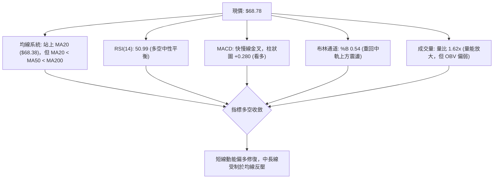

### 📈 移動平均線排列分析

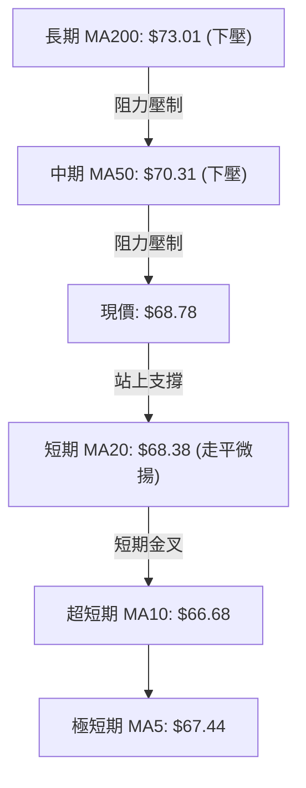

#### 均線數據與結構分析

| 均線名稱 | 當前價格 | 與現價差距 | 排列狀態 | 技術解讀 |
|----------|----------|------------|----------|----------|
| **MA 5** | $67.44 | +1.98% | 向上翻揚 | 極短線支撐，11-04 帶量突破後 MA5 急速拐頭向上 |
| **MA 10** | $66.68 | +3.14% | 向上翻揚 | 短期轉折確認，與 MA5 形成短線多頭排列 |
| **MA 20** | $68.38 | +0.58% | 走平轉多 | 現價已成功站上 MA20，正式扭轉為期數週的短線跌勢 |
| **MA 50** | $70.31 | -2.18% | 往下壓制 | 中期下行壓力線，與斐波那契 78.6% ($70.76) 重合 |
| **MA 60** | $71.51 | -3.82% | 往下壓制 | 季線阻力，壓制反彈空間 |
| **MA 120** | $71.83 | -4.25% | 往下壓制 | 半年線阻力，與 R1 $72.08 形成雙重阻力壁壘 |
| **MA 200** | $73.01 | -5.79% | 往下壓制 | 長線多空分水嶺，當前與現價呈現 -5.79% 負乖離 |
| **MA 240** | $74.92 | -8.20% | 往下壓制 | 長期年線反壓，確認整體大格局處於空頭修正 |

- **排列判定**：中長線呈現標準「空頭排列」（MA20 < MA50 < MA200），但超短期呈現「底背離修復」（價格 > MA20 > MA5 > MA10），指示股價正處於空頭格局下的強勁技術性反彈。

### 📉 RSI(14) 分析

- **當前讀數**：**50.99**（Wilder 計算方法）
- **動能評估進度條**：
  ```
  超賣區 (0-30)        中性平衡區 (30-70)        超買區 (70-100)
  ░░░░░░░░░░░░░░░░░░░░█████████████░░░░░░░░░░░░░░░░░░░░░░░░░░ 50.99
  ```
- **背離分析判斷**：
  - **結論**：近 20 根 K 棒**無明顯頂背離或底背離**。
  - **佐證依據**：價格於 10-29 創下 $64.04 低點時，RSI 位於 35.8 附近同步見底；隨後價格拉升至 $68.78，RSI 同步回升至 50.99。動能指標與價格走勢保持一致性，未見背馳現象，顯示反彈屬於常態技術修復。

### 📊 MACD (12, 26, 9) 訊號解讀

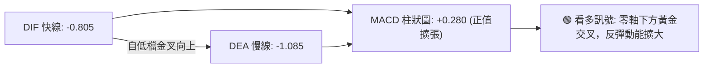

- **讀數**：MACD 快線為 **-0.805**，訊號線（Signal）為 **-1.085**，柱狀圖（Histogram）為 **+0.280**。
- **訊號解讀**：MACD 柱狀圖連續兩週顯著翻正（從 -0.339 快速跳升至 +0.280），快線已自低檔明確向上黃金交叉訊號線，顯示低檔多頭買盤力量正在加速聚集，支撐短線持續上攻。

### 📦 布林通道分析

```
UBER 日線布林通道結構示意圖
$72.84 ───────────────────────────── 上軌 (Upper Band)
                                      ▲ 11-04 衝高受阻於上軌與 R1
$68.78 ═════════════════════════════ 【現價: $68.78】(%B = 0.54)
$68.38 ───────────────────────────── 中軌 (MA20 Middle Band)
                                      ▼ 10-29 觸底回彈
$63.92 ───────────────────────────── 下軌 (Lower Band)
```

- **數值結構**：
  - 上軌：**$72.84**
  - 中軌（MA20）：**$68.38**
  - 下軌：**$63.92**
  - **%B 指標**：**0.54**
- **動態解讀**：現價在觸及下軌 $63.92 獲強力支撐後展開反彈，目前微幅越過中軌 $68.38（%B = 0.54），顯示多方已重新奪回中軌主導權。布林帶寬目前處於收斂狀態，預示未來 1-2 週將迎來區間突破方向選擇。

### 💹 成交量分析（量價配合度）

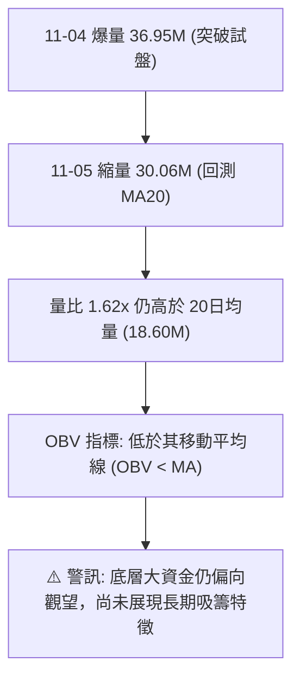

- **量價配合分析**：
  1. 11-04 當日成交量激增至 36,952,600 股，價格上漲 +4.91%（收 $69.87），呈現「放量長紅」的健康進攻型態。
  2. 11-05 小幅回檔時成交量降至 30,055,600 股，呈現「量縮回踩」，未見恐慌拋售。
  3. **OBV 能量潮解讀**：OBV 仍位於其均線下方，說明長線累積能量尚未完全翻多，中長線機構資金進場相對克制，多頭突破仍須持續補量方能克服 R1 ($72.08) 與 R2 ($76.30) 密集套牢區。

---

## 6. 動能與波動率

### ⚡ 動能評估四象限

| 象限 | 動能維度 | 波動維度 | UBER 當前狀態 | 技術評估與操作導引 |
|------|----------|----------|---------------|-------------------|
| **第一象限 (Q1)** | 強動能 | 低波動 | ── | 最佳單邊趨勢機會 |
| **第二象限 (Q2)** | 弱動能 | 低波動 | ── | 窄幅盤整，觀望等待 |
| **第三象限 (Q3)** | **強動能** | **中高波動** | **✓ 當前定位** | **反彈動能強勁 (ADX 26.69)，波動率 3.01%，適合區間波段進出** |
| **第四象限 (Q4)** | 弱動能 | 高波動 | ── | 混亂下跌，嚴格規避 |

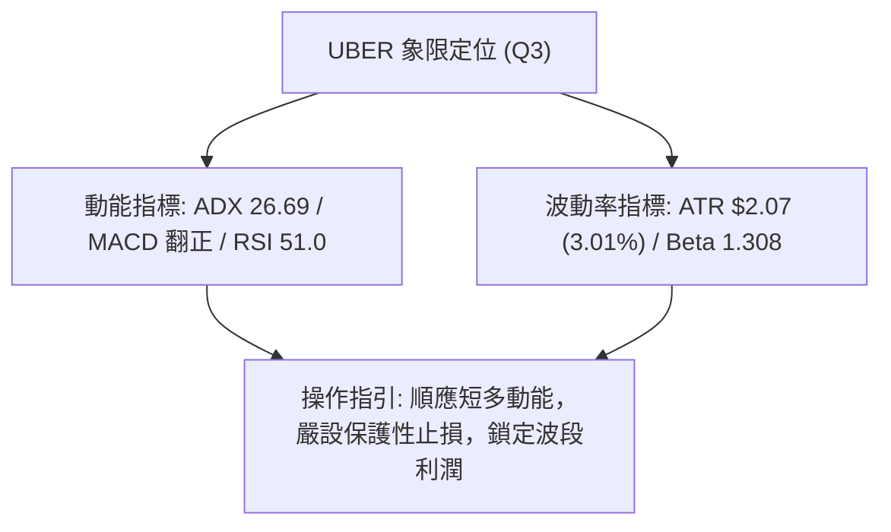

### 📊 ATR 波動率分析

- **ATR(14) 讀數**：**$2.07**（佔股價比例 **3.01%**，Wilder 平滑計算）。
- **日內波動特徵**：UBER 每日平均波動空間約 $2.07，這意味著任何日內交易策略若止損設定小於 $2.00 極易遭到日常雜訊清洗。
- **動態止損建議**：
  - **保守型止損距離（2.0 × ATR）**：$2.07 × 2.0 = **$4.14**
  - **波段型止損距離（1.5 × ATR）**：$2.07 × 1.5 = **$3.11**
  - **進取型短線止損（1.0 × ATR）**：$2.07 × 1.0 = **$2.07**

### 📐 Beta 與市場相關性

- **Beta 係數**：**1.308**
- **市場特徵分析**：UBER 的 Beta 為 1.308，展現高於標普 500 指數 30.8% 的高貝塔高彈性特徵。當大盤（如 Nasdaq 或 S&P 500）走強時，UBER 具備更強的反彈爆發力；然而在市場整體修正環境下（如近期新聞所指之科技股回調），該股亦將承受放大之回撤壓力。

---

## 7. 多時框架總結

### 📋 時框架評分表

| 時框架 | 趨勢方向 | 動能狀態 | 均線排列 | 關鍵形態 | 評分 | 建議操作策略 |
|--------|----------|----------|----------|----------|------|--------------|
| **月線 (長期)** | 🔴 偏空 | 弱勢築底 | 空頭排列 (MA200下方) | 52週低點測試 | 40/100 | 長期投資者逢低分批，不可追高 |
| **週線 (中期)** | 🟡 中性 | 反彈初起 | MA50下方震盪整理 | 底部倒轉錘頭放量 | 50/100 | 區間交易，逢阻力減碼 |
| **日線 (短期)** | 🟢 偏多 | 向上修復 | 站上 MA20，MA5/10翻揚 | 雙重底頸線突破回測 | 65/100 | 順勢短多，依支撐分批低吸 |

### 🔲 綜合訊號矩陣

```
╔══════════════════════════════════════════════════════════════╗
║              UBER 多時框訊號一致性矩陣                        ║
╠══════════════════════════════════════════════════════════════╣
║ 時框維度   │ 均線系統 │ 動能 (RSI/MACD) │ 量價形態 │ 綜合傾向  ║
╠════════════╪══════════╪═════════════════╪══════════╪══════════╣
║ 短期 (日線)│   🟢     │       🟢        │    🟢    │ 🟢 偏多   ║
║ 中期 (週線)│   🔴     │       🟢        │    🟡    │ 🟡 中性   ║
║ 長期 (月線)│   🔴     │       🟡        │    🔴    │ 🔴 偏空   ║
╚══════════════════════════════════════════════════════════════╝
```

### ⚖️ 多時框收斂結論

依據多時框收斂規則第 14 條：
1. **趨勢判定優先級**：當前 ADX(14) 讀數為 **26.69 > 25**，符合「趨勢行情」條件。
2. **多時框權重取捨**：
   - 中長線（週線、MA50 $70.31、MA200 $73.01）處於絕對空頭壓制格局，決定了整體上檔空間受限；
   - 短線日線已發出明確的反彈動能訊號（價格站上 MA20 $68.38、MACD 金叉、+DI > -DI）。
3. **唯一方向性收斂結論**：**中性偏多之弱勢反彈格局（區間震盪築底）**。
   - 操作定位：以「日線尋找逢低布局點位」，但「目標價嚴格受制於中期阻力 R1 $72.08 與 R2 $76.30」，**絕不盲目做中長線趨勢突破追價**。

---

## 8. 交易策略建議

### 🗺️ 策略決策流程圖

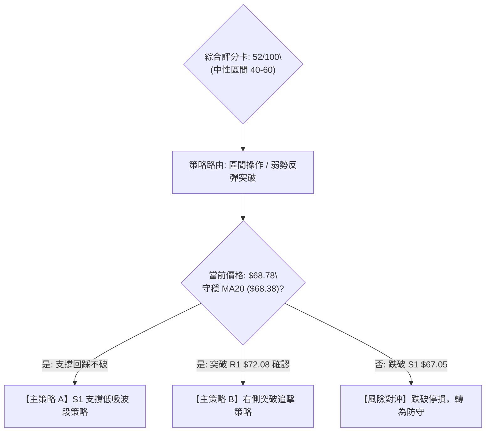

### 🧭 策略路由

> **當前主策略方向 = 區間震盪低吸與右側突破策略（依技術評分卡 52/100，定位於中性震盪修復區）**

### 🎯 價格情境階梯（Price Scenarios）

所有價位均嚴格引用第 4 章及數據計算結果：

| 觸發條件 | 下一目標 | 後續延伸 | 情境含義與技術應對 |
|----------|----------|----------|-------------------|
| **突破 R1 $72.08** | **R2 $76.30** | **R3 $78.60** | 短線轉強，正式挑戰 61.8% 斐波那契壓力，可加碼跟進 |
| **守穩 S1 $67.05 - 現價** | **R1 $72.08** | **布林上軌 $72.84** | 處於健康築底反彈結構，維持區間多頭持股 |
| **跌破 S1 $67.05** | **S2 $65.41** | **S3 $64.04** | 短線反彈宣告失敗，股價將重返 52週低點尋求支撐 |

### 📊 情境機率分佈

| 情境分類 | 預估機率 | 主要技術依據 |
|----------|----------|--------------|
| **情境一：延續反彈衝擊 R1 / R2** | **55%** | MACD 柱狀圖翻正 (+0.280)、+DI (28.02) 佔優、成交量突破 1.62x 均量 |
| **情境二：在 S1 與 R1 間區間震盪** | **30%** | RSI 位於 50.99 平衡點，MA50 ($70.31) 形成反壓，OBV 尚未顯著超越均線 |
| **情境三：跌破 S1 回測 52W 低點 S3** | **15%** | 中長線均線空頭排列，若大盤科技股持續回調可能引發系統性下殺 |

### 🟢 主策略詳情

嚴格按照規則 17 定義計算風險報酬比：`(目標價 T1 − 進場價) ÷ (進場價 − 止損價)`。

| 策略要素 | 策略 A：S1 支撐回踩低吸策略（左側/區間） | 策略 B：突破 R1 確認追擊策略（右側） |
|----------|------------------------------------------|--------------------------------------|
| **進場條件** | 股價回踩 S1 ($67.05) 不破，出現下影線確認 | 日線實體帶量突破並收於 R1 ($72.08) 之上 |
| **進場價格** | **$67.05** | **$72.08** |
| **止損價格** | **$65.41**（跌破 S2 支撐） | **$70.31**（跌回 MA50 之下） |
| **目標價 T1** | **$72.08**（波段阻力 R1） | **$76.30**（關鍵阻力 R2 / Fib 61.8%） |
| **目標價 T2** | **$76.30**（關鍵阻力 R2） | **$78.60**（強阻力 R3） |
| **風險報酬比** | **1 : 3.07（以 T1 計）**<br>*(計算式: (72.08 - 67.05) ÷ (67.05 - 65.41) = 5.03 ÷ 1.64 = 3.067)* | **1 : 2.38（以 T1 計）**<br>*(計算式: (76.30 - 72.08) ÷ (72.08 - 70.31) = 4.22 ÷ 1.77 = 2.384)* |
| **成功機率** | **60%** | **55%** |
| **建議倉位** | **15% 總資金** | **10% 總資金** |

*註：策略 A 至 T2 之風報比為 1 : 5.64（以 T2 計）；策略 B 至 T2 之風報比為 1 : 3.68（以 T2 計）。*

### 🔴 反向風險觸發點（對沖提示）

- **推翻做多假說的關鍵價位**：**$67.05（S1 支撐）**。
- **風控觸發訊號**：
  1. 日線收盤跌破 **$67.05**，意味著自 $64.04 展開的反彈浪宣告結束，多單應無條件停損出場。
  2. 若進一步摜破 **$65.41（S2）**，將極大概率再次測試 52週低點 **$64.04（S3）**，空手者嚴禁盲目抄底。

### ⭐ 整體訊號強度評星

```
做多訊號強度：★★★☆☆  (3/5星，短線動能改善，但受中長線均線壓制)
做空訊號強度：★★☆☆☆  (2/5星，觸底反彈動能強勁，做空勝率偏低)
整體可信度：  ★★★★☆  (4/5星，指標與量價共振度高，區間邊界清晰)
```

---

## 9. 風險提示與監控

### ✅ 關鍵監控指標 Checklist

```
╔══════════════════════════════════════════════════════════════╗
║              UBER 交易風控監控清單 (Daily Checklist)         ║
╠══════════════════════════════════════════════════════════════╣
║ [ ] 價格是否持續守在 MA20 ($68.38) 與 S1 ($67.05) 之上？       ║
║ [ ] 每日成交量是否維持在 20日均量 (18.60M) 以上健康換手？     ║
║ [ ] MACD 柱狀圖是否持續處於正值區擴張 (當前 +0.280)？        ║
║ [ ] RSI(14) 是否成功站穩 50 多空分水嶺之上？                 ║
║ [ ] 股價衝擊 R1 ($72.08) 時是否出現長上影線或爆量滯漲？       ║
║ [ ] 納斯達克科技股整體走勢是否出現系統性大幅拉回？           ║
╚══════════════════════════════════════════════════════════════╝
```

### ⚠️ 風險場景分析

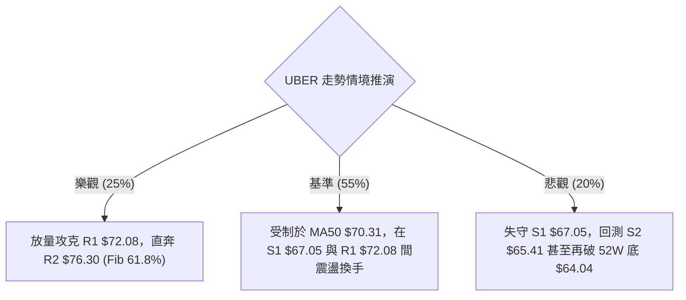

### 🛡️ 風險管理重要提醒

1. **嚴禁過度槓桿與重倉追高**：當前均線系統仍屬空頭排列（MA20 < MA50 < MA200），整體反彈本質為「空頭結構下的超跌修復」，絕非主升浪。任何多頭操作倉位應嚴格控制在 15-25% 以內。
2. **波動率管理（ATR 紀律）**：UBER 的 ATR 高達 $2.07，單日正常震盪幅度可達 3% 以上。止損設定必須避開整數關卡之流動性陷阱，嚴格以 S1 ($67.05) 與 S2 ($65.41) 關鍵價位作為嚴格停損分界。
3. **大盤系統性風險（Beta 1.308）**：近期新聞提及科技巨頭拉回與宏觀修正風險，UBER 具有高 Beta 屬性，若大盤重挫，切勿逆勢硬抗，應果斷執行對沖或離場觀望。

---

## 📋 報告總結

```
╔══════════════════════════════════════════════════════════════╗
║              UBER 技術分析報告總結 (2026-11-06)              ║
╠══════════════════════════════════════════════════════════════╣
║ 當前價格：$68.78                                              ║
║ 分析評級：⚖️ 中性震盪 / 底部弱勢反彈 (綜合評分: 52/100)        ║
╠══════════════════════════════════════════════════════════════╣
║ 關鍵結論：                                                    ║
║ ├─ 長期趨勢：🔴 偏空 (受制於年線 MA200 $73.01 與深幅下行架構)║
║ ├─ 中期趨勢：🟡 中性 (於 52週低點 $64.04 探底回升，進入打底)║
║ ├─ 短期趨勢：🟢 偏多 (帶量站上 MA20 $68.38，MACD 翻正向上)  ║
║ ├─ 關鍵支撐：S1 $67.05 │ S2 $65.41 │ S3 $64.04 (52W底線)    ║
║ ├─ 關鍵阻力：R1 $72.08 │ R2 $76.30 │ R3 $78.60              ║
║ └─ 分析師目標：均價 $100.77 (最低 $70.00 / 最高 $150.00)     ║
╠══════════════════════════════════════════════════════════════╣
║ 最優策略組合：                                                ║
║ 1. 🥇 最佳機會：回踩 S1 ($67.05) 布局短多，目標 R1 ($72.08)，║
║                 止損設於 S2 ($65.41)，風報比高達 1 : 3.07。  ║
║ 2. 🥈 次選機會：帶量突破 R1 ($72.08) 後順勢追進，目標 R2     ║
║                 ($76.30)，止損設於 $70.31，風報比 1 : 2.38。 ║
║ 3. 🥉 保守選擇：在股價未實質突破布林上軌與 MA50 ($70.31) 前，║
║                 維持觀望，等待日線與週線均線系統收斂。        ║
╚══════════════════════════════════════════════════════════════╝
```

---

> ⚠️ **免責聲明**：本報告為 AI 自動生成之技術分析，所有數據及估算均嚴格基於所提供的歷史價格與量化資訊。本報告**僅供研究與學術參考**，**不構成任何形式的投資建議**。市場有風險，交易需獨立判斷與嚴格風控。

---

*報告生成時間：2026-11-06 ｜ 數據來源：Yahoo Finance ｜ 分析框架：多時框技術分析體系*