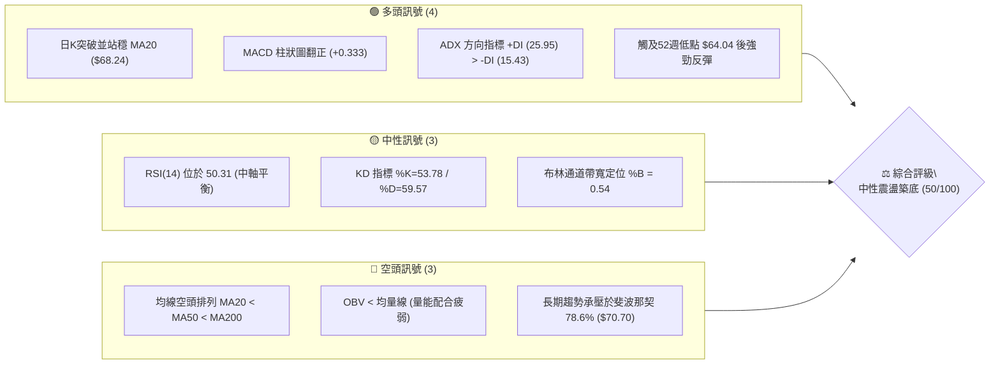
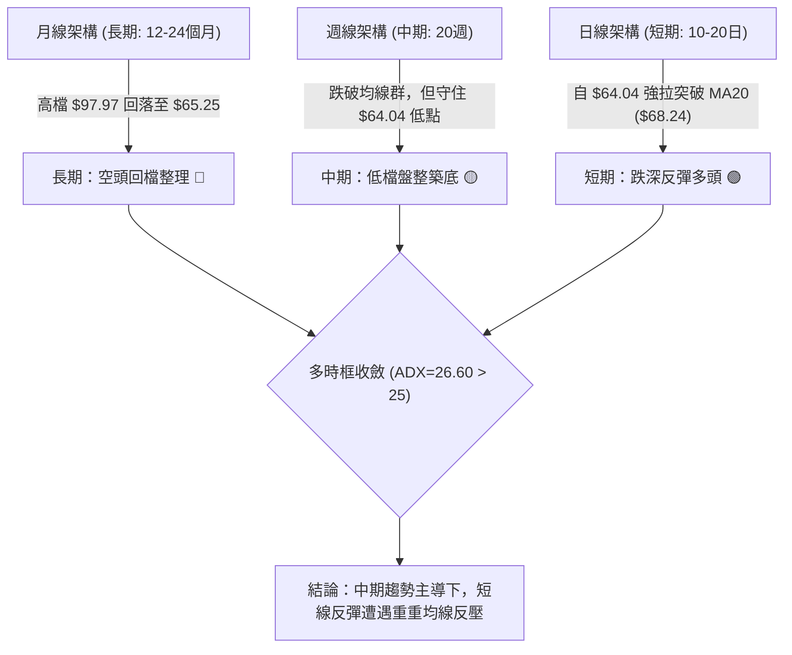
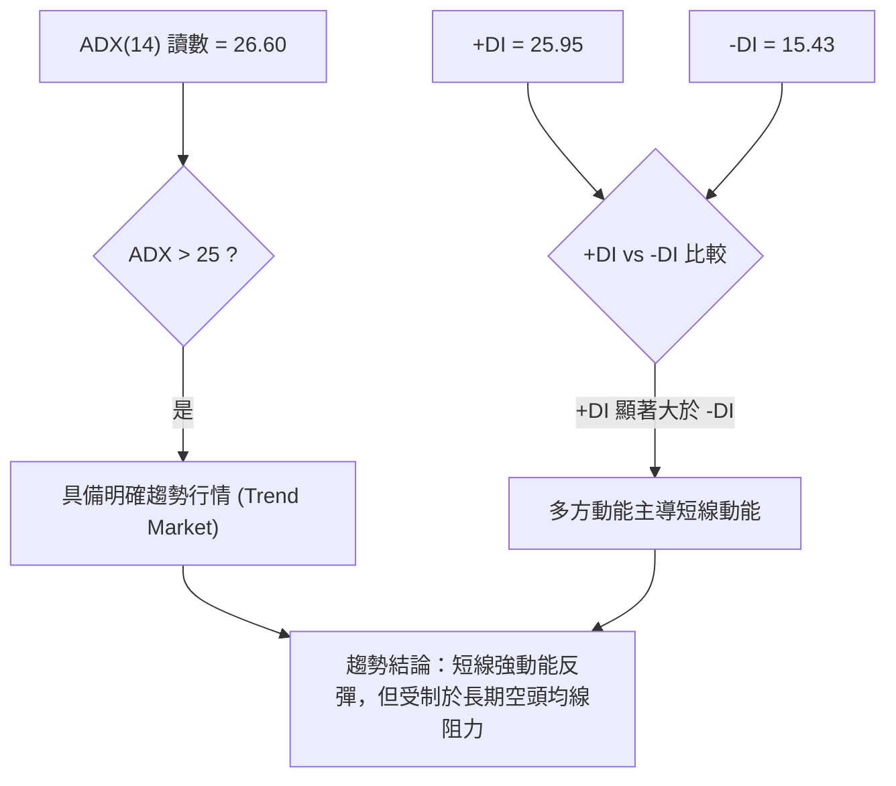
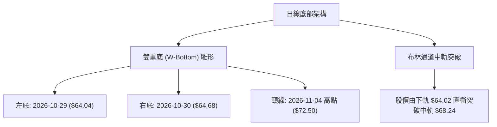
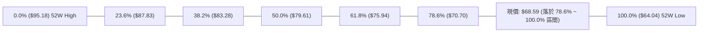
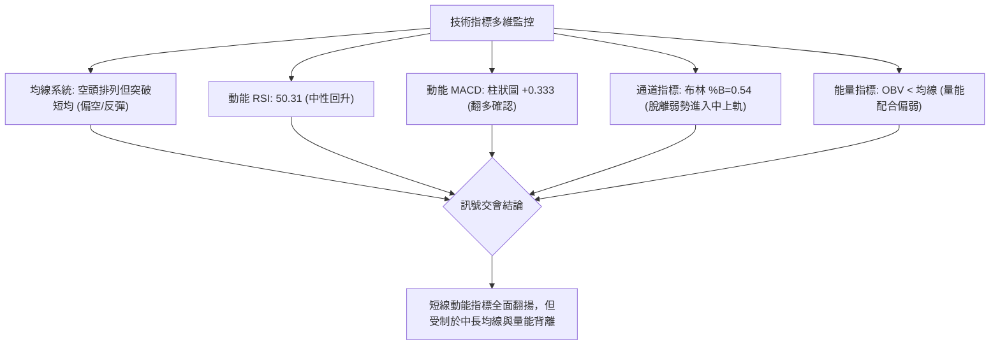
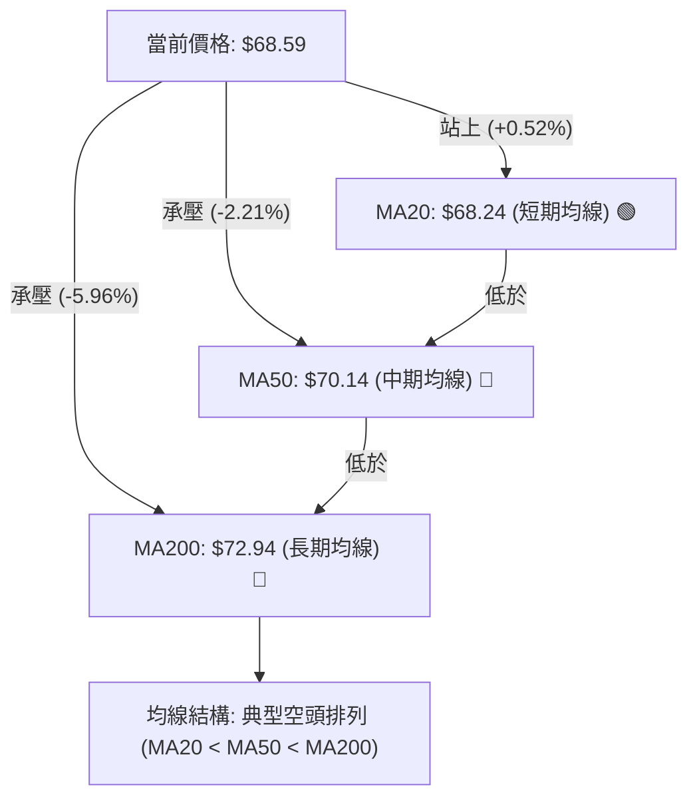
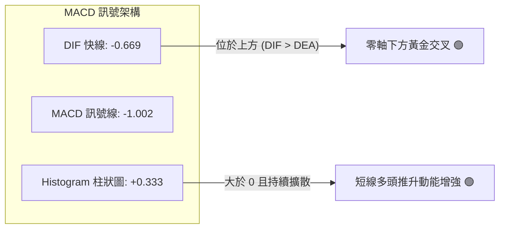
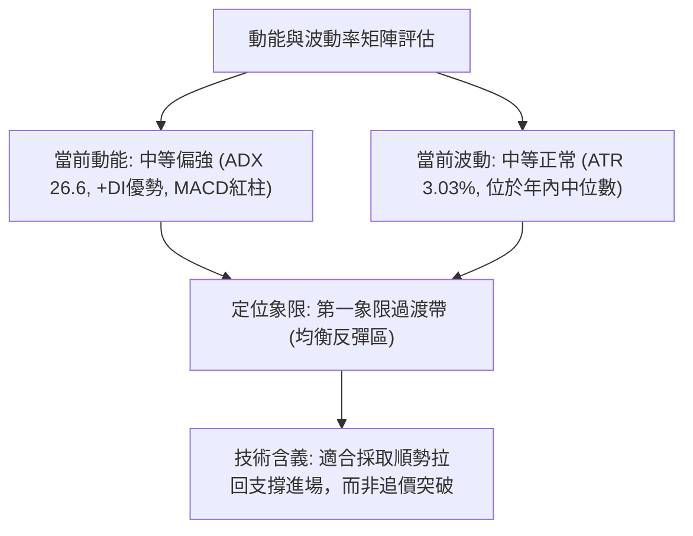
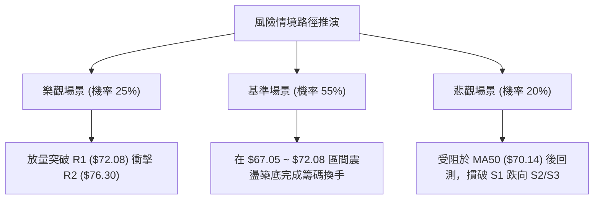

# UBER 技術分析報告

> **報告日期**：2026-11-07 ｜ **語言**：繁體中文 ｜ **數據來源**：Yahoo Finance ｜ **當前價格**：$68.59

---

## 目錄

| 章節 | 內容 |
|------|------|
| [1. 技術面概覽](#1-技術面概覽) | 訊號儀表板、核心指標、評分卡 |
| [2. 趨勢分析](#2-趨勢分析) | 多時框趨勢、長中短期走勢 |
| [3. 圖表形態分析](#3-圖表形態分析) | 形態識別、K線組合、目標價 |
| [4. 支撐與阻力](#4-支撐與阻力) | 關鍵價位、斐波那契回調 |
| [5. 技術指標深度解讀](#5-技術指標深度解讀) | MA/RSI/MACD/布林/成交量 |
| [6. 動能與波動率](#6-動能與波動率) | 動能評估、ATR、Beta |
| [7. 多時框架總結](#7-多時框架總結) | 時框架評分矩陣 |
| [8. 交易策略建議](#8-交易策略建議) | 多空策略、風險報酬比 |
| [9. 風險提示與監控](#9-風險提示與監控) | 監控指標、風險場景 |

---

## 1. 技術面概覽

### 🎯 技術訊號儀表板



### 📊 核心指標速覽表

| 指標類別 | 指標名稱 | 當前數值 | 訊號 | 解讀 |
|----------|----------|----------|------|------|
| **價格** | 當前收盤價 | $68.59 | 🟡 | 位於52週區間 14.6% 處，自低檔反彈但整體偏低 |
| **均線** | MA20 | $68.24 | 🟢 | 價格突破短期均線上方（+0.52%），短線轉強 |
| **均線** | MA50 | $70.14 | 🔴 | 價格位於中期均線下方（-2.21%），承壓明顯 |
| **均線** | MA200 | $72.94 | 🔴 | 價格位於長期均線下方（-5.96%），長期架構偏空 |
| **動能** | RSI(14) | 50.31 | 🟡 | 剛跨越50中軸，無超買超賣，多空勢力均衡 |
| **動能** | MACD (12,26,9) | -0.669 / -1.002 | 🟢 | 零軸下方黃金交叉，Histogram 為 +0.333 |
| **趨勢** | ADX(14) | 26.60 | 🟢 | 數值大於 25，趨勢強度轉強，+DI 占據優勢 |
| **通道** | 布林帶 (%B) | 0.54 | 🟡 | 剛越過中軌 ($68.24)，進入中軌至上軌區間 |
| **量能** | 20日成交量比 | 0.98x | 🔴 | 最新量 18.28M 低於均量 18.69M，OBV 疲弱 |
| **波動** | ATR(14) | $2.08 | 🟡 | 日波動率為 3.03%，波動維持正常水準 |

### 🏆 技術評分卡

```
╔══════════════════════════════════════════════════════════════╗
║                技術評分卡 — UBER (2026-11-07)                ║
╠══════════════════════════════════════════════════════════════╣
║ 評估維度         強度進度條                      分數    訊號║
╠══════════════════════════════════════════════════════════════╣
║ 趨勢強度         ██████████░░░░░░░░░░           52/100   🟡  ║
║ 動能指標         ███████████░░░░░░░░░           56/100   🟡  ║
║ 支撐穩定度       ████████████░░░░░░░░           60/100   🟢  ║
║ 成交量配合       █████████░░░░░░░░░░░           45/100   🟡  ║
║ 形態完整度       ██████████░░░░░░░░░░           50/100   🟡  ║
║ 均線排列         ███████░░░░░░░░░░░░░           35/100   🔴  ║
╠══════════════════════════════════════════════════════════════╣
║ 綜合評分         ██████████░░░░░░░░░░           50/100   🟡  ║
║ 評級結論         中性觀望（區間操作 / 築底等待突破）         ║
╚══════════════════════════════════════════════════════════════╝
```
*註：綜合評分由六項子評分算術平均計算：(52 + 56 + 60 + 45 + 50 + 35) ÷ 6 = 49.67，四捨五入為 50/100。*

---

## 2. 趨勢分析

### 🌐 多時框趨勢分析



### 📈 長期趨勢 — 12個月走勢圖（Unicode）

```
UBER 月線收盤走勢圖（2025-11 至 2026-11）
價格 ($)
$98 ┤
$95 ┤
$92 ┤
$89 ┤
$86 ┤● 87.54
$83 ┤
$80 ┤    ● 81.71  ● 80.05
$77 ┤
$74 ┤                 ● 75.42           ● 75.65
$71 ┤                      ● 71.93 ● 74.61   ● 72.16
$68 ┤                                   ● 70.40   ● 70.36   ● 68.51         ● 68.59(現價)
$65 ┤                                                           ● 65.25
    └─────────────────────────────────────────────────────────────────────────────
     11/25  12/25  01/26  02/26  03/26  04/26  05/26  06/26  07/26  08/26  09/26  10/26  11/26
```

#### 長期走勢特徵分析

| 階段 | 時間區間 | 起始收盤價 | 結束收盤價 | 區間漲跌幅 | 走勢結構與技術特徵 |
|------|----------|------------|------------|------------|--------------------|
| 主跌浪一 | 2025-11 ～ 2026-03 | $87.54 | $71.93 | -17.83% | 自歷史高位 $97.97 展開回調，跌破80元整數心理關卡 |
| 弱勢反彈 | 2026-04 ～ 2026-08 | $74.61 | $75.65 | +1.39% | 橫盤拉鋸，受阻於 78.60 阻力帶，高點無法推進 |
| 破底趕底 | 2026-09 ～ 2026-10 | $68.51 | $65.25 | -4.76% | 殺出 52 週最低點 $64.04，呈現超賣趕底現象 |
| 初步止血 | 2026-11 當前 | $65.25 | $68.59 | +5.12% | 季報釋出後放量反彈，站回月線 $68 基準帶 |

### 📊 中期趨勢（週線分析）

```
UBER 週線關鍵支撐阻力結構示意圖
$78.80 ── 2026-08 波段雙頂高點 (中期強壓力 R3: $78.60)
         │
$75.02 ── 08月反彈高點平台 (中期阻力 R2: $76.30)
         │
$72.08 ── 10/09 反彈週高點 / 頸線阻力 (短期轉折 R1: $72.08)
═══════════════════════════════════════════════════════════════════
$68.59 ── 當前收盤價 (處於多空爭奪帶)
═══════════════════════════════════════════════════════════════════
$67.05 ── 近期震盪下緣支撐 (支撐 S1)
         │
$65.41 ── 10月下檔密集成交底 (支撐 S2)
         │
$64.04 ── 2026-10-29 創下之 52 週新低 (中期生命線支撐 S3)
```

在中期維度上，UBER 歷經了連續 8 週的下行走勢，從 8 月底高點 $78.82 一路下滑至 10 月底的 $64.04。近兩週週成交量顯著放大（10/30 週 95.36M，11/06 週 124.40M），且週 MACD 柱狀圖由 -0.339 快速翻揚至 +0.333，週 RSI 由 35.8 谷底爬升至 50.3，確認中期下行結構受到多頭強力抵抗。

### ⚡ 趨勢強度評估（ADX 解讀）



| 指標名稱 | 當前讀數 | 閥值標準 | 狀態評估 | 技術意涵 |
|----------|----------|----------|----------|----------|
| **ADX(14)** | 26.60 | 25.00 | 趨勢確立 🟢 | 擺脫無趨勢盤整（<20），進入趨勢發展期 |
| **+DI** | 25.95 | - | 多頭控盤 🟢 | 多方買盤力量自低位快速聚攏 |
| **-DI** | 15.43 | - | 空頭衰竭 🟢 | 空方拋壓大幅減弱，跌破低點動能消失 |
| **方向差距 (+DI - -DI)** | +10.52 | 0.00 | 正向主導 🟢 | 短期反彈具有較高的方向持續性 |

---

## 3. 圖表形態分析

### 🔍 形態識別系統



#### 形態信心度與目標計算

| 形態名稱 | 信心度 | 判斷依據（引用數據） | 完成度 | 目標價（附計算式） |
|----------|--------|----------------------|--------|--------------------|
| **雙重底 (W-Bottom)** | 65% | 10/29 低點 $64.04 與 10/30 低點 $64.68 形成雙針探底，頸線阻力對應 11/04 高點 $72.50（逼近 R1 $72.08） | 60% | 待有效突破頸線 $72.50：<br>形態高度 = $72.50 - $64.04 = $8.46<br>理論目標價 = $72.50 + $8.46 = $80.96（面臨 R3 $78.60 與 50% 斐波那契 $79.61 密集區） |
| **布林通道中軌突破** | 80% | 11/04 收盤 $69.87 向上貫穿中軌 $68.24，%B 由 0.1 升至 0.54 | 100% | 通道上軌目標價 = **$72.45**（布林上軌當前位置） |
| **中長期下降旗形** | 50% | 週線層級自 8 月高點 $78.82 下跌通道，近兩週回抽通道上緣 | 40% | 訊號不足，僅做指標型解讀，暫不推算破底目標 |

### 🕯️ 重要K線形態分析

嚴格依據數據中「近10根日K」與「近8根週K」之實際開高低收進行幾何檢視：

| 日期（日K/週K） | 開 | 高 | 低 | 收 | K線形態名稱 | 形態技術解讀 | 訊號 |
|------------------|------|------|------|------|-------------|--------------|------|
| **日K 2026-10-28** | 65.50 | 65.88 | 64.69 | 65.27 | 陰線續跌 | 沿短期均線下挫，逼近前低，空方主控 | 🔴 |
| **日K 2026-10-29** | 65.28 | 65.80 | 64.04 | 65.74 | 下影鎚頭線 (Hammer) | 盤中殺破創 52 週新低 $64.04 後強烈收回，長下影線達 $1.24，多頭抵抗 | 🟢 |
| **日K 2026-10-30** | 65.61 | 65.80 | 64.68 | 65.25 | 低檔紡錘線 (Spinning Top) | 波動收窄，實體僅 $0.36，空頭力竭，形成次低點確立 | 🟡 |
| **日K 2026-11-02** | 66.12 | 67.47 | 65.55 | 66.71 | 紅三兵前導陽線 | 開盤隨即向上推進，高點越過前四日高點，動能轉強 | 🟢 |
| **日K 2026-11-03** | 66.75 | 66.96 | 65.99 | 66.60 | 高檔十字整理星 | 於 $66.60 附近高檔盤整蓄勢，量能溫和沉澱 | 🟡 |
| **日K 2026-11-04** | 68.28 | 72.50 | 67.36 | 69.87 | 大陽長紅棒 (Long Bullish) | 暴量 36.95M 跳空大漲，盤中高點見 $72.50，一舉突破 MA20 | 🟢 |
| **日K 2026-11-05** | 70.77 | 71.09 | 67.73 | 68.78 | 帶長上影倒轉陰線 | 開高走低留 $2.31 上影線，獲利了結與 R1 ($72.08) 賣壓湧現 | 🔴 |
| **日K 2026-11-06** | 68.12 | 70.14 | 67.99 | 68.59 | 孕線整固陽線 (Inside Bar) | 低點 $67.99 守住 MA20 ($68.24)，收盤維持在 $68.59，確認突破有效性 | 🟢 |
| **週K 2026-10-30** | 66.62 | 67.00 | 64.04 | 65.25 | 週級別破底下影線 | 測試 $64.04 年內極致低點，留長下影線暗示中線支撐成型 | 🟢 |
| **週K 2026-11-06** | 66.12 | 72.50 | 65.55 | 68.59 | 週長下影大轉折紅K | 成交量激增至 124.40M，單週實體與影線大舉反撲，底背離動能初現 | 🟢 |

### 📉 ASCII 走勢形態示意圖

```
日線低檔 W 底築底走勢與頸線壓力示意
$73.00 ┤                                        [長上影 R1 反壓 $72.50]
$72.00 ┤                                           ▲
$71.00 ┤                                          ╱ ╲
$70.00 ┤                                         ╱   ╲
$69.00 ┤                                        ╱     ● 收盤 $68.59
$68.00 ┤─── 頸線區域 ($68.24 MA20) ────────────╱───────
$67.00 ┤                     ╱╲                ╱
$66.00 ┤      ●───────●     ╱  ╲              ╱
$65.00 ┤     ╱         ╲   ╱    ╲            ╱
$64.00 ┤    ●           ╲ ╱      ●          ╱
           10/26         10/29   10/30      11/04
         [震盪下探]    [左底64.04] [右底64.68]  [暴量突破]
```

---

## 4. 支撐與阻力

### 🗺️ 關鍵價位分布圖（Unicode）

```
UBER 價位結構分布圖
═══════════════════════════════════════════════════════════════
$78.60 ║████████████████████████████████║ 強阻力 R3 (近一年密集頭部)
$76.30 ║██████████████████████          ║ 中期阻力 R2 (8月中旬平台高點)
$72.08 ║████████████████████████████    ║ 關鍵阻力 R1 (10/09週高點/頸線)
$70.70 ║────────────────────────────────║ 斐波那契 78.6% 回調關鍵分水嶺
$70.14 ║--------------------------------║ MA50 均線壓制位
╠══════╬════════════════════════════════╬══════════════════════
$68.59 ║◄◄◄ 當前價格 (收盤價)           ║ 
╠══════╬════════════════════════════════╬══════════════════════
$68.24 ║································║ MA20 均線 / 布林中軌
$67.05 ║▓▓▓▓▓▓▓▓▓▓▓▓▓▓▓▓▓▓              ║ 近期支撐 S1 (近期拉回防守點)
$65.41 ║▓▓▓▓▓▓▓▓▓▓▓▓▓▓▓▓▓▓▓▓▓▓▓▓        ║ 強支撐 S2 (日K實體密集支撐帶)
$64.04 ║████████████████████████████████║ 極限強支撐 S3 (52週最低點)
═══════════════════════════════════════════════════════════════
```

### 🚧 阻力位分析表

所有價位嚴格引用自 OHLCV 關鍵價位聚類：

| 阻力級別 | 價位 | 形成原因 | 突破難度 | 重要性 |
|----------|------|----------|----------|--------|
| **R1** | **$72.08** | 近一年波段高點聚類；對應 2026-10-09 週K高點 ($72.08) 及 11-04 日K高點 ($72.50) 密集帶 | 🟡 中等偏高 | 核心頸線。若站穩確認雙底成型，開啟向上修復通道 |
| **R2** | **$76.30** | 近一年波段高點聚類；2026-06 與 2026-08 多次衝高受阻之籌碼密集套牢平台 | 🔴 較高 | 中期分水嶺。伴隨 61.8% 斐波那契回調位 ($75.94)，解套賣壓沉重 |
| **R3** | **$78.60** | 近一年波段高點聚類；2026-08-21 ($78.80) 與 2026-08-28 ($78.82) 雙頂結構高點 | 🔴 極高 | 終極空頭防線。未突破前，長期大格局仍屬下行架構 |

### 🛡️ 支撐位分析表

所有價位嚴格引用自 OHLCV 關鍵價位聚類：

| 支撐級別 | 價位 | 形成原因 | 守住機率 | 重要性 |
|----------|------|----------|----------|--------|
| **S1** | **$67.05** | 近一年波段低點聚類；11-04 暴量長陽之起漲實體平台下緣，與 MA20 ($68.24) 形成動態護城河 | 75% | 短線多頭防線。失守則代表 11/04 之突破動能消退，將重新拉回測底 |
| **S2** | **$65.41** | 近一年波段低點聚類；10-27 至 10-30 多根日K低點重合帶 | 85% | 結構防線。守住此處則雙底多頭型態依然有效 |
| **S3** | **$64.04** | 近一年波段低點聚類；2026-10-29 創下之 52 週最低點，亦為年線級別極限支撐 | 95% | 全局防守底線。一旦失守將引發程式化停損停損賣壓，下行空間將完全敞開 |

### 📐 斐波那契回調位分析

依據 52 週極值區間（低點 $64.04 → 高點 $95.18）進行回調比例精準映射：



| 比例檔位 | 價格水準 | 與現價差距 | 技術角色與市場意義 |
|----------|----------|------------|--------------------|
| **0.0% (52W High)** | $95.18 | +38.77% | 歷史多頭頂部平台 |
| **23.6%** | $87.83 | +28.05% | 2025年11月失守之強支撐轉強阻力位 |
| **38.2%** | $83.28 | +21.42% | 中長期牛熊轉折分界帶 |
| **50.0%** | $79.61 | +16.07% | 心理平衡位，與 R3 ($78.60) 重合，構成重大整數障礙 |
| **61.8%** | $75.94 | +10.72% | 黃金分割重要防線，與 R2 ($76.30) 形成雙重阻力共振區 |
| **78.6%** | **$70.70** | +3.08% | **當前直面上攻第一阻力**；現價上方第一道黃金分割壓制位 |
| **100.0% (52W Low)**| **$64.04** | -6.63% | **極限防守底線**；年內波段極低點，具備強力實質買盤托底 |

**現價落點解讀**：
當前收盤價 **$68.59** 精確座落於 **78.6% ($70.70)** 與 **100.0% ($64.04)** 之間。在技術分析典範中，跌破 61.8% ($75.94) 意味著原多頭格局全面瓦解，進入深幅修正；而當價格在 78.6% 至 100.0% 之間形成止跌回升，此區間往往被機構投資人視為「深度價值回補帶」。上方 $70.70 恰好與 50 日均線 ($70.14) 產生共振壓制，唯有有效攻克 $70.70，多頭方能宣告扭轉長達一年的頹勢。

---

## 5. 技術指標深度解讀

### 🎛️ 指標訊號總覽



### 📈 移動平均線排列分析



均線系統細部階梯分析：
- **超短期均線組**：MA5 為 **$68.11**（+0.70%），MA10 為 **$66.87**（+2.57%）。MA5 已金叉 MA10，價格全面站上 MA5 與 MA10，反映過去 10 個交易日超跌買盤強勁。
- **短期均線**：MA20 為 **$68.24**（+0.52%）。收盤價 $68.59 成功站穩 MA20 之上，且 MA20 扣抵值即將進入低檔區，短期均線即將由扣跌轉為走平上翹。
- **中長期均線組**：MA60 為 **$71.39**，MA120 為 **$71.78**，MA200 為 **$72.94**，MA240 為 **$74.86**。此處呈現標準由上而下的下傾空頭排列。$70.14 至 $72.94 形成寬達近 3 美元的沉重均線蓋頭壓力區。

### 📉 RSI(14) 分析

```
RSI(14) 指標狀態進度條
超賣區 (0-30)           中性平衡區 (30-70)          超買區 (70-100)
├───────────────┼───────────────●───────────────┼───────────────┤
0              30             50.31            70             100
[███████████████████████████████░░░░░░░░░░░░░░░░░░░░░░░░░░░░░░░] 50.31%
```

- **當前數值**：**50.31**（Wilder 計算體系）。
- **區間評估**：擺脫了 10 月下旬的 35.8 弱勢邊緣，正式翻上 50 多空分水嶺，宣告空頭絕對優勢遭到瓦解。
- **背離檢驗結論**：
  - **日線背離**：數據明確顯示「RSI 背離：無明顯背離（僅比較近20根K棒首尾的價格與RSI方向）」。價格於 10/29 創 $64.04 點，當日 RSI 仍維持在中性區間，未出現標準多日指標底背離。
  - **週線動態**：週 RSI 由 10/30 當週的 35.8 快速反彈至 11/06 當週的 50.3，呈現低檔急遽斜率上升，顯示中線殺跌動能已在此告一段落。

### 📊 MACD(12,26,9) 訊號解讀



- **DIF 快線**：-0.669
- **DEA 慢線**：-1.002
- **MACD 柱狀圖 (Histogram)**：**+0.333**
- **交叉狀態與研判**：
  MACD 快線已於零軸下方顯著上穿慢線，柱狀圖擴張至 +0.333，展現出明確的低位金叉向上態勢。然而，由於雙線均座落於零軸以下（負值區域），技術本質仍定義為「空頭市場中的強勁反彈」，而非「多頭趨勢的主升波」。後續若欲轉為強勢多頭，快慢線必須進一步突破零軸關卡。

### 📦 布林通道分析

```
布林通道 (Bollinger Bands, 20, 2) 結構示意圖
$72.45 ┤── 上軌 (Upper Band)
$71.00 ┤
$70.00 ┤
$69.00 ┤
$68.59 ┤  ● 當前收盤價 ($68.59) ── %B: 0.54
$68.24 ┤── 中軌 (MA20)
$67.00 ┤
$66.00 ┤
$65.00 ┤
$64.02 ┤── 下軌 (Lower Band)
```

- **上軌價格**：**$72.45**
- **中軌價格 (MA20)**：**$68.24**
- **下軌價格**：**$64.02**
- **通道指標 %B**：**0.54**
- **通道寬度與動態解讀**：
  通道下軌 $64.02 與 52 週低點 $64.04 幾乎完全重疊，證明下軌在 10 月底發揮了教科書級別的防禦功效。隨後股價自下軌直衝上穿中軌 $68.24，當前 %B 來到 0.54。這代表股價已成功由布林通道的「弱勢區」（0 ～ 0.5）進入「強勢區」（0.5 ～ 1.0）。上方目標直指布林上軌 **$72.45**，此價位與 R1 阻力位 **$72.08** 形成極強的空間重合。

### 💹 成交量分析（量價配合度）

```
量能比較進度條
最新成交量 (18.28M)     ████████████████████░  (量比: 0.98x)
20日均量  (18.69M)     █████████████████████
50日均量  (18.00M)     ████████████████████░
```

- **最新成交量**：18,279,800 股
- **20日均量**：18,689,335 股（量比 0.98x，略微縮量）
- **50日均量**：17,999,068 股
- **OBV (能量潮指標) 走勢**：**OBV < MA → 量能疲弱 🔴**
- **量價關係深度剖析**：
  1. **巨量突破後量縮整固**：11-04 出現單日 36,952,600 股的爆發性大量（為均量的 1.98 倍），帶動股價大漲突破 MA20。隨後 11-05（30.11M）與 11-06（18.28M）成交量呈現階梯式遞減，股價維持在 $68.59 整固，屬於良性的「放量攻堅、縮量回洗」。
  2. **OBV 警訊**：雖然短線放量，但整體累計 OBV 仍處於移動平均線之下。這意味著自 9 月以來的龐大拋壓籌碼尚未被完全吸收，多頭主力尚未展現持續性鎖碼意願，追高買盤若缺乏量能跟進，極易在觸碰 R1 ($72.08) 時動能衰竭。

---

## 6. 動能與波動率

### ⚡ 動能評估四象限



| 象限分類 | 動能特徵 | 波動特徵 | UBER 當前狀態 | 策略應對方針 |
|----------|----------|----------|---------------|--------------|
| **Q1 (最佳擴張)** | 強動能 (+DI強) | 低/中波動 | **當前落點 (偏向 Q1)** | 順應反彈趨勢，依據支撐逐步佈局 |
| **Q2 (盤整蟄伏)** | 弱動能 (ADX<20) | 低波動 | 否 (已突破脫離) | 區間網格操作，高拋低吸 |
| **Q3 (高危博弈)** | 強動能 (趨勢劇烈) | 高波動 (ATR>5%) | 否 | 縮減部位，放大停損距離 |
| **Q4 (空頭潰散)** | 弱動能 (破底續跌) | 高波動 | 否 (10月底為此狀態，現已緩解) | 嚴禁抄底，保持空倉 |

### 📊 ATR 波動率分析

- **當前 ATR(14)**：**$2.08**（Wilder 平滑計算）
- **波動率佔價格比**：**3.03%**
- **技術止損與操作空間設定建議**：
  - **超短線交易保護帶 (1.0 × ATR)**：$2.08。在當前價位 $68.59 下方，日內常規雜訊波動容忍區為 **$66.51**。
  - **波段策略安全停損帶 (1.5 × ATR)**：$3.12。波段進場點向下延伸 1.5 倍 ATR，可避開大部分洗盤誘空走勢。
  - **進場緩衝應用**：S1 支撐位為 **$67.05**，與現價差 $1.54，恰好在 1 倍 ATR 範圍之內；S2 為 **$65.41**，與現價差 $3.18，約等於 1.5 倍 ATR，印證關鍵價位與波動率具有高度結構吻合度。

### 📐 Beta 與市場相關性

- **Beta 係數**：**1.308**
- **系統性風險評估**：
  UBER 具有高於標普 500 指數約 31% 的波動敏感度。這表明在美股大盤處於反彈波段時，UBER 具備獲取超額報酬（Alpha）的高貝塔彈性；但相對地，一旦大盤遭遇宏觀利空重挫，其下行修正力道亦將被放大 1.3 倍。當前在建構倉位時，需將部位規模控制於常規個股的 75%～80%，以抵禦高 Beta 帶來的淨值震盪。

---

## 7. 多時框架總結

### 📋 時框架評分表

| 時框架 | 趨勢方向 | 動能狀態 | 均線排列 | 形態特徵 | 綜合評分 | 戰術建議 |
|--------|----------|----------|----------|----------|----------|----------|
| **短期 (日線)** | 🟢 震盪反彈 | 🟢 MACD金叉/RSI>50 | 🟡 突破MA20/承壓MA50 | 🟢 雙底築底突破 | **65/100** | 逢拉回支撐 S1 尋求短多契機 |
| **中期 (週線)** | 🟡 低檔震盪 | 🟡 週RSI回升至50.3 | 🔴 承壓於週均線群 | 🟡 破底長下影反轉 | **50/100** | 區間震盪看待，嚴控 R1 阻力 |
| **長期 (月線)** | 🔴 偏空回調 | 🔴 處於下降趨勢線下 | 🔴 MA200大幅下壓 | 🔴 高檔下行旗形 | **35/100** | 不盲目擴大中長線持倉規模 |

### 🔲 綜合訊號矩陣

```
時框訊號一致性矩陣
┌──────────────┬──────────────┬──────────────┬──────────────┐
│  維度 \ 時框 │  短期 (日線) │  中期 (週線) │  長期 (月線) │
├──────────────┼──────────────┼──────────────┼──────────────┤
│  趨勢強度    │     🟢 強    │     🟡 中    │     🔴 弱    │
│  動能指標    │     🟢 偏多  │     🟡 中性  │     🔴 偏空  │
│  量價配合    │     🟡 普通  │     🟢 放量  │     🔴 疲弱  │
│  結構形態    │     🟢 雙底  │     🟡 止跌  │     🔴 空頭  │
└──────────────┴──────────────┴──────────────┴──────────────┘
```

### ⚖️ 多時框收斂結論

依據多時框收斂規則（嚴格要求 14）：
1. **行情性質判斷**：ADX(14) 讀數為 **26.60**（高於 25 臨界閥值），確認市場脫離無序盤整，進入**具方向性的趨勢行情**。+DI (25.95) 遠高於 -DI (15.43)，短期多頭奪得發球權。
2. **時框優先級權重**：在此條件下，中長期均線（MA50 $70.14、MA200 $72.94）與週線架構構成主導上檔空間的決定性力量，日線級別的反彈只應用於**精確捕捉區間進場時機與嚴格風控點位**。
3. **收斂方向性結論**：**中性偏多區間震盪（以反彈格局視之，非主升趨勢）**。短期動能強力支持向上回抽測試壓力，但上方長期均線重壓難以一次越過。交易主軸定位為「利用回調低吸、博取向上測試 R1/R2 的波段機會」，絕不追高。此結論直接收斂至第 8 章之主策略架構。

---

## 8. 交易策略建議

### 🗺️ 策略決策流程圖

```mermaid
graph TD
    START["當前價格 $68.59 (綜合評分: 50/100 中性)"] --> DECIDE{"主策略分流路由"}
    DECIDE -->|"評分 40~60 區間"| ROUTE_NEUTRAL["主推：區間拉回低吸與破位突破操作"]
    ROUTE_NEUTRAL --> CHOICE1["策略 A (保守型): 拉回支撐 S1 低吸"]
    ROUTE_NEUTRAL --> CHOICE2["策略 B (積極型): 實質突破頸線 R1 順勢追擊"]
    CHOICE1 --> EXEC_A["進場: $67.05 |" 止損: $65.41 "| 目標: $72.08"]
    CHOICE2 --> EXEC_B["進場: $72.08 |" 止損: $70.14 "| 目標: $76.30"]
```

### 🧭 策略路由（依評分卡分流）

**當前主策略方向 = 中性區間震盪與低吸反彈策略（依技術評分 50/100 確立）**
評分落於 40–60 分之中性區間，顯示空頭主跌波已遭阻斷，但多頭主升浪尚缺乏中長期均線背書。因此，主策略嚴禁追高，完全聚焦於關鍵支撐阻力間的**區間反彈操作**與**關鍵突破跟進**。

### 🎯 價格情境階梯（Price Scenarios）

價位完全採用關鍵價位區塊與斐波那契實際數值：

| 觸發條件 | 下一目標 | 後續延伸 | 情境含義與技術研判 |
|----------|----------|----------|--------------------|
| **強勢突破 R1 ($72.08)** | **R2 ($76.30)** | **R3 ($78.60)** | 短線全面轉強，雙底完全確立，上探 61.8% 斐波那契位 |
| **突破 78.6% 回調 ($70.70)** | **R1 ($72.08)** | **布林上軌 ($72.45)** | 越過 MA50 ($70.14)，反彈空間全面打開 |
| **守穩 MA20 ($68.24) / 現價** | **78.6% ($70.70)** | **R1 ($72.08)** | 區間震盪蓄勢，短多控盤消化浮額 |
| **失守支撐 S1 ($67.05)** | **支撐 S2 ($65.41)** | **S3 ($64.04)** | 短線反彈夭折，重新回測底部實體平台 |
| **跌破 52W 低點 S3 ($64.04)** | **N/A（數據未提供）**| **N/A（數據未提供）**| 空頭主跌重啟，所有多頭結構瓦解，無條件離場 |

### 📊 情境機率分佈

| 情境劇本 | 發生機率 | 主要依據與指標佐證 |
|----------|----------|--------------------|
| **情境一：守穩支撐，向上挑戰 R1 ($72.08)** | **55%** | MACD 柱狀圖翻正 (+0.333)、ADX +DI 占優 (25.95)、價格站穩 MA20 ($68.24) |
| **情境二：於 $67.05 ～ $70.70 區間窄幅震盪** | **30%** | OBV 指標偏弱未確認暴量突破、RSI(14) 處於 50.31 平衡態、均線呈現糾結前兆 |
| **情境三：反彈衰竭，回落再探底 S2/S3** | **15%** | 均線整體仍呈空頭排列 (MA20<MA50<MA200)，若大盤重挫可能帶動高 Beta (1.308) 殺盤 |

### 🟢 主策略詳情

所有價位均直接取自關鍵價位（S1, S2, R1, R2, R3, MA50），風險報酬比嚴格按公式計算：
$$\text{風險報酬比 (T1)} = \frac{T1 - \text{進場價}}{\text{進場價} - \text{止損價}}$$

| 策略要素 | 策略 A（保守型：支撐拉回承接） | 策略 B（積極型：頸線突破追擊） |
|----------|--------------------------------|--------------------------------|
| **交易邏輯** | 回踩 S1 支撐不破，博取反彈往 R1 推進 | 放量貫穿頸線 R1，順應短多動能追擊至 R2 |
| **進場條件** | 日K拉回測試 S1 出現下影線止跌訊號 | 日K收盤價實質突破 R1 ($72.08) 且成交量放大 |
| **進場價格** | **$67.05**（精確對應支撐位 S1） | **$72.08**（精確對應阻力位 R1） |
| **目標價 T1** | **$72.08**（精確對應阻力位 R1） | **$76.30**（精確對應阻力位 R2） |
| **目標價 T2** | **$76.30**（精確對應阻力位 R2） | **$78.60**（精確對應阻力位 R3） |
| **止損價格** | **$65.41**（精確對應支撐位 S2） | **$70.14**（精確對應均線 MA50 轉支撐） |
| **風險空間** | $67.05 - $65.41 = **$1.64** | $72.08 - $70.14 = **$1.94** |
| **報酬空間 (T1)**| $72.08 - $67.05 = **$5.03** | $76.30 - $72.08 = **$4.22** |
| **風險報酬比** | **1 : 3.07（以 T1 計）**<br>*(1 : 5.64 以 T2 計)* | **1 : 2.18（以 T1 計）**<br>*(1 : 3.36 以 T2 計)* |
| **成功機率** | 60% | 50% |
| **建議倉位** | 總資產之 **10% - 15%** | 總資產之 **8% - 10%** |

### 🔴 反向風險觸發點（對沖提示）

若出現以下情境，宣告主策略失效，應即刻轉化為防禦或避險操作：
1. **失守 MA20 動態支撐 ($68.24)**：若收盤價連續 2 日跌破 $68.24，意味著短線突破為假突破，多頭部位應即刻減半。
2. **摜破關鍵支撐 S1 ($67.05)**：觸發策略 A 止損預警；若帶量摜破 S2 ($65.41)，所有剩餘多單無條件清倉，並可考慮小幅建立以 S3 ($64.04) 為目標的反手空頭避險單。
3. **MACD 柱狀圖收斂至 0 軸以下**：若柱狀圖由正轉負，代表反彈動能耗盡，即使未達止損價亦應主動退場觀望。

### ⭐ 整體訊號強度評星

```
做多訊號強度：★★★☆☆  (3/5星 — 短線指標支持，但受制於長期均線)
做空訊號強度：★★☆☆☆  (2/5星 — 空方力道衰竭，ADX -DI顯著下滑)
整體可信度：  ★★★★☆  (4/5星 — 52週低點與布林下軌形成堅實數據共振)
```

---

## 9. 風險提示與監控

### ✅ 關鍵監控指標 Checklist

```
╔══════════════════════════════════════════════════════════════╗
║               技術面每日監控清單 (Checklist)                 ║
╠══════════════════════════════════════════════════════════════╣
║ [ ] 價格防守：收盤價是否持續站穩 MA20 ($68.24) 之上？       ║
║ [ ] 阻力攻堅：是否帶量突破 78.6% 斐波那契回調位 ($70.70)？  ║
║ [ ] 頸線檢驗：R1 ($72.08) 是否出現長上影線壓制？             ║
║ [ ] 動能維護：MACD 柱狀圖是否持續大於 +0.300？              ║
║ [ ] RSI 警訊：RSI(14) 能否維持在 50 中軸之上，向 60 推進？  ║
║ [ ] 量能確認：日成交量是否回升至 20日均量 (18.69M) 之上？    ║
║ [ ] 破底底線：任何情況下絕不允許收盤摜破 S3 ($64.04)！      ║
╚══════════════════════════════════════════════════════════════╝
```

### ⚠️ 風險場景分析



### 🛡️ 風險管理重要提醒

1. **嚴禁在阻力位前重倉追價**：現價 $68.59 距上方斐波那契強阻力 $70.70 僅約 3% 空間，而距 MA50 ($70.14) 更近。當前位置盈虧比不利於追高，務必等待回調 S1 ($67.05) 或確認帶量突破 R1 ($72.08) 方可採取行動。
2. **高 Beta 波動防範**：Beta 高達 1.308，若大盤科技股指數出現 2% 以上回檔，UBER 日內波動極易打穿緊密停損。部位規劃必須嚴格遵守單筆交易風險不超過總投資組合 1.5% 之鐵律。
3. **停損絕對執行紀律**：S2 ($65.41) 與 S3 ($64.04) 為年線級別最後生命線，若出現跳空跌破，不得抱持任何僥倖心理向下攤平，必須機械化停損離場。

---

## 📋 報告總結

```
╔══════════════════════════════════════════════════════════════════╗
║                    UBER 技術分析報告總結                         ║
╠══════════════════════════════════════════════════════════════════╣
║ 報告日期：2026-11-07                                             ║
║ 當前價格：$68.59                                                 ║
║ 分析評級：⚖️ 中性觀望 / 區間反彈 (綜合評分: 50/100)              ║
╠══════════════════════════════════════════════════════════════════╣
║ 關鍵結論：                                                       ║
║ ├─ 長期趨勢：🔴 偏空回調 (受制於 MA200 $72.94 與年內下行通道)    ║
║ ├─ 中期趨勢：🟡 築底盤整 (52W 低點 $64.04 出現密集買盤抵抗)     ║
║ ├─ 短期趨勢：🟢 跌深反彈 (站上 MA20 $68.24，MACD 翻正 +0.333)    ║
║ ├─ 關鍵支撐：S1: $67.05 │ S2: $65.41 │ S3: $64.04             ║
║ ├─ 關鍵阻力：R1: $72.08 │ R2: $76.30 │ R3: $78.60             ║
║ └─ 分析師目標共識：$100.77 (低標: $70.00，高標: $150.00)        ║
╠══════════════════════════════════════════════════════════════════╣
║ 最優策略組合：                                                   ║
║ 1. 🥇 最佳機會：策略 A (拉回 $67.05 低吸，停損 $65.41，R:R 3.07) ║
║ 2. 🥈 次選機會：策略 B (實質站上 $72.08 追擊至 $76.30，R:R 2.18) ║
║ 3. 🥉 保守選擇：空倉觀望，等待價格越過 MA50 ($70.14) 均線糾結帶 ║
╚══════════════════════════════════════════════════════════════════╝
```

---

> ⚠️ **免責聲明**：本報告為依據客觀量化技術指標與歷史走勢數據生成之技術分析報告，所有價位均取自市場公開歷史交易數據。本報告**僅供研究與學術參考**，**不構成任何形式的投資建議或買賣邀約**。金融市場具高度風險，投資人應獨立評估自身風險承受能力並自負盈虧。

---

*報告生成時間：2026-11-07 ｜ 數據來源：Yahoo Finance ｜ 分析框架：多時框架量化技術分析*