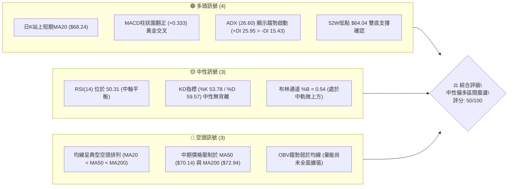
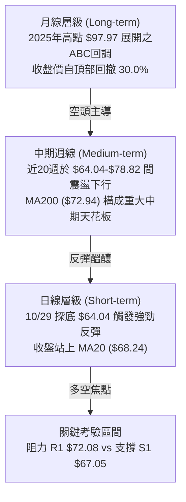
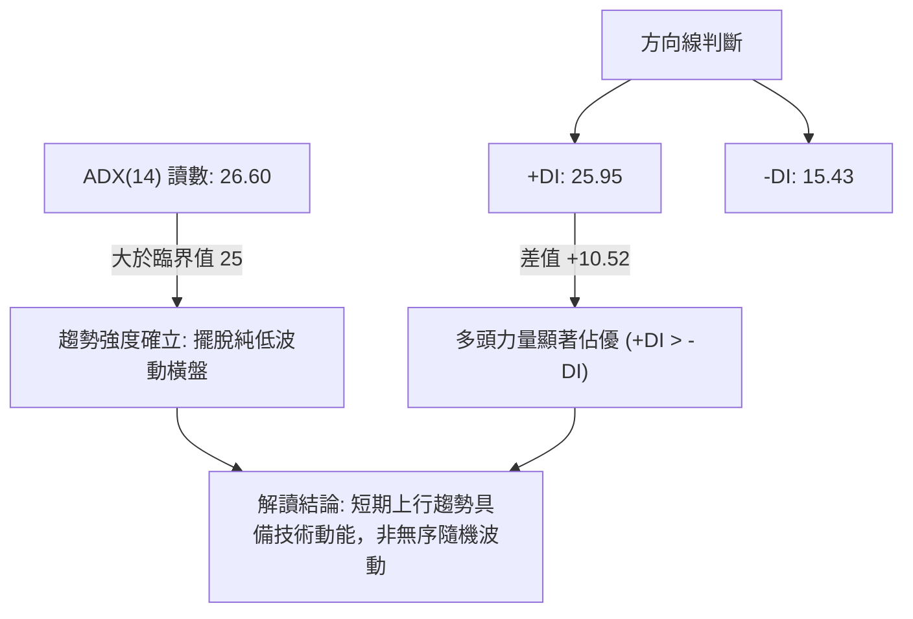
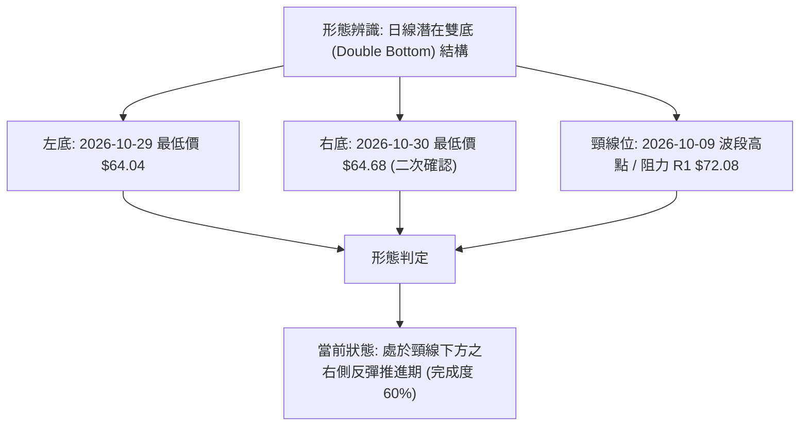
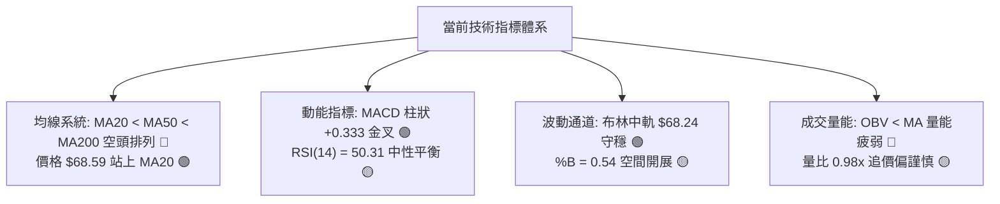
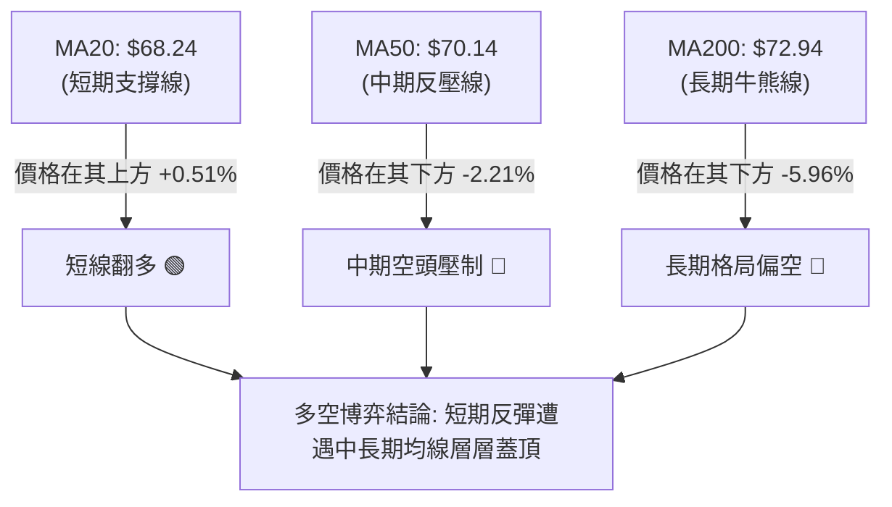
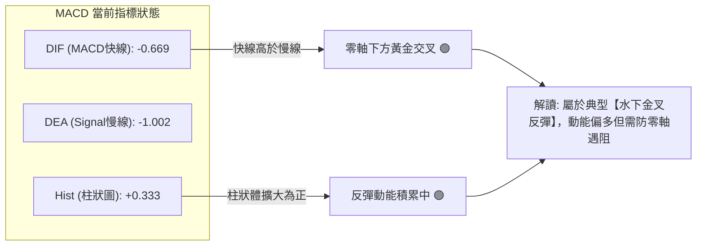
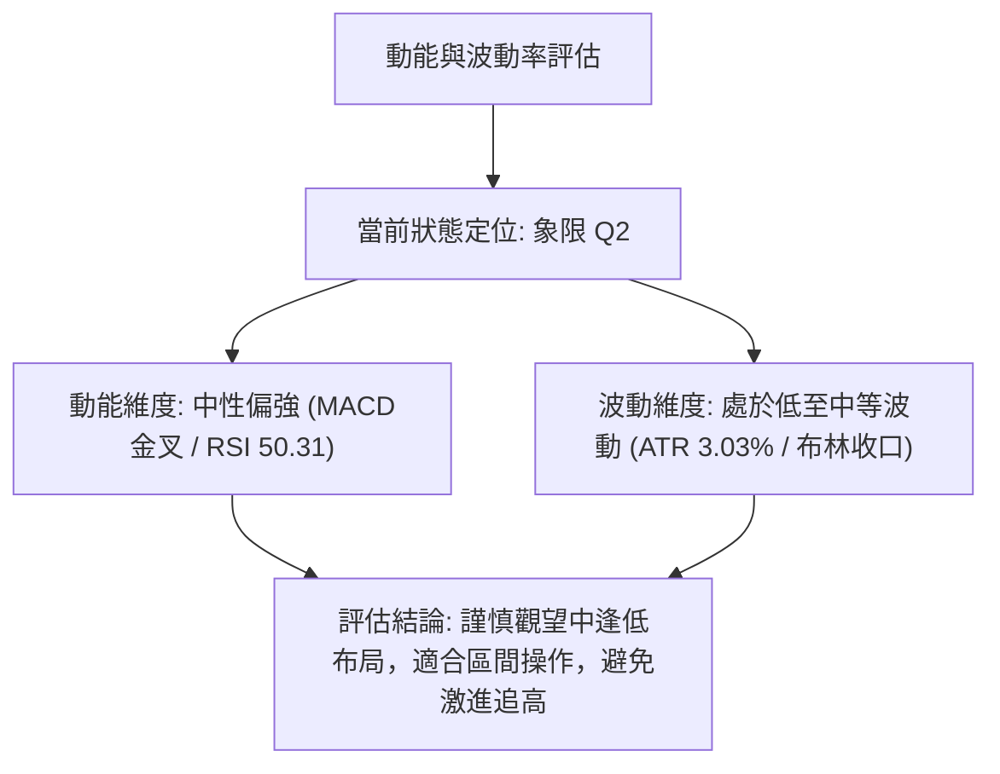
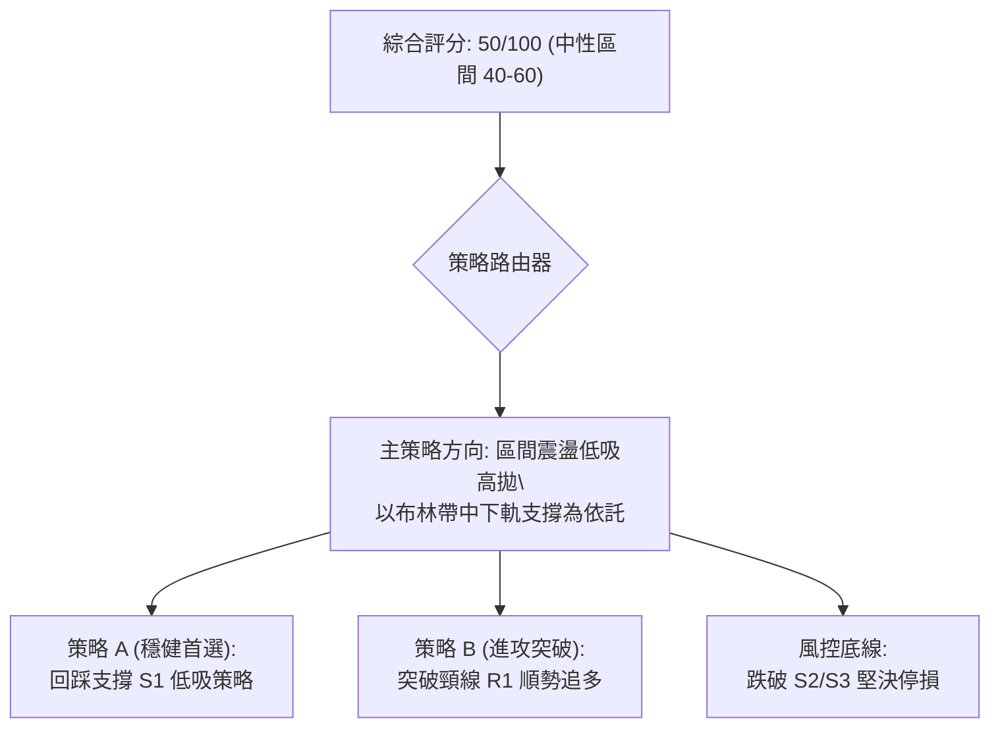
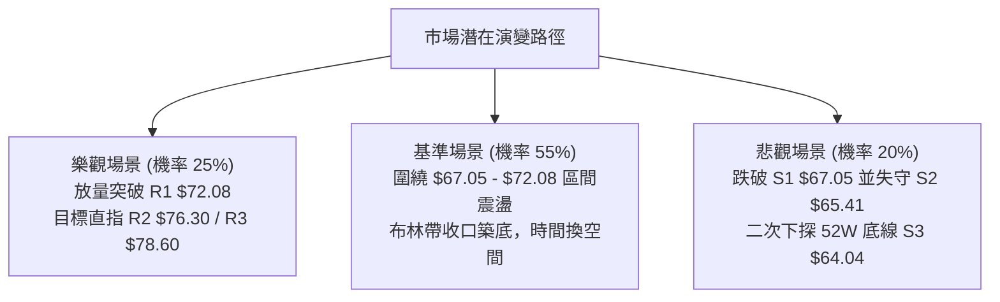

# UBER 技術分析報告

> **報告日期**：2026-11-08 ｜ **語言**：繁體中文 ｜ **數據來源**：Yahoo Finance ｜ **當前價格**：$68.59

---

## 目錄

| 章節 | 內容 |
|------|------|
| [1. 技術面概覽](#1-技術面概覽) | 訊號儀表板、核心指標、評分卡 |
| [2. 趨勢分析](#2-趨勢分析) | 多時框趨勢、長中短期走勢、12個月走勢圖 |
| [3. 圖表形態分析](#3-圖表形態分析) | 形態識別、K線組合、目標價推算 |
| [4. 支撐與阻力](#4-支撐與阻力) | 關鍵價位分布圖、斐波那契回調 |
| [5. 技術指標深度解讀](#5-技術指標深度解讀) | MA/RSI/MACD/布林/成交量量價配合 |
| [6. 動能與波動率](#6-動能與波動率) | 動能四象限、ATR、Beta 與市場相關性 |
| [7. 多時框架總結](#7-多時框架總結) | 時框架評分表、訊號矩陣、收斂結論 |
| [8. 交易策略建議](#8-交易策略建議) | 策略路由、階梯情境、具體策略參數 |
| [9. 風險提示與監控](#9-風險提示與監控) | 監控清單、風險場景、部位風控 |
| [報告總結](#報告總結) | 核心結論與最佳策略組合 |

---

## 1. 技術面概覽

### 🎯 技術訊號儀表板



### 📊 核心指標速覽表

| 指標類別 | 指標名稱 | 當前數值 | 訊號 | 解讀 |
|:---|:---|:---|:---:|:---|
| **價格** | 當前收盤價 | $68.59 | 🟡 | 位於52週區間 14.6% 位置，自低點 $64.04 展開第一波技術性反彈 |
| **均線** | 短期 MA20 | $68.24 | 🟢 | 現價微幅突破 MA20 (+0.51%)，短線扭轉極弱勢格局 |
| **均線** | 中期 MA50 | $70.14 | 🔴 | 位於現價上方 (+2.26%)，與斐波那契 78.6% 回調位 ($70.70) 形成雙重反壓 |
| **均線** | 長期 MA200 | $72.94 | 🔴 | 位於現價上方 (+6.34%)，長週期均線下行，長期空頭趨勢未扭轉 |
| **動能** | RSI(14) | 50.31 | 🟡 | 回升至 50 多空中軸上方，擺脫 10 月下旬超賣區，動能恢復平衡 |
| **動能** | MACD (12,26,9) | -0.669 / -1.002 | 🟢 | MACD 線上穿 Signal 線，柱狀圖走擴至 +0.333，短線動能偏多 |
| **波動** | ATR(14) | $2.08 | 🟡 | 佔股價 3.03%，日均震盪幅度維持正常，未出現極端恐慌性波動 |
| **通道** | 布林通道 | $64.02 - $72.45 | 🟡 | 現價處於中軌 ($68.24) 上方，%B 為 0.54，通道呈水平收口狀態 |
| **量能** | 20日成交量比 | 0.98x (18.28M) | 🔴 | 量能略低於20日均量 (18.69M)，OBV < MA，突破尚缺顯著持續買盤 |

### 🏆 技術評分卡

```
╔══════════════════════════════════════════════════════════════╗
║              技術評分卡 — UBER (2026-11-08)                 ║
╠══════════════════════════════════════════════════════════════╣
║ 趨勢強度      ██████████░░░░░░░░░░  50/100  🟡 中性 (ADX強但多空角力) ║
║ 動能指標      ███████████░░░░░░░░░  55/100  🟢 偏多 (MACD金叉/RSI平衡)║
║ 支撐穩定度    █████████████░░░░░░░  65/100  🟢 偏多 ($64.04雙底確立)  ║
║ 成交量配合    █████████░░░░░░░░░░░  45/100  🔴 偏弱 (OBV低於均線)     ║
║ 形態完整度    ██████████░░░░░░░░░░  50/100  🟡 中性 (築底中未破頸線) ║
║ 均線排列      ███████░░░░░░░░░░░░░  35/100  🔴 空頭 (MA20<50<200)     ║
╠══════════════════════════════════════════════════════════════╣
║ 綜合評分      ██████████░░░░░░░░░░  50/100  ⚖️ 區間震盪 (觀望/低吸)  ║
╚══════════════════════════════════════════════════════════════╝
```
*註：綜合評分 = (50 + 55 + 65 + 45 + 50 + 35) ÷ 6 = 50.0分（依規則 18 採六項算術平均，四捨五入至整數）。*

---

## 2. 趨勢分析

### 🌐 多時框趨勢分析



### 📈 長期趨勢 — 12個月走勢圖（ASCII）

過去 12 個月（2025-11 至 2026-11）UBER 呈現自歷史高位持續下行的單邊修正與末端盤整結構：

```
UBER 月線收盤走勢圖（過去12個月）
價格軸 ($)
$90 ┤  ● 87.54 (2025-11 高點)
$85 ┤    ● 81.71
$80 ┤      ● 80.05
$75 ┤        ● 75.42           ● 75.65 (2026-08 弱反彈高點)
$70 ┤          ● 71.93 ● 74.61 ● 70.40 ● 72.16 ● 70.36
$65 ┤                                                 ● 68.51   ● 68.59 (現價)
$60 ┤                                                       ● 65.25 (2026-10 最低月收盤)
    └───────────────────────────────────────────────────────────────────────────
        11   12   01   02   03   04   05   06   07   08   09   10   11 (月份)
       (25) (25) (26) (26) (26) (26) (26) (26) (26) (26) (26) (26) (26)
```

#### 走勢特徵分析表格

| 階段 | 時間區間 | 起始價 → 結束價 | 漲跌幅 | 主要技術特徵 |
|:---|:---|:---:|:---:|:---|
| **單邊主跌段** | 2025-11 → 2026-03 | $87.54 → $71.93 | -17.83% | 月K連陰，高點逐步下移，跌破所有短期均線支撐 |
| **箱體平台整理** | 2026-04 → 2026-08 | $74.61 → $75.65 | +1.39% | 圍繞 $70.00-$75.00 構築中繼平台，反彈高點受制於 50週均線 |
| **二次探底釋放** | 2026-09 → 2026-10 | $68.51 → $65.25 | -4.76% | 跌破前低平台，摜壓至 52W 最低點 $64.04 (10月月收盤 $65.25) |
| **當前築底反彈** | 2026-11 (進行中) | $65.25 → $68.59 | +5.12% | 出現日線級別帶量陽線反抽，重新回測 $70.00 大關 |

### 📊 中期趨勢（週線分析）

從近 20 週數據觀察，週線結構在 2026-08-28 達到波段反彈高點 $78.82 後即展開連續回落。隨後週 K 線連續 6 週下跌，至 2026-10-30 週收盤達到低點 $65.25。

```
週線級別壓力與支撐示意圖
$78.82 ─────────────── 中期波段強阻力頂部 (2026-08-28)
           \
$75.00 ──────\──────── 週線中樞壓力位
              \
$72.08 ────────▼────── 關鍵阻力 R1 (前波週反彈高點 10-09)
═══════════════ $68.59 (現價：突破近期震盪帶) ═══════════════
$67.05 ────────▲────── 近期回踩支撐 S1
              /
$64.04 ──────/──────── 52W 極限底線支撐 S3 (10-30 當週低點)
```

最近一週（2026-11-06）週 K 線顯著收陽（開 $66.12，高 $72.50，低 $65.55，收 $68.59），成交量放大至 124,396,100 股，為近 12 週以來最大週成交量，週 MACD 柱狀圖由 -0.339 快速翻正至 +0.333，週 RSI 由 35.8 躍升至 50.3，確認中期下行壓力獲得有效緩衝。

### ⚡ 趨勢強度評估（ADX 解讀）



| 指標變數 | 當前讀數 | 門檻標準 | 狀態評估 | 實戰指導意義 |
|:---|:---:|:---:|:---:|:---|
| **ADX(14)** | 26.60 | 臨界線 25.0 | 🟢 趨勢行情確立 | 讀數 > 25.0 表明市場脫離了無趨勢的低波震盪，具有方向性運動特質 |
| **+DI** | 25.95 | 高於 -DI | 🟢 多方主導 | 買方在日線週期掌握主動權，推動價格自下軌脫離 |
| **-DI** | 15.43 | 低於 +DI | 🟢 空方退縮 | 空方拋壓連續三日衰竭，空方趨勢動能降溫 |
| **趨勢性質** | 反彈趨勢 | ADX走升 | 🟡 反彈持續中 | 依規則 14，此時中長期均線（MA50/MA200）仍偏空，多方反彈受制於上方結構 |

---

## 3. 圖表形態分析

### 🔍 形態識別系統



#### 形態識別信心度評估表（依規則 15）

| 形態名稱 | 信心度 | 判斷依據（嚴格引用數據） | 完成度 | 目標價（附嚴謹計算式） |
|:---|:---:|:---|:---:|:---|
| **日線雙底 (Double Bottom)** | 55% | 10/29 探低 $64.04、10/30 探低 $64.68，均精準在 52W 低點 $64.04 (S3) 獲得承接；11/04 出現大陽線放量反撲 | 60% | **$80.12**<br/>計算式：頸線 R1 $72.08 + (頸線 R1 $72.08 - 底部 S3 $64.04) = $72.08 + $8.04 = $80.12 |
| **布林中軌破線翻 (Reversal)** | 70% | 價格自布林下軌 $64.02 反彈，11/04 收盤 $69.87 強勢貫穿布林中軌 MA20 ($68.24) | 85% | **$72.45** (布林上軌)<br/>計算式：直接指向布林通道上軌數值 $72.45 |
| **頭肩底 (Inverted H&S)** | 30% | 數據中左肩與頭部結構對稱度不足，未有完整左肩形成 | 20% | *訊號不足，依規則 15 僅做指標型解讀，不預設目標價* |

### 🕯️ 重要 K 線形態分析

嚴格依據數據中「近 10 根日 K」與「近 8 根週 K」實際數據判讀：

#### 近 10 根日 K 線逐日形態解讀

| 日期 (日K) | 開盤價 | 最高價 | 最低價 | 收盤價 | 成交量 | K線形態 | 技術解讀與訊號 |
|:---|:---:|:---:|:---:|:---:|:---:|:---|:---|
| **2026-10-26** | 66.62 | 67.00 | 65.68 | 66.13 | 22.06M | 小陰實體 | 跌勢延續，受阻於 $67.00 🔴 |
| **2026-10-27** | 66.40 | 66.50 | 65.47 | 65.78 | 20.73M | 陰線下移 | 連續破底，重心緩慢下挫 🔴 |
| **2026-10-28** | 65.50 | 65.88 | 64.69 | 65.27 | 18.32M | 破位小陰 | 逼近 52W 前低，拋壓釋放 🔴 |
| **2026-10-29** | 65.28 | 65.80 | 64.04 | 65.74 | 16.29M | **長下影錘頭星** | 探至全期最低點 $64.04 後強烈抽回，低位見買盤 🟢 |
| **2026-10-30** | 65.61 | 65.80 | 64.68 | 65.25 | 17.96M | 窄幅十字小陰 | 二次探測 $64.68 未創新低，止跌訊號初顯 🟡 |
| **2026-11-02** | 66.12 | 67.47 | 65.55 | 66.71 | 17.74M | 小陽線上攻 | 突破前三日高點，確認 $64.04 支撐有效 🟢 |
| **2026-11-03** | 66.75 | 66.96 | 65.99 | 66.60 | 21.31M | 帶上影小陰 | 震盪蓄勢，成交量放大至 21.31M 🟡 |
| **2026-11-04** | 68.28 | 72.50 | 67.36 | 69.87 | 36.95M | **長陽突破巨量K** | 成交量激增至 36.95M (近20日均量1.98倍)，最高達 $72.50，一舉突破 MA20 🟢 |
| **2026-11-05** | 70.77 | 71.09 | 67.73 | 68.78 | 30.11M | 高開衝高回落陰 | 高開於 $70.77 遇 MA50 阻力回踩，量能保持充沛 🟡 |
| **2026-11-06** | 68.12 | 70.14 | 67.99 | 68.59 | 18.28M | 縮量抗跌小陽 | 收盤穩於 MA20 ($68.24) 之上，消化前日獲利盤 🟢 |

#### 近 8 根週 K 線結構特徵

| 日期 (週K末日) | 開盤價 | 最高價 | 最低價 | 收盤價 | 成交量 | K線形態 | 週線訊號解讀 |
|:---|:---:|:---:|:---:|:---:|:---:|:---|:---|
| **2026-09-18** | 71.97 | 72.80 | 70.06 | 70.50 | 92.99M | 中陰線 | 破位下挫，確認 72.80 頂部反壓 🔴 |
| **2026-09-25** | 70.82 | 71.90 | 68.55 | 69.62 | 86.78M | 下行小陰 | 跌破 $70 整數心理關卡 🔴 |
| **2026-10-02** | 69.36 | 69.97 | 67.22 | 68.11 | 80.48M | 長下影陰線 | 空頭動能減速，量能萎縮 🟡 |
| **2026-10-09** | 68.40 | 72.08 | 68.00 | 71.51 | 75.17M | 週線長陽 | 強勁反彈，最高觸及 R1 $72.08 🟢 |
| **2026-10-16** | 71.16 | 71.86 | 68.62 | 70.35 | 69.27M | 衝高回落陰 | 受阻於 $72 關卡，多方攻勢停頓 🟡 |
| **2026-10-23** | 70.13 | 70.76 | 66.43 | 66.70 | 84.76M | 破位實體中陰 | 二次向下破位，直逼 52W 低點 🔴 |
| **2026-10-30** | 66.62 | 67.00 | 64.04 | 65.25 | 95.36M | **探底長針錘頭陰** | 創出全期新低 $64.04 後強烈反抽 🟡 |
| **2026-11-06** | 66.12 | 72.50 | 65.55 | 68.59 | 124.40M | **放量反轉大陽線** | 週量爆出 124.40M，實體大反攻，多方確立止跌 🟢 |

### 📉 ASCII 走勢形態示意圖

```
UBER 日線雙底與頸線結構示意圖
價格軸 ($)
$72.50 ┤                     ▲ (11/04 爆量高點)
$72.08 ┤═════════════════════╤═════════════════════════════ 頸線位 / R1 阻力
       │                     │
$70.00 ┤                     │         ▲ (11/05-06 震盪整理)
       │                     │        ╱ ╲
$68.59 ┤─────────────────────┼───────●───● ◄── 現價 ($68.59，守穩 MA20)
       │                     │      ╱
$67.05 ┤                     │     ● S1 支撐位
       │                     │    ╱
$65.25 ┤   ● (10/26)         │   ╱
$64.04 ┤───┴───▼─────────────┴──●──────── 52W 極限底線 (S3)
            底 1 (10/29)        底 2 (10/30)
```

### 🎯 形態目標價計算

1. **第一階測幅目標 (頸線測試)**：
   - 基準點：雙底最低點 $64.04。
   - 頸線位置：聚類阻力 R1 = **$72.08**。
   - 當前推進階段：價格自 $64.04 上漲至當前 $68.59，已完成自底部至頸線距離的 56.6%。

2. **第二階測幅目標 (形態全額突破推算)**：
   - 形態高度 $H$ = 頸線 ($72.08) - 底部最低點 ($64.04) = **$8.04**。
   - 突破目標價 = 頸線 ($72.08) + 形態高度 ($8.04) = **$80.12**。
   - 與關鍵價位對照：此推算目標價與斐波那契 50.0% 回調位 ($79.61) 及阻力 R3 ($78.60) 形成密集交匯帶。

---

## 4. 支撐與阻力

### 🗺️ 關鍵價位分布圖（Unicode）

```
UBER 價位結構分布圖
══════════════════════════════════════════════════════════════════
$78.60 ║████████████████████████████████║ 強阻力 R3 (近一年波段高點聚類)
$76.30 ║████████████████████            ║ 中期阻力 R2 (反彈延伸壓力)
$72.45 ║▓▓▓▓▓▓▓▓▓▓▓▓▓▓▓▓▓▓▓▓▓▓▓▓        ║ 布林上軌 (動態壓制)
$72.08 ║████████████████████████████████║ 關鍵頸線阻力 R1 (突破轉強關鍵)
$70.70 ║────────────────────────────────║ 斐波那契 78.6% 回調位
$70.14 ║--------------------------------║ MA50 均線下壓位
═══════╠════════════════════════════════╣ ◄ 當前收盤價 $68.59
$68.24 ║································║ MA20 / 布林中軌 (短線多空分水嶺)
$67.05 ║▓▓▓▓▓▓▓▓▓▓▓▓▓▓▓▓▓▓▓▓            ║ 近期回踩支撐 S1 (第一道防線)
$65.41 ║████████████████████████        ║ 強支撐 S2 (次級波段低點聚類)
$64.04 ║████████████████████████████████║ 極限強支撐 S3 (52W 最低點 / 雙底底線)
══════════════════════════════════════════════════════════════════
```

### 🚧 阻力位分析表

*嚴格引用數據中「關鍵價位」區塊數值：*

| 阻力級別 | 準確價位 | 距現價幅標 | 形成原因 | 突破難度 | 重要性權重 |
|:---|:---:|:---:|:---|:---:|:---:|
| **R1** | **$72.08** | +5.09% | 近一年波段高點聚類；10/09 週反彈高點；日線雙底之頸線所在 | 高 🔴 | ★★★★★ |
| **R2** | **$76.30** | +11.24% | 2026年6-8月多次震盪成交密集區；斐波那契 61.8% ($75.94) 共振帶 | 極高 🔴 | ★★★★☆ |
| **R3** | **$78.60** | +14.59% | 2026-08-28 波段最高點 $78.82 聚類；中期空頭防守總源頭 | 頂級 🔴 | ★★★★★ |

### 🛡️ 支撐位分析表

*嚴格引用數據中「關鍵價位」區塊數值：*

| 支撐級別 | 準確價位 | 距現價幅標 | 形成原因 | 守住機率 | 重要性權重 |
|:---|:---:|:---:|:---|:---:|:---:|
| **S1** | **$67.05** | -2.25% | 近一年波段低點聚類；11/04 爆量大陽線起漲平台下沿 | 70% 🟢 | ★★★★☆ |
| **S2** | **$65.41** | -4.64% | 2026-10-27/28 破位前盤整低點密集帶；強支撐防線 | 85% 🟢 | ★★★★☆ |
| **S3** | **$64.04** | -6.63% | 52週最低點；10/29 長針探底低點；此波反彈之多頭生死線 | 95% 🟢 | ★★★★★ |

### 📐 斐波那契回調位分析

依據 52 週極值區間（低點 **$64.04** 至 高點 **$95.18**），落差空間共 $31.14：

```
斐波那契回調位階梯 (由高至低)
 0.0% ── $95.18 (52W High)
23.6% ── $87.83
38.2% ── $83.28
50.0% ── $79.61
61.8% ── $75.94 ─── 密集阻力區間 (緊鄰 R2 $76.30)
78.6% ── $70.70 ─── 現行反彈上檔直接壓力帶
────────────────── ◄ 當前價格: $68.59 (落於 78.6% 與 100.0% 之間)
100.0% ── $64.04 (52W Low / 底線)
```

#### 斐波那契層級深度解讀

- **當前位置歸屬**：現價 **$68.59** 處於 78.6%（**$70.70**）與 100.0%（**$64.04**）的深度超跌回調區間內。
- **技術意義**：
  1. 價格從 $64.04 強力反彈，目前正面臨 78.6% 回調位（$70.70）的關鍵收復戰。此位置同時受 MA50（$70.14）與 R1（$72.08）壓制。
  2. 若日線實體能有效收復 $70.70，技術結構將由「極弱勢超跌反抽」轉化為「中級修復行情」，上方空間將直接被打開至 61.8% 黃金分割位 **$75.94**（貼近 R2 **$76.30**）。

---

## 5. 技術指標深度解讀

### 🎛️ 指標訊號總覽



### 📈 移動平均線排列分析



#### 移動平均線數據對照矩陣

| 均線名稱 | 當前數值 | 距現價差距 | 方向特徵 | 趨勢解讀 |
|:---|:---:|:---:|:---:|:---|
| **MA 5** | $68.11 | +0.70% | ▲ 向上走平 | 短線第一動態支撐，價格緊貼其上運行 |
| **MA 10** | $66.87 | +2.57% | ▲ 快速拉升 | 底部急升，與 MA5 形成短天期金叉 |
| **MA 20** | $68.24 | +0.52% | ▲ 微幅走揚 | 翻揚支撐，11/06 收盤成功收復此線 |
| **MA 50** | $70.14 | -2.21% | ▼ 下行趨緩 | 中期下壓第一道厚重防線 |
| **MA 60** | $71.39 | -3.92% | ▼ 穩定下行 | 季線下壓，限制反彈高度 |
| **MA 120** | $71.78 | -4.44% | ▼ 持續走低 | 半年線反壓，壓制中期流動性 |
| **MA 200** | $72.94 | -5.96% | ▼ 長期下移 | 年線空頭核心，未站上不可言反轉 |
| **MA 240** | $74.86 | -8.37% | ▼ 長期下移 | 兩年均線頂部天花板 |

### 📉 RSI(14) 分析

當前 RSI(14) 讀數為 **50.31**：

```
RSI(14) 指標狀態: 50.31 (中性均衡區間)
0 ──────── 30 ───────────────────── 50 ───────────────────── 70 ──────── 100
[  極度超賣  ] [      偏弱區間      ] ▲ [      偏強區間      ] [  極度超買  ]
                                 現價位置 (50.31)
進度條: █████████████████████████░░░░░░░░░░░░░░░░░░░░ 50.31%
```

- **超買超賣狀態**：指標脫離 10 月下旬的 35.8 弱勢區，重返 50 基準線上方，說明空頭絕對主導的單邊殺跌階段已告一段落。
- **背離判斷結論**：
  - 根據系統近 20 根 K 棒首尾與指標比對：**無明顯背離**。
  - 實質解讀：10/29 低點 $64.04 伴隨 RSI 由 35 向上拐頭，當前回升至 50.31 屬於「指標同步於價格反彈」的常態修復，尚未出現頂背離或底背離結構。

### 📊 MACD(12,26,9) 訊號解讀



- **MACD 數值解讀**：DIF (-0.669) 位於 Signal (-1.002) 之上，Hist 呈現正值 **+0.333**。
- **反彈屬性**：雙線目前皆運行於零軸（0.00）下方，技術上定義為「水下金叉」。此類金叉通常代表超跌後的估值修復反抽，而非強牛市主升浪。上行首要目標為測試零軸附近的平衡阻力。

### 📦 布林通道分析

```
UBER 日線布林通道示意圖
$72.45 ┤──────────────────────────────────────── 布林上軌 (動態壓制)
       │
$70.00 ┤
       │
$68.59 ┤════════════════════════════════════════ 現價 ($68.59，%B = 0.54)
$68.24 ┤──────────────────────────────────────── 布林中軌 (MA20 支撐)
       │
$66.00 ┤
       │
$64.02 ┤──────────────────────────────────────── 布林下軌 (極限支撐)
```

- **軌道邊界**：上軌 **$72.45** ｜ 中軌 **$68.24** ｜ 下軌 **$64.02**。
- **%B 指標分析**：當前 %B 讀數為 **0.54**，代表價格已脫離下軌區間，穩步跨越中軌（0.50）並站上中軌上方。布林帶寬度呈現收縮狀態，預示價格正由大波動下跌轉入區間震盪收斂。

### 💹 成交量分析（量價配合度）

1. **量能水準**：
   - 最新收盤成交量：**18,279,800 股**。
   - 20 日均量：**18,689,335 股**（量比：**0.98x**，幾乎與均量持平）。
   - 50 日均量：**17,999,068 股**（略高於長期均量）。
2. **OBV 趨勢評估**：
   - 當前系統數據明確指示：**OBV < MA → 量能疲弱**。
   - 解讀：儘管 11/04 出現 36.95M 股的單日突發放量，但整體 OBV 能量潮尚未形成持續穿越均線的牛市攻擊結構。總體成交量結構依然偏向「存量資金博弈」，缺乏場外增量資金大規模連續推升的跡象。

---

## 6. 動能與波動率

### ⚡ 動能評估四象限



| 象限代號 | 動能特徵 | 波動率特徵 | 當前狀態吻合度 | 戰略應對方針 |
|:---:|:---:|:---:|:---:|:---|
| **Q1** | 強動能 | 低波動 | ── | 最佳單邊趨勢突破買點 |
| **Q2** | **中/偏弱** | **低/中波動** | **✓ 符合 (UBER 現狀)** | **區間震盪低吸高拋，鎖定確定性利潤** |
| **Q3** | 強動能 | 高波動 | ── | 高風險高收益突破追單 |
| **Q4** | 弱動能 | 高波動 | ── | 恐慌崩跌段，絕對避免盲目進場 |

### 📊 ATR 波動率分析

- **ATR(14) 精確讀數**：**$2.08**（佔當前股價之 **3.03%**，Wilder 平滑法）。
- **波動意義解讀**：每日常規波動預期約在 $2.08 左右，當前波動率處於近半年的常態健康水準，未見恐慌性拋售。
- **動態止損建議**：
  - 激進型短線止損（1.0 × ATR）：止損距進場點 **$2.08**。
  - 穩健型波段止損（1.5 × ATR）：止損距進場點 **$3.12**。
  - 保守型底線止損（2.0 × ATR）：止損距進場點 **$4.16**。

### 📐 Beta 與市場相關性

- **Beta 係數**：**1.308**。
- **市場特徵**：UBER 屬於高彈性成長/科技型標的，波動幅度較標普500指數（S&P 500）高出約 30.8%。當大盤反彈時其上攻彈性較高，但在宏觀流動性收緊或市場風險偏好轉弱時，回撤幅度亦顯著放大。

---

## 7. 多時框架總結

### 📋 時框架評分表

| 時框架 | 趨勢方向 | 動能狀態 | 均線排列 | 形態結構 | 綜合評分 | 戰術建議 |
|:---|:---:|:---:|:---:|:---:|:---:|:---|
| **短期 (日線)** | 🟢 震盪反彈 | 🟢 MACD金叉 | 🟡 站上MA20 / 承壓MA50 | 雙底反抽未破頸線 | **60/100** | 逢低回踩 S1 布局，嚴格止損 |
| **中期 (週線)** | 🟡 止跌回穩 | 🟢 柱狀翻正 | 🔴 均線反壓密集 | 探底長針反轉 | **50/100** | 關注 R1 $72.08 突破有效性 |
| **長期 (月線)** | 🔴 處修正段 | 🔴 中期下行 | 🔴 空頭排列未改 | 高位ABC回撤途中 | **40/100** | 長線未現右側買點，以防守為主 |

### 🔲 綜合訊號矩陣

```
時框架訊號矩陣收斂表
┌───────────┬──────────────┬──────────────┬──────────────┐
│ 分析維度  │ 短期 (日線)  │ 中期 (週線)  │ 長期 (月線)  │
├───────────┼──────────────┼──────────────┼──────────────┤
│ 趨勢方向  │ 🟢 震盪偏多  │ 🟡 中性築底  │ 🔴 空頭修正  │
│ 均線架構  │ 🟢 MA20突破  │ 🔴 均線蓋頂  │ 🔴 空頭排列  │
│ 動能強度  │ 🟢 動能轉強  │ 🟢 柱狀轉正  │ 🔴 偏弱無力  │
│ 形態完整  │ 🟡 雙底醞釀  │ 🟡 探底陽包  │ 🔴 下跌中繼  │
│ 量價健康  │ 🟡 爆量後縮  │ 🟢 週量激增  │ 🔴 OBV疲弱   │
└───────────┴──────────────┴──────────────┴──────────────┘
```

### ⚖️ 多時框收斂結論

依據「嚴格要求 14」收斂規則進行定性裁決：
1. **行情性質判定**：當前 ADX(14) 為 **26.60**（> 25.0），且 +DI (25.95) 大於 -DI (15.43)，滿足「趨勢行情啟動」門檻。然而，中長期均線（MA50 = $70.14、MA200 = $72.94）呈現堅定下行排列，空頭防禦陣容嚴密。
2. **多時框衝突收斂取捨**：
   - 依照優先級規則：「趨勢行情以中長期方向為主，日線只用來尋找進場時機」。
   - 目前長期月線偏空、日線反彈轉強，二者產生衝擊。收斂後的唯一結論為：**中性偏多之【超跌區間反彈行情】**。
   - 不具備直接發動波瀾壯闊牛市主升浪的條件，交易重點在於捕捉自支撐 S1/S2 向阻力 R1/R2 的波段反彈空間。

---

## 8. 交易策略建議

### 🗺️ 策略決策流程圖



### 🧭 策略路由

> **當前主策略方向 = 中性偏多區間操作（依綜合評分 50/100）**
> 
> *依規則：綜合評分落於 40–60 分區間，定位為「區間操作」，以布林通道與關鍵支撐阻力為主，等待突破確認。嚴禁兩頭下注，主推依據下方價格階梯展開的精準區間低吸與突破跟進策略。*

### 🎯 價格情境階梯（Price Scenarios）

*本表所有價位完全引用第 4 章「關鍵價位」數據：*

| 觸發條件 | 下一目標 | 後續延伸 | 情境技術含義 |
|:---|:---:|:---:|:---|
| **向上突破 R1 ($72.08)** | **R2 ($76.30)** | **R3 ($78.60)** | 短線轉強，雙底形態確認突破，展開中級反彈行情 |
| **站穩現價區間 ($68.24-$68.59)** | **R1 ($72.08)** | ── | 處於 MA20 支撐上方整理蓄勢，維持震盪偏多基調 |
| **向下回踩跌破 S1 ($67.05)** | **S2 ($65.41)** | **S3 ($64.04)** | 短期反彈遇阻，市場轉入弱勢二次探底，考驗前低支撐 |

### 📊 情境機率分佈

| 預測情境 | 發生機率 | 主要技術依據 |
|:---|:---:|:---|
| **情境一：震盪上行測試 R1** | **55%** | MACD 柱狀圖維持 +0.333；日K穩居 MA20 ($68.24) 之上；+DI 領先 -DI 達 10.52 |
| **情境二：箱體窄幅震盪** | **30%** | OBV 量能低於均線顯示追高動能不足；布林通道呈水平收口狀態（帶寬有限） |
| **情境三：跌破 S1 二次探底** | **15%** | MA50 ($70.14) 與 MA200 ($72.94) 下壓沉重，若大盤重挫可能引發空頭反撲 |

### 🟢 主策略詳情

*所有價位嚴格引用關鍵價位數據，風險報酬比嚴格按規則 17 計算（公式：(T1 - 進場價) ÷ (進場價 - 止損價)）：*

| 策略要素 | 策略 A（穩健型：回踩支撐低吸） | 策略 B（進攻型：突破頸線追多） |
|:---|:---|:---|
| **進場條件** | 價格回踩 S1 不破且日K收陽 | 價格放量突破 R1 且收盤確認 |
| **進場價格** | **$67.05** (支撐位 S1) | **$72.08** (阻力位 R1) |
| **目標價 T1** | **$72.08** (阻力位 R1) | **$76.30** (阻力位 R2) |
| **目標價 T2** | **$76.30** (阻力位 R2) | **$78.60** (阻力位 R3) |
| **止損價格** | **$65.41** (支撐位 S2) | **$68.24** (MA20 / 布林中軌) |
| **風險報酬比** | **1 : 3.07（以 T1 計）**<br/>*(72.08-67.05)/(67.05-65.41) = 5.03/1.64*<br/>*(以 T2 計為 1 : 5.64)* | **1 : 1.10（以 T1 計）**<br/>*(76.30-72.08)/(72.08-68.24) = 4.22/3.84*<br/>*(以 T2 計為 1 : 1.70)* |
| **預估勝率** | **65%** | **50%** |
| **建議倉位** | **15%** 總資金 | **10%** 總資金 |

### 🔴 反向風險觸發點（對沖提示）

- **全面停損與轉空警戒線**：日線收盤跌破 **$65.41 (S2)**。
- **推翻多頭假設之訊號**：若價格有效貫穿 **$64.04 (S3 / 52W Low)**，宣告雙底築底徹底失敗，市場將開啟新一輪無支撐單邊暴跌。屆時所有多單必須無條件止損離場，並可建立空頭對沖部位。

### ⭐ 整體訊號強度評星

```
做多訊號強度：★★★☆☆  (3/5星 — 具備雙底反彈動能，但受限均線壓制)
做空訊號強度：★★☆☆☆  (2/5星 — 空方力道衰竭，下有 $64.04 雙底護盤)
整體可信度：  ★★★☆☆  (3/5星 — 量能尚未完全放大，維持區間定位)
```

---

## 9. 風險提示與監控

### ✅ 關鍵監控指標 Checklist

```
╔══════════════════════════════════════════════════════════════╗
║                 每日盤後風控監控清單 (Checklist)             ║
╠══════════════════════════════════════════════════════════════╣
║ [ ] 價格是否穩守短期生命線 MA20 ($68.24) 以上？               ║
║ [ ] 日成交量是否回升至 20日均量 (18.69M) 之上？              ║
║ [ ] MACD 柱狀圖是否持續保持正值 (+0.333) 且未出現背離收斂？  ║
║ [ ] RSI(14) 是否守在多空中軸 50.0 之上？                     ║
║ [ ] 盤中是否有跌破關鍵防守點 S1 ($67.05) 之異常異動？        ║
║ [ ] 大盤高 Beta 風險：標普500/納指是否出現單日 > 1.5% 大跌？ ║
╚══════════════════════════════════════════════════════════════╝
```

### ⚠️ 風險場景分析



### 🛡️ 風險管理重要提醒

1. **嚴禁左側盲目加碼**：當前行情本質仍是「下跌趨勢中的超跌反抽」，均線系統 MA50/MA200 仍為空頭壓制。未突破 R1 ($72.08) 之前，切忌將短期反彈誤判為主升牛市而過度加槓桿。
2. **部位分散與回撤控制**：單一交易策略（策略 A 或 B）之曝險金額建議嚴格控制在總投資組合資金的 10%-15% 以內，整體 UBER 總部位不宜超過 20%。
3. **ATR 動態追蹤停利**：若價格順利觸及 R1 ($72.08)，建議至少獲利了結 50% 倉位，並將剩餘部位的止損線自動上移至損益兩平點（即進場價 $67.05 或 MA20 處），鎖定無風險利潤。

---

## 📋 報告總結

```
╔══════════════════════════════════════════════════════════════╗
║                   UBER 技術分析報告總結                      ║
╠══════════════════════════════════════════════════════════════╣
║ 報告日期：2026-11-08                                         ║
║ 當前價格：$68.59 USD                                         ║
║ 分析評級：⚖️ 中性偏多區間震盪 (技術綜合評分: 50/100)          ║
║                                                              ║
║ 關鍵結論：                                                   ║
║ ├─ 長期趨勢：🔴 空頭修正 (受制於年線 MA200 $72.94 與高位壓制)║
║ ├─ 中期趨勢：🟡 止跌回穩 (週線放巨量收陽，尋求打底)           ║
║ ├─ 短期趨勢：🟢 震盪反彈 (收復 MA20 $68.24，MACD 水下金叉)   ║
║ ├─ 關鍵支撐：S1 $67.05 ｜ S2 $65.41 ｜ 極限防守 S3 $64.04     ║
║ ├─ 關鍵阻力：R1 $72.08 ｜ R2 $76.30 ｜ 波段強壓 R3 $78.60     ║
║ └─ 分析師共識：47位分析師買入評級，平均目標價 $99.16         ║
║                                                              ║
║ 最優策略組合：                                               ║
║ 1. 🥇 最佳機會 (策略 A)：回踩 S1 $67.05 低吸，停損設 S2      ║
║    $65.41，第一目標看 R1 $72.08 (風報比高達 1 : 3.07)       ║
║ 2. 🥈 次選機會 (策略 B)：右側放量突破 R1 $72.08 追多，        ║
║    目標看 R2 $76.30 (風報比 1 : 1.10)                        ║
║ 3. 🥉 保守選擇：維持場外觀望，靜待日線級別帶量實體站穩       ║
║    $72.08 頸線後再行進場                                     ║
╚══════════════════════════════════════════════════════════════╝
```

---

> ⚠️ **免責聲明**：本報告為 AI 自動生成之技術分析，所有數據及估算均基於提供的歷史價格資訊。本報告**僅供研究與學術參考**，**不構成任何投資建議**。投資有風險，入市需謹慎。

---

*報告生成時間：2026-11-08 ｜ 數據來源：Yahoo Finance ｜ 分析框架：多時框技術分析*