# UBER 技術分析報告

> **報告日期**：2026-11-09 ｜ **語言**：繁體中文 ｜ **數據來源**：Yahoo Finance ｜ **當前價格**：$68.59

---

## 目錄

| 章節 | 內容 |
|------|------|
| [1. 技術面概覽](#1-技術面概覽) | 訊號儀表板、核心指標、評分卡 |
| [2. 趨勢分析](#2-趨勢分析) | 多時框趨勢、長中短期走勢 |
| [3. 圖表形態分析](#3-圖表形態分析) | 形態識別、K線組合、目標價 |
| [4. 支撐與阻力](#4-支撐與阻力) | 關鍵價位、斐波那契回調 |
| [5. 技術指標深度解讀](#5-技術指標深度解讀) | MA/RSI/MACD/布林/成交量 |
| [6. 動能與波動率](#6-動能與波動率) | 動能評估、ATR、Beta |
| [7. 多時框架總結](#7-多時框架總結) | 時框架評分矩陣 |
| [8. 交易策略建議](#8-交易策略建議) | 多空策略、風險報酬比 |
| [9. 風險提示與監控](#9-風險提示與監控) | 監控指標、風險場景 |

---

## 1. 技術面概覽

### 🎯 技術訊號儀表板

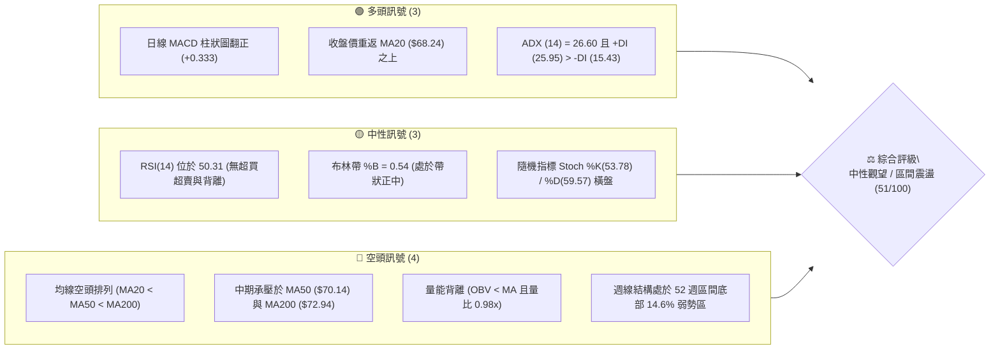

### 📊 核心指標速覽表

| 指標類別 | 指標名稱 | 當前數值 | 訊號 | 解讀 |
|----------|----------|----------|:----:|------|
| **價格** | 當前收盤價 | $68.59 | 🟡 | 位於52週區間14.6%處，近週脫離低點但受壓於中長期均線 |
| **均線** | MA20 | $68.24 | 🟢 | 現價位於MA20之上（+0.52%），短線底部支撐確立 |
| **均線** | MA50 | $70.14 | 🔴 | 現價位於MA50之下（-2.21%），中期反彈第一道天花板 |
| **均線** | MA200 | $72.94 | 🔴 | 現價位於MA200之下（-5.96%），長期多空分水嶺尚未收復 |
| **動能** | RSI(14) | 50.31 | 🟡 | Wilder平滑數值處於中性平衡區（30–70），無背離訊號 |
| **動能** | MACD (12,26,9) | -0.669 / 柱+0.333 | 🟢 | 快線站於訊號線(-1.002)之上，柱狀圖正向擴張，短線動能偏多 |
| **動能** | ADX / ±DI | 26.60 / +DI 25.95 | 🟢 | ADX>25顯示具備趨勢動能，且+DI顯著高於-DI(15.43)，短線多方主導 |
| **波動** | ATR(14) | $2.08 | 🟡 | 佔現價 3.03%，波動處於中等水平，適合常態區間佈局 |
| **量能** | OBV 趨勢 | OBV < MA | 🔴 | 能量潮指標位於均線之下，成交量比 0.98x，反彈未獲巨量背書 |

### 🏆 技術評分卡

```
╔══════════════════════════════════════════════════════════════════╗
║                   技術評分卡 — UBER (2026-11-09)                 ║
╠══════════════════════════════════════════════════════════════════╣
║ 趨勢強度 (ADX=26.60, 週線偏空)   ████████████░░░░░░░░  60/100 🟡 ║
║ 動能指標 (MACD翻紅, RSI=50.31)   ████████████░░░░░░░░  60/100 🟢 ║
║ 支撐穩定度 (S1=$67.05, S3=$64.04)██████████████░░░░░░  70/100 🟢 ║
║ 成交量配合 (OBV疲弱, 20日均量平) ████████░░░░░░░░░░░░  40/100 🔴 ║
║ 形態完整度 (日線雙重底初成)      ████████████░░░░░░░░  60/100 🟡 ║
║ 均線排列 (空頭排列, MA20<50<200) ████░░░░░░░░░░░░░░░░  20/100 🔴 ║
╠══════════════════════════════════════════════════════════════════╣
║ 綜合評分 (六項算術平均)          ██████████░░░░░░░░░░  51/100 🟡 ║
║ 評級結論：中性觀望（區間操作格局，等待 $70.14-$72.08 突破確認） ║
╚══════════════════════════════════════════════════════════════════╝
```

*計算依據：(60 + 60 + 70 + 40 + 60 + 20) ÷ 6 = 51.67，四捨五入為 51/100。*

---

## 2. 趨勢分析

### 🌐 多時框趨勢分析

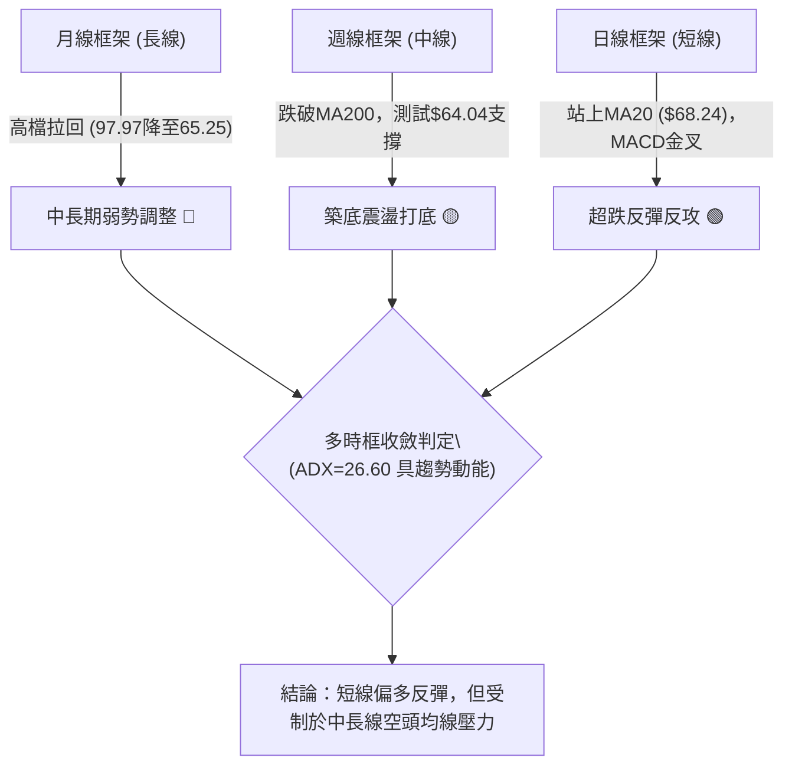

### 📈 長期趨勢 — 12個月走勢圖（Unicode）

以下為 UBER 過去 12 個月（2025-12 至 2026-11）的月線收盤走勢全景：

```
UBER 月線收盤走勢圖（過去12個月）
價格軸 ($)
$85.00 ┤
$82.00 ┤● (2025-12: $81.71)
$80.00 ┤    ● (2026-01: $80.05)
$78.00 ┤
$76.00 ┤        ● (02: $75.42)               ● (08: $75.65)
$74.00 ┤                    ● (04: $74.61)
$72.00 ┤            ●(03: 71.93)    ●(06: 72.16)
$70.00 ┤                        ●(05: 70.40) ●(07: 70.36)
$68.00 ┤                                                 ● (11: $68.59 現價)
$66.00 ┤                                             ●(09: 68.51)
$64.00 ┤                                                 ● (10: $65.25 52W低點區)
       └──────────────────────────────────────────────────────────
         12   01  02  03  04  05  06  07  08  09  10  11 (月份)
```

**月度走勢特徵分析表**：

| 時期 | 起訖月份 | 收盤區間 | 累積漲跌幅 | 走勢特徵與結構解讀 |
|:---|:---:|:---:|:---:|:---|
| **第一階段：高檔滑落** | 2025-12 至 2026-03 | $81.71 → $71.93 | -11.97% | 自 2025 年高點連續走低，失守 $80 整數關卡，形成長期下降通道 |
| **第二階段：中期箱型** | 2026-04 至 2026-08 | $74.61 → $75.65 | +1.39% | 在 $70.36–$75.65 區間構築橫盤箱型，8月一度觸及波段高點 |
| **第三階段：破底探底** | 2026-09 至 2026-10 | $68.51 → $65.25 | -4.76% | 跌破箱型下軌，10月創下波段收盤低位 $65.25（盤中觸及52W低點 $64.04） |
| **第四階段：築底回升** | 2026-10 至 2026-11 | $65.25 → $68.59 | +5.12% | 於 52 週低位獲買盤支撐，月線初現陽線反彈吞噬，進行均線回抽確認 |

### 📊 中期趨勢（週線分析）

```
中期週線價格與均線結構示意圖
$76.30 ┼────────────────────────────── R2（波段高點阻力）
$72.94 ┼┄ ┄ ┄ ┄ ┄ ┄ ┄ ┄ ┄ ┄ ┄ ┄ ┄ ┄ ┄ MA200 / R1 區域 ($72.08 - $72.94)
$70.14 ┼┈┈┈┈┈┈┈┈┈┈┈┈┈┈┈┈┈┈┈┈┈┈┈┈┈┈┈┈┈┈ MA50 / 斐波那契 78.6% ($70.70)
$68.59 ┼─────────────● (當前價格) 突破 MA20 ($68.24)
$65.41 ┼────────────────────────────── S2（次級防守支撐）
$64.04 ┼────────────────────────────── 52週低點 / S3 強力支撐底線
```

週線層面上，近 8 週走勢從 2026-09-18 的 $70.50 逐步滑落至 2026-10-30 的 $65.25，成交量在下探至 $64.04 時未見恐慌性爆量，而在 2026-11-06 當週激增至 124,396,100 股，單週拉出上影中陽線（高點觸及 $72.50，收盤 $68.59），顯示低檔承接意願強烈。

### ⚡ 趨勢強度評估（ADX 解讀）

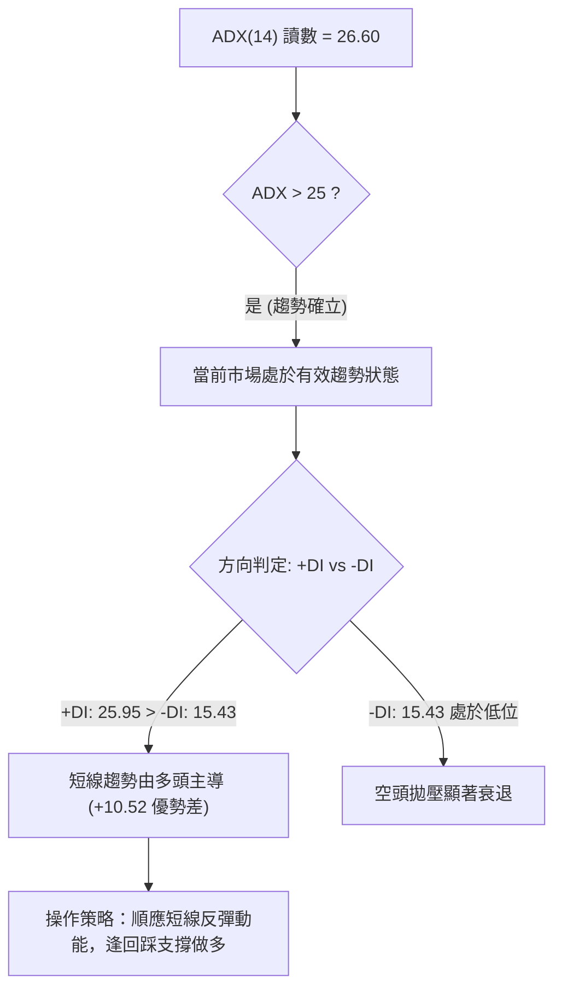

**ADX 趨勢強度矩陣**：

| 指標名稱 | 當前數值 | 臨界基準 | 狀態評估 | 實戰指導意義 |
|----------|:--------:|:--------:|:--------:|--------------|
| **ADX(14)** | 26.60 | 25.00 | 強趨勢 (Strong Trend) | 行情擺脫窄幅無方向牛皮盤整，短線反彈具備趨勢延續性 |
| **+DI** | 25.95 | 20.00 | 強勢擴張 | 多方攻擊能量充足，為近期反彈提供推升基礎 |
| **-DI** | 15.43 | 20.00 | 弱勢萎縮 | 空方力道處於鈍化狀態，不易出現瀑布式大跌 |

---

## 3. 圖表形態分析

### 🔍 形態識別系統

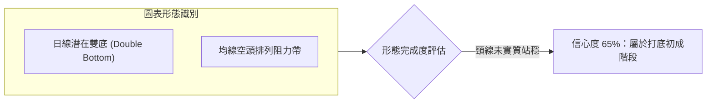

**形態信心度與目標價計算表**：

| 形態類別 | 信心度 | 判斷依據（嚴格引用數據） | 完成度 | 目標價計算式與點位 |
|:---|:---:|:---|:---:|:---|
| **日線潛在雙重底** | 65% | 第一次低點為 2026-10-29 之 $64.04；第二次低點為 2026-11-02 之 $65.55，兩次低點均獲 S3($64.04)/S2($65.41) 支撐收腳；頸線為 2026-11-04 盤中波段高點 $72.50。 | 60% | 頸線 $72.50 + (形態高度：$72.50 − $64.04 = $8.46) = **理論目標價 $80.96**（待完全突破頸線確認） |
| **週線下行旗形整理** | 45% | 2026-08 創高 $78.82 後沿下行通道走跌，近期下影線回測通道下軌。但因週線 ADX>25 且短線爆量反彈，幾何邊界未完全收斂。 | 35% | *訊號不足，依規則 15 僅作指標型均線解讀，不強制計算目標價。* |

### 🕯️ 重要K線形態分析

根據提供的「近10根日K」與「近8根週K」實際開高低收數據進行嚴格識別：

| 日期（時框） | 開盤價 | 最高價 | 最低價 | 收盤價 | K線形態名稱 | 形態特徵解讀 | 訊號方向 |
|:---|:---:|:---:|:---:|:---:|:---|:---|:---:|
| **2026-10-29 (日K)** | $65.28 | $65.80 | $64.04 | $65.74 | **長下影錘頭線** | 盤中下探觸及52週新低$64.04後強勢拉回，實體極小，下影線長達$1.24，顯現強力探底買盤。 | 🟢 強烈看多 |
| **2026-11-04 (日K)** | $68.28 | $72.50 | $67.36 | $69.87 | **爆量長上影大陽線** | 成交量激增至3,695萬股（約均量2倍），向上挑戰MA200，但觸及$72.50後遭遇解套賣壓回落。 | 🟡 多頭受阻 |
| **2026-11-05 (日K)** | $70.77 | $71.09 | $67.73 | $68.78 | **高開低走陰吞噬** | 跳空高開未能守住，實體陰線向下包覆前一日部分漲幅，顯示$70.00上方空方阻力沉重。 | 🔴 短線回檔 |
| **2026-11-06 (日K)** | $68.12 | $70.14 | $67.99 | $68.59 | **中性紡錘星線** | 開盤$68.12、收盤$68.59，高低振幅收窄，多空在MA20($68.24)上方達成短線微幅平衡。 | 🟡 震盪整理 |
| **2026-10-30 (週K)** | $66.62 | $67.00 | $64.04 | $65.25 | **弱勢探底下影線** | 測試下軌$64.04底線，收盤守在$65之上，奠定週線級別底部基礎。 | 🟡 止跌信號 |
| **2026-11-06 (週K)** | $66.12 | $72.50 | $65.55 | $68.59 | **週線放量倒轉錘頭** | 成交量擴增至1.24億股，振幅劇烈（$65.55–$72.50），最終收高於開盤，確認底背離反彈態勢。 | 🟢 轉強訊號 |

### 📉 ASCII 走勢形態示意圖

```
日線雙重底 (Double Bottom) 形態示意圖：
價位
$72.50 ┤          ▲ 頸線阻力位 (11-04 盤中高點，逼近 MA200 $72.94)
       │         / \
$70.00 ┤        /   \     ● 現價 $68.59 (回測 MA20 $68.24 守穩)
       │       /     \   /
$68.00 ┤      /       \ /
       │     /         V 
$66.00 ┤    /           \ 
       │   /             ● 第二低點 $65.55 (11-02)
$64.04 ┴──● 第一低點 (10-29 52W Low) ───────────────────── S3 底線
```

### 🎯 形態目標價計算

- **底型左底（第一低點）**：$64.04（2026-10-29 創下之 52 週最低點）
- **底型右底（第二低點）**：$65.55（2026-11-02 築成較高之次低點）
- **形態頸線**：$72.50（2026-11-04 反彈高點）
- **形態垂直高度**：$72.50 − $64.04 = $8.46
- **第一階段突破目標價 (T1)**：直接指向關鍵阻力 R2 **$76.30**（若有效站上 $72.50–$72.94 均線密集帶）
- **理論等幅測量目標價 (T2)**：$72.50 + $8.46 = **$80.96**（接近斐波那契 50.0% 回調位 $79.61 與長期整數關卡）

---

## 4. 支撐與阻力

### 🗺️ 關鍵價位分布圖（Unicode）

```
UBER 價位結構分布圖 (依據 OHLCV 歷史波動計算)
═══════════════════════════════════════════════════════════════
$78.60 ║██████████████████████████████║ 強阻力 R3 (+14.59%)
$76.30 ║████████████████████          ║ 波段阻力 R2 (+11.24%)
$72.08 ║████████████████████████      ║ 關鍵阻力 R1 (+5.09%) / MA200($72.94)
───────╫──────────────────────────────╢
$68.59 ╠══════════════════════════════╣ ◄ 當前收盤價 (現處 S1 與 R1 之間)
───────╫──────────────────────────────╢
$67.05 ║▓▓▓▓▓▓▓▓▓▓▓▓▓▓▓▓              ║ 近期支撐 S1 (-2.25%) / 貼近MA20
$65.41 ║████████████████████          ║ 次級強支撐 S2 (-4.64%)
$64.04 ║██████████████████████████████║ 核心防守底線 S3 (-6.63% / 52W Low)
═══════════════════════════════════════════════════════════════
```

### 🚧 阻力位分析表

所有數值均嚴格引用提供的波段高點聚類數據：

| 阻力級別 | 準確價位 | 距現價幅差 | 形成原因與籌碼結構 | 突破難度 | 重要性 |
|:---|:---:|:---:|:---|:---:|:---:|
| **R1** | $72.08 | +5.09% | 近一年波段高點聚類；上方緊貼布林通道上軌($72.45)及MA200($72.94)，為空頭主力防線。 | 高 🔴 | ★★★★☆ |
| **R2** | $76.30 | +11.24% | 2026年8月反彈次高點區域；吻合斐波那契61.8%回調位($75.94)，籌碼套牢密集。 | 極高 🔴 | ★★★★☆ |
| **R3** | $78.60 | +14.59% | 2026年8月下旬雙頂高點($78.80–$78.82)形成之結構性大天花板。 | 極高 🔴 | ★★★★★ |

### 🛡️ 支撐位分析表

所有數值均嚴格引用提供的波段低點聚類數據：

| 支撐級別 | 準確價位 | 距現價幅差 | 形成原因與防守邏輯 | 守住機率 | 重要性 |
|:---|:---:|:---:|:---|:---:|:---:|
| **S1** | $67.05 | -2.25% | 近期波段回踩低點聚類；下方有MA20($68.24)與MA10($66.87)提供短線動態承接。 | 75% 🟢 | ★★★★☆ |
| **S2** | $65.41 | -4.64% | 2026-10-30 週K收盤價($65.25)及近10日多個低點聚集區，為第一道結構防線。 | 85% 🟢 | ★★★★☆ |
| **S3** | $64.04 | -6.63% | 52週歷史絕對低點（2026-10-29盤中創下），斐波那契100%回調位，多頭最後生命線。 | 90% 🟢 | ★★★★★ |

### 📐 斐波那契回調位分析

依據 52 週波動區間（高點 $95.18 → 低點 $64.04）計算：

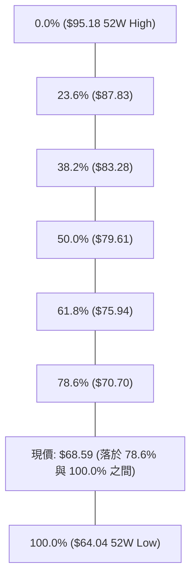

- **當前位置解讀**：現價 $68.59 處於 **78.6% ($70.70)** 與 **100.0% ($64.04)** 深度回調超跌區間。
- **技術意義**：
  1. 股價在 100.0% ($64.04) 獲得有效支撐，確認未出現破位崩跌。
  2. 上方第一道斐波那契關鍵壓力為 78.6% 回調位 **$70.70**，該位置與日線 MA50 ($70.14) 形成高度共振壓力帶。只有帶量有效收復 $70.70，才能打開向上挑戰 61.8% ($75.94) 的反彈空間。

---

## 5. 技術指標深度解讀

### 🎛️ 指標訊號總覽

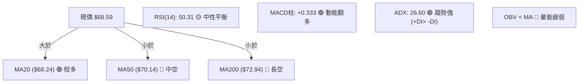

### 📈 移動平均線排列分析

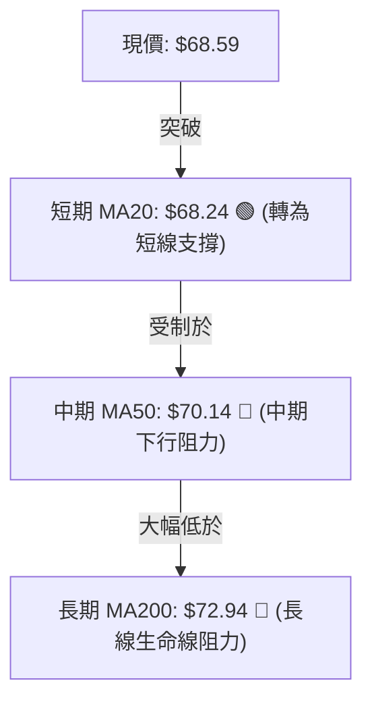

均線各週期數據詳列如下：

| 均線名稱 | 數值 | 現價與均線關係 | 均線歷史走勢軌跡 | 訊號解讀 |
|:---|:---:|:---:|:---:|:---|
| **MA 5** | $68.11 | 現價高於均線 (+0.70%) | ▅▆▇█████▇▆▅▄▃▂▁▁▂▃▄ (近端微幅勾頭向上) | 超短線買盤強勢 |
| **MA 10** | $66.87 | 現價高於均線 (+2.57%) | ██▇▆▅▆▇████▇▆▅▄▃▂▁▁▁ (由下往上金叉上揚) | 短線底部支撐穩固 |
| **MA 20** | $68.24 | 現價高於均線 (+0.52%) | ██▇▆▅▄▄▄▃▃▃▃▂▂▁▁▁▁▁ (扣抵低檔，走平翻揚) | 短線轉多臨界點 |
| **MA 50** | $70.14 | 現價低於均線 (-2.21%) | 順暢下行斜率 | 中期空頭壓制線 |
| **MA 60** | $71.39 | 現價低於均線 (-3.92%) | 穩步下行 | 季線下彎壓力顯著 |
| **MA 120**| $71.78 | 現價低於均線 (-4.44%) | 持續向下延伸 | 半年線壓制 |
| **MA 200**| $72.94 | 現價低於均線 (-5.96%) | 穩固下行排列 | 年線長期空頭警戒區 |
| **MA 240**| $74.86 | 現價低於均線 (-8.37%) | 長期天花板 | 終極多空防線 |

**均線格局總結**：目前均線系統整體呈現 **MA20 < MA50 < MA200** 典型的空頭排列。然而，現價已成功站上 MA5、MA10 及 MA20，代表短線層面出現「均線初級金叉反彈」，但上檔 MA50($70.14) 與 MA200($72.94) 仍構成強大的重力場。

### 📉 RSI(14) 分析

```
RSI(14) 讀數：50.31 (Wilder 平滑)
0 ──────────── 30 ────────────────── 50 ────────────────── 70 ─────────── 100
[   超賣區    ] [      偏弱區       ] ▲ [      偏強區       ] [   超買區    ]
                                    現值 50.31
進度條：██████████░░░░░░░░░░ (50.31%)
```

- **區間評估**：RSI(14) 數值由 10 月底的 35.80 強力回升至當前的 **50.31**，成功跨越 50 多空中軸，進入中性略微偏強格局。
- **背離診斷**：
  - 價格端：10-29 創下最低點 $64.04，10-30 收盤 $65.25；
  - 指標端：近 20 根 K 棒對比顯示，RSI 在下探 33–35 區間後並未跌破前期低點，但數據提供之演算法判定「**無明顯背離**」。結論：屬於常態超跌回抽，並未形成高信度的日線級別底背離形態。

### 📊 MACD(12/26/9) 訊號解讀

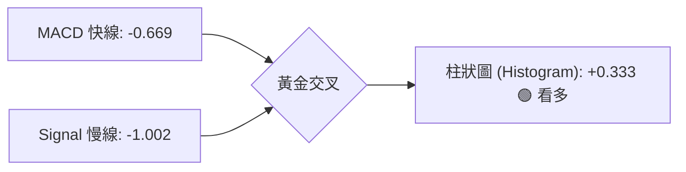

- **數值特徵**：DIF快線 (-0.669) 位於零軸下方，但已顯著上穿 DEA訊號線 (-1.002)。
- **動能解讀**：柱狀圖 Histogram 讀數為 **+0.333**，處於綠色多頭擴張狀態。顯示在零軸之下的低位反彈力道正在發酵，短線多頭掌握節奏，預計反彈動能尚能維持數個交易日。

### 📦 布林通道分析

```
布林通道 (Bollinger Bands 20, 2) 結構圖：
價位 ($)
$72.45 ┼────────────────────────────── BB 上軌 (+5.63%)
       │
$70.14 ┼┄ ┄ ┄ ┄ ┄ ┄ ┄ ┄ ┄ ┄ ┄ ┄ ┄ ┄ ┄ MA50 阻力
       │
$68.59 ┼─────────────● 現價 (位於通道中軌偏上方，%B = 0.54)
$68.24 ┼────────────────────────────── BB 中軌 (MA20) 支撐
       │
$64.02 ┼────────────────────────────── BB 下軌 (-6.66%)
```

- **軌道寬度與位置**：上軌 $72.45、中軌 $68.24、下軌 $64.02。
- **%B 指標分析**：當前 %B 為 **0.54**，意味著股價剛好突破布林中軌（0.50）並站穩，正朝向布林上軌 $72.45 進行常態波動推進。下軌 $64.02 與 52 週低點 $64.04 完美重合，構成固若金湯的下檔防線。

### 💹 成交量分析（量價配合度）

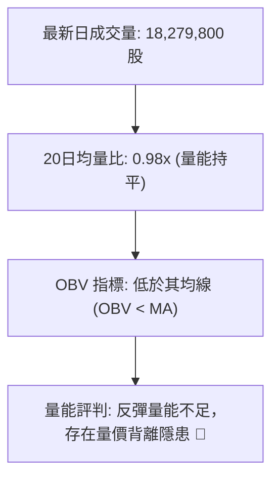

- **成交量剖析**：
  - 最新交易日成交量為 18,279,800 股，相較於 20 日均量 18,689,335 股，量比僅為 **0.98x**。
  - 雖然 11-04 出現 3,695 萬股的攻擊量，但隨後兩個交易日量能迅速萎縮至均量以下。
  - **OBV 能量潮**：數據明確提示「**OBV < MA → 量能疲弱**」。這代表此波從 $64.04 彈升至 $68.59 的過程，多數為籌碼惜售與空頭回補所致，場外增量主力資金進場信號尚不明顯。

---

## 6. 動能與波動率

### ⚡ 動能評估四象限

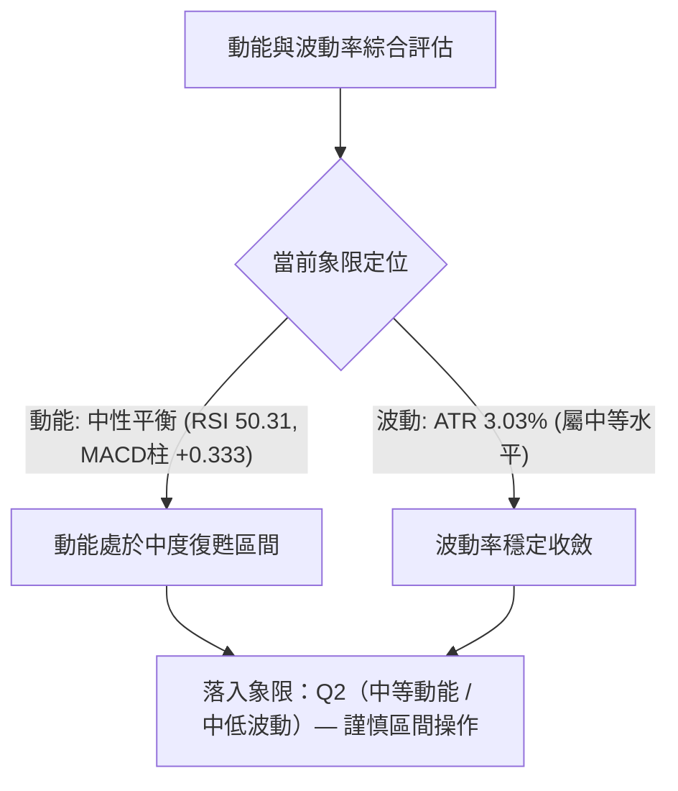

**動能與波動四象限矩陣**：

| 象限 | 動能維度 | 波動維度 | 當前判定 | 特徵與實戰指引 |
|:---:|:---:|:---:|:---:|:---|
| **Q1** | 強動能 | 低波動 | — | 主升浪黃金進場點 |
| **Q2** | **中/弱動能** | **中/低波動** | **✓ 當前狀態** | **超跌反彈修復期，股價圍繞 MA20 震盪，適合高拋低吸** |
| **Q3** | 強動能 | 高波動 | — | 單日大反轉或突破爆發行情報價 |
| **Q4** | 弱動能 | 高波動 | — | 破位崩跌或恐慌拋售區間，嚴禁盲目抄底 |

### 📊 ATR 波動率分析

- **ATR(14) 讀數**：**$2.08**（Wilder 計算，佔當前股價 3.03%）。
- **實戰風控指導**：
  - **日內安全防護噪聲距離**：1.0 × ATR = **$2.08**。
  - **常態波段止損緩衝空間**：1.5 × ATR = **$3.12**。
  - 若在現價 $68.59 進場，向下扣除 1.5 ATR 的點位為 $65.47，恰好落在次級強支撐 **S2 ($65.41)** 之上，證明 S2 具備極高的風控設置邏輯合理性。

### 📐 Beta 與市場相關性

- **Beta 數值**：**1.308**。
- **市場敏感度評估**：
  - UBER 屬於高彈性成長/科技平台股，相較於標普 500 指數具備 30.8% 的超額波動度。
  - 當大盤回暖時，UBER 具備領跑彈升潛能；然而當市場情緒逆轉時，其回檔壓力亦會同比例放大，因此操作上必須設定剛性止損點。

---

## 7. 多時框架總結

### 📋 時框架評分表

| 時框架 | 趨勢方向 | 動能指標 | 均線系統 | 圖表形態 | 綜合評分 | 建議操作策略 |
|:---|:---:|:---:|:---:|:---:|:---:|:---|
| **日線 (短期)** | 偏多反彈 🟢 | MACD柱紅, RSI 50 🟢 | 站上MA20但受制MA50 🟡 | 雙重底反彈 🟢 | 65/100 | 逢回踩支撐輕倉做多 |
| **週線 (中期)** | 區間築底 🟡 | RSI 50, MACD柱轉正 🟢 | 跌破MA50與MA200 🔴 | 箱型下緣探底 🟡 | 50/100 | 區間震盪高拋低吸 |
| **月線 (長期)** | 空頭調整 🔴 | 由97.97滑落弱勢區 🔴 | 均線長空格局 🔴 | 下降通道 🔴 | 38/100 | 長期投資宜分批觀望 |

### 🔲 綜合訊號矩陣

```
時框與維度收斂對照表：
┌────────────┬─────────────┬─────────────┬─────────────┐
│ 分析維度   │ 日線 (短期) │ 週線 (中期) │ 月線 (長期) │
├────────────┼─────────────┼─────────────┼─────────────┤
│ 趨勢方向   │ 🟢 向上     │ 🟡 橫盤     │ 🔴 向下     │
│ 均線系統   │ 🟡 糾結     │ 🔴 空頭     │ 🔴 空頭     │
│ 動能狀態   │ 🟢 多方擴張 │ 🟡 中性平衡 │ 🔴 弱勢衰退 │
│ 成交量配合 │ 🔴 疲弱     │ 🟢 底部放量 │ 🟡 平衡     │
│ 關鍵價位   │ 守住 $68.24 │ 守住 $64.04 │ 失守 $80.00 │
└────────────┴─────────────┴─────────────┴─────────────┘
```

### ⚖️ 多時框收斂結論

依據多時框收斂規則（規則 14）：
1. **行情屬性判斷**：日線 ADX(14) 讀數為 **26.60 > 25.00**，顯示市場具備**趨勢行情**特徵，且 +DI(25.95) > -DI(15.43) 由多頭主導。
2. **多時框權重收斂**：在 ADX 趨勢行情的框架下，長期月線與中期週線的均線空頭排列（MA200=$72.94、MA50=$70.14）決定了**上方空間受到強壓制**；日線級別站上 MA20 僅能視為**中長期下跌趨勢中的強勢技術性反彈**。
3. **最終方向性結論**：**中性偏多（區間震盪反彈格局）**。
   以日線級別尋求反彈做多機會，但不可盲目追高，必須緊盯上檔阻力位 R1($72.08) 與 R2($76.30)，一旦反彈乏力應迅速獲利了結。

---

## 8. 交易策略建議

### 🗺️ 策略決策流程圖

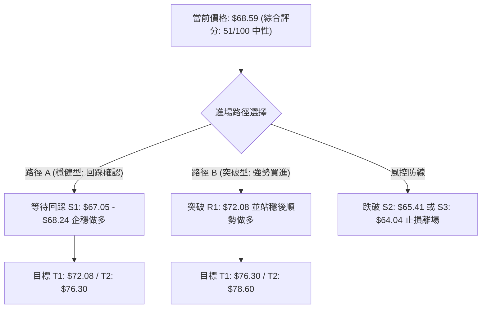

### 🧭 策略路由（依評分卡分流）

> **當前主策略方向 = 區間反彈操作（依評分 51/100 判定為中性震盪，以布林通道與關鍵支撐阻力為操作軸心）**

評分處於 40–60 中性區間，且日線 ADX>25 呈現短線反彈動能。因此策略以**「拉回支撐做多」**為核心推薦，同時標注上方阻力與下破風控點。

### 🎯 價格情境階梯（Price Scenarios）

所有價位均嚴格引用第 4 章及數據計算數值：

| 觸發條件 | 下一目標 | 後續延伸 | 情境技術面含義 |
|:---|:---:|:---:|:---|
| **強勢突破 R1 ($72.08)** | R2 ($76.30) | R3 ($78.60) | 突破 MA200，扭轉中期頹勢，確認日線雙重底成立 |
| **站穩現價區間 ($67.05–$68.59)** | R1 ($72.08) | — | 股價於 MA20 之上強勢橫盤，消化套牢賣壓 |
| **跌破支撐 S1 ($67.05)** | S2 ($65.41) | S3 ($64.04) | 短線反彈宣告夭折，重回下探打底走勢 |

### 📊 情境機率分佈

| 情境 | 機率 | 主要依據 |
|:---|:---:|:---|
| **情境一：延續反彈震盪上攻** | **55%** | MACD柱正向擴張(+0.333)、+DI(25.95)佔優、日K守穩MA20。 |
| **情境二：箱型區間震盪整理** | **30%** | OBV量能疲弱(OBV < MA)、均線仍處空頭排列、上檔MA50壓力沉重。 |
| **情境三：反彈衰竭再探前低** | **15%** | 機構拋售風險、大盤高Beta回檔連帶效應。 |

### 🟢 主策略詳情（方向依上方路由）

所有目標價、止損點與進場價皆嚴格依據第 4 章數據數值，風險報酬比計算依規則 17 呈現：

| 策略要素 | 策略 A（穩健型：回踩 MA20 佈局多單） | 策略 B（激進型：突破 R1 追擊多單） |
|:---|:---:|:---:|
| **進場條件** | 股價回踩 S1 區域獲支撐，日K收下影線確認 | 日K帶量實體陽線突破關鍵阻力 R1 |
| **進場價格** | **$67.65**（取 S1 $67.05 至 MA20 $68.24 之中點） | **$72.08**（精確依據 R1 阻力價位） |
| **第一目標價 (T1)** | **$72.08**（精確依據 R1） | **$76.30**（精確依據 R2） |
| **第二目標價 (T2)** | **$76.30**（精確依據 R2） | **$78.60**（精確依據 R3） |
| **止損價格** | **$65.41**（精確依據 S2） | **$70.14**（精確依據 MA50） |
| **風險報酬比 (以 T1 計)** | **1 : 1.98**（以 T1 計）<br>*(72.08 − 67.65) ÷ (67.65 − 65.41) = 4.43 ÷ 2.24* | **1 : 2.18**（以 T1 計）<br>*(76.30 − 72.08) ÷ (72.08 − 70.14) = 4.22 ÷ 1.94* |
| **風險報酬比 (以 T2 計)** | **1 : 3.86**（以 T2 計）<br>*(76.30 − 67.65) ÷ 2.24 = 8.65 ÷ 2.24* | **1 : 3.36**（以 T2 計）<br>*(78.60 − 72.08) ÷ 1.94 = 6.52 ÷ 1.94* |
| **成功機率** | 60% | 50% |
| **建議倉位** | 10% – 15% 總資金倉位 | 5% – 10% 總資金倉位 |

### 🔴 反向風險觸發點（對沖提示）

- **全面停損訊號**：若日K收盤價**實體跌破 S2 ($65.41)**，說明多頭防禦失敗，必須將多單全部減倉或停損；若進一步下破 **S3 ($64.04)**，代表 52 週新低再度被刷新，將開啟下行空間，投資人應考慮買入認沽期權（Put）進行對沖。
- **獲利了結訊號**：若股價上衝至 **R1 ($72.08)** 或 **MA200 ($72.94)** 出現日K長上影線（如 11-04 形態），應即刻分批獲利了結，防範假突破風險。

### ⭐ 整體訊號強度評星

```
做多訊號強度：★★★☆☆  (3/5星 — 短線指標偏多，但受均線與量能壓制)
做空訊號強度：★★☆☆☆  (2/5星 — 低檔買盤湧現，做空空間受限於 S1/S2)
整體可信度：  ★★★★☆  (4/5星 — 價位重疊度高，斐波那契與支撐阻力結構清晰)
```

---

## 9. 風險提示與監控

### ✅ 關鍵監控指標 Checklist

```
╔══════════════════════════════════════════════════════════════════╗
║                   關鍵技術指標監控 Checklist                     ║
╠══════════════════════════════════════════════════════════════════╣
║ [ ] 價格是否持續收在 MA20 ($68.24) 之上？                        ║
║ [ ] RSI(14) 能否穩守 50 中軸，避免重新跌入 40 以下弱勢區？       ║
║ [ ] 日成交量能否回升至 20日均量 (1,868 萬股) 以上形成放量？     ║
║ [ ] MACD 柱狀圖正值是否持續擴大 (+0.333 以上)？                 ║
║ [ ] 向上挑戰 R1 ($72.08) 時，能否實體突破而非長上影拉回？        ║
║ [ ] 52週低點 S3 ($64.04) 是否絕對守穩未遭摜破？                  ║
╚══════════════════════════════════════════════════════════════════╝
```

### ⚠️ 風險場景分析

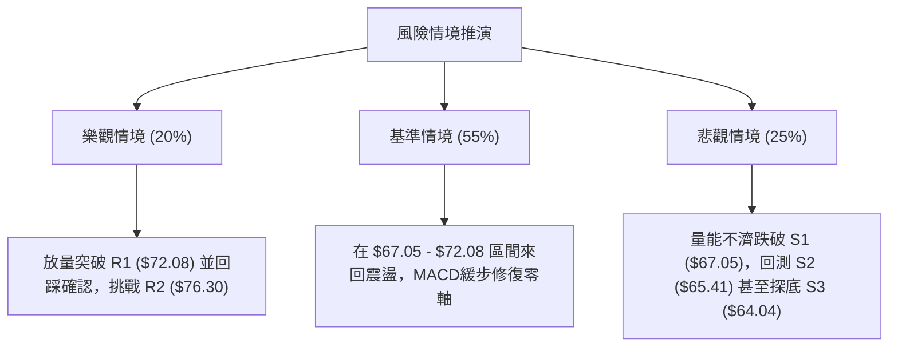

### 🛡️ 風險管理重要提醒

1. **嚴格控制部位**：當前均線系統仍屬大級別空頭排列，目前的操作屬於「逆中長期趨勢的短線超跌反彈」，建議總多頭曝險不宜超過整體投資組合的 **15%**。
2. **防範假突破**：2026-11-04 盤中曾衝高至 $72.50 但收盤大幅滑落至 $69.87，留下顯著解套賣壓上影線。後續在挑戰 **R1 ($72.08)** 與 **MA200 ($72.94)** 時，切忌於盤中急拉時追高，必須等待日K收盤實體站穩再行加碼。
3. **無條件止損紀律**：以波段支撐 **S2 ($65.41)** 作為嚴格防守底線。一旦盤中下破且無法收復，必須無條件執行停損，防範股價二次探底跌破 **S3 ($64.04)** 觸發流動性踩踏。

---

## 📋 報告總結

```
╔══════════════════════════════════════════════════════════════════╗
║                   UBER 技術分析報告總結                          ║
╠══════════════════════════════════════════════════════════════════╣
║ 報告日期：2026-11-09                                             ║
║ 當前價格：$68.59                                                 ║
║ 綜合評分：51 / 100 (算術平均)                                    ║
║ 分析評級：⚖️ 中性觀望 / 區間偏多反彈                              ║
║                                                                  ║
║ 關鍵技術維度結論：                                               ║
║ ├─ 長期趨勢 (月線)：🔴 空頭回檔，自 $97.97 滑落至 $64-$68 區間    ║
║ ├─ 中期趨勢 (週線)：🟡 探底築底，MA50 與 MA200 下行形成壓制     ║
║ ├─ 短期趨勢 (日線)：🟢 超跌反彈，收復 MA20 ($68.24) 且 MACD 金叉 ║
║ ├─ 核心支撐：S1: $67.05 │ S2: $65.41 │ S3: $64.04 (52W Low)     ║
║ ├─ 關鍵阻力：R1: $72.08 │ R2: $76.30 │ R3: $78.60               ║
║ └─ 分析師共識目標：$99.16 (最高 $150.00 / 最低 $70.00)          ║
║                                                                  ║
║ 最優策略組合建議：                                               ║
║ 1. 🥇 最佳機會：策略 A — 回踩 S1/MA20 ($67.65) 企穩做多，        ║
║                 目標 R1 ($72.08)，止損 S2 ($65.41)，風報比 1:1.98║
║ 2. 🥈 次選機會：策略 B — 帶量突破 R1 ($72.08) 追擊，             ║
║                 目標 R2 ($76.30)，止損 MA50 ($70.14)，風報比 1:2.18║
║ 3. 🥉 保守選擇：在 $67.05 - $72.08 區間未表態前空倉觀望，        ║
║                 等待日線收盤確認站上 MA200 後再行順勢佈局        ║
╚══════════════════════════════════════════════════════════════════╝
```

---

> ⚠️ **免責聲明**：本報告為技術分析研究，所有數據與價位均嚴格依據歷史成交資訊客觀推導。本報告**僅供學術研究與參考**，**不構成任何要約、招攬或投資買賣建議**。金融市場波動劇烈，投資人應獨立思考並自負盈虧風險。

---

*報告生成時間：2026-11-09 ｜ 數據來源：Yahoo Finance ｜ 分析框架：多時框技術分析模型*