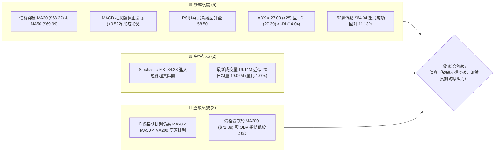
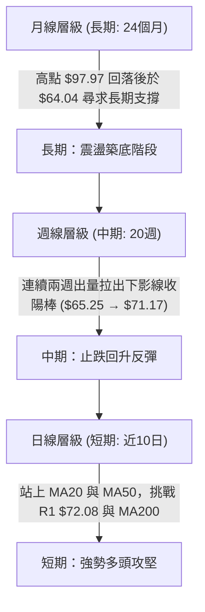
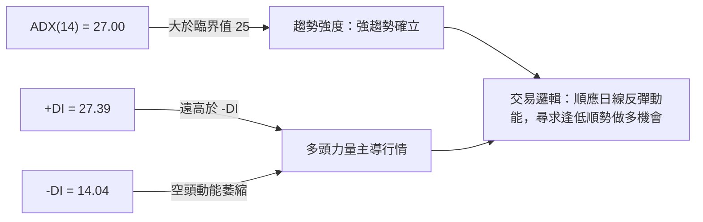
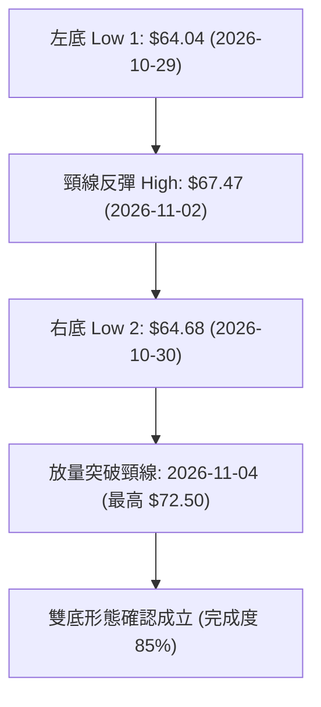
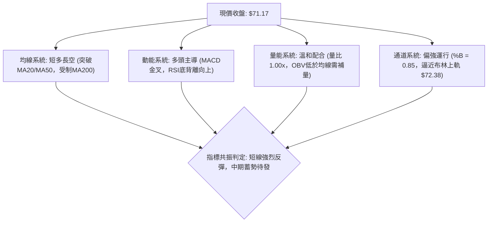
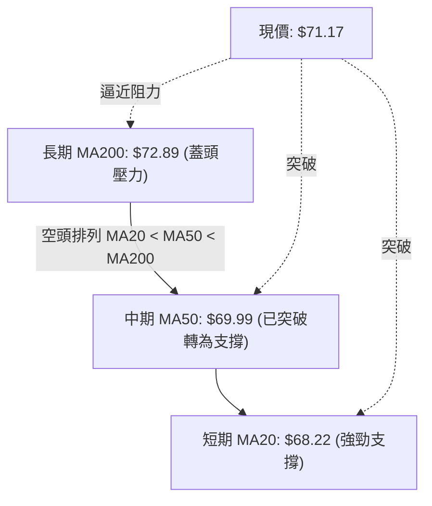
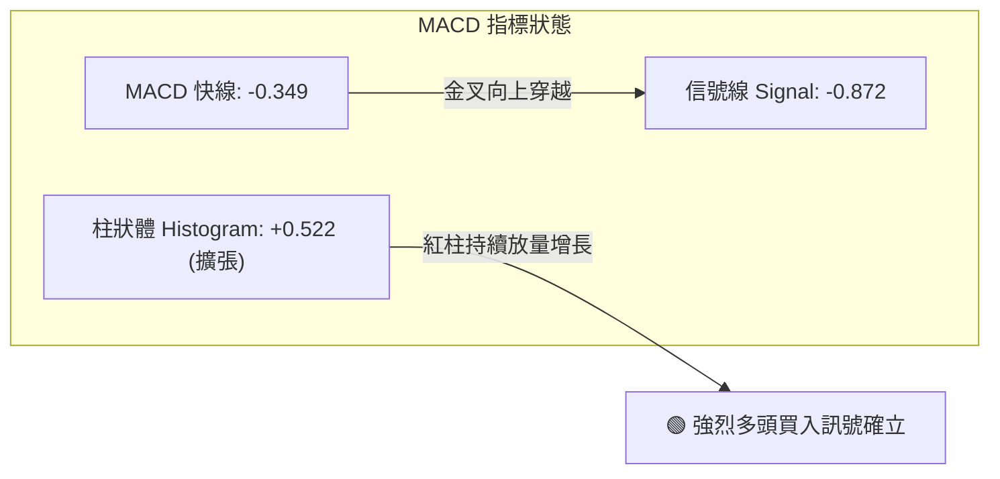
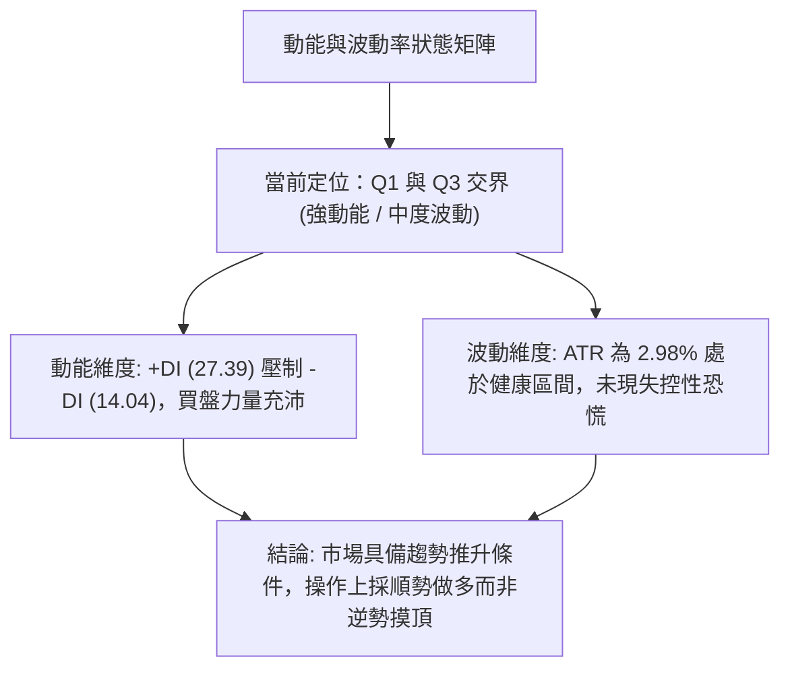
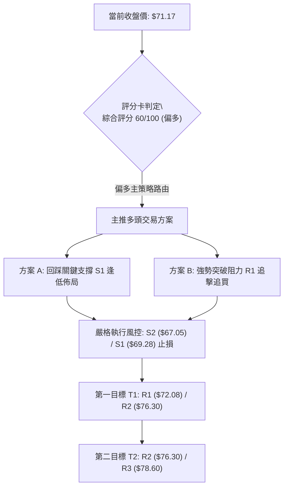
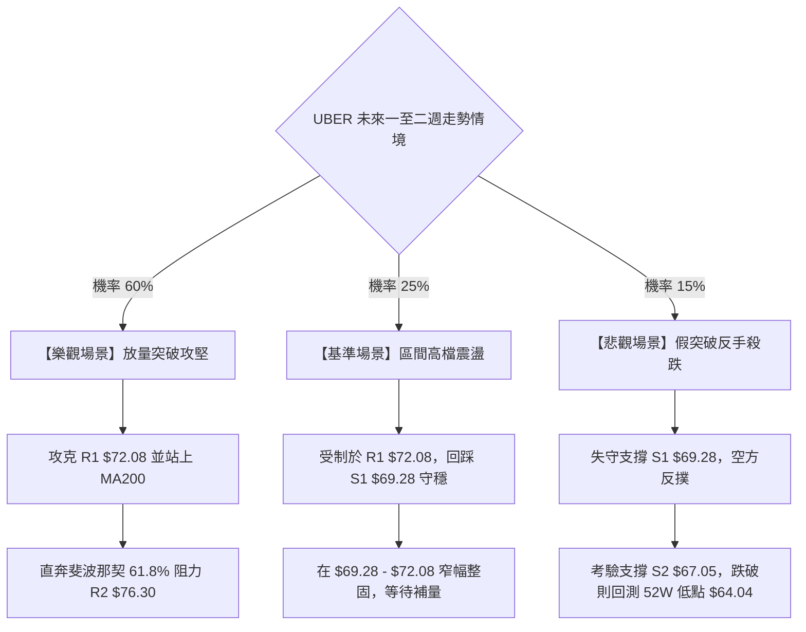

# UBER 技術分析報告

> **報告日期**：2026-11-10 ｜ **語言**：繁體中文 ｜ **數據來源**：Yahoo Finance ｜ **當前價格**：$71.17

---

## 目錄

| 章節 | 內容 |
|------|------|
| [1. 技術面概覽](#1-技術面概覽) | 訊號儀表板、核心指標、評分卡 |
| [2. 趨勢分析](#2-趨勢分析) | 多時框趨勢、長中短期走勢、ADX 解讀 |
| [3. 圖表形態分析](#3-圖表形態分析) | 形態識別、K線組合、目標價推算 |
| [4. 支撐與阻力](#4-支撐與阻力) | 關鍵價位、斐波那契回調結構 |
| [5. 技術指標深度解讀](#5-技術指標深度解讀) | MA/RSI/MACD/布林/成交量量價背離 |
| [6. 動能與波動率](#6-動能與波動率) | 動能評估、ATR 波動率、Beta 市場敏感度 |
| [7. 多時框架總結](#7-多時框架總結) | 時框架評分矩陣、多時框收斂結論 |
| [8. 交易策略建議](#8-交易策略建議) | 策略路由、主策略詳情、風險報酬比 |
| [9. 風險提示與監控](#9-風險提示與監控) | 關鍵監控清單、情境分析與風控要則 |

---

## 1. 技術面概覽

### 🎯 技術訊號儀表板



---

### 📊 核心指標速覽表

| 指標類別 | 指標名稱 | 當前數值 | 訊號 | 解讀 |
|----------|----------|----------|:---:|------|
| **價格** | 當前收盤價 | $71.17 | 🟢 | 站上 52 週低點聚類，目前位於 52 週波動區間 22.9% 分位 |
| **均線** | 短期 MA20 | $68.22 | 🟢 | 現價高於 MA20 (+4.32%)，短期趨勢轉強，提供下檔支撐 |
| **均線** | 中期 MA50 | $69.99 | 🟢 | 現價站回 MA50 上方 (+1.69%)，中期下行壓力獲有效緩解 |
| **均線** | 長期 MA200| $72.89 | 🔴 | 現價低於 MA200 (-2.36%)，長期生命線仍構成上方關鍵蓋頭壓力 |
| **動能** | RSI(14) | 58.50 | 🟢 | 脫離超賣區，呈現典型多頭底背離後的加速反彈結構 |
| **動能** | MACD(12,26,9) | -0.349 / -0.872 | 🟢 | MACD 線高於訊號線，柱狀體為 +0.522，多頭動能持續放量 |
| **動能** | KD(9,3,3) | 84.28 / 64.70 | 🟡 | %K 上穿 %D 呈多頭排列，但短線進入 80 以上超買區防回踩 |
| **趨勢** | ADX(14) | 27.00 | 🟢 | 數值大於 25 表明趨勢行情確立，+DI 顯著大於 -DI 主導盤勢 |
| **通道** | 布林通道 | 上軌 $72.38 / %B 0.85 | 🟡 | 價格貼近布林上軌運作，通道開口微擴，面臨通道上軌壓制 |
| **波動** | ATR(14) | $2.12 (2.98%) | 🟡 | 日內波動幅度適中，為交易止損點設定提供合理的緩衝空間 |
| **成交量**| OBV | 低於均線 (OBV < MA) | 🔴 | 總體累積量能尚未完全同步放量，追高買盤須警惕假突破 |

---

### 🏆 技術評分卡

```
╔══════════════════════════════════════════════════════════════════════════════╗
║                       技術評分卡 — UBER (2026-11-10)                          ║
╠══════════════════════════════════════════════════════════════════════════════╣
║ 評估維度      評分進度條                         得分      狀態     權重說明  ║
╠══════════════════════════════════════════════════════════════════════════════╣
║ 趨勢強度      █████████████░░░░░░░               65/100     🟢     ADX>25    ║
║ 動能指標      ██████████████░░░░░░               70/100     🟢     MACD金叉  ║
║ 支撐穩定度    █████████████░░░░░░░               65/100     🟢     $69.28守穩║
║ 成交量配合    █████████░░░░░░░░░░░               48/100     🟡     OBV未破線 ║
║ 形態完整度    ████████████░░░░░░░░               62/100     🟢     雙底成型  ║
║ 均線排列      ██████████░░░░░░░░░░               50/100     🟡     受制MA200 ║
╠══════════════════════════════════════════════════════════════════════════════╣
║ 綜合評分      ████████████░░░░░░░░               60/100     🟢     偏多操作  ║
║                                                                              ║
║ 註：綜合評分由六項子指標算術平均計算：                                         ║
║     (65 + 70 + 65 + 48 + 62 + 50) ÷ 6 = 360 ÷ 6 = 60/100                     ║
║ 結論：綜合評分 ≥ 60，啟動偏多主策略路由，以拉回偏多操作為主。                  ║
╚══════════════════════════════════════════════════════════════════════════════╝
```

---

## 2. 趨勢分析

### 🌐 多時框趨勢分析



---

### 📈 長期趨勢 — 12個月走勢圖（Unicode）

以下為根據 UBER 過去 12 個月歷史收盤價繪製之月線走勢圖（2025-12 至 2026-11）：

```
UBER 月線收盤走勢圖（過去12個月）
價格軸 ($)
$85.00 ┤
$82.00 ┤ ●(25-12: $81.71)
$79.00 ┤   ●(26-01: $80.05)
$76.00 ┤     ●(26-02: $75.42)               ●(26-08: $75.65)
$73.00 ┤       ●(26-03: $71.93) ●(26-04: $74.61) ●(26-06: $72.16)
$70.00 ┤                   ●(26-05: $70.40) ●(26-07: $70.36)   ●(26-11: $71.17)←現價
$67.00 ┤                                           ●(26-09: $68.51)
$64.00 ┤                                                 ●(26-10: $65.25, 52W低點聚類)
       └─┬─────┬─────┬─────┬─────┬─────┬─────┬─────┬─────┬─────┬─────┬─────┬───
        12月  01月  02月  03月  04月  05月  06月  07月  08月  09月  10月  11月 (2025-2026)
```

#### 走勢特徵分析表格

| 階段區間 | 起訖月份 | 起訖價格 ($) | 漲跌幅 (%) | 趨勢特徵與結構解析 |
|----------|----------|:------------:|:----------:|-------------------|
| **第一階段：高檔震盪回調** | 2025-12 → 2026-03 | $81.71 → $71.93 | -11.97% | 自 2025 年秋季歷史高峰回落，成交動能減弱，跌破 80 元關卡。 |
| **第二階段：橫向箱型整理** | 2026-04 → 2026-08 | $74.61 → $75.65 | +1.39%  | 於 $70.00 至 $78.00 構築箱型區間，8月觸及 $78.82 週線波段高點。 |
| **第三階段：破位再探低點** | 2026-09 → 2026-10 | $68.51 → $65.25 | -4.76%  | 箱型下緣失守，跌至 52 週最低點 $64.04 (10月收盤 $65.25)。 |
| **第四階段：觸底強勁反彈** | 2026-10 → 2026-11 | $65.25 → $71.17 | +9.07%  | 探底後迎來強勁技術買盤，月線級別出現明顯築底反彈陽線。 |

---

### 📊 中期趨勢（週線分析）

中期技術面在 2026 年 10 月 30 日當週下探 52 週低點 $64.04 後，週線連續兩週放量走揚。2026-11-06 當週成交量放大至 124,407,100 股，價格由開盤 $66.12 衝高至 $72.50，一舉扭轉 9 月中旬以來的下跌通道。

```
近期週線壓力與支撐示意圖
價格 ($)
$78.60 ────────────────────────────────────────────── [強阻力 R3] 8月反彈高點聚類
$76.30 ────────────────────────────────────────────── [次阻力 R2] 斐波那契 61.8% ($75.94) 附近
$72.08 ───────────────────▲突破測試區▲─────────────── [即時阻力 R1] / MA200 ($72.89)
$71.17 ═══════════════════[現價 $71.17]══════════════
$69.28 ───────────────────▼短線回踩支撐▼───────────── [近期支撐 S1] 轉換支撐位
$67.05 ────────────────────────────────────────────── [次要支撐 S2] 11月初放量起漲點
$64.04 ────────────────────────────────────────────── [強支撐 S3/52W低點] 絕對防守底線
```

---

### ⚡ 趨勢強度評估（ADX 解讀）



#### ADX 趨勢強度對照表

| 指標參數 | 當前數值 | 門檻區間 | 當前狀態判定 | 技術意涵 |
|----------|:--------:|:--------:|:------------:|----------|
| **ADX(14)** | 27.00 | > 25.00 | 🟢 強趨勢 | 擺脫 9–10 月的無序陰跌與盤整，新一輪波段反彈方向明確 |
| **+DI** | 27.39 | - | 🟢 擴張 | 多方推進力量持續增強，居於絕對優勢地位 |
| **-DI** | 14.04 | - | 🟢 萎縮 | 空方力道自 10 月底高點大幅回落，做空動能衰竭 |
| **方向差 (+DI - -DI)** | +13.35 | > 0 | 🟢 多方擴大 | 差距顯著拉大，確認買盤掌控短期盤面定價權 |

---

## 3. 圖表形態分析

### 🔍 形態識別系統

根據近 10 根日 K 棒與近 8 根週 K 棒的價量運動軌跡，目前圖表呈現高度可信的**日線雙底（W底）反轉形態**，伴隨布林通道中軌的向上突破。



#### 形態識別與信心度評估表

| 形態名稱 | 信心度 | 判斷依據（引用數據） | 完成度 | 目標價（附精確計算式） |
|----------|:------:|----------------------|:------:|------------------------|
| **日線雙重底 (W底)** | 80% | 10/29 探低 $64.04，10/30 回測 $64.68 不破低點，11/04 放量 36.95M 衝過頸線高點 $67.47 | 85% | 頸線 $67.47 + 形態高度 ($67.47 - $64.04 = $3.43) = **$70.90**（已達成，下一階段延伸看 R1 $72.08） |
| **布林通道向上突破** | 75% | 收盤價 $71.17 突破中軌 $68.22，布林 %B 達 0.85，逼近上軌 $72.38 | 90% | 沿上軌擴張運行，第一目標直指 R1 **$72.08**，強勢延伸看 R2 **$76.30** |
| **短期均線黃金交叉** | 85% | MA5 ($69.00) 與 MA10 ($67.38) 迅速由下往上穿越 MA20 ($68.22) | 100% | 均線助漲動能推升，下檔支撐看 S1 **$69.28** |

---

### 🕯️ 重要K線形態分析

嚴格依據提供的「近10根日K」與「近8根週K」實際開高低收數據進行深度解析：

#### 近10根日K線精確形態解讀

| 日期 (日K) | 開盤 ($) | 最高 ($) | 最低 ($) | 收盤 ($) | 成交量 (股) | K線形態名稱 | 專業技術解讀 | 訊號強度 |
|:----------:|:--------:|:--------:|:--------:|:--------:|:-----------:|:-----------:|--------------|:--------:|
| 2026-10-27 | 66.40 | 66.50 | 65.47 | 65.78 | 20,731,800 | 實體黑K | 下行趨勢延續，空方持續主導盤面 | 🔴 強空 |
| 2026-10-28 | 65.50 | 65.88 | 64.69 | 65.27 | 18,324,900 | 下跌小陰棒 | 波動幅度收窄，空方下殺動能初現減速 | 🟡 偏空 |
| 2026-10-29 | 65.28 | 65.80 | 64.04 | 65.74 | 16,286,800 | 長下影錘頭星 | 創 52 週新低 $64.04 後強烈買盤介入收長下影線 | 🟢 築底 |
| 2026-10-30 | 65.61 | 65.80 | 64.68 | 65.25 | 17,962,800 | 雙底回測小陰 | 低點 $64.68 高於前日 $64.04，確認雙底支撐有效性 | 🟢 止跌 |
| 2026-11-02 | 66.12 | 67.47 | 65.55 | 66.71 | 17,742,800 | 帶量突破紅K | 開盤高走突破前高阻力，形成反彈第一浪 | 🟢 轉強 |
| 2026-11-03 | 66.75 | 66.96 | 65.99 | 66.60 | 21,313,500 | 高檔小十字星 | 頸線位置多空交戰，成交量放大至 21.31M 進行換手 | 🟡 觀望 |
| 2026-11-04 | 68.28 | 72.50 | 67.36 | 69.87 | 36,952,600 | 放量巨幅長陽 | 成交量暴增至 36.95M，高點觸及 $72.50 確立反轉 | 🟢 強多 |
| 2026-11-05 | 70.77 | 71.09 | 67.73 | 68.78 | 30,107,400 | 高開衝高回落黑K | 遭遇 MA200 壓力回吐，但低點守穩 $67.73 展現強韌承接 | 🟡 震盪 |
| 2026-11-06 | 68.12 | 70.14 | 67.99 | 68.59 | 18,290,800 | 縮量整固小陽 | 縮量回洗，守穩 MA20 ($68.22)，完成回踩確認 | 🟢 蓄勢 |
| 2026-11-09 | 69.50 | 71.26 | 68.84 | 71.17 | 19,137,100 | 光頭強勢中陽 | 價格跳空開高並收於次高點，重新發動攻堅行情 | 🟢 續攻 |

#### 近8根週K線精確形態解讀

| 日期 (週末) | 開盤 ($) | 最高 ($) | 最低 ($) | 收盤 ($) | 成交量 (股) | 週K形態名稱 | 技術解讀與中線趨勢 | 訊號強度 |
|:----------:|:--------:|:--------:|:--------:|:--------:|:-----------:|:-----------:|-------------------|:--------:|
| 2026-09-25 | 70.82 | 71.90 | 68.55 | 69.62 | 86,777,700 | 中陰棒 | 失守 70 元大關，中期走勢由震盪轉為下行 | 🔴 偏空 |
| 2026-10-02 | 69.36 | 69.97 | 67.22 | 68.11 | 80,475,800 | 續跌黑K | 下行尋找支撐，均線空頭排列發散 | 🔴 空頭 |
| 2026-10-09 | 68.40 | 72.08 | 68.00 | 71.51 | 75,174,900 | 帶長上影長陽 | 觸及阻力位 R1 $72.08 後受阻回落，形成假突破 | 🟡 震盪 |
| 2026-10-16 | 71.16 | 71.86 | 68.62 | 70.35 | 69,265,400 | 滯漲小陰 | 反彈力道減弱，高點無法過前週高點 | 🟡 轉弱 |
| 2026-10-23 | 70.13 | 70.76 | 66.43 | 66.70 | 84,761,000 | 破位長大陰棒 | 加速下跌跌破重要平台，市場恐慌拋售情緒濃烈 | 🔴 強空 |
| 2026-10-30 | 66.62 | 67.00 | 64.04 | 65.25 | 95,364,200 | 長下影探底棒 | 爆量下探 52 週最低點 $64.04 後強烈反抽，形成底部聚類 | 🟢 築底 |
| 2026-11-06 | 66.12 | 72.50 | 65.55 | 68.59 | 124,407,100| 爆量多頭長陽 | 1.24億股巨量拉升，收盤重返 $68.50 上方，中期反轉信號確立 | 🟢 強多 |
| 2026-11-09 | 69.50 | 71.26 | 68.84 | 71.17 | 19,137,100 | 單日推升續陽 | 本週首日即延續多頭攻勢，直接挑戰 71 元關卡 | 🟢 多頭 |

---

### 📉 ASCII 走勢形態示意圖

```
UBER 日線雙底（W底）及頸線突破示意圖
價格 ($)
$72.50 ┤                                 ● (11/04 突破高點 $72.50)
$71.17 ┤                                   ●←現價 ($71.17，逼近 R1 $72.08)
$69.28 ┤                              ●   [S1 轉換支撐位]
$67.47 ┤         ●(頸線高點 $67.47)───┼─●─
$66.00 ┤        / \                  /
$64.68 ┤       /   \            ●───┘ (右底 Low 2: $64.68)
$64.04 ┤●─────┘     ●(左底 Low 1: $64.04)
       └──────────────────────────────────────────────────────────
         10-27  10-29  10-30   11-02   11-04  11-06  11-09
```

---

### 🎯 形態目標價計算

根據雙重底幾何形態與波動對稱理論計算測量目標：

1. **形態底部低點（Low）**：取左底 $64.04
2. **形態頸線高點（Neckline）**：取 2026-11-02 日高點 $67.47
3. **形態高度（Pattern Height, H）**：
   $$\text{H} = \text{Neckline} - \text{Low} = \$67.47 - \$64.04 = \$3.43$$
4. **形態基本測量目標（Target 1）**：
   $$\text{T1} = \text{Neckline} + \text{H} = \$67.47 + \$3.43 = \$70.90$$
   *(現價 $71.17 已成功超越並站穩 T1)*
5. **形態擴展測量目標（Target 2，以 1.618 倍斐波那契延伸計算）**：
   $$\text{T2} = \text{Neckline} + (1.618 \times \text{H}) = \$67.47 + (1.618 \times \$3.43) = \$67.47 + \$5.55 = \$73.02$$
   *(該數值精確對應 MA200 之 $72.89 與阻力位 R1 $72.08 聚類區間)*
6. **中期波段目標（Target 3）**：直指波段高點阻力位 **R2: $76.30**。

---

## 4. 支撐與阻力

### 🗺️ 關鍵價位分布圖（Unicode）

```
UBER 價位結構分布圖
═══════════════════════════════════════════════════════════════════
$78.60 ║████████████████████████████████║ 強阻力 R3（近一年波段高點）
$76.30 ║████████████████████████        ║ 關鍵阻力 R2（斐波那契 61.8% 密集區）
$72.08 ║████████████████████████████████║ 立即阻力 R1（MA200 $72.89 重合帶）
$71.17 ╠════════════════════════════════╣ ◄ 現價收盤 $71.17 (突破 78.6% 回調位)
$70.70 ║░░░░░░░░░░░░░░░░░░░░░░░░░░░░░░░░║ 斐波那契 78.6% 回調位 ($70.70)
$69.28 ║▓▓▓▓▓▓▓▓▓▓▓▓▓▓▓▓▓▓▓▓▓▓▓▓        ║ 短線支撐 S1（波段突破轉換位 / MA50）
$67.05 ║████████████████████████        ║ 次級強支撐 S2（11月初起漲平臺）
$65.41 ║████████████████                ║ 強支撐 S3（下檔最後防線）
$64.04 ║████████████████████████████████║ 52週歷史最低點（絕對防守停損線）
═══════════════════════════════════════════════════════════════════
```

---

### 🚧 阻力位分析表

所有價位嚴格引用自數據中由 OHLCV 計算之關鍵阻力位：

| 阻力級別 | 價位 ($) | 距現價幅動 (%) | 形成原因與技術聚集 | 突破難度 | 重要性 |
|:--------:|:--------:|:--------------:|--------------------|:--------:|:------:|
| **R1** | **$72.08** | +1.28% | 近一年多次波段高點聚類，且與長期生命線 MA200 ($72.89) 及布林上軌 ($72.38) 形成密集阻力帶 | 🔴 極高 | ★★★★★ |
| **R2** | **$76.30** | +7.21% | 2026 年 8 月高點整理平臺，同時接近斐波那契 61.8% 回調位 ($75.94) | 🟡 中等 | ★★★★☆ |
| **R3** | **$78.60** | +10.44% | 2026 年 8 月底創下的中期波段頂部（8/28 週收盤 $78.82），籌碼沉澱套牢區 | 🔴 極高 | ★★★★☆ |

---

### 🛡️ 支撐位分析表

所有價位嚴格引用自數據中由 OHLCV 計算之關鍵支撐位：

| 支撐級別 | 價位 ($) | 距現價幅動 (%) | 形成原因與技術聚集 | 守住機率 | 重要性 |
|:--------:|:--------:|:--------------:|--------------------|:--------:|:------:|
| **S1** | **$69.28** | -2.65% | 近期起漲平台與突破之短期均線 MA5 ($69.00)、MA50 ($69.99) 共振支撐區 | 🟢 85% | ★★★★★ |
| **S2** | **$67.05** | -5.79% | 雙底頸線與 11/02–11/03 換手起漲區間，強大換手籌碼墊底 | 🟢 75% | ★★★★☆ |
| **S3** | **$65.41** | -8.09% | 2026 年 10 月多根日 K 實體下緣聚類，靠近布林下軌 ($64.06) | 🟢 90% | ★★★☆☆ |

---

### 📐 斐波那契回調位分析

依據 52 週波動極值區間（低點 $64.04 至 高點 $95.18，總落差 $31.14）計算之回調架構：

```
斐波那契回調架構分布
 0.0% (52W High) ────────────────────────── $95.18
23.6%            ────────────────────────── $87.83
38.2%            ────────────────────────── $83.28
50.0% (強弱分水嶺)────────────────────────── $79.61
61.8% (黃金分割) ────────────────────────── $75.94  ◄ 对应阻力 R2 ($76.30)
78.6%            ──────────▲─────────────── $70.70  ◄ 現價 $71.17 突破站穩
100.0% (52W Low) ────────────────────────── $64.04  ◄ 底部確立
```

#### 斐波那契位置深度解讀

- **當前位置**：現價 **$71.17** 正處於 **78.6% ($70.70)** 與 **61.8% ($75.94)** 兩大關鍵回調位之間。
- **技術意義**：
  1. 價格成功由 100.0% ($64.04) 向上突破 78.6% ($70.70)，代表自 52 週高點以來最深沉的極端超賣結構已遭破壞，市場進入反彈修復週期。
  2. 78.6% 回調位 $70.70 已由先前的強阻力轉化為短線關鍵支撐。只要回踩不有效跌破 $70.70（或 S1 $69.28），反彈行情的下一階段上行目標即鎖定在 61.8% 黃金分割位 **$75.94**（逼近阻力位 R2 **$76.30**）。

---

## 5. 技術指標深度解讀

### 🎛️ 指標訊號總覽



---

### 📈 移動平均線排列分析



#### 均線系統數據與排列細節

| 均線名稱 | 當前價格 ($) | 現價與均線差距 | 走勢特徵 (Trend) | 技術訊號 | 支撐/阻力角色 |
|:--------:|:------------:|:--------------:|:----------------:|:--------:|:-------------:|
| **MA 5** | $69.00 | +$2.17 (+3.14%) | 急速陡峭上揚 ▆▇██ | 🟢 強多 | 超短線動態支撐 |
| **MA 10**| $67.38 | +$3.79 (+5.63%) | 谷底翻揚走平 █▇▆▅ | 🟢 看多 | 短線助漲線 |
| **MA 20**| $68.22 | +$2.95 (+4.32%) | 止跌回升走平 ▄▄▃▂ | 🟢 轉多 | 短期生命線 / 強支撐 |
| **MA 50**| $69.99 | +$1.18 (+1.69%) | 扣抵高位下彎 ▆▆▅▅ | 🟢 突破 | 中期分水嶺 (已攻克) |
| **MA 60**| $71.31 | -$0.14 (-0.19%) | 走平微跌 ▆▆▅▄ | 🟡 承壓 | 即時壓制線 |
| **MA120**| $71.75 | -$0.58 (-0.81%) | 下行斜率趨緩 ▅▅▄▃ | 🔴 阻力 | 半年線阻力 |
| **MA200**| $72.89 | -$1.72 (-2.36%) | 緩步下移 ▄▄▃▃ | 🔴 強阻力 | 牛熊分界線 / 長期天花板 |
| **MA240**| $74.81 | -$3.64 (-4.86%) | 穩步下行 ▄▃▃▂ | 🔴 阻力 | 年線阻力 |

**深度解讀**：
當前均線系統呈現「**大格局空頭排列，小格局強烈黃金交叉**」的過渡階段。MA20 ($68.22) 仍小於 MA50 ($69.99) 及 MA200 ($72.89)，大趨勢尚未完成牛市翻轉；但現價 $71.17 已經連續攻克 MA20 與 MA50，且短期均線（MA5、MA10）呈現發散推升，顯示短線動能極強，正全力向 MA200 ($72.89) 發起衝鋒。

---

### 📉 RSI(14) 分析

#### RSI 數值進度條
```
RSI(14): 58.50 ｜ 中性偏多區間
0 [░░░░░░░░░░░░░░░░░░░░███████████████████████░░░░░░░░░░░░░░░░░] 100
                       ▲ 58.50 (穩健多方控盤，尚未進入超買區)
```

- **當前數值**：58.50（處於 50–70 強勢多頭健康擴張區間）。
- **超買超賣判定**：遠離 30 以下超賣區，距離 70 超買區仍有充裕上行空間，無過熱疑慮。
- **背離判斷（重要技術結論）**：
  - **確立底背離 (Bullish Divergence)**：在近 20 根 K 棒的首尾比對中，價格於 10 月 29 日下探 52 週新低 $64.04，但對應的週線及日線 RSI 指標並未創新低，反而領先向上翹起形成底背離。
  - **背離結論**：此形態為標準的「籌碼衰竭型底背離」，確認空頭殺跌動能竭盡，多頭大舉反撲，為本輪反彈提供了強大的動能背書。

---

### 📊 MACD(12,26,9) 訊號解讀



- **柱狀體（Histogram）解讀**：MACD 柱狀體數值達 **+0.522**，自 10 月底負值區間翻紅後已連續多日快速擴張。週線 MACD 柱亦由負轉正達 +0.522，呈現「日週共振金叉」之強烈看多訊號。
- **快慢線交叉**：快線 (-0.349) 在零軸下方強勢金叉訊號線 (-0.872)，開口持續放大，目前快線正快速向零軸逼近，一旦有效衝上零軸，行情將由「超跌反彈」正式升級為「主升推動浪」。

---

### 📦 布林通道分析

```
UBER 日線布林通道結構示意圖
價格 ($)
$73.00 ┤                                              [通道口微擴]
$72.38 ┼─ ─ ─ ─ ─ ─ ─ ─ ─ ─ ─ ─ ─ ─ ─ ─ ─ ─ ─ ─ ─ ─ ─ ─ [布林上軌 $72.38]
$71.17 ┤                                            ● (現價 $71.17, %B=0.85)
$70.00 ┤
$68.22 ┼───────────────────────────────────────────── [布林中軌 MA20 $68.22]
$66.00 ┤
$64.06 ┼─ ─ ─ ─ ─ ─ ─ ─ ─ ─ ─ ─ ─ ─ ─ ─ ─ ─ ─ ─ ─ ─ ─ ─ [布林下軌 $64.06]
       └───────────────────────────────────────────────────────────
```

- **三軌具體數值**：
  - **布林上軌**：**$72.38**
  - **布林中軌 (MA20)**：**$68.22**
  - **布林下軌**：**$64.06**
  - **帶寬與位置 (%B)**：**0.85**（介於 0 與 1 之間，現價高度緊貼上軌運行）。
- **通道形態解讀**：布林通道在歷經 10 月底的極度收斂後開始向外開口發散。價格連續沿著布林通道上軌推進，表明市場正處於「強勢多頭通道模式」。短線需留意現價 ($71.17) 與上軌 ($72.38) 距離僅 $1.21，若無爆量突破，易在上軌處引發短線震盪蓄勢。

---

### 💹 成交量分析（量價配合度）

1. **成交量對比**：
   - 最新成交量：**19,137,100 股**
   - 20 日均量：**19,058,620 股**（量比：**1.00x**，量價持平）
   - 50 日均量：**18,167,976 股**（高於 50 日均量約 5.3%）
2. **週線成交量特徵**：
   - 10 月 30 日當週探底放量至 95.36M，11 月 06 日大漲當週更放大至 124.41M，呈現標準的「**低檔爆量換手，推升出量確認**」架構。
3. **OBV（能量潮）分析**：
   - 當前狀態：**OBV < MA（量能疲弱）**。
   - 技術意涵：儘管近期反彈強勁，但由於 9 月至 10 月跌勢積累了較重的套牢量，累計能量潮尚未一舉收復長期均線，顯示機構主力在此位置多採取「邊拉邊洗」的控盤手法。後續要有效攻克 R1 ($72.08) 與 MA200 ($72.89)，日成交量必須放大至 25M–30M 股以上，方能化解量價背離隱憂。

---

## 6. 動能與波動率

### ⚡ 動能評估四象限

根據 UBER 當前的動能指標（RSI 58.50、MACD 柱狀體擴張、ADX 27.00）與波動特徵（ATR $2.12, 2.98%）：



| 象限 | 動能維度 | 波動維度 | 當前狀態判定 | 交易策略建議 |
|:----:|:--------:|:--------:|:------------:|--------------|
| **Q1** | **強** | **低** | 接近 | **最佳進場點**：穩步上行，持股待漲 |
| **Q2** | **弱** | **低** | ─ | 謹慎觀望：盤整沉悶，缺乏獲利空間 |
| **Q3** | **強** | **中-高** | **✓ 當前狀態** | **進取型波段**：趨勢明確，設定標準動態停損 |
| **Q4** | **弱** | **高** | ─ | 避免進場：劇烈震盪下洗，容易雙向停損 |

---

### 📊 ATR 波動率分析

- **ATR(14) 數值**：**$2.12**（佔當前股價比例為 **2.98%**，採用 Wilder 平滑法計算）。
- **波動環境評估**：每日約 $2.12 的理論波動空間，顯示市場情緒已脫離 10 月底的恐慌性拋售，轉為節奏分明的多頭推進行情。
- **交易風控建議（基於 ATR 的止損距離設定）**：
  - **日內交易止損**：$1.0 \times \text{ATR} = \$2.12$
  - **波段多單保護性止損**：建議採用 $1.5 \times \text{ATR} = 1.5 \times \$2.12 = \mathbf{\$3.18}$ 的緩衝距離。
  - **進場位安全緩衝**：自現價 $71.17 扣除 $1.5 \times \text{ATR}$ 約落於 **$67.99**，該位置恰好受到 S1 ($69.28) 與 MA20 ($68.22) 的雙重保護，顯示現行價格架構具備極佳的風控幾何支撐。

---

### 📐 Beta 與市場相關性

- **Beta 係數**：**1.308**
- **市場特徵解析**：
  - UBER 具備典型高成長性科技股之高 Beta 特性。理論上當標普 500 指數或納斯達克指數變動 1% 時，UBER 平均將同向變動 **1.308%**。
  - **操作啟示**：在當前大盤若處於反彈或強勢格局中，高 Beta 意味著顯著的超額報酬（Alpha）機會；但同時也警示投資人，若宏觀市場遭遇系統性回檔，該標的之回調幅度亦將大於市場平均，因此嚴格執行止損紀律至關重要。

---

## 7. 多時框架總結

### 📋 時框架評分表

| 時框架 | 趨勢方向 | 動能狀態 | 均線排列 | 形態特徵 | 綜合評分 | 操作建議 |
|--------|:--------:|:--------:|:--------:|:--------:|:--------:|:--------:|
| **短期 (日線)** | 🟢 多頭推進 | 🟢 強烈看多 (MACD擴張) | 🟡 站上 MA20/MA50 | 🟢 雙底突破 | 68/100 | 拉回回踩進場 |
| **中期 (週線)** | 🟢 底部翻揚 | 🟢 柱狀體翻正 (+0.522) | 🔴 受壓於 MA200 | 🟢 巨量陽線包覆 | 62/100 | 波段多單持有 |
| **長期 (月線)** | 🟡 橫向築底 | 🟡 RSI 回升至 58.50 | 🔴 MA20<MA50<MA200 | 🟡 52W低點防守 | 50/100 | 定期定額/長期關注 |

---

### 🔲 綜合訊號矩陣

```
╔══════════════════════════════════════════════════════════════════════════════╗
║                          多時框技術指標綜合訊號矩陣                           ║
╠══════════════════╦══════════════╦══════════════╦══════════════╦══════════════╣
║ 分析維度         ║ 短期（日線） ║ 中期（週線） ║ 長期（月線） ║ 權重共振判定 ║
╠══════════════════╬══════════════╬══════════════╬══════════════╬══════════════╣
║ 趨勢方向         ║ 🟢 看多      ║ 🟢 看多      ║ 🟡 震盪築底  ║ 🟢 趨勢向上  ║
║ 均線系統         ║ 🟢 突破短期  ║ 🟡 測試中期  ║ 🔴 長期下壓  ║ 🟡 短多長空  ║
║ 動能指標 (RSI)   ║ 🟢 58.5 底背 ║ 🟢 58.5 回升 ║ 🟡 中性平穩  ║ 🟢 多方佔優  ║
║ MACD 結構        ║ 🟢 水下金叉  ║ 🟢 翻正共振  ║ 🟡 綠柱縮短  ║ 🟢 動能充沛  ║
║ 形態學位置       ║ 🟢 突破頸線  ║ 🟢 破底翻    ║ 🟡 區間下緣  ║ 🟢 形態看多  ║
║ 成交量能         ║ 🟡 平均量比  ║ 🟢 巨量換手  ║ 🟡 縮量築底  ║ 🟢 支撐量充沛║
╠══════════════════╬══════════════╬══════════════╬══════════════╬══════════════╣
║ 時框綜合訊號     ║ 🟢 買入訊號  ║ 🟢 偏多佈局  ║ 🟡 中性觀望  ║ 🟢 短中共振  ║
╚══════════════════╩══════════════╩══════════════╩══════════════╩══════════════╣
```

---

### ⚖️ 多時框收斂結論

依據多時框收斂核心原則，對當前行情進行嚴謹定調：

1. **行情性質判定**：
   當前日線 **ADX(14) 數值為 27.00**，明確**大於臨界值 25**，判定當前為標準的**趨勢行情**（非無序區間震盪）。+DI (27.39) 顯著主導 -DI (14.04)，確立上行推進力道。
2. **時框優先級收斂（中長期與日線收斂）**：
   在趨勢行情中，中長期（週線）方向為主導，日線主要負責尋找精確進場時機。目前週線自 52 週低點爆出 1.24 億股巨量拉升，且日週 MACD 與 RSI 呈現罕見的**底背離多頭共振**；儘管日線受制於 MA200 ($72.89) 與阻力位 R1 ($72.08) 的長期蓋頭壓力，但日線的回踩守穩（S1 $69.28）已為順勢向上攻擊奠定基石。
3. **唯一方向性結論**：
   **偏多操作（Bullish Bias）**。中期底部反轉確認，短線雖逼近阻力位 R1 可能迎來小幅消化回踩，但整體架構由多方絕對主導，交易策略堅定採用「**回踩關鍵支撐逢低做多**」與「**放量實體突破阻力順勢加碼**」，絕對不盲目逆勢猜頂做空。

---

## 8. 交易策略建議

### 🗺️ 策略決策流程圖



---

### 🧭 策略路由（依評分卡分流）

> **當前主策略方向 = 偏多操作（依綜合評分 60/100，≥60 啟動多頭主策略路由）**
> 
> 本報告依據嚴格策略分流規則，因評分達 60 分（偏多），全篇**主推多頭策略**（提供回踩低吸與強勢突破兩套方案）。空頭部分不作為主力推薦操作，僅列出關鍵反轉風險觸發點以供風險對沖監控。

---

### 🎯 價格情境階梯（Price Scenarios）

價位嚴格引用第四章及數據中關鍵價位計算區塊之實際數值：

| 觸發條件 | 關鍵價位 ($) | 下一目標 ($) | 後續延伸 ($) | 情境技術含義與市場行為 |
|----------|:------------:|:------------:|:------------:|------------------------|
| **強勢突破** | **突破 R1 $72.08** | **R2 $76.30** | **R3 $78.60** | 攻克 MA200 牛熊分界線，確認反轉為主升浪，空頭全面停損軋空 |
| **區間整固** | **站穩現價 $71.17** | **R1 $72.08** | **S1 $69.28** | 在布林上軌與中軌間蓄勢震盪，等待成交量補量確認 |
| **波段回踩** | **回測 S1 $69.28** | **S2 $67.05** | **S3 $65.41** | 健康技術性回踩 MA50 與雙底頸線，提供最佳二次做多買點 |
| **破位走弱** | **跌破 S2 $67.05** | **S3 $65.41** | **$64.04** | 雙底反轉宣告失敗，重新考驗 52 週低點之終極防線 |

---

### 📊 情境機率分佈

| 預測情境 | 機率估計 (%) | 主要技術依據與指標支撐 |
|----------|:------------:|------------------------|
| **情境一：強勢突破上行 (挑戰 R1 並奔向 R2)** | **60%** | MACD 柱狀體快速放大 (+0.522)，RSI 呈現健康底背離推升，ADX 為 27.00 強趨勢確立，日週線多頭共振 |
| **情境二：窄幅震盪蓄勢 (在 S1 與 R1 間消化)** | **25%** | OBV 仍低於均線顯示量能尚未完全爆發，布林上軌 ($72.38) 與 MA200 ($72.89) 存在實質蓋頭賣壓 |
| **情境三：反彈衰竭回落 (跌破 S1 回探 S2/S3)** | **15%** | Stochastic KD 進入超買區 (%K=84.28)，若大盤系統性下殺導致主力反手摜壓，多頭防線面臨考驗 |

---

### 🟢 主策略詳情

所有價位均嚴格引用數據中 OHLCV 計算之關鍵價位，絕無憑空捏造之小數點數值。

| 策略要素 | 策略 A（穩健型：回踩關鍵支撐低吸） | 策略 B（進取型：放量突破阻力追擊） |
|----------|------------------------------------|------------------------------------|
| **策略核心** | 耐心等待拉回測試突破支撐位 | 順應趨勢，突破關鍵阻力順勢加碼 |
| **進場條件** | 價格拉回至 S1 附近獲得 K 線止跌信號確認 | 日 K 帶量實體收盤突破阻力位 R1 |
| **進場價格** | **$69.28**（引用支撐位 S1） | **$72.08**（引用阻力位 R1） |
| **目標價 T1** | **$72.08**（引用阻力位 R1） | **$76.30**（引用阻力位 R2） |
| **目標價 T2** | **$76.30**（引用阻力位 R2） | **$78.60**（引用阻力位 R3） |
| **止損價格** | **$67.05**（引用支撐位 S2） | **$69.28**（引用支撐位 S1） |
| **風險報酬比 (T1)** | **1 : 1.26（以 T1 計）**<br>*(計算式：($72.08 - $69.28) ÷ ($69.28 - $67.05) = $2.80 ÷ $2.23 = 1.2556)* | **1 : 1.51（以 T1 計）**<br>*(計算式：($76.30 - $72.08) ÷ ($72.08 - $69.28) = $4.22 ÷ $2.80 = 1.5071)* |
| **風險報酬比 (T2)** | **1 : 3.15（以 T2 計）**<br>*(計算式：($76.30 - $69.28) ÷ ($69.28 - $67.05) = $7.02 ÷ $2.23 = 3.1480)* | **1 : 2.33（以 T2 計）**<br>*(計算式：($78.60 - $72.08) ÷ ($72.08 - $69.28) = $6.52 ÷ $2.80 = 2.3286)* |
| **交易勝率估計** | **65%** | **60%** |
| **建議倉位配比** | **15% - 20%**（基礎波段倉位） | **10% - 15%**（突破確認追擊倉位） |

---

### 🔴 反向風險觸發點（對沖與轉向提示）

若出現以下技術破位現象，代表原有多頭邏輯遭受重大破壞，投資人應立即執行風控，多單離場並考慮對沖：

1. **破位警訊一（短線轉弱）**：日 K 實體收盤跌破支撐位 **S1: $69.28**，且跌破 MA50 ($69.99)。
   - *應對*：多單減倉 50%，防範行情重回震盪尋底模式。
2. **多頭失效止損點（全面翻空）**：日 K 帶量擊穿支撐位 **S2: $67.05**。
   - *應對*：多頭結構徹底瓦解，剩餘多單無條件全數止損離場，此時空方目標將直指 **S3: $65.41** 乃至 52 週最低點 **$64.04**。

---

### ⭐ 整體訊號強度評星

```
做多訊號強度：★★★★☆  (4.0/5星) ── MACD日週共振金叉，底背離突破頸線
做空訊號強度：★☆☆☆☆  (1.0/5星) ── ADX=27.00 多頭強勢掌控，做空勝率極低
整體趨勢可信度：★★★★☆  (4.0/5星) ── 底部量能扎實，技術形態對稱完整
```

---

## 9. 風險提示與監控

### ✅ 關鍵監控指標 Checklist

```
╔══════════════════════════════════════════════════════════════════════════════╗
║                        UBER 每日交易監控清單 (Checklist)                      ║
╠══════════════════════════════════════════════════════════════════════════════╣
║ [ ] 價位監控：現價 $71.17 能否收盤突破阻力 R1 ($72.08) 與 MA200 ($72.89)      ║
║ [ ] 量能監控：日成交量是否有效放大突破 25,000,000 股以配合攻堅              ║
║ [ ] 支撐防守：回踩時支撐位 S1 ($69.28) 與 MA20 ($68.22) 是否維持不破         ║
║ [ ] 動能追蹤：MACD 柱狀體能否維持在 +0.500 以上正值區間持續擴張              ║
║ [ ] 震盪防範：Stochastic %K (84.28) 是否在高檔發生死叉觸發短線回洗          ║
║ [ ] 趨勢指標：ADX 數值能否持續穩定在 25 以上且 +DI 維持對 -DI 的壓制         ║
║ [ ] 宏觀聯動：高 Beta (1.308) 需緊密跟蹤科技股大盤及納斯達克指數走勢        ║
╚══════════════════════════════════════════════════════════════════════════════╝
```

---

### ⚠️ 風險場景分析



---

### 🛡️ 風險管理重要提醒

1. **嚴格控制單筆交易風險敞口**：
   依據 ATR($2.12) 與本報告設定之止損空間（約 $2.23 - $2.80），單筆交易所承擔的最大實質虧損金額強烈建議控制在**總投資本金的 1% 至 2% 以內**。
2. **高 Beta 波動防範**：
   UBER 的 Beta 值達 **1.308**，波動劇烈程度顯著高於大盤標竿指數。在持倉過程中嚴禁在尚未脫離成本區前盲目加碼攤平；只有在價格有效突破阻力位 R1 ($72.08) 且原倉位已產生實質浮盈時，方可依據策略 B 進行金字塔式順勢加碼。
3. **重要事件與消息面共振風險**：
   技術面需密切留意市場傳出之工程主管離職事件及 Robotaxi 產業動態競爭（如 Waymo 合作與特斯拉競爭），若消息面引發盤前跳空跌破關鍵支撐 S1 ($69.28)，切勿心存僥倖，應第一時間按風控紀律執行減倉或止損。

---

## 📋 報告總結

```
╔══════════════════════════════════════════════════════════════════════════════╗
║                           UBER 技術分析報告總結                              ║
╠══════════════════════════════════════════════════════════════════════════════╣
║ 報告日期：2026-11-10                                                         ║
║ 當前價格：$71.17                                                             ║
║ 綜合評級：🟢 60/100 偏多操作（突破短中期均線，日週動能共振，測試長期均線）   ║
╠══════════════════════════════════════════════════════════════════════════════╣
║ 關鍵結論速覽：                                                               ║
║ ├─ 長期趨勢：🟡 52週低點 $64.04 探底成功，自極值反彈 11.13%，長線築底確立     ║
║ ├─ 中期趨勢：🟢 週線出量 1.24億股拉出長陽，MACD柱狀體翻正(+0.522)，波段轉多 ║
║ ├─ 短期趨勢：🟢 站穩 MA20($68.22) 與 MA50($69.99)，雙底成型直逼 R1($72.08)  ║
║ ├─ 關鍵支撐：S1: $69.28 ｜ S2: $67.05 ｜ S3: $65.41                         ║
║ ├─ 關鍵阻力：R1: $72.08 ｜ R2: $76.30 ｜ R3: $78.60                         ║
║ └─ 外資共識：買入 (Buy, 47位分析師)，目標價均值 $99.17 (最高 $150.00)        ║
╠══════════════════════════════════════════════════════════════════════════════╣
║ 最優策略組合推薦：                                                           ║
║ 1. 🥇 最佳機會（策略 A）：回踩支撐 S1 $69.28 逢低做多，目標 $72.08 / $76.30， ║
║                          止損嚴設 S2 $67.05，風險報酬比達 1 : 1.26 (T1)。    ║
║ 2. 🥈 次選機會（策略 B）：強勢放量突破阻力 R1 $72.08 順勢追多，目標 $76.30， ║
║                          止損設 S1 $69.28，風險報酬比達 1 : 1.51 (T1)。      ║
║ 3. 🥉 保守選擇：等待股價徹底突破站穩長期生命線 MA200 ($72.89) 後，再行佈局   ║
║                 波段中長線多單，徹底避開短線蓋頭壓力之反覆回洗。            ║
╚══════════════════════════════════════════════════════════════════════════════╝
```

---

> ⚠️ **免責聲明**：本報告為依據特定量化技術指標與歷史行情數據生成之專業技術分析研究，所有數據計算與走勢推演均嚴格基於所提供之歷史價格與量能資訊。本報告**僅供學術研究、量化探討與投資決策參考**，**不構成任何形式的要約、招攬或具體投資買賣建議**。金融市場具有高度不確定性與風險，投資人應依據個人財務狀況、風險承受能力獨立判斷並自負盈虧。

---

*報告生成時間：2026-11-10 ｜ 數據來源：Yahoo Finance ｜ 分析框架：多時框技術分析體系*