# UBER 技術分析報告

> **報告日期**：2026-11-11 ｜ **語言**：繁體中文 ｜ **數據來源**：Yahoo Finance ｜ **當前價格**：$70.05

---

## 目錄

| 章節 | 內容 |
|------|------|
| [1. 技術面概覽](#1-技術面概覽) | 訊號儀表板、核心指標、評分卡 |
| [2. 趨勢分析](#2-趨勢分析) | 多時框趨勢、長中短期走勢 |
| [3. 圖表形態分析](#3-圖表形態分析) | 形態識別、K線組合、目標價 |
| [4. 支撐與阻力](#4-支撐與阻力) | 關鍵價位、斐波那契回調 |
| [5. 技術指標深度解讀](#5-技術指標深度解讀) | MA/RSI/MACD/布林/成交量 |
| [6. 動能與波動率](#6-動能與波動率) | 動能評估、ATR、Beta |
| [7. 多時框架總結](#7-多時框架總結) | 時框架評分矩陣 |
| [8. 交易策略建議](#8-交易策略建議) | 多空策略、風險報酬比 |
| [9. 風險提示與監控](#9-風險提示與監控) | 監控指標、風險場景 |

---

## 1. 技術面概覽

### 🎯 技術訊號儀表板

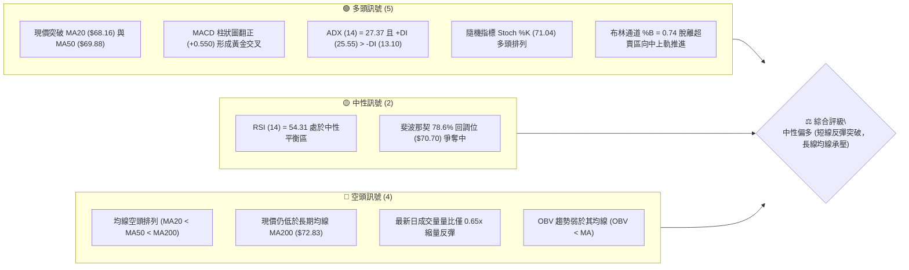

### 📊 核心指標速覽表

| 指標類別 | 指標名稱 | 當前數值 | 訊號 | 解讀 |
|:---|:---|:---|:---:|:---|
| **價格** | 當前收盤價 | $70.05 | 🟢 | 現價由近52週低點 $64.04 彈升，處於52W區間 19.3% 位置 |
| **均線** | 短期 MA20 | $68.16 | 🟢 | 現價位於 MA20 上方 (+2.78%)，短期多頭排列確立 |
| **均線** | 中期 MA50 | $69.88 | 🟢 | 現價剛站上 MA50 上方 (+0.24%)，中短期反彈動能增強 |
| **均線** | 長期 MA200 | $72.83 | 🔴 | 現價位於 MA200 下方 (-3.82%)，長期結構仍受年線壓制 |
| **動能** | RSI(14) | 54.31 | 🟡 | 位於 30–70 中性強弱分水嶺，未超買亦未超賣，略呈多方主導 |
| **動能** | MACD (12,26,9) | Hist: +0.550 | 🟢 | MACD 線 (-0.184) 高於訊號線 (-0.734)，柱狀體擴大，看多 |
| **動能** | 隨機指標 Stoch %K/%D| 71.04 / 69.70 | 🟢 | %K 穿過 %D 上行，進入強勢動能區 |
| **趨勢強度**| ADX (14) | 27.37 | 🟢 | ADX > 25 且 +DI (25.55) 顯著大於 -DI (13.10)，具強趨勢多頭特徵 |
| **通道** | 布林通道 %B | 0.74 | 🟢 | 位於中軌 ($68.16) 與上軌 ($72.16) 之間，強勢反彈 |
| **量能** | 成交量 / 20日均量 | 量比 0.65x | 🔴 | 成交量 12.32M 低於 20MA (19.03M)，反彈伴隨量能萎縮需防假突破 |
| **量能** | OBV 走勢 | OBV < MA | 🔴 | 累積能量線在移動均線之下，能量積累尚嫌不足 |
| **波動** | ATR(14) | $2.11 | 🟡 | 佔現價 3.01%，每日價格波動跨度適中，提供明確止損邊界 |

### 🏆 技術評分卡

```
╔══════════════════════════════════════════════════════════════════╗
║              技術評分卡 — UBER (2026-11-11)                      ║
╠══════════════════════════════════════════════════════════════════╣
║ 趨勢強度 (ADX=27.37, +DI強勢)   ██████████████░░░░░░  70/100 🟢 ║
║ 動能指標 (MACD翻正, RSI=54.31)  █████████████░░░░░░░  65/100 🟢 ║
║ 支撐穩定度 (站穩S1 $69.28)      ██████████████░░░░░░  70/100 🟢 ║
║ 成交量配合 (量比0.65x, OBV偏弱) ████████░░░░░░░░░░░░  40/100 🔴 ║
║ 形態完整度 (自$64.04築底反彈)   ████████████░░░░░░░░  60/100 🟡 ║
║ 均線排列 (MA20<MA50<MA200空排)  ████████░░░░░░░░░░░░  40/100 🔴 ║
╠══════════════════════════════════════════════════════════════════╣
║ 綜合評分 (依規則18算術平均)     ████████████░░░░░░░░  58/100 🟡 ║
║ 評級結論：中性觀望偏多（短多波段展開，面臨長線空頭均線反壓）   ║
╚══════════════════════════════════════════════════════════════════╝
```
*註：綜合評分 = (70 + 65 + 70 + 40 + 60 + 40) ÷ 6 = 57.5，四捨五入至整數為 58/100。*

---

## 2. 趨勢分析

### 🌐 多時框趨勢分析

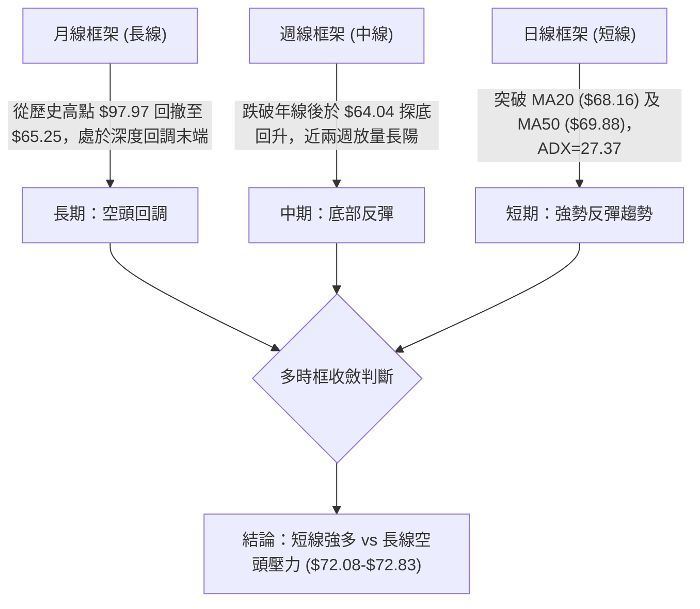

### 📈 長期趨勢 — 12個月走勢圖（Unicode）

```
UBER 月線收盤走勢圖（過去12個月：2025-12 至 2026-11）
價格軸 ($)
$90.00 ┤
$85.00 ┤
$81.71 ┤● (2025-12)
$80.05 ┤    ●
$75.42 ┤        ●
$74.61 ┤                 ●
$72.16 ┤                          ●
$71.93 ┤            ●
$70.40 ┤                      ●       ●
$70.05 ┤━━━━━━━━━━━━━━━━━━━━━━━━━━━━━━━━━━━●←現價 ($70.05)
$68.51 ┤                                  ●
$65.25 ┤                                      ● (波段低點)
$60.00 ┤
       └─────────────────────────────────────────────
         12   01   02   03   04   05   06   07   08   09   10   11 (月份)
```

**12個月走勢特徵分析表格**：

| 時間週期 | 起始/結束價 | 區間漲跌幅 | 主要走勢特徵 |
|:---|:---|:---|:---|
| **2025-12 至 2026-03** | $81.71 → $71.93 | -11.97% | 自 2025 年 9 月高點 ($97.97) 持續下挫，重心逐月下移 |
| **2026-04 至 2026-08** | $74.61 → $75.65 | +1.39% | 在 $70.36 至 $75.65 間形成寬幅箱型震盪，多空拉鋸 |
| **2026-09 至 2026-10** | $68.51 → $65.25 | -4.76% | 箱型下軌失守，10 月下探近一年極端低點 $64.04 |
| **2026-11 (至今)** | 開盤至 $70.05 | +7.36% | 低點放量反彈，收復 $70 整數大關與 50 日均線 |

### 📊 中期趨勢（週線分析）

```
UBER 週線關鍵支撐阻力結構示意圖
$78.82 ══════════════════════════════════════════ [08-28 波段高點，強阻力 R3 延伸]
$76.30 ------------------------------------------ [週線反彈阻力位 R2]
$72.08 ------------------------------------------ [10-09 波段高點 / R1 關鍵壓制]
$70.05 ══════════════════════════════════════════ ◄ 現價 ($70.05) 爭奪 MA50
$69.28 ------------------------------------------ [波段支撐位 S1]
$65.25 ------------------------------------------ [10-30 週線收盤低點]
$64.04 ══════════════════════════════════════════ [52週最低價，極限強支撐]
```

### ⚡ 趨勢強度評估（ADX 解讀）

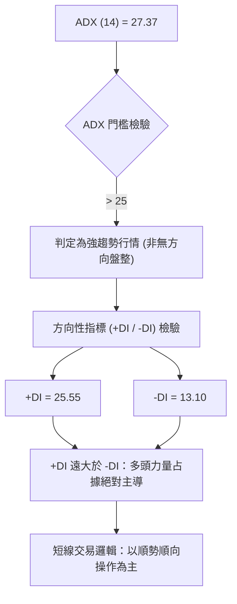

**ADX 趨勢強度對照表**：

| 指標名稱 | 實際數值 | 臨界標準 | 狀態評估 | 實質意義 |
|:---|:---:|:---:|:---:|:---|
| **ADX (14)** | 27.37 | 25.00 | 🟢 強趨勢 | 市場脫離橫盤震盪，具有顯著的單向推進動能 |
| **+DI (14)** | 25.55 | 20.00 | 🟢 擴張 | 多方買盤推升力量強勁，且呈發散向上狀態 |
| **-DI (14)** | 13.10 | 20.00 | 🟢 萎縮 | 空方拋壓動能急速衰竭，拋售力道處於低位 |
| **DI 差值** | +12.45 | 0.00 | 🟢 多頭主導 | 多空力道差值顯著為正，支持價格進一步挑戰阻力 |

---

## 3. 圖表形態分析

### 🔍 形態識別系統

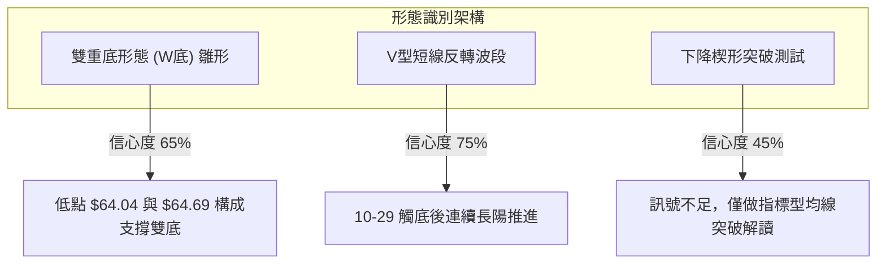

**圖表形態信心度與目標價評估表**：

| 形態名稱 | 信心度 | 判斷依據（引用數據） | 完成度 | 目標價（附計算式） |
|:---|:---:|:---|:---:|:---|
| **日線雙底 (W-Bottom)** | 65% | 第一次低點 2026-10-29 之 $64.04，第二次次低點 10-30 之 $64.68，兩次回踩波段低點聚類 | 70% | 頸線取阻力 R1 $72.08，形態高度 = 頸線 $72.08 − 底點 $64.04 = $8.04。<br>目標價 = 頸線 $72.08 + 形態高度 $8.04 = **$80.12** |
| **短線反轉上升波** | 75% | 自 10-30 收盤 $65.25 起，連續收出帶量陽線，突破短期 MA20 ($68.16) | 85% | 依支撐 S1 ($69.28) 向上測幅至阻力 R1 **$72.08** (由數據提供之阻力位) |
| **大型下降楔形** | 40% | 訊號不足，僅做指標型解讀 | 30% | 信心度 < 50%，不進行幾何測幅，純依均線與布林指標追蹤 |

### 🕯️ 重要 K 線形態分析

依規定僅採用數據中「近 10 根日 K」與「近 8 根週 K」之實際 OHLC 數據進行判讀：

| 日期（日K/週K） | 開 | 高 | 低 | 收 | K線形態 | 解讀 | 訊號 |
|:---|:---:|:---:|:---:|:---:|:---|:---|:---:|
| **日K 10-29** | 65.28 | 65.80 | 64.04 | 65.74 | 下影長錘頭線 | 盤中下探 52 週新低 $64.04 後強勁拉回，長下影線達 $1.24，顯示低檔承接買盤進場 | 🟢 |
| **日K 10-30** | 65.61 | 65.80 | 64.68 | 65.25 | 縮量十字陰線 | 再次下測 $64.68 未破前低，成交量 17.96M，賣壓衰竭確立雙底右腳 | 🟡 |
| **日K 11-04** | 68.28 | 72.50 | 67.36 | 69.87 | 放量大長陽線 | 成交量激增至 36.95M (突破均量)，單日實體上攻突破 MA20 ($68.16)，觸及 $72.50 遇阻 | 🟢 |
| **日K 11-05** | 70.77 | 71.09 | 67.73 | 68.78 | 衝高回落黑K | 跳空高開後回踩中軌，下影線探至 $67.73 獲買盤承接，換手量達 30.11M | 🟡 |
| **日K 11-09** | 69.50 | 71.26 | 68.84 | 71.17 | 中陽實體突破 | 收盤價 $71.17 站穩短期均線群，多頭反攻結構延續 | 🟢 |
| **日K 11-10** | 70.85 | 71.04 | 69.19 | 70.05 | 縮量小陰線 | 高檔縮量整理 (量比0.65x)，收盤仍守於 $70.05，維持在 MA50 之上 | 🟡 |
| **週K 10-30** | 66.62 | 67.00 | 64.04 | 65.25 | 週線探底長下影 | 帶量 95.36M 下探 $64.04 獲利空出盡支撐，形成波段轉折低點 | 🟢 |
| **週K 11-06** | 66.12 | 72.50 | 65.55 | 68.59 | 週線爆量長陽 | 成交量放大至 124.41M，週漲幅顯著，確立週線等級底部反彈波 | 🟢 |

### 📉 ASCII 走勢形態示意圖

```
UBER 近 10 個交易日雙底反彈與頸線壓制示意圖
價格 ($)
$72.50 ┤          ▲ (11-04 高點)
$72.08 ┤══════════╬══════════════════════════════════ [阻力 R1 / 雙底頸線位]
$71.17 ┤                               ▲ (11-09)
$70.05 ┤━━━━━━━━━━━━━━━━━━━━━━━━━━━━━━━● 現價 ($70.05)
$69.88 ┤------------------------------------------ [MA50 移動平均線]
$68.16 ┤------------------------------------------ [MA20 移動平均線]
$66.71 ┤                    ▲ (11-02)
$65.74 ┤   ▲ (10-29)
$65.25 ┤● (10-28)   ● (10-30)
$64.04 ┤   ▼ (10-29 52W低點: $64.04 - 底點1)
       └──────────────────────────────────────────
          10-28 10-29 10-30 11-02 11-03 11-04 11-05 11-06 11-09 11-10 (日期)
```

### 🎯 形態目標價計算

根據日線雙底結構推算目標價位：
1. **頸線確認位**：取數據提供之近一年波段高點聚類阻力位 **R1: $72.08**。
2. **底部基準位**：取 2026-10-29 日 K 與 52 週最低價 **$64.04**。
3. **垂直形態高度**：$72.08 − $64.04 = **$8.04**。
4. **理論突破測幅目標價**：
   $$\text{雙底突破目標價} = \text{頸線價} + \text{形態高度} = 72.08 + 8.04 = \mathbf{\$80.12}$$
5. **階段性目標取值**：依據數據提供之阻力階梯，第一階段目標對齊波段阻力 **R1 ($72.08)**，第二階段目標對齊波段阻力 **R2 ($76.30)**，終極測幅滿足點為 **R3 ($78.60)** 與形態高度推算之 **$80.12**。

---

## 4. 支撐與阻力

### 🗺️ 關鍵價位分布圖（Unicode）

```
UBER 價位結構分布圖
══════════════════════════════════════════════════════════════════
$78.60 ║████████████████████████████████║ 強阻力 R3 (+12.20%)
$76.30 ║████████████████████████        ║ 阻力 R2 (+8.92%)
$72.83 ║--------------------------------║ 長期均線 MA200 反壓
$72.08 ║████████████████████████████████║ 關鍵頸線阻力 R1 (+2.90%)
$70.70 ║................................║ 斐波那契 78.6% 回調壓制
$70.05 ╠════════════════════════════════╣ ◄ 現價 ($70.05)
$69.88 ║--------------------------------║ 中期均線 MA50 支撐
$69.28 ║▓▓▓▓▓▓▓▓▓▓▓▓▓▓▓▓▓▓▓▓▓▓▓▓        ║ 近期波段支撐 S1 (-1.10%)
$68.16 ║--------------------------------║ 短期均線 MA20 / 布林中軌
$67.05 ║████████████████████████        ║ 強支撐 S2 (-4.29%)
$65.41 ║████████████████████████████████║ 密集支撐 S3 (-6.62%)
$64.04 ║████████████████████████████████║ 52週歷史低點 (極限支撐)
══════════════════════════════════════════════════════════════════
```

### 🚧 阻力位分析表

| 阻力級別 | 價位 | 形成原因 | 突破難度 | 重要性 |
|:---|:---:|:---|:---:|:---:|
| **R1** | **$72.08** | 近一年波段高點聚類；與週K (10-09) 高點 $72.08 完全重疊，鄰近布林上軌 ($72.16) | 🔴 高 | ★★★★★<br>多空反轉樞紐頸線 |
| **R2** | **$76.30** | 近一年波段中繼套牢區高點聚類；接近斐波那契 61.8% ($75.94) | 🟡 中 | ★★★★☆<br>中期波段延伸目標 |
| **R3** | **$78.60** | 近一年波段次高點密集區；對應 2026 年 8 月週線收盤高點 $78.80 區域 | 🔴 極高 | ★★★★☆<br>大型趨勢反轉目標 |

### 🛡️ 支撐位分析表

| 支撐級別 | 價位 | 形成原因 | 守住機率 | 重要性 |
|:---|:---:|:---|:---:|:---:|
| **S1** | **$69.28** | 近一年波段低點聚類；緊鄰 11-10 日K最低價 $69.19 及 MA50 ($69.88) | 75% | ★★★★☆<br>短線多頭防守基點 |
| **S2** | **$67.05** | 近一年波段低點聚類；11-04 日K起漲點下緣與 MA20 ($68.16) 緩衝區 | 85% | ★★★★★<br>中短期多頭生命線 |
| **S3** | **$65.41** | 近一年波段低點聚類；10-28 至 10-30 日K築底密集換手區 | 90% | ★★★★★<br>波段防禦最終防線 |

### 📐 斐波那契回調位分析

依據 52 週完整波動區間（高點 **$95.18** 至 低點 **$64.04**，波幅 $31.14）黃金分割回調計算：

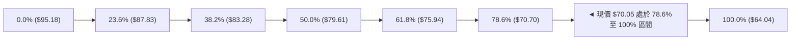

- **位置解讀**：現價 $70.05 剛好運行於 **78.6% 回調位 ($70.70)** 與 **100.0% 底部 ($64.04)** 之間。
- **技術意義**：78.6% 斐波那契回調位通常被視為深度回調的「最後防守區」。UBER 在 $64.04 探底後回升至此，若能有效突破並站穩 $70.70，將確認本輪下行趨勢徹底終結，並向 61.8% ($75.94) 及 50.0% ($79.61) 展開回歸修復走勢。

---

## 5. 技術指標深度解讀

### 🎛️ 指標訊號總覽

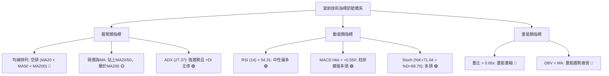

### 📈 移動平均線排列分析

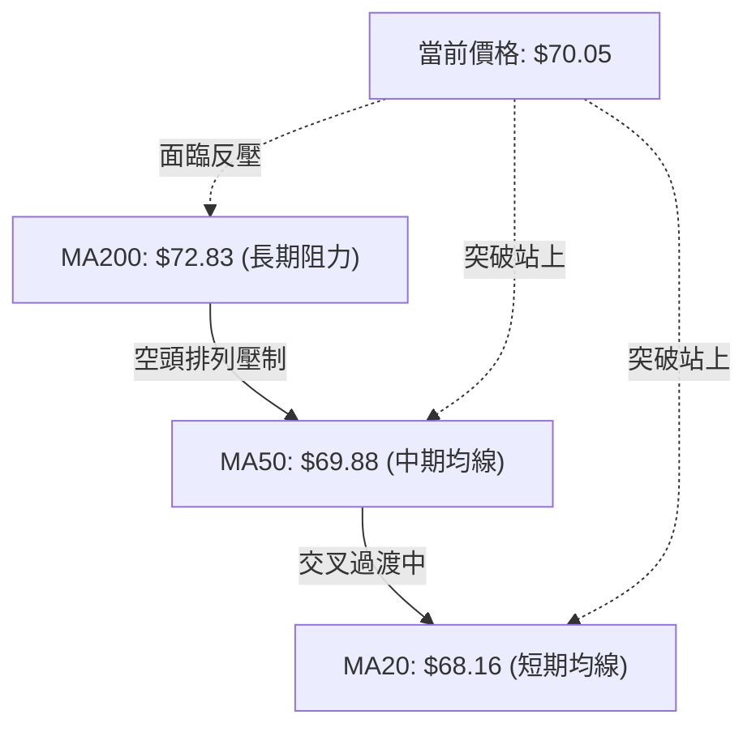

- **均線排列狀態**：當前系統呈 **MA20 ($68.16) < MA50 ($69.88) < MA200 ($72.83)**，整體格局定義為「空頭排列」。
- **動態變化特徵**：短期均線已展現顯著修復動能。MA5 ($69.69) 與 MA10 ($67.80) 雙雙向上發散，且現價 $70.05 已成功站上 MA20 與 MA50。此為典型的「均線空頭排列下的強勢反彈波」，後續焦點在於現價能否推升 MA20 形成黃金交叉穿過 MA50。
- **長線壓制線**：上方 MA60 ($71.23)、MA120 ($71.72) 及 MA200 ($72.83) 在 $71.20–$72.83 區間形成厚實的均線防護網，與波段阻力 R1 ($72.08) 形成共振壓制。

### 📉 RSI(14) 分析

- **RSI 數值進度條**：
  `RSI(14): 54.31 ░░░░░░░░░░░░░░░░░░░░███████████░░░░░░░░░ 54.31% [中性偏強]`
- **超買超賣評估**：位於 50 基準線上方，遠離超賣區 (<30) 且未觸及超買區 (>70)，顯示反彈空間尚未消耗殆盡。
- **背離判定**：檢視近期走勢，10-29 日 K 下探低點 $64.04 時，RSI 快速自 30 附近止跌回升，伴隨價格反彈 RSI 抬升至 54.31；對比近 20 根 K 棒首尾，**目前無明顯頂背離或底背離**現象，指標方向與價格走勢完全同步，確認當前反彈為實質價格推升。

### 📊 MACD(12/26/9) 訊號解讀

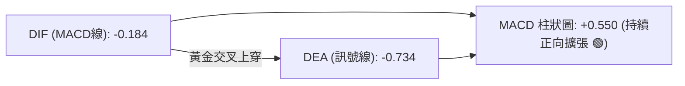

- **絕對值解讀**：DIF (-0.184) 與 DEA (-0.734) 雖雙雙位於零軸下方（代表長期格局仍處於修復期），但 DIF 線已大幅向上挑頭並穿過 DEA 線，產生標準的**零下黃金交叉**。
- **動能柱狀圖**：MACD Hist 當前數值達 **+0.550**，呈現顯著擴大態勢，反映由 $64.04 起漲的多頭動能正加速釋放，短線不宜盲目做空。

### 📦 布林通道分析

```
UBER 日線布林通道 (20, 2) 結構示意圖
價格 ($)
$72.16 ┤────────────────────────────────────────── 布林上軌 ($72.16)
       │                        ▲ (11-04 上穿試探 $72.50)
$70.05 ┤━━━━━━━━━━━━━━━━━━━━━━━━● 現價 ($70.05) [BB %B = 0.74]
$68.16 ┤────────────────────────────────────────── 布林中軌 (MA20: $68.16)
       │
$64.16 ┤────────────────────────────────────────── 布林下軌 ($64.16)
       │        ▼ (10-29 觸及下軌 $64.04)
       └──────────────────────────────────────────
```

- **位置指標**：布林通道 %B 為 **0.74**，表明現價位於通道中軌與上軌偏高位置（0 代表下軌，0.5 代表中軌，1.0 代表上軌）。
- **通道特徵**：股價於 10-29 跌破下軌 ($64.16) 觸及 $64.04 後強烈回彈，並在 11-04 帶量強突中軌 ($68.16)。目前價格在 %B 0.74 運作，上軌 $72.16 構成短線動態壓力位，與靜態阻力 R1 ($72.08) 形成關鍵共振。

### 💹 成交量分析（量價配合度）

- **量比與均量**：最新交易日 (11-10) 成交量為 **12,322,900** 股，相較於 20 日均量 (19,033,455) 量比僅 **0.65x**，亦顯著低於 50 日均量 (18,044,704)。
- **OBV 走勢**：技術快照標明 **OBV < MA**，代表累積能量線仍處於均線下方，反映量能疲弱。
- **量價背離警訊**：11-04 放量大漲 (36.95M) 後，價格持續維持在 $70.05 附近高檔，但近三個交易日成交量逐日遞減 (30.11M → 18.29M → 19.16M → 12.32M)。呈現典型的「**量價縮量背離**」，顯示市場追價意願不足，若無後續增量配合，衝擊 R1 ($72.08) 將面臨回洗風險。

---

## 6. 動能與波動率

### ⚡ 動能評估四象限

| 象限 | 動能維度 | 波動維度 | UBER 當前狀態 | 評估與策略含義 |
|:---:|:---:|:---:|:---:|:---|
| **Q1** | 強 (ADX=27.37, MACD翻正) | 低 (ATR=3.01%) | — | 最佳波段發酵機會 |
| **Q2** | **強 (動能反彈確立)** | **中/適中 (ATR=$2.11)** | **✓ (當前歸屬)** | **穩健順勢反彈：回踩低吸為主，避免高位追價** |
| **Q3** | 弱 (均線空排尚未完全修復) | 高 (歷史高位回撤震盪) | — | 震盪洗盤，防範穿刺風險 |
| **Q4** | 弱 (量能不足) | 低 (縮量橫盤) | — | 觀望等待方向確認 |

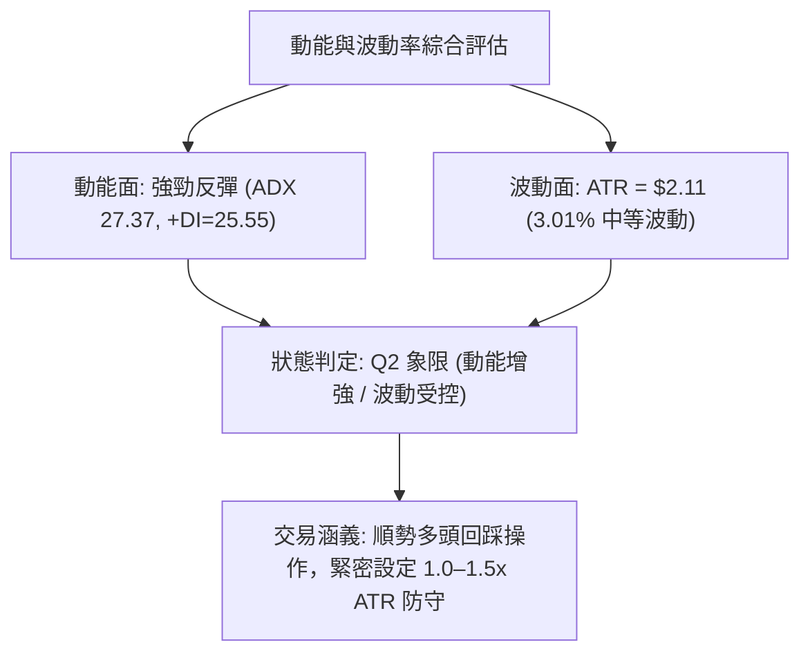

### 📊 ATR 波動率分析

- **ATR(14) 數值**：**$2.11**（佔現價比率為 **3.01%**，採用 Wilder 平滑計算）。
- **日內跨度解讀**：每日平均波動振幅約 $2.11，意味著日內常規價格噪音區間為 ±$1.05 左右。
- **止損距離建議**：
  - *短線交易止損距離*：建議設定 1.0 倍 ATR（即 **$2.11**），對應支撐防守位在 $70.05 − $2.11 = $67.94 附近（剛好覆蓋 MA20 $68.16）。
  - *波段交易止損距離*：建議設定 1.5 倍 ATR（即 **$3.16**），對應支撐防守位在 $70.05 − $3.16 = $66.89 附近（有效覆蓋波段強支撐 S2 $67.05）。

### 📐 Beta 與市場相關性

- **Beta 係數**：**1.308**。
- **市場敏感度**：UBER 的波動敏感度高於標普 500 指數 30.8%，屬於典型的高彈性成長與科技應用股。在大盤走強時具備顯著的超額進攻能力，但若總體市場環境回落，其修正下殺幅度亦相對劇烈，操作上需嚴格遵守風險控管。

---

## 7. 多時框架總結

### 📋 時框架評分表

| 時框架 | 趨勢方向 | 動能狀態 | 均線排列 | 形態特徵 | 綜合評分 | 建議操作 |
|:---|:---:|:---:|:---:|:---|:---:|:---|
| **短期 (日線)** | 🟢 向上偏多 | 🟢 強勁 (+DI主導) | 🟡 站上短中期 | 雙底反彈成形 | 72/100 | 回踩進場 / 逢低做多 |
| **中期 (週線)** | 🟡 底部修復 | 🟢 MACD柱翻正 | 🔴 均線承壓 | 探底長下影反彈 | 58/100 | 波段持有 / 遇阻減碼 |
| **長期 (月線)** | 🔴 震盪回調 | 🔴 深度修正期 | 🔴 均線空頭排列 | 歷史高點大幅回撤 | 44/100 | 嚴控部位 / 觀望修復 |

### 🔲 綜合訊號矩陣

```
時框維度與訊號收斂分析
╔══════════════╦══════════════╦══════════════╦══════════════╗
║ 評估維度     ║ 短期 (日線)  ║ 中期 (週線)  ║ 長期 (月線)  ║
╠══════════════╬══════════════╬══════════════╬══════════════╣
║ 趨勢方向     ║ 🟢 偏多      ║ 🟡 中性      ║ 🔴 偏空      ║
║ 動能指標     ║ 🟢 偏多      ║ 🟢 偏多      ║ 🔴 偏空      ║
║ 支撐阻力結構 ║ 🟢 站穩支撐  ║ 🟡 接近阻力  ║ 🔴 均線壓制  ║
║ 量價配合度   ║ 🔴 縮量背離  ║ 🟢 放量大陽  ║ 🔴 能量偏弱  ║
╚══════════════╩══════════════╩══════════════╩══════════════╝
```

### ⚖️ 多時框收斂結論

依據多時框收斂規則（規則 14）：
1. **行情性質判定**：當前日線 ADX(14) 數值為 **27.37 (> 25)**，指標顯示市場脫離橫盤，處於標準的「**強趨勢行情**」。
2. **時框主導與優先級權衡**：在 ADX > 25 的趨勢行情中，中長期（週線、MA50、MA200）方向為宏觀防守架構，而短期日線則主導當前的實質推進力與進場時機。
3. **收斂唯一結論**：儘管長期均線（MA200: $72.83）存在空頭壓制，但短中期動能已由 $64.04 探底回升，日線連續突破 MA20 ($68.16) 與 MA50 ($69.88)，多頭力量完全掌控盤面（+DI 25.55 vs -DI 13.10）。因此，收斂結論為：**偏多（短中線順勢做多反彈，但在阻力 R1 $72.08 及 MA200 $72.83 採取階段性止盈）**。此結論完全符合第 1 章評分卡（綜合評分 58/100 偏向區間多頭反彈）與第 8 章交易策略。

---

## 8. 交易策略建議

### 🗺️ 策略決策流程圖

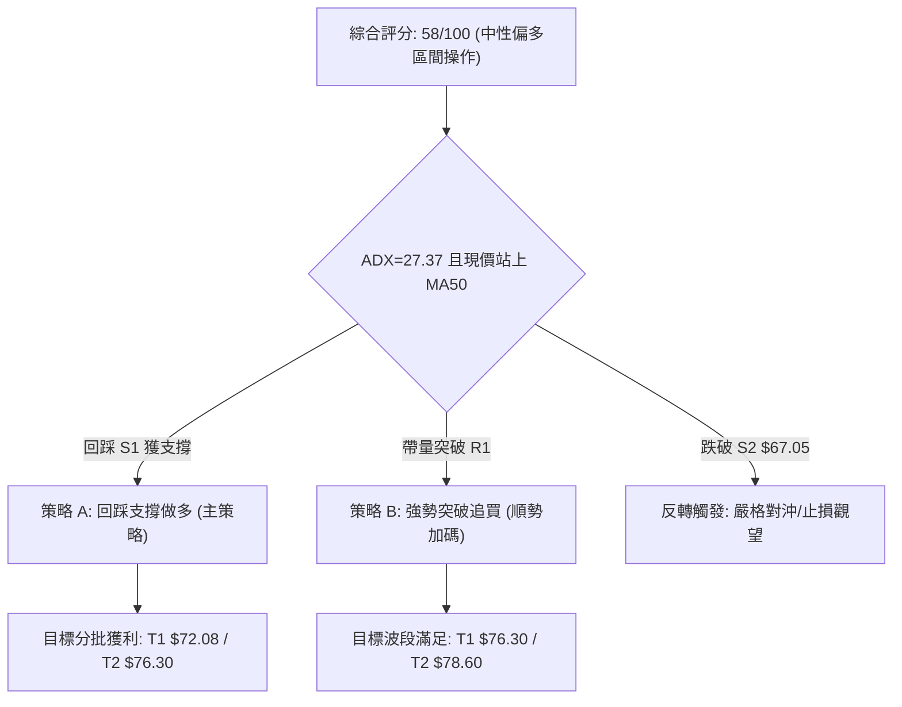

### 🧭 策略路由（依評分卡分流）

> **當前主策略方向 = 中性偏多區間操作（依評分 58/100）**
> *依規則：評分處於 40–60 區間且 ADX > 25，以日線布林通道與均線支撐為操作依據，主推「回踩支撐逢低做多」及「突破頸線順勢多頭」策略；空頭僅列為反轉對沖提示。*

### 🎯 價格情境階梯（Price Scenarios）

價位嚴格引用數據中計算之阻力（R1/R2/R3）與支撐（S1/S2/S3）數值：

| 觸發條件 | 下一目標 | 後續延伸 | 情境含義 |
|:---|:---:|:---:|:---|
| **強勢突破阻力 R1 ($72.08)** | 阻力 R2 ($76.30) | 阻力 R3 ($78.60) | 短線雙底完全確立，挑戰斐波那契 61.8% ($75.94) 與年線突破 |
| **維持於現價區間 ($70.05)** | 阻力 R1 ($72.08) | 支撐 S1 ($69.28) | 在 MA50 與布林上軌之間窄幅蓄勢換手，修復成交量背離 |
| **失守跌破支撐 S1 ($69.28)** | 支撐 S2 ($67.05) | 支撐 S3 ($65.41) | 短線反彈動能衰竭，回測布林中軌 MA20 ($68.16) 及起漲密集區 |

### 📊 情境機率分佈

| 情境 | 機率 | 主要依據 |
|:---|:---:|:---|
| **繼續上行 / 挑戰 R1** | **55%** | MACD 柱狀圖正向擴張 (+0.550)，ADX 27.37 且 +DI 主導，日線穩居 MA50 上方 |
| **區間震盪 / 消化均線** | **30%** | 最新日成交量萎縮 (量比 0.65x)，OBV < MA 量能尚未確認，布林上軌壓制 |
| **回落 / 跌破支撐 S1** | **15%** | 均線系統長期仍處空頭排列 (MA200 反壓)，大盤系統性風險擾動 |

### 🟢 主策略詳情

進場點、目標價與止損點均嚴格引用關鍵價位區塊之真實數值：

| 策略要素 | 策略 A（回踩支撐做多） | 策略 B（突破阻力追多） |
|:---|:---:|:---:|
| **操作性質** | 回踩低吸（防守型） | 順勢突破（進攻型） |
| **進場條件** | 回踩支撐 S1 企穩不破，縮量回調 | 帶量長陽實體收盤站穩阻力 R1 |
| **進場價格** | **$69.28** (精確引用支撐 S1) | **$72.08** (精確引用阻力 R1) |
| **目標價 T1** | **$72.08** (阻力 R1) | **$76.30** (阻力 R2) |
| **目標價 T2** | **$76.30** (阻力 R2) | **$78.60** (阻力 R3) |
| **止損價格** | **$67.05** (支撐 S2) | **$69.28** (支撐 S1) |
| **風險報酬比** | **1 : 1.26（以 T1 計）**<br>*(72.08−69.28)/(69.28−67.05) = 2.80/2.23*<br>*(以 T2 計則為 1 : 3.15)* | **1 : 1.51（以 T1 計）**<br>*(76.30−72.08)/(72.08−69.28) = 4.22/2.80*<br>*(以 T2 計則為 1 : 2.33)* |
| **成功機率** | 60% | 55% |
| **建議倉位** | 10% – 15% | 5% – 10% (加碼倉) |

### 🔴 反向風險觸發點（對沖提示）

- **多單失效與停損點**：若價格帶量跌破 **支撐 S2 ($67.05)**，宣告自 $64.04 以來的反彈浪徹底破敗，所有多頭部位應全面止損離場。
- **對沖放空觸發條件**：若價格反彈至 **阻力 R1 ($72.08)** 或 **MA200 ($72.83)** 出現爆量長上影線且 RSI > 65 頂背離，可考慮以輕倉對沖空單介入，止損設於 $73.50，目標看回支撐 S1 ($69.28)。

### ⭐ 整體訊號強度評星

```
╔══════════════════════════════════════════════════════════════════╗
║ 做多訊號強度：  ★★★★☆  (3.8/5星 - 短線反彈動能充沛，惟均線承壓)  ║
║ 做空訊號強度：  ★★☆☆☆  (1.8/5星 - MACD翻正，無做空技術依據)     ║
║ 整體可信度：    ★★★★☆  (4.0/5星 - 多項動能與型態指標互相印證)   ║
╚══════════════════════════════════════════════════════════════════╝
```

---

## 9. 風險提示與監控

### ✅ 關鍵監控指標 Checklist

```
╔══════════════════════════════════════════════════════════════════╗
║                   UBER 技術面每日監控清單 (Checklist)             ║
╠══════════════════════════════════════════════════════════════════╣
║ [ ] 價格是否持續守在短期生命線 MA20 ($68.16) 與 S1 ($69.28) 之上 ║
║ [ ] 日成交量能否放大至 20 日均量 (19.03M) 以上，解除量價背離     ║
║ [ ] MACD 柱狀體是否維持大於 0 (+0.550)，有無縮短走平跡象        ║
║ [ ] 阻力位 R1 ($72.08) 及布林上軌 ($72.16) 的實體突破與回抽確認  ║
║ [ ] ADX (14) 是否持續維持在 25 以上，且 +DI 保持大於 -DI        ║
║ [ ] RSI(14) 接近 60–65 時是否產生量價背離或長上影線             ║
║ [ ] 長期均線 MA200 ($72.83) 是否產生沉重技術面解套賣壓          ║
╚══════════════════════════════════════════════════════════════════╝
```

### ⚠️ 風險場景分析

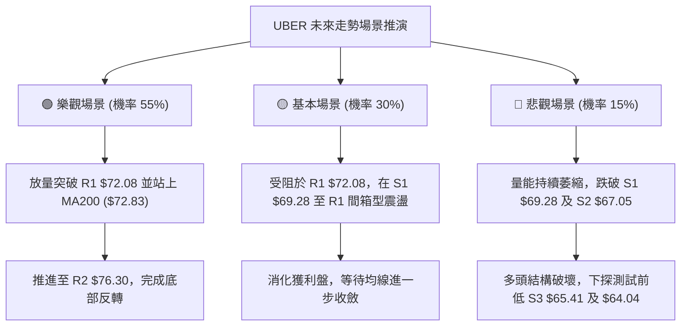

### 🛡️ 風險管理重要提醒

1. **嚴禁忽視量價萎縮背離**：現階段價格由 $64.04 彈升至 $70.05 雖極為迅猛，但近三個交易日成交量急速萎縮至 12.32M（量比 0.65x），OBV 趨勢仍低於其均線，代表主力資金追高意願降溫。進場必須保持紀律，切忌在 $71.00 以上急躁追高，應耐心等待回踩支撐 S1 ($69.28) 測試。
2. **高 Beta 波動防禦**：UBER 的 Beta 值達 1.308，且 ATR 高達 $2.11 (3.01%)。單筆交易承受之帳面虧損應嚴格控制在總資金的 1%–2% 以內，依據 ATR 設置至少 $2.11 的防守緩衝空間，避免因盤中常規雜訊而遭到震盪洗盤出場。
3. **長線均線空頭排列事實**：雖然日線短多確立，但不可忽視 MA20 < MA50 < MA200 的長期空頭排列本質。在價格有效放量站穩 MA200 ($72.83) 之前，一律將當前行情定性為「**空頭結構下的波段技術性反彈**」，操作策略應採取「分批止盈、見好就收」，切忌抱持盲目長線心態。

---

## 📋 報告總結

```
╔══════════════════════════════════════════════════════════════════╗
║                   UBER 技術分析報告總結                          ║
╠══════════════════════════════════════════════════════════════════╣
║ 報告日期：2026-11-11                                            ║
║ 當前收盤價格：$70.05                                             ║
║ 技術分析綜合評分：58/100                                         ║
║ 分析評級：⚖️ 中性偏多區間操作（短線反彈動能強勁，長線均線承壓） ║
╠══════════════════════════════════════════════════════════════════╣
║ 關鍵結論：                                                       ║
║ ├─ 長期趨勢：🔴 偏空回調（受 MA200 $72.83 及空頭排列壓制）     ║
║ ├─ 中期趨勢：🟡 底部反彈（週線於 $64.04 探底回升，進入修復期）   ║
║ ├─ 短期趨勢：🟢 強勁多頭（站穩 MA20/MA50，ADX=27.37 且 +DI 主導）║
║ ├─ 關鍵支撐：S1 $69.28 ／ S2 $67.05 ／ S3 $65.41                 ║
║ ├─ 關鍵阻力：R1 $72.08 ／ R2 $76.30 ／ R3 $78.60                 ║
║ └─ 分析師目標：共識均價 $99.17 (最低 $70.00，最高 $150.00)       ║
╠══════════════════════════════════════════════════════════════════╣
║ 最優策略組合：                                                   ║
║ 1. 🥇 最佳機會（策略 A - 防守型）：                              ║
║    回踩支撐 S1 $69.28 進場做多，止損 S2 $67.05，目標 T1 $72.08，║
║    風險報酬比 1 : 1.26（以 T1 計）／ 1 : 3.15（以 T2 $76.30 計） ║
║ 2. 🥈 次選機會（策略 B - 突破型）：                              ║
║    帶量突破阻力 R1 $72.08 順勢進場，止損 S1 $69.28，             ║
║    目標 T1 $76.30，風險報酬比 1 : 1.51（以 T1 計）               ║
║ 3. 🥉 保守選擇：                                                 ║
║    暫時觀望等待量價背離修復，待回測 MA20 ($68.16) 企穩再行布局  ║
╚══════════════════════════════════════════════════════════════════╝
```

---

> ⚠️ **免責聲明**：本報告為技術分析研究，所有數據、圖表及價位評估均基於客觀歷史價格走勢與技術指標計算。本報告**僅供研究與學術參考**，**不構成任何形式的投資買賣建議**。金融市場瞬息萬變，投資人應獨立評估風險並自行承擔交易損益。

---

*報告生成時間：2026-11-11 ｜ 數據來源：Yahoo Finance ｜ 分析框架：多時框技術分析體系*