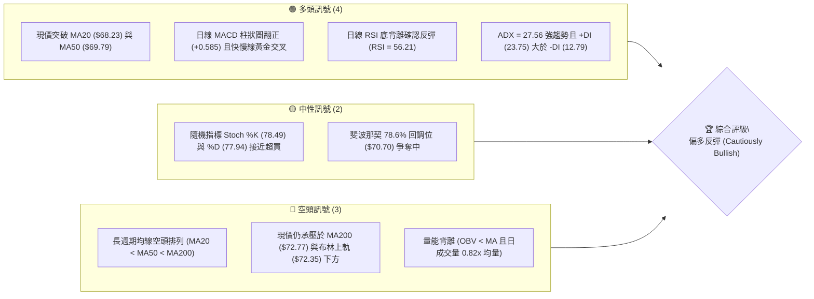
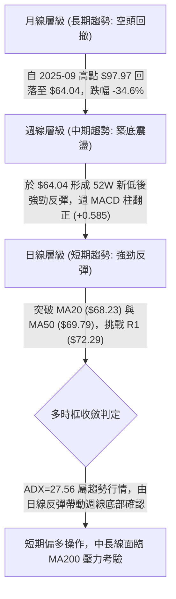
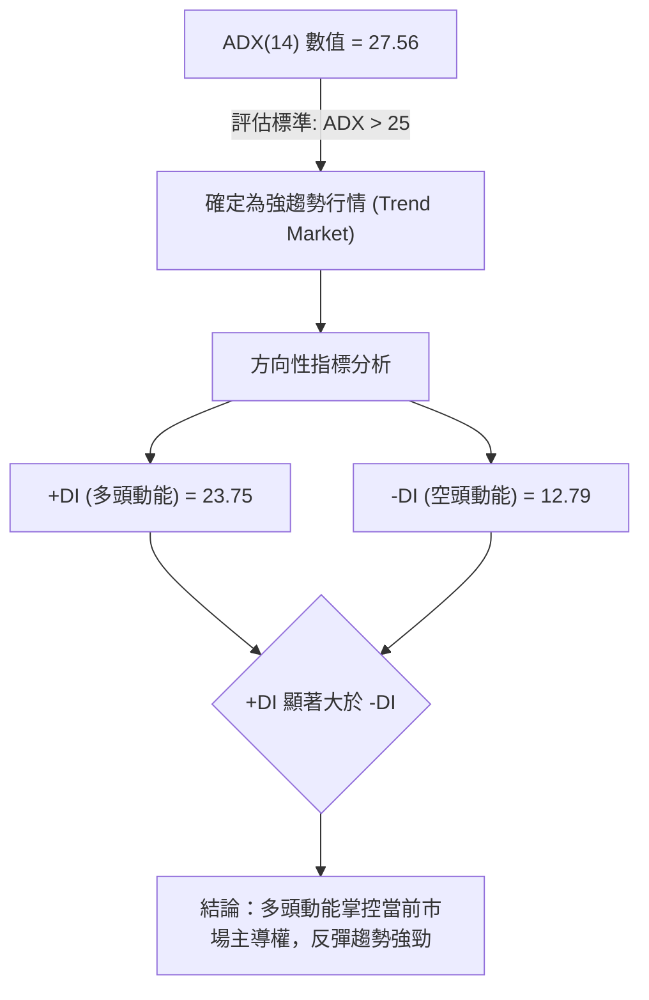
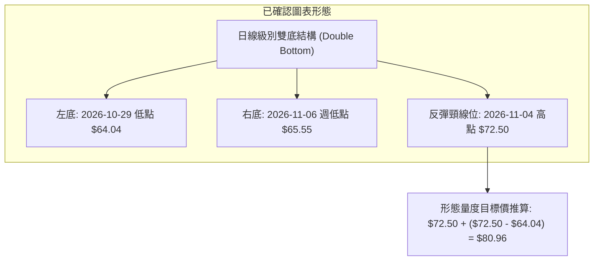
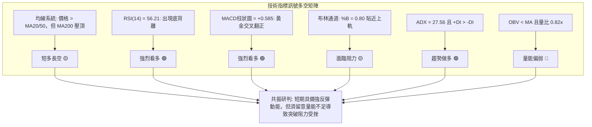
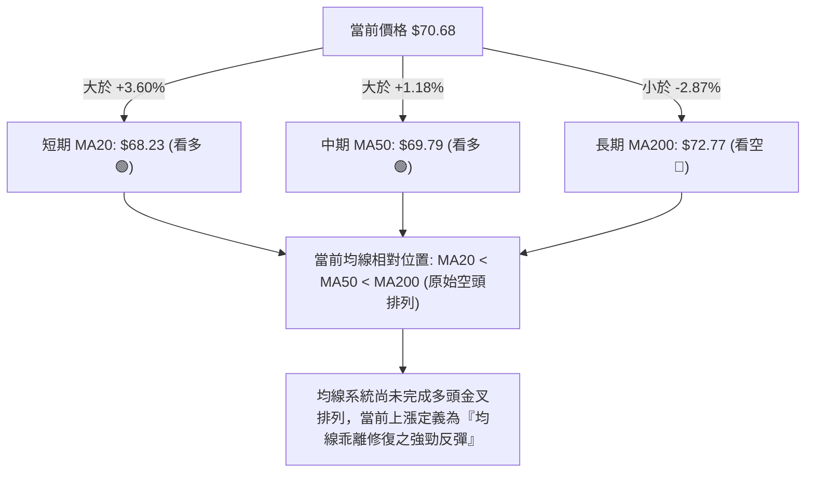
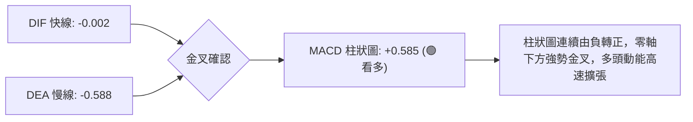
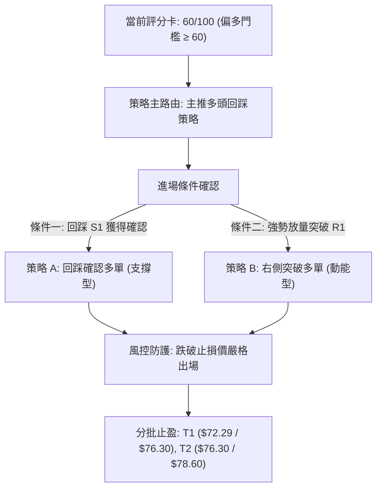
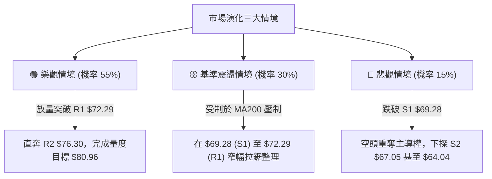

# UBER 技術分析報告

> **報告日期**：2026-11-12 ｜ **語言**：繁體中文 ｜ **數據來源**：Yahoo Finance ｜ **當前價格**：$70.68

---

## 目錄

| 章節 | 內容 |
|------|------|
| [1. 技術面概覽](#1-技術面概覽) | 訊號儀表板、核心指標、評分卡 |
| [2. 趨勢分析](#2-趨勢分析) | 多時框趨勢、長中短期走勢 |
| [3. 圖表形態分析](#3-圖表形態分析) | 形態識別、K線組合、目標價 |
| [4. 支撐與阻力](#4-支撐與阻力) | 關鍵價位、斐波那契回調 |
| [5. 技術指標深度解讀](#5-技術指標深度解讀) | MA/RSI/MACD/布林/成交量 |
| [6. 動能與波動率](#6-動能與波動率) | 動能評估、ATR、Beta |
| [7. 多時框架總結](#7-多時框架總結) | 時框架評分矩陣 |
| [8. 交易策略建議](#8-交易策略建議) | 多空策略、風險報酬比 |
| [9. 風險提示與監控](#9-風險提示與監控) | 監控指標、風險場景 |

---

## 1. 技術面概覽

### 🎯 技術訊號儀表板



### 📊 核心指標速覽表

| 指標類別 | 指標名稱 | 當前數值 | 訊號 | 解讀 |
|:---|:---|:---|:---:|:---|
| **價格** | 當前收盤價 | $70.68 | 🟢 | 自波段低點 $64.04 明顯反彈，目前突破 MA20 與 MA50 |
| **均線** | 短期 MA20 | $68.23 | 🟢 | 價格位於 MA20 上方 (+3.60%)，短期趨勢轉強 |
| **均線** | 中期 MA50 | $69.79 | 🟢 | 價格成功收復 MA50，轉化為短線支撐 |
| **均線** | 長期 MA200 | $72.77 | 🔴 | 價格低於 MA200 (-2.87%)，長期下行壓力未解，呈反彈格局 |
| **均線系統** | 排列結構 | MA20 < MA50 < MA200 | 🔴 | 均線系統整體仍處空頭排列，目前為熊市結構中的技術性反彈 |
| **動能** | RSI(14) | 56.21 | 🟢 | 脫離超賣區進入中性偏多區間，且呈現顯著底背離 |
| **動能** | MACD(12,26,9) | -0.002 / -0.588 | 🟢 | MACD 柱狀圖為 +0.585，快線即將穿越零軸，發出買入訊號 |
| **趨勢強度**| ADX(14) | 27.56 | 🟢 | ADX > 25 確立趨勢行情，+DI (23.75) 壓制 -DI (12.79) 多頭主導 |
| **波動** | ATR(14) | $2.11 | 🟡 | 佔現價 2.98%，波動度中等，提供明確的止損設置依據 |
| **量能** | 日成交量 / 20日均量 | 15.59M / 19.03M | 🔴 | 量比 0.82x，反彈過程未顯著放量，OBV 低於均線顯示追價謹慎 |

### 🏆 技術評分卡

```
╔══════════════════════════════════════════════════════════════════╗
║                   技術評分卡 — UBER (2026-11-12)                ║
╠══════════════════════════════════════════════════════════════════╣
║ 趨勢強度 (ADX=27.56, +DI主導)   ██████████████░░░░░░  70/100 🟢  ║
║ 動能指標 (RSI底背離, MACD翻紅)  ██████████████░░░░░░  70/100 🟢  ║
║ 支撐穩定度 (S1=$69.28, S2=$67.05)████████████░░░░░░░░  60/100 🟡  ║
║ 成交量配合 (量比0.82x, OBV<MA)  ████████░░░░░░░░░░░░  40/100 🔴  ║
║ 形態完整度 (雙底反彈形態進行中) ██████████████░░░░░░  70/100 🟢  ║
║ 均線排列 (空頭排列, 但站上MA50) ██████████░░░░░░░░░░  50/100 🟡  ║
╠══════════════════════════════════════════════════════════════════╣
║ 綜合評分 (六項算術平均四捨五入) ████████████░░░░░░░░  60/100 🟢  ║
║ 評級結論：偏多反彈架構 (主推突破回踩多頭策略，防範 MA200 壓制) ║
╚══════════════════════════════════════════════════════════════════╝
```

---

## 2. 趨勢分析

### 🌐 多時框趨勢分析



### 📈 長期趨勢 — 12個月走勢圖（Unicode）

```
UBER 月線收盤走勢圖（2025-11 至 2026-11）
價格軸 ($)
$100 ┤
$95  ┤
$90  ┤
$85  ┤ ● ($87.54)
$80  ┤   ● ($81.71) ● ($80.05)
$75  ┤                ● ($75.42)  ● ($74.61)          ● ($75.65)
$70  ┤                     ● ($71.93)   ● ($70.40) ● ($72.16) ● ($70.36)   ●←現在 ($70.68)
$65  ┤                                                              ● ($68.51) ● ($65.25)
$60  ┤
     └─────────────────────────────────────────────────────────────────────────────
       11    12    01    02    03    04    05    06    07    08    09    10    11
     (2025)                      (2026 年月份)
```

**走勢特徵分析表格**：

| 階段區間 | 時間跨度 | 起訖收盤價 | 區間漲跌幅 | 走勢特徵與技術解讀 |
|:---|:---|:---|:---:|:---|
| **第一階段：高位滑落** | 2025-11 ～ 2026-03 | $87.54 → $71.93 | -17.83% | 自歷史高位回跌，空頭排列初現，月線收盤連續走低 |
| **第二階段：中期平台** | 2026-04 ～ 2026-08 | $74.61 → $75.65 | +1.39% | 在 $70.00–$75.00 構築第一整理中繼站，波動率收縮 |
| **第三階段：破位探底** | 2026-09 ～ 2026-10 | $68.51 → $65.25 | -4.76% | 破位下殺創下 52 週最低點 $64.04 (2026-10-29)，賣壓釋放 |
| **第四階段：底部反彈** | 2026-11 至今 | $65.25 → $70.68 | +8.32% | 強勁築底反彈，收復 10 月失地，測試 78.6% 回調位 ($70.70) |

### 📊 中期趨勢（週線分析）

```
中期週線結構示意圖 (近8週)
$73.00 ┤                                         [高點 $72.50]
$72.00 ┤        [高點 $72.08]              ╭─╮         │
$71.00 ┤           │     ╭─╮              │ │         │   ╭─╮ [現價 $70.68]
$70.00 ┤ ╭─╮       │     │ │   ╭─╮        │ │         │   │ │
$69.00 ┤ │ │       │     │ │   │ │        ╰─╯         ╰─╮ │ │
$68.00 ┤ │ │       ╰─╮   │ │   ╰─╯                      │ │ │
$67.00 ┤ ╰─╯         │   ╰─╯             ╭─╮            ╰─╯
$66.00 ┤             │                    │ │
$65.00 ┤             │                    ╰─╯
$64.00 ┤                                [最低 $64.04]
       └────────────────────────────────────────────────────────
         09-25     10-09         10-23     10-30        11-06 11-11
```

週線層面顯示，股價在跌破 $66.00 關卡並探至 $64.04 後，連續兩週帶長下影線拉升，11-06 週更是爆出 1.24 億股的大成交量，週 RSI 自 35.8 快速回升至 56.2，MACD 柱狀圖從 -0.339 驟升至 +0.585，確認中期落底反彈信號。

### ⚡ 趨勢強度評估（ADX 解讀）



**ADX 趨勢強度對照表**：

| ADX 數值區間 | 趨勢狀態 | UBER 當前狀態 (27.56) | 交易指引 |
|:---|:---|:---:|:---|
| 0 ～ 20 | 缺乏趨勢 / 橫盤整理 | ❌ | 適合區間網格操作 |
| 20 ～ 25 | 趨勢孕育期 | ❌ | 觀察突破方向 |
| **25 ～ 50** | **強趨勢建立** | **🟢 正處於此區間** | **順勢操作，依日線多頭回踩訊號進場** |
| 50 ～ 75 | 極強趨勢 | ❌ | 注意超買超賣反轉 |

---

## 3. 圖表形態分析

### 🔍 形態識別系統



**形態信心度評估表**：

| 形態名稱 | 信心度 | 判斷依據（引用數據） | 完成度 | 目標價（附計算式） |
|:---|:---:|:---|:---:|:---|
| **日線級別雙底 (W底)** | 75% | 左底 10-29 最低 $64.04，右底 11-02 最低 $65.55（高於左底），且 RSI 形成顯著底背離 | 85% | 頸線取 11-04 高點 $72.50。<br>形態高度 = $72.50 − $64.04 = $8.46。<br>破頸線量度目標價 = $72.50 + $8.46 = **$80.96** |
| **均線黃金交叉反彈** | 80% | 現價 $70.68 站上 MA20 ($68.23) 與 MA50 ($69.79)，且短期均線系統上揚 | 90% | 第一阻力目標：阻力位 R1 **$72.29**；<br>第二目標：阻力位 R2 **$76.30** |

### 🕯️ 重要K線形態分析

嚴格依據近 10 根日 K 與近 8 根週 K 實際開高低收數據進行解讀：

| 日期（週期） | 開 | 高 | 低 | 收 | K線形態 | 解讀 | 訊號 |
|:---|:---:|:---:|:---:|:---:|:---|:---|:---:|
| **2026-10-29 (日K)** | 65.28 | 65.80 | 64.04 | 65.74 | **探底錘頭線 (Hammer)** | 觸及 52 週新低 $64.04 後強烈買盤介入，長下影線收高 | 🟢 |
| **2026-10-30 (日K)** | 65.61 | 65.80 | 64.68 | 65.25 | **窄幅整理紡錘線** | 低檔震盪縮量，空頭下殺動能竭盡，確認 $64.04 支撐 | 🟡 |
| **2026-11-04 (日K)** | 68.28 | 72.50 | 67.36 | 69.87 | **長上影大陽突破線** | 成交量放大至 36.95M，盤中上衝 $72.50 遭遇解套賣壓 | 🟢 |
| **2026-11-05 (日K)** | 70.77 | 71.09 | 67.73 | 68.78 | **高開低走陰線 (回踩)** | 爆量 30.11M 洗盤，最低 $67.73 成功守在 MA20 ($68.23) 附近 | 🟡 |
| **2026-11-10 (日K)** | 70.85 | 71.04 | 69.19 | 70.05 | **高檔縮量小陰線** | 成交量驟降至 12.33M，顯示回踩過程無恐慌賣壓 | 🟢 |
| **2026-11-11 (日K)** | 69.10 | 71.09 | 69.01 | 70.68 | **光腳反彈實體陽線** | 開盤 $69.10 即為近全日低點，收盤穩健收於 $70.68 高位 | 🟢 |
| **2026-10-30 (週K)** | 66.62 | 67.00 | 64.04 | 65.25 | **長下影探底陰十字** | 成交 95.36M，確立中期大底 $64.04 | 🟢 |
| **2026-11-06 (週K)** | 66.12 | 72.50 | 65.55 | 68.59 | **爆量帶上影長陽線** | 成交量激增至 124.41M，主力進場吸籌，扭轉中期下行趨勢 | 🟢 |

### 📉 ASCII 走勢形態示意圖

```
UBER 雙底形態 (W底) 構築示意圖
價格軸
$73.00 ┤                     [頸線高點: 11-04 $72.50]
$72.00 ┤                            ╭─╮
$71.00 ┤                           ╭╯ ╰╮     ╭─● [現價: 11-11 $70.68]
$70.00 ┤                          ╭╯   ╰╮   ╭╯
$69.00 ┤                         ╭╯     ╰╮ ╭╯
$68.00 ┤                        ╭╯       ╰─╯ [回踩低點: 11-05 $67.73]
$67.00 ┤                  ╭─╮  ╭╯
$66.00 ┤        ╭─╮      ╭╯ ╰──╯ [次低點: 11-02 $65.55]
$65.00 ┤       ╭╯ ╰──────╯
$64.00 ┤───────● [左底最低: 10-29 $64.04]
       └──────────────────────────────────────────────────────────
         10-29 10-30   11-02 11-04    11-05 11-06   11-11
```

### 🎯 形態目標價計算

根據日線雙底結構之標準技術幾何量度法：
1. **基底支撐點 (Base Low)**：2026-10-29 最低價 **$64.04**
2. **頸線確認位 (Neckline)**：2026-11-04 波段反彈最高價 **$72.50**
3. **垂直形態高度 (Pattern Height)**：$72.50 − $64.04 = **$8.46**
4. **最小量度滿足目標價 (Minimum Measured Target)**：
   $$\text{頸線位 } \$72.50 + \text{形態高度 } \$8.46 = \mathbf{\$80.96}$$
5. **階段性保守目標**：在突破頸線 $72.50 前，首要面對上方波段密集阻力位 R1 **$72.29** 與 R2 **$76.30**（詳見第 4 章）。

---

## 4. 支撐與阻力

### 🗺️ 關鍵價位分布圖（Unicode）

```
UBER 價位結構分布圖
══════════════════════════════════════════════════════════════
$78.60 ║████████████████████████████████████║ 強阻力 R3 (強賣壓)
$76.30 ║████████████████████                ║ 次級阻力 R2 (反彈中繼)
$72.29 ║████████████████████████████████    ║ 關鍵頸線阻力 R1 (MA200 / BB上軌)
$70.70 ╟────────────────────────────────────╢ 斐波那契 78.6% 回調位
$70.68 ╠════════════════════════════════════╣ ◄ 當前收盤價 ($70.68)
$69.28 ║▓▓▓▓▓▓▓▓▓▓▓▓▓▓▓▓▓▓▓▓▓▓▓▓            ║ 近期支撐 S1 (MA50 匯聚處)
$67.05 ║▓▓▓▓▓▓▓▓▓▓▓▓▓▓▓▓                    ║ 中期強支撐 S2 (日線平台)
$65.41 ║████████████████████████████████████║ 波段底部強支撐 S3 (雙底防守)
$64.04 ╟────────────────────────────────────╢ 52週最低點 (年內鐵底)
══════════════════════════════════════════════════════════════
```

### 🚧 阻力位分析表

所有價位均直接引用數據「關鍵價位」區塊：

| 阻力級別 | 價位 | 距現價幅幅 | 形成原因與技術共振 | 突破難度 | 重要性 |
|:---|:---:|:---:|:---|:---:|:---:|
| **關鍵阻力 R1** | **$72.29** | +2.28% | 近一年波段高點聚類；與布林通道上軌 ($72.35)、MA200 ($72.77) 極度接近，形成強大複合壓制帶 | 🔴 較高 | ★★★★★ |
| **次級阻力 R2** | **$76.30** | +7.95% | 近一年波段密集籌碼套牢區；共振斐波那契 61.8% 回調位 ($75.94) | 🟡 中等 | ★★★★☆ |
| **強阻力 R3** | **$78.60** | +11.20% | 2026 年 8 月高點聚類平台；共振斐波那契 50.0% 關鍵心理大關 ($79.61) 附近 | 🔴 極高 | ★★★☆☆ |

### 🛡️ 支撐位分析表

所有價位均直接引用數據「關鍵價位」區塊：

| 支撐級別 | 價位 | 距現價幅幅 | 形成原因與技術共振 | 守住機率 | 重要性 |
|:---|:---:|:---:|:---|:---:|:---:|
| **近期支撐 S1** | **$69.28** | -1.98% | 近一年波段低點聚類；與上升之 MA50 ($69.79) 及 11-10 日低點 $69.19 形成緊密下檔支撐 | 🟢 80% | ★★★★★ |
| **中期支撐 S2** | **$67.05** | -5.14% | 波段低點聚類平台；鄰近日線 11-02 突破起漲點 $66.71 與 MA20 ($68.23) 下沿 | 🟢 85% | ★★★★☆ |
| **強支撐 S3** | **$65.41** | -7.46% | 近期雙底形態次低點聚集區；守護 52 週最低點 $64.04 的最後防線 | 🟢 90% | ★★★★★ |

### 📐 斐波那契回調位分析

依據 52 週區間波段（極值：$64.04 → $95.18）回調階梯：

```
斐波那契回調結構 (52W 範圍: $64.04 - $95.18)
0.0%  (52W High) ─────────────── $95.18
23.6%            ─────────────── $87.83
38.2%            ─────────────── $83.28
50.0%            ─────────────── $79.61
61.8% (黃金分割) ─────────────── $75.94 ─── (對應阻力 R2: $76.30)
78.6%            ─────────────── $70.70 ◄── 現價 $70.68 緊貼於此
100.0%(52W Low)  ─────────────── $64.04
```

**位置解讀**：
- 當前收盤價 **$70.68** 緊貼斐波那契 **78.6% 回調位 ($70.70)**，僅相差 $0.02。
- 價格目前嚴格處於 **78.6% ($70.70)** 與 **100.0% ($64.04)** 之間的最深回調區間底部。
- 在技術分析中，78.6% 回調位通常被視為「最後反轉防線」或「深度價值修復起點」。現價若能日線實體站上 $70.70，將開啟朝向 61.8% ($75.94) 的反彈通道；反之若無法有效突破，將在 $69.28 (S1) 至 $70.70 間反覆拉鋸。

---

## 5. 技術指標深度解讀

### 🎛️ 指標訊號總覽



### 📈 移動平均線排列分析



- **短均線斜率**：MA5 ($69.85) 與 MA10 ($68.34) 強勁向上翹頭，提供日線下檔保護。
- **關鍵反轉阻力**：MA200 位於 **$72.77**，與 R1 阻力位 **$72.29** 構成緊密阻力帶，此為多空牛熊轉折的真正試金石。

### 📉 RSI(14) 分析

```
RSI(14) 當前數值: 56.21
0 ────── 超賣 (30) ────────────────── 中性 (50) ─── 現值 (56.21) ────── 超買 (70) ────── 100
░░░░░░░░░░░░░░░░░░░░░░░░░░░░░░░░░░░░░░░░███████████████████████░░░░░░░░░░░░░░░░░░░░░░░░░
```

- **背離判斷**：數據明確標記 **⚠️ 底背離 (Bullish Divergence)**。近 20 根 K 棒中，價格在 10-29 創下 52 週新低 $64.04，但 RSI 形成顯著抬高的底部結構，價格與動能形成強烈底背離，發出極具參考價值的波段反轉信號。
- **動能評估**：RSI 目前為 56.21，越過 50 強弱分水嶺，尚未觸及 70 超買警戒線，意味著股價向上推進仍具備充足空間。

### 📊 MACD(12/26/9) 訊號解讀



MACD 快線已自深谷急速攀升至 -0.002，即將穿過零軸進入正值區，柱狀圖大幅推升至 +0.585，驗證反彈波段動能飽滿。

### 📦 布林通道分析

```
UBER 日線布林通道 (20, 2) 結構圖
$73.00 ┤                               
$72.35 ┼────────────────────────────── [布林上軌 $72.35]
$71.00 ┤                     ●← 現價 $70.68 (%B = 0.80)
$70.00 ┤                   ╭─╯         
$69.00 ┤                  ╭╯           
$68.23 ┼─────────────────╯──────────── [布林中軌/MA20 $68.23]
$66.00 ┤            ╭─╮                
$65.00 ┤           ╭╯ ╰╮               
$64.10 ┼──────────●────╯────────────── [布林下軌 $64.10]
       └───────────────────────────────
         10-29   11-04  11-11
```

- **帶寬與位置**：%B 高達 **0.80**，表明價格已運行至通道上軌區域（0.5 為中軌，1.0 為上軌）。
- **壓制效應**：布林上軌位於 **$72.35**，與阻力 R1 ($72.29) 產生重疊共振，現價逼近通道頂部，短線若未能放量突破，易在上軌處引發均值回歸修整。

### 💹 成交量分析（量價配合度）

- **量比現況**：最新成交量為 15,588,000，20 日均量為 19,026,655，量比僅 **0.82x**，屬於「縮量反彈」。
- **OBV 趨勢**：數據指示「OBV < MA → 量能疲弱」。
- **量價背離解讀**：股價自 $64.04 反彈以來，除 11-04、11-05 兩日爆量外，近三日反彈量能呈現遞減態勢（19.16M → 12.33M → 15.59M）。縮量突破阻力位往往缺乏持續性，暗示上方套牢賣壓在接近 R1 ($72.29) 時可能再度湧現。

---

## 6. 動能與波動率

### ⚡ 動能評估四象限

| 象限區間 | 動能特徵 | 波動率特徵 | 當前狀態判定 | 操作指引 |
|:---|:---:|:---:|:---:|:---|
| **Q1 (主流多頭)** | 強動能 (RSI>50, MACD>0) | 低波動 (ATR 佔比低) | ❌ | 最佳加碼區間 |
| **Q2 (震盪沉澱)** | 弱動能 | 低波動 | ❌ | 觀望等待方向 |
| **Q3 (反彈修復)** | **強動能 (MACD柱+0.585, ADX 27.56)** | **中高波動 (ATR $2.11 / 2.98%, Beta 1.308)** | **✓ (當前所處象限)** | **順勢高勝率波段操作，嚴設 ATR 止損** |
| **Q4 (主跌恐慌)** | 弱動能 | 高波動 | ❌ | 嚴禁抄底 |

### 📊 ATR 波動率分析

- **ATR(14) 數值**：**$2.11**（佔現價 $70.68 之 2.98%，Wilder 算法）。
- **日間真實波幅含義**：UBER 單日正常波動範圍約為 ±$2.11。
- **止損距離建議**：
  - **激進型（短線交易）**：1.0 × ATR = **$2.11**。以現價 $70.68 計算，激進止損位在 $68.57（緊貼 MA20 $68.23 上方）。
  - **保守型（波段交易）**：1.5 × ATR = **$3.17**。止損空間設定為現價下調 $3.17，即 **$67.51**（緊貼 S2 支撐位 $67.05 之上）。

### 📐 Beta 與市場相關性

- **Beta 係數**：**1.308**。
- **解讀**：UBER 屬於典型的「高 Beta 成長型/科技應用股」，其對大盤（S&P 500）的波動敏感度高出 30.8%。在市場風險偏好回暖時，其向上彈性顯著高於大盤；然而在市場承壓時，下修風險亦同步放大，因此交易必須配合大盤環境控制整體部位。

---

## 7. 多時框架總結

### 📋 時框架評分表

| 時框架 | 趨勢方向 | 動能指標 | 均線排列狀態 | 形態進展 | 綜合評分 | 戰略建議 |
|:---|:---:|:---:|:---:|:---:|:---:|:---|
| **短期 (日線)** | 偏多 🟢 | RSI底背離 / MACD柱增強 | 站上 MA20/MA50 | 雙底反彈構建中 | **70/100** | 尋找回踩支撐順勢做多 |
| **中期 (週線)** | 震盪修復 🟡 | 週MACD柱翻正 (+0.585) | MA20向下壓制 | 52週新低處爆量長下影 | **60/100** | 區間底部確立，確認反彈 |
| **長期 (月線)** | 偏空 🔴 | 距52W高點仍深跌 -25.7% | MA200上方反壓 | 大週期自 $97.97 下行 | **50/100** | 僅作反彈對待，非長期牛市反轉 |

### 🔲 綜合訊號矩陣

```
時框共振訊號圖解
┌─────────────────┬──────────────────┬─────────────────┐
│  短期 (日線)    │   中期 (週線)    │   長期 (月線)   │
│  方向：🟢 偏多   │   方向：🟡 震盪  │   方向：🔴 偏空 │
│  動能：🟢 轉強   │   動能：🟢 擴張  │   動能：🔴 偏弱 │
│  位置：MA50 上方 │   位置：區間底部 │   位置：深度回調│
└────────┬────────┴─────────┬────────┴────────┬────────┘
         │                  │                 │
         └─────────────► 綜合判定 ◄───────────┘
               【趨勢性波段反彈行情確立】
```

### ⚖️ 多時框收斂結論

依據多時框收斂規則：
1. **趨勢/盤整判定**：當前 ADX(14) 數值為 **27.56 (>25)**，且 +DI (23.75) 壓制 -DI (12.79)，市場由「盤整震盪」正式切入「**趨勢行情**」。
2. **時框優先級權重收斂**：在趨勢行情下，中期格局主導方向，日線用於錨定進場時機。週線在 $64.04 探底後爆出 1.24 億股巨量拉升，且週 MACD 柱翻正，中期築底已經成立；日線則以突破 MA50 予以共振確認。長期 MA200 ($72.77) 雖居高臨下，但距離當前仍有上行空間。
3. **唯一收斂結論**：**偏多反彈（Cautiously Bullish）**。交易主軸確立為「利用短期回踩確認支撐，順應日線動能做多，目標直指 MA200 與 R1 阻力帶」。

---

## 8. 交易策略建議

### 🗺️ 策略決策流程圖



### 🧭 策略路由（依評分卡分流）

**當前主策略方向 = 主推多頭策略（依綜合評分 60/100 判定）**

綜合評分達 60 分偏多門檻，RSI 底背離、MACD 金叉放量與 ADX 趨勢指標共振看多，交易策略全力聚焦**做多**架構，做空方向僅列為反轉跌破之風控警示。

### 🎯 價格情境階梯（Price Scenarios）

所有價位精確引用自第 4 章數據聚類價位：

| 觸發條件 | 下一目標 | 後續延伸 | 情境含義 |
|:---|:---:|:---:|:---|
| **強勢突破 R1 ($72.29)** | **R2 ($76.30)** | **R3 ($78.60)** | 短線全面轉強，收復 MA200，打開朝向 61.8% 斐波那契回調位的反彈空間 |
| **穩守 S1 ($69.28) 區間** | **R1 ($72.29)** | **R2 ($76.30)** | 正常技術性回踩 MA50，多頭蓄勢重整攻擊隊形 |
| **有效跌破 S1 ($69.28)** | **S2 ($67.05)** | **S3 ($65.41)** | 反彈宣告失敗，股價重陷均線空頭泥潭，有再次探底風險 |

### 📊 情境機率分佈

| 情境 | 機率 | 主要技術依據 |
|:---|:---:|:---|
| **繼續上行 / 反彈突破 (Bull)** | **55%** | MACD 柱狀圖翻正 (+0.585)、RSI 出現底部背離、ADX=27.56 且 +DI 主導 |
| **區間震盪整理 (Neutral)** | **30%** | OBV 低於均線量能不足、現價受制於斐波那契 78.6% ($70.70) 及布林上軌壓制 |
| **回落 / 再探低點 (Bear)** | **15%** | 長期均線空頭排列 (MA200 壓制)，若跌破 S1 恐引發技術性停損賣壓 |

### 🟢 主策略詳情

進場價格設定為精確數值；進場為區間時，以區間中點計算風險報酬比（依規則 17）：

| 策略要素 | 策略 A（保守型：回踩 MA50 支撐做多） | 策略 B（積極型：突破 R1 追買動能單） |
|:---|:---|:---|
| **進場條件** | 股價回踩 S1 ($69.28) ～ MA50 ($69.79) 企穩出現下影線 | 日線實體突破 R1 ($72.29) 且成交量超越 20 日均量 |
| **進場價格** | **$69.54**（區間 $69.28～$69.79 之中點） | **$72.40**（突破 R1 買入價） |
| **止損價格** | **$67.05**（精確設於 S2 支撐位） | **$69.79**（跌回 MA50 止損） |
| **目標價 T1** | **$72.29**（精確對應阻力位 R1） | **$76.30**（精確對應阻力位 R2） |
| **目標價 T2** | **$76.30**（精確對應阻力位 R2） | **$78.60**（精確對應阻力位 R3） |
| **風險報酬比 (T1)** | **1 : 1.10（以 T1 計）**<br>計算式：$(72.29 - 69.54) \div (69.54 - 67.05) = 2.75 \div 2.49 = 1.10$ | **1 : 1.49（以 T1 計）**<br>計算式：$(76.30 - 72.40) \div (72.40 - 69.79) = 3.90 \div 2.61 = 1.49$ |
| **風險報酬比 (T2)** | **1 : 2.71（以 T2 計）**<br>計算式：$(76.30 - 69.54) \div 2.49 = 6.76 \div 2.49 = 2.71$ | **1 : 2.38（以 T2 計）**<br>計算式：$(78.60 - 72.40) \div 2.61 = 6.20 \div 2.61 = 2.38$ |
| **成功機率** | **65%** | **55%** |
| **建議倉位** | **15% - 20%** 總投資資金 | **10%** 總投資資金 |

### 🔴 反向風險觸發點（對沖提示）

若出現以下情境，宣告多頭反彈行情破裂，應即刻離場或啟動避險對沖：
1. **跌破核心防線**：日線收盤價跌破 **S1 ($69.28)** 且伴隨成交量放大，意味著 MA50 失守。
2. **形態破位**：若進一步跌破 **S2 ($67.05)**，宣告日線雙底結構流產，股價高機率再次滑向 52 週最低點 **$64.04**。

### ⭐ 整體訊號強度評星

```
做多訊號強度：★★★★☆  (4/5星) — RSI底背離與MACD金叉共振，短期偏多強勁
做空訊號強度：★★☆☆☆  (2/5星) — 空頭排列仍在，但短期下殺動能已枯竭
整體可信度：  ★★★★☆  (4/5星) — ADX > 25 確認趨勢行情，訊號具備較高可靠度
```

---

## 9. 風險提示與監控

### ✅ 關鍵監控指標 Checklist

```
╔══════════════════════════════════════════════════════════════════╗
║                    交易執行與每日風控監控清單                    ║
╠══════════════════════════════════════════════════════════════════╣
║ [ ] 監控一：日線收盤價是否站穩斐波那契 78.6% 位 ($70.70)       ║
║ [ ] 監控二：向上挑戰 R1 ($72.29) 時，成交量是否超越 19.03M 均量 ║
║ [ ] 監控三：RSI(14) 是否在進入 70 超買區前出現鈍化               ║
║ [ ] 監控四：MACD 柱狀圖是否維持正向增長 (當前 +0.585)            ║
║ [ ] 監控五：下檔關鍵防守線 S1 ($69.28) 是否每日維持不破          ║
║ [ ] 監控六：大盤波動率變化 (Beta 1.308 意味著高敏感度)           ║
╚══════════════════════════════════════════════════════════════════╝
```

### ⚠️ 風險場景分析



### 🛡️ 風險管理重要提醒

1. **單筆交易風險敞口控制**：嚴格遵守單筆交易虧損不超過總帳戶淨值 1.5%–2.0% 的原則。以策略 A 止損幅度約 $2.49（約 3.58%）為例，總部位不宜超過總資金之 20%。
2. **防範假突破風險**：由於成交量呈現量背離（量比僅 0.82x），在攻堅阻力位 R1 **$72.29** 與 MA200 **$72.77** 時，嚴禁在未出量時盲目市價追高，應等待 15 分鐘或 1 小時 K 線收盤確認實體站穩後再行介入。
3. **動態追蹤止損**：當股價順利觸及目標價 T1 ($72.29) 時，應立即將止損點推移至進場成本價（Breakeven），鎖定零風險交易，剩餘半數部位續抱博取 T2 ($76.30)。

---

## 📋 報告總結

```
╔══════════════════════════════════════════════════════════════════╗
║                   UBER 技術分析報告總結                          ║
╠══════════════════════════════════════════════════════════════════╣
║ 報告日期：2026-11-12                                            ║
║ 當前價格：$70.68                                                ║
║ 分析評級：🟢 偏多反彈 (綜合評分: 60/100)                        ║
╠══════════════════════════════════════════════════════════════════╣
║ 關鍵結論：                                                       ║
║ ├─ 長期趨勢：🔴 偏空 (受制於 MA200 $72.77，大結構屬深度回撤)    ║
║ ├─ 中期趨勢：🟡 震盪築底 (52週低點 $64.04 探明，週線爆量反彈)   ║
║ ├─ 短期趨勢：🟢 偏多 (站上 MA50，MACD翻紅，ADX=27.56 趨勢多頭)   ║
║ ├─ 關鍵支撐：S1 $69.28  /  S2 $67.05  /  S3 $65.41              ║
║ ├─ 關鍵阻力：R1 $72.29  /  R2 $76.30  /  R3 $78.60              ║
║ └─ 分析師目標：均價 $98.88 (最低 $70.00，最高 $150.00)          ║
╠══════════════════════════════════════════════════════════════════╣
║ 最優策略組合：                                                   ║
║ 1. 🥇 最佳機會：策略 A (回踩 S1-MA50 區間 $69.54 進場做多，      ║
║                  止損 $67.05，目標 $72.29 / $76.30)             ║
║ 2. 🥈 次選機會：策略 B (放量突破 R1 $72.29 追買動能單，          ║
║                  止損 $69.79，目標 $76.30 / $78.60)             ║
║ 3. 🥉 保守選擇：等待股價徹底突破並站穩 MA200 ($72.77) 後，       ║
║                  再行順勢佈局波段中長多                         ║
╚══════════════════════════════════════════════════════════════════╝
```

---

> ⚠️ **免責聲明**：本報告為 AI 自動生成之技術分析，所有數據及估算均基於提供的歷史價格資訊。本報告**僅供研究與學術參考**，**不構成任何投資建議**。投資有風險，入市需謹慎。

---

*報告生成時間：2026-11-12 ｜ 數據來源：Yahoo Finance ｜ 分析框架：多時框技術分析*