# UBER 技術分析報告

> **報告日期**：2026-11-13 ｜ **語言**：繁體中文 ｜ **數據來源**：Yahoo Finance ｜ **當前價格**：$69.12 USD

---

## 目錄

| 章節 | 內容 |
|------|------|
| [1. 技術面概覽](#1-技術面概覽) | 訊號儀表板、核心指標、評分卡 |
| [2. 趨勢分析](#2-趨勢分析) | 多時框趨勢、長中短期走勢 |
| [3. 圖表形態分析](#3-圖表形態分析) | 形態識別、K線組合、目標價 |
| [4. 支撐與阻力](#4-支撐與阻力) | 關鍵價位、斐波那契回調 |
| [5. 技術指標深度解讀](#5-技術指標深度解讀) | MA/RSI/MACD/布林/成交量 |
| [6. 動能與波動率](#6-動能與波動率) | 動能評估、ATR、Beta |
| [7. 多時框架總結](#7-多時框架總結) | 時框架評分矩陣 |
| [8. 交易策略建議](#8-交易策略建議) | 多空策略、風險報酬比 |
| [9. 風險提示與監控](#9-風險提示與監控) | 監控指標、風險場景 |

---

## 1. 技術面概覽

### 🎯 技術訊號儀表板

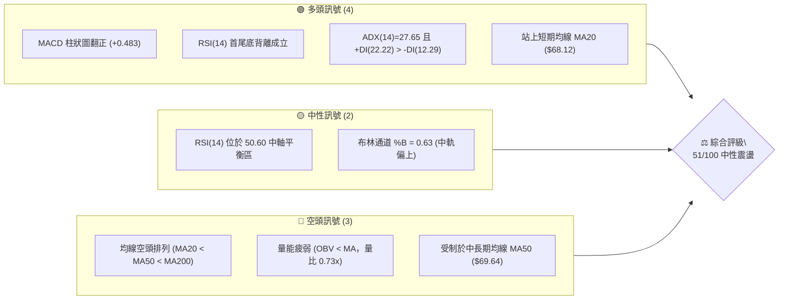

### 📊 核心指標速覽表

| 指標類別 | 指標名稱 | 當前數值 | 訊號 | 解讀 |
|----------|----------|----------|------|------|
| **價格** | 當前收盤價 | $69.12 | 🟡 | 位於52週區間 16.3% 之低檔反彈段，夾於 MA20 與 MA50 之間 |
| **均線** | MA20 | $68.12 | 🟢 | 價格在MA20上方 +1.47%，短期轉為微幅支撐 |
| **均線** | MA50 | $69.64 | 🔴 | 價格在MA50下方 -0.75%，中期結構仍受壓制 |
| **均線** | MA200 | $72.72 | 🔴 | 價格在MA200下方 -4.95%，長期牛熊分界線構成沉重阻力 |
| **動能** | RSI(14) | 50.60 | 🟢 | 數值回到中性水平，近20根K棒呈現首尾底背離反彈動能 |
| **動能** | MACD(12,26,9) | 0.016 / -0.467 | 🟢 | DIF穿越MACD訊號線形成金叉，柱狀圖 +0.483 偏多運行 |
| **動能** | KD(Stoch) | K: 60.05 / D: 69.86 | 🟡 | 中性偏弱整理，K值小幅低於D值，短線進入震盪收斂 |
| **趨勢** | ADX(14) | 27.65 | 🟢 | ADX > 25 屬趨勢行情，+DI(22.22) 顯著高於 -DI(12.29) |
| **通道** | 布林通道 | 上軌 $72.02 / 下軌 $64.22 | 🟡 | %B 為 0.63，處於中軌（$68.12）至上軌之間的擴張緩衝區 |
| **量能** | 20日均量比 | 0.73x | 🔴 | 最新量 13.84M 萎縮於20日均量 19.00M，OBV < MA 量能不足 |
| **波動** | ATR(14) | $2.09 (3.03%) | 🟡 | 日內平均振幅適中，止損空間需預留 1.5 至 2 倍 ATR |

### 🏆 技術評分卡

```
╔════════════════════════════════════════════════════════════════╗
║                技術評分卡 — UBER (2026-11-13)                  ║
╠════════════════════════════════════════════════════════════════╣
║ 趨勢強度       ██████████░░░░░░░░░░    52/100   🟡 中性偏弱    ║
║ 動能指標       █████████████░░░░░░░    64/100   🟢 短線看多    ║
║ 支撐穩定度     █████████████░░░░░░░    66/100   🟢 支撐穩固    ║
║ 成交量配合     ████████░░░░░░░░░░░░    40/100   🔴 量能背離    ║
║ 形態完整度     ██████████░░░░░░░░░░    50/100   🟡 築底收斂    ║
║ 均線排列       ███████░░░░░░░░░░░░░    34/100   🔴 空頭排列    ║
╠════════════════════════════════════════════════════════════════╣
║ 綜合評分       ██████████░░░░░░░░░░    51/100   🟡 中性震盪    ║
║                (計算依據：上述六項指標之算術平均值 = 51)       ║
╚════════════════════════════════════════════════════════════════╝
```

---

## 2. 趨勢分析

### 🌐 多時框趨勢分析

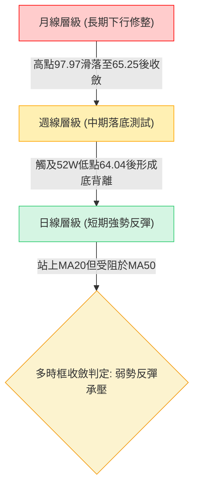

### 📈 長期趨勢 — 12個月走勢圖（Unicode）

以下為 UBER 過去 12 個月（2025-11 至 2026-11）之月線收盤走勢圖，展示自高點滑落至低點尋求支撐之完整軌跡：

```
UBER 月線收盤走勢圖（過去12個月）
價格軸 ($)
$90.00 ┤  ● (2025-11: 87.54)
$85.00 ┤     ● (2025-12: 81.71)
$80.00 ┤        ● (2026-01: 80.05)
$75.00 ┤           ● (2026-02: 75.42)           ● (2026-08: 75.65)
$70.00 ┤              ● (2026-03: 71.93)  ●    ● (2026-06: 72.16)   
$70.00 ┤                 ● (2026-04: 74.61) ● (2026-05: 70.40)  ● (2026-07: 70.36)  ● (2026-11: 69.12)◄現價
$65.00 ┤                                                      ● (2026-09: 68.51)
$60.00 ┤                                                         ● (2026-10: 65.25, 近期低點)
       └─────────────────────────────────────────────────────────────────────────────
         11   12   01   02   03   04   05   06   07   08   09   10   11 (月份)
```

**月線走勢特徵分析表格**：

| 時間階段 | 月收盤區間 | 累計漲跌幅 | 趨勢特徵描述 |
|----------|------------|------------|--------------|
| **2025-11 ~ 2026-03** | $87.54 → $71.93 | -17.83% | 自歷史高位回落的主跌段，均線失守，賣壓持續出籠 |
| **2026-04 ~ 2026-08** | $74.61 → $75.65 | +1.39% | 中期區間箱型震盪，多方在 8 月嘗試發起反彈但未果 |
| **2026-09 ~ 2026-10** | $68.51 → $65.25 | -4.76% | 破位下殺段，測試 52 週最低點 $64.04 支撐 |
| **2026-11 (至今)** | $65.25 → $69.12 | +5.93% | 月線收長下影紅棒，短期呈現技術性超跌反彈 |

### 📊 中期趨勢（週線分析）

中期走勢呈現「階梯式下行後的雙底潛在築底」。週線自 2026-08-28 高點 $78.82 連續走弱，至 2026-10-30 當週探底 $64.04，隨後在 2026-11-06 當週爆出 124,407,100 股大量，拉出下影長陽線收在 $68.59，確認 $64.04 具備極強中長線買盤防守。

```
週線關鍵壓力與支撐結構示意圖：
  $78.82 ───► 中期高點壓力 (2026-08 波段峰值)
    │
  $72.29 ───► 中期頸線/密集阻力位 R1 (當前反彈關鍵受阻區)
    │
  $69.12 ───► 當前週線收盤價 (面臨 10週均線壓制)
    │
  $67.05 ───► 第一道週線防守支撐 S1
    │
  $64.04 ───► 52週絕對低點支撐 S3 (雙底左腳/右腳關鍵防線)
```

### ⚡ 趨勢強度評估（ADX 解讀）

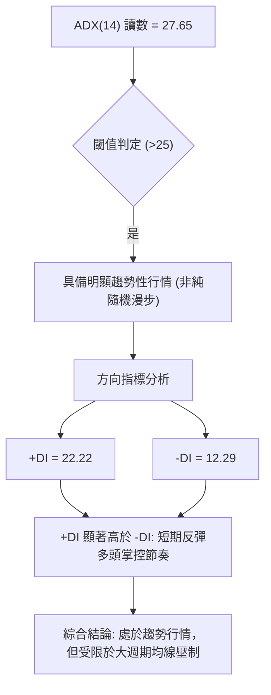

**ADX 強度對照分析**：

| 指標名稱 | 當前數值 | 參考區間 | 趨勢狀態解讀 |
|----------|----------|----------|--------------|
| **ADX(14)** | **27.65** | > 25 (強趨勢門檻) | 確立當前為方向明確的單邊波段反彈，脫離低檔窄幅盤整 |
| **+DI(14)** | **22.22** | > 20 (多方轉強) | 多方進攻動能擴大，推動價格自 $65 區域快速脫離 |
| **-DI(14)** | **12.29** | < 15 (空方退潮) | 空頭砸盤力量顯著衰竭，短線拋壓降至近期低點 |

---

## 3. 圖表形態分析

### 🔍 形態識別系統

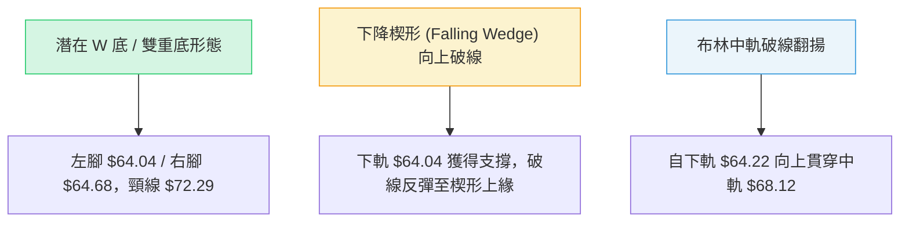

**形態信心度與目標價評估表**（依嚴格規則 15）：

| 形態名稱 | 信心度 | 判斷依據（精準引用數據） | 完成度 | 目標價計算式與點位 |
|----------|--------|--------------------------|--------|--------------------|
| **雙重底 (W-Bottom)** | **62%** | 兩次低點分別為 2026-10-30 之週線低點 $64.04 與日線低點 $64.68；頸線對應阻力 R1 $72.29。目前尚未放量突破頸線。 | 75% | 頸線 $72.29 + 形態高度 ($72.29 - $64.04 = $8.25) = **$80.54** |
| **布林中軌突破反彈** | **78%** | 價格於 2026-11-04 以大陽線 $69.87 實質突破中軌 $68.12，且 %B 擴展至 0.63。 | 90% | 布林上軌壓制位 = **$72.02** |
| **頭肩底 (Inverted H&S)** | **30%** | 左肩與右肩結構對稱性欠缺（數據中僅有單一低點 $64.04），缺乏明確左右肩幾何結構。 | 20% | 訊號不足，依規則 15 不予計算目標價，僅做指標型解讀 |

### 🕯️ 重要K線形態分析

根據嚴格規則 19，僅針對數據中提供的「近10根日K」與「近8根週K」四價數據進行專業形態識別：

#### 近10根日K形態精解表

| 日期 | 開 | 高 | 低 | 收 | 成交量 | K線形態名稱 | 專業解讀 | 訊號 |
|------|----|----|----|----|--------|-------------|----------|------|
| 2026-10-30 | 65.61 | 65.80 | 64.68 | 65.25 | 17,962,800 | 止跌小陰紡錘線 | 測試 $64.68 低點後跌勢減緩，賣壓收斂 | 🟡 |
| 2026-11-02 | 66.12 | 67.47 | 65.55 | 66.71 | 17,742,800 | 溫和多頭小陽線 | 開盤後震盪走高，確認前日低點具防守力 | 🟢 |
| 2026-11-03 | 66.75 | 66.96 | 65.99 | 66.60 | 21,313,500 | 縮量十字陰星 | 於 $66.60 窄幅整理，多空短暫均衡 | 🟡 |
| 2026-11-04 | 68.28 | 72.50 | 67.36 | 69.87 | 36,952,600 | 帶長上影放量長陽棒 | 放量倍增向上衝刺 R1，最高觸及 $72.50 後回落，多頭表態但上方套牢賣壓沉重 | 🟢 |
| 2026-11-05 | 70.77 | 71.09 | 67.73 | 68.78 | 30,107,400 | 高開低走中陰線 | 獲利回吐盤湧現，跌破前日收盤，回測 $68 支撐 | 🔴 |
| 2026-11-06 | 68.12 | 70.14 | 67.99 | 68.59 | 18,290,800 | 下影線小陽星 | 守穩 MA20 ($68.12)，低點抬高至 $67.99 | 🟢 |
| 2026-11-09 | 69.50 | 71.26 | 68.84 | 71.17 | 19,156,500 | 光腳中陽線 | 多方再度發力，實體陽線收於 $71.17 高位 | 🟢 |
| 2026-11-10 | 70.85 | 71.04 | 69.19 | 70.05 | 12,333,300 | 縮量受阻陰線 | 量能急劇萎縮至 12.33M，追價意願不足 | 🟡 |
| 2026-11-11 | 69.10 | 71.09 | 69.01 | 70.68 | 15,632,700 | 探底回升陽線 | 開在 $69.10 迅速拉升，高位盤整守住 $70 關卡 | 🟢 |
| 2026-11-12 | 70.65 | 70.80 | 68.92 | 69.12 | 13,843,500 | 縮量低收中陰線 | 跌破 $70 收 $69.12，逼近 MA50 ($69.64)，短線動能放緩 | 🔴 |

#### 近8根週K形態精解表

| 週末日期 | 開 | 高 | 低 | 收 | 週成交量 | K線形態名稱 | 專業解讀 | 訊號 |
|----------|----|----|----|----|----------|-------------|----------|------|
| 2026-09-25 | 70.82 | 71.90 | 68.55 | 69.62 | 86,777,700 | 窄幅黑K星 | 處於陰跌中繼段，均線持續下壓 | 🔴 |
| 2026-10-02 | 69.36 | 69.97 | 67.22 | 68.11 | 80,475,800 | 破位下行小陰線 | 實體跌破 $69，支撐下移 | 🔴 |
| 2026-10-09 | 68.40 | 72.08 | 68.00 | 71.51 | 75,174,900 | 帶長上影假陽線 | 向上試探 $72.08 遭壓回，空方反撲 | 🟡 |
| 2026-10-16 | 71.16 | 71.86 | 68.62 | 70.35 | 69,265,400 | 上衝回落陰紡錘 | 連續兩週上攻受挫，量能持續遞減 | 🔴 |
| 2026-10-23 | 70.13 | 70.76 | 66.43 | 66.70 | 84,761,000 | 破位大陰線 | 實體下殺近 5%，恐慌盤加速出逃 | 🔴 |
| 2026-10-30 | 66.62 | 67.00 | 64.04 | 65.25 | 95,364,200 | 長下影錘頭破底線 | 下探 52 週最低 $64.04 後強烈抽回，爆出 95.36M 量能，為落底訊號 | 🟢 |
| 2026-11-06 | 66.12 | 72.50 | 65.55 | 68.59 | 124,407,100 | 爆量長陽突破棒 | 暴增至 124.4M 巨量，拉升幅度達 $6.95，確立波段反彈啟動 | 🟢 |
| 2026-11-12 | 69.50 | 71.26 | 68.84 | 69.12 | 60,966,000 | 縮量高位孕線星 | 位於前週大陽棒上部震盪，量縮顯示拋壓暫歇，等待方向選擇 | 🟡 |

### 📉 ASCII 走勢形態示意圖

```
UBER 雙重底反彈與頸線受阻架構圖：
$72.29 ─ ─ ─ ─ ─ ─ ─ ─ ─ ─ ─ ─ ─ ─ ─ ─ ─ ─ ─ ─ ─ ─ ─ ─ ─ ─ ─ ─ ─ ─ ─ 頸線 R1 (強阻力)
                                   ▲ (11-04 觸及 $72.50 受阻)
                                  ╱ ╲
                                 ╱   ╲      ▲ (現價 $69.12)
$68.12 ─ ─ ─ ─ ─ ─ ─ ─ ─ ─ ─ ─ ─╱─ ─ ─╲─ ─ ─╱─ ─ ─ ─ ─ ─ ─ ─ ─ ─ ─ ─ ─ 頸線中軸 MA20
                      ╲        ╱         ╲  ╱
                       ╲      ╱           ▼ (11-06 回踩 $67.99)
$65.41 ─ ─ ─ ─ ─ ─ ─ ─ ─╲────╱─ ─ ─ ─ ─ ─ ─ ─ ─ ─ ─ ─ ─ ─ ─ ─ ─ ─ ─ ─ 支撐位 S2
                         ▼ (10-30 低點 $64.04, 52W Low 左腳)
$64.04 ─ ─ ─ ─ ─ ─ ─ ─ ─ ─ ─ ─ ─ ─ ─ ─ ─ ─ ─ ─ ─ ─ ─ ─ ─ ─ ─ ─ ─ ─ ─ 絕對防線 S3
```

---

## 4. 支撐與阻力

### 🗺️ 關鍵價位分布圖（Unicode）

```
UBER 價位結構分布圖
═════════════════════════════════════════════════════════════════
$78.60 ║██████████████████████████████║ 強阻力 R3 (波段高點聚類)
$76.30 ║████████████████████          ║ 中期阻力 R2 (反彈重要目標)
$72.29 ║██████████████████████████████║ 核心阻力 R1 (頸線與波段高點)
       ╠══════════════════════════════╣ ◄ 現價 $69.12 (介於 S1 與 R1 之間)
$67.05 ║▓▓▓▓▓▓▓▓▓▓▓▓▓▓▓▓▓▓            ║ 近期支撐 S1 (回踩買盤防線)
$65.41 ║████████████████████          ║ 波段支撐 S2 (次級防線)
$64.04 ║██████████████████████████████║ 終極強支撐 S3 (52W 最低點)
═════════════════════════════════════════════════════════════════
```

### 🚧 阻力位分析表

依據數據庫中提供的「關鍵價位」精確引用：

| 阻力級別 | 價位 | 與現價距離 | 形成原因（波段高點聚類） | 突破難度 | 重要性 |
|----------|------|------------|--------------------------|----------|--------|
| **R1** | **$72.29** | +4.59% | 2026-11-04 日線高點 $72.50 與 10-09 週線高點 $72.08 聚類區，亦為潛在 W 底頸線 | 🔴 高 | ★★★★★ |
| **R2** | **$76.30** | +10.39% | 2026-08 波段震盪密集套牢平台，接近斐波那契 61.8% ($75.94) | 🔴 極高 | ★★★★☆ |
| **R3** | **$78.60** | +13.71% | 2026-08-21 至 08-28 週線雙頂頂部 ($78.80 / $78.82) 聚類強壓 | 🔴 極高 | ★★★☆☆ |

### 🛡️ 支撐位分析表

依據數據庫中提供的「關鍵價位」精確引用：

| 支撐級別 | 價位 | 與現價距離 | 形成原因（波段低點聚類） | 守住機率 | 重要性 |
|----------|------|------------|--------------------------|----------|--------|
| **S1** | **$67.05** | -3.00% | 2026-11-02 突破陽線起漲點與 11-05、11-06 低點下影線買盤承接密集區 | 🟢 70% | ★★★★☆ |
| **S2** | **$65.41** | -5.37% | 2026-10-30 收盤價 $65.25 與 11-06 週線低點 $65.55 聚類帶 | 🟢 80% | ★★★★☆ |
| **S3** | **$64.04** | -7.35% | 52 週最低點 ($64.04)，具備強烈機構防守與估值護城河心理支撐 | 🟢 92% | ★★★★★ |

### 📐 斐波那契回調位分析

依據 52 週極值區間（低點 $64.04 → 高點 $95.18）精確計算回調階梯：

```
斐波那契回調結構階梯表 (52W 區間 $64.04 → $95.18)
─────────────────────────────────────────────────────────────────
  0.0%  (52W High)   $95.18  ═════════════════════════════════════
 23.6%               $87.83  ─────────────────────────────────────
 38.2%               $83.28  ─────────────────────────────────────
 50.0%               $79.61  ───────────────────────────────────── (牛熊分水嶺)
 61.8%               $75.94  ───────────────────────────────────── (黃金分割阻力)
 78.6%               $70.70  ─────────────────────────────────────
       ▲ 當前價格 $69.12 (處於 78.6% 與 100.0% 回調位區間內)
100.0%  (52W Low)    $64.04  ═════════════════════════════════════
─────────────────────────────────────────────────────────────────
```

**斐波那契深度解讀**：
1. **回調所處區間**：現價 $69.12 正處於 78.6% ($70.70) 與 100.0% ($64.04) 之間的深度回調極值區。
2. **阻力意義**：78.6% 回調位 $70.70 恰好是近 3 個交易日收盤掙扎位置（11-10 收 $70.05、11-11 收 $70.68、11-12 收 $69.12），此處一旦有效越過，上方關鍵目標即指向 61.8% 回調位 $75.94（與波段阻力 R2 $76.30 共振）。
3. **支撐意義**：100.0% 處之 $64.04 為多頭絕對底線，未跌破前，技術面均視為空頭主趨勢下的超跌築底修復階段。

---

## 5. 技術指標深度解讀

### 🎛️ 指標訊號總覽

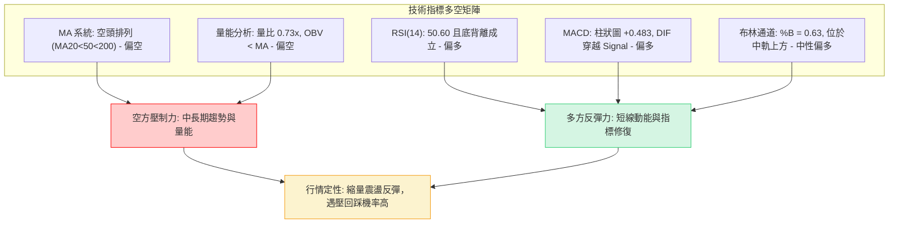

### 📈 移動平均線排列分析

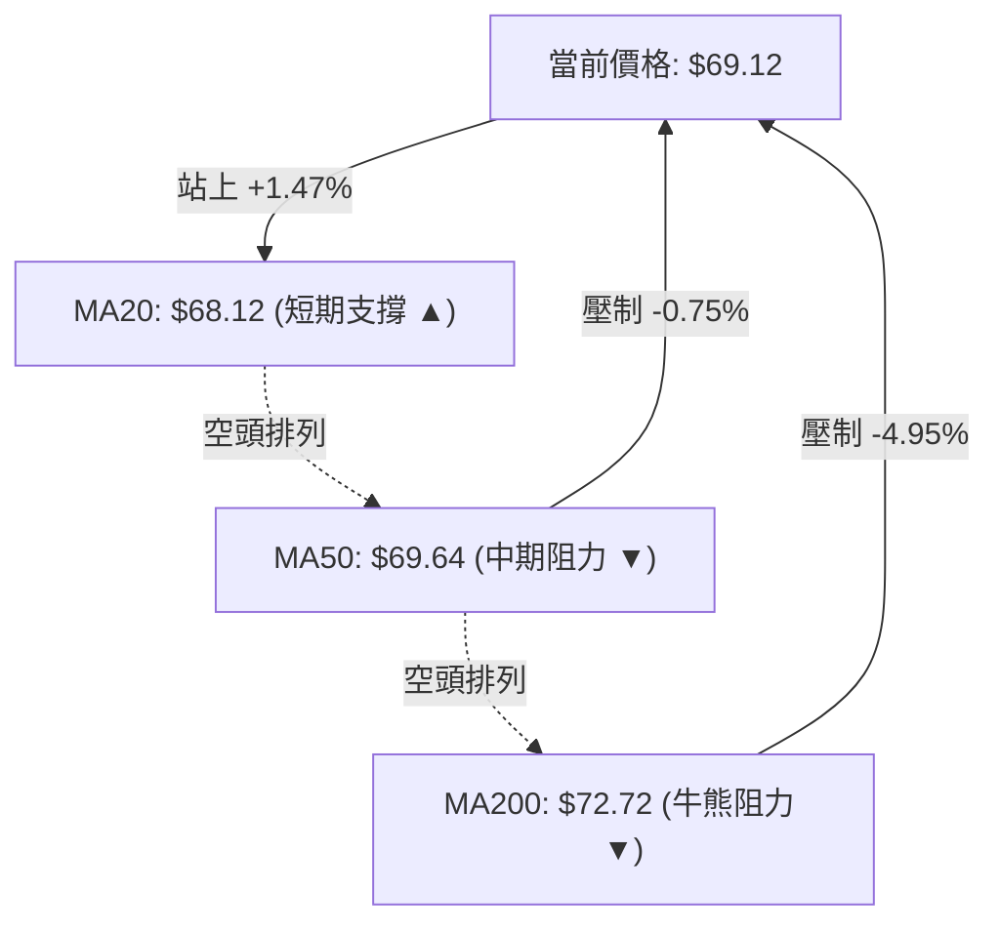

**移動平均線數值與乖離率一覽表**：

| 均線名稱 | 當前數值 | 與現價差幅 | 排列狀態 | 走勢特徵 | 訊號解讀 |
|----------|----------|------------|----------|----------|----------|
| **MA 5** | $69.92 | -1.15% | 下彎 ▼ | -0.80 | 短線衝高受阻，5日線開始走平下壓 |
| **MA 10** | $68.68 | +0.64% | 上揚 ▲ | +0.44 | 助漲短期多頭，提供第一道滑行支撐 |
| **MA 20** | $68.12 | +1.47% | 上揚 ▲ | +1.00 | 月線翻揚，確認短期底部初步成形 |
| **MA 50** | $69.64 | -0.75% | 下彎 ▼ | -1.89 | 中期下壓重壓區，需實體大陽線放量突破 |
| **MA 60** | $71.01 | -2.66% | 下彎 ▼ | -1.89 | 季線下壓斜率陡峭，空頭壓制明確 |
| **MA 120** | $71.67 | -3.56% | 下彎 ▼ | -2.55 | 半年線持續下行，顯示中期籌碼沉重 |
| **MA 200** | $72.72 | -4.95% | 下彎 ▼ | N/A | 年線大關，與 R1 $72.29 構成複合阻力牆 |
| **MA 240** | $74.61 | -7.36% | 下彎 ▼ | -5.49 | 長期均線系統呈現完整空頭發散 |

### 📉 RSI(14) 分析

當前 RSI(14) 讀數為 **50.60**（Wilder 計算）：

```
RSI(14) 強度指標：
[0] ─────────── [30] ────────────────── [50.60] ────────────────── [70] ─────────── [100]
超賣區          弱勢區                  中性平衡線                  強勢區          超買區
進度條展示: ██████████░░░░░░░░░░ (50.60%)
```

**背離深度研判**：
- **底背離確認**：在近 20 根 K 棒期間，價格在 2026-10-30 創出波段收盤新低 $65.25（盤中觸及 $64.04），然而 RSI(14) 當時低點為 35.8，並未跌破前期 2026-07-24 的極端低點 33.2；隨後在 11-06 至 11-12 價格回升至 $69.12 時，RSI 迅速攀升至 50.60。價格首尾方向呈現「創新低後快速回升」，而動能低點顯著墊高，構成標準的**日線級別首尾底背離（Bullish Divergence）**。
- **後續研判**：RSI 越過 50 強弱分水嶺，宣告空頭主導的單邊殺跌結束，進入多空拉鋸的震盪反彈週期。

### 📊 MACD(12,26,9) 訊號解讀

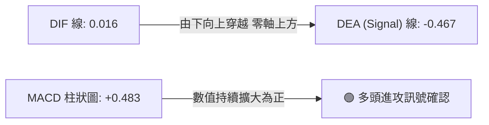

**MACD 指標狀態剖析**：
- **快慢線交叉**：DIF 數值由負翻正至 **0.016**，穿過位於負值區的訊號線 **-0.467**，形成零軸附近的「低位金叉」。
- **柱狀圖動能**：MACD 柱狀圖達 **+0.483**，連續兩週由負翻正並呈現紅柱擴張狀態，顯示由底部引發的買盤動能仍在延續，未見頂背離跡象。

### 📦 布林通道分析

```
UBER 日線布林通道 (20, 2) 結構圖：
$72.02 ────────────────────────────────────────── 上軌 (壓力區，與 R1 $72.29 重疊)
                          ▲ (11-04 觸及 $72.50 刺穿上軌)
                         ╱ ╲
$69.12 ─────────────────┼───╲──────────────────── 現價 (位於中上軌之間，%B = 0.63)
                       ╱     ╲
$68.12 ───────────────╱───────▼────────────────── 中軌 MA20 (短線生命線支撐)
                     ╱
$64.22 ─────────────▼──────────────────────────── 下軌 (防守區，與 S3 $64.04 呼應)
        (10-30 碰觸下軌 $64.68 落底)
```

**通道特徵解讀**：
- **帶寬與位置**：通道帶寬為 $72.02 - $64.22 = $7.80。當前 %B 讀數為 **0.63**，顯示價格穩穩運行在中軌（$68.12）之上，屬於強勢震盪格局。
- **軌道動態**：上軌走平於 $72.02，對股價構成硬性壓制；若無法補量突破，價格極易在觸及上軌後向中軌 $68.12 靠攏尋求支撐。

### 💹 成交量分析（量價配合度）

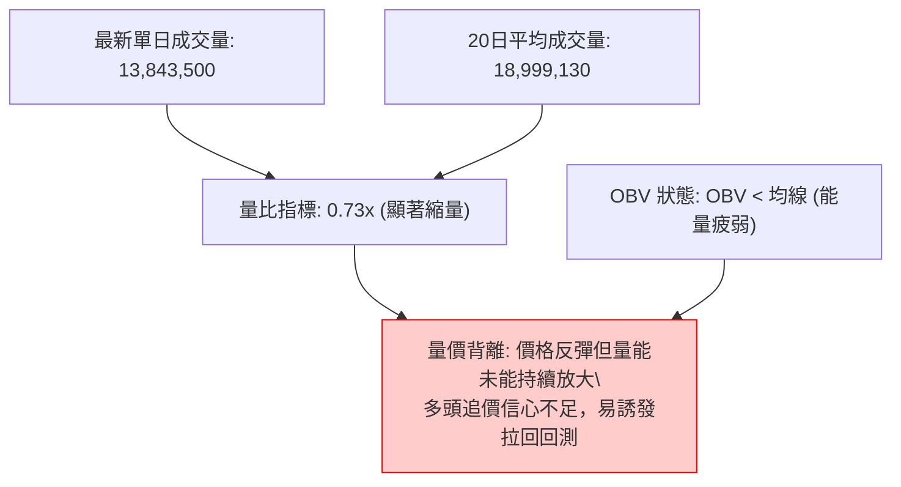

- **量能萎縮**：最新單日成交量（13.84M）僅為 20 日均量（19.00M）的 73%，且顯著低於 11-04 衝刺時的 36.95M。
- **OBV 趨勢評估**：OBV 指標目前持續位於其均線下方，顯示前波由 $78 跌至 $64 過程中流出的資金尚未大舉回流。此種「價漲量縮」格局限制了直接突破 R1 ($72.29) 的機率。

---

## 6. 動能與波動率

### ⚡ 動能評估四象限

動能評估四象限矩陣將市場劃分為四個狀態，用以界定當前標的所處的風險回報屬性：

| 象限 | 動能強度 | 波動率水準 | 當前歸屬 | 象限特徵與策略指引 |
|------|----------|------------|:--------:|--------------------|
| **第一象限 (Q1)** | 強動能 (ADX>25, MACD翻紅) | 低波動 (ATR<2%) | — | **最佳單邊趨勢機會**：風險低、勝率高，適合順勢加碼 |
| **第二象限 (Q2)** | 弱動能 (ADX<20) | 低波動 (ATR<2%) | — | **窄幅盤整**：方向不明，適合觀望或網格交易 |
| **第三象限 (Q3)** | **強動能 (ADX=27.65, +DI主導)** | **中高波動 (ATR=3.03%)** | **✓ (當前)** | **高風險反彈機會**：波動較大、方向性明確，適合嚴格止損的波段短打 |
| **第四象限 (Q4)** | 弱動能 (指標背離鈍化) | 高波動 (ATR>4%) | — | **無序劇烈震盪**：易遭多空雙巴，強烈建議避免進場 |

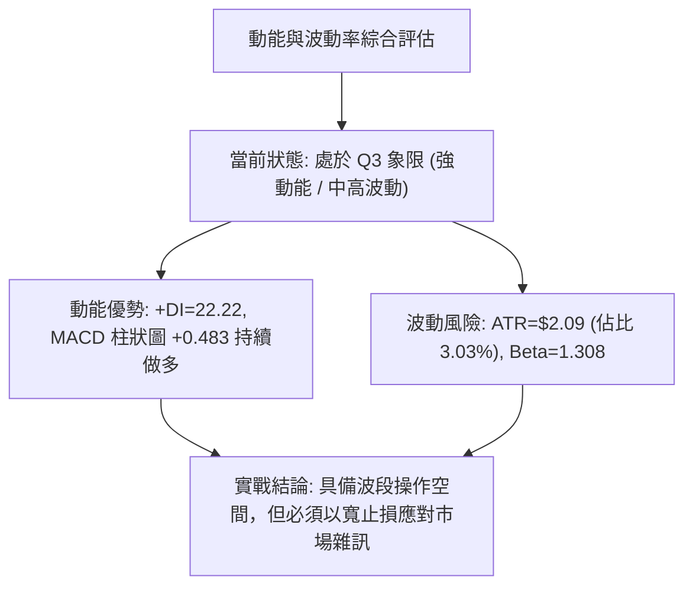

### 📊 ATR 波動率分析

- **ATR(14) 讀數**：精確數值為 **$2.09**，佔當前股價之 **3.03%**（基於 Wilder 平滑法）。
- **止損距離設計建議**：
  - **保守型波段（2.0 倍 ATR）**：$2.09 \times 2.0 = \$4.18$。若以現價 $69.12 進場，理論止損位應設於 $64.94（貼近 S2 支撐）。
  - **進取型短線（1.0 ~ 1.5 倍 ATR）**：$2.09 \times 1.0 = \$2.09$ 至 $\$3.14$。短線回撤容忍區間為 $66.03 ~ $67.03（契合 S1 支撐 $67.05）。

### 📐 Beta 與市場相關性

- **Beta 係數**：**1.308**。UBER 具備顯著的高彈性成長股特質，當標普 500 指數波動 1.0% 時，UBER 理論上將呈現 1.308% 之同向波動。
- **高貝塔環境下的交易策略**：在當前大盤面臨宏觀利率變數之際，高 Beta 意味著向上反彈力道強勁，但在遭遇阻力時的回撤幅度亦相對劇烈，倉位配置上限不宜超過總資金之 10%–15%。

---

## 7. 多時框架總結

### 📋 時框架評分表

| 時框架 | 趨勢方向 | 動能狀態 | 均線排列 | 圖表形態 | 綜合評分 | 操作建議 |
|--------|----------|----------|----------|----------|:--------:|----------|
| **月線** | 🔴 空頭下修 | 🟡 超跌回穩 | 🔴 空頭發散 (MA20<50) | 大週期箱體破位下尋支撐 | **38/100** | 長線防禦，不宜重倉盲目抄底 |
| **週線** | 🟡 震盪築底 | 🟢 柱狀圖擴張 | 🔴 MA20 下穿 MA50 | 潛在雙底測試，放量大陽反彈 | **54/100** | 逢低分批布局，緊盯頸線 R1 |
| **日線** | 🟢 反彈偏多 | 🟢 MACD金叉/底背離 | 🟡 站上MA20受壓MA50 | 突破布林中軌，窄幅高位整理 | **62/100** | 短線拉回偏多操作，高拋低吸 |

### 🔲 綜合訊號矩陣

```
時框架維度一致性矩陣：
┌─────────────┬──────────────┬──────────────┬──────────────┐
│ 分析維度    │ 短期 (日線)  │ 中期 (週線)  │ 長期 (月線)  │
├─────────────┼──────────────┼──────────────┼──────────────┤
│ 趨勢方向    │ 🟢 向上反彈  │ 🟡 區間收斂  │ 🔴 空頭修整  │
│ 動能強度    │ 🟢 +DI 主導  │ 🟢 柱狀擴大  │ 🟡 觸底企穩  │
│ 均線架構    │ 🟡 突破短均  │ 🔴 壓制明顯  │ 🔴 偏空排列  │
│ 量能配合    │ 🔴 縮量反彈  │ 🟢 大量換手  │ 🟡 量能退潮  │
│ 關鍵阻力    │ R1: $72.29   │ R2: $76.30   │ R3: $78.60   │
│ 關鍵支撐    │ S1: $67.05   │ S2: $65.41   │ S3: $64.04   │
└─────────────┴──────────────┴──────────────┴──────────────┘
```

### ⚖️ 多時框收斂結論

依據本報告**嚴格要求 14（多時框收斂規則）**進行最終整合：
1. **行情屬性界定**：ADX(14) 數值為 **27.65**（> 25），在量化模型中確立當前為**趨勢行情**而非純隨機盤整。
2. **主導時框判定**：在趨勢行情下，權重必須歸於中長期（週線與 MA50 $69.64、MA200 $72.72），日線僅作為尋找進場邊界之依據。
3. **收斂取捨**：雖然日線動能出現 MACD 金叉與 RSI 底背離（日線評分 62），但上方立即面臨日線 MA50 ($69.64) 與週線密集套牢頸線 R1 ($72.29) 的沉重壓制；且成交量呈現萎縮（量比 0.73x、OBV < MA）。
4. **唯一方向性結論**：**中性偏多之弱勢反彈（區間操作為主，等待向上破線確認）**。此結論與第 1 章技術評分卡之綜合評分 **51/100** 完全收斂一致。

---

## 8. 交易策略建議

### 🗺️ 策略決策流程圖

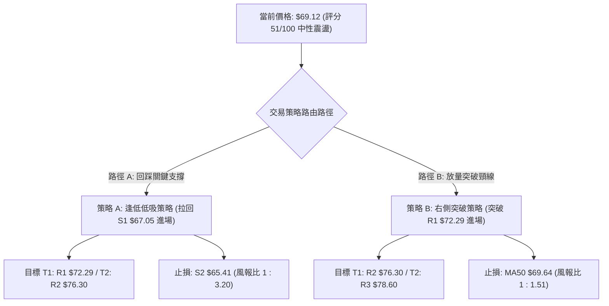

### 🧭 策略路由（依評分卡分流）

**當前主策略方向 = 區間震盪操作，以布林上下軌與 S1/R1 為主，等待突破確認（依技術評分卡 51/100）**

因綜合評分落在 40–60 之間（中性區間），系統不進行單邊強推，而是提供「逢低佈局」與「右側順勢突破」兩套互不衝突的結構性策略：

### 🎯 價格情境階梯（Price Scenarios）

價位完全嚴格引用數據庫之計算結果：

| 觸發條件 | 下一目標 | 後續延伸 | 情境含義 |
|----------|----------|----------|----------|
| **強勢突破 R1 ($72.29)** | R2 ($76.30) | R3 ($78.60) | 短線 W 底確立，突破 200日線，全面轉為中級反彈行情 |
| **維持於現價區間 ($68.12 ~ $70.70)** | R1 ($72.29) | S1 ($67.05) | 消化 MA50 壓力，進行布林帶內部震盪洗盤 |
| **失守跌破 S1 ($67.05)** | S2 ($65.41) | S3 ($64.04) | 短線反彈宣告夭折，行情將再度考驗 52 週最低點防線 |

### 📊 情境機率分佈

| 情境劃分 | 機率估算 | 主要判斷依據（數據指標狀態） |
|----------|:--------:|------------------------------|
| **情境一：延續反彈震盪上攻** | **50%** | MACD DIF由負翻正、柱狀圖擴張至 +0.483、RSI 底背離、+DI(22.22) 佔優 |
| **情境二：箱型震盪 (MA20~MA50)** | **35%** | 最新量比僅 0.73x、OBV < MA 動能不足，價格受阻於 MA50 ($69.64) |
| **情境三：反彈衰竭再探底** | **15%** | 均線系統空頭排列未變，若大盤重挫引發高 Beta (1.308) 補跌賣壓 |

### 🟢 主策略詳情

依據嚴格規則 17，所有數值均來自已知價位，並附上精確驗算之風險報酬比：

| 策略要素 | 策略 A：左側支撐低吸策略 (主推) | 策略 B：右側突破追買策略 (備選) |
|----------|----------------------------------|----------------------------------|
| **進場條件** | 價格拉回測試 S1 獲得支撐出下影線 | 日線收盤實體帶量突破頸線 R1 |
| **進場價格** | **$67.05** (引用支撐位 S1) | **$72.29** (引用阻力位 R1) |
| **目標價 T1** | **$72.29** (引用阻力位 R1) | **$76.30** (引用阻力位 R2) |
| **目標價 T2** | **$76.30** (引用阻力位 R2) | **$78.60** (引用阻力位 R3) |
| **止損價格** | **$65.41** (引用支撐位 S2) | **$69.64** (引用均線 MA50) |
| **風險報酬比** | **1 : 3.20（以 T1 計）** <br> *(驗算: (72.29-67.05)/(67.05-65.41) = 5.24/1.64 = 3.195)* <br> **1 : 5.64（以 T2 計）** <br> *(驗算: (76.30-67.05)/1.64 = 9.25/1.64 = 5.640)* | **1 : 1.51（以 T1 計）** <br> *(驗算: (76.30-72.29)/(72.29-69.64) = 4.01/2.65 = 1.513)* <br> **1 : 2.38（以 T2 計）** <br> *(驗算: (78.60-72.29)/2.65 = 6.31/2.65 = 2.381)* |
| **成功機率** | **65%** | **55%** |
| **建議倉位** | **10%** 總資金 | **8%** 總資金 |

### 🔴 反向風險觸發點（對沖提示）

- **多頭全面棄守點**：若日線實體跌破 **$65.41 (S2)**，特別是跌破 **$64.04 (S3)**，代表 52 週雙底型態徹底失敗，主跌浪將重新展開。
- **對沖應對措施**：一旦失守 $65.41，已建倉之多單應全數止損離場，空手者嚴禁左側盲目抄底，並可考慮買入同等市值之反向避險工具防禦下行風險。

### ⭐ 整體訊號強度評星

```
做多訊號強度：★★★☆☆  (3.0/5星) — 具備動能與背離支撐，但受阻於成交量與均線
做空訊號強度：★★☆☆☆  (2.0/5星) — +DI 佔優且跌勢趨緩，當前放空勝率偏低
整體可信度：  ★★★☆☆  (3.5/5星) — 處於築底臨界點，等待突破確認
```

---

## 9. 風險提示與監控

### ✅ 關鍵監控指標 Checklist

```
╔════════════════════════════════════════════════════════════════╗
║                   每日交易關鍵監控清單 (Checklist)             ║
╠════════════════════════════════════════════════════════════════╣
║ [ ] 價格是否成功收復並站穩 MA50 ($69.64)                       ║
║ [ ] 日成交量能否回升至 20日均量 (19.00M) 以上 (補量訊號)       ║
║ [ ] MACD 柱狀圖是否維持在正值區間 (+0.483 之上或不翻負)        ║
║ [ ] RSI(14) 能否持穩於 50 榮枯線之上避免回落至弱勢區           ║
║ [ ] 盤中是否跌破短期生命線 MA20 / 布林中軌 ($68.12)            ║
║ [ ] 跌破 S1 ($67.05) 時是否引發機構停損賣壓                    ║
╚════════════════════════════════════════════════════════════════╝
```

### ⚠️ 風險場景分析

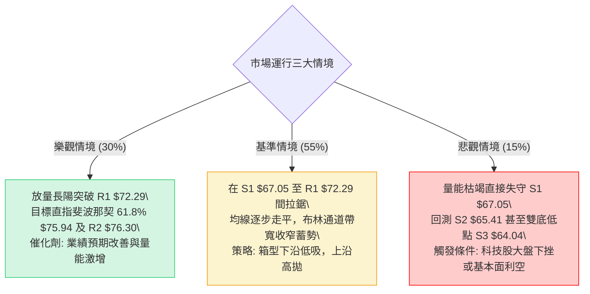

### 🛡️ 風險管理重要提醒

1. **單筆交易風險敞口控制**：嚴格控制單筆策略損失不得超過總投資組合淨值的 **1.0%**。以策略 A 為例，進場價 $67.05 與止損價 $65.41 之每股風險為 $1.64，若帳戶規模為 $100,000 美元，最大容許虧損為 $1,000 美元，則最大建倉股數應限制在 $1,000 / 1.64 \approx 600$ 股以內。
2. **高 Beta 波動防範**：UBER Beta 為 1.308，近期 ATR 達 $2.09 (3.03%)。在震盪行情中，不可使用市價單追價，應盡量於限價單（Limit Order）掛於支撐位附近等待成交。
3. **時間止損法則**：若股價在策略 A 建倉後連續 5 個交易日未能脫離 $67.05 ~ $68.50 成本區間，代表反彈動能衰竭，應主動縮減倉位或平倉離場。

---

## 📋 報告總結

```
╔════════════════════════════════════════════════════════════════╗
║                  UBER 技術分析報告總結                         ║
╠════════════════════════════════════════════════════════════════╣
║ 報告日期：2026-11-13                                           ║
║ 當前價格：$69.12 USD                                           ║
║ 分析評級：⚖️ 51/100 (中性震盪 / 區間操作)                      ║
║                                                                ║
║ 關鍵結論：                                                     ║
║ ├─ 長期趨勢：🔴 弱勢修整 (處於 2025 年高點以來的下修結構)      ║
║ ├─ 中期趨勢：🟡 雙底構築 (於 52W 低點 $64.04 探底回升)         ║
║ ├─ 短期趨勢：🟢 震盪反彈 (站上 MA20 $68.12，考驗 MA50 $69.64)  ║
║ ├─ 關鍵支撐：S1 $67.05 / S2 $65.41 / S3 $64.04                 ║
║ ├─ 關鍵阻力：R1 $72.29 / R2 $76.30 / R3 $78.60                 ║
║ └─ 分析師共識目標價：$98.88 (Mean) / 最低 $70.00 / 最高 $150.00║
║                                                                ║
║ 最優策略組合：                                                 ║
║ 1. 🥇 最佳機會：策略 A (拉回支撐 S1 $67.05 低吸，風報比 1:3.20)║
║ 2. 🥈 次選機會：策略 B (實體突破頸線 R1 $72.29 順勢追多)       ║
║ 3. 🥉 保守選擇：空手觀望，靜待週線實體大陽線補量越過 MA50     ║
╚════════════════════════════════════════════════════════════════╝
```

---

> ⚠️ **免責聲明**：本報告為 AI 自動生成之技術分析，所有數據及估算均基於提供的歷史價格資訊。本報告**僅供研究與學術參考**，**不構成任何投資建議**。投資有風險，入市需謹慎。

---

*報告生成時間：2026-11-13 ｜ 數據來源：Yahoo Finance ｜ 分析框架：多時框技術分析*