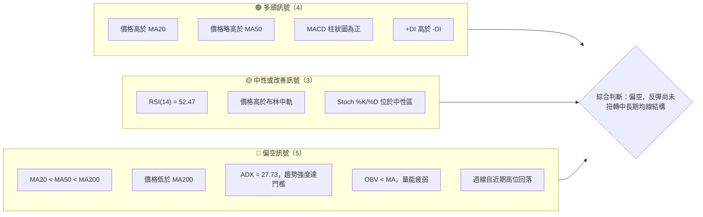
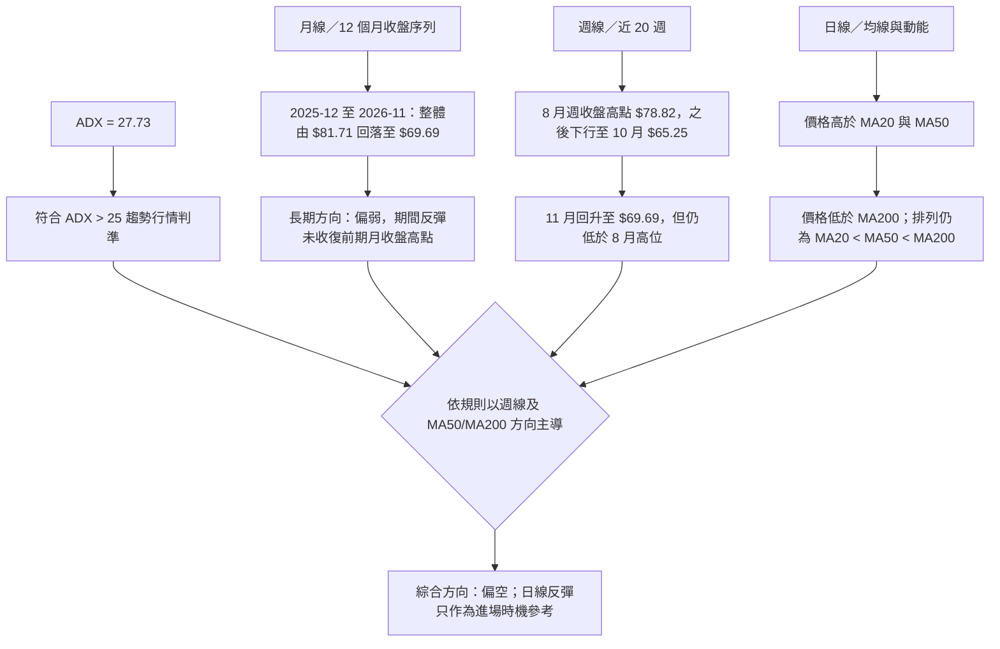
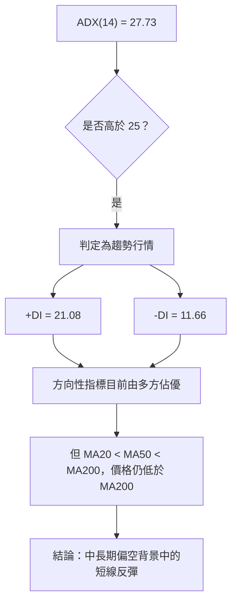
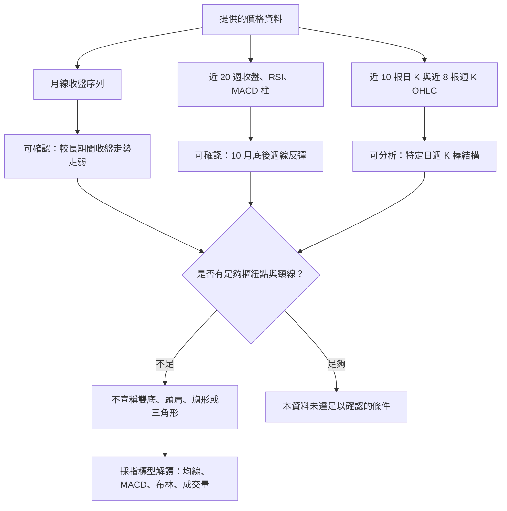
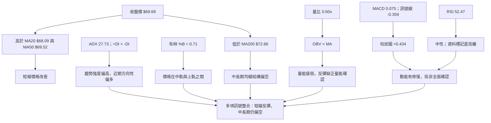
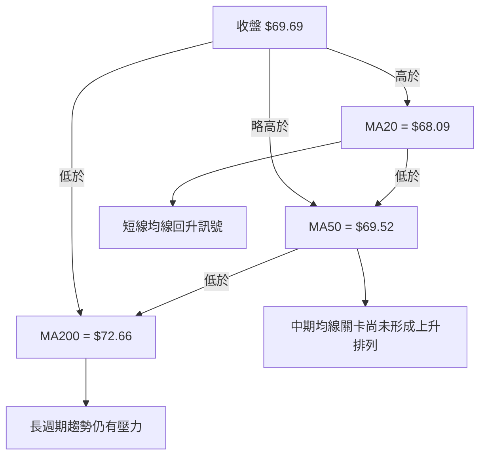
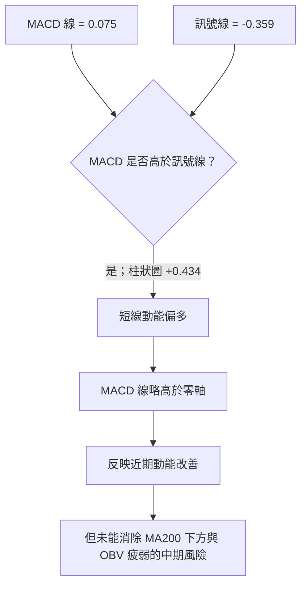
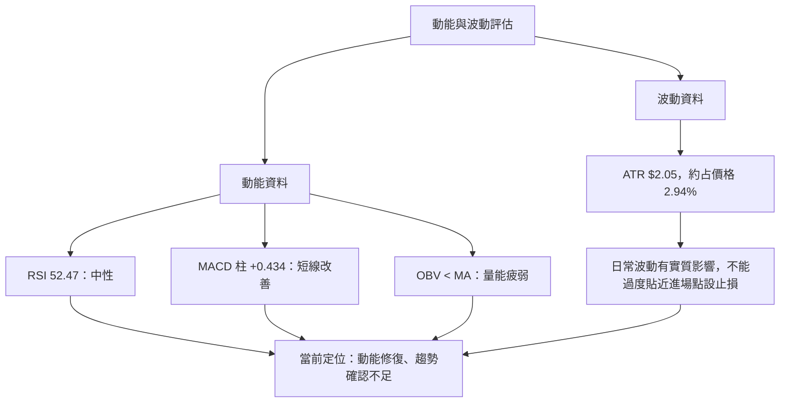
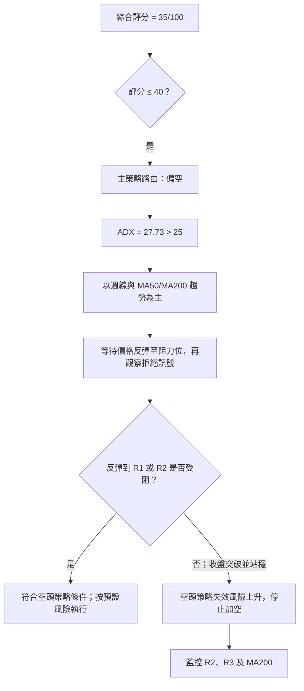
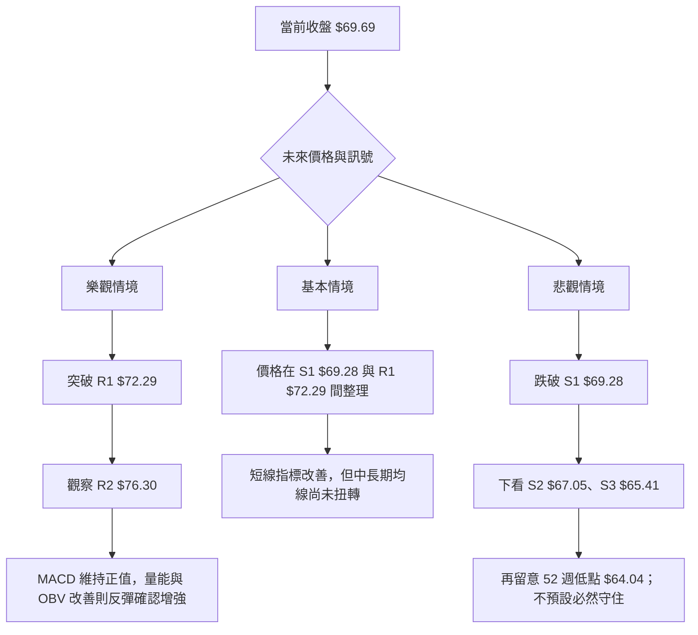

# UBER 技術分析報告

> **報告日期**：2026-11-14 ｜ **語言**：繁體中文 ｜ **數據來源**：使用者提供的 Yahoo Finance 技術數據 ｜ **當前價格**：**$69.69**（2026-11-13 收盤）

---

## 目錄

| 章節 | 內容 |
|------|------|
| 1. 技術面概覽 | 訊號儀表板、核心指標、評分卡 |
| 2. 趨勢分析 | 多時框趨勢、長中短期走勢 |
| 3. 圖表形態分析 | 形態識別、K線組合、目標價 |
| 4. 支撐與阻力 | 關鍵價位、斐波那契回調 |
| 5. 技術指標深度解讀 | MA、RSI、MACD、布林通道、成交量 |
| 6. 動能與波動率 | 動能評估、ATR、Beta |
| 7. 多時框架總結 | 時框架評分矩陣 |
| 8. 交易策略建議 | 空頭主策略、風險報酬比 |
| 9. 風險提示與監控 | 監控指標、風險場景 |

---

## 1. 技術面概覽

### 🎯 技術訊號儀表板

訊號判斷以提供的技術快照為準。此處所稱「訊號數量」是報告整理後的分類，不是獨立的量化回測結果。



訊號的關鍵矛盾是：**短線動能有修復，但中期均線排列、相對 MA200 的位置與 OBV 仍偏弱**。因此，MACD 翻正與 RSI 底背離可以支持反彈可能，卻尚不足以證明中期下跌結構已反轉。

### 📊 核心指標速覽表

| 指標類別 | 指標名稱 | 當前數值 | 訊號 | 解讀 |
|----------|----------|----------:|:---:|------|
| 價格 | 收盤價 | $69.69 | 🟡 | 高於 MA20、MA50，但低於 MA200 |
| 均線 | MA20 | $68.09 | 🟢 | 收盤價高於 MA20，短線價格結構改善 |
| 均線 | MA50 | $69.52 | 🟡 | 收盤價僅略高於 MA50，尚需持續站穩 |
| 均線 | MA200 | $72.66 | 🔴 | 收盤價低於 MA200，長週期趨勢尚未轉強 |
| 動能 | RSI(14) | 52.47 | 🟡 | 中性區，沒有超買或超賣 |
| 動能 | MACD | 0.075 | 🟢 | MACD 高於訊號線，柱狀圖為正 |
| 動能 | MACD Histogram | +0.434 | 🟢 | 動能改善，但不等同長期趨勢反轉 |
| 趨勢 | ADX(14) | 27.73 | 🔴/🟡 | 大於 25，顯示趨勢有一定強度；方向須結合 DI、均線判斷 |
| 波動 | ATR(14) | $2.05 | 🟡 | 約為價格的 2.94%，每日波動不可忽視 |
| 量能 | 量比 | 0.60x | 🔴 | 最新量低於 20 日均量 |
| 量能 | OBV | OBV < MA | 🔴 | 量能未確認近期反彈 |
| 布林 | %B | 0.71 | 🟡 | 位於中軌至上軌之間，偏強但未到上軌 |

### 🏆 技術評分卡

評分採 0–100 分，屬本報告依現有訊號做的技術判斷，不是歷史回測勝率。六項分數的算術平均為：

\[
(35+42+45+30+35+25)/6 = 35.33
\]

四捨五入後，**綜合評分 = 35/100**。

```text
╔══════════════════════════════════════════════════════════════════╗
║                技術評分卡 — UBER（2026-11-14）                 ║
╠══════════════════════════════════════════════════════════════════╣
║ 趨勢強度      ███████░░░░░░░░░░░░░  35/100  🔴                 ║
║ 動能指標      ████████░░░░░░░░░░░░  42/100  🟡                 ║
║ 支撐穩定度    █████████░░░░░░░░░░░  45/100  🟡                 ║
║ 成交量配合    ██████░░░░░░░░░░░░░░  30/100  🔴                 ║
║ 形態完整度    ███████░░░░░░░░░░░░░  35/100  🔴                 ║
║ 均線排列      █████░░░░░░░░░░░░░░░  25/100  🔴                 ║
╠══════════════════════════════════════════════════════════════════╣
║ 綜合評分      ███████░░░░░░░░░░░░░  35/100  🔴 偏空             ║
║ 計算：六項子評分算術平均，四捨五入至整數                         ║
╚══════════════════════════════════════════════════════════════════╝
```

```text
分數區間解讀
0          20          40          60          80         100
|-----------|-----------|-----------|-----------|-----------|
偏空區間       中性下緣      中性區間      偏多區間
███████░░░░░░░░░░░░░░░░░░░░░░░░░░░░░░░░░░░░░░░░ 35
```

- **趨勢強度 35**：ADX 高於 25，但均線方向仍是空頭排列，價格低於 MA200。
- **動能指標 42**：MACD 柱狀圖為正、RSI 位於中性區，短線有修復；但週線近期仍呈現反覆下探。
- **支撐穩定度 45**：已提供 S1、S2、S3 多個支撐參考，但目前價格仍接近 S1，是否有效守住尚待確認。
- **成交量配合 30**：最新成交量只有 20 日均量的 0.60 倍，OBV 低於其移動平均。
- **形態完整度 35**：資料不足以確認高信心度的頭肩、雙底或三角形等幾何形態。
- **均線排列 25**：MA20 < MA50 < MA200，整體仍為空頭排列。

---

## 2. 趨勢分析

### 🌐 多時框趨勢分析



依指定的收斂規則，ADX(14) 為 **27.73**，高於 25，因此採取「趨勢行情」處理方式：以週線與 MA50／MA200 中長期方向為主，日線只用來安排進場。儘管日線 RSI、MACD 有改善，週線走勢仍未回復至 8 月高點區域，價格也仍低於 MA200。

### 📈 長期趨勢 — 12 個月走勢圖

以下圖表使用提供的 **2025-12 至 2026-11 月收盤價**。點位是月收盤，不代表該月盤中高低價。顯示期間最高月收盤是 2025-12 的 $81.71，最低月收盤是 2026-10 的 $65.25。

```text
UBER 月線收盤走勢圖（2025-12 至 2026-11）
每個 ● 為一個月收盤；縱軸刻度為視覺化參考，精確收盤數字列於下方。

$82 ┤ ● 12月
$80 ┤       ● 1月
$78 ┤
$76 ┤             ● 2月
$74 ┤                   ● 3月
$72 ┤                         ● 4月
$70 ┤                               ● 5月  ● 6月          ● 8月
$68 ┤                                                ● 7月      ● 9月
$66 ┤                                                            ● 10月
$64 ┤
$70 ┤                                                                  ● 11月
     └───────────────────────────────────────────────────────────────
       12月  1月  2月  3月  4月  5月  6月  7月  8月  9月  10月 11月
```

> 圖形為月收盤點位的方向示意，為避免刻度映射造成誤讀，精確數值以表格為準。

| 月份 | 月收盤 | 相對前月變化 | 階段特徵 |
|------|-------:|-------------:|----------|
| 2025-12 | $81.71 | N/A（2025-11 月收盤資料未提供） | 本分析 12 個月序列的起點 |
| 2026-01 | $80.05 | -2.03% | 延續回落 |
| 2026-02 | $75.42 | -5.78% | 回撤加深 |
| 2026-03 | $71.93 | -4.63% | 持續走低 |
| 2026-04 | $74.61 | +3.73% | 出現月度反彈 |
| 2026-05 | $70.40 | -5.64% | 反彈未延續 |
| 2026-06 | $72.16 | +2.50% | 小幅回升 |
| 2026-07 | $70.36 | -2.49% | 再度回落 |
| 2026-08 | $75.65 | +7.52% | 明顯反彈 |
| 2026-09 | $68.51 | -9.43% | 反彈後大幅回吐 |
| 2026-10 | $65.25 | -4.76% | 延續下行，為本區間最低月收盤 |
| 2026-11 | $69.69 | +6.80% | 截至 11 月 13 日的收盤回升 |

**長期趨勢判讀：**

- 從 2025-12 的月收盤 $81.71 到 2026-10 的 $65.25，月收盤方向整體向下。
- 2026-11 收於 $69.69，較 10 月回升，但仍低於 2025-12 至 2026-08 的多個月收盤。
- 月度序列呈現「下跌趨勢中反覆反彈」的結構；不能單憑 11 月回升判定長期反轉。
- 52 週高點 $94.06、低點 $64.04 是另外提供的年度極值，與上表月收盤高低不可混為一談。

### 📊 中期趨勢（週線分析）

近 20 週資料顯示，股價於 2026-08-28 收於 $78.82 後，至 2026-10-30 收於 $65.25；11 月兩週則回升至 $68.59 與 $69.69。週線價格反彈與週 RSI、MACD 柱狀圖改善互相呼應，但尚未扭轉 9 月至 10 月的下跌結構。

```text
週線結構示意（使用提供的週收盤數值）
$78.82 ── 8/28 近期週收盤高位
   │
   ├── 9/04 $75.76
   ├── 9/11 $71.67
   ├── 9/18 $70.50
   ├── 9/25 $69.62
   ├── 10/02 $68.11
   ├── 10/09 $71.51  ← 反彈
   ├── 10/16 $70.35
   ├── 10/23 $66.70
   ├── 10/30 $65.25  ← 近 20 週低週收盤
   ├── 11/06 $68.59
   └── 11/13 $69.69  ← 最新週收盤

已提供波段結構價位：
上方阻力：R1 $72.29 → R2 $76.30 → R3 $78.60
下方支撐：S1 $69.28 → S2 $67.05 → S3 $65.41
```

中期觀察重點：

1. 週收盤自 10 月 30 日低點回升，近期週 RSI 從 35.8 上升至 52.5，週 MACD 柱狀圖也由負轉正。
2. 這些訊號支持短線反彈，但週收盤仍未收復 R1 $72.29；在突破並站穩之前，反彈仍處於阻力下方。
3. 週成交量於 11 月 6 日為 124,407,100，11 月 13 日降至 72,316,700；價格上升而最新週量下降，對反彈延續性的確認不足。
4. 週線提供的數據不包含整段週均線，因此不能自行推算或補填週線 MA 值。

### ⚡ 趨勢強度評估（ADX 解讀）



| ADX 區間 | 常見解讀 | UBER 狀態 |
|----------|----------|-----------|
| < 20 | 趨勢弱，較像盤整 | 不適用；ADX 為 27.73 |
| 20–25 | 趨勢形成或方向不明 | 不適用；ADX 高於此區 |
| > 25 | 趨勢強度增加，需看方向指標 | **目前 27.73** |
| +DI > -DI | 方向性偏多 | **21.08 > 11.66** |
| -DI > +DI | 方向性偏空 | 目前不是 |

ADX 衡量的是**趨勢強度，不直接表示多空方向**。目前 +DI 高於 -DI，代表近期方向性反彈由多方佔優；然而中長期均線排列仍偏空。依規則採趨勢行情判斷，主方向仍由週線及 MA50／MA200 結構主導，而不是只看 +DI。

---

## 3. 圖表形態分析

### 🔍 形態識別系統

週收盤顯示 8 月反彈後大幅回落，10 月底出現階段低點，11 月有所回升。然而，現有資料不足以確認雙底、頭肩底、對稱三角形或旗形等幾何形態：沒有足夠且明確的樞紐高低點組合可供驗證，也沒有提供經確認的頸線或形態邊界。



| 形態／訊號 | 信心度 | 判斷依據 | 完成度 | 目標價 |
|------------|--------|----------|--------|--------|
| 中期下行後的短線反彈 | 70% | 週收盤從 2026-10-30 的 $65.25 回升至 2026-11-13 的 $69.69；週 RSI 與 MACD 柱同步改善 | 反彈進行中；無法確認趨勢反轉 | 不提供形態目標價；沒有可驗證的形態高度 |
| 雙底 | <50%；訊號不足 | 目前資料不足以確認兩個清楚且可比對的低點與頸線 | N/A（數據未提供） | 不適用 |
| 頭肩底／頭肩頂 | <50%；訊號不足 | 未提供足以辨認肩、頭、頸線的可靠高低點結構 | N/A（數據未提供） | 不適用 |
| 三角形／旗形 | <50%；訊號不足 | 缺少足以確認收斂邊界或旗桿、旗面幾何結構的資料 | N/A（數據未提供） | 不適用 |
| 均線空頭排列 | 85% | MA20 $68.09 < MA50 $69.52 < MA200 $72.66 | 當前成立 | 非幾何形態，不計算形態目標價 |

「中期下行後反彈」是對已提供週收盤資料的描述，不代表典型反轉形態。形態目標價必須有明確的頸線與形態高度；本組資料未偵測到可可靠用於計算的此類形態。

### 🕯️ 重要 K 線形態分析

以下只使用提供的近 10 根日 K 與近 8 根週 K OHLC。K 棒訊號以開高低收結構描述；樣本外日期不作 K 線形態推斷。

| 日期（日K/週K） | 開 | 高 | 低 | 收 | K 線形態與結構 | 解讀 | 訊號 |
|------|------:|------:|------:|------:|----------------|------|:---:|
| 2026-11-04（日） | $68.28 | $72.50 | $67.36 | $69.87 | 寬幅震盪，收盤低於最高價 | 日內高低差大，收盤未守在高位；單根不足以確認反轉 | 🟡 |
| 2026-11-05（日） | $70.77 | $71.09 | $67.73 | $68.78 | 收低於開，實體偏向下跌 | 前一日上攻後回吐，顯示上方有賣壓 | 🔴 |
| 2026-11-06（日） | $68.12 | $70.14 | $67.99 | $68.59 | 小實體、窄下影 | 單根方向偏正，但實體小，確認度有限 | 🟡 |
| 2026-11-09（日） | $69.50 | $71.26 | $68.84 | $71.17 | 收高於開，收盤接近最高區 | 當日買盤較強，但仍須對照後續阻力與量能 | 🟢 |
| 2026-11-10（日） | $70.85 | $71.04 | $69.19 | $70.05 | 收低於開 | 前一日上漲後回落，未構成明確反轉形態 | 🟡 |
| 2026-11-11（日） | $69.10 | $71.09 | $69.01 | $70.68 | 收高於開，低位接近開盤 | 日內收復部分跌幅，呈現溫和買盤 | 🟢 |
| 2026-11-12（日） | $70.65 | $70.80 | $68.92 | $69.12 | 收低於開，收盤接近低位 | 當日賣壓較明顯，短線動能受限 | 🔴 |
| 2026-11-13（日） | $69.32 | $70.50 | $69.03 | $69.69 | 小幅收高，實體較小 | 有所回升但不具明確單根反轉結構 | 🟡 |
| 2026-10-30（週K） | $66.62 | $67.00 | $64.04 | $65.25 | 週收低於開，低點觸及提供的 52 週低點 | 週線賣壓仍在；僅憑此根不能命名為錘頭 | 🔴 |
| 2026-11-06（週K） | $66.12 | $72.50 | $65.55 | $68.59 | 寬幅週K，收高於開但未收於週高 | 週內有反彈買盤，收盤仍低於最高點 | 🟡 |
| 2026-11-13（週K） | $69.50 | $71.26 | $68.84 | $69.69 | 小幅收高 | 反彈延續但實體不大，尚未突破 R1 | 🟡 |

**K 線判讀限制：**

- 近 10 根日 K 中可看到多根收高與收低交替，反映短線買賣力量仍在拉鋸。
- 2026-11-09 日 K 收盤接近當日高位，當日結構偏強；後續 11 月 10、12 日分別收低於開盤，故不能把單根強勢 K 延伸解讀為連續反轉。
- 近 8 根週 K 中，2026-11-06 週 K 收高於開盤，代表週內反彈，但該週收盤仍未站上 R1 $72.29。
- 不把樣本範圍外日期的 OHLC 資料用於 K 線形態判斷。

### 📉 ASCII 走勢形態示意圖

```text
週收盤形態示意（非幾何反轉形態判定）
價格
$78.82  ● 8/28
         \
$75.76    ● 9/04
            \
$71.67       ● 9/11
$70.50         ● 9/18
$69.62           ● 9/25
$68.11             ● 10/02
$71.51                ● 10/09  反彈
$70.35                  ● 10/16
$66.70                     ● 10/23
$65.25                       ● 10/30  週收盤低點
$68.59                          ● 11/06
$69.69                            ● 11/13

上方參考：R1 $72.29 → R2 $76.30 → R3 $78.60
下方參考：S1 $69.28 → S2 $67.05 → S3 $65.41
```

此圖只呈現週收盤序列，不能取代 OHLC 圖，也不應視為已確認的雙底或 W 型形態。

### 🎯 形態目標價計算

本資料**沒有足以確認的幾何形態高度、頸線或收斂邊界**，因此：

- 頭肩、雙底、三角形、旗形目標價：**數據中未偵測到**。
- 不以任意高低點拼接形態，也不把均線或布林值冒稱為形態目標。
- 後續策略使用的 T1、T2 是已提供的波段支撐／阻力價位，不是形態高度推算的目標價。

---

## 4. 支撐與阻力

### 🗺️ 關鍵價位分布圖

以下價位取自提供的「關鍵價位（由 OHLCV 計算）」區塊。圖中顯示相對層級，並非線性比例座標。

```text
UBER 價位結構分布圖（支撐／阻力使用已提供價位）
══════════════════════════════════════════════════════════════
$78.60 ║████████████████████████║ R3 — 上方阻力
$76.30 ║████████████████████    ║ R2 — 中期阻力
$72.29 ║████████████████████████║ R1 — 首要阻力
$69.69 ╠════════════════════════╣ ◄ 當前收盤價
$69.28 ║▓▓▓▓▓▓▓▓▓▓▓▓▓▓▓▓        ║ S1 — 最近支撐
$67.05 ║████████████████████████║ S2 — 次級支撐
$65.41 ║████████████████████    ║ S3 — 下方支撐
══════════════════════════════════════════════════════════════
補充年度區間：52 週高 $94.06；52 週低 $64.04
```

### 🚧 阻力位分析表

| 阻力級別 | 價位 | 形成原因 | 突破難度 | 重要性 |
|----------|------:|----------|----------|--------|
| R1 | $72.29 | 近一年波段高點聚類；亦接近近期反彈上方需要克服的區域 | 中 | 高；首個反彈確認關卡 |
| R2 | $76.30 | 近一年波段高點聚類 | 中高 | 高；突破 R1 後的下一個阻力參考 |
| R3 | $78.60 | 近一年波段高點聚類 | 高 | 高；靠近近 20 週收盤資料中 2026-08-28 的 $78.82，但兩者屬不同資料計算，不能當作同一價位 |

突破判讀以收盤確認為佳。單日盤中觸及某一阻力，未必代表有效突破；目前提供的 11 月 13 日收盤為 $69.69，仍低於 R1 $72.29。

### 🛡️ 支撐位分析表

| 支撐級別 | 價位 | 形成原因 | 守住機率 | 重要性 |
|----------|------:|----------|----------|--------|
| S1 | $69.28 | 近一年波段低點聚類；距離當前收盤較近 | 中；僅為技術結構判讀，非統計勝率 | 高；近期價格需要維持在其上方 |
| S2 | $67.05 | 近一年波段低點聚類 | 中 | 高；若 S1 失守，下一層支撐參考 |
| S3 | $65.41 | 近一年波段低點聚類 | 中低 | 高；接近近期低位區，但不等同 52 週低點 |
| 52 週低點 | $64.04 | 市場數據提供的 52 週低點 | N/A（未提供守住機率資料） | 重要年度參考；並非上述 S3 |

守住機率欄是定性評估，不是根據回測或歷史觸及次數計算的統計概率。

### 📐 斐波那契回調位分析

下表直接引用已提供的 52 週區間斐波那契值，不另行重算。

| 回調比例 | 價位 |
|----------|------:|
| 23.6% | $86.98 |
| 38.2% | $82.59 |
| 50.0% | $79.05 |
| 61.8% | $75.51 |
| 78.6% | $70.46 |

當前收盤 **$69.69** 低於提供的 78.6% 回調位 **$70.46**，也低於 52 週區間低點一端以外的其他回調參考區間；以這組回調位比較，現價已在 78.6% 水準下方，而不是位於兩個回調位之間。

這表示從 $94.06 高點計算的回撤相當深，技術上反映此前上漲區間已大幅回吐。斐波那契位是價格參考，不應單獨視為支撐保證；目前更直接的近端支撐仍是 OHLCV 計算的 S1、S2、S3。

```text
斐波那契與現價相對位置
$94.06  52W 高
$86.98  23.6%
$82.59  38.2%
$79.05  50.0%
$75.51  61.8%
$70.46  78.6%
$69.69  ◄ 當前收盤（低於 78.6% 水準）
$64.04  52W 低
```

---

## 5. 技術指標深度解讀

### 🎛️ 指標訊號總覽



### 📈 移動平均線排列分析



| 均線 | 數值 | 收盤價相對位置 | 趨勢含義 |
|------|------:|----------------|----------|
| MA20 | $68.09 | 高於 | 短線價格已回到短均線上方 |
| MA50 | $69.52 | 高於 $0.17 | 僅略高於 MA50，站穩程度尚待確認 |
| MA200 | $72.66 | 低於 $2.97 | 長週期價格趨勢尚未轉強 |
| 均線排序 | MA20 < MA50 < MA200 | 空頭排列 | 均線尚未呈現多頭排列 |

另有 MA60 $70.86、MA120 $71.67、MA240 $74.54，收盤價低於這三條均線；這些資料同樣顯示上方存在均線壓力。短均線回升與長均線下壓並存，屬於下跌背景中的反彈結構，而非完整多頭排列。

### 📉 RSI(14) 分析

**RSI(14) = 52.47**，落在常見的 30–70 中性區間。

```text
RSI(14) 強度尺（區間 0–100）
0         30         50        70        100
|----------|----------|---------|----------|
                       ▲ 52.47
                       ██████████░░░░░░░░░░ 52.47%
超賣參考：30 以下；中性區：30–70；超買參考：70 以上
```

- **超買／超賣**：52.47 不是超買，也不是超賣；單靠 RSI 不支持立即反向交易。
- **方向狀態**：RSI 由週線 10 月底低點區回升的週資料，支持近期反彈修復。
- **背離判斷**：提供的技術快照明確標示 RSI 底背離，依其「近 20 根 K 棒首尾價格與 RSI 方向」方法，**採納為底背離訊號**。
- **背離限制**：沒有提供近 20 根逐根 RSI 值及兩個明確局部低點的配對資料，因此本報告無法獨立重建背離區段、起訖價格或背離幅度。結論是「數據標記為底背離」，不是宣稱已由本報告獨立驗證。
- **綜合解讀**：RSI 底背離與 MACD 柱轉正偏多；但價格低於 MA200、OBV 疲弱，兩者限制底背離訊號的確認力。

### 📊 MACD(12/26/9) 訊號解讀



| MACD 項目 | 數值 | 判讀 |
|-----------|-----:|------|
| MACD 線 | 0.075 | 略高於零 |
| 訊號線 | -0.359 | 位於零線下 |
| 柱狀圖 | +0.434 | MACD 高於訊號線，短線偏多 |
| 背離 | N/A（數據未提供） | 沒有足夠逐段價格與 MACD 高低點資料，不能自行宣稱 MACD 頂背離或底背離 |

**背離結論：** RSI 有資料標示的底背離；MACD 背離則為 **N/A（數據未提供）**。MACD 柱狀圖正值代表當前短線動能偏強，不代表已確認中期轉勢。

### 📦 布林通道分析

提供的布林通道為：上軌 **$71.92**、中軌／MA20 **$68.09**、下軌 **$64.25**，%B = **0.71**。

```text
布林通道位置示意
$71.92 ───────────── 上軌
                     │
                     │     ● 收盤 $69.69
                     │     %B = 0.71
$68.09 ───────────── 中軌（MA20）
                     │
                     │
$64.25 ───────────── 下軌

現價位於中軌之上、上軌之下；未觸及上軌或下軌。
```

- 收盤高於中軌，短線位置偏強。
- %B 0.71 代表價格位於通道中上段，不在極端下軌區，也未觸及上軌。
- 在 ADX > 25 的趨勢判讀框架下，不把布林上下軌機械視為固定區間反轉點；需先尊重中長期趨勢方向。
- 布林帶寬數值未提供，**N/A（數據未提供）**；不推測波動收斂或擴張的幅度。

### 💹 成交量分析（量價配合度）

| 成交量項目 | 數值 | 比較 |
|------------|------:|------|
| 最新日成交量 | 11,329,600 | 低於 20 日均量與 50 日均量 |
| 20 日均量 | 18,842,450 | 最新量約為其 0.60 倍 |
| 50 日均量 | 18,088,330 | 最新量亦低於 50 日均量 |
| 最新週成交量 | 72,316,700 | 低於前一週 124,407,100 |
| OBV 趨勢 | OBV < MA | 量能疲弱 |

**量價解讀：**

1. 股價從 10 月底反彈至 11 月 13 日收盤 $69.69，但最新日成交量低於均量，反彈缺少明確的量能放大確認。
2. 11 月 6 日週量較高，週收盤上升；11 月 13 日週量下降，週收盤仍小幅提高。這可能代表賣壓減輕，也可能表示買盤追價意願不足，單靠現有資料不能二選一確認。
3. OBV 低於其移動平均，與價格短線回升形成一定程度的量價背離／確認不足。
4. 因此，MACD、RSI 的短線改善應視為「有反彈動能，但量能尚未確認」，而不是完整的量價多頭訊號。

---

## 6. 動能與波動率

### ⚡ 動能評估四象限

本報告不以未提供的歷史波動分位數虛構象限值；以下以現有動能指標與 ATR 做定性分類。

| 象限 | 動能 | 波動 | 當前狀態 | 評估 |
|------|------|------|----------|------|
| Q1 | 強 | 低 | 未確認 | 理想趨勢延續區，但目前缺少低波動量化資料 |
| Q2 | 弱 | 低 | 未確認 | 需要波動率分位數資料 |
| Q3 | 強／改善 | 中等日波動 | **部分符合** | MACD 柱正、+DI > -DI；但量能弱且中長期均線偏空 |
| Q4 | 弱 | 高 | 未確認 | ATR 價格占比為 2.94%，但沒有歷史 ATR 分位數 |



### 📊 ATR 波動率分析

| 指標 | 數值 | 解讀 |
|------|------:|------|
| ATR(14) | $2.05 | Wilder 計算的平均真實波幅 |
| ATR／收盤價 | 2.94% | 每日波動相對價格比例 |
| 收盤價 | $69.69 | 計算比例使用的基準收盤價 |

ATR 是波動度指標，不是方向指標，也不是支撐／阻力。以 $2.05 為參考，日常價格波動可能使過窄的止損在未發生趨勢反轉前被觸及。交易策略中的止損採用已提供的結構價位，而非由 ATR 自行推算，符合本報告的價位數據紀律。

**執行提醒：**

- 進場價到止損價的距離若接近或小於 ATR，策略容易受到一般日內波動干擾。
- ATR 沒有提供近期歷史變化序列，無法比較目前波動是處於歷史高位或低位。
- 不將 ATR 乘數推算價位冒稱為已提供的支撐、阻力或目標價。

### 📐 Beta 與市場相關性

| 指標 | 數值 | 解讀 |
|------|------:|------|
| Beta | 1.308 | 依所提供資料，UBER 對市場變動的敏感度高於 1 的基準 |
| 相關係數 | N/A（數據未提供） | Beta 不等同相關係數，無法由此判定精確相關程度 |
| 個股特有波動 | N/A（數據未提供） | 沒有提供可分解市場風險與個股風險的資料 |

Beta 1.308 表示股票可能對市場波動具有較高敏感度，但不能據此推導每次市場下跌時 UBER 必然以固定倍數下跌。遇到大盤急跌、公司消息或產業事件時，個股走勢也可能偏離 Beta 所代表的歷史敏感度。

---

## 7. 多時框架總結

### 📋 時框架評分表

評分與第 1 章總分不同：本表是分時框架的質性整理；全報告引用的正式綜合評分仍為第 1 章的 **35/100**。

| 時框架 | 趨勢方向 | 動能 | 均線排列 | 形態 | 綜合評分 | 建議 |
|--------|----------|------|----------|------|----------|------|
| 長期（月線／12 個月收盤） | 🔴 偏空 | 🟡 月度反彈與回落交替 | 月線 MA 數據未提供 | 下跌後反彈，幾何形態未確認 | 35/100 | 不以單月反彈判定長線反轉 |
| 中期（週線／近 20 週） | 🔴 偏空背景中的反彈 | 🟡 RSI、MACD 柱近期改善 | 週線均線數據未提供 | 未確認雙底或反轉形態 | 40/100 | 觀察 R1 $72.29 是否有效突破 |
| 短期（日線快照） | 🟡 反彈 | 🟢 MACD 柱正、RSI 中性 | MA20 < MA50 < MA200 | 只有指標改善，幾何形態未確認 | 45/100 | 日線反彈作為進場時機，不凌駕中期趨勢 |
| 綜合技術面 | 🔴 偏空 | 🟡 混合 | 🔴 空頭排列 | 🔴 形態確認不足 | **35/100** | 偏空，等待反彈到阻力區的確認訊號 |

### 🔲 綜合訊號矩陣

```text
╔══════════════╦══════════════╦══════════════╦══════════════════╗
║ 維度         ║ 長期（月線） ║ 中期（週線） ║ 短期（日線）     ║
╠══════════════╬══════════════╬══════════════╬══════════════════╣
║ 趨勢方向     ║ 🔴 偏空      ║ 🔴 偏空背景  ║ 🟡 反彈          ║
║ 動能         ║ 🟡 反覆      ║ 🟡 改善      ║ 🟢 MACD 柱為正   ║
║ 均線位置     ║ N/A          ║ N/A          ║ 🔴 空頭排列      ║
║ 量能確認     ║ N/A          ║ 🟡 不一致    ║ 🔴 OBV < MA      ║
║ 綜合作用     ║ 🔴 下行主導  ║ 🔴 反彈未反轉║ 🟡 進場時機改善  ║
╚══════════════╩══════════════╩══════════════╩══════════════════╝
```

### ⚖️ 多時框收斂結論

1. **行情分類**：ADX(14) = **27.73 > 25**，依指定規則判為趨勢行情。
2. **主導時框**：趨勢行情下，以中長期週線與 MA50／MA200 方向為主。近 20 週從 $78.82 回落至 $65.25 後雖反彈至 $69.69，但收盤仍低於 MA200 $72.66。
3. **短線訊號定位**：MACD 柱轉正、RSI 位於中性區且資料標示 RSI 底背離，代表反彈可能；不改寫 MA20 < MA50 < MA200 的空頭排列。
4. **唯一方向性結論：偏空。** 若綜合評分為 35/100，依第 8 章路由以空頭策略為主；日線反彈只用來等待較佳的風險位置，不採取追空式執行。

---

## 8. 交易策略建議

### 🗺️ 策略決策流程圖



### 🧭 策略路由

**當前主策略方向 = 偏空（依評分 35/100）。**

本報告遵循「綜合評分 ≤40 主推空頭策略」的指定分流規則。即使 RSI、MACD 有短線改善，也不將其擴大為兩頭下注。空頭策略的執行前提是等待反彈至已提供阻力位後出現受阻跡象；在當前 $69.69 附近直接追空，風險位置不如等待阻力確認。

### 🎯 價格情境階梯（Price Scenarios）

| 觸發條件 | 下一目標 | 後續延伸 | 情境含義 |
|----------|----------|----------|----------|
| 向上突破並站穩 R1 $72.29 | R2 $76.30 | R3 $78.60 | 短線轉強；若伴隨量能改善，空頭結構受挑戰 |
| 價格仍在 S1 $69.28 與 R1 $72.29 間波動 | — | — | 反彈／整理，方向未明；不追價 |
| 跌破 S1 $69.28 | S2 $67.05 | S3 $65.41 | 支撐轉弱，延續下行風險升高 |
| 跌破 S3 $65.41 | 52 週低點 $64.04 作年度參考 | N/A（數據未提供） | 需注意年度低點附近的風險；不預設該位必然守住 |

本表只使用提供的關鍵支撐、阻力及年度高低值，沒有另行創設技術價位。

### 📊 情境機率分佈

以下是依目前技術訊號建立的**主觀情境權重**，不是歷史回測勝率，也非保證結果。

| 情境 | 機率 | 主要依據 |
|------|------:|----------|
| 繼續上行／反彈 | 25% | MACD 柱 +0.434、RSI 52.47、+DI 高於 -DI、價格高於 MA20 與 MA50；但量比僅 0.60x 且低於 MA200 |
| 區間震盪 | 30% | 現價仍位於 S1 與 R1 之間；布林 %B 為 0.71，價格在中軌與上軌之間；布林帶寬未提供 |
| 回落／再探底 | 45% | MA20 < MA50 < MA200、收盤低於 MA200、OBV < MA，週線曾自 $78.82 回落至 $65.25 |

**合計：100%。** 偏空情境權重最高，與綜合評分及主策略方向一致；正向訊號仍保留反彈情境，不視為不存在。

### 🔴 主策略詳情（偏空）

下列策略是條件式技術計畫，不代表價格必然到達指定區域。進場與目標使用提供的 R／S 位，止損使用已提供的阻力位。風險報酬比按做空方向計算：

\[
\text{做空風險報酬比}
=
\frac{\text{進場價}-\text{目標價}}
{\text{止損價}-\text{進場價}}
\]

| 策略要素 | 策略 A：R1 受阻做空 | 策略 B：R2 受阻做空 |
|----------|---------------------:|---------------------:|
| 進場條件 | 價格反彈至 R1，出現受阻確認後才考慮 | 價格進一步反彈至 R2，並出現受阻確認後才考慮 |
| 進場價格 | $72.29（R1） | $76.30（R2） |
| 目標價 T1 | $69.28（S1） | $69.28（S1） |
| 目標價 T2 | $67.05（S2） | $67.05（S2） |
| 止損價格 | $76.30（R2） | $78.60（R3） |
| 單股風險 | $76.30 − $72.29 = $4.01 | $78.60 − $76.30 = $2.30 |
| 單股 T1 潛在報酬 | $72.29 − $69.28 = $3.01 | $76.30 − $69.28 = $7.02 |
| 風險報酬比（以 T1 計） | **1 : 0.75** | **1 : 3.05** |
| 風險報酬比（以 T2 計） | **1 : 1.31** | **1 : 4.02** |
| 成功機率 | 主觀估計 45% | 主觀估計 40% |
| 建議倉位 | 風險預算控制於總資金 0.25%–0.50% | 風險預算控制於總資金 0.25%–0.50% |

> **風險報酬比驗算：**  
> 策略 A T1：$(72.29-69.28)/(76.30-72.29)=3.01/4.01=0.75$；T2：$(72.29-67.05)/4.01=5.24/4.01=1.31$。  
> 策略 B T1：$(76.30-69.28)/(78.60-76.30)=7.02/2.30=3.05$；T2：$(76.30-67.05)/2.30=9.25/2.30=4.02$。

策略 A 的 T1 風險報酬比低於 1，適合作為靠近阻力時的較保守、較早期觸發計畫，但要注意其報酬空間不大。策略 B 的比例較高，但必須等待價格先反彈到 R2，且受阻條件確認；未觸及或沒有受阻訊號時不應預設進場。

**進場確認條件：**

- 阻力位附近出現價格受阻，且收盤沒有有效站上阻力。
- 若成交量放大並伴隨收盤突破阻力，應視為空頭風險增加，而非機械式加空。
- 不在支撐位附近追空；S1、S2、S3 是目標參考，也是可能出現反彈的位置。
- 成功機率是主觀策略估計，沒有歷史策略回測支撐，不能解讀為保證命中率。

### 🔴 反向風險觸發點（對沖提示）

空頭主策略的失效風險增加，需重新評估，而不是自動加倉：

1. **收盤突破 R1 $72.29 並能站穩**：代表近期反彈不再只停留於 R1 下方。
2. **進一步站上 R2 $76.30**：策略 A 的止損條件被觸發；週線反彈結構明顯增強。
3. **向 R3 $78.60 推進並站穩**：空頭結構受更大挑戰；本報告不把該區上方另行延伸為新目標。
4. **MACD 柱維持正值且 OBV 改善**：若與價格突破同步出現，多頭反彈確認力提升。
5. **收盤重新站上 MA200 $72.66**：長週期價格位置改善，但仍需觀察均線排列是否改變。

### ⭐ 整體訊號強度評星

```text
做多訊號強度：★★☆☆☆  (2/5 星)
做空訊號強度：★★★☆☆  (3/5 星)
整體可信度：  ★★★☆☆  (3/5 星)
```

做空訊號評為 3/5，而非更高，因為價格已回到 MA20、MA50 上方，MACD 柱為正，RSI 資料標示底背離；這些訊號增加短線反彈風險。另一方面，均線空頭排列、低於 MA200、OBV 疲弱，使偏空方向仍是主判斷。

---

## 9. 風險提示與監控

### ✅ 關鍵監控指標 Checklist

```text
╔══════════════════════════════════════════════════════════════════╗
║                    UBER 技術面監控清單                          ║
╠══════════════════════════════════════════════════════════════════╣
║ □ 日收盤是否守住 S1 $69.28？                                    ║
║ □ 若失守 S1，是否進一步測試 S2 $67.05？                         ║
║ □ 若跌破 S2，是否接近 S3 $65.41？                               ║
║ □ 反彈是否突破 R1 $72.29，且收盤能否站穩？                      ║
║ □ 若突破 R1，是否接續測試 R2 $76.30？                           ║
║ □ MA20 $68.09 是否持續高於／支撐收盤價？                         ║
║ □ 收盤能否收復 MA200 $72.66？                                   ║
║ □ MACD 柱 +0.434 是否延續，或轉回負值？                          ║
║ □ RSI 52.47 是否維持中性，或向 70／30 區移動？                   ║
║ □ OBV < MA 的量能疲弱狀態是否改善？                              ║
║ □ 最新成交量是否高於 20 日均量 18,842,450？                     ║
║ □ ADX 是否仍高於 25，且 +DI／-DI 方向是否改變？                 ║
╚══════════════════════════════════════════════════════════════════╝
```

**監控優先級：**

| 優先級 | 監控項目 | 判讀方式 |
|--------|----------|----------|
| 高 | R1 $72.29 | 短線反彈是否開始突破首要阻力 |
| 高 | S1 $69.28 | 近端支撐是否失守 |
| 高 | MA200 $72.66 | 長週期價格位置是否改善 |
| 中 | OBV 與成交量 | 反彈是否有量能確認 |
| 中 | MACD 柱狀圖 | 短線動能改善是否延續 |
| 中 | RSI 背離訊號 | 是否僅止於背離，還是轉為價格結構改善 |
| 中 | ADX、+DI、-DI | 趨勢強度與方向是否出現變化 |

### ⚠️ 風險場景分析



| 情境 | 技術條件 | 風險／機會含義 | 監控價位 |
|------|----------|----------------|----------|
| 樂觀 | 突破 R1，後續量能與 OBV 同步改善 | 短線反彈有機會延續；中長期趨勢是否翻多仍需觀察 MA200 與均線排列 | R1 $72.29、R2 $76.30、MA200 $72.66 |
| 基本 | 價格仍在 S1 與 R1 之間；MACD 正值但量能未確認 | 反彈與回落力量拉鋸，不宜把中性價格波動誤認為趨勢反轉 | S1 $69.28、R1 $72.29 |
| 悲觀 | 收盤跌破 S1，且後續無法收復 | 下行風險可能擴大，市場重新測試較低支撐 | S2 $67.05、S3 $65.41、52 週低點 $64.04 |

### 🛡️ 風險管理重要提醒

1. **趨勢風險**：ADX 高於 25，代表市場不宜被簡化為低波動盤整。依多時框規則，中長期均線結構仍偏空，日線反彈不應單獨主導方向判斷。
2. **反彈風險**：RSI 底背離標記、MACD 柱狀圖為正、+DI 高於 -DI，皆可能令空頭回補或反彈延續；空頭策略應等待阻力受阻，而不是忽略多頭訊號。
3. **量能風險**：OBV < MA，最新量比僅 0.60x，價格回升尚未獲得充分量能確認；若突破阻力時量能改善，空頭策略需要重新評估。
4. **波動風險**：ATR(14) 為 $2.05，約占收盤價 2.94%。過窄止損容易受正常波動干擾；倉位大小應根據止損距離調整，而非只看股票數量。
5. **跳空與消息風險**：公司消息、政策、競爭或整體市場變化可能使股價跳空，止損成交價不一定等於預設止損價。
6. **倉位控制**：以單筆交易可承受損失反推股數。若單筆最大風險預算為帳戶資金的 \(r\)，每股止損距離為 \(d\)，則理論股數約為「帳戶資金 × r ÷ d」。實際執行仍須考慮跳空、滑價與流動性。
7. **分批執行**：若採用阻力位做空，可先等價格到達相應阻力、再觀察確認；不把「觸及價位」本身等同於有效訊號。
8. **目標與止損紀律**：支撐位可能反彈，阻力位也可能突破。T1、T2 僅為計畫價位，不保證成交或達成。
9. **數據限制**：本報告使用的是截至 2026-11-13 的收盤價與所提供技術快照；沒有後續即時價格、逐筆量能、完整逐日指標序列或策略回測資料。

---

## 📋 報告總結

```text
╔══════════════════════════════════════════════════════════════════╗
║                  UBER 技術分析報告總結                         ║
╠══════════════════════════════════════════════════════════════════╣
║ 報告日期：2026-11-14                                             ║
║ 當前價格：$69.69                                                  ║
║ 分析評級：🔴 偏空（綜合評分 35/100）                             ║
╠══════════════════════════════════════════════════════════════════╣
║ 關鍵結論：                                                        ║
║ ├─ 長期趨勢：🔴 月收盤序列整體偏弱，反彈尚未證明長期反轉        ║
║ ├─ 中期趨勢：🔴 週線從 8 月高位回落後反彈，仍未突破首要阻力    ║
║ ├─ 短期趨勢：🟡 高於 MA20、MA50，MACD 動能改善                  ║
║ ├─ 均線結構：🔴 MA20 $68.09 < MA50 $69.52 < MA200 $72.66        ║
║ ├─ 關鍵支撐：$69.28（S1）；其後 $67.05（S2）、$65.41（S3）     ║
║ ├─ 關鍵阻力：$72.29（R1）；其後 $76.30（R2）、$78.60（R3）     ║
║ ├─ RSI／MACD：RSI 52.47 且資料標記底背離；MACD 柱 +0.434        ║
║ ├─ 量能：🔴 量比 0.60x，OBV < MA，反彈尚缺量能確認              ║
║ ├─ ADX：27.73，依規則採趨勢行情；中長期方向主導交易判斷          ║
║ └─ 分析師平均目標：$98.88（分析師共識，不是本報告技術目標價）   ║
╠══════════════════════════════════════════════════════════════════╣
║ 最優策略組合：                                                    ║
║ 1. 🥇 主策略：等待反彈至 R1 $72.29 或 R2 $76.30，確認受阻後考慮 ║
║ 2. 🥈 風控重點：S1 $69.28 若失守，觀察 S2 $67.05 與 S3 $65.41  ║
║ 3. 🥉 反向風險：若收盤突破並站穩 R1，重新評估空頭策略          ║
╚══════════════════════════════════════════════════════════════════╝
```

> ⚠️ **免責聲明**：本報告為 AI 自動生成之技術分析，根據使用者提供的歷史價格與技術指標整理，僅供研究與學術參考，不構成投資建議。報告中的情境機率與策略成功機率屬主觀估計，不代表回測結果或未來保證。投資有風險，入市需謹慎。

---

*報告生成時間：2026-11-14 ｜ 數據來源：使用者提供之 Yahoo Finance 數據 ｜ 分析框架：多時框技術分析*