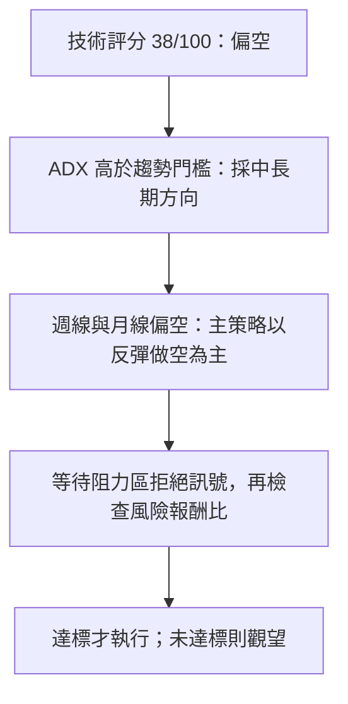

# UBER 技術分析報告

> **報告日期**：2026-11-16 ｜ **語言**：繁體中文 ｜ **數據來源**：Yahoo Finance ｜ **當前價格**：$69.69 USD（收盤日：2026-11-13）

---

## 目錄

| 章節 | 內容 |
|------|------|
| [1. 技術面概覽](#1-技術面概覽) | 核心指標速覽、評分卡 |
| [2. 趨勢分析](#2-趨勢分析) | 長中短期走勢、ADX |
| [3. 圖表形態分析](#3-圖表形態分析) | 形態、K線、缺口 |
| [4. 支撐與阻力](#4-支撐與阻力) | 關鍵價位、斐波那契 |
| [5. 技術指標深度解讀](#5-技術指標深度解讀) | MA/RSI/MACD/布林/成交量/進階指標 |
| [6. 動能與波動率](#6-動能與波動率) | ATR、Beta、相對強度 |
| [7. 多時框架總結](#7-多時框架總結) | 時框架評分矩陣 |
| [8. 交易策略建議](#8-交易策略建議) | 歷史基準、策略、風險報酬比 |
| [9. 風險提示與監控](#9-風險提示與監控) | 監控指標、風險場景 |

---

## 1. 技術面概覽

目前技術結構偏空：中長期均線排列偏弱，週線與月線方向亦偏空。  
日線動能有回升跡象，但成交量偏弱，且股價仍受較長期均線及上方供給區壓制。  
最大反向風險是日線多頭動能延續並突破上方關鍵阻力，使中期偏空判斷失效。

### 📊 核心指標速覽表

| 指標類別 | 指標名稱 | 當前數值 | 訊號 | 解讀 |
|----------|----------|----------|------|------|
| **價格** | 當前價格 | **$69.69** | 🟡 | 收盤價；位於 52 週區間偏低位置 |
| **均線** | MA20 / MA50 / MA200 | 見第 5 章 | 🔴 | 收盤高於短中期均線，但低於 MA200；排列偏空 |
| **動能** | RSI(14)（日線） | 見第 5 章 | 🟡 | 中性，並有程式標示的底背離訊號 |
| **動能** | MACD 柱（日線） | 見第 5 章 | 🟢 | 日線柱值轉正，短線動能改善 |
| **趨勢** | ADX(14) | 見第 2 章 | 🟡 | 趨勢強度達趨勢行情門檻；方向仍須服從中長期訊號 |
| **波動** | ATR(14) | 見第 6 章 | 🟡 | 日常波動幅度中等，停損需考慮波動空間 |
| **多時框** | 一致性 | 見第 7 章 | 🔴 | 多時框偏空，週線與月線偏空 |

### 🏆 技術評分卡

| 維度 | 評分（0–100） | 訊號 | 主要依據（引用數值所在章節） |
|------|---------------|------|------------------------------|
| 趨勢強度 | 38 | 🔴 | 趨勢強度明確，但週線、月線與長期均線方向偏空；見第 2、7 章 |
| 動能指標 | 45 | 🟡 | 日線 RSI 中性、MACD 柱轉正，但週線 MACD 柱仍為負；見第 5、7 章 |
| 支撐穩定度 | 45 | 🟡 | 下方有多層價位參考，但近期歷史基準表現偏弱；見第 4、8 章 |
| 成交量配合 | 32 | 🔴 | OBV 顯示量能疲弱，最新量低於均量；見第 5 章 |
| 形態完整度 | 40 | 🟡 | 未確認高信心度幾何形態；目前以指標型訊號為主，見第 3 章 |
| 均線排列 | 25 | 🔴 | 中長期均線仍呈空頭排列；見第 5 章 |
| **綜合評分** | **38** | **偏空** | 六項算術平均：225 ÷ 6 = 37.5，四捨五入為 38 |

---

## 2. 趨勢分析

**結論：中長期走勢仍偏空，近期有反彈但尚未扭轉較大級別弱勢。**  
月線價格在觀察期間整體走低；週線收盤仍低於其趨勢均線，且週線 MACD 柱仍為負值。  
日線短線偏多訊號視為反彈或進場時機訊號，不足以單獨推翻週線與月線的弱勢判斷。

### 📈 長期趨勢（近 12 個月）

以下階段取自近 12 個月月收盤資料；為避免將最新收盤價在其他章節重複列示，階段表截至 2026 年 10 月。

| 期間 | 起訖月收盤 | 漲跌幅 | 特徵 |
|------|------------|--------|------|
| 2025-12 至 2026-03 | $81.71 → $71.93 | -11.97% | 多月下行，反映中期賣壓延續 |
| 2026-03 至 2026-06 | $71.93 → $72.16 | +0.32% | 整體橫向整理，反彈幅度有限 |
| 2026-06 至 2026-10 | $72.16 → $65.25 | -9.58% | 再度走弱，月收盤下行 |

### 📊 中期趨勢（週線）

| 觀察項目 | 週線訊號 | 解讀 |
|----------|----------|------|
| 趨勢方向 | 偏空 | 依多時框指標區塊，收盤低於週線趨勢均線且週 RSI 低於 50 |
| 週 MACD 柱 | 負值 | 雖較前期負值收斂，但尚未翻正 |
| 近期週收盤變化 | 10 月底後反彈，最近兩週收盤回升 | 屬弱勢中的反彈，仍需突破週線趨勢均線確認 |
| 週成交量 | 反彈週成交量曾放大，最新一週回落 | 量能未能持續支持反彈 |

### ⚡ 趨勢強度（ADX）

| 指標 | 數值 | 解讀 |
|------|------:|------|
| ADX(14) | 27.73 | 高於 25，判定為趨勢行情，而非一般盤整 |
| +DI | 21.08 | 高於 −DI，短線方向性力量由多方占優 |
| −DI | 11.66 | 低於 +DI，但不代表中長期趨勢已反轉 |

ADX 判定目前屬趨勢行情，因此依多時框收斂規則，以週線及中長期均線方向為主，日線只用於尋找進場時機。  
+DI 高於 −DI 與日線反彈訊號互相呼應，但週線、月線偏空，故不足以將主方向改判為偏多。

---

## 3. 圖表形態分析

**結論：現有資料不足以確認高信心度的頭肩、雙底、旗形等幾何形態。**  
近端較可靠的觀察是日線動能改善、週線反彈，以及反彈伴隨量能未持續跟進；不宜把這些訊號包裝成已完成的反轉形態。

### 🔍 形態識別

| 形態 | 信心度 | 判斷依據 | 完成度 | 目標價 |
|------|--------|----------|--------|--------|
| 幾何反轉形態 | 低 | 現有週、日收盤序列不足以確認形態所需的清晰頸線及對稱轉折 | 訊號不足，僅做指標型解讀 | N/A（數據未提供可確認形態高度） |
| 均線／動能反彈 | 中 | 日線 MACD 柱轉正、+DI 高於 −DI；但週線、月線方向仍偏空 | 反彈訊號存在，趨勢反轉未確認 | 不適用；不是具備可計算形態高度的幾何形態 |

### 🕯️ 重要 K 線形態與缺口

| 日期（日K/週K） | 開 | 高 | 低 | 收 | K 線形態 | 解讀 | 訊號 |
|------|----:|----:|----:|----:|---------|------|------|
| 2026-11-04（日K） | 68.28 | 72.50 | 67.36 | 69.87 | 長上影陽線 | 當日高點未能守住，顯示上方有賣壓；單根 K 線不足以確認反轉 | 🟡 |
| 2026-11-06（週K） | 66.12 | 72.50 | 65.55 | 68.59 | 陽線、上影較長 | 週內曾大幅反彈但收盤未接近日內高點，賣壓仍存在 | 🟡 |
| 2026-11-13（週K） | 69.50 | 71.26 | 68.84 | 69.69 | 小實體陽線 | 延續反彈但幅度有限；不能視為強勢突破 K 線 | 🟡 |

| 缺口檢查 | 結果 |
|----------|------|
| 近 60 個交易日跳空缺口 | 近期無 ≥1% 缺口；沒有可列為未回補缺口的價格區間 |

---

## 4. 支撐與阻力

**結論：股價上方的阻力帶較多，下方則有數個逐級支撐參考。**  
價位採用程式由 OHLCV 計算的波段高低點聚類；資料標示回溯期間為近一年。  
以下價位是技術分析參考，不代表必然反轉或必然突破。

### 🚧 阻力位分析表

| 阻力級別 | 價位 | 形成原因 | 突破難度 | 重要性 |
|----------|------:|----------|----------|--------|
| R1 | $72.29 | 近一年波段高點聚類；亦接近近期均線、雲層等供給參考區 | 中 | 短線反彈首先需面對的阻力 |
| R2 | $76.30 | 近一年波段高點聚類；與較上方價值區供給重疊 | 高 | 中期趨勢轉強前的重要阻力 |
| R3 | $78.60 | 近一年波段高點聚類 | 高 | 若突破前兩級阻力，則為更上方波段供給參考 |

### 🛡️ 支撐位分析表

| 支撐級別 | 價位 | 形成原因 | 守住可能性 | 重要性 |
|----------|------:|----------|------------|--------|
| S1 | $69.28 | 近一年波段低點聚類 | 中 | 現價附近的第一層支撐參考 |
| S2 | $67.05 | 近一年波段低點聚類 | 中 | 若短線支撐失守，下一級觀察區 |
| S3 | $65.41 | 近一年波段低點聚類 | 中 | 更下方的波段支撐參考，失守將加重弱勢 |

> 支撐與阻力區塊標示的回溯期間均為近一年；此處不以未提供的更長回溯資料延伸價位。

### 📐 斐波那契回調位分析

| 回調比例 | 價位 |
|----------|------:|
| 23.6% | $86.98 |
| 38.2% | $82.59 |
| 50.0% | $79.05 |
| 61.8% | $75.51 |
| 78.6% | $70.46 |

斐波那契區間以 52 週高點 $94.06 至低點 $64.04 計算。現價位於 **78.6% 回調位 $70.46 與 100.0% 回調位 $64.04 之間**，表示股價已回吐大部分 52 週區間漲幅；若未能收復 78.6% 回調位，較大級別趨勢仍偏弱。

---

## 5. 技術指標深度解讀

**結論：日線動能轉好，但均線結構仍偏空；多個指標並未形成一致的趨勢反轉確認。**  
日線價格在 MA20、MA50 之上而在 MA200 之下；MACD 柱轉正，RSI 維持中性。  
然而空頭均線排列、股價位於一目雲層下方及 OBV 疲弱，限制了日線反彈訊號的可信度。

### 📈 均線、RSI、MACD、布林通道

| 指標 | 數值 | 訊號 | 解讀 |
|------|------|------|------|
| MA20 / MA50 / MA200 與排列 | MA20 $68.09；MA50 $69.52；MA200 $72.66；排列為 MA20 < MA50 < MA200 | 🔴 | 收盤高於 MA20、MA50，但低於 MA200；均線排列仍為空頭排列 |
| RSI(14)（日線）與背離 | RSI 52.47；程式標示近 20 根 K 棒比較為底背離 | 🟡 | RSI 位於中性區；有底背離訊號，但其計算只比較區間首尾價格與 RSI 方向，不能當作強反轉確認 |
| MACD 線 / Signal / 柱 | MACD 0.075；Signal -0.359；Histogram +0.434 | 🟢 | MACD 柱為正且 MACD 線高於 Signal，支持短線動能改善 |
| 布林上軌 / 中軌 / 下軌 / %B | $71.92 / $68.09 / $64.25；%B 0.71 | 🟡 | 位於布林中軌與上軌之間，偏向區間上半部，尚未觸及上軌 |

RSI 的底背離標示與 MACD 柱轉正互相呼應，支持短線反彈；但空頭均線排列及收盤仍低於 MA200，與反轉論點矛盾。  
布林 %B 顯示日線價格位於區間上半部，並不構成單獨的突破確認。綜合判斷為「短線改善、中長期未反轉」。

### 💹 成交量（量價配合度）

| 指標 | 數值／訊號 | 解讀 |
|------|------------|------|
| 最新成交量 | 11,329,600 股 | 低於 20 日均量及 50 日均量 |
| 20 日均量 | 18,842,450 股 | 量比 0.60 倍，當日成交量低於近期常態 |
| OBV | OBV < MA | OBV 低於其均線，顯示量能疲弱，未確認價格反彈 |
| A/D 線 | 近 20 根高於其 20 日均值；A/D 下降且價格下跌 | 近端 A/D 方向與價格下跌同向，反映賣壓確認；A/D 位於均值之上則提供部分緩衝 |

量價整體確認度偏弱：最新成交量偏低、OBV 未確認價格上行。A/D 線雖高於其均值，但近端下降方向與價格下跌同向，因此不能據此判定累積買盤已全面接手。

### 🧭 進階指標

| 指標 | 數值 | 收盤相對位置 | 解讀 |
|------|------|--------------|------|
| 一目均衡表 | 轉換線 $69.24；基準線 $68.27；先行帶 A $70.78、B $74.55；前方雲層 A $68.76、B $71.20 | 收盤位於當前雲層下方 | 轉換線高於基準線，短線偏正面；但收盤在雲下，前方雲層 A 低於 B，整體中期偏空 |
| 成交量分布 | POC $70.92；價值區 $67.79–$79.05（含 73% 成交量） | 收盤位於價值區內 | 價格仍在主要成交價值區內，但低於 POC，POC 是上方成交密集區參考 |
| 錨定 VWAP | 自 52 週高點起 $75.15；自 52 週低點起 $68.52 | 低於自高點錨定 VWAP；高於自低點錨定 VWAP | 相對高點錨定成本仍偏弱，但高於低點錨定成本，呈現不同錨點下的多空分歧 |
| A/D 線 | 近 20 根高於其 20 日均值；A/D 下降、價格下跌 | — | 方向上確認近端價格下跌；與短線 MACD 改善有分歧 |

進階指標與均線、RSI、MACD 的訊號並非一致：一目雲層、POC 及自 52 週高點錨定 VWAP 反映上方阻力；轉換線高於基準線、自低點錨定 VWAP 之上及日線 MACD 轉正，則反映短線回升。整體仍以中長期偏空訊號為主。

---

## 6. 動能與波動率

**結論：波動足以影響短線停損距離，且相對大盤表現偏弱；相對 QQQ 則近一個月較強，但中期仍落後。**  
Beta 高於 1，意味對市場波動較敏感；相對強度資料並不支持把日線反彈直接視為趨勢反轉。

### 📊 ATR 波動率分析

| 指標 | 數值 | 解讀 |
|------|------:|------|
| ATR(14) | $2.05 | 每日平均真實波幅參考，不代表單日波動上限 |
| ATR / 價格 | 2.94% | 相對波動幅度中等 |
| 1.5 倍 ATR 參考距離 | $3.08 | 可作為停損距離檢視參考；實際停損仍須與明確價位結構配合 |
| 2 倍 ATR 參考距離 | $4.10 | 若採用此距離，應按帳戶風險預算相應縮小倉位 |

ATR 換算僅作風險尺度參考，不取代第 4 章的已列關鍵價位，也不代表必須將停損設在某一固定倍數。

### 📐 Beta 與相對強度

| 基準 | 期間 | 本股報酬 | 基準報酬 | 超額報酬 |
|------|------|---------:|---------:|---------:|
| VTI（美國整體市場） | 1 個月 | -2.2% | -1.9% | -0.3% |
| VTI（美國整體市場） | 3 個月 | -7.1% | -2.9% | -4.2% |
| VTI（美國整體市場） | 6 個月 | -7.2% | +2.3% | -9.5% |
| QQQ（Nasdaq-100） | 1 個月 | -2.2% | -6.6% | +4.4% |
| QQQ（Nasdaq-100） | 3 個月 | -7.1% | -6.8% | -0.2% |
| QQQ（Nasdaq-100） | 6 個月 | -7.2% | -4.1% | -3.1% |

| 指標 | 數值／趨勢 | 對策略的含義 |
|------|------------|--------------|
| Beta | 1.308 | 對整體市場變動較敏感，停損及部位大小需納入市場波動風險 |
| 對 VTI 比值趨勢 | 相對走強，比值高於其 50 日均值 | 對空頭策略略有抵觸；顯示近期相對表現可能改善，但各期間超額報酬仍為負 |
| 對 QQQ 比值趨勢 | 相對走強，比值高於其 50 日均值 | 近一個月相對占優，但 3 個月接近落後、6 個月落後；不足以推翻中期偏空主判斷 |

**主策略方向的相對強度判斷：**相對 VTI 的各期間超額報酬均為負，支持謹慎偏空；相對 QQQ 的比值趨勢走強則構成反向風險，應避免在支撐附近追空。

---

## 7. 多時框架總結

**結論：日線與週線、月線分歧，多時框架一致性依程式結果為 2/3 偏空。**  
ADX 判定為趨勢行情，依規則以週線及中長期方向為主；日線偏多訊號只作為擇時，不推翻週線與月線的偏空方向。  
唯一方向性結論為：**偏空**。

### 📋 時框架評分表

| 時框架 | 趨勢方向 | RSI(14) | MACD 柱 | 收盤 vs 趨勢均線 | 形態 | 建議 |
|--------|----------|---------|---------|------------------|------|------|
| 日線 | 偏多 | 52.47 | +0.434 | MA50 69.52；收盤在其上方 | 短線動能回升，尚未扭轉長期均線排列 | 反彈時觀察阻力，不追價 |
| 週線 | 偏空 | 46.27 | -0.248 | MA20 71.70；收盤在其下方 | 弱勢反彈，週線動能仍未翻多 | 以週線趨勢為主，等待反彈受阻或有效轉強 |
| 月線 | 偏空 | 29.20 | N/A（數據未提供） | MA10 71.40；收盤在其下方 | 月線仍偏弱；月 MACD 柱歷史不足 | 不以日線反彈單獨建立中期多頭結論 |

多時框一致性：**2/3 偏空**（照抄多時框指標區塊）。

### ⚖️ 多時框收斂結論

ADX 高於趨勢行情門檻，故依規則優先採用週線及中長期均線方向。  
週線與月線偏空，日線偏多只視為短線反彈訊號，因此不改變主方向。  
**最終方向：偏空。** 第 8 章主策略採反彈遇阻後的條件式做空，並要求風險報酬比達標。

---

## 8. 交易策略建議

**當前主策略方向 = 偏空（依評分 38/100）。**

以下策略是條件式技術方案，不代表必然成交或必然獲利。  
主策略選擇在較高阻力區等待反彈失敗，而非在現價附近追空；若價格未觸發條件，維持觀望。

### 🧭 策略路由

### 📊 歷史基準機率

今日狀態：RSI(14) 50–70 且收盤在 MA200 下方。  
樣本期間：2019-05-10 至 2026-11-13，共 1,890 個交易日；報酬為價格報酬，不含股息。

| 持有期 | 相同狀態樣本（段數） | 上漲比例 | 中位數報酬 | 25%–75% 分位 | 全部交易日上漲比例／中位數 |
|--------|----------------------|----------|------------|--------------|----------------------------|
| 5 日 | 212（54 段） | 43% | -1.2% | -4.0% 至 +2.5% | 52%／+0.3% |
| 20 日 | 209（53 段） | 36% | -3.0% | -8.7% 至 +6.1% | 50%／+0.1% |
| 60 日 | 202（50 段） | 34% | -6.1% | -14.6% 至 +6.5% | 57%／+3.6% |

與全部交易日相比，今日狀態之後各持有期的歷史上漲比例均較低，中位數報酬亦偏弱，方向上支持謹慎偏空。  
各狀態交易日彼此可能重疊，段數較樣本日數更接近獨立事件數；即使段數達數十段，仍不代表未來結果。  
上述為歷史頻率，不是預測，也不能直接解讀為本次交易策略的成功機率。

### 🎯 價格情境階梯（Price Scenarios）

| 觸發條件 | 下一目標 | 後續延伸 | 可能性 | 依據 |
|----------|----------|----------|--------|------|
| 突破 R1 | R2 | R3 | 中 | 日線動能偏正面，但須觀察突破是否有量能確認；多時框仍偏空 |
| 站穩現價區間 | — | — | 中 | 支撐與阻力之間仍可能反覆；方向以週線確認為準 |
| 跌破 S1 | S2 | S3 | 中 | 與週線、月線偏空一致；若量能擴大，弱勢延續訊號更明確 |

> 情境價位引用第 4 章同名 R/S 級別；可能性為高／中／低的定性判斷，不是百分比機率。

### 🟢 主策略詳情

| 策略要素 | 策略 A（主策略：反彈遇阻做空） | 策略 B（跌破支撐追空候選） |
|----------|--------------------------------|------------------------------|
| 最新收盤基準 | $69.69（2026-11-13） | $69.69（2026-11-13） |
| 進場條件 | 價格反彈至 R2，並出現受阻或轉弱訊號 | 跌破 S1 後再測該區未能收復；僅作條件檢核 |
| 進場價格 | $76.30 | 此價位不交易（風險報酬比 1 : 0.74 不足） |
| 目標價 T1 | $69.28 | $67.05 |
| 目標價 T2 | $67.05 | $65.41 |
| 止損價格 | $78.60 | $72.29 |
| 風險報酬比 | 1 : 3.05（以 T1 計；做空） | 1 : 0.74（以 T1 計；做空，不達 1 : 1.50） |
| 把握度 | 中：中長期方向偏空，且進場設於阻力區；但反彈強度與量能確認仍不確定 | 低：支撐跌破後可能延續，但候選位置的風險報酬比不足 |
| 建議倉位 | 佔可投資資金 0.5%–1.0% 的風險預算，依止損距離反推股數 | 不建立新倉；等待更有利且可由已列價位驗證的進場結構 |

策略 A 風險報酬比計算：做空方向為（進場價 − T1）÷（止損價 − 進場價），即（$76.30 − $69.28）÷（$78.60 − $76.30）＝ **1 : 3.05**。  
策略 B 以候選觸發價及所列止損、T1 計算未達最低標準，因此不得作為可執行交易。未提供其他已列關鍵價位組合可使此候選策略達標，故不以自行推算的價位補足。  
若策略 A 未觸及進場條件，或進場時風險報酬比因價格變動而低於最低要求，應取消交易，不追價。

### 🔴 反向風險觸發點（對沖提示）

- 若價格有效突破並站穩 R1，且成交量同步改善，短線空頭假設需重新檢視。
- 若進一步突破 R2，主策略 A 的做空論點明顯減弱；到達止損時按計畫執行，不延後或放寬。
- 日線 MACD 柱仍為正且 RSI 維持中性以上時，避免在支撐區附近追空。
- 相對 QQQ 比值趨勢走強，是中期空頭策略的反向風險之一。

---

## 9. 風險提示與監控

**結論：監控重點是上方反彈阻力能否壓制價格、下方支撐是否失守，以及成交量是否確認突破或跌破。**  
財報日距最新收盤日尚有一段時間，但日期可能調整；若持倉期間延長至財報前後，必須重新評估跳空風險。

### ✅ 關鍵監控指標

| 監控項目 | 價位／事件 | 觸發後動作 |
|----------|------------|------------|
| 第一阻力 | R1（見第 4 章） | 觀察是否有量能確認；未確認前不把反彈視為趨勢反轉 |
| 主策略進場區 | R2（見第 4 章） | 等待價格受阻訊號，並於進場時重新核算風險報酬比 |
| 主策略止損區 | R3（見第 4 章） | 到價依計畫停損，不擴大風險 |
| 第一支撐 | S1（見第 4 章） | 觀察收盤是否有效跌破及量能是否擴大 |
| 下方支撐 | S2、S3（見第 4 章） | 作為弱勢延續的分級觀察位置，不預設必然到達 |
| 日線量價 | OBV、A/D、成交量 | 量能仍疲弱時，降低對短線反彈延續的信心 |
| 下次財報日 | 2027-02-03；距最新收盤日 82 個日曆天（Yahoo Finance，日期可能調整） | 若策略持倉跨入財報前後，降低槓桿及部位；財報可能造成跳空，止損不保證成交 |

### ⚠️ 風險場景

| 情境 | 觸發條件 | 價位參考 | 可能性 | 應對 |
|------|----------|----------|--------|------|
| 樂觀 | 日線動能延續並伴隨放量突破阻力 | R1 → R2 → R3 | 低至中 | 空頭部位避免加碼；若突破並站穩，重新評估趨勢 |
| 基本 | 價格在已列支撐與阻力之間反覆，量能未見明確改善 | S1 至 R1 | 中 | 以等待確認為主，不在區間中段追價 |
| 悲觀 | 有效跌破 S1，且週線弱勢延續 | S2 → S3 | 中 | 按預設風險計畫管理空頭部位，避免支撐附近過度追空 |

### 🛡️ 風險管理提醒

1. 進場前先設定止損，依止損距離反推股數；不得以固定股數忽略波動風險。
2. 只有策略風險報酬比達到最低標準且觸發條件成立時才執行；未達標就觀望。
3. 支撐、阻力及斐波那契價位是觀察區，不保證價格反轉；突破或跌破仍須配合收盤與量能確認。
4. 若價格進入財報事件窗口，注意跳空可能使實際成交價偏離止損價。
5. 日線指標改善不等於週線、月線反轉；應以多時框主方向管理持倉。

---

## 📋 報告總結

| 項目 | 結論 |
|------|------|
| 報告日期 | 2026-11-16 |
| 當前價格 | $69.69（收盤日期：2026-11-13） |
| 綜合評分 / 方向 | 38/100，偏空 |
| 長期 / 中期 / 短期趨勢 | 🔴 長期偏空；🔴 中期偏空；🟡 短線反彈、尚未確認反轉 |
| 關鍵支撐 / 關鍵阻力 | 支撐 S1、S2、S3；阻力 R1、R2、R3（精確價位見第 4 章） |
| 🥇 最佳機會 | 策略 A：等待反彈至阻力區並出現受阻訊號後，依風險報酬比規則評估做空 |
| 最大風險 | 日線動能改善且相對 QQQ 比值走強，若突破阻力並放量，可能使偏空策略失效 |

---

> ⚠️ **免責聲明**：本報告為 AI 自動生成之技術分析，所有數據及估算均基於歷史價格資訊。本報告**僅供研究與學術參考**，**不構成任何投資建議**。投資有風險，入市需謹慎。

---

## 資料與來源

| 項目 | 內容 |
|------|------|
| 價格 | 69.69 USD，2026-11-13 收盤（Yahoo Finance 日線） |
| K 棒 | 501 根日線，2024-11-14 至 2026-11-13（Yahoo Finance）；較長期間的價位與基準機率取自價格資料庫 |
| 關鍵價位回溯期間 | 阻力 近一年、支撐 近一年 |
| 下次財報日 | 2027-02-03（Yahoo Finance，日期可能調整） |
| 有回應的資料來源 | Yahoo Finance、Finviz、StockAnalysis、Roic.ai |
| 由程式計算 | 所有指標、R1–S3 與斐波那契價位、多時框方向、相對強度、缺口、歷史基準機率、綜合評分 |
| 撰寫模型 | openai / gpt-6-luna |

> 本區塊由產生報告的程式依實際取得的資料填寫，非模型撰寫。「由程式計算」的數字不是模型的估計；其餘判斷（評分、情境、策略）是模型的分析。
