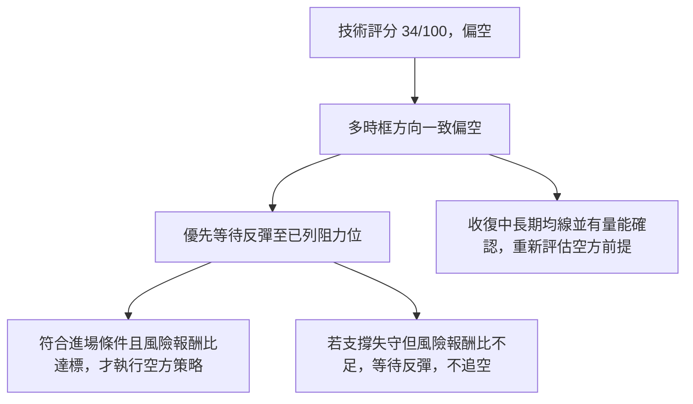

# UBER 技術分析報告

> **報告日期**：2026-11-26 ｜ **語言**：繁體中文 ｜ **數據來源**：Yahoo Finance ｜ **當前價格**：$66.35 USD（2026-11-25 收盤）

---

## 目錄

| 章節 | 內容 |
|------|------|
| [1. 技術面概覽](#1-技術面概覽) | 核心指標速覽、評分卡 |
| [2. 趨勢分析](#2-趨勢分析) | 長中短期走勢、ADX |
| [3. 圖表形態分析](#3-圖表形態分析) | 形態、K線、缺口 |
| [4. 支撐與阻力](#4-支撐與阻力) | 關鍵價位、斐波那契 |
| [5. 技術指標深度解讀](#5-技術指標深度解讀) | MA、RSI、MACD、布林、成交量、進階指標 |
| [6. 動能與波動率](#6-動能與波動率) | ATR、Beta、相對強度 |
| [7. 多時框架總結](#7-多時框架總結) | 時框架方向矩陣 |
| [8. 交易策略建議](#8-交易策略建議) | 歷史基準、策略、風險報酬比 |
| [9. 風險提示與監控](#9-風險提示與監控) | 監控指標、風險情境 |

---

## 1. 技術面概覽

整體技術方向偏空：日、週、月三個時框方向一致偏空，且價格位於主要均線下方。空方判斷的主要依據是空頭均線排列與負向 MACD 柱，同時 ADX 已進入趨勢強度門檻、且 -DI 高於 +DI。反向風險在於價格距離近一年低位不遠，日線 Stoch 回升，若支撐區守住並重新收復短期均線，可能出現反彈或空頭回補。

### 📊 核心指標速覽表

| 指標類別 | 指標名稱 | 當前數值 | 訊號 | 解讀 |
|----------|----------|----------|------|------|
| **價格** | 當前價格 | **$66.35** | 🔴 | 位於 52 週區間下部，價格定位見市場資料。 |
| **均線** | MA20 / MA50 / MA200 | 見第 5 章 | 🔴 | 價格低於三條均線，均線呈空頭排列。 |
| **動能** | RSI(14)（日線） | 見第 5 章 | 🟡 | 中性區間，尚未形成日線超賣讀值。 |
| **動能** | MACD 柱（日線） | 見第 5 章 | 🔴 | 負值，動能仍偏空。 |
| **趨勢** | ADX(14) | 見第 2 章 | 🔴 | 略高於趨勢門檻，且空方 DI 占優。 |
| **波動** | ATR(14) | 見第 6 章 | 🟡 | 日常波動幅度具一定程度，進場與停損需留有空間。 |
| **多時框** | 一致性 | 見第 7 章 | 🔴 | 日、週、月方向一致偏空。 |

### 🏆 技術評分卡

本報告唯一評分卡；綜合評分為六項子評分的算術平均，四捨五入至整數。

| 維度 | 評分（0–100） | 訊號 | 主要依據 |
|------|---------------|------|----------|
| 趨勢強度 | 25 | 🔴 | ADX 僅略高於趨勢門檻，空方方向明確；詳見第 2 章。 |
| 動能指標 | 42 | 🔴 | 日線 MACD 柱偏空、RSI 中性；詳見第 5 章。 |
| 支撐穩定度 | 48 | 🟡 | 價格接近已識別波段支撐，但多項進階指標仍在價格上方；詳見第 4、5 章。 |
| 成交量配合 | 35 | 🔴 | OBV 與 A/D 未確認價格反彈；詳見第 5 章。 |
| 形態完整度 | 35 | 🔴 | 未確認高信心度幾何形態，現階段主要是指標型偏空訊號；詳見第 3 章。 |
| 均線排列 | 20 | 🔴 | 短、中、長期均線空頭排列；詳見第 5 章。 |
| **綜合評分** | **34** | **偏空** | 六項平均為 34.17，四捨五入為 34；計算符合規則 18。 |

---

## 2. 趨勢分析

**結論：長期月線走勢仍在高位回落後的弱勢區間，中期週線偏空，短期雖有反彈跡象但尚未改變趨勢結構。** ADX 顯示目前按趨勢行情處理，故依規則以週線及中長期均線方向為主，日線只用來找進場時機。

### 📈 長期趨勢（近 12 個月）

以下階段漲跌幅以各階段起訖月收盤計算。為避免在本章重複列出當前收盤價，最後一階段截至完整月收盤；最新未完整月份的收盤值不在此表重複列示。

| 期間 | 起始月收盤 | 結束月收盤 | 漲跌幅 | 階段特徵 |
|------|------------:|------------:|-------:|----------|
| 2025-11 至 2026-03 | $87.54 | $71.93 | -17.83% | 高位回落，連續走弱。 |
| 2026-04 至 2026-08 | $74.61 | $75.65 | +1.39% | 區間震盪，未形成持續性上升趨勢。 |
| 2026-09 至 2026-10 | $68.51 | $65.25 | -4.76% | 再度走低，月線動能處於弱勢區域。 |

長期結構的關鍵不是單月反彈，而是價格能否重新站回中長期均線並形成連續的高點、低點抬升。目前月線方向仍偏空，月 RSI 位於弱勢範圍；月 MACD 柱為 **N/A（數據未提供）**。

### 📊 中期趨勢（週線）

近 20 週週收盤資料呈現先升後跌：價格在夏季由低位反彈，於 8 月後轉弱，9 月以來週收盤整體下移。週 RSI 隨價格下滑後近期回升，但仍未改變週線方向判定；週 MACD 柱在 10 月初轉負後持續處於負值區域，顯示中期動能尚未修復。

「多時框指標」的週線列判定為偏空；週收盤仍在其趨勢均線下方。近 20 週末段雖出現反彈，但反彈尚未獲週線 MACD 動能翻正、均線收復與成交量同步確認。

### ⚡ 趨勢強度（ADX）

| 指標 | 數值 | 判讀 |
|------|------:|------|
| ADX(14) | 25.64 | 高於 25，屬趨勢行情門檻；強度略高於門檻，並非極強趨勢。 |
| +DI | 13.91 | 多方方向指標較弱。 |
| -DI | 21.26 | 高於 +DI，空方主導。 |
| 行情分類 | 趨勢行情 | 依規則 14，以週線及 MA50、MA200 中長期方向為主，日線用於尋找交易時機。 |

因此本報告不以日線布林通道作為主要區間交易框架；交易方向需服從週線及中長期均線偏空的結構。

---

## 3. 圖表形態分析

**結論：目前沒有足夠資料確認高信心度的頭肩、雙底、旗形或其他幾何形態。** 可確認的內容以均線、動能、通道與量價指標為主；不以短期反彈單獨宣稱反轉形態。

### 🔍 形態識別

| 形態 | 信心度 | 判斷依據 | 完成度 | 目標價（附計算式） |
|------|--------|----------|--------|--------------------|
| 幾何反轉形態（頭肩／雙底等） | 低 | 可用價格序列不足以確認清晰頸線、左右對稱結構或有效突破。 | 訊號不足，僅做指標型解讀。 | N/A（未確認形態，無可稽核的形態高度與目標價）。 |
| 均線型偏空結構 | 中 | 日線價格低於 MA20、MA50、MA200，且均線依序空頭排列。 | 偏空排列成立；反轉尚未確認。 | 不適用；此項為指標結構，非幾何形態。 |
| 布林通道位置 | 中 | 收盤位於布林中軌下方，%B 小於中軌位置。 | 弱勢區內，尚未出現下軌外有效突破訊號。 | 不適用；不以布林通道外推精確目標價。 |

**形態判斷限制：** 近 10 根日 K 與近 8 根週 K 可用於辨識局部 K 棒，不足以單獨支撐長期幾何形態的完整頸線、型態高度與突破確認。因此本報告不提供形態高度目標價。

### 🕯️ 重要 K 線形態與缺口

以下只使用近 10 根日 K、近 8 根週 K 所列的 OHLC 判斷。列出的 K 棒並不等於確認趨勢反轉，需結合後續收盤、量能與均線訊號驗證。

| 日期（日 K／週 K） | 開 | 高 | 低 | 收 | K 線形態 | 解讀 | 訊號 |
|------|------:|------:|------:|------:|----------|------|------|
| 2026-11-19（日 K） | $69.19 | $69.26 | $65.33 | $65.60 | 長黑實體，收盤接近低位 | 賣方當日占優；下影線不足以構成明確錘頭。 | 🔴 |
| 2026-11-20（日 K） | $65.77 | $68.36 | $63.29 | $63.47 | 長上影黑 K | 盤中反彈未能守住，收盤靠近低位，顯示上方賣壓。 | 🔴 |
| 2026-11-25（日 K） | $64.00 | $66.98 | $63.57 | $66.35 | 紅 K，實體明顯 | 收盤高於開盤，屬短線反彈訊號；尚未證明中期趨勢反轉。 | 🟡 |
| 2026-11-06（週 K） | $66.12 | $72.50 | $65.55 | $68.59 | 紅 K、上影較長 | 週內曾反彈，但上方賣壓限制收盤位置。 | 🟡 |
| 2026-11-20（週 K） | $70.00 | $70.89 | $63.29 | $63.47 | 長黑週 K | 週收盤大幅落於週內區間下端，與週線偏空判斷一致。 | 🔴 |
| 2026-11-25（週 K） | $65.20 | $66.98 | $63.43 | $66.35 | 紅 K | 最新週 K 為進行中 K 棒；反彈尚未確認為週線反轉。 | 🟡 |

#### 跳空缺口

| 期間 | 日期 | 方向 | 缺口區間 | 是否回補 |
|------|------|------|----------|----------|
| 近 60 個交易日 | 無 | 無 | 無 | 無近期 ≥1% 跳空缺口；因此沒有可列為未回補缺口的價位。 |

---

## 4. 支撐與阻力

**結論：價格已進入近一年波段支撐區上方的觀察範圍，但上方阻力層次較多。** 近一年支撐聚類只有兩個已列出的層級，故不補造第三支撐；各級別均依「關鍵價位（由 OHLCV 計算）」所列數值。

### 🚧 阻力位分析表

| 阻力級別 | 價位 | 形成原因 | 突破難度 | 重要性 |
|----------|------:|----------|----------|--------|
| R1 | $72.29 | 近一年波段高點聚類。 | 中 | 第一個主要波段阻力；收復後才有條件測試更高阻力。 |
| R2 | $76.30 | 近一年波段高點聚類。 | 高 | 中段阻力，且接近成交量價值區上緣範圍。 |
| R3 | $78.60 | 近一年波段高點聚類。 | 高 | 更高層級波段阻力，需有量價與週線動能確認。 |

回溯期間：近一年。

### 🛡️ 支撐位分析表

| 支撐級別 | 價位 | 形成原因 | 守住可能性 | 重要性 |
|----------|------:|----------|------------|--------|
| S1 | $65.41 | 近一年波段低點聚類。 | 中 | 第一層波段支撐；若失守，短線賣壓可能延續。 |
| S2 | $64.04 | 近一年波段低點聚類。 | 中 | 第二層已識別波段支撐。 |
| S3 | N/A（數據未提供） | 關鍵價位區塊未列出第三層波段支撐。 | N/A（數據未提供） | 不以未提供數據推算。 |

回溯期間：近一年。因已有兩個波段支撐及三個波段阻力，本章不以樞軸點補列波段價位。

### 📐 斐波那契回調位分析

| 回調比例 | 價位 | 解讀 |
|----------|------:|------|
| 23.6% | $85.82 | 高位回撤後的上方參考阻力。 |
| 38.2% | $81.51 | 中長期反彈阻力參考。 |
| 50.0% | $78.03 | 中段回撤參考位。 |
| 61.8% | $74.56 | 上方反彈的重要回撤參考。 |
| 78.6% | $69.60 | 近端回撤參考，亦是現價上方的第一個斐波那契層級。 |

斐波那契區間基準為 52 週高點 $92.78 至 52 週低點 $63.29。當前價格位於 78.6% 回調位 $69.60 與 100% 回調位 $63.29 之間，代表價格已回撤至區間下部；若接近區間低端仍未見成交量與動能確認，不能僅因回撤幅度較深就視為底部訊號。

---

## 5. 技術指標深度解讀

**結論：均線、MACD、一目雲與成交量分布偏空；RSI 與 Stoch 僅提供中性至短線修復訊號，尚不足以抵銷主要趨勢。**

### 📈 均線、RSI、MACD、布林通道

| 指標 | 數值 | 訊號 | 解讀 |
|------|------|------|------|
| MA20 / MA50 / MA200 與排列 | MA20：$67.70；MA50：$68.57；MA200：$72.27；MA20 < MA50 < MA200 | 🔴 | 收盤低於三條均線，且短至長期均線依序下移，屬標準空頭排列。 |
| RSI(14)（日線）與背離 | RSI：45.34；資料標註近 20 根 K 棒首尾比較為「無明顯背離」 | 🟡 | 位於 30–70 中性區間。RSI 未確認明確底背離；此結論限於數據所採用的近 20 根首尾比較方法。 |
| MACD 線 / Signal / 柱 | MACD：-0.953；Signal：-0.582；柱：-0.371 | 🔴 | MACD 低於 Signal 且柱為負，日線動能偏空。 |
| MACD 背離 | 無法由所列數值確認 | 🟡 | 快照未提供可核對的價格與 MACD 擺動高低點序列，因此不宣稱存在頂背離或底背離；目前可確認的是 MACD 負值偏空。 |
| 布林上軌 / 中軌 / 下軌 / %B | 上軌：$72.40；中軌：$67.70；下軌：$63.00；%B：0.36 | 🟡 | 位於中軌下方、但尚未觸及下軌；屬通道偏弱位置，尚非明確的下軌反彈確認。 |

**指標整合：** 空頭均線排列與負 MACD 柱互相確認主要下行動能；RSI 位於中性區且未見明確背離，並未提供有力反轉確認。布林 %B 處於中軌下方，支持偏弱解讀，但仍高於下軌，意味短線存在反彈空間。Stoch %K 為 38.39、%D 為 21.52，兩者位於中性區；這是短線動能回升的線索，尚未扭轉日線 MACD 與多時框方向。

### 💹 成交量（量價配合度）

| 項目 | 數值／狀態 | 解讀 |
|------|------------|------|
| 最新成交量 | 19,832,100 股 | 與 20 日均量接近，未見明顯放量突破訊號。 |
| 20 日均量及量比 | 19,732,495 股；1.01x | 量能約在短期均量水平，對反彈的確認力度有限。 |
| 50 日均量 | 17,853,610 股 | 近期成交量高於中期均量基準，但單日量不能單獨確認趨勢反轉。 |
| OBV | OBV < MA；量能疲弱 | OBV 未確認價格走勢，量能偏弱；反彈缺乏明確累積量能支持。 |
| A/D 線 | 近 20 根不高於 20 日均值；A/D 下降、價格上漲 | 價漲而 A/D 下降，呈派發跡象；與 OBV 的量能疲弱判斷一致。 |

**量價結論：** OBV 與 A/D 均未確認價格反彈，成交量配合度偏弱。若價格反彈而 A/D 持續走低，應把反彈視為可能的回補或短線修復，而非已成立的趨勢反轉。

### 🧭 進階指標

| 指標 | 數值 | 收盤相對位置 | 解讀 |
|------|------|--------------|------|
| 一目均衡表（轉換線／基準線／雲層） | 轉換線 $67.09；基準線 $67.90；最新雲層先行帶 A $69.93、B $74.79；前方 26 根雲層先行帶 A $67.49、B $67.90 | 收盤位於最新雲層下方；轉換線低於基準線；前方 A 在 B 下方 | 偏空排列。收盤在雲下與空頭均線結論互相確認。 |
| 成交量分布（POC／價值區） | POC $71.28；價值區 $66.98–$78.03（含 73% 成交量） | 收盤位於價值區下方 | 價格在過去一年主要成交密集區下方，代表上方可能存在供給壓力；與空頭均線方向一致。 |
| 錨定 VWAP（自 52 週高點／低點） | 自 52 週高點起：$74.02；自 52 週低點起：$65.00 | 收盤低於高點錨定 VWAP、位於低點錨定 VWAP 上方 | 從高點起算的持倉成本偏上方，構成反彈壓力；從低點起算則顯示價格仍在近期低點成本基準上方，與近端反彈相符。 |
| A/D 線 | 近 20 根低於其 20 日均值；A/D 下降、價格上漲 | — | 派發跡象，與 OBV 量能疲弱相互確認，並與短線上漲表現相抵。 |

---

## 6. 動能與波動率

**結論：日均波動幅度約占股價中等比例，停損不宜貼近單日雜訊；相對強度呈現對不同基準不一致，但對整體市場的中期表現偏弱。**

### 📊 ATR 波動率分析

| 指標 | 數值 | 解讀 |
|------|------:|------|
| ATR(14) | $2.48 | 以 Wilder 方法計算的日線平均真實波幅。 |
| ATR 佔價格比例 | 3.74% | 單日波動相對股價仍須納入倉位與停損規劃。 |
| 1.5 倍 ATR 停損距離 | $3.72 | 可作為較寬鬆風險距離的參考，不等同於保證適用於所有策略。 |
| 2 倍 ATR 停損距離 | $4.96 | 波動加大或持倉週期較長時，可用作壓力測試參考。 |

ATR 是波動尺度，不是支撐或阻力位。實際策略停損仍以第 8 章列出的、符合規則的明確價位為準；若結構性停損距離大於可接受風險，應縮小部位，而非任意縮窄停損。

### 📐 Beta 與相對強度

Beta 為 1.308，代表股價對市場變動的敏感度高於市場基準的典型敏感度；這是歷史統計特徵，不代表未來波動必定維持相同。以下相對強度數值為價格報酬、不含股息，並依市場脈絡區塊照錄。

#### 相對強度 vs VTI（美國整體市場）

| 期間 | UBER | VTI | 超額報酬 |
|------|-----:|----:|---------:|
| 1 個月 | -2.2% | -5.8% | +3.6% |
| 3 個月 | -17.6% | -6.4% | -11.1% |
| 6 個月 | -8.5% | -4.2% | -4.3% |

比值趨勢：相對走弱，比值低於其 50 日均值。短期一個月相對表現較佳，但中期各期間超額報酬為負，整體不利於偏多策略，與本報告偏空主策略方向一致。

#### 相對強度 vs QQQ（Nasdaq-100）

| 期間 | UBER | QQQ | 超額報酬 |
|------|-----:|----:|---------:|
| 1 個月 | -2.2% | -10.4% | +8.2% |
| 3 個月 | -17.6% | -10.3% | -7.3% |
| 6 個月 | -8.5% | -12.5% | +4.0% |

比值趨勢：相對走強，比值高於其 50 日均值。對 QQQ 的相對表現並非全期間一致，短期與半年表現較佳、三個月表現較弱；因此只能視為偏空策略的部分抵銷因素，不能推翻週線及多時框偏空結論。

---

## 7. 多時框架總結

**結論：日線、週線、月線均偏空；時框方向依規定照錄多時框指標區塊，不用週線或月線資料重新推算。**

### 📋 時框架方向表

| 時框架 | 趨勢方向 | RSI(14) | MACD 柱 | 收盤 vs 趨勢均線 | 形態 | 建議 |
|--------|----------|---------:|--------:|------------------|------|------|
| 日線 | 偏空 | 45.34 | -0.371 | MA50 68.57；收盤在其下方 | 均線空頭排列、MACD 柱負值 | 以日線反彈尋找順勢空方進場，不追價。 |
| 週線 | 偏空 | 43.19 | -0.428 | MA20 70.75；收盤在其下方 | 週線收盤低於趨勢均線，週 MACD 柱為負 | 中期方向偏空，反彈需等突破確認。 |
| 月線 | 偏空 | 26.14 | N/A（數據未提供） | MA10 71.06；收盤在其下方 | 月線方向偏空；月 MACD 柱資料不足 | 長期方向仍偏弱，不以單週反彈作為反轉依據。 |

**多時框一致性：3/3 偏空。**

### ⚖️ 多時框收斂結論

ADX 高於趨勢行情門檻，因此依規則由週線及 MA50、MA200 等中長期方向主導；日線僅作進場時機判斷。日、週、月三個時框一致偏空，週線動能也未顯示翻多。唯一方向性結論為：**偏空**。第 8 章主策略因此採取等待反彈至阻力區後的順勢空方規劃，而非在支撐附近追空。

---

## 8. 交易策略建議

**當前主策略方向 = 偏空（依評分 34/100）。** 依評分路由，以下以順勢空方策略為主；沒有達到最低風險報酬比的價位，不列為可執行交易。

### 🧭 策略路由

### 📊 歷史基準機率

今日狀態定義為「RSI(14) 30–50 且收盤在 MA200 下方」。樣本期間為 2019-05-10 至 2026-11-25，共 1,898 個交易日；以下各持有期資料照錄歷史基準區塊。

| 持有期 | 相同狀態樣本（段數） | 上漲比例 | 中位數報酬 | 25%–75% 分位 | 全部交易日上漲比例／中位數 |
|--------|----------------------|----------|------------|--------------|----------------------------|
| 5 日 | 484（85 段） | 54% | +0.6% | -3.5% 至 +5.0% | 52%／+0.2% |
| 20 日 | 478（84 段） | 53% | +0.6% | -6.6% 至 +9.6% | 50%／+0.1% |
| 60 日 | 445（81 段） | 56% | +2.9% | -9.1% 至 +18.3% | 56%／+3.4% |

歷史相同狀態在短期持有期的上漲比例略高於全部交易日基準；較長持有期的上漲比例與全部交易日相同，但中位數報酬低於全部交易日中位數。各持有期的交易日彼此重疊，段數較接近獨立事件數，並非獨立樣本。這些是歷史頻率，不是預測；對當前偏空主策略構成反向風險提示，尤其不支持在支撐位附近盲目追空。

### 🎯 價格情境階梯（Price Scenarios）

| 觸發條件 | 下一目標 | 後續延伸 | 可能性 | 依據 |
|----------|----------|----------|--------|------|
| 突破並站穩 R1 | R2 | R3 | 中 | 若收復首層阻力且量能改善，反彈可能延伸；但需同時觀察週線動能與均線，不能只憑盤中突破判定。 |
| 站穩現價區間 | — | — | 中 | 支撐附近已有短線反彈跡象，但 OBV、A/D 未確認，且多時框仍偏空；可能維持震盪，未確認反轉。 |
| 跌破 S1 | S2 | S3：N/A（數據未提供） | 中 | 跌破首層波段支撐將增加下探第二層支撐的風險；第三層波段支撐未偵測到，不延伸編造目標。 |

### 🟢 主策略詳情

以下比值以做空公式計算：風險報酬比 =（進場價 − T1）÷（止損價 − 進場價）。所有進場、止損與目標均採第 4 章已列價位；進場條件仍須等價格觸及及出現弱勢確認。

| 策略要素 | 策略 A：R1 附近反彈做空 | 策略 B：R2 附近反彈做空 |
|----------|--------------------------|--------------------------|
| 參考當前價格 | $66.35 | $66.35 |
| 進場條件 | 反彈至 R1，出現日線轉弱或無法站穩，且週線偏空結構未變。 | 反彈至 R2，出現轉弱訊號；若有效站穩，取消空方掛單並重新評估。 |
| 進場價格 | $72.29 | $76.30 |
| 目標價 T1 | $67.12（樞軸 P） | $72.29（R1） |
| 目標價 T2 | $65.41（S1） | $67.12（樞軸 P） |
| 止損價格 | $74.56（61.8% 斐波那契位） | $78.60（R3） |
| 風險報酬比 | 1 : 2.28（以 T1 計；(72.29−67.12)÷(74.56−72.29)） | 1 : 1.74（以 T1 計；(76.30−72.29)÷(78.60−76.30)） |
| 以 T2 計的風險報酬比 | 1 : 3.03 | 1 : 3.99 |
| 把握度 | 中：與多時框偏空方向一致；但 RSI 中性、歷史基準並未顯示短期必然走低。 | 中：阻力位上方有明確失效點，且潛在回撤空間較大；但價格未必反彈至進場區。 |
| 建議倉位 | 以帳戶可承受損失反推，單筆風險控制在資金的 0.25%–0.50%；觸發止損時按計畫離場。 | 以帳戶可承受損失反推，單筆風險控制在資金的 0.25%–0.50%；考量較高入場價與止損距離，避免超額槓桿。 |

兩項策略的 T1 風險報酬比均達最低門檻，但都屬等待價格反彈後執行，不代表目前價格可直接進場。策略 A 的 T1 使用樞軸 P 作為公式價位；樞軸是公式參考，不應誤讀為波段支撐。

### 🔴 反向風險觸發點（對沖提示）

- 若價格有效站回 MA20、MA50，並進一步收復 MA200，空頭均線結構將減弱；需重新檢查空方策略，而非機械式加空。
- 若價格突破並站穩 R1，且 OBV 與 A/D 同步轉強，短線反彈可能延伸至更高阻力區，空方應避免在突破後追單。
- 若跌破 S1，雖然趨勢方向仍偏空，但若進場後至 T1 的風險報酬比不足最低門檻，應等待反彈，不追空。

---

## 9. 風險提示與監控

### ✅ 關鍵監控指標

| 監控項目 | 價位／事件 | 觸發後動作 |
|----------|------------|------------|
| 第一層波段支撐 | S1，見第 4 章 | 觀察日線收盤是否失守；未有符合風險報酬比的進場條件時不追空。 |
| 第二層波段支撐 | S2，見第 4 章 | 若價格接近，觀察賣壓是否放緩；不把未提供的下一層支撐自行推算。 |
| 第一層波段阻力 | R1，見第 4 章 | 觀察反彈能否站穩；若出現轉弱，評估策略 A。 |
| 中期阻力 | R2，見第 4 章 | 若反彈至此並轉弱，評估策略 B；有效突破時取消空方計畫。 |
| OBV 與 A/D | 量能指標見第 5 章 | 若量價由背離轉為確認且均線同步收復，降低空方曝險。 |
| 下次財報日 | 2027-02-03；距最新收盤日 70 個日曆天（Yahoo Finance，日期可能調整） | 財報前檢查持倉與停損安排；財報事件可能造成跳空，止損不保證成交。 |

策略持有期間若跨越財報日，財報可能造成價格跳空，停損單不保證按指定價格成交；若財報日期調整，應以公司及交易平台最新日程為準。

### ⚠️ 風險場景

| 情境 | 觸發條件 | 價位參考 | 可能性 | 應對 |
|------|----------|----------|--------|------|
| 樂觀（對空方不利） | 價格收復均線阻力，且成交量、OBV、A/D 同步改善 | MA20、MA50、MA200 見第 5 章；波段阻力見第 4 章 | 中 | 停止加空，檢視空頭排列是否失效；已進場部位依原停損管理。 |
| 基本（偏空延續） | 反彈無法站穩阻力，週線與日線動能維持偏空 | R1、R2 見第 4 章 | 中 | 等待符合條件的反彈空方進場；不因方向偏空而忽略風險報酬比。 |
| 悲觀（加速下跌） | 波段支撐失守，且賣出量能擴大 | S1、S2 見第 4 章；更低層支撐 N/A（數據未提供） | 中 | 持倉者以既定停損及目標執行；未進場者不因急跌追空，待反彈與風險報酬比重新符合條件。 |

以上「高／中／低」是條件式技術判斷，不是由歷史基準表推算出的策略成功機率。

### 🛡️ 風險管理提醒

- 單筆最大可承受損失應先決定，再依入場與止損距離反推部位；不得只因方向判斷偏空而放大倉位。
- 價格若未到策略列出的進場區，或進場後 T1 風險報酬比不足最低門檻，應觀望，不追價。
- 以收盤或交易計畫預先定義的觸發條件管理止損，避免盤中波動造成臨時改單。
- 財報等事件可能造成跳空，止損不保證成交；事件前應重新評估部位與隔夜風險。
- 若均線、多時框方向或 OBV／A/D 轉為與空方相反，應重新評估策略前提，不以原先判斷作為持續持倉的唯一理由。

---

## 📋 報告總結

| 項目 | 結論 |
|------|------|
| 報告日期 | 2026-11-26 |
| 當前價格 | 見第 1 章（2026-11-25 收盤） |
| 綜合評分／方向 | 34/100，偏空 |
| 長期／中期／短期趨勢 | 🔴 長期月線偏空；🔴 中期週線偏空；🟡 短線反彈尚未確認趨勢反轉。 |
| 關鍵支撐／關鍵阻力 | S1、S2 與 R1–R3 見第 4 章。 |
| 🥇 最佳機會 | 策略 A：等待反彈至 R1 並轉弱後做空；符合條件後執行，未到價不追空。 |
| 最大風險 | 支撐附近的短線反彈若獲成交量、A/D 與均線收復共同確認，將削弱空方趨勢判斷。 |

> ⚠️ **免責聲明**：本報告為 AI 自動生成之技術分析，所有數據及估算均基於歷史價格資訊。本報告僅供研究與學術參考，不構成任何投資建議。投資有風險，入市需謹慎。

---

## 資料與來源

| 項目 | 內容 |
|------|------|
| 價格 | 66.35 USD，2026-11-25 收盤（Yahoo Finance 日線） |
| K 棒 | 501 根日線，2024-11-26 至 2026-11-25（Yahoo Finance）；較長期間的價位與基準機率取自價格資料庫 |
| 關鍵價位回溯期間 | 阻力 近一年、支撐 近一年 |
| 下次財報日 | 2027-02-03（Yahoo Finance，日期可能調整） |
| 有回應的資料來源 | Yahoo Finance、Finviz、StockAnalysis、Roic.ai |
| 由程式計算 | 所有指標、R1–S3 與斐波那契價位、多時框方向、相對強度、缺口、歷史基準機率、綜合評分 |
| 撰寫模型 | openai / gpt-6-luna |

> 本區塊由產生報告的程式依實際取得的資料填寫，非模型撰寫。「由程式計算」的數字不是模型的估計；其餘判斷（評分、情境、策略）是模型的分析。
