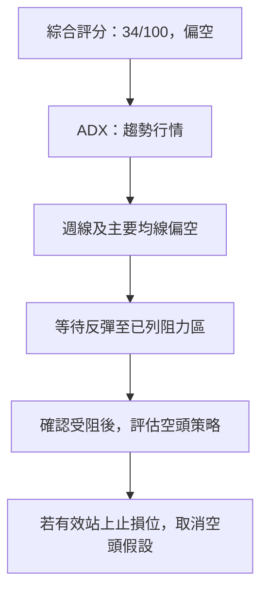

# UBER 技術分析報告

> **報告日期**：2026-11-27 ｜ **語言**：繁體中文 ｜ **數據來源**：Yahoo Finance ｜ **當前價格**：US$66.35（收盤日期：2026-11-25）

---

## 目錄

| 章節 | 內容 |
|------|------|
| [1. 技術面概覽](#1-技術面概覽) | 核心指標速覽、評分卡 |
| [2. 趨勢分析](#2-趨勢分析) | 長中短期走勢、ADX |
| [3. 圖表形態分析](#3-圖表形態分析) | 形態、K線、缺口 |
| [4. 支撐與阻力](#4-支撐與阻力) | 關鍵價位、斐波那契 |
| [5. 技術指標深度解讀](#5-技術指標深度解讀) | MA、RSI、MACD、布林、成交量、進階指標 |
| [6. 動能與波動率](#6-動能與波動率) | ATR、Beta、相對強度 |
| [7. 多時框架總結](#7-多時框架總結) | 時框架評分矩陣 |
| [8. 交易策略建議](#8-交易策略建議) | 歷史基準、策略、風險報酬比 |
| [9. 風險提示與監控](#9-風險提示與監控) | 監控指標、風險場景 |

---

## 1. 技術面概覽

目前技術結構偏空：價格位於主要均線下方，且日、週、月三個時框的方向一致偏空。最重要的確認訊號是均線空頭排列與空頭 DI 主導；較大的反向風險則是價格靠近近一年低位區域，短線可能出現反彈，且相對強度近期對大盤有所改善。整體評分偏空，但策略上仍須等待價格反彈至既定阻力區，不能因方向偏空而在支撐附近追空。

### 📊 核心指標速覽表

| 指標類別 | 指標名稱 | 當前數值 | 訊號 | 解讀 |
|----------|----------|----------|------|------|
| **價格** | 當前價格 | US$66.35 | 🔴 | 收盤價接近近一年低位區域，價格結構仍弱。 |
| **均線** | MA20 / MA50 / MA200 | 見第 5 章 | 🔴 | 價格低於三條主要均線，均線排列偏空。 |
| **動能** | RSI(14)（日線） | 見第 5 章 | 🟡 | 尚未進入超賣區，動能中性偏弱。 |
| **動能** | MACD 柱（日線） | 見第 5 章 | 🔴 | 負值柱顯示短線空頭動能仍在。 |
| **趨勢** | ADX(14) | 見第 2 章 | 🔴 | 趨勢強度略高於趨勢門檻，空頭 DI 主導。 |
| **波動** | ATR(14) | 見第 6 章 | 🟡 | 日常波動幅度具一定規模，止損不宜設得過窄。 |
| **多時框** | 一致性 | 見第 7 章 | 🔴 | 日、週、月線方向一致偏空。 |

### 🏆 技術評分卡

綜合評分為六項子評分的算術平均，四捨五入至整數；本卡為全報告唯一評分卡。

| 維度 | 評分（0–100） | 訊號 | 主要依據（引用數值所在章節） |
|------|---------------|------|------------------------------|
| 趨勢強度 | 32 | 🔴 | ADX 顯示趨勢已達趨勢行情門檻，且空頭 DI 主導，見第 2 章。 |
| 動能指標 | 40 | 🔴 | RSI 未超賣，但 MACD 柱偏空；反彈動能尚不足以扭轉結構，見第 5 章。 |
| 支撐穩定度 | 42 | 🟡 | 價格靠近已列出的波段支撐，但中長期方向偏空，支撐確認仍不足，見第 4 章。 |
| 成交量配合 | 35 | 🔴 | OBV 低於均線，A/D 走弱，量能未能確認價格反彈，見第 5 章。 |
| 形態完整度 | 30 | 🔴 | 目前較適合以趨勢及指標解讀，尚無足夠幾何結構確認反轉形態，見第 3 章。 |
| 均線排列 | 25 | 🔴 | 主要均線呈空頭排列，價格位於主要均線下方，見第 5 章。 |
| **綜合評分** | **34** | **偏空** | 六項平均為 34，符合偏空分類。 |

---

## 2. 趨勢分析

### 📈 長期趨勢（近 12 個月）

近十二個月的月收盤走勢呈現先回落、其後反彈、再度走弱的階段結構。最近階段收盤持續下移，長期方向偏空；月線指標亦與此方向相符。月線 MACD 柱數據不足，不作推算。

| 階段 | 起訖月收盤 | 漲跌幅 | 特徵 |
|------|------------|--------|------|
| 2025-12 至 2026-03 | US$81.71 → US$71.93 | -11.97% | 連續回落，長期趨勢轉弱。 |
| 2026-04 至 2026-07 | US$74.61 → US$70.36 | -5.70% | 中途反彈後再度回落，尚未形成持續上升結構。 |
| 2026-08 至 2026-11 | US$75.65 → US$66.35 | -12.29% | 反彈高點後轉弱，近期月收盤重心下移。 |

*價格來源：價格資料庫。階段漲跌幅以各階段起訖月收盤計算。*

### 📊 中期趨勢（週線）

週線方向偏空。近二十週走勢顯示，夏季高位後整體回落；週 RSI 在近期反彈時回升，但仍未扭轉週線偏空判定。週 MACD 柱在轉負後仍處負值區，配合週線收盤低於趨勢均線，反映中期賣壓尚未解除。詳細週線指標見第 7 章。

### ⚡ 趨勢強度（ADX）

| 指標 | 數值 | 解讀 |
|------|------|------|
| ADX(14) | 25.64 | 高於 25，按本報告規則屬趨勢行情；但僅略高於門檻，趨勢強度不宜解讀為極強。 |
| +DI | 13.91 | 多方方向動能較弱。 |
| −DI | 21.26 | 高於 +DI，空頭方向主導。 |

**收斂方式：**目前屬趨勢行情，依多時框規則以中長期週線及 MA50、MA200 方向為主，日線用於尋找交易時機。中長期結構偏空，因此日線短暫反彈不構成方向反轉確認。

---

## 3. 圖表形態分析

### 🔍 形態識別

目前 OHLCV 歷史片段不足以確認高信心度的頭肩、雙底或旗形等幾何形態；因此以下以指標型結構為主，不將短線波動過度解讀為反轉形態。

| 形態／結構 | 信心度 | 判斷依據 | 完成度 | 目標價 |
|------------|--------|----------|--------|--------|
| 主要均線空頭排列 | 高 | 日線收盤位於主要均線下方；均線排列偏空，且週、月時框方向一致偏空。 | 已形成，但尚未代表未來必然續跌。 | 不適用；不是具備可稽核高度的幾何形態。 |
| 近端反彈嘗試 | 低 | 最近交易日收盤回升，但量能與 A/D 尚未確認，且仍受上方均線及阻力區制約。 | 未確認突破或趨勢反轉。 | 不適用；訊號不足，僅做指標型解讀。 |
| 雙底／頭肩／旗形 | 低 | 現有區段未提供足以確認頸線、形態高度或完整擺動結構的可靠證據。 | 未確認。 | 不適用；不作形態目標推算。 |

### 🕯️ 重要 K 線形態與缺口

以下 K 線判讀僅使用「近10根日K」及「近8根週K」的 OHLC。日線近期出現看跌長上影線，隨後有一根可能的看漲吞噬形態；惟吞噬只代表短線反彈訊號，並未改變中長期偏空結構。

| 日期（日K／週K） | 開 | 高 | 低 | 收 | K 線形態 | 解讀 | 訊號 |
|------|----:|----:|----:|----:|----------|------|------|
| 2026-11-20（日K） | US$65.77 | US$68.36 | US$63.29 | US$63.47 | 長上影、收盤接近日低 | 高位受阻，當日賣壓顯著；不能單獨視為反轉訊號。 | 🔴 |
| 2026-11-24（日K） | US$63.50 | US$65.73 | US$63.43 | US$64.70 | 小實體陽線 | 低位有買盤，但尚未證明趨勢反轉。 | 🟡 |
| 2026-11-25（日K） | US$64.00 | US$66.98 | US$63.57 | US$66.35 | 看漲吞噬前一日實體 | 收盤高於前一日實體範圍，形成短線反彈訊號；仍須上方阻力與量能確認。 | 🟡 |
| 2026-11-20（週K） | US$70.00 | US$70.89 | US$63.29 | US$63.47 | 長實體週陰線 | 週內由高位回落，週線賣壓強；對短線反彈形成壓力。 | 🔴 |
| 2026-11-25（週K） | US$65.20 | US$66.98 | US$63.43 | US$66.35 | 下影線反彈，週K未完結 | 週線有低位承接，但該週 K 棒未完成，訊號可靠度有限。 | 🟡 |

*K 棒價格來源：Yahoo Finance。*

**跳空缺口：**近 60 個交易日未偵測到達到規則門檻的跳空缺口；因此沒有可列入支撐或阻力參考的未回補缺口區間。

---

## 4. 支撐與阻力

### 🚧 阻力位分析表

阻力位來自近一年波段高點聚類。阻力難度評估綜合均線、趨勢方向及距離收盤價的相對位置，不代表必然受阻。

| 阻力級別 | 價位 | 形成原因 | 突破難度 | 重要性 |
|----------|------:|----------|----------|--------|
| R1 | US$72.29 | 近一年波段高點聚類；與長期壓力區及一目雲層下方區域接近。 | 中 | 首要反彈觀察位；收復並站穩才改善短線結構。 |
| R2 | US$76.30 | 近一年波段高點聚類；位於更高的供給區。 | 高 | 若突破 R1 後回測守穩，才有條件挑戰此位。 |
| R3 | US$78.60 | 近一年波段高點聚類；處於較高阻力區。 | 高 | 突破需更充分的量價確認。 |

### 🛡️ 支撐位分析表

支撐位來自近一年波段低點聚類。資料中未偵測到 S3；不以其他來源自行補值。

| 支撐級別 | 價位 | 形成原因 | 守住可能性 | 重要性 |
|----------|------:|----------|------------|--------|
| S1 | US$65.41 | 近一年波段低點聚類，鄰近近期價格區域。 | 中 | 第一層短線觀察位；若失守，需留意下方支撐測試。 |
| S2 | US$64.04 | 近一年波段低點聚類。 | 中 | 若價格跌破 S1，此位是下一層波段支撐參考。 |
| S3 | N/A（數據未提供） | 關鍵價位區塊未列出第三個波段支撐。 | N/A（數據未提供） | 不推算、不補值。 |

波段支撐與阻力均已提供至少兩級，本節不以樞軸點替代或重標波段價位。

### 📐 斐波那契回調位分析

| 回調位 | 價位 | 技術意義 |
|--------|------:|----------|
| 23.6% | US$85.82 | 位於較高回調區，需先收復較低阻力才能評估。 |
| 38.2% | US$81.51 | 中段回調參考位。 |
| 50.0% | US$78.03 | 半回調參考位，且靠近上方波段壓力區。 |
| 61.8% | US$74.56 | 常見回調觀察位，仍高於現有價格區間。 |
| 78.6% | US$69.60 | 現價上方最近一級斐波那契參考位。 |

現價位於 **78.6% 回調位 US$69.60 與 100.0% 回調位 US$63.29** 之間，顯示價格已回吐大部分前期波段升幅，並靠近 52 週低位參考。若下方區域失守，須以已列出的波段支撐作為風險觀察，而不以斐波那契位置推測未提供的支撐。

---

## 5. 技術指標深度解讀

### 📈 均線、RSI、MACD、布林通道

| 指標 | 數值 | 訊號 | 解讀 |
|------|------|------|------|
| MA20 / MA50 / MA200 與排列 | MA20 US$67.70；MA50 US$68.57；MA200 US$72.27；MA20 < MA50 < MA200 | 🔴 | 收盤低於三條均線，且均線空頭排列；上方均線構成逐層壓力。 |
| RSI(14)（日線）與背離 | RSI 45.34；數據標示無明顯 RSI 背離 | 🟡 | RSI 位於中性區間偏弱，未達超賣。近二十根 K 棒首尾比較未顯示明顯背離。 |
| MACD 線 / Signal / 柱 | MACD -0.953；Signal -0.582；Histogram -0.371 | 🔴 | MACD 線低於 Signal 且柱值為負，短線動能偏空。現有資料未提供可確認的 MACD 擺動高低點背離，故判定為未確認背離，而非推定存在背離。 |
| 布林上軌 / 中軌 / 下軌 / %B | US$72.40 / US$67.70 / US$63.00；%B 0.36 | 🟡 | 收盤位於中軌下方、通道下半部，但未貼近下軌；反映偏弱而非明確極端超賣。 |

**指標整合：**均線、MACD 與多時框趨勢彼此確認偏空；RSI 仍在中性範圍，沒有顯示極端賣壓或明確背離。布林 %B 位於通道下半部，支持偏弱判讀，但不足以單獨推斷即將突破或反轉。短線吞噬反彈 K 線與主要趨勢方向有分歧，應視為逆勢反彈訊號，而不是趨勢反轉確認。

### 💹 成交量（量價配合度）

| 指標 | 數值／狀態 | 解讀 |
|------|-------------|------|
| 最新成交量 | 19,842,500 股 | 與 20 日均量接近，單日成交量未顯示明顯放量確認。 |
| 20 日均量／量比 | 19,733,015 股／1.01 倍 | 成交量大致符合短期均量，沒有強烈量能突破訊號。 |
| 50 日均量 | 17,853,818 股 | 近端成交量基準低於 20 日均量，需觀察反彈是否能持續放量。 |
| OBV | OBV 低於其均線 | 🔴 量能疲弱；尚未確認價格反彈。 |
| A/D 線 | 近二十根不高於其均值；A/D 下降而價格上漲 | 🔴 顯示價漲量能結構背離，具派發跡象，降低短線反彈的可信度。 |

**量價結論：**目前成交量沒有明確確認反彈；OBV 與 A/D 的方向偏弱，和最近的價格回升不一致。若價格挑戰阻力，應要求量能改善並觀察 A/D 是否停止下滑，否則突破可靠度有限。

### 🧭 進階指標

| 指標 | 數值 | 收盤相對位置 | 解讀 |
|------|------|--------------|------|
| 一目均衡表（轉換線／基準線／雲層） | 轉換線 US$67.09；基準線 US$67.90；先行帶 A US$69.93、B US$74.79。前方 26 根先行帶 A US$67.49、B US$67.90，A 在 B 下方。 | 收盤位於雲層下方；轉換線亦在基準線下方。 | 一目均衡表偏空，與均線、MACD 及中長期方向相互確認。 |
| 成交量分布（POC／價值區） | POC US$71.28；價值區 US$66.98–US$78.03，涵蓋 73% 成交量。 | 收盤位於價值區下方。 | 價格落在歷史成交密集區下方，該價值區可能構成上方供給壓力，與偏空趨勢一致。 |
| 錨定 VWAP（自 52 週高點／低點） | 自 2025-12-08 起 US$74.02；自 2026-11-20 起 US$65.00。 | 收盤低於高點錨定 VWAP，並高於低點錨定 VWAP。 | 中長期錨定成本位偏空；近期低點錨定 VWAP 則顯示低位後有短線回升，兩者呈現長空、短反彈的組合。 |
| A/D 線 | 近二十根不高於其 20 日均值；A/D 下降、價格上漲。 | — | 有派發跡象；與 RSI 未超賣的判讀相容，但和短線價格反彈相矛盾。 |

*指標與價位來源：程式由日線計算。*

---

## 6. 動能與波動率

### 📊 ATR 波動率分析

| 指標 | 數值 | 解讀 |
|------|------|------|
| ATR(14) | US$2.48 | Wilder 方法計算的日均真實波幅參考。 |
| ATR 佔收盤價比例 | 3.74% | 單日波動相對價格不低，倉位及止損距離須考慮波動。 |
| 1.5 倍 ATR 參考距離 | US$3.72 | 由 ATR 乘以 1.5 計算，可作一般波動緩衝參考；不是本報告的支撐或策略止損價。 |
| 2 倍 ATR 參考距離 | US$4.96 | 由 ATR 乘以 2 計算，可作較寬波動緩衝參考；不是本報告的支撐或策略止損價。 |

策略止損依第 8 章所列的已知技術價位設定；ATR 距離僅用於檢查止損是否可能過窄，不取代已列出的價位，也不應以 ATR 倍數另造支撐或目標。

### 📐 Beta 與相對強度

Beta 為 **1.308**，表示 UBER 歷史上對市場波動較敏感；Beta 不是未來波動幅度或方向的保證。相對強度以下市況脈絡資料為準，報酬均為價格報酬、不含股息。

| 比較基準 | 期間 | UBER | 基準 | 超額報酬 | 比值趨勢 |
|----------|------|-----:|-----:|---------:|----------|
| VTI（美國整體市場） | 1 個月 | +0.9% | -6.5% | +7.4% | 相對走強；比值高於其 50 日均值。 |
| VTI（美國整體市場） | 3 個月 | -13.8% | -7.2% | -6.6% | 相對走強；比值高於其 50 日均值。 |
| VTI（美國整體市場） | 6 個月 | -6.4% | -5.0% | -1.5% | 相對走強；比值高於其 50 日均值。 |
| QQQ（Nasdaq-100） | 1 個月 | +0.9% | -12.1% | +13.0% | 相對走強；比值高於其 50 日均值。 |
| QQQ（Nasdaq-100） | 3 個月 | -13.8% | -12.1% | -1.7% | 相對走強；比值高於其 50 日均值。 |
| QQQ（Nasdaq-100） | 6 個月 | -6.4% | -13.8% | +7.4% | 相對走強；比值高於其 50 日均值。 |

*相對強度來源：價格資料庫。*

**相對強度解讀：**短期對大盤及 Nasdaq-100 的相對表現改善，但較長比較期間仍有部分落後基準。相對強度改善可降低空頭交易的確定性，然而尚未抵銷均線、週線方向及量能指標偏空的訊號。因此，它對「等待反彈後尋找空方進場」構成部分相抵，而非足以反轉主策略。

---

## 7. 多時框架總結

### 📋 時框架評分表

以下方向、趨勢均線、RSI、MACD 柱按多時框指標區塊列示；週線、月線最後一根均為截至最新交易日的進行中 K 棒。

| 時框架 | 趨勢方向 | RSI(14) | MACD 柱 | 收盤 vs 趨勢均線 | 形態 | 建議 |
|--------|----------|---------|---------|------------------|------|------|
| 日線 | 偏空 | 45.34 | -0.371 | US$66.35 低於 MA50 US$68.57 | 主要均線空頭排列；短線有反彈嘗試 | 以反彈尋找空方機會，不追空支撐。 |
| 週線 | 偏空 | 43.19 | -0.428 | US$66.35 低於 MA20 US$70.75 | 收盤低於週線趨勢均線，週動能柱為負 | 中期方向偏空；等待日線反彈確認阻力。 |
| 月線 | 偏空 | 26.14 | N/A（數據未提供） | US$66.35 低於 MA10 US$71.06 | 月線趨勢偏弱，月 RSI 低位但未構成反轉證據 | 長期偏空；不因低 RSI 單獨做多。 |

**多時框一致性：3/3 偏空。**

### ⚖️ 多時框收斂結論

ADX 高於趨勢行情門檻，故採用趨勢行情的收斂規則，以週線及 MA50、MA200 中長期方向主導，日線只負責尋找較佳進場時機。日、週、月方向均偏空，沒有時框衝突需要逆向取捨。**唯一方向性結論：偏空。**短線反彈及相對強度改善是反向風險，不足以改變主結論。

---

## 8. 交易策略建議

### 🧭 策略路由（依評分卡分流）

**當前主策略方向 = 偏空（依評分 34/100）。**按評分規則主推空頭策略；此處的策略均為條件式方案，價格未進入設定區域前不追價執行。

### 📊 歷史基準機率

今日狀態為 **RSI(14) 30–50 且收盤低於 MA200**。樣本期間為 **2019-05-10 至 2026-11-25**，總計 **1,898 個交易日**。以下歷史基準由價格資料庫計算，百分比只表示相同狀態之後的歷史上漲比例，不是預測。

| 持有期 | 相同狀態樣本（段數） | 上漲比例 | 中位數報酬 | 25%–75% 分位 | 全部交易日上漲比例／中位數 |
|--------|----------------------|----------|------------|--------------|----------------------------|
| 5 日 | 484（85 段） | 54% | +0.6% | -3.5% 至 +5.0% | 52%／+0.2% |
| 20 日 | 478（84 段） | 53% | +0.6% | -6.6% 至 +9.6% | 50%／+0.1% |
| 60 日 | 445（81 段） | 56% | +2.9% | -9.1% 至 +18.3% | 56%／+3.4% |

歷史上相同狀態的短、中期上漲比例與全部交易日相比差異有限，較長持有期的上漲比例與全部交易日相同；因此，歷史狀態資料本身**不支持把空頭方向視為具有明顯統計優勢**。雖然交易日樣本數不低，但狀態會連續出現、持有期互相重疊，較接近獨立事件的段數較少。此結果對偏空主策略構成相抵，故應嚴格採用價位觸發、控制倉位，不能把歷史頻率當作預測。

### 🎯 價格情境階梯（Price Scenarios）

以下價位均取自第 4 章已列波段價位。可能性以高／中／低作定性判斷，並非自估機率。

| 觸發條件 | 下一目標 | 後續延伸 | 可能性 | 依據 |
|----------|----------|----------|--------|------|
| 突破並站穩 R1 | R2：US$76.30 | R3：US$78.60 | 低 | 需先收復首要阻力並有成交量確認；均線、MACD 與多時框方向仍偏空。 |
| 守住現有支撐區並反彈 | R1：US$72.29 | 斐波那契 78.6%：US$69.60 為途中觀察位 | 中 | 低位反彈 K 線可提供短線支持，但 OBV、A/D 未確認，且上方均線仍構成壓力。 |
| 跌破 S1 | S2：US$64.04 | 斐波那契 100.0%：US$63.29 | 中 | 主要趨勢偏空；但近端支撐尚未確認失守，須以收盤或回測確認避免假跌破。 |

### 🟢 主策略詳情（偏空）

以下兩項為不同阻力位的條件式空頭方案，必須出現受阻或失敗突破等價格確認才考慮進場。風險報酬比依規則以 T1 計算；每筆均須達到最低門檻。

| 策略要素 | 策略 A：R1 受阻 | 策略 B：R2 受阻 |
|----------|------------------|------------------|
| 進場條件 | 價格反彈至 R1 後受阻，且日線未能有效站穩該位；不在現價附近追空。 | 價格上行至 R2 後出現明確受阻；僅在空頭結構未被破壞時執行。 |
| 進場價格 | US$72.29 | US$76.30 |
| 目標價 T1 | US$65.41（S1） | US$72.29（R1） |
| 目標價 T2 | US$64.04（S2） | US$65.41（S1） |
| 止損價格 | US$76.30（R2） | US$78.60（R3） |
| 風險報酬比 | 1 : 1.72（以 T1 計）；計算： (72.29 − 65.41) ÷ (76.30 − 72.29) = 1.72 | 1 : 1.74（以 T1 計）；計算： (76.30 − 72.29) ÷ (78.60 − 76.30) = 1.74 |
| 把握度 | 中：主要趨勢偏空，但須等待價格反彈至阻力並確認受阻。 | 低：需先出現較大幅反彈才觸及；在未觸及及未確認受阻前不成立。 |
| 建議倉位 | 單筆帳戶風險控制在 0.25%–0.50%；按進場至止損距離計算股數。 | 單筆帳戶風險控制在 0.25%–0.50%；按進場至止損距離計算股數。 |

**策略優先順序：**策略 A 較接近近期價格結構，但必須等待反彈到其進場條件；策略 B 是較高阻力位的備選方案。若價格未觸及進場價或未出現受阻確認，兩者皆不執行。T1、T2 均為已列關鍵價位，沒有用未提供的價格推算目標。

### 🔴 反向風險觸發點（對沖提示）

| 反向觸發 | 風險含義 | 風控動作 |
|----------|----------|----------|
| 收盤有效站上策略止損位 R2 | 策略 A 空頭假設失效；反彈可能延伸至更高阻力。 | 依策略止損，不因看空立場延後退出。 |
| 收盤有效站上 R3 | 策略 B 的失效條件出現，中期空頭結構需重新評估。 | 停止新增空頭部位，重新檢視週線與成交量。 |
| 支撐區附近出現持續放量、OBV 與 A/D 同步轉強 | 可能代表賣壓減弱，短線反彈可信度提高。 | 暫緩追空，等待價格重新確認方向。 |

---

## 9. 風險提示與監控

### ✅ 關鍵監控指標

| 監控項目 | 觀察條件 | 觸發後動作 |
|----------|----------|------------|
| S1／S2 波段支撐 | 留意收盤是否失守 S1，及其後是否測試 S2。 | 不以盤中短暫跌破單獨追空；等待收盤或回測確認。 |
| R1 反彈阻力 | 觀察反彈至 R1 後是否受阻，及成交量是否配合。 | 若受阻，才評估策略 A；若放量站穩，取消該次空頭進場。 |
| R2／R3 上方風險 | 價格接近策略止損或有效突破更高阻力。 | 依策略止損退出，勿擴大虧損限額。 |
| OBV 與 A/D | 觀察量能指標能否停止走弱、是否配合價格反彈。 | 若量能持續不確認反彈，空頭論點較完整；若轉強，降低空頭曝險。 |
| 下次財報日 | 2027-02-03；距最新收盤日 70 個日曆天。日期來源為 Yahoo Finance，可能調整。 | 若策略仍持有至財報日附近，降低曝險或預先退出；財報可能造成跳空，止損不保證成交。 |

### ⚠️ 風險場景

| 情境 | 觸發條件 | 價位參考 | 可能性 | 應對 |
|------|----------|----------|--------|------|
| 樂觀（對空頭不利） | 放量收復首要阻力，且量能指標同步改善。 | 先看 R1，其後觀察 R2。 | 低 | 不追空；若持有空單，按既定止損管理。 |
| 基本 | 價格在 S1 至 R1 區域內震盪，均線與量能仍偏弱。 | S1、R1 | 中 | 等待反彈受阻或支撐有效跌破後再行動，避免區間中段追價。 |
| 悲觀（對空頭有利） | 收盤確認跌破 S1，並進一步測試下一級波段支撐。 | S2，其後參考斐波那契 100.0% 位 | 中 | 僅在確認跌破後考慮順勢管理；接近下方支撐時不宜無條件加碼。 |

### 🛡️ 風險管理提醒

- 單筆風險先以帳戶可承受損失設定，再依進場價與止損價距離計算股數；不要先固定股數再放寬止損。
- 兩項空頭策略均須等候價格進入指定阻力區並確認受阻；未到價不預先進場。
- 若價格放量站上策略止損位，依計畫退出；不要因為週線偏空而忽略日線反轉訊號。
- 財報可能導致價格跳空，止損單無法保證按指定價格成交；持倉期間若接近財報，應重新評估曝險。
- 歷史基準是過往條件下的頻率，不代表未來結果；段數低於交易日樣本數，且存在重疊樣本。

---

## 📋 報告總結

| 項目 | 結論 |
|------|------|
| 報告日期 | 2026-11-27 |
| 當前價格 | 見標題列；收盤日期為 2026-11-25。 |
| 綜合評分／方向 | 34/100，偏空。 |
| 長期／中期／短期趨勢 | 🔴 長期偏空；🔴 中期偏空；🟡 短線有反彈嘗試但未確認反轉。 |
| 關鍵支撐／關鍵阻力 | 支撐參考 S1、S2；阻力參考 R1、R2、R3，詳細價位見第 4 章。 |
| 🥇 最佳機會 | 等待反彈至 R1 並確認受阻，再評估策略 A；未到價不交易。 |
| 最大風險 | 價格接近低位支撐且相對強度近期改善，若放量收復阻力，空頭策略可能失效。 |

> ⚠️ **免責聲明**：本報告為 AI 自動生成之技術分析，所有數據及估算均基於歷史價格資訊。本報告僅供研究與學術參考，不構成任何投資建議。投資有風險，入市需謹慎。

---

## 資料與來源

| 項目 | 內容 |
|------|------|
| 價格 | 66.35 USD，2026-11-25 收盤（Yahoo Finance 日線） |
| K 棒 | 501 根日線，2024-11-26 至 2026-11-25（Yahoo Finance）；較長期間的價位與基準機率取自價格資料庫 |
| 關鍵價位回溯期間 | 阻力 近一年、支撐 近一年 |
| 下次財報日 | 2027-02-03（Yahoo Finance，日期可能調整） |
| 有回應的資料來源 | Yahoo Finance、Finviz、StockAnalysis、Roic.ai |
| 由程式計算 | 所有指標、R1–S3 與斐波那契價位、多時框方向、相對強度、缺口、歷史基準機率、綜合評分 |
| 撰寫模型 | openai / gpt-6-luna |

> 本區塊由產生報告的程式依實際取得的資料填寫，非模型撰寫。「由程式計算」的數字不是模型的估計；其餘判斷（評分、情境、策略）是模型的分析。
