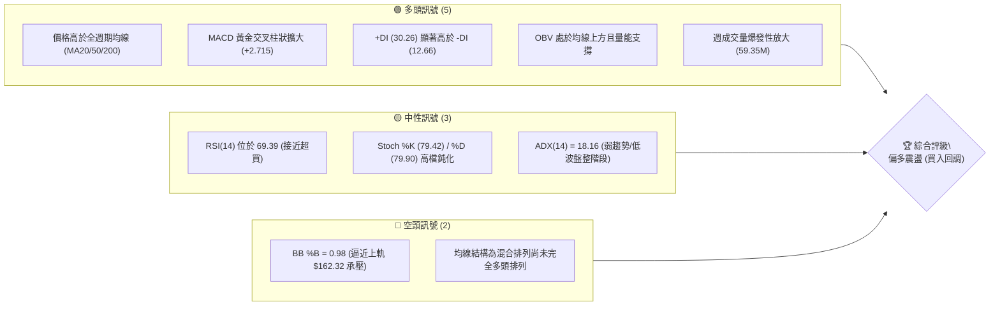
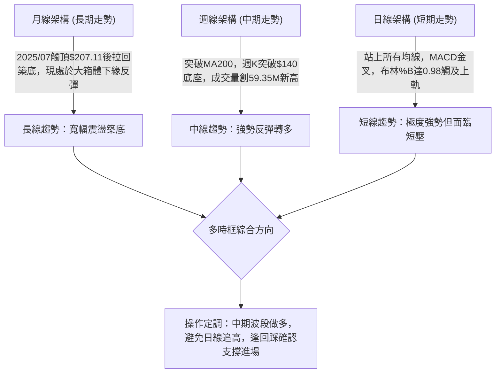
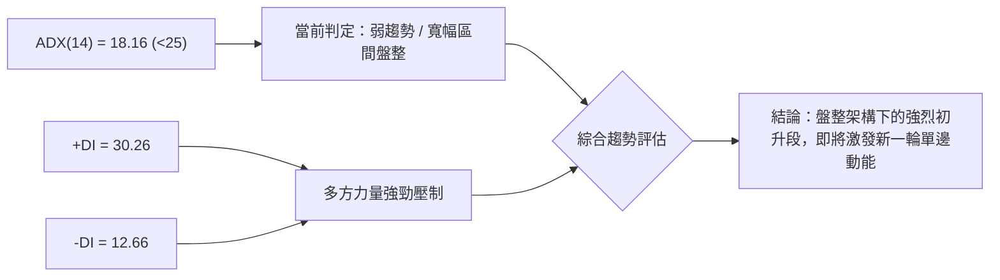
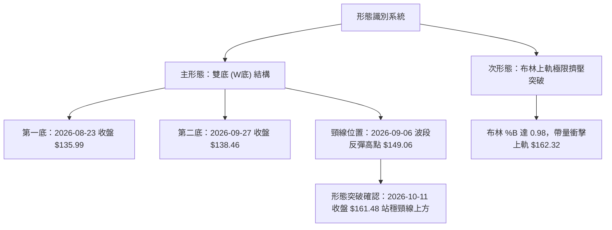
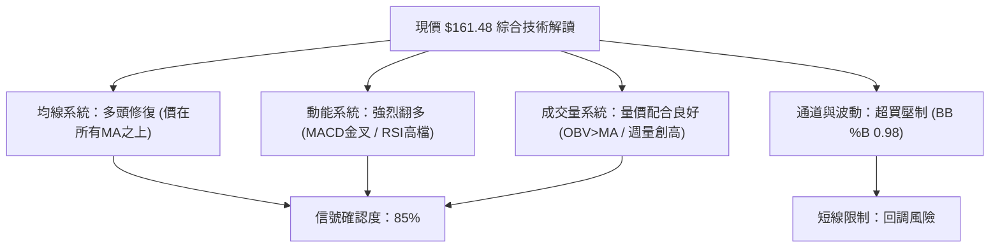
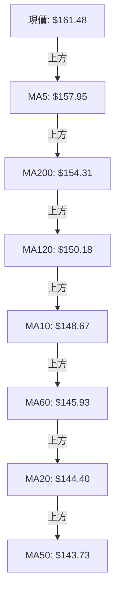
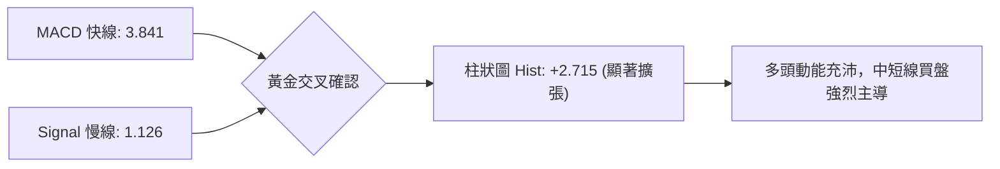
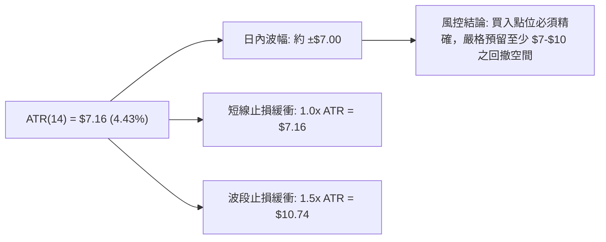
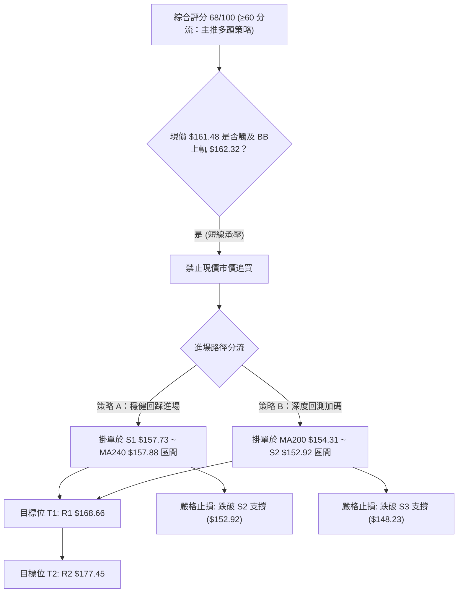
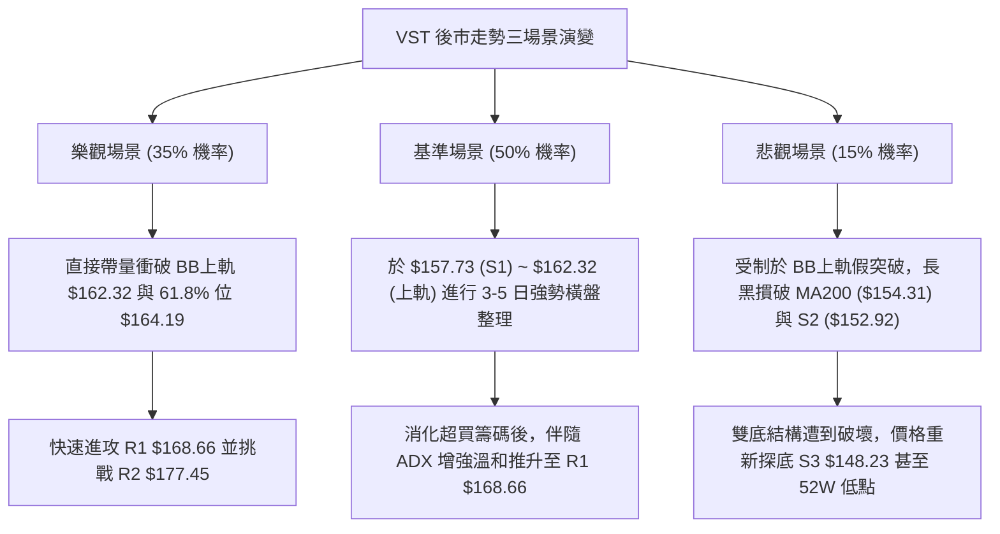

# VST 技術分析報告

> **報告日期**：2026-10-11 ｜ **語言**：繁體中文 ｜ **數據來源**：Yahoo Finance ｜ **當前價格**：$161.48

---

## 目錄

| 章節 | 內容 |
|------|------|
| [1. 技術面概覽](#1-技術面概覽) | 訊號儀表板、核心指標、評分卡 |
| [2. 趨勢分析](#2-趨勢分析) | 多時框趨勢、長中短期走勢 |
| [3. 圖表形態分析](#3-圖表形態分析) | 形態識別、K線組合、目標價 |
| [4. 支撐與阻力](#4-支撐與阻力) | 關鍵價位、斐波那契回調 |
| [5. 技術指標深度解讀](#5-技術指標深度解讀) | MA/RSI/MACD/布林/成交量 |
| [6. 動能與波動率](#6-動能與波動率) | 動能評估、ATR、Beta |
| [7. 多時框架總結](#7-多時框架總結) | 時框架評分矩陣 |
| [8. 交易策略建議](#8-交易策略建議) | 多空策略、風險報酬比 |
| [9. 風險提示與監控](#9-風險提示與監控) | 監控指標、風險場景 |

---

## 1. 技術面概覽

### 🎯 技術訊號儀表板



### 📊 核心指標速覽表

| 指標類別 | 指標名稱 | 當前數值 | 訊號 | 解讀 |
|----------|----------|----------|------|------|
| **價格** | 當前價格 | $161.48 | 🟢 | 站上 52 週低點反彈 22.09%，處 52 週區間 35.0% 分位 |
| **均線** | MA20 | $144.40 | 🟢 | 現價高於 MA20 達 +11.83%，短線乖離擴大，多方防守線 |
| **均線** | MA50 | $143.73 | 🟢 | 現價高於 MA50，中期趨勢翻揚形成支撐平台 |
| **均線** | MA200 | $154.31 | 🟢 | 現價重回牛熊分界線上方 (+4.65%)，長多結構修復 |
| **動能** | RSI(14) | 69.39 | 🟡 | 位於強勢多頭區間，接近 70 警戒線，無頂背離 |
| **動能** | MACD | 3.841 | 🟢 | MACD > Signal (1.126)，Hist +2.715 持續拉長 |
| **動能** | ADX(14) | 18.16 | 🟡 | ADX < 25 處於弱趨勢，但 +DI (30.26) 壓制 -DI (12.66) |
| **通道** | 布林 %B | 0.98 | 🔴 | 價格緊貼布林上軌 ($162.32)，面臨短線軌道壓制 |
| **波動** | ATR(14) | $7.16 | 🟡 | 日波動率 4.43%，短線震盪幅度大，需預留止損緩衝 |
| **籌碼** | OBV / 量比 | 1.00x / OBV>MA | 🟢 | 最新週量 59.35M 創近20週新高，量價齊揚確認動能 |

### 🏆 技術評分卡

```
╔══════════════════════════════════════════════════════════════════╗
║                   技術評分卡 — VST (2026-10-11)                  ║
╠══════════════════════════════════════════════════════════════════╣
║ 趨勢強度      ██████████░░░░░░░░░░  50/100  🟡 中性 (ADX=18.16) ║
║ 動能指標      ████████████████░░░░  80/100  🟢 看多 (MACD/DI強) ║
║ 支撐穩定度    ██████████████░░░░░░  70/100  🟢 良好 (站回MA200) ║
║ 成交量配合    ██████████████████░░  90/100  🟢 強勁 (週放巨量)  ║
║ 形態完整度    ████████████░░░░░░░░  60/100  🟡 尚可 (區間築底)  ║
║ 均線排列      ████████████░░░░░░░░  60/100  🟡 改善 (混合排列)  ║
╠══════════════════════════════════════════════════════════════════╣
║ 綜合評分      ██████████████░░░░░░  68/100  🟢 偏多 (買入回調)  ║
╚══════════════════════════════════════════════════════════════════╝
```

---

## 2. 趨勢分析

### 🌐 多時框趨勢分析



### 📈 長期趨勢 — 12個月走勢圖（Unicode）

```
VST 月線走勢圖（過去12個月：2025-11 至 2026-10）
價格軸 ($)
$190 ┤
$180 ┤ ● (2025-11: $177.83)
$170 ┤                               ● (2026-02: $173.13)
$160 ┤       ● (2025-12: $160.62)                                  ● (2026-10: $161.48 現價)
$150 ┤             ● (2026-01: $157.65)   ● (2026-04: $157.36) 
$140 ┤                                        ● (2026-03: $149.87)   ● (2026-09: $138.35)
$130 ┤                                                                   ● (2026-08: $137.15 低點)
     └─────────────────────────────────────────────────────────────────────────────
        11    12    01    02    03    04    05    06    07    08    09    10  (月份)
```

**走勢特徵分析表格**：

| 階段週期 | 時間區間 | 價格區間 ($) | 漲跌幅 | 趨勢特徵與量價行為 |
|----------|----------|--------------|--------|--------------------|
| 第一階段：衝高後回落 | 2025-11 ~ 2026-01 | $177.83 → $157.65 | -11.35% | 自 2025 年歷史高點回落後的下行尋底階段，均線逐步下彎。 |
| 第二階段：春季反彈 | 2026-01 ~ 2026-02 | $157.65 → $173.13 | +9.82% | 測試 $173.13 壓力區，多方反撲受阻，形成次級高點。 |
| 第三階段：夏季陰跌 | 2026-02 ~ 2026-08 | $173.13 → $137.15 | -20.78% | 跌破 MA200，探至 52 週低點聚類 ($135.99~$137.15)，散戶籌碼沉澱。 |
| 第四階段：底部爆發 | 2026-08 ~ 2026-10 | $137.15 → $161.48 | +17.74% | 築雙重底部回升，2026-10 放出天量 (59.35M)，一舉收復所有主要均線。 |

### 📊 中期趨勢（週線分析）

從 20 週數據觀察，價格在 2026-08-23 創下波段收盤低點 $135.99（當週 RSI 降至 26.1 極度超賣），隨後於 2026-09-27 二度測試 $138.46。兩次底部確立後，2026-10-11 當週收出巨陽線報 $161.48，MACD 柱狀圖由 -0.431 劇烈放大至 +2.715，週成交量由 22.34M 激增至 59.35M，顯示機構法人買盤強烈介入。

```
中期壓力與支撐示意圖 (週線層級)
$181.76 ─── R3 (近一年波段高點聚類頂部)
$177.45 ─── R2 (波段強阻力位)
$168.66 ─── R1 (短線波段高點阻力 / 第一目標)
$164.19 ─── 斐波那契 61.8% 關鍵回調阻力
$161.48 ───【當前價格】(緊貼 BB 上軌 $162.32)
$157.73 ─── S1 (第一支撐 / 近期突破平台)
$154.31 ─── MA200 長期牛熊分界線
$152.92 ─── S2 (波段核心支撐)
$148.23 ─── S3 (波段防守支撐 / MA10 位置)
```

### ⚡ 趨勢強度評估（ADX 解讀）



| 指標變數 | 當前數值 | 臨界標準 | 狀態解讀 |
|----------|----------|----------|----------|
| **ADX (14)** | 18.16 | < 25 | 弱趨勢/震盪格局，表明尚未進入極端單邊趨勢，操作切忌追高。 |
| **+DI** | 30.26 | > 25 | 顯著增強，顯示買方掌握即期定價主動權。 |
| **-DI** | 12.66 | < 15 | 空方動能萎縮至低位，短期拋壓衰竭。 |
| **DI 差值** | +17.60 | 擴大中 | 多空力量失衡，預示 ADX 即將自底部掉頭向上穿越 20。 |

---

## 3. 圖表形態分析

### 🔍 形態識別系統



**形態信心度表格**：

| 形態名稱 | 信心度 | 判斷依據（引用數據） | 完成度 | 目標價（附計算式） |
|----------|--------|----------------------|--------|--------------------|
| **雙底形態 (W-Bottom)** | 85% | 8/23 低點 $135.99 與 9/27 低點 $138.46 構成雙底底座，頸線為 9/06 高點 $149.06，現價 $161.48 帶量突破。 | 100% (已突破) | 由雙底形態推算：頸線 $149.06 + 形態高度 ($149.06 - $135.99 = $13.07) = **$162.13** (已基本達成) |
| **大箱體底抽突破** | 70% | 價格自 52 週低點區間 $132.26 附近止跌，回升站上 MA200 ($154.31) 與 S1 ($157.73)。 | 75% | 由箱體推算：箱底 $135.99 至箱頂 R1 $168.66，突破後延伸目標為 R2 **$177.45** |
| **頭肩底形態** | 35% | 缺乏清晰左肩與右肩對稱時間週期，數據結構不足以支撐。 | 訊號不足 | 信心度 < 50%，依規則不做過度推算，僅做指標解讀。 |

### 🕯️ 重要K線形態分析

| 日期 / 月份 | 收盤價 ($) | K線形態 | 解讀 | 訊號 |
|-------------|------------|---------|------|------|
| 2026-08-23  | 135.99     | 超賣長陰探底線 | 觸及 52 週低點 $132.26 邊緣，RSI 降至 26.1，出現恐慌性拋售。 | 🔴 轉 🟢 |
| 2026-09-06  | 149.06     | 底部放量陽線   | 突破短線降軌，MACD 柱狀由負翻正 (+1.364)，構築 W 底初胚。 | 🟢 看多 |
| 2026-09-27  | 138.46     | 次低確認十字星 | 週線縮量回測支撐，未破前低 $135.99，形成更高次低點 (Higher Low)。 | 🟢 築底 |
| 2026-10-11  | 161.48     | 巨量光頭大陽線 | 週成交量 59.35M 創紀錄，長陽直接吞沒多條均線，強勢表態。 | 🟢 極強 |

### 📉 ASCII 走勢形態示意圖

```
VST 雙重底 (W-Bottom) 突破結構
價格 ($)
$165 ┤                                                  ● 現價 $161.48 (已穿過形態理論目標)
$160 ┤                                            ╭─────╯
$155 ┤                                      ╭─────╯
$150 ┤                ● 頸線 $149.06 ───────╯
$145 ┤          ╭─────╯       ╰─────╮
$140 ┤    ╭─────╯                   ╰─────● 第二底 $138.46
$135 ┤────● 第一底 $135.99 (8/23)          (9/27)
     └─────────────────────────────────────────────────────────────► 時間軸
```

### 🎯 形態目標價計算

1. **雙底理論最小量度目標價**：
   - 第一底低點：$135.99
   - 頸線高點：$149.06
   - 形態高度：$149.06 - $135.99 = $13.07
   - 最小目標價 = 頸線 $149.06 + $13.07 = **$162.13**（目前現價 $161.48 已觸碰此目標，短線獲利盤可能引發震盪回踩）。
2. **延伸波段目標價**：
   - 根據關鍵價位聚類，若有效站穩 $162.13 上方，下一個重要技術目標直接指向波段阻力 **R1: $168.66** 以及 **R2: $177.45**。

---

## 4. 支撐與阻力

### 🗺️ 關鍵價位分布圖（Unicode）

```
VST 價位結構分布圖
══════════════════════════════════════════════════════════════════
$181.76 ║████████████████████████████████║ 強阻力 R3 (波段頂部聚類)
$177.45 ║████████████████████████        ║ 阻力 R2 (中期反彈高點聚類)
$174.05 ║────────────────────────────────║ 斐波那契 50.0% 回調位
$168.66 ║████████████████████████████    ║ 關鍵阻力 R1 (近期首要阻力)
$164.19 ║────────────────────────────────║ 斐波那契 61.8% 重要壓力位
$162.32 ║································║ 布林通道上軌
$161.48 ╠════════════════════════════════╣ ◄ 現價 ($161.48)
$157.73 ║▓▓▓▓▓▓▓▓▓▓▓▓▓▓▓▓▓▓▓▓            ║ 近期支撐 S1 / MA240 ($157.88)
$154.31 ║────────────────────────────────║ 長期牛熊線 MA200
$152.92 ║████████████████████            ║ 強支撐 S2 (波段核心防守)
$150.15 ║────────────────────────────────║ 斐波那契 78.6% 回調位 / MA120 ($150.18)
$148.23 ║████████████████████████████    ║ 波段支撐 S3 / MA10 ($148.67)
$132.26 ║████████████████████████████████║ 52週低點 (100.0% 回調位)
══════════════════════════════════════════════════════════════════
```

### 🚧 阻力位分析表

| 阻力級別 | 價位 ($) | 形成原因 | 突破難度 | 重要性 |
|----------|----------|----------|----------|--------|
| **R1** | $168.66 | 近一年波段高點聚類，對應 +4.45% 漲幅區間，為首道空頭防線 | 中等 | 🟢 短線突破分水嶺 |
| **R2** | $177.45 | 近一年波段次高點聚類，對應 +9.89% 漲幅，2025-11 平台起跌點 | 較高 | 🟡 中期多空轉折點 |
| **R3** | $181.76 | 近一年波段高點聚類頂部，對應 +12.56% 漲幅，逼近 2025 年密集套牢區 | 極高 | 🔴 強力天花板阻力 |

### 🛡️ 支撐位分析表

| 支撐級別 | 價位 ($) | 形成原因 | 守住機率 | 重要性 |
|----------|----------|----------|----------|--------|
| **S1** | $157.73 | 近一年波段低點聚類，共振 MA5 ($157.95) 與 MA240 ($157.88) | 75% | 🟢 短線第一防守線 |
| **S2** | $152.92 | 波段低點聚類，共振 MA200 ($154.31) 牛熊線支撐帶 | 85% | 🟢 中期生命線 |
| **S3** | $148.23 | 波段重要支撐聚類，共振 MA10 ($148.67) 與雙底頸線 ($149.06) | 95% | 🟢 終極多頭防線 |

### 📐 斐波那契回調位分析

依據 52 週完整區間（低點 $132.26 至高點 $215.85，總波幅 $83.59）計算之回調位如下：

| 斐波那契回調水準 | 價位 ($) | 當前相對位置與技術解讀 |
|------------------|----------|------------------------|
| **0.0% (52W High)** | $215.85 | 歷史高峰，長期多頭終極目標 |
| **23.6%** | $196.12 | 深層牛市分水嶺 |
| **38.2%** | $183.92 | 接近阻力位 R3 ($181.76)，強壓力帶 |
| **50.0%** | $174.05 | 多空中樞平衡線，接近阻力位 R2 ($177.45) |
| **61.8%** | $164.19 | **黃金分割關鍵位**：現價 $161.48 位於其下方 -1.65%，即期首要突破目標 |
| **78.6%** | $150.15 | 深度回調支撐位，與 MA120 ($150.18) 高度重合，已確認守穩突破 |
| **100.0% (52W Low)**| $132.26 | 週期底部，本輪波段回調終點 |

**現價區間解讀**：
當前價格 **$161.48** 正好落於 **78.6% 回調位 ($150.15)** 與 **61.8% 回調位 ($164.19)** 之間。突破 $164.19（斐波那契黃金分割位）將標誌著 VST 正式由「超跌反彈」過渡至「中級多頭趨勢」，並打開通往 50.0% 回調位 **$174.05** 的通道。

---

## 5. 技術指標深度解讀

### 🎛️ 指標訊號總覽



### 📈 移動平均線排列分析



| 週期均線 | 數值 ($) | 價格相對位置 | 偏離度 (%) | 趨勢方向與意義 |
|----------|----------|--------------|------------|----------------|
| **MA 5** | $157.95 | 價格在其上方 | +2.24% | 超短線極速上揚，提供即時動能支撐 |
| **MA 10** | $148.67 | 價格在其上方 | +8.62% | 短線加速攀升，斜率轉為陡峭 |
| **MA 20** | $144.40 | 價格在其上方 | +11.83% | 短期生命線，已自下軌向上穿越 MA50 |
| **MA 50** | $143.73 | 價格在其上方 | +12.35% | 中期基線，落後低點已逐步墊高 |
| **MA 60** | $145.93 | 價格在其上方 | +10.65% | 季線位置，價格強勢穿透 |
| **MA 120** | $150.18 | 價格在其上方 | +7.53% | 半年線壓制被克服，轉為中期下檔支撐 |
| **MA 200** | $154.31 | 價格在其上方 | +4.65% | 長期牛熊分水嶺，有效收復奠定長多基石 |
| **MA 240** | $157.88 | 價格在其上方 | +2.28% | 年線位置，已同步被現價帶量突破 |

**均線排列總結**：雖然目前 MA 排列呈現「混合排列」（因先前長期陰跌導致長天期均線仍在消化下行慣性），但短期 MA5、MA10 向上穿越 MA20/MA50，且價格一口氣跨越 MA200，形成罕見的「價格領先均線扭轉」強勢結構。

### 📉 RSI(14) 分析

- **RSI 數值進度條**：
  ```
  RSI(14) = 69.39: ██████████████░░░░░░ 69.4% (接近超買區 70.0)
  ```
- **區間診斷**：RSI 處於 69.39，緊貼 70 超買分界線。在強勢波段中，RSI 進入 65-75 屬於多頭強勢動能釋放區，尚未進入 80 以上的極端失控鈍化區。
- **背離判斷**：
  - 價格近 4 週由 $138.46 攀升至 $161.48，RSI 同步由 30.9 飆升至 69.4。
  - **結論：當前無頂背離現象**，指標與價格呈現同向確認，屬於健康的量價動能推升。

### 📊 MACD(12/26/9) 訊號解讀



- **MACD 線**：3.841 處於零軸上方。
- **MACD Signal 線**：1.126，快線已大幅甩開慢線。
- **柱狀圖 (Histogram)**：+2.715，連續兩週急遽拉長（前週僅 +0.023），顯示動能呈現指數級加速噴發。

### 📦 布林通道分析

```
布林通道結構示意圖 (帶寬與價格相對位置)
$162.32 ┬ 上軌 ──────────────────────────── ◄ 現價 $161.48 (極度貼近, %B = 0.98)
        │
$153.36 │ (帶寬通道中上部)
        │
$144.40 ┼ 中軌 (MA20) ──────────────────────
        │
$135.44 │ (帶寬通道中下部)
        │
$126.48 ┴ 下軌 ────────────────────────────
```

- **BB %B = 0.98**：表示當前價格已經達到布林通道頂部極限（0.98 即 98% 位置）。
- **技術含義**：在 ADX 僅為 18.16（盤整背景）的條件下，布林通道 %B 接近 1.00 通常暗示短期存在均值回歸壓力，價格直接向上突破上軌 $162.32 的難度較高，極易引發日內或數日級別的回踩蓄勢。

### 💹 成交量分析（量價配合度）

1. **成交量比**：
   - 最新日成交量：7,048,600，與 20 日均量 7,014,270 相當（量比 1.00x）。
   - 高於 50 日均量 5,541,092 達 **+27.2%**，顯示中線買盤活絡。
2. **週線成交量爆發**：
   - 2026-10-11 當週成交量達 **59,354,500**，較前一週（34,710,000）暴增 **71.0%**，為近 20 週歷史天量。
3. **OBV (能量潮)**：
   - 指標顯示 `OBV > MA`，量能走在價格之前，確認法人資金已大舉回補，排除「無量虛漲」可能。

---

## 6. 動能與波動率

### ⚡ 動能評估四象限

| 象限分類 | 動能強度 | 波動率水準 | 當前 VST 狀態 | 戰略應對建議 |
|----------|----------|------------|---------------|--------------|
| **Q1 (高動能 / 低波動)** | 強 | 低 | — | 最佳波段加碼機會 |
| **Q2 (低動能 / 低波動)** | 弱 | 低 | — | 靜待方向突破，謹慎觀望 |
| **Q3 (強動能 / 高波動)** | **強** | **高** | **✓ (當前狀態)** | **高收益伴隨短線劇烈震盪，控制倉位，回調布局** |
| **Q4 (低動能 / 高波動)** | 弱 | 高 | — | 雜訊過大，嚴禁進場 |

**象限評估詳解**：
VST 目前動能指標（MACD Hist +2.715、RSI 69.39）極強，而 ATR 達 $7.16（佔股價 4.43%），Beta 高達 1.384，明確處於 **Q3 象限**。此階段行情的特徵是「爆發力極大但短線甩轎劇烈」，切忌於布林上軌市價追價，必須等待回測支撐的右側機會。

### 📊 ATR 波動率分析



- **單日期望波動**：以收盤價 $161.48 估算，常態單日上下波動範圍在 $154.32 至 $168.64 之間。
- **止損距離建議**：
  - 激進日內交易：1.0 × ATR = **$7.16**
  - 波段順勢交易：1.5 × ATR = **$10.74**（回推防守點位約在 S2 $152.92 下方）。

### 📐 Beta 與市場相關性

- **Beta = 1.384**：VST 屬於高 Beta 公用事業股（具備獨立電力生產商 IPP 屬性，疊加 AI 數據中心電力需求題材），波動率較標普 500 指數高出 **38.4%**。
- **市場環境敏感度**：當大盤走強時，VST 具備顯著的超額報酬能力（Alpha）；若大盤出現系統性回檔，其拉回幅度亦將大於市場平均，操作時必須緊盯整體美股流動性風向。

---

## 7. 多時框架總結

### 📋 時框架評分表

| 時框架 | 趨勢方向 | 動能狀態 | 均線排列 | 形態結構 | 綜合評分 | 戰略建議 |
|--------|----------|----------|----------|----------|----------|----------|
| **月線 (長期)** | 震盪偏多 | 中性築底 | 長期均線走平 | 大箱體底部反彈 | **65/100** | 長線持股續抱，目標中樞 $174.05 |
| **週線 (中期)** | 強勢反轉 | 極度強勁 | 突破 MA200 牛熊線 | 雙底帶量成型 | **75/100** | 波段買入做多，回踩頸線加碼 |
| **日線 (短期)** | 單邊推升 | 逼近超買 | 短期均線多頭散開 | 觸及布林上軌 | **60/100** | 短線禁止追高，等待小時級別回調 |

### 🔲 綜合訊號矩陣

```
時框架訊號收斂矩陣
┌──────────────┬─────────────┬─────────────┬─────────────┐
│ 評估維度     │ 短期 (日線) │ 中期 (週線) │ 長期 (月線) │
├──────────────┼─────────────┼─────────────┼─────────────┤
│ 趨勢方向     │ 🟢 多頭     │ 🟢 多頭     │ 🟡 震盪     │
│ MACD 訊號    │ 🟢 金叉柱增 │ 🟢 放量擴張 │ 🟡 零軸整理 │
│ RSI 區間     │ 🔴 接近超買 │ 🟢 50-70強勢│ 🟡 50附近   │
│ 均線位置     │ 🟢 突破所有 │ 🟢 站上MA200│ 🟢 守穩長均 │
│ 籌碼量能     │ 🟡 常態量   │ 🟢 天量爆發 │ 🟢 資金回流 │
└──────────────┴─────────────┴─────────────┴─────────────┘
```

### ⚖️ 多時框收斂結論

> **依多時框收斂規則（規則 14）判定**：
> 當前 **ADX(14) 為 18.16（ADX < 25）**，技術環境本質上處於**盤整行情（大區間寬幅震盪）**。在此背景下，市場規則優先以**日線布林通道上下軌**為主要邊界，日線價格已逼近布林上軌（$162.32，%B=0.98），顯示短線隨時有受阻拉回中軌的技術需求。
>
> 然而，中期週線層級收出近 20 週天量（59.35M）並突破雙底形態，方向明確翻多。依收斂優先級：**以中期週線方向（偏多）定調主戰略，但以日線震盪邊界（布林通道與短線支撐）尋找安全回調進場點**。
>
> **唯一方向性結論：偏多震盪（逢回調做多，嚴禁追高）**。

---

## 8. 交易策略建議

### 🗺️ 策略決策流程圖



### 🧭 策略路由

**當前主策略方向 = 偏多回調做多（依綜合評分 68/100 主推多頭策略，空頭僅列為風控避險觸發點）**

### 🎯 價格情境階梯（Price Scenarios）

| 觸發條件 | 下一目標 | 後續延伸 | 情境含義 |
|----------|----------|----------|----------|
| **突破 R1 $168.66** | R2 $177.45 | R3 $181.76 | 短線極度強勢，突破斐波那契 61.8% 展開主升段 |
| **站穩現價區間 ($157.73 ~ $162.32)** | R1 $168.66 | — | 布林上軌蓄勢震盪，消化短線超買籌碼 |
| **跌破 S1 $157.73** | S2 $152.92 | S3 $148.23 | 短線反彈遇阻回踩，測試 MA200 牛熊支撐 |

### 📊 情境機率分佈

| 情境劇本 | 機率 | 主要依據 |
|----------|------|----------|
| **情境一：強勢回踩後續攻** | **60%** | 週線 59.35M 天量突破，MACD 柱狀 +2.715 強勁，OBV 處於均線之上提供實質買盤支撐。 |
| **情境二：布林上軌寬幅震盪** | **25%** | ADX 僅 18.16（弱趨勢），布林 %B 達 0.98 面臨軌道壓制，短線需時間消化獲利盤。 |
| **情境三：假突破深度回落** | **15%** | 僅在大盤系統性暴跌且跌破 MA200 ($154.31) 與 S2 ($152.92) 時觸發。 |

### 🟢 主策略詳情（多頭買入）

*註：價位嚴格引用關鍵價位區塊計算之精確數值。*

| 策略要素 | 策略 A（穩健突破回踩單） | 策略 B（防守型波段單） |
|----------|--------------------------|------------------------|
| **進場條件** | 價格自布林上軌拉回，於 S1 附近獲得分時確認 | 價格回測 MA200 與波段強支撐帶 S2 |
| **進場價格** | **$157.73**（引用 S1 支撐位） | **$152.92**（引用 S2 支撐位） |
| **目標價 T1** | **$168.66**（引用 R1 阻力位） | **$168.66**（引用 R1 阻力位） |
| **目標價 T2** | **$177.45**（引用 R2 阻力位） | **$177.45**（引用 R2 阻力位） |
| **止損價格** | **$152.92**（跌破 S2 強支撐即離場） | **$148.23**（跌破 S3 終極支撐離場）|
| **風險報酬比 (至T1)** | **1 : 2.27** (風險 $4.81 / 報酬 $10.93) | **1 : 3.36** (風險 $4.69 / 報酬 $15.74) |
| **風險報酬比 (至T2)** | **1 : 4.10** (風險 $4.81 / 報酬 $19.72) | **1 : 5.23** (風險 $4.69 / 報酬 $24.53) |
| **成功機率** | 65% | 75% |
| **建議倉位** | 10% ~ 15% | 15% ~ 20% |

### 🔴 反向風險觸發點（對沖提示）

若出現以下訊號，多頭邏輯即刻失效，多單必須立即離場並考慮避險對沖：
1. **有效跌破 MA200 ($154.31)**：若日線實體陰線收盤跌破 MA200，宣告長多修復失敗。
2. **失守 S2 ($152.92)**：跌破此位將確認雙底突破為假突破，下檔將直接回測 S3 ($148.23) 甚至重回 $130 區間。
3. **量能驟降伴隨頂部吞沒**：若在 R1 $168.66 遇阻並出現放量長上影線且 MACD 柱狀圖快速衰退。

### ⭐ 整體訊號強度評星

```
做多訊號強度：★★★★☆  (4/5星 - 週天量突破，動能充沛但面臨短軌壓制)
做空訊號強度：★☆☆☆☆  (1/5星 - 逆勢操作風險極大，僅限短線對沖)
整體可信度：  ★★★★☆  (4/5星 - 量價配合扎實，各指標收斂一致)
```

---

## 9. 風險提示與監控

### ✅ 關鍵監控指標 Checklist

```
╔══════════════════════════════════════════════════════════════════╗
║               VST 核心技術監控清單 (DAILY MONITOR)              ║
╠══════════════════════════════════════════════════════════════════╣
║ [ ] 價格能否有效站穩 S1 ($157.73) 及 MA240 ($157.88) 之上        ║
║ [ ] RSI(14) 是否在突破 70 後形成極端超買背離                     ║
║ [ ] ADX(14) 是否由 18.16 向上拐頭突破 20，宣告強單邊趨勢啟動     ║
║ [ ] 每日收盤價是否持續高於 MA200 ($154.31) 長期分界線            ║
║ [ ] 日成交量是否維持在 50 日均量 (5.54M) 之上，無縮量衰竭跡象   ║
║ [ ] BB %B 是否在觸及 0.98 後順利完成軌道擴張而非受阻暴跌         ║
╚══════════════════════════════════════════════════════════════════╝
```

### ⚠️ 風險場景分析



### 🛡️ 風險管理重要提醒

1. **ATR 動態倉位控制**：VST 日 ATR 高達 $7.16，單日波動極大。建議以總資產風險暴露不超過 1.5% 為基準計算部位大小。公式：`買入股數 = (總資產 × 1.5%) / ATR ($7.16)`。
2. **嚴格禁止追價原則**：目前現價 $161.48 緊貼布林通道上軌 $162.32（%B=0.98），從統計學角度而言，此處買入的勝率與期望值極低。必須嚴守「策略 A：回調至 S1 $157.73」或「策略 B：回調至 S2 $152.92」的限價單進場紀律。
3. **公用事業板塊與利率環境連動**：需注意整體債券殖利率劇烈波動對高負債公用事業股（VST 總負債 $20.51B）資產負債表預期的潛在衝擊。

---

## 📋 報告總結

```
╔══════════════════════════════════════════════════════════════════╗
║                    VST 技術分析報告總結                          ║
╠══════════════════════════════════════════════════════════════════╣
║ 報告日期：2026-10-11                                             ║
║ 當前價格：$161.48                                                ║
║ 分析評級：🟢 偏多震盪 (買入回調 / 評分 68 分)                   ║
╠══════════════════════════════════════════════════════════════════╣
║ 關鍵結論：                                                       ║
║ ├─ 長期趨勢：🟡 月線大箱體震盪築底，現處於反彈上升波段           ║
║ ├─ 中期趨勢：🟢 週線爆出 59.35M 天量，有效突破雙底形態           ║
║ ├─ 短期趨勢：🟡 日線動能充沛但觸及布林上軌 ($162.32)，面臨回踩   ║
║ ├─ 關鍵支撐：S1: $157.73 ｜ S2: $152.92 ｜ S3: $148.23           ║
║ ├─ 關鍵阻力：R1: $168.66 ｜ R2: $177.45 ｜ R3: $181.76           ║
║ └─ 機構目標：華爾街平均目標價 $210.25 (隱含 +30.2% 空間)         ║
╠══════════════════════════════════════════════════════════════════╣
║ 最優策略組合：                                                   ║
║ 1. 🥇 最佳機會：於 S1 $157.73 掛限價單，止損 $152.92，目標 $168.66║
║    (風險報酬比達 1:2.27，順應中期爆量多頭動能)                  ║
║ 2. 🥈 次選機會：深度回踩 S2 $152.92 (MA200下方) 加碼，止損 $148.23║
║    (風險報酬比達 1:3.36，長多防守防線)                          ║
║ 3. 🥉 保守選擇：完全空倉者等待日線收盤確認站穩 $164.19            ║
║    (斐波那契 61.8%) 之後，再行右側順勢追入                      ║
╚══════════════════════════════════════════════════════════════════╝
```

---

> ⚠️ **免責聲明**：本報告為 AI 自動生成之技術分析，所有數據及估算均基於提供的歷史價格資訊。本報告**僅供研究與學術參考**，**不構成任何投資建議**。投資有風險，入市需謹慎。

---

*報告生成時間：2026-10-11 ｜ 數據來源：Yahoo Finance ｜ 分析框架：多時框技術分析*