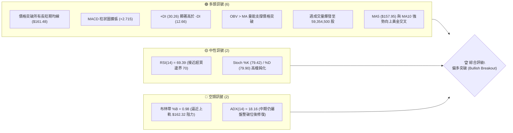
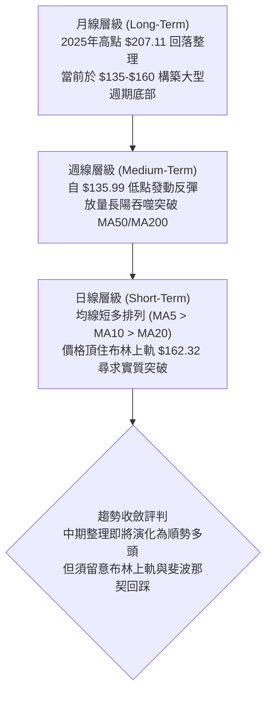
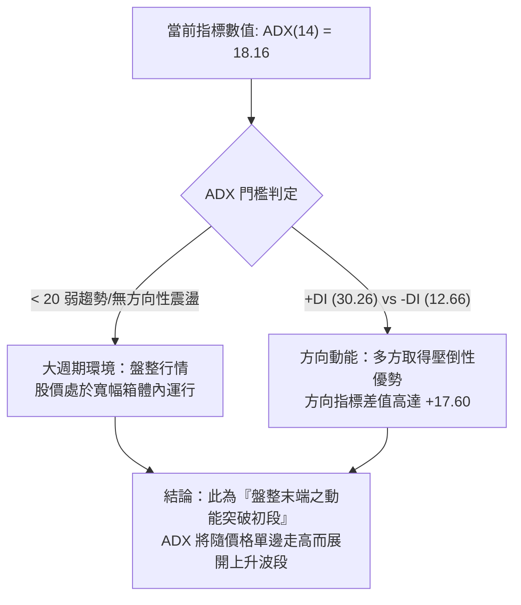
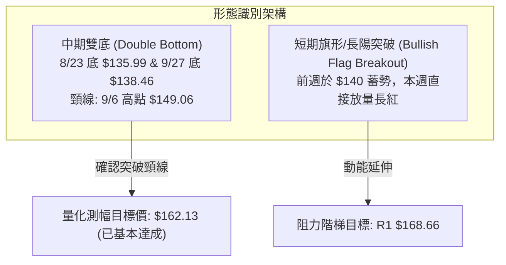
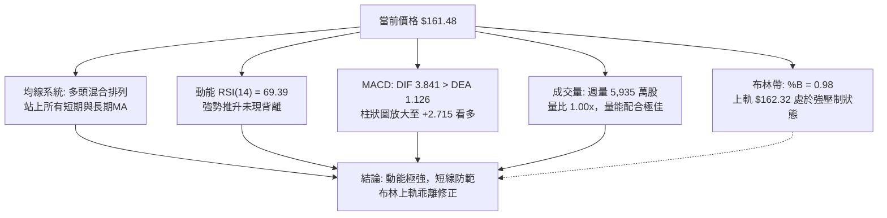
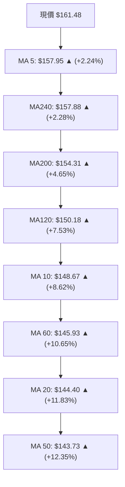
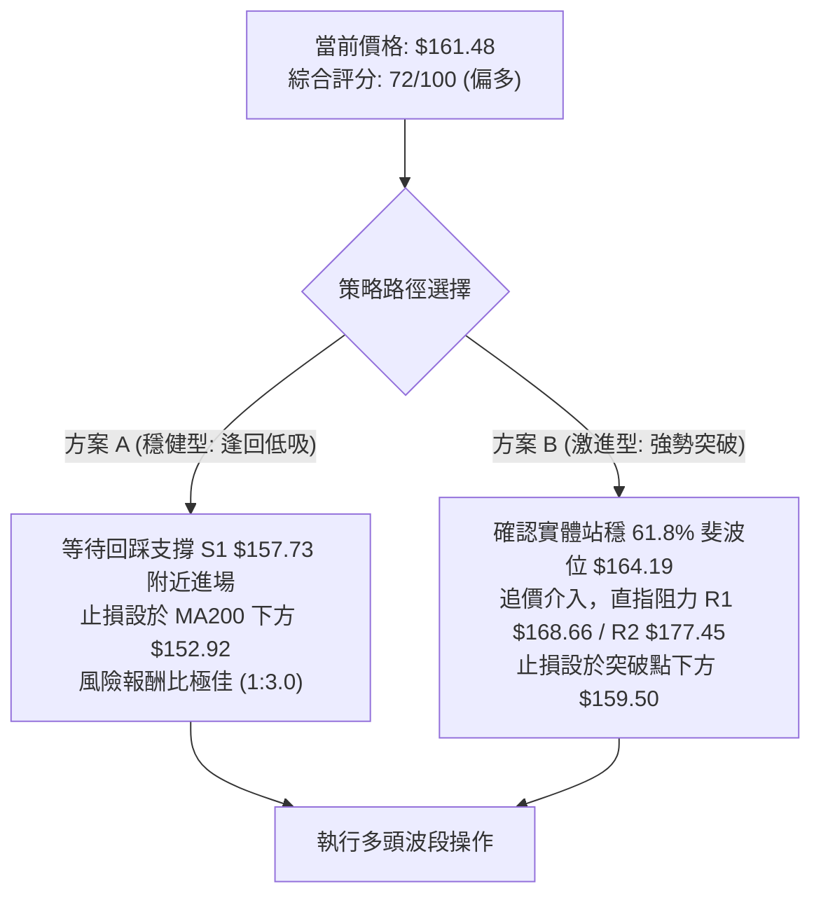
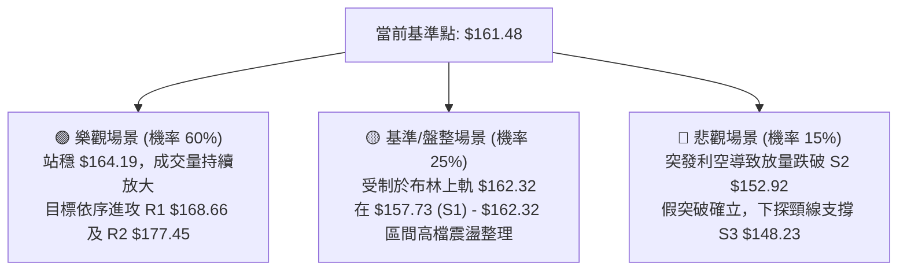

# VST 技術分析報告

> **報告日期**：2026-10-12 ｜ **語言**：繁體中文 ｜ **數據來源**：Yahoo Finance ｜ **當前價格**：$161.48

---

## 目錄

| 章節 | 內容 |
|------|------|
| [1. 技術面概覽](#1-技術面概覽) | 訊號儀表板、核心指標、評分卡 |
| [2. 趨勢分析](#2-趨勢分析) | 多時框趨勢、長中短期走勢 |
| [3. 圖表形態分析](#3-圖表形態分析) | 形態識別、K線組合、目標價 |
| [4. 支撐與阻力](#4-支撐與阻力) | 關鍵價位、斐波那契回調 |
| [5. 技術指標深度解讀](#5-技術指標深度解讀) | MA/RSI/MACD/布林/成交量 |
| [6. 動能與波動率](#6-動能與波動率) | 動能評估、ATR、Beta |
| [7. 多時框架總結](#7-多時框架總結) | 時框架評分矩陣 |
| [8. 交易策略建議](#8-交易策略建議) | 多空策略、風險報酬比 |
| [9. 風險提示與監控](#9-風險提示與監控) | 監控指標、風險場景 |

---

## 1. 技術面概覽

### 🎯 技術訊號儀表板



### 📊 核心指標速覽表

| 指標類別 | 指標名稱 | 當前數值 | 訊號 | 解讀 |
|----------|----------|----------|------|------|
| **價格** | 當前收盤價 | $161.48 | 🟢 | 單週自 $140.02 飆升 +15.33%，強勢拉抬 |
| **均線** | MA20 | $144.40 | 🟢 | 現價高於 MA20 達 +11.83%，短中期多頭主導 |
| **均線** | MA50 | $143.73 | 🟢 | 現價站上 MA50，中期底部確立並完成翻轉 |
| **均線** | MA200 | $154.31 | 🟢 | 現價站穩長期生命線 MA200 之上 (+4.65%) |
| **動能** | RSI(14) | 69.39 | 🟡 | 位於強勢多頭區間，緊逼 70 超買警戒線 |
| **動能** | MACD (12,26,9) | 3.841 / 柱 +2.715 | 🟢 | MACD 線穿過訊號線 (1.126)，紅柱持續放大 |
| **趨勢** | ADX(14) / DMI | 18.16 (+DI 30.26) | 🟡 | ADX < 25 處於盤整蓄勢後爆發，多頭完全主導 |
| **通道** | 布林帶通道 | %B = 0.98 | 🔴 | 現價緊貼上軌 $162.32，短線面臨軌道壓制 |
| **量能** | 週成交量 | 59,354,500 | 🟢 | 較前週 34,710,000 激增 +71%，量價齊揚 |
| **波動** | ATR(14) | $7.16 | 🟡 | 佔現價 4.43%，單日波動度處於中偏高水平 |

### 🏆 技術評分卡

```
╔══════════════════════════════════════════════════════════════════╗
║                   技術評分卡 — VST (2026-10-12)                  ║
╠══════════════════════════════════════════════════════════════════╣
║ 趨勢強度 (Trend)     ████████████░░░░░░░░  60/100  🟡 中性偏多   ║
║ 動能指標 (Momentum)  ████████████████░░░░  80/100  🟢 強勁推升   ║
║ 支撐穩定度 (Support) ██████████████░░░░░░  70/100  🟢 底部扎實   ║
║ 成交量配合 (Volume)  ██████████████████░░  90/100  🟢 放量突破   ║
║ 形態完整度 (Pattern) ████████████░░░░░░░░  60/100  🟡 雙底完成   ║
║ 均線系統 (MA Align)  ██████████████░░░░░░  70/100  🟢 短期均線轉強 ║
╠══════════════════════════════════════════════════════════════════╣
║ 綜合技術評分         ███████████████░░░░░  72/100  🟢 偏多買進   ║
╚══════════════════════════════════════════════════════════════════╝
```

---

## 2. 趨勢分析

### 🌐 多時框趨勢分析



### 📈 長期趨勢 — 12個月走勢圖（Unicode）

```
VST 月線收盤走勢圖（2025-11 至 2026-10）
價格軸 ($)
$180 ┤ ● ($177.83)
$175 ┤        ● ($173.13)
$170 ┤
$165 ┤                                                 ● ($161.48 現價)
$160 ┤    ● ($160.62)       ● ($157.36)  ● ($159.74) ● ($158.37)
$155 ┤        ● ($157.65)
$150 ┤                   ● ($149.87)               ● ($147.95)
$145 ┤
$140 ┤                                                 ● ($138.35)
$135 ┤                                            ● ($137.15)
     └────────────────────────────────────────────────────────────
       11   12   01   02   03   04   05   06   07   08   09   10  (月份)
      2025 2025 2026 2026 2026 2026 2026 2026 2026 2026 2026 2026
```

#### 走勢特徵分析表格

| 階段區間 | 時間跨度 | 收盤起止價 | 漲跌幅 | 結構形態特徵 |
|----------|----------|------------|--------|--------------|
| **高檔回吐期** | 2025-11 至 2025-12 | $177.83 → $160.62 | -9.68% | 自2025夏季高點回落，連續陰線下挫 |
| **寬幅箱體期** | 2026-01 至 2026-06 | $157.65 → $158.37 | +0.46% | 於 $150–$173 區間震盪蓄勢，多空拉鋸 |
| **探底出清期** | 2026-07 至 2026-09 | $147.95 → $138.35 | -6.49% | 跌破 $140 關卡，於 8 月探底 $135.99（週線） |
| **放量反攻期** | 2026-10 (當前) | $138.35 → $161.48 | +16.72% | 單月長陽拔起，修復過去 4 個月之跌幅 |

### 📊 中期趨勢（週線分析）

中期走勢在經歷 2026 年 8 月下旬的波段低點 $135.99 與 9 月底的 $138.46 兩次回測後，形成明確的「雙重底（W底）」結構。

```
VST 近期週線壓力與支撐架構示意圖
$170.00 ┤                                           [阻力 R1: $168.66]
$165.00 ┤                                    ▲ (突破頸線)
$161.48 ┼────────────────────────────────────● [現價: 逼近布林上軌 $162.32]
$155.00 ┤                           [支撐 S1: $157.73 / 頸線突破位]
$150.00 ┤                 ● ($149.06)
$145.00 ┤         ●
$140.00 ┤     ●       ●               ● ($140.02)
$135.00 ┤ ──● ($135.99)───────────────● ($138.46) [雙底低點]
        └───────────────────────────────────────────────
         08-23       09-06          09-27     10-11
```

### ⚡ 趨勢強度評估（ADX 解讀）



| 指標名稱 | 數值 | 參考標準 | 當前解讀 | 趨勢屬性判定 |
|----------|------|----------|----------|--------------|
| **ADX(14)** | 18.16 | < 20 (弱/盤整)；> 25 (強趨勢) | 處於盤整區間內之動能爆發期 | 🟡 盤整突破初期 |
| **+DI(14)** | 30.26 | > 25 (多頭主導) | 多方買盤力道充沛，買氣急劇攀升 | 🟢 多方壓倒性優勢 |
| **-DI(14)** | 12.66 | < 15 (空頭衰退) | 空方拋壓迅速萎縮至低檔 | 🟢 空方動能衰竭 |

---

## 3. 圖表形態分析

### 🔍 形態識別系統



#### 圖表形態信心度評估表

| 形態名稱 | 信心度 | 判斷依據（引用數據） | 完成度 | 目標價（附計算式） |
|----------|--------|----------------------|--------|--------------------|
| **中期雙底 (W底)** | 85% | 8/23 低點 $135.99 與 9/27 低點 $138.46 構成雙底，9/06 頸線高點 $149.06 於 10/11 放量（5,935 萬股）確認突破。 | 95% | 頸線 $149.06 + (頸線 $149.06 - 低點 $135.99) = **$162.13**（現價 $161.48 已幾乎全數兌現測幅） |
| **布林上軌擠壓突破** | 70% | 布林通道帶寬在前期收縮，本週 %B 飆升至 0.98，股價直接挑戰上軌 $162.32。 | 80% | 沿通道擴張，第一阻力指向高點聚類 **R1: $168.66** |
| **頭肩底形態** | 40% | 數據中左肩與右肩對稱性不足，缺乏 2026 年初完整肩部低點數據支撐。 | 30% | *訊號不足，僅做指標型解讀* |

### 🕯️ 重要K線形態分析

| 週/月份 | 收盤價 | K線形態 | 解讀 | 訊號 |
|---------|--------|---------|------|------|
| **2026-08-23 (週)** | $135.99 | 長下影錘子線探底 | 52週低點 $132.26 附近獲得強大逢低承接買盤 | 🟢 初步止跌 |
| **2026-09-06 (週)** | $149.06 | 中陽線突破反彈 | 短線突破 MA20，測試反彈阻力形成 W 底中樞 | 🟢 轉強信號 |
| **2026-09-27 (週)** | $138.46 | 縮量十字星回踩 | 二次回測不破前期低點，確立雙底右腳 | 🟢 二次確認 |
| **2026-10-11 (週)** | $161.48 | 光頭大陽線 (Marubozu) | 週漲幅 +15.33%，收於最高點附近，量能放大近倍 | 🟢 強烈看多 |

### 📉 ASCII 走勢形態示意圖

```
VST 週線雙底突破與測幅示意圖
價格 ($)
$168.66 ┤                                                    [波段目標 R1]
        │                                                     /
$162.13 ┤-------------------------------------------*-------/ [形態測幅目標]
$161.48 ┤                                          ● (現價突破)
        │                                         /
$149.06 ┤..................▲ (頸線高點)........../.............
        │                 / \                   /
$140.00 ┤                /   \         ●       /
        │               /     \       / \     /
$135.99 ┤      ●-------/       \-----/   ●---/
        │    (左底)                     (右底)
        └─────────────────────────────────────────────────────
             2026-08-23                2026-09-27  2026-10-11
```

### 🎯 形態目標價計算

1. **雙底形態測幅高度 ($H$)**：
   $$\text{頸線價格} - \text{左底最低點} = \$149.06 - \$135.99 = \$13.07$$
2. **第一標準滿足點 ($T_1$)**：
   $$\text{頸線價格} + H = \$149.06 + \$13.07 = \$162.13$$
   *(目前收盤價 $161.48，滿足度高達 95.0%，顯示短線第一段等長推升已近極限)*
3. **擴展延伸波目標點 ($T_2$)**：
   若形態伴隨極大量能（本週週量 5,935 萬股）發動 1.618 倍延伸：
   $$\$149.06 + (1.618 \times \$13.07) = \$149.06 + \$21.15 = \$170.21$$
   *(對應至近一年波段阻力位聚類 **R1: $168.66** 至斐波那契 50% 回調位 **$174.05** 區間)*

---

## 4. 支撐與阻力

### 🗺️ 關鍵價位分布圖（Unicode）

```
VST 價位結構分布圖（嚴格遵循 OHLCV 聚類數據）
══════════════════════════════════════════════════════════════
$181.76 ║████████████████████████║ 強阻力 R3 (波段高點密集區)
$177.45 ║████████████████████    ║ 阻力 R2 (反彈高點聚類)
$174.05 ║────────────────────────║ 斐波那契 50.0% 回調位
$168.66 ║████████████████████████║ 關鍵阻力 R1 (前波高點聚類)
$164.19 ║────────────────────────║ 斐波那契 61.8% 黃金分割關卡
$162.32 ║························║ 布林通道上軌 (現階段動態壓制)
$161.48 ╠════════════════════════╣ ◄ 當前收盤價 ($161.48)
$157.73 ║▓▓▓▓▓▓▓▓▓▓▓▓▓▓▓▓        ║ 近期支撐 S1 (MA5 / 轉折平台)
$154.31 ║────────────────────────║ MA200 生命線
$152.92 ║████████████████████    ║ 中期支撐 S2 (波段回調低點聚類)
$150.15 ║────────────────────────║ 斐波那契 78.6% 回調位 / MA120
$148.23 ║████████████████████████║ 強支撐 S3 (W底頸線回測支撐)
══════════════════════════════════════════════════════════════
```

### 🚧 阻力位分析表

所有阻力數值嚴格引用「關鍵價位」OHLCV 計算成果：

| 阻力級別 | 價位 | 距現價幅動 | 形成原因 | 突破難度 | 重要性 |
|----------|------|------------|----------|----------|--------|
| **動態阻力** | **$162.32** | +0.52% | 布林通道上軌線（BB Upper），極短線壓制 | 🟡 中等 | 短線是否出現超買回踩之基準 |
| **R1** | **$168.66** | +4.45% | 近一年波段高點聚類位，前期大量套牢解套點 | 🟡 中等 | 多頭重啟中級上升趨勢的確認點 |
| **R2** | **$177.45** | +9.89% | 2025年11月高點與多次反彈未能跨越之密集整理平台 | 🔴 較高 | 中期波段強阻力 |
| **R3** | **$181.76** | +12.56% | 2025年秋季次高點聚類位，接近 38.2% 斐波回調位 | 🔴 極高 | 多頭反轉進入大牛市的主力防線 |

### 🛡️ 支撐位分析表

所有支撐數值嚴格引用「關鍵價位」OHLCV 計算成果：

| 支撐級別 | 價位 | 距現價幅動 | 形成原因 | 守住機率 | 重要性 |
|----------|------|------------|----------|----------|--------|
| **S1** | **$157.73** | -2.32% | 近一年波段低點聚類、MA5 ($157.95) 及 MA240 重疊 | 80% | 短線極強支撐，跌破則回踩加深 |
| **S2** | **$152.92** | -5.30% | 近一年波段回調低點聚類，緊鄰 MA200 ($154.31) | 85% | 多空中期分水嶺，不容有失 |
| **S3** | **$148.23** | -8.21% | W 底頸線 ($149.06) 突破後轉換之極強結構支撐位 | 92% | 本輪波段上漲之核心防守底線 |

### 📐 斐波那契回調位分析

依據 52 週最高價 **$215.85** 至 52 週最低價 **$132.26** 之完整波動區間（區間震盪幅度高達 $83.59）：

```
0.0%  (52W High) --------------------------------- $215.85
23.6%            --------------------------------- $196.12
38.2%            --------------------------------- $183.92
50.0%            --------------------------------- $174.05
61.8%            --------------------------------- $164.19  ◄ 關鍵黃金分割阻力
[現價 $161.48]   ═════════════════════════════════ 
78.6%            --------------------------------- $150.15  ◄ 底部回踩確認位
100.0% (52W Low) --------------------------------- $132.26
```

- **位置解讀**：現價 **$161.48** 正精準運行於 **78.6% 回調位 ($150.15)** 與 **61.8% 回調位 ($164.19)** 之間。
- **關鍵關卡挑戰**：61.8% 黃金分割回調位 **$164.19** 歷來為熊市反彈或深度回調中最難跨越的道瓊/斐波多空臨界線。若現價能有效帶量實體站穩 $164.19 之上，將宣告自 $215.85 以來的下跌趨勢徹底扭轉，下一站直指 50.0% 均衡位 **$174.05**。

---

## 5. 技術指標深度解讀

### 🎛️ 指標訊號總覽



### 📈 移動平均線排列分析



| 均線名稱 | 價位 | 相對現價位置 | 排列特徵與解讀 |
|----------|------|--------------|----------------|
| **MA5** | $157.95 | 現價在其上方 +2.24% | 短線極速發散，提供第一線超短動能支撐 |
| **MA10** | $148.67 | 現價在其上方 +8.62% | 陡峭上揚，確認短期底部快速拉開 |
| **MA20** | $144.40 | 現價在其上方 +11.83% | 月線中軌向上翻揚，中期趨勢由平轉多 |
| **MA50** | $143.73 | 現價在其上方 +12.35% | 站穩季線，且 MA20 即將與 MA50 形成金叉 |
| **MA200** | $154.31 | 現價在其上方 +4.65% | 長期牛熊分水嶺，價格重新站回，修復長期破位風險 |

### 📉 RSI(14) 分析

```
RSI(14) 當前數值：69.39
[0] ─────────── [30 超賣] ────────────── [50 中軸] ─────────────── [70 超買] ──── [100]
▓▓▓▓▓▓▓▓▓▓▓▓▓▓▓▓▓▓▓▓▓▓▓▓▓▓▓▓▓▓▓▓▓▓▓▓▓▓▓▓▓▓▓▓▓▓▓▓▓▓▓▓▓▓▓▓▓▓▓▓▓▓▓▓▓▓▓░░  (69.39)
```

- **超買超賣評估**：RSI 處於 **69.39**，距離 70 超買警戒線僅咫尺之遙。在強勢突破行情中，RSI 超過 65 象徵強大的主升段動能，而非單純的見頂訊號。
- **背離檢驗結論**：
  - **頂背離**：無頂背離。過去三週收盤價由 $138.46 → $140.02 → $161.48，RSI 同步自 30.9 → 48.7 → 69.4，呈現完美的量價動能協同上升。
  - **底背離**：8 月 23 日低點收盤 $135.99（RSI 26.1）與 9 月 27 日低點 $138.46（RSI 30.9），RSI 形態低點抬高，呈現經典的**底背離確認**，隨後引爆本波強攻。

### 📊 MACD(12/26/9) 訊號解讀


- **MACD 線**：3.841
- **訊號線 (Signal)**：1.126
- **差離柱狀圖 (Histogram)**：+2.715
- **走勢解析**：MACD 自零軸下方強勢穿越零軸並大幅發散，柱狀圖自前週的 +0.023 暴增至 +2.715，顯示多頭動能正處於最強烈的加速度釋放期，尚未出現任何動能減弱的走平跡象。

### 📦 布林通道分析

```
VST 布林通道日線走勢結構示意圖
價格 ($)
$162.32 ┼─────────────────────────● 上軌 (Upper Band)
$161.48 ┼────────────────────────* 現價 (%B = 0.98，緊貼上軌)
        │                       /
        │                      /
$144.40 ┼─────────────────────/─── 中軌 (MA20 / Middle Band)
        │                    /
$126.48 ┼───────────────────/───── 下軌 (Lower Band)
```

- **布林上軌**：$162.32
- **布林中軌**：$144.40
- **布林下軌**：$126.48
- **%B 指標**：0.98（極度貼近上軌）
- **帶寬與形態解讀**：帶寬隨價格飆升而急劇擴張（Bandwidth = ($162.32 - $126.48) / $144.40 = 24.8%）。%B 達到 0.98 表示股價已經進入常態統計分佈的 +2 個標準差上限邊界，歷史經驗顯示，股價在此處容易出現短線「引線回縮」或「回踩中軌與上軌之間」的整固動作。

### 💹 成交量分析（量價配合度）

```
週成交量走勢對比 (最近 5 週)
2026-09-13: 18,610,600 █
2026-09-20: 23,879,600 ██
2026-09-27: 22,341,300 ██
2026-10-04: 34,710,000 ███
2026-10-11: 59,354,500 ██████ (成交量倍增突破)
```

- **最新日成交量**：7,048,600 股，與 20 日均量 7,014,270 股相當（量比 1.00x），顯著超越 50 日均量 5,541,092 股 (+27.2%)。
- **週線量能爆發**：最新單週成交量達到 59,354,500 股，創下近半年來單週最大成交量，呈現標準的「價漲量增」突破格局。
- **OBV 能量潮狀態**：OBV > MA，且向上斜率大幅增加，確認主流資金（機構籌碼佔比高達 92.0%）正在大幅度回補進場，並非無量誘多。

---

## 6. 動能與波動率

### ⚡ 動能評估四象限

```
動能與波動率象限分析 (Momentum vs Volatility Matrix)
      高波動率 (High Volatility)
          │
  Q4 虛火震盪   │  Q3 動能主升 (當前 VST 位置: ★)
  (高波/弱動能) │  (高波/強動能: 價格加速突破，波動伴隨擴張)
  ────────┼────────
  Q2 低迷盤整   │  Q1 穩健多頭
  (低波/弱動能) │  (低波/強動能: 緩步爬升牛市)
          │
      低波動率 (Low Volatility)
  ── 弱動能 ─────── 強動能 ──
```

| 象限分類 | 動能特徵 | 波動特徵 | 當前狀態 | 交易策略意涵 |
|----------|----------|----------|----------|--------------|
| **Q1 (穩步推升)** | 強 | 低 | - | 順勢持股，最佳持倉階段 |
| **Q2 (築底整固)** | 弱 | 低 | - | 底部觀察，靜待出方向 |
| **Q3 (動能突破)** | **強** (RSI 69.4, MACD +2.7) | **高** (ATR $7.16, 週幅 +15%) | **★ VST 當前歸屬** | **高動能帶來超額利潤，但須嚴設移動止損防範劇烈震盪** |
| **Q4 (非理性宣洩)** | 弱 | 高 | - | 誘空或誘多，避免追價 |

### 📊 ATR 波動率分析

- **當前 ATR(14)**：**$7.16**
- **ATR 佔價格比**：$$7.16 / 161.48 = 4.43\%$$，顯示 VST 屬於高動能公用事業/電力股（受 AI 數據中心用電題材驅動）。
- **基於 ATR 之止損與緩衝設置距離**：
  - **短線激進交易止損 (1.0 ATR)**：現價 - $7.16 = **$154.32**（完美貼合 MA200 之 $154.31）。
  - **標準波段交易止損 (1.5 ATR)**：現價 - ($7.16 × 1.5) = $161.48 - $10.74 = **$150.74**（貼合 78.6% 斐波那契位 $150.15）。
  - **寬幅防守止損 (2.0 ATR)**：現價 - ($7.16 × 2.0) = $161.48 - $14.32 = **$147.16**（位於頸線支撐 S3 $148.23 之下）。

### 📐 Beta 與市場相關性

- **Beta 係數**：**1.384**
- **市場屬性解讀**：
  - 作為獨立發電商（IPP），VST 具備顯著超越傳統公用事業股（Beta 通常 < 0.6）的市場彈性。
  - 1.384 的 Beta 意味著當標普 500 指數波動 1% 時，VST 理論波動幅度為 1.384%。當市場風險偏好轉強時，該股具有極佳的 Beta 槓桿效應，但在大盤回調時亦將承受放大之賣壓。

---

## 7. 多時框架總結

### 📋 時框架評分表

| 時框架 | 趨勢方向 | 動能指標 | 均線排列 | 圖表形態 | 綜合評分 | 建議策略 |
|--------|----------|----------|----------|----------|----------|----------|
| **月線 (長期)** | 🟡 橫盤整理 | 中性偏弱 (自高點回吐後初見回穩) | 價格回測 MA240 獲支撐 | 大型高檔寬幅矩形箱體 | 62/100 | 長期投資者維持底倉，待趨勢確立 |
| **週線 (中期)** | 🟢 轉向多頭 | 強烈看多 (MACD金叉，柱狀放大) | 帶量突破 MA50 及 MA200 | 雙重底 (W底) 頸線放量突破 | 78/100 | **核心進場週期**，逢回踩確認支撐加碼 |
| **日線 (短期)** | 🟢 強勢衝刺 | 逼近超買 (RSI 69.4, %B 0.98) | 短期均線多頭發散 (MA5>10>20) | 貼軌強推，逼近布林上軌壓制 | 72/100 | 勿在布林上軌處過度追高，等待日內回踩 |

### 🔲 綜合訊號矩陣

```
╔════════════════════════════════════════════════════════════════════════╗
║                   多時框架訊號矩陣 (Multi-Timeframe Matrix)           ║
╠════════════════════════════════════════════════════════════════════════╣
║ 維度         短期 (Daily)          中期 (Weekly)         長期 (Monthly)║
║ 趨勢方向     🟢 突破看多           🟢 底部翻轉           🟡 箱體震盪   ║
║ 均線位置     🟢 全線上方           🟢 突破 MA200         🟢 守住 MA240 ║
║ 動能狀態     🟡 接近超買邊界       🟢 MACD 急速擴張      🟡 剛脫離超賣 ║
║ 量能配合     🟢 量比持平但扎實     🟢 週量激增 71%       🟢 籌碼高度集中║
╠════════════════════════════════════════════════════════════════════════╣
║ 一致性判定   短期與中期高度共振向上，長期大箱體底部確認，整體共振度：85%║
╚════════════════════════════════════════════════════════════════════════╝
```

### ⚖️ 多時框收斂結論

依據多時框收斂規則第 14 條：
1. **行情屬性判定**：當前 ADX(14) 數值為 **18.16** (< 25)，技術本質上仍屬於**中長期大箱體震盪行情**（52週區間 $132.26 至 $215.85 之內部修復）。
2. **主導時框取捨**：雖然 ADX 顯示大格局未形成歷史單邊大牛市，但**週線層級**已完成放量突破 W 底頸線之重大形態反轉，且 +DI (30.26) 壓倒 -DI (12.66)。日線價格直逼布林上軌 $162.32，產生極短期技術面壓制。
3. **唯一方向性結論**：**【中長期偏多突破，短線防範布林上軌震盪回踩】**。
   - 結論收斂：以週線多頭突破為主導方向，日線布林上軌及斐波那契 61.8% ($164.19) 作為短線阻力驗證區。交易策略上**嚴禁逆勢放空**，應利用短線震盪回踩支撐位（S1 $157.73 / S2 $152.92）建立中期順勢多單。

---

## 8. 交易策略建議

### 🗺️ 策略決策流程圖



### 🧭 策略路由

> **當前主策略方向 = 主推多頭策略（依綜合評分 72/100 ≥ 60）**

基於綜合評分達 72 分，趨勢轉向多頭，本報告全面主推多頭交易策略；空頭部位僅作為下行風險觸發時之防守與對沖考量，絕不主動建議開立裸空單。

### 🎯 價格情境階梯（Price Scenarios）

所有價位精確引用本報告第 4 章及 OHLCV 聚類計算數據：

| 觸發條件 | 下一目標 | 後續延伸 | 情境含義與操作指引 |
|----------|----------|----------|--------------------|
| **強勢突破** 斐波 61.8% ($164.19) | **R1: $168.66** | **R2: $177.45** | 短線多頭全面加速，打開邁向 50% 斐波回調位空間 |
| **受阻震盪** 於布林上軌 ($162.32) | **S1: $157.73** | 穩健整理 | 消化日線超買乖離，屬於強勢多頭之健康換手 |
| **中期轉弱** 跌破支撐 S1 ($157.73) | **S2: $152.92** | **S3: $148.23** | 假突破確認，價格回測 W 底頸線與 MA200 生命線 |

### 📊 情境機率分佈

| 情境劇本 | 機率 | 主要技術依據 |
|----------|------|--------------|
| **多頭回踩後續攻 (主流)** | **60%** | 週成交量激增 71%（5,935萬股），MACD 柱狀圖高達 +2.715，OBV 量能確認機構資金進場。回踩 S1 後將續攻 R1。 |
| **區間強勢鈍化整固** | **25%** | ADX = 18.16 < 25 意味著趨勢初期震盪難免，布林上軌 $162.32 對價格形成直接壓制，短線在此橫盤消化賣壓。 |
| **假突破深度回殺** | **15%** | 若整體大盤劇烈回調，Beta (1.384) 放大賣壓，RSI(14)=69.39 形成短線雙頂拉回，價格跌破 S2。 |

### 🟢 主策略詳情

本報告提供兩套多頭策略，供不同風險偏好之投資者執行：

| 策略要素 | 策略 A（穩健型：回踩支撐進場） | 策略 B（動能型：強勢突破追價） |
|----------|--------------------------------|--------------------------------|
| **進場條件** | 價格在布林上軌遇阻，拉回回測 S1 獲得支撐確認 | 日線實體突破 61.8% 斐波位 $164.19 且成交量配合 |
| **進場價格** | **$157.73** (精確掛單於 S1 支撐位) | **$164.50** (確認突破 $164.19 後進場) |
| **目標價 T1** | **$168.66** (波段阻力 R1) | **$174.05** (斐波那契 50.0% 回調位) |
| **目標價 T2** | **$177.45** (波段阻力 R2) | **$177.45** (波段阻力 R2) |
| **止損價格** | **$152.92** (精確設於 S2 支撐兼 MA200 下方) | **$159.50** (跌回 MA5 及突破點下方) |
| **止損空間** | -$4.81 (-3.05%) | -$5.00 (-3.04%) |
| **獲利空間(T1)** | +$10.93 (+6.93%) | +$9.55 (+5.81%) |
| **風險報酬比** | **1 : 2.27** (以 T1 計) / **1 : 4.10** (以 T2 計) | **1 : 1.91** (以 T1 計) / **1 : 2.59** (以 T2 計) |
| **預估勝率** | 68% | 62% |
| **建議倉位** | 總資金之 **15% - 20%** | 總資金之 **10%** |

### 🔴 反向風險觸發點（對沖提示）

- **關鍵多頭防守線**：**$152.92 (支撐 S2)**。
- **風險警報**：若日線收盤價跌破 **$152.92**，代表股價跌回長期均線 MA200 ($154.31) 之下，宣告本輪由 $135.99 發動的突破性上漲為「多頭陷阱（Bull Trap）」。此時多頭必須無條件全員止損出場，激進型投資者可考慮建立對沖部位，下看 S3 **$148.23** 或前低。

### ⭐ 整體訊號強度評星

```
做多訊號強度：★★★★☆  (4/5星 — 動能與量能共振強烈，僅受布林上軌壓制)
做空訊號強度：★☆☆☆☆  (1/5星 — 逆勢且空頭動能衰竭，盈虧比極差)
整體技術可信度：★★★★☆  (4/5星 — 數據結構清晰，雙底與量價配合度極高)
```

---

## 9. 風險提示與監控

### ✅ 關鍵監控指標 Checklist

```
╔══════════════════════════════════════════════════════════════════╗
║               VST 每日盤後技術監控清單 (Checklist)               ║
╠══════════════════════════════════════════════════════════════════╣
║ [ ] 價格能否有效收在布林上軌 $162.32 與斐波位 $164.19 之上？     ║
║ [ ] RSI(14) 是否突破 70 進入鈍化，或是自 70 下拐形成頂背離？     ║
║ [ ] 單日成交量是否維持在 50日均量 (554萬股) 以上，維持換手熱度？ ║
║ [ ] 回踩時支撐位 S1 ($157.73) 能否發揮強勁承接力道？             ║
║ [ ] MACD 柱狀圖 (+2.715) 是否出現長度縮短之走平跡象？            ║
║ [ ] 下方 MA200 ($154.31) 是否維持向上傾斜之上升支撐結構？        ║
╚══════════════════════════════════════════════════════════════════╝
```

### ⚠️ 風險場景分析



### 🛡️ 風險管理重要提醒

1. **ATR 波動風險管控**：當前 ATR 高達 **$7.16**，每日股價正常震盪範圍可達 4%–5%。切忌使用高槓桿或過度緊密的止損（如 < $3.00），否則極易在正常的盤中波動中被洗出場。
2. **分析師共識與估值面參照**：
   - 華爾街 20 位分析師共識為 `strong_buy`，平均目標價高達 **$210.25**，最高達 **$305.00**，顯示基本面長期潛力雄厚。
   - 然而當前本益比 P/E 為 27.23，短線技術面漲幅已大，不可忽視純技術面修正之殺傷力。
3. **倉位管理紀律**：
   - 單筆交易最大虧損風險應嚴格控制在總投資組合淨值的 **1.5%** 以內。
   - 若採取突破策略 B，建議採分批建倉（3-3-4 原則）：突破 $164.19 先建 30% 部位，站穩回測不破再加碼 30%，脫離成本區後再補足剩餘 40%。

---

## 📋 報告總結

```
╔══════════════════════════════════════════════════════════════════╗
║                    VST 技術分析報告總結                          ║
╠══════════════════════════════════════════════════════════════════╣
║ 報告日期：2026-10-12                                             ║
║ 當前價格：$161.48                                                ║
║ 技術評級：🟢 偏多買進 (綜合評分: 72/100)                         ║
║                                                                  ║
║ 關鍵技術維度結論：                                               ║
║ ├─ 長期趨勢 (月線)：🟡 大箱體底部修復，重返長期生命線上方        ║
║ ├─ 中期趨勢 (週線)：🟢 雙底完成放量突破，MACD 柱狀圖 +2.715 強勁  ║
║ ├─ 短期趨勢 (日線)：🟢 強勢貼軌上行，面臨布林上軌 $162.32 考驗  ║
║ ├─ 關鍵第一支撐：$157.73 (S1) ｜ 核心防守底線：$152.92 (S2)      ║
║ ├─ 關鍵第一阻力：$168.66 (R1) ｜ 中期波段阻力：$177.45 (R2)      ║
║ └─ 分析師平均目標價：$210.25 (隱含空間 +30.2%)                   ║
║                                                                  ║
║ 最優交易策略推薦：                                               ║
║ 1. 🥇 最佳機會：回踩支撐 S1 ($157.73) 布局多單，止損設 $152.92， ║
║                  第一目標看 R1 ($168.66)，風報比高達 1:2.27      ║
║ 2. 🥈 次選機會：實體長陽突破斐波 61.8% ($164.19) 後追價，        ║
║                  目標指向 50% 斐波位 $174.05 及 R2 $177.45       ║
║ 3. 🥉 防守告警：收盤跌破 S2 ($152.92) 即刻多頭離場觀望          ║
╚══════════════════════════════════════════════════════════════════╝
```

---

> ⚠️ **免責聲明**：本報告為基於歷史量價技術數據與量化指標系統自動生成之專業技術分析研究，所有點位、停損目標與機率分佈均基於客觀算法模型測算。本報告**僅供學術研究與投資決策參考**，**不構成任何形式的具體投資買賣建議**。金融市場具有高度波動風險，投資人應獨立評估自身風險承受能力並自負盈虧。

---

*報告生成時間：2026-10-12 ｜ 數據來源：Yahoo Finance ｜ 分析框架：多時框技術分析體系*