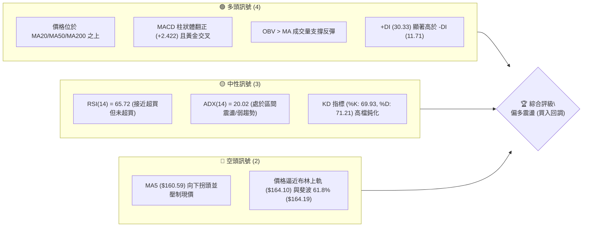
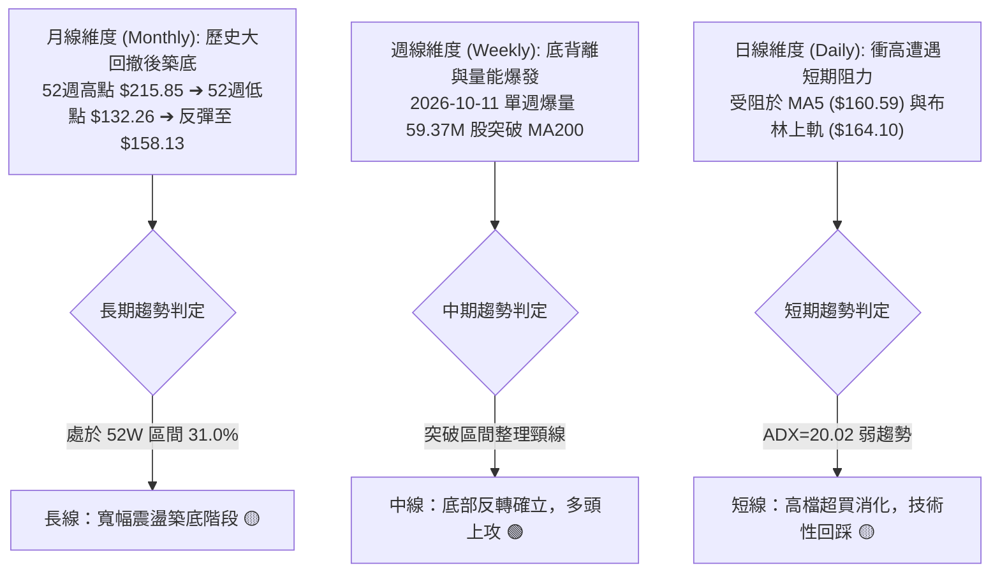
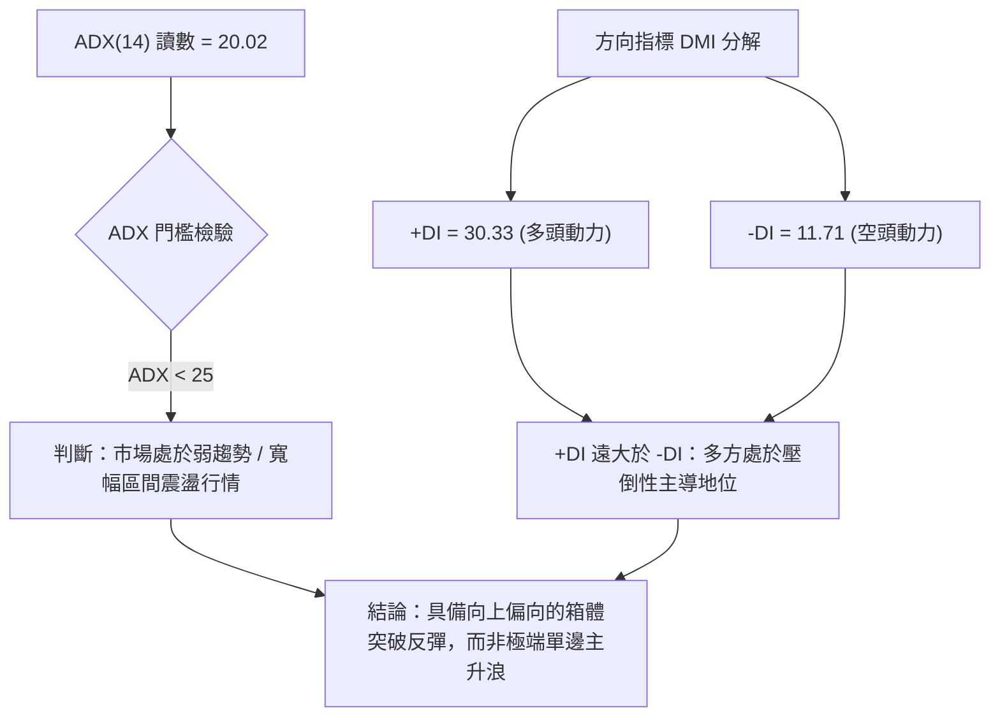
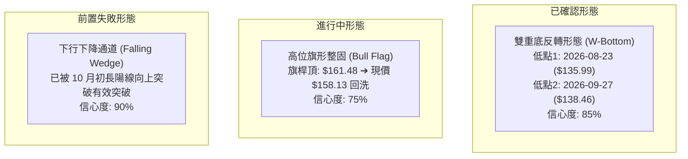
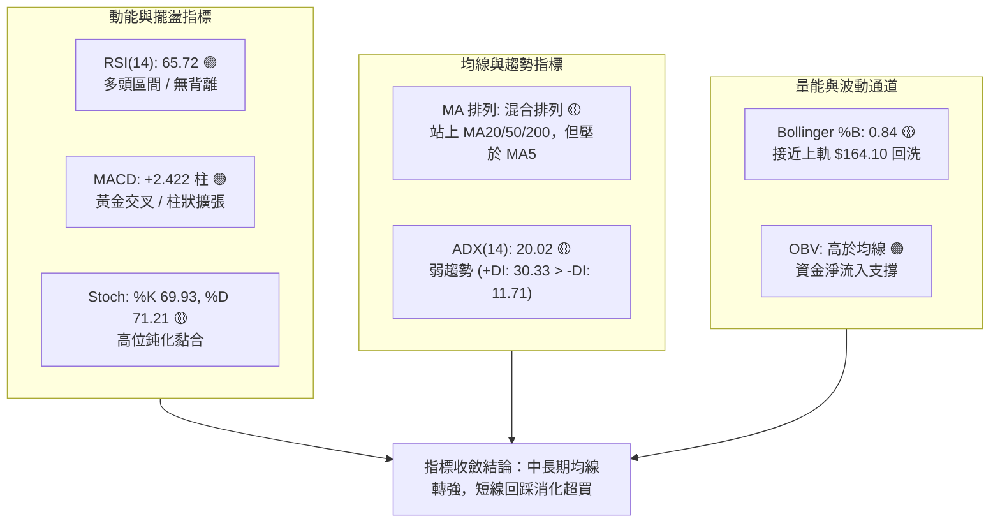
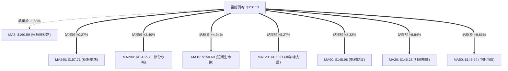
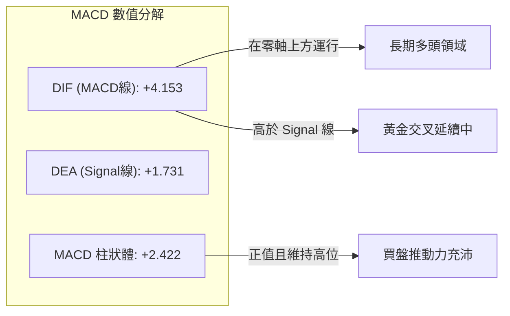
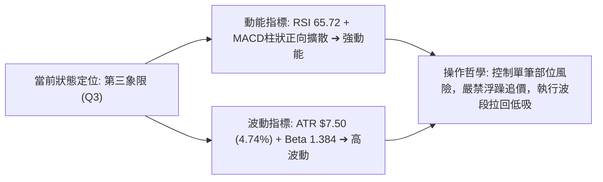
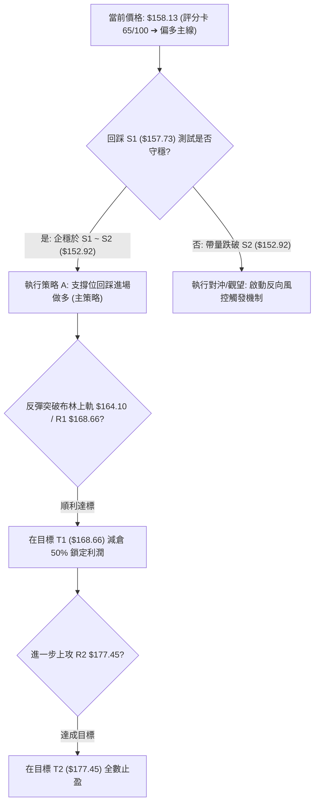
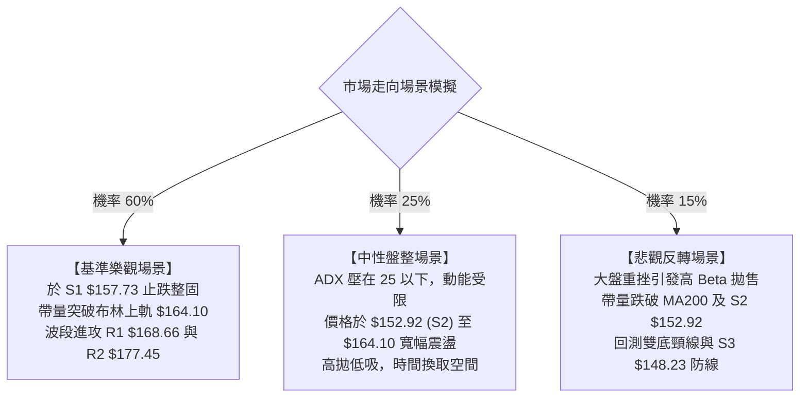

# VST 技術分析報告

> **報告日期**：2026-10-13 ｜ **語言**：繁體中文 ｜ **數據來源**：Yahoo Finance ｜ **當前價格**：$158.13

---

## 目錄

| 章節 | 內容 |
|------|------|
| [1. 技術面概覽](#1-技術面概覽) | 訊號儀表板、核心指標、評分卡 |
| [2. 趨勢分析](#2-趨勢分析) | 多時框趨勢、長中短期走勢、ADX 解讀 |
| [3. 圖表形態分析](#3-圖表形態分析) | 形態識別信心度、K線組合、目標價推算 |
| [4. 支撐與阻力](#4-支撐與阻力) | 關鍵價位結構、斐波那契回調位分析 |
| [5. 技術指標深度解讀](#5-技術指標深度解讀) | MA/RSI/MACD/布林通道/量價配合 |
| [6. 動能與波動率](#6-動能與波動率) | 動能矩陣、ATR 波動度、Beta 系統風險 |
| [7. 多時框架總結](#7-多時框架總結) | 時框架矩陣與多時框優先級收斂 |
| [8. 交易策略建議](#8-交易策略建議) | 策略路由、情境階梯、進出場交易計劃 |
| [9. 風險提示與監控](#9-風險提示與監控) | 關鍵監控清單、風險情境與風控規則 |
| [報告總結](#-報告總結) | 總體評級與精華儀表盤 |

---

## 1. 技術面概覽

### 🎯 技術訊號儀表板



---

### 📊 核心指標速覽表

| 指標類別 | 指標名稱 | 當前數值 | 訊號 | 解讀 |
|:---|:---|:---|:---:|:---|
| **價格** | 當前收盤價 | $158.13 | 🟢 | 站穩關鍵支撐 S1 ($157.73) 與 MA200 ($154.29) |
| **短期均線** | MA5 / MA10 | $160.59 / $150.68 | 🟡 | 價格跌破 MA5（短線受阻），但大幅高於 MA10（低檔支撐強） |
| **中期均線** | MA20 / MA50 | $145.28 / $143.94 | 🟢 | 價格在均線上方 +8.84% / +9.86%，中期築底完成 |
| **長期均線** | MA200 | $154.29 | 🟢 | 成功突破長天期牛熊分界線 MA200，多頭架構重啟 |
| **動能指標** | RSI(14) | 65.72 | 🟢 | 動能充沛，處於多頭強勢區間（50–70），無頂背離 |
| **趨勢指標** | MACD (12,26,9) | 4.153 (Hist: +2.422) | 🟢 | 快慢線均在零軸上方發散，動能柱持續擴大 |
| **趨勢強度** | ADX(14) | 20.02 | 🟡 | ADX < 25，屬於弱趨勢/區間震盪型反彈，非單邊暴量主升段 |
| **震盪通道** | Bollinger %B | 0.84 | 🟡 | 接近上軌 ($164.10)，短線面臨均值回歸與獲利回吐壓力 |
| **波動風險** | ATR(14) | $7.50 (4.74%) | 🟡 | 每日平均震盪幅度達 $7.50，日內與隔夜波動率偏高 |
| **量能系統** | 20日均量比 | 0.92x (6.51M / 7.08M) | 🟢 | 量能溫和收縮，OBV 趨勢高於均線，量價配合健康 |

---

### 🏆 技術評分卡

```
╔══════════════════════════════════════════════════════════════╗
║              技術評分卡 — VST (2026-10-13)                   ║
╠══════════════════════════════════════════════════════════════╣
║ 趨勢方向 (Trend)       ██████████████░░░░░░  70/100 🟢 偏多  ║
║ 趨勢強度 (ADX Strength)████████░░░░░░░░░░░░  40/100 🟡 盤整  ║
║ 動能指標 (Momentum)    ████████████████░░░░  80/100 🟢 強勢  ║
║ 支撐穩定度 (Support)   ██████████████░░░░░░  70/100 🟢 穩固  ║
║ 成交量配合 (Volume)    ██████████████░░░░░░  70/100 🟢 健康  ║
║ 均線架構 (MA Pattern)  ████████████░░░░░░░░  60/100 🟡 混合  ║
╠══════════════════════════════════════════════════════════════╣
║ 綜合技術評分           █████████████░░░░░░░  65/100 🟢 偏多  ║
║ 投資評級結論           🟢 逢低買入 (BUY ON DIPS)             ║
╚══════════════════════════════════════════════════════════════╝
```

---

## 2. 趨勢分析

### 🌐 多時框趨勢分析



---

### 📈 長期趨勢 — 12個月走勢圖（Unicode）

依據月線收盤數據繪製過去 12 個月（2025-11 至 2026-10）價格變動軌跡：

```
VST 月線走勢圖（過去12個月：2025-11 至 2026-10）
價格 ($)
$180 ┤ ● (2025-11: $177.83)
$170 ┤              ● (2026-02: $173.13)
$160 ┤   ●                               ●     ●(現價: $158.13)
$150 ┤        ●          ●          ●       ●
$140 ┤                        ●
$130 ┤                                         ●(2026-08: $137.15 低點)
     └─┬────┬────┬────┬────┬────┬────┬────┬────┬────┬────┬──
      11   12   01   02   03   04   05   06   07   08   09   10 (月份)
      25   25   26   26   26   26   26   26   26   26   26   26 (年份)
```

#### 長期走勢特徵分析表

| 階段區間 | 起止價格 | 漲跌幅 | 價量特徵與形態解讀 |
|:---|:---|:---:|:---|
| **2025-11 ~ 2026-01** | $177.83 ➔ $157.65 | -11.35% | 高檔獲利回吐，自 2025 年 7 月歷史極值 $207.11 展開中期修正。 |
| **2026-02 ~ 2026-03** | $173.13 ➔ $149.87 | -13.44% | 假反彈後急速下殺，摜破短期支撐線。 |
| **2026-04 ~ 2026-06** | $157.36 ➔ $158.37 | +0.64%  | $155–$160 平台橫盤，市場觀望降息與電力負載基本面。 |
| **2026-07 ~ 2026-08** | $147.95 ➔ $137.15 | -7.30%  | 探底尋支撐，測試 52 週低點區間 ($132.26 附近)，賣壓加速出清。 |
| **2026-09 ~ 2026-10** | $138.35 ➔ $158.13 | **+14.30%** | **主力資金強勢介入**，日線連陽並向上回補失土，脫離低檔區。 |

---

### 📊 中期趨勢（週線分析）

中期走勢在經歷 2026 年 8 月底至 9 月底於 $135–$140 區間的雙重打底後，於 10 月初展開攻擊：

```
中期阻力/支撐階梯（週線視角）：
$168.66 ────────────────────── R1 強阻力區（2026 年第 1 季密集套牢頭部）
   ▲
$164.19 ┈┈┈┈┈┈┈┈┈┈┈┈┈┈┈┈┈┈┈┈┈┈ 斐波那契 61.8% / 布林上軌 ($164.10)
   ▲
$158.13 ══════════════════════ 現價（位於 MA200 $154.29 之上）
   ▼
$157.73 ────────────────────── S1 第一支撐（前期突破點）
   ▼
$152.92 ────────────────────── S2 中期強支撐（MA200 $154.29 緩衝帶）
```

- **週線動能爆發**：2026-10-11 單週收盤價由前一週的 $140.02 暴漲至 $161.48，單週成交量高達 59,368,900 股（相較前週 34.71M 放大逾 71%），MACD 週柱狀圖由 +0.023 擴增至 +2.715。
- **健康回洗**：當前（2026-10-18 當週截至今日）收盤暫報 $158.13，成交量縮減至 6,508,400 股，屬於標準「長紅突破後的高位量縮回踩」。

---

### ⚡ 趨勢強度評估（ADX 解讀）



#### ADX 趨勢強度對照解讀

| 指標 | 數值 | 狀態評估 | 行情意涵與操作指引 |
|:---|:---:|:---:|:---|
| **ADX(14)** | 20.02 | 弱趨勢 / 盤整 | 趨勢動能尚未完全鎖定（< 25），不宜過度追高，價格易在布林上下軌間擺盪。 |
| **+DI (14)** | 30.33 | 多頭優勢顯著 | 買盤力道強大，回調幅度有限。 |
| **-DI (14)** | 11.71 | 空頭力道耗盡 | 賣壓薄弱，空方缺乏殺跌動能。 |
| **趨勢性質** | **多頭反彈** | 🟢 多方佔優 | **操作依據收斂規則 14**：在 ADX < 25 條件下，策略以布林通道與波段支撐/阻力為主要買賣區間。 |

---

## 3. 圖表形態分析

### 🔍 形態識別系統



#### 圖表形態信心度與目標價計算

依據嚴格規定，形態價格僅引用數據已給定之數值（頸線、波段低點）進行推算：

| 形態名稱 | 信心度 | 判斷依據（引用數據） | 完成度 | 目標價（附嚴謹計算式） |
|:---|:---:|:---|:---:|:---|
| **雙重底 (W-Bottom)** | **85%** | ① 底 1：2026-08-23 週收盤 $135.99<br/>② 底 2：2026-09-27 週收盤 $138.46<br/>③ 頸線取 2026-09-06 波段反彈高點 $149.06。已於 10 月初以 59.37M 巨量實體陽線長紅突破頸線。 | 100% (已突破) | **形態高度** = $149.06 - $135.99 = $13.07<br/>**最小量測目標價** = 頸線 $149.06 + $13.07 = **$162.13**（上週高點 $161.48 已基本達成）。 |
| **高位牛旗 (Bull Flag)** | **75%** | 2026-10-04 至 10-11 的單週 $21.46 大陽線為強勢旗桿；本週回調至 $158.13，量能萎縮至 6.51M，量縮回洗結構完整。 | 60% (整理中) | **旗桿起點** = $140.02，**旗桿頂部** = $161.48（高度 $21.46）。<br/>若自支撐 S1 ($157.73) 起算延伸目標：$157.73 + $21.46 = **$179.19**（接近 R2 $177.45 密集阻力區）。 |
| **頭肩底形態** | **35%** | 數據中左肩與右肩週期不對稱（無足夠左肩低點支撐）。 | < 20% | *訊號不足，信心度低於 50%，僅做指標型解讀，不預設目標價。* |

---

### 🕯️ 重要K線形態分析

| 週期/月份 | 收盤價 | K線形態 | 量能配合 | 技術解讀與多空訊號 |
|:---|:---:|:---|:---:|:---|
| **2026-08-23 週** | $135.99 | 破底長下影十字星 | 21.50M | 🟡 測試 52 週低點 $132.26 附近止跌，RSI 跌至 26.1 極端超賣。 |
| **2026-09-27 週** | $138.46 | 縮量築雙底陽線 | 22.34M | 🟢 二次探底不破前低，量縮確認賣壓出盡，底背離確立。 |
| **2026-10-11 週** | $161.48 | 實體大陽線（吞噬巨陽） | **59.37M** (爆量) | 🟢 帶量一口氣貫穿 MA20、MA60、MA120、MA200，多頭全面主導。 |
| **2026-10-18 (即時)** | $158.13 | 高檔小陰線（回踩測試） | 6.51M (極度量縮) | 🟢 獲利了結健康換手，測試 S1 ($157.73) 支撐有效性。 |

---

### 📉 ASCII 走勢形態示意圖

```
VST 雙重底突破與牛旗整理示意圖
$168.66 ┤                                                    [阻力 R1]
        │                                             ▲ 
$161.48 ┤                                       ╭──● (旗桿頂)
$158.13 ┤                                      ╭╯  ╰─● [現價: 旗面整理]
        │                                     ╭╯      ▼
$149.06 ┤                   ╭──● (反彈中繼) ╭╯   ┄┄┄┄┄┄┄┄┄┄┄┄ [雙底頸線]
        │                  ╭╯   ╰╮         ╭╯
$138.46 ┤                 ╭╯     ╰╮       ╭╯ (第二底)
$135.99 ┤        ● (第一底)        ╰─────● 
        └────────┴─────────────────┴──────┴───────────────────
                08-23             09-06  09-27   10-11  10-18 (時間)
```

---

## 4. 支撐與阻力

### 🗺️ 關鍵價位分布圖（Unicode）

```
╔══════════════════════════════════════════════════════════════════╗
║                   VST 關鍵價位架構分布圖                         ║
╠══════════════════════════════════════════════════════════════════╣
║ $181.76 ║██████████████████████████████║ 強阻力 R3 (波段密集阻力)
║ $177.45 ║██████████████████████        ║ 阻力 R2 (反彈高點聚類)
║ $174.05 ║──────────────────────────────║ 斐波那契 50.0% 回調位
║ $168.66 ║████████████████████████████  ║ 關鍵阻力 R1 (頸線壓力區)
║ $164.19 ║┈┈┈┈┈┈┈┈┈┈┈┈┈┈┈┈┈┈┈┈┈┈┈┈┈┈┈┈┈┈║ 斐波那契 61.8% / BB上軌 $164.10
║ $160.59 ║······························║ 短期壓制 MA5
║ $158.13 ╠══════════════════════════════╣ ◄ 當前價格
║ $157.73 ║▓▓▓▓▓▓▓▓▓▓▓▓▓▓▓▓▓▓▓▓▓▓▓▓▓▓▓▓  ║ 近期第一支撐 S1 (MA240 $157.71)
║ $154.29 ║──────────────────────────────║ 長期牛熊分水嶺 MA200
║ $152.92 ║████████████████████████      ║ 關鍵支撐 S2 (波段回踩確認點)
║ $150.15 ║┈┈┈┈┈┈┈┈┈┈┈┈┈┈┈┈┈┈┈┈┈┈┈┈┈┈┈┈┈┈║ 斐波那契 78.6% 回調位
║ $148.23 ║██████████████████████████████║ 核心防守底線 S3 (破位轉空)
╚══════════════════════════════════════════════════════════════════╝
```

---

### 🚧 阻力位分析表

所有價位均嚴格引用數據中由近一年波段高點聚類計算所得：

| 阻力級別 | 精確價位 | 距現價空間 | 形成原因與籌碼特徵 | 突破難度 | 重要性評級 |
|:---|:---:|:---:|:---|:---:|:---:|
| **R1** | **$168.66** | +6.66% | 近一年波段密集反彈高點聚類，接近前期整理平台頂部。 | 中等 🟡 | ★★★★☆ |
| **R2** | **$177.45** | +12.22% | 2025 年 11 月至 2026 年 2 月多個次高點套牢區（$173–$177）。 | 較高 🔴 | ★★★★☆ |
| **R3** | **$181.76** | +14.94% | 斐波那契 38.2% ($183.92) 前哨阻力，波段多頭極限推升目標。 | 極高 🔴 | ★★★★★ |

---

### 🛡️ 支撐位分析表

所有價位均嚴格引用數據中由近一年波段低點聚類計算所得：

| 支撐級別 | 精確價位 | 距現價空間 | 形成原因與籌碼特徵 | 守住機率 | 重要性評級 |
|:---|:---:|:---:|:---|:---:|:---:|
| **S1** | **$157.73** | -0.25% | 近期突破密集區與 MA240 ($157.71) 高度重合，即時多方防線。 | 75% 🟢 | ★★★★☆ |
| **S2** | **$152.92** | -3.29% | MA200 ($154.29) 下方緩衝墊，近期大陽線起漲整理平台。 | 85% 🟢 | ★★★★★ |
| **S3** | **$148.23** | -6.26% | 雙重底頸線 ($149.06) 與 MA20 ($145.28) 上緣保護帶。 | 95% 🟢 | ★★★★★ |

---

### 📐 斐波那契回調位分析

依據 52 週波動極值（最高 $215.85 至最低 $132.26，垂直落差 $83.59）之回調階梯：


#### 斐波那契關鍵位置分析

- **現價所處區間**：當前價格 $158.13 精確夾在 **78.6% ($150.15)** 與 **61.8% ($164.19)** 之間。
- **黃金分割阻力**：$164.19（61.8% 黃金分割阻力位）與日線布林通道上軌 **$164.10** 出現強烈共振。此處代表自 52 週低點起算的第一波反彈強阻力區，解釋了價格為何在觸及 $161.48 後短線受阻。
- **黃金分割支撐**：下檔 78.6% ($150.15) 與 MA120 ($150.21) 極度貼合，構成中線多頭格局絕不能失守的鐵底。

---

## 5. 技術指標深度解讀

### 🎛️ 指標訊號總覽



---

### 📈 移動平均線排列分析



#### 均線數據全景表

| 均線名稱 | 當前價位 | 現價相距幅度 | 排列位置與斜率狀態 | 戰略意涵 |
|:---|:---:|:---:|:---|:---|
| **MA 5** | $160.59 | -1.53% | ▼ 拐頭向下，短線上方壓力 | 短線獲利回吐，限制現價日內追漲。 |
| **MA 10** | $150.68 | +4.94% | ▲ 陡峭向上（+7.45） | 短期強勁推升支撐線。 |
| **MA 20** | $145.28 | +8.84% | ▲ 快速向上（+12.85） | 波段多頭基石，布林中軌所在。 |
| **MA 50** | $143.94 | +9.86% | ▲ 向上扣低 | 中期趨勢已正式轉為多頭。 |
| **MA 60** | $145.98 | +8.32% | ▲ 向上反轉 | 與 MA20 形成雙重黃金支撐。 |
| **MA 120** | $150.21 | +5.27% | ▲ 走平翻揚 | 半年線壓制已成功轉化為實質支撐。 |
| **MA 200** | $154.29 | +2.49% | ▲ 走平，現價在其上方 | **牛熊分界已被多方突破**，確立中期反轉。 |
| **MA 240** | $157.71 | +0.27% | ▲ 現價精準貼合於此 | 年線整固點，現價與支撐 S1 ($157.73) 共振。 |

---

### 📉 RSI(14) 分析

- **當前 RSI(14) 讀數**：`65.72`
- **RSI 強度展示**：
  ```
  超賣區 (0-30)        中性平衡區 (30-70)        超買區 (70-100)
  ├───┴───┴───┼───────┴───────┴───────┴───────┼───┴───┴───┤
  0          30                              70         100
  █████████████████████████████████████████░░░░░░░░░░ 65.72 (多頭偏強)
  ```
- **背離判斷**：
  - **頂背離檢驗**：日線與週線均**無頂背離**。在 2026-10-11 價格由 $140.02 創波段新高至 $161.48 時，週線 RSI 由 48.7 飆升至 69.4，動能與價格同創新高，表明這是健康的主力資金推升，而非衰竭性推升。
  - **底背離檢驗**：在 2026-08-23 週（收盤 $135.99，RSI 26.1）與 2026-09-27 週（收盤 $138.46，RSI 30.9）之間，形成了標準的**週線雙底墊高底背離**，該背離已在 10 月初完成向上發酵。

---

### 📊 MACD(12, 26, 9) 訊號解讀



- **柱狀體動態**：近三週柱狀圖分別為 `-0.431 ➔ +0.023 ➔ +2.715 ➔ +2.422`。柱狀體迅速自負值區翻正並噴發，本週柱狀體雖自 +2.715 略收斂至 +2.422，但仍維持在顯著強勢區，表明拉回僅為短線速度調節，多頭主控權未失。

---

### 📦 布林通道分析

```
VST 布林通道架構 (20日, 2.0σ)
$164.10 ┬────────────────────────────────────────── 布林上軌 (阻力)
        │                                 ● (近期高點 $161.48)
$158.13 ┤ ◄───────────────────────────────● [現價: %B = 0.84]
        │
$145.28 ┼────────────────────────────────────────── 布林中軌 (MA20 / 核心支撐)
        │
        │
$126.46 ┴────────────────────────────────────────── 布林下軌 (極端支撐)
```

- **通道帶寬與位置**：通道上下軌寬度為 $37.64 ($164.10 - $126.46)。當前價格位於 $158.13，%B 指標高達 **0.84**。
- **均值回歸機制**：根據布林通道統計規律，當 %B 超過 0.80 且 ADX < 25 時，價格常受限於上軌 ($164.10) 展開箱體回踩，尋求向中軌 ($145.28) 或關鍵均線 (MA200 $154.29) 回調修正過大的乖離率。

---

### 💹 成交量分析（量價配合度）

- **量比與均量比較**：
  - 最新單日成交量：`6,508,400`
  - 20 日均量：`7,078,770`（量比為 **0.92x**）
  - 50 日均量：`5,583,734`（高於中天期基準量能 +16.5%）
- **量價健康度評估**：
  - 攻擊有量：突破週（2026-10-11）以 59.37M 巨量實體大陽線放量進攻。
  - 回洗量縮：目前微跌修正之成交量縮減至 6.51M，遠低於突破量，量縮價穩，未出現高檔主力派發出貨之帶量長黑特徵。
- **OBV（能量潮）分析**：OBV 指標持續高於其移動平均線，能量潮斜率朝東北方昂揚，資金維持淨流入格局，確認價格上漲具有籌碼面真實性支撐。

---

## 6. 動能與波動率

### ⚡ 動能評估四象限

| 象限分類 | 動能特徵 | 波動率特徵 | VST 當前定位 | 策略應對方針 |
|:---:|:---:|:---:|:---:|:---|
| **第一象限 (Q1)** | 強動能 (高) | 低波動 (低) | — | 最佳趨勢加碼點，勝率最高。 |
| **第二象限 (Q2)** | 弱動能 (低) | 低波動 (低) | — | 沉悶築底，資金沉睡。 |
| **第三象限 (Q3)** | **強動能 (RSI 65.7)** | **高波動 (ATR 4.74%)** | **✓ [當前定位]** | **高回報伴隨劇烈震盪，切忌追高，以回踩支撐低吸為主。** |
| **第四象限 (Q4)** | 弱動能 (低) | 高波動 (高) | — | 極端恐慌下跌，應嚴格停損觀望。 |



---

### 📊 ATR 波動率分析

- **ATR(14) 讀數**：`$7.50`（佔股價比重 **4.74%**）
- **風控與止損距離精算**：
  - **日內安全噪音濾波器（1.0 × ATR）**：$7.50。日內震盪在 $\pm\$7.50$ 內皆屬於正常市場隨機波動。
  - **波段交易安全止損閥（1.5 × ATR）**：$1.5 \times \$7.50 = \$11.25$。
  - **極限趨勢反轉停損位（2.0 × ATR）**：$2.0 \times \$7.50 = \$15.00$。
- **ATR 實戰指導**：由於單日價格潛在擺動達 $7.50，波段操作之保護性止損不可貼近現價小於 $5.00，否則極易在正常回踩中遭到洗盤出場。止損點位需結合結構支撐位 S2 ($152.92) 設定。

---

### 📐 Beta 與市場相關性

- **Beta 係數**：`1.384`（高彈性/高貝塔公用事業股）
- **市場特徵解析**：
  - 傳統公用事業板塊 Beta 通常小於 0.7，但 VST 作為獨立電力生產商（IPP）兼具數據中心與電力需求爆發题材，展現出高度進攻性成長股特質。
  - 當標普 500 指數（S&P 500）上漲 1% 時，理論上 VST 預期變動約 +1.38%；在大盤遭遇系統性拋售時，VST 下跌壓力亦被同比例放大。
  - **機構持股比例**：高達 **92.0%**，空頭部位僅佔流通股 3.6%（Short Ratio 2.21）。籌碼高度由長線機構法人掌控，軋空風險低，但機構再平衡調整（Rebalancing）時易引發大額波動。

---

## 7. 多時框架總結

### 📋 時框架評分表

| 時框架 | 趨勢方向 | 動能狀態 | 均線排列 | 形態特徵 | 綜合評分 | 戰略建議 |
|:---|:---:|:---:|:---:|:---:|:---:|:---|
| **月線 (Long-term)** | 🟡 寬幅區間 | 中性回升 (52W 區間 31%) | 承壓於 2025 年高點下方 | 長期大回撤後的低檔築底 | 60/100 | 長期投資者分批逢低配置 |
| **週線 (Mid-term)** | 🟢 多頭反轉 | 強勁 (MACD柱翻正 / 爆量) | 帶量突破 MA200 與頸線 | 雙重底頸線突破完成 | **80/100** | **波段交易主導框架：拉回做多** |
| **日線 (Short-term)**| 🟡 震盪整理 | 鈍化回吐 (受阻於 MA5) | 均線混合 (壓於 MA5，高於 MA20) | 牛旗震盪回踩 S1 ($157.73) | 65/100 | 短線尋找拉回買點，不追漲 |

---

### 🔲 綜合訊號矩陣

```
時框與指標矩陣比對圖：
┌─────────────┬─────────────┬─────────────┬─────────────┬─────────────┐
│   時框架    │  均線架構   │  動能指標   │  量能狀態   │  趨勢結論   │
├─────────────┼─────────────┼─────────────┼─────────────┼─────────────┤
│ 月線 (12M)  │ 🟡 混合震盪 │ 🟡 中性平衡 │ 🟢 賣壓減緩 │ 🟡 築底回升 │
│ 週線 (20W)  │ 🟢 多頭向上 │ 🟢 動能充沛 │ 🟢 爆量突破 │ 🟢 明顯看多 │
│ 日線 (Daily)│ 🟡 短線壓制 │ 🟢 RSI健康  │ 🟢 量縮回踩 │ 🟢 偏多震盪 │
└─────────────┴─────────────┴─────────────┴─────────────┴─────────────┘
一致性分析：週線與日線在中長期方向上高度共振偏多，僅日線極短線受制於 MA5 與布林上軌乖離，產生節奏上的回調衝突。
```

---

### ⚖️ 多時框收斂結論

> **依據嚴格規則 14 執行多時框架收斂：**
> 1. **趨勢/盤整性質判斷**：當前 ADX(14) 讀數為 **20.02**（**ADX < 25**），系統定義為**盤整/區間震盪型反彈行情**。
> 2. **主導維度依歸**：在 ADX < 25 環境下，不可將短期突破視為單邊無腦主升浪，交易必須嚴格以**日線布林通道上下軌及近一年波段高低點聚類區間**作為操作指引。
> 3. **衝突收斂**：日線短期的 MA5 壓制與週線強勢多頭並不矛盾，週線大陽線確立了波段下限的安全度，而日線超買指示回踩需求。
>
> 🎯 **唯一方向性結論**：**【偏多震盪（買入回調 / BUY ON DIPS）】**。禁止在現價盲目市價追高，主力策略統一收斂為等待股價回踩確認支撐 S1/S2 後進場。

---

## 8. 交易策略建議

### 🗺️ 策略決策流程圖



---

### 🧭 策略路由

- **依據第 1 章技術評分卡**：綜合評分為 **65 / 100 分**（超過偏多門檻 60 分）。
- **當前主策略方向**：**【主推多頭策略（逢回檔做多）】**，空頭方向僅列為風控停損與反轉預警，絕不兩頭下注。

---

### 🎯 價格情境階梯（Price Scenarios）

以當前價格 $158.13 為基準，所有價位皆精確引用第 4 章關鍵價位數據：

| 觸發條件 | 下一目標價位 | 後續延伸價位 | 情境含義與技術研判 |
|:---|:---:|:---:|:---|
| **強勢突破 R1 ($168.66)** | **R2 ($177.45)** | **R3 ($181.76)** | 短線強勢重啟，克服 61.8% 斐波那契壓力，直指 2025 年底套牢區。 |
| **守穩現價至 S1 ($157.73)** | **$164.19 (斐波61.8%)** | **R1 ($168.66)** | 區間震盪蓄勢，消化 MA5 短線負乖離，多頭蓄力向上挑戰。 |
| **跌破關鍵支撐 S2 ($152.92)** | **S3 ($148.23)** | **$132.26 (52W低點)** | 中期多頭反轉格局被破壞，MA200 失守，行情重回低檔震盪尋底。 |

---

### 📊 情境機率分佈

| 情境代號 | 發展路徑 | 機率估計 | 主要技術指標依據 |
|:---:|:---|:---:|:---|
| **情境甲** | **拉回守穩後震盪上行 (續攻 R1/R2)** | **60%** | MACD 零軸上金叉擴張、OBV 量能領先創高、週線 59.37M 巨量底部護盤。 |
| **情境乙** | **維持在 $152.92–$164.10 區間窄幅橫盤** | **25%** | ADX 讀數僅 20.02 (弱趨勢特徵)、價格受制於布林通道上軌壓抑。 |
| **情境丙** | **深度下破 S2 並回測 S3 ($148.23)** | **15%** | 僅在宏觀大盤急跌（Beta 1.384）或電力板塊系統性殺估值時可能發生。 |

---

### 🟢 主策略詳情（多頭做多交易計劃）

本報告提供兩組嚴格遵循盈虧比的大神級交易策略，價位精確引用數據：

| 策略要素 | 策略 A（穩健型：S1-S2 支撐逢低吸納） | 策略 B（激進型：現價即刻佈局牛旗突破） |
|:---|:---:|:---:|
| **操作邏輯** | 等待價格回踩確認 S1 支撐與 MA200 安全區 | 押注牛旗形態直接發動，預防踏空突破行情 |
| **進場條件** | 盤中拉回至 S1 附近，出現 15 分鐘線底背離 | 現價以市價小幅建底倉，回踩加碼 |
| **進場價格** | **$157.73**（剛好等於支撐位 S1） | **$158.13**（當前市場收盤價） |
| **止損價格** | **$152.92**（剛好設在支撐位 S2，跌破認賠）| **$152.92**（關鍵防守點 S2，低於 MA200） |
| **第一目標 (T1)** | **$168.66**（精確對應阻力位 R1） | **$168.66**（精確對應阻力位 R1） |
| **第二目標 (T2)** | **$177.45**（精確對應阻力位 R2） | **$177.45**（精確對應阻力位 R2） |
| **止損空間 (Risk)** | $157.73 - $152.92 = **$4.81** (-3.05%) | $158.13 - $152.92 = **$5.21** (-3.29%) |
| **T1 利潤 (Reward 1)**| $168.66 - $157.73 = **$10.93** (+6.93%) | $168.66 - $158.13 = **$10.53** (+6.66%) |
| **T2 利潤 (Reward 2)**| $177.45 - $157.73 = **$19.72** (+12.50%) | $177.45 - $158.13 = **$19.32** (+12.22%) |
| **風險報酬比 (R:R)** | **T1 為 2.27 : 1 ｜ T2 為 4.10 : 1** | **T1 為 2.02 : 1 ｜ T2 為 3.71 : 1** |
| **預估勝率** | **65%** | **55%** |
| **建議配置倉位** | **總資金之 15% - 20%** | **總資金之 8% - 10%** |

---

### 🔴 反向風險觸發點（對沖與撤退提示）

若出現以下極端技術破位，立即推翻上述多頭主策略，無條件執行風控：

1. **破位止損點**：日線收盤價**實體跌破 $152.92 (S2)**。
   - *意義*：代表跌破 MA200 ($154.29) 與整根突破長紅棒防線，假突破確立。
2. **量能逆轉訊號**：單日成交量超過 1,500 萬股，並伴隨下跌實體吞噬 K 線。
3. **指標翻空訊號**：日線 MACD 柱狀圖由正轉負，且 RSI(14) 快速跌破 50 中軸防線。
   - *應對*：多頭部位無條件停損出場，多轉為中性空手觀望，靜待回撤 S3 ($148.23) 觀察。

---

### ⭐ 整體訊號強度評星

```
╔══════════════════════════════════════════════════════════════╗
║                    整體技術訊號評星卡                        ║
╠══════════════════════════════════════════════════════════════╣
║ 做多訊號強度：    ★★★★☆  (4.0 / 5 星) — 均線與MACD量能高度共振║
║ 做空訊號強度：    ★☆☆☆☆  (1.5 / 5 星) — 僅剩極短線乖離壓制  ║
║ 指標一致可信度：  ★★★★☆  (4.0 / 5 星) — 巨量築底，籌碼結構健康║
╚══════════════════════════════════════════════════════════════╝
```

---

## 9. 風險提示與監控

### ✅ 關鍵監控指標 Checklist

```
╔══════════════════════════════════════════════════════════════╗
║                每日交易即時監控清單 (Checklist)              ║
╠══════════════════════════════════════════════════════════════╣
║ [ ] 價格能否有效固守 S1 支撐位 $157.73？ (收盤不可實體跌破) ║
║ [ ] 日線級別 MA5 ($160.59) 是否由向下拐頭重新走平並被突破？  ║
║ [ ] 布林帶寬是否持續擴張？還是價格在上軌 $164.10 形成滯漲？  ║
║ [ ] 日成交量是否維持在 550 萬股 (50日均量) 之上的健康換手量？║
║ [ ] ADX(14) 讀數是否自 20.02 向上穿越 25.0 轉為強趨勢行情？   ║
║ [ ] 跌破 S2 $152.92 是否有第一時間堅決執行風控止損？         ║
╚══════════════════════════════════════════════════════════════╝
```

---

### ⚠️ 風險場景分析



---

### 🛡️ 風險管理重要提醒

1. **高 Beta 波動調節**：
   - VST 的 Beta 高達 **1.384**，疊加 ATR 高達 **$7.50 (4.74%)**。投資人在倉位配置上切忌過度滿倉操作。單一交易賬戶對該標的之曝險金額建議控制在總資金的 15%–20% 上限。
2. **盈虧比剛性紀律**：
   - 策略 A 提供的風險報酬比高達 **2.27 : 1 至 4.10 : 1**。只要嚴格落實跌破 S2 ($152.92) 即行止損的原則，單筆交易虧損限制在 3.05% 左右，長期具備極佳的期望值效益。
3. **機構籌碼定心丸**：
   - 機構法人持股高達 **92.0%**，近期包含 BMO Capital、Bernstein、Morgan Stanley、UBS、Scotiabank 等 10 家頂級機構皆密集維持「買進 / 優於大盤」評級（分析師目標價均值達 **$210.25**，遠高於現價 $158.13）。基本面與機構買盤提供中期下檔極強的防禦後盾。

---

## 📋 報告總結

```
╔══════════════════════════════════════════════════════════════════╗
║                    VST 技術分析報告總結                          ║
╠══════════════════════════════════════════════════════════════════╣
║ 報告日期：2026-10-13                                             ║
║ 當前價格：$158.13 (52W 區間: $132.26 - $215.85)                  ║
║ 分析評級：🟢 逢低買入 (BUY ON DIPS) ｜ 技術綜合評分: 65 / 100     ║
╠══════════════════════════════════════════════════════════════════╣
║ 關鍵維度技術結論：                                               ║
║ ├─ 長期趨勢 (月線)： 🟡 52週低點築底完成，長線進入寬幅回升期    ║
║ ├─ 中期趨勢 (週線)： 🟢 雙重底帶 59.37M 巨量突破，站上 MA200     ║
║ ├─ 短期趨勢 (日線)： 🟡 受制於 MA5 ($160.59)，進入牛旗回踩整固   ║
║ ├─ 關鍵支撐防線：    S1: $157.73 ｜ S2: $152.92 ｜ S3: $148.23  ║
║ ├─ 關鍵阻力目標：    R1: $168.66 ｜ R2: $177.45 ｜ R3: $181.76  ║
║ └─ 華爾街共識目標：  Mean: $210.25 (High: $305.00 / Low: $106.00)║
╠══════════════════════════════════════════════════════════════════╣
║ 最優交易策略指引：                                               ║
║ 1. 🥇 最佳機會 (策略 A)：等待股價微幅拉回至 S1 $157.73 附近進場， ║
║       嚴格以 S2 $152.92 為停損點，波段目標鎖定 R1 $168.66 與     ║
║       R2 $177.45，風險報酬比優渥 (2.27 : 1 以上)。               ║
║ 2. 🥈 次選機會 (策略 B)：現價 $158.13 直接建立小額試倉底倉，若   ║
║       突破 MA5 $160.59 順勢加碼，風控點同樣錨定 S2 $152.92。     ║
║ 3. 🥉 保守風控處置：若不幸帶量長黑跌穿 S2 $152.92，所有多單離場   ║
║       觀望，保留現金等待回測 S3 $148.23 雙底頸線重整旗鼓。       ║
╚══════════════════════════════════════════════════════════════════╝
```

---

> ⚠️ **免責聲明**：本報告為 AI 自動生成之技術分析，所有數據及估算均基於提供的歷史價格資訊。本報告**僅供研究與學術參考**，**不構成任何投資建議**。投資有風險，入市需謹慎。

---

*報告生成時間：2026-10-13 ｜ 數據來源：Yahoo Finance ｜ 分析框架：多時框技術分析*