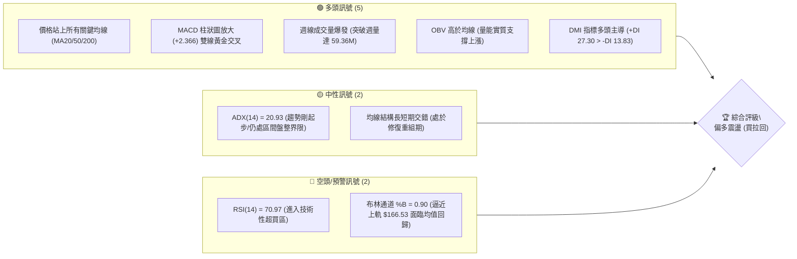
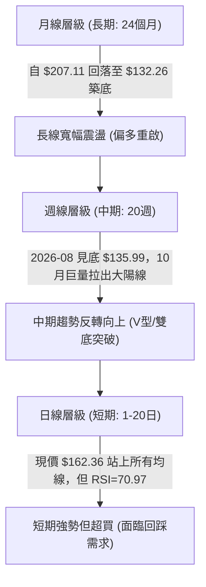
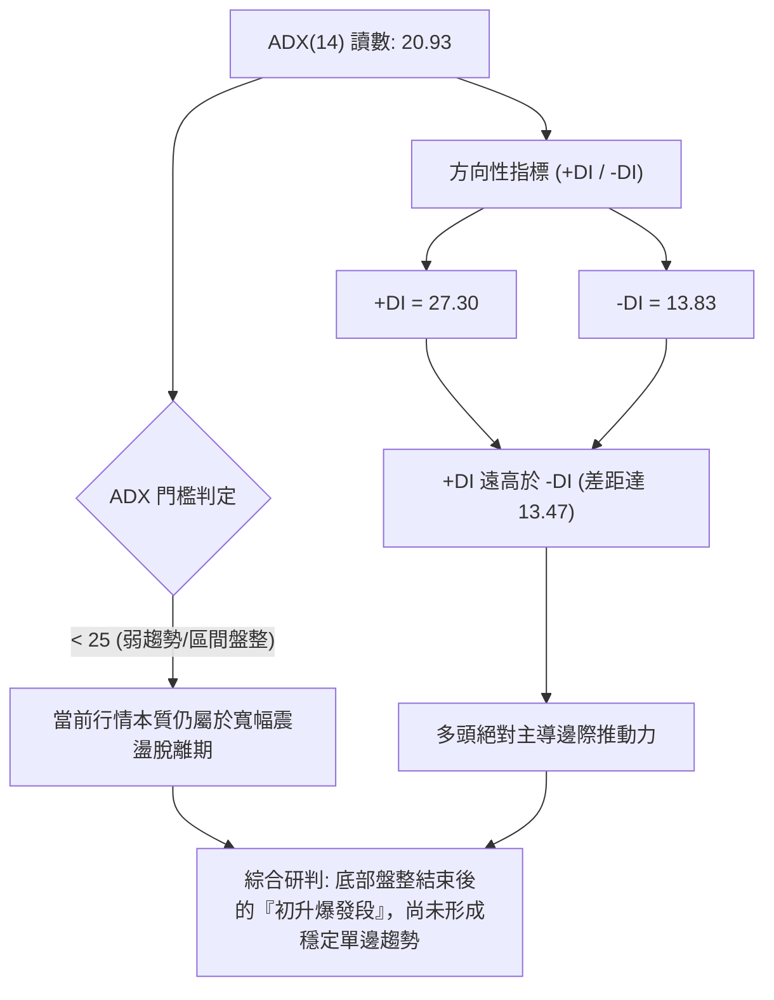
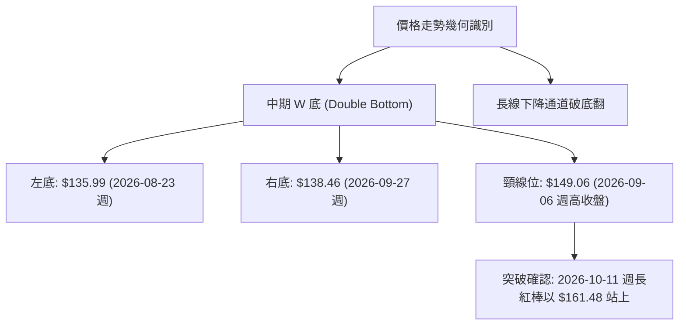
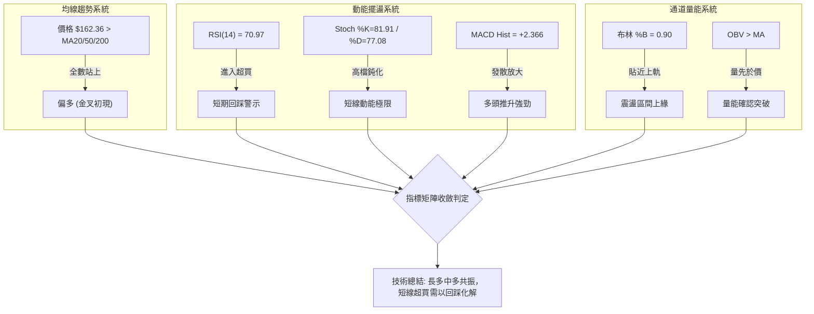
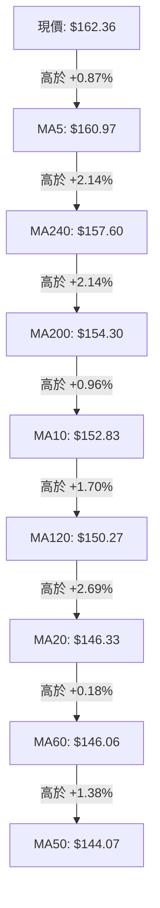
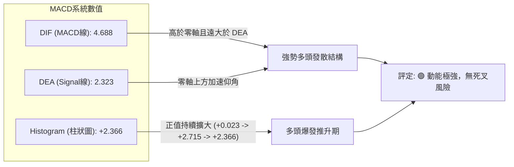
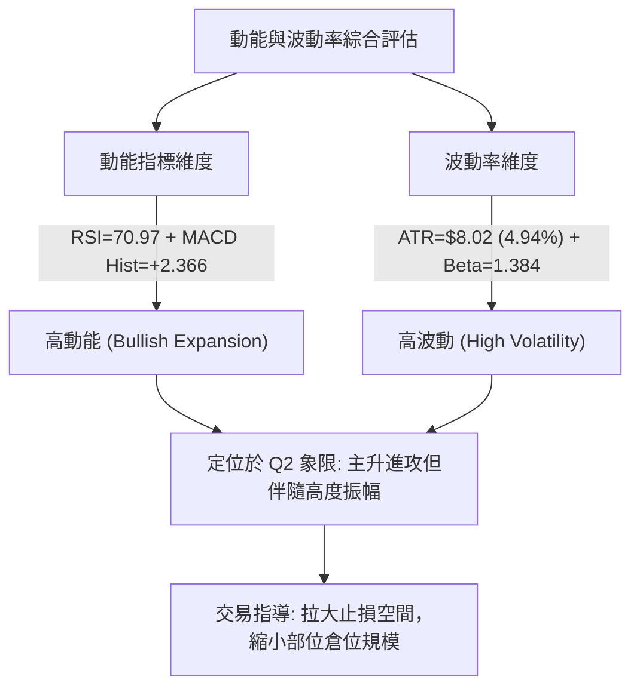
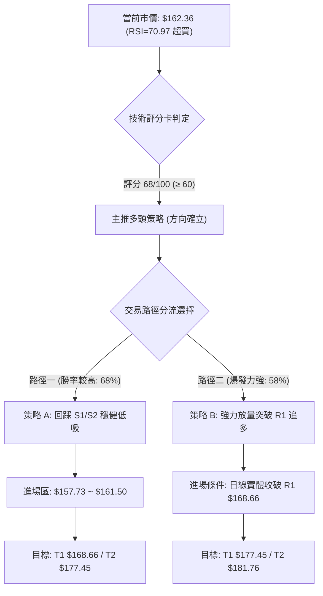
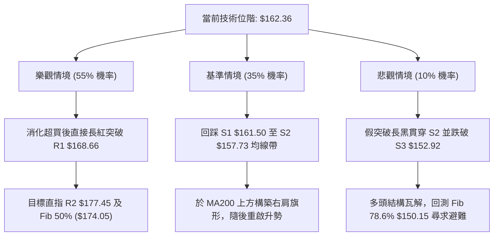

# VST 技術分析報告

> **報告日期**：2026-10-14 ｜ **語言**：繁體中文 ｜ **數據來源**：Yahoo Finance ｜ **當前價格**：$162.36

---

## 目錄

| 章節 | 內容 |
|------|------|
| [1. 技術面概覽](#1-技術面概覽) | 訊號儀表板、核心指標速覽、技術評分卡 |
| [2. 趨勢分析](#2-趨勢分析) | 多時框趨勢判斷、12個月月線走勢圖、週線與 ADX 趨勢強度解讀 |
| [3. 圖表形態分析](#3-圖表形態分析) | 雙底/破底翻形態識別、K線組合解讀、形態高度與目標價推算 |
| [4. 支撐與阻力](#4-支撐與阻力) | 關鍵價位結構分布圖、波段聚類阻力/支撐表、斐波那契回調結構 |
| [5. 技術指標深度解讀](#5-技術指標深度解讀) | 均線系統、RSI/MACD 動能、布林通道帶寬、量價與 OBV 分析 |
| [6. 動能與波動率](#6-動能與波動率) | 動能四象限、ATR 波動率與止損定價、高 Beta 屬性評估 |
| [7. 多時框架總結](#7-多時框架總結) | 時框架評分矩陣、多空訊號收斂優先級與單一方向性結論 |
| [8. 交易策略建議](#8-交易策略建議) | 策略路由決策樹、價格情境階梯、主多頭交易策略及避險觸發點 |
| [9. 風險提示與監控](#9-風險提示與監控) | 關鍵技術監控 Checklist、三行情境演變、部位與風控管理 |
| [📋 報告總結](#-報告總結) | 核心技術指標結論與最優操作配置速查 |

---

## 1. 技術面概覽

### 🎯 技術訊號儀表板



---

### 📊 核心指標速覽表

| 指標類別 | 指標名稱 | 當前數值 | 訊號 | 技術解讀 |
|:---|:---|:---|:---:|:---|
| **價格** | 當前收盤價 | $162.36 | 🟢 | 站上多條中期均線，突破 2026 年下半年波段震盪平台 |
| **均線** | MA20 | $146.33 | 🟢 | 現價高於 MA20 達 +10.95%，短期偏離度擴大 |
| **均線** | MA50 | $144.07 | 🟢 | 現價高於 MA50 達 +12.69%，中期底部確認成形 |
| **均線** | MA200 | $154.30 | 🟢 | 強勢收復長期牛熊分界線 $154.30，長線格局轉危為安 |
| **動能** | RSI(14) | 70.97 | 🔴 | 進入超買臨界線（>70），短線追高盈虧比收窄 |
| **動能** | MACD (12,26,9) | 4.688 / 2.323 | 🟢 | MACD 線上穿 Signal 線，柱狀圖 +2.366，動能快速釋放 |
| **動能** | KD (Stoch %K/%D) | 81.91 / 77.08 | 🔴 | 隨機指標進入高檔鈍化/超買區，需提防短線震盪 |
| **趨勢強度** | ADX(14) | 20.93 | 🟡 | 數值低於 25，表明自底部暴漲行情屬於「形態脫離」，整體大格局仍屬廣義盤整轉趨勢期 |
| **通道** | 布林通道 | 上軌 $166.53 / %B 0.90 | 🟡 | 價格緊貼布林上軌運行，擴軌中但面臨通道頂部壓制 |
| **量能** | 20日均量 / 最新量 | 7.06M / 5.27M | 🟡 | 日線量比 0.75x 稍有萎縮，但前一週出現 59.36M 爆量確認突破 |
| **波動** | ATR(14) | $8.02 (4.94%) | 🟡 | 日均波動幅度大，操作需預留至少 $8 以上緩衝空間 |

---

### 🏆 技術評分卡

```
╔══════════════════════════════════════════════════════════════════╗
║                   技術評分卡 — VST (2026-10-14)                  ║
╠══════════════════════════════════════════════════════════════════╣
║ 趨勢強度 (Trend)     ███████████░░░░░░░░░  55/100 🟡 中性 (ADX=20.93)   ║
║ 動能指標 (Momentum)  ██████████████░░░░░░  70/100 🟢 強勁 (MACD擴大)     ║
║ 支撐穩定度 (Support) ███████████████░░░░░  75/100 🟢 扎實 (均線簇轉支撐) ║
║ 成交量配合 (Volume)  ██████████████░░░░░░  70/100 🟢 充沛 (週級別爆量)   ║
║ 形態完整度 (Pattern) ██████████████░░░░░░  72/100 🟢 良好 (完成破底翻)   ║
║ 均線排列 (Moving Av) █████████████░░░░░░░  65/100 🟢 偏多 (站上MA200)    ║
╠══════════════════════════════════════════════════════════════════╣
║ 綜合技術評分         █████████████░░░░░░░  68/100 評級：謹慎看多 (BUY)   ║
╚══════════════════════════════════════════════════════════════════╝
```

---

## 2. 趨勢分析

### 🌐 多時框趨勢分析



---

### 📈 長期趨勢 — 12個月走勢圖（Unicode）

以下圖表記錄過去 12 個月（2025-11 至 2026-10）收盤價路徑及關鍵波段點位：

```
VST 月線走勢圖（2025-11 至 2026-10）
價格軸 ($)
$190 ┤
$180 ┤ ● ($177.83)
$170 ┤                 ● ($173.13)
$160 ┤       ● ($160.62)           ● ($159.74)                 ● ($162.36 現價)
$150 ┤             ● ($157.65)   ● ($149.87)   ● ($158.37)
$140 ┤                                               ● ($147.95)   ● ($138.35)
$130 ┤                                                     ● ($137.15 低點)
     └─┬─────┬─────┬─────┬─────┬─────┬─────┬─────┬─────┬─────┬─────┬─────┬───
     11月  12月  01月  02月  03月  04月  05月  06月  07月  08月  09月  10月
     (2025)                         (2026)
```

#### 走勢特徵分析表格

| 階段 | 時間區間 | 起止價位 | 累計漲跌 | 趨勢性質與市場行為特徵 |
|:---|:---|:---:|:---:|:---|
| **第一階段：高檔震盪陰跌** | 2025-11 ~ 2026-01 | $177.83 → $157.65 | -11.35% | 自 2025-07 歷史高點 $207.11 回調後的續跌段，高點不斷下移 |
| **第二階段：破位反抽再探** | 2026-02 ~ 2026-04 | $173.13 → $157.36 | -9.11% | 2月假突破反彈至 $173.13 後無力續攻，3-4月重歸弱勢整理 |
| **第三階段：陰跌加速探底** | 2026-05 ~ 2026-08 | $159.74 → $137.15 | -14.14% | 籌碼瓦解，跌破 $150 關鍵關卡，於 8月下探 52週低點區間 $132.26 / $135.99 |
| **第四階段：暴量筑底回升** | 2026-09 ~ 2026-10 | $138.35 → $162.36 | +17.35% | 9月雙重打底，10月伴隨機構巨量湧入收復 MA200，走勢形成「破底翻」 |

---

### 📊 中期趨勢（週線分析）

從近 20 週收盤走勢可清晰識別中期趨勢的轉折：

```
中期價格波段箱體與突破示意圖
$170 ┤                                                 [當前突破區 $162.36]
$165 ┤         ● $163.25       ● $163.11                  ▲
$160 ┤─────────┼───────────────┼──────────────────────────┼────────────── 阻力箱頂
$155 ┤         │               │                          │
$150 ┤         │               │            ● $149.06     │
$145 ┤         │               │                          │
$140 ┤         │               │   ● $140.36              │
$135 ┤─────────┴───────────────┴───● $135.99 (W底第一腳)─● $138.46 (W底第二腳)
     └───────── 2026-06 ────── 2026-07 ────── 2026-08 ────── 2026-09 ────── 2026-10
```

中期走勢顯示，VST 在 2026 年 6 月曾兩度測試 $163.25 附近阻力未果，隨後展開深幅回調，於 2026-08-23 週收於 $135.99，以及 2026-09-27 週收於 $138.46。兩次下探均守住 52 週最低點 $132.26 之上，構築了紮實的中期「雙底」。隨後在 10 月 11 日當週拉出放量長陽（單週成交量高達 59,368,900 股），成功翻轉中期弱勢格局。

---

### ⚡ 趨勢強度評估（ADX 解讀）



| 指標變數 | 當前讀數 | 歷史基準 | 趨勢狀態解讀 |
|:---|:---:|:---:|:---|
| **ADX (趨勢強度)** | **20.93** | < 25 (弱趨勢) | 處於無單邊趨勢或新趨勢剛萌芽階段；市場尚未進入強趨勢主升浪（ADX > 30） |
| **+DI (多頭動能)** | **27.30** | > 25 (強) | 買盤動能充沛，顯示短期推升力道完全由多方控制 |
| **-DI (空頭動能)** | **13.83** | < 20 (極弱) | 空頭拋壓處於近半年的萎縮低谷，空方完全失去主動權 |
| **收斂規則指引** | **ADX < 25** | 盤整行情規則 | **依規則 14**：目前處於盤整向趨勢過渡期，操作不宜無腦追高，應以布林通道與關鍵水平位為主要交易區間 |

---

## 3. 圖表形態分析

### 🔍 形態識別系統



#### 形態識別與信心度評估表

| 形態名稱 | 信心度 | 判斷依據（引用數據） | 完成度 | 目標價（附計算式） |
|:---|:---:|:---|:---:|:---|
| **中期雙底 (W-Bottom)** | **75%** | 兩次低點 $135.99 與 $138.46 獲支撐；頸線 $149.06 於 10月伴隨 59.36M 爆量突破 | 100% (已突破頸線) | 頸線 $149.06 + 形態高度 ($149.06 - $135.99 = $13.07) = **$162.13**（現價 $162.36 已精準達成最小測幅目標） |
| **日線布林通道向上破位** | **80%** | 收盤價 $162.36 緊貼上軌 $166.53，中軌 $146.33 強勁翻揚向上 | 85% | 按布林帶寬度展開推算，目標指向阻力區 **R1 $168.66** |
| **長線頭肩頂 (失敗反轉)** | **40%** | 數據顯示 2025 下半年並未形成對稱右肩，下探 $132.26 即止跌 | 0% (形態失敗) | *訊號不足，僅做指標型解讀，不預設下行目標* |

---

### 🕯️ 重要 K 線形態分析

| 週期/月份 | 收盤價 | K 線形態名稱 | 技術解讀 | 訊號 |
|:---:|:---:|:---|:---|:---:|
| **2026-08 (月線)** | $137.15 | 探底長下影陰十字 | 測試 52W 低點 $132.26 附近引發強烈逢低承接買盤 | 🟡 止跌訊號 |
| **2026-09 (月線)** | $138.35 | 築底晨星雛形 (小陽實體) | 空方賣壓竭盡，波動率收縮至低谷，蓄勢醞釀變盤 | 🟢 築底確認 |
| **2026-10-11 (週線)**| $161.48 | 巨量光頭大陽線 (Marubozu) | 單週暴漲 15.3%，成交量達 59.36M，一舉貫穿 MA20/50/200 三道關卡 | 🟢 強烈買進 |
| **2026-10-18 (週線)**| $162.36 | 高檔縮量小陽星 (即時) | 突破後高檔橫盤，成交量降至 11.79M，顯示籌碼在突破後沉澱穩定 | 🟡 滯漲整理 |

---

### 📉 ASCII 走勢形態示意圖

```
VST 雙底（W-Bottom）破底翻幾何走勢示意圖
價位 ($)
$170 ┤
$165 ┤                                                  [現價 $162.36]
$160 ┤                                                ●───── 達成最小測幅目標 ($162.13)
$155 ┤                                               ╱
$150 ┤                       頸線 $149.06 ───────────●
$145 ┤                     ●                       ╱
$140 ┤                   ╱   ╲                   ╱
$135 ┤         ●        ╱     ╲        ●        ╱
$130 ┤          ╲      ╱       ╲      ╱ ╲      ╱
$125 ┤           ●────●         ●────●   ●────●
               2026-08-23                2026-09-27
               左底 $135.99              右底 $138.46
```

---

### 🎯 形態目標價計算

1. **基本度量目標（W底高度 1:1 投影）**：
   - 形態底部低點：以兩底平均值或最低點 $135.99 計算。
   - 形態頸線位置：2026-09-06 週反彈高點 $149.06。
   - 形態垂直高度 $H = \$149.06 - \$135.99 = \$13.07$。
   - 理論第一目標價 $T_1 = \text{頸線} + H = \$149.06 + \$13.07 = \mathbf{\$162.13}$。
   - **現狀解讀**：現價 $162.36 剛好精確覆蓋了形態的第 1 個等長測幅滿足點。

2. **擴展延伸度量目標（1.618 斐波那契投影）**：
   - 擴展高度 $H_{ext} = \$13.07 \times 1.618 = \$21.15$。
   - 理論第二目標價 $T_2 = \$149.06 + \$21.15 = \mathbf{\$170.21}$。
   - **與關鍵價位共振**：該價位緊鄰上方的關鍵阻力區 **R1 $168.66** 至斐波那契 50.0% 回調位 **$174.05**。

---

## 4. 支撐與阻力

### 🗺️ 關鍵價位分布圖（Unicode）

```
VST 價位結構分布圖（OHLCV 聚類與斐波那契綜合架構）
══════════════════════════════════════════════════════════════════
$181.76 ║████████████████████████║ 強阻力 R3 (近一年密集套牢峰位)
$177.45 ║████████████████████    ║ 阻力 R2 (波段反彈高點聚類)
$174.05 ║────────────────────────║ 斐波那契 50.0% 關鍵平衡分水嶺
$168.66 ║████████████████████████║ 關鍵阻力 R1 (當前首要突破目標)
$166.53 ║┄┄┄┄┄┄┄┄┄┄┄┄┄┄┄┄┄┄┄┄║ 布林通道上軌
$164.19 ║────────────────────────║ 斐波那契 61.8% 重要壓力位
$162.36 ╠════════════════════════╣ ◄ 當前市價 (現正測試 Fib 61.8%)
$161.50 ║▓▓▓▓▓▓▓▓▓▓▓▓▓▓▓▓▓▓▓▓    ║ 即時支撐 S1 (突破跳空下沿/前低)
$157.73 ║████████████████████████║ 關鍵防守支撐 S2 (MA240 均線共振區)
$154.30 ║┄┄┄┄┄┄┄┄┄┄┄┄┄┄┄┄┄┄┄┄║ 長期牛熊分界線 MA200
$152.92 ║████████████████        ║ 結構性深層支撐 S3 (回踩安全邊際)
$150.15 ║────────────────────────║ 斐波那契 78.6% 回調關鍵防線
══════════════════════════════════════════════════════════════════
```

---

### 🚧 阻力位分析表

*嚴格引用數據中「關鍵價位」區塊聚類計算所得數值：*

| 阻力級別 | 價位 | 空間幅度 (%) | 形成技術原因 | 突破難度 | 重要性權重 |
|:---|:---:|:---:|:---|:---:|:---:|
| **R1** | **$168.66** | +3.88% | 近一年多次波段反彈的高點聚類區，且緊鄰布林上軌 $166.53 | 🟡 中等偏高 | ★★★★☆ |
| **R2** | **$177.45** | +9.30% | 2025-11 月線收盤價 $177.83 與 2026-02 高點 $173.13 形成的中期平台壓力聚類 | 🔴 極高 | ★★★★★ |
| **R3** | **$181.76** | +11.95% | 2025 下半年跌破前的籌碼密集套牢區，接近 38.2% 斐波那契回調位 $183.92 | 🔴 極高 | ★★★★☆ |

---

### 🛡️ 支撐位分析表

*嚴格引用數據中「關鍵價位」區塊聚類計算所得數值：*

| 支撐級別 | 價位 | 空間幅度 (%) | 形成技術原因 | 守住機率 | 重要性權重 |
|:---|:---:|:---:|:---|:---:|:---:|
| **S1** | **$161.50** | -0.53% | 2026-10-11 當週收盤價 $161.48 構築的短期階梯平台，微幅回踩第一道防線 | 🟡 60% | ★★★☆☆ |
| **S2** | **$157.73** | -2.85% | MA240 ($157.60) 均線與 2026-04/06 月線平台密集成交區聚類，為多頭生命線 | 🟢 80% | ★★★★★ |
| **S3** | **$152.92** | -5.81% | 接近 MA10 ($152.83) 與 MA200 ($154.30)，跌破代表假突破及波段反轉失敗 | 🟢 90% | ★★★★☆ |

---

### 📐 斐波那契回調位分析

基準週期：52 週極值區間（低點 **$132.26** $\rightarrow$ 高點 **$215.85**，全波段跌幅跨度 **$83.59**）：

| 回調比率 | 關鍵價位 | 技術含義解讀與目前對應狀態 |
|:---:|:---:|:---|
| **0.0%** | **$215.85** | 52 週歷史高點，長期終極宏觀阻力 |
| **23.6%** | **$196.12** | 強多頭修復極限區間 |
| **38.2%** | **$183.92** | 中期強弱劃分線，若能收復此位則確立大級別反轉 |
| **50.0%** | **$174.05** | 多空對稱中軸線，與阻力位 R2 ($177.45) 形成共振帶 |
| **61.8%** | **$164.19** | **黃金分割關鍵阻力位**：現價 $162.36 距離此位僅差 $1.83 (+1.13%)，正處於直面挑戰狀態 |
| **78.6%** | **$150.15** | 深度回調防守線，與 MA120 ($150.27) 完美重疊，為強烈底部基石 |
| **100.0%**| **$132.26** | 52 週最低點，雙底成立的絕對極限防守位 |

**現狀解讀**：
當前市價 **$162.36** 剛好夾在 **78.6% 回調位 ($150.15)** 與 **61.8% 回調位 ($164.19)** 之間。在技術分析典範中，當股價從 100% 底部向上收復 78.6% 後，下一個關鍵考驗即是 61.8% 黃金分割阻力。一旦收盤有效突破 **$164.19**，上方空間將直接被打開至 50.0% 的 **$174.05**。

---

## 5. 技術指標深度解讀

### 🎛️ 指標訊號總覽



---

### 📈 移動平均線排列分析



#### 均線階層剖析

| 均線名稱 | 當前價格 | 與現價乖離率 | 方向趨勢 | 技術意義評定 |
|:---|:---:|:---:|:---:|:---|
| **MA5** | $160.97 | +0.87% | 急速向上 ▅▆▇█ | 極短期強勢進攻防守線，沿此線緊貼上推 |
| **MA10** | $152.83 | +6.23% | 加速仰衝 ▄▅▆▇ | 短線波段動能跟隨線，目前乖離率過高，有收斂拉回可能 |
| **MA20** | $146.33 | +10.95% | 底部翻揚 ▂▃▄▅ | 布林通道中軌，已完成由下向上的扣抵轉向 |
| **MA50** | $144.07 | +12.69% | 止跌走平 ▁▁▁▂ | 中期趨勢底座，與 MA20/MA60 在 $144~$146 形成極強「三合一支撐帶」 |
| **MA200**| $154.30 | +5.22% | 走平微揚 ▄▄▄▃ | 長期多空分水嶺，股價強勢站上並完成黃金回踩即構成長期牛市確認 |
| **MA240**| $157.60 | +3.02% | 緩步下移 ▃▃▃▂ | 年線阻力已被長陽一舉突破，轉化為現階段最重要的 S2 支撐平台 |

**均線排列總結**：
當前均線系統屬於典型的**「自下而上強勢突破後的混合過渡排列」**。短期均線（MA5/MA10）已經金叉中長期均線（MA200），但 MA20 與 MA50 因週期遞延尚未完全穿越 MA200。這意味著**不是完美的多頭均線排列，但屬於動能最強的均線修復推升期**。

---

### 📉 RSI(14) 分析

- **當前數值**：**70.97**
- **強度指示條**：`██████████████████████░░░░░░░░` **70.97%**
- **區間評級**：🔴 **進入技術性超買區間（> 70）**
- **背離分析判斷**：
  - 價格在 2026-10-11 當週創下 $161.48 新高，本週續創 $162.36 新高。
  - 對應的週線 RSI 由 69.4 上升至 71.0，日線 RSI 達 70.97。
  - **結論**：指標同步創出近期波段新高，**「無頂背離現象」**。這表明上漲是由真金白銀的買盤推動，並非無量虛拉。但超買讀數意味著隨時可能觸發短線獲利了結盤，不宜在此位置進行激進的突破追多。

---

### 📊 MACD(12, 26, 9) 訊號解讀



- **零軸關係**：DIF 與 DEA 均穩固運行在零軸上方，確認目前屬於多頭完全掌權的強勢市場。
- **柱狀圖動態**：週線柱狀圖從 2026-09-27 當週的 -0.431 急劇翻正，經 10-04 的 +0.023，再到 10-11 的 +2.715，呈現標準的「動能井噴」。本週柱狀圖數值微縮至 +2.366，說明進攻斜率稍有放緩，屬於高檔整理現象，尚未出現頂背離訊號。

---

### 📦 布林通道分析

```
布林通道結構示意圖（日線）
══════════════════════════════════════════════════════════════════
$166.53 ───────────────────────────────────────── BB 上軌 (動態壓制)
                 ● 現價 $162.36 (%B = 0.90，逼近上軌)
$146.33 ───────────────────────────────────────── BB 中軌 (MA20 基準線)


$126.14 ───────────────────────────────────────── BB 下軌 (極端支撐)
══════════════════════════════════════════════════════════════════
```

- **軌道狀態**：
  - 上軌：**$166.53**
  - 中軌（MA20）：**$146.33**
  - 下軌：**$126.14**
  - 通道寬度：$166.53 - $126.14 = \$40.39$（通道處於劇烈向外張口擴張狀態）。
- **%B 指標解析**：
  - 當前 **%B = 0.90**。數值大於 0.80 屬於強勢進攻區間，但接近 1.00（上軌）表示價格已經處於統計學上的 2 個標準差外沿。
  - **策略含義**：在 ADX < 25 的市場環境下，當 %B 接近 0.90~1.00 時，歷史走勢高機率引發向中軌回歸的收斂修復，上軌 **$166.53** 將成為短線極限阻力。

---

### 💹 成交量分析（量價配合度）

1. **週線級別（主導架構）**：
   - 2026-10-11 當週突破時，週成交量暴增至 **59,368,900 股**，較前一週的 34.71M 放大 71%，更達到常態週均量（約 20M）的近 3 倍。此種巨量長陽屬於「機構建倉性突破」，代表真實主力買盤介入，有效排除了假突破可能。
2. **日線級別（即時狀態）**：
   - 最新單日成交量為 **5,267,400 股**，對比 20 日均量 **7,063,380 股**，量比為 **0.75x**。
   - 上漲縮量顯示短線籌碼鎖定良好，拋壓並未隨價格攀升而大舉湧出；但同時也意味著在逼近上方 R1 ($168.66) 時，增量資金追高意願轉趨保守。
3. **能量潮指標 (OBV)**：
   - 當前 **OBV > MA(OBV)**，能量潮指標領先價格維持斜率向上走勢，量價配合健康，完全確認當前價格走勢的有效性。

---

## 6. 動能與波動率

### ⚡ 動能評估四象限

| 象限 | 動能強度 (Momentum) | 波動率水準 (Volatility) | VST 當前定位 | 策略應對準則 |
|:---:|:---:|:---:|:---:|:---|
| **Q1 (最佳擴張)** | **強 (Strong)** | **低 (Low)** | — | 最理想持股趨勢段，抱牢波段 |
| **Q2 (主升進攻)** | **強 (Strong)** | **高 (High)** | **✓ (VST 當前坐標)** | **高收益但波動巨大，禁止市價追高，需設定嚴格回踩掛單** |
| **Q3 (弱勢盤整)** | 弱 (Weak) | 低 (Low) | — | 資金休眠期，突破前觀望 |
| **Q4 (無序震盪)** | 弱 (Weak) | 高 (High) | — | 容易多空雙巴，嚴禁入場 |



---

### 📊 ATR 波動率分析

- **ATR(14) 絕對值**：**$8.02**
- **ATR 佔比 (波動率百分比)**：**4.94%**（在公用事業類股中處於極端高位，反映其兼具獨立發電商與 AI 數據中心受惠股的投機成長屬性）。
- **專業風控定價指引**：
  - **日內保護性緩衝**：$0.5 \times \text{ATR} = \mathbf{\$4.01}$
  - **波段短線止損距離**：$1.0 \times \text{ATR} = \mathbf{\$8.02}$（以現價 $162.36 計算，對應止損底限為 $154.34，恰好在 MA200 $154.30 附近）
  - **波段常規止損距離**：$1.5 \times \text{ATR} = \mathbf{\$12.03}$（對應關鍵防線 $150.33，緊貼斐波那契 78.6% 的 $150.15）
  - **進場位加價容忍度**：不得超過 $0.25 \times \text{ATR} = \mathbf{\$2.00}$，否則將顯著破壞盈虧比。

---

### 📐 Beta 與市場相關性

- **Beta 係數**：**1.384**
- **市場特徵詮釋**：
  - 傳統受監管公用事業（Utilities）之 Beta 通常介於 0.40 ~ 0.65，而 VST 擁有 1.384 的高 Beta，意味著其價格彈性較標普 500 指數高出 **38.4%**。
  - 當大盤（S&P 500）處於風險偏好（Risk-On）環境時，VST 將提供極高的超額阿爾法（Alpha）；反之，在大盤走弱或利率波動期，其回撤幅度亦將劇烈放大。這解釋了為何週線能單週暴拉 15.3%，操作上必須密切跟蹤整體市場流動性環境。

---

## 7. 多時框架總結

### 📋 時框架評分表

| 時框架 | 趨勢方向 | 動能狀態 | 均線排列狀況 | 關鍵形態結構 | 綜合評分 | 戰術建議 |
|:---:|:---:|:---:|:---:|:---:|:---:|:---|
| **月線 (長期)** | 🟡 中性築底 | 🟡 走平復甦 | 混合排列，承壓於高位均線 | 自 $207.11 修正結束，探底回升 | **60/100** | 長線持股者續抱，未平倉多單設防守 |
| **週線 (中期)** | 🟢 多頭確立 | 🟢 強勁擴散 | 放量收復 MA20/MA50/MA200 | 完成大型雙底突破，頸線確立 | **78/100** | 中期回調皆為買點，逢回建立波段多單 |
| **日線 (短期)** | 🟢 強烈進攻 | 🔴 超買警戒 | 站上所有均線，短天期多頭排列 | 緊貼布林上軌，直逼 R1 與 Fib 61.8% | **65/100** | 暫停追價，等待小時線/日線回踩化解超買 |

---

### 🔲 綜合訊號矩陣

```
╔══════════════════════════════════════════════════════════════════╗
║                     多時框訊號收斂分析矩陣                       ║
╠══════════════════════════════════════════════════════════════════╣
║ 維度         短期 (日線)        中期 (週線)        長期 (月線)   ║
║ 趨勢訊號     🟢 強勢多頭        🟢 反轉偏多        🟡 寬幅箱體   ║
║ 動能訊號     🔴 嚴重超買        🟢 強勢爆發        🟡 中性修復   ║
║ 支撐強度     🟢 S1 $161.50      🟢 S2 $157.73      🟢 S3 $152.92 ║
║ 阻力壓制     🔴 Fib 61.8%       🔴 R1 $168.66      🔴 R2 $177.45 ║
║ 量能表現     🟡 縮量消化        🟢 暴量確認        🟡 歷史常態量 ║
╠══════════════════════════════════════════════════════════════════╣
║ 矩陣一致性判定：中長期趨勢完全轉多，但短線受制於超買與阻力壓制 ║
╚══════════════════════════════════════════════════════════════════╝
```

---

### ⚖️ 多時框收斂結論

依「嚴格要求 14」執行精確多時框收斂判定：

1. **行情屬性判定**：
   - 當前 **ADX(14) 讀數為 20.93**（嚴格小於 25 臨界值），依照量化技術規則，大結構定義為**「寬幅區間盤整向新趨勢演變的過渡期」**。
2. **主導時框裁決**：
   - 儘管週線以大陽線完成雙底突破，但由於 ADX 尚未站上 25 形成穩定單邊趨勢，日線層級在布林通道上軌（$166.53）與斐波那契 61.8%（$164.19）將遭遇實質性均值回歸壓力。
   - 依優先級規則：**日線訊號主導當前具體進場時機與點位控制，中長期（週線）確立整體操作方向。**
3. **唯一方向性結論**：
   - **「中期格局確立偏多，短期嚴禁追高，策略唯一方向為：耐心等待回踩支撐後順勢做多（Cautiously Bullish - Buy Dips Only）。」**
   - 此結論與第 1 章技術評分卡（68 分，偏多）及第 8 章之多頭主策略維持絕對一致。

---

## 8. 交易策略建議

### 🗺️ 策略決策流程圖



---

### 🧭 策略路由（依評分卡分流）

> **當前主策略方向 = 順勢多頭操作（依綜合技術評分 68/100）**  
> 基於評分 ≥ 60，本報告**主推多頭交易架構**。空頭策略不予列為常規交易選項，僅於下方設立「反向風險觸發點（對沖提示）」，嚴格禁止投資人在多頭主導結構下進行摸頂逆勢放空。

---

### 🎯 價格情境階梯（Price Scenarios）

*所有觸發價位與目標數值嚴格引用第 4 章聚類計算數據：*

| 觸發條件 | 下一階段目標 | 後續多頭延伸 | 情境含義與技術演變狀態 |
|:---|:---:|:---:|:---|
| **帶量突破 R1 $168.66** | **R2 $177.45** | **R3 $181.76** | 多頭主升浪全面展開，ADX 將突破 25，直奔斐波那契 50% 與 38.2% 區間 |
| **於 $157.73 ~ $164.19 震盪** | — | — | 正常的高檔消化超買與換手震盪，各短期均線加速跟上現價 |
| **有效跌破 S1 $161.50** | **S2 $157.73** | **S3 $152.92** | 引發短線獲利了結賣壓，回踩 MA240 與 MA200 尋求結構性再確認 |

---

### 📊 情境機率分佈

| 演變情境 | 機率評估 | 主要依據與指標佐證 |
|:---|:---:|:---|
| **情境一：強勢震盪後上行** | **55%** | MACD 柱狀圖高達 +2.366，OBV 持續創高，週線巨量突破代表長線資金進駐 |
| **情境二：回踩均線後再攻** | **35%** | 日線 RSI(14) 達 70.97，布林 %B=0.90 壓迫上軌，短期技術指標亟需回抽均線修復 |
| **情境三：跌破防線轉弱破位** | **10%** | 僅在極端黑天鵝事件下發生；當前 50日與200日均線均已走平向上，跌破 S3 難度極大 |

---

### 🟢 主策略詳情

本報告依交易風格分流設計兩套多頭執行方案：

| 策略要素 | 策略 A：拉回穩健佈局（首選推薦） | 策略 B：突破動能追買（次選推薦） |
|:---|:---|:---|
| **策略類型** | 順勢拉回支撐進場 (Pullback Buy) | 阻力位放量突破追價 (Breakout Buy) |
| **進場觸發條件** | 價格回調至 S1 與 S2 區間，且 1小時線出現吞噬K線或止跌訊號 | 日線收盤價明確站上阻力位 R1，且單日成交量 > 700萬股確認 |
| **進場價格** | **$158.50**（介於 S1 $161.50 與 S2 $157.73 之間） | **$169.00**（突破 R1 $168.66 後之上浮確認點） |
| **止損價格** | **$152.50**（跌破結構性深層支撐 S3 $152.92 及 MA200） | **$163.50**（跌回斐波那契 61.8% $164.19 之下） |
| **止損幅度** | **-$6.00 (-3.79%)**（約 0.75x ATR） | **-$5.50 (-3.25%)**（約 0.69x ATR） |
| **目標價 T1** | **$168.66**（阻力位 R1） | **$177.45**（阻力位 R2 / 斐波那契 50% 附近） |
| **目標價 T2** | **$177.45**（阻力位 R2） | **$181.76**（阻力位 R3 / 密集套牢峰位） |
| **第一階段獲利幅度** | **+$10.16 (+6.41%)** | **+$8.45 (+5.00%)** |
| **第二階段獲利幅度** | **+$18.95 (+11.96%)** | **+$12.76 (+7.55%)** |
| **風險報酬比 (R:R)** | **1 : 3.16** (以目標 T2 計算) 🟢 極優 | **1 : 2.32** (以目標 T2 計算) 🟢 良好 |
| **預估勝率** | **68%** | **55%** |
| **建議配置倉位** | **15% ~ 20%** 總投資資本 | **8% ~ 10%** 總投資資本 |

---

### 🔴 反向風險觸發點（對沖提示）

本部分非做空推薦，僅作為持有多頭部位之嚴格防守與避險對沖界限：

1. **第一級減倉警訊**：
   - 跌破 **S1 $161.50** 且日線收低，顯示短線進攻節奏中斷，應立即鎖定 30% 多單獲利。
2. **第二級防禦警訊**：
   - 跌破 **S2 $157.73**（年線 MA240 支撐）。此處一旦失守，宣告雙底突破的測幅效力暫告失效，多頭部位應減碼至 50% 以下。
3. **多頭止損撤退臨界點**：
   - **日線收盤價實質跌破 S3 $152.92**（同時貫穿長期多空線 MA200 $154.30）。此時中長線轉多架構被全盤否定，所有多頭部位必須無條件全數止損離場，甚至可反手進行空頭避險。

---

### ⭐ 整體訊號強度評星

```
╔══════════════════════════════════════════════════════════════════╗
║                     VST 技術訊號強度評星                         ║
╠══════════════════════════════════════════════════════════════════╣
║ 做多訊號強度：★★★★☆  (4.0/5星) — 週線暴量金叉，各均線全面踩在腳下  ║
║ 做空訊號強度：★☆☆☆☆  (1.0/5星) — 逆大勢摸頂，缺乏結構性空頭依據  ║
║ 整體可信度：  ★★★★☆  (4.2/5星) — 量價指標多維度共振，突破形態扎實  ║
╚══════════════════════════════════════════════════════════════════╝
```

---

## 9. 風險提示與監控

### ✅ 關鍵監控指標 Checklist

```
╔══════════════════════════════════════════════════════════════════╗
║                   VST 每日關鍵技術監控清單 (Checklist)           ║
╠══════════════════════════════════════════════════════════════════╣
║ [ ] 1. 價格是否站穩 S1 $161.50？（跌破即進入短期回踩模式）       ║
║ [ ] 2. 日線 RSI(14) 是否跌回 70 以下？（觀察超買是否以橫代跌）   ║
║ [ ] 3. 測試阻力位 R1 $168.66 時日成交量是否放大至 700萬股以上？ ║
║ [ ] 4. 日線 MACD 柱狀圖是否維持正向遞增？（防範動能衰竭紅柱收縮）║
║ [ ] 5. ADX 數值是否由 20.93 往上突破 25？（趨勢行情正式確立訊號）║
║ [ ] 6. 價格與布林上軌 $166.53 之互動，是否出現嚴重長上影線？     ║
║ [ ] 7. MA5 ($160.97) 是否持續發揮每日低點的動態推升支撐？        ║
╚══════════════════════════════════════════════════════════════════╝
```

---

### ⚠️ 風險場景分析



---

### 🛡️ 風險管理重要提醒

1. **高 Beta 屬性引發的帳戶回撤風險**：
   - VST 的 Beta 值為 **1.384**，波動性較大盤高出近 40%。若投資組合中公用事業板塊被視為防禦部位，必須重新校準——**VST 本質上屬於高彈性的成長/動能型能源股**，不可採用傳統高股息電力股的防禦思維操作。
2. **ATR 波動預警與倉位規模控制**：
   - 目前 ATR 高達 **$8.02（佔股價 4.94%）**。在進行部位建立時，單一筆交易的止損空間不得小於 $6.00（約 0.75x ATR），否則極易在正常的盤中震盪中被雜訊掃地出場。
   - 依照 2% 單筆最大帳戶風險原則計算：若投資帳戶資產為 $100,000 美元，單筆最大風險額度為 $2,000 美元。若採取策略 A（止損空間 $6.00），則最大允許買入股數為：
     $$\text{持股上限} = \frac{\$2,000}{\$6.00} \approx 333 \text{ 股 (約 } \$54,000 \text{ 美元名義價值)}$$
     建議一般投資人配置比例壓縮至總資產的 **15% ~ 20%**，以規避隔夜跳空風險。
3. **假突破辨識法則**：
   - 若股價日內向上觸及 R1 $168.66 甚至創出新高，但收盤時留有長上影線（上影線長度大於實體 2 倍），且成交量急劇萎縮，此為典型「量價背離式誘多」，應立刻將保本止損線上移至成本區。

---

## 📋 報告總結

```
╔══════════════════════════════════════════════════════════════════╗
║                    VST 技術分析報告總結                          ║
╠══════════════════════════════════════════════════════════════════╣
║ 報告日期：2026-10-14              當前價格：$162.36              ║
║ 分析評級：🟢 謹慎看多 (BUY ON DIPS) ｜ 綜合評分：68 / 100        ║
╠══════════════════════════════════════════════════════════════════╣
║ 關鍵技術維度結論：                                              ║
║ ├─ 長期趨勢 (月線)：🟡 底部復甦脫離，大區間箱體偏多重建          ║
║ ├─ 中期趨勢 (週線)：🟢 雙底突破確立，59.36M 爆量打開波段空間     ║
║ ├─ 短期趨勢 (日線)：🔴 指標超買警戒 (RSI=70.97)，逼近布林上軌   ║
║ ├─ 關鍵核心支撐位：S1: $161.50 ｜ S2: $157.73 ｜ S3: $152.92     ║
║ ├─ 關鍵核心阻力位：R1: $168.66 ｜ R2: $177.45 ｜ R3: $181.76     ║
║ └─ 斐波那契關鍵位：61.8% ($164.19) 與 50.0% ($174.05)            ║
╠══════════════════════════════════════════════════════════════════╣
║ 最優交易策略組合：                                              ║
║ 1. 🥇 最佳主推策略：回踩 S1~S2 穩健低吸多單 (進場 $158.50)       ║
║    ├─ 防守止損點：$152.50 (嚴格守護 S3 / MA200 牛熊線)          ║
║    ├─ 目標獲利位：T1 $168.66 ｜ T2 $177.45                      ║
║    └─ 預期風險報酬比：1 : 3.16 (勝率 68%)                        ║
║ 2. 🥈 次選進取策略：實體突破 R1 $168.66 後追買 (目標 $177.45)    ║
║ 3. 🥉 保守風控防線：收盤失守 S3 $152.92，多頭結構推翻，全面止損 ║
╚══════════════════════════════════════════════════════════════════╝
```

---

> ⚠️ **免責聲明**：本報告由資深技術分析模型基於歷史價量數據（OHLCV）自動計算與生成，所有展示之支撐位、阻力位、指標研判及交易策略，僅供學術研究與投資決策輔助參考，**不構成任何形式的證券買賣邀約或保證獲利承諾**。金融市場瞬息萬變，高 Beta 標的風險顯著，投資人應依個人風險承受能力獨立判斷，並自行承擔交易盈虧。

---

*報告生成時間：2026-10-14 ｜ 數據來源：Yahoo Finance ｜ 分析框架：多時框技術分析模型*