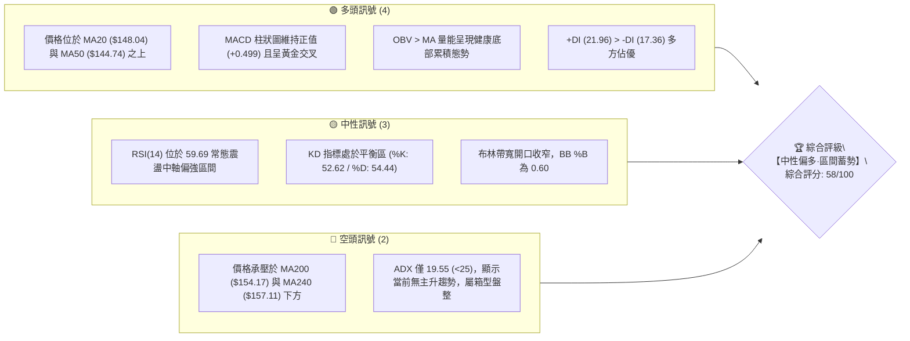
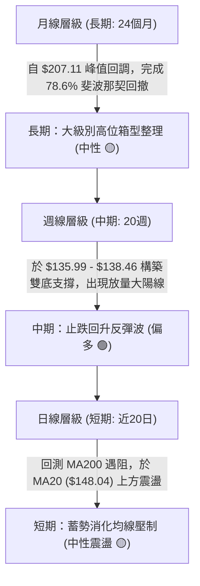
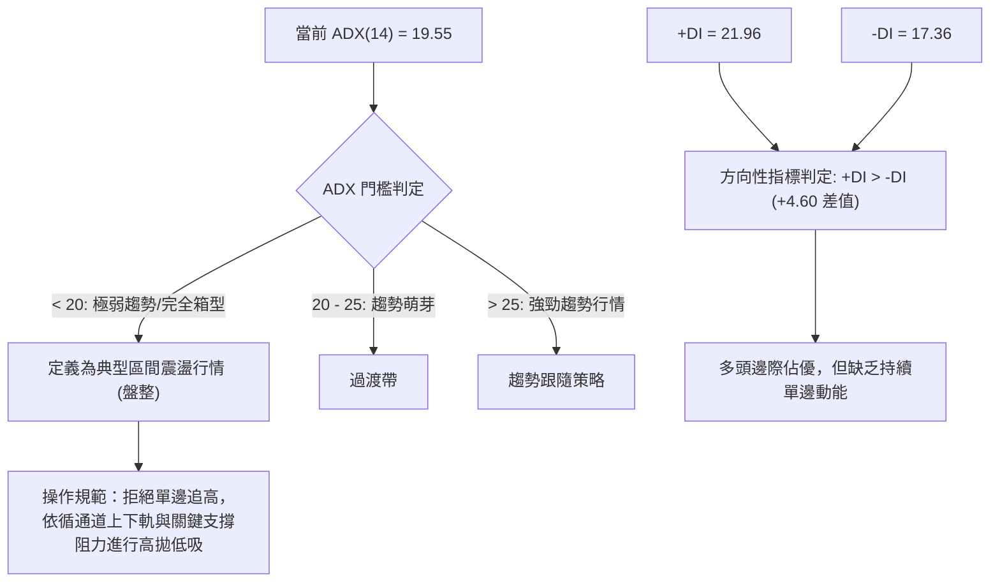
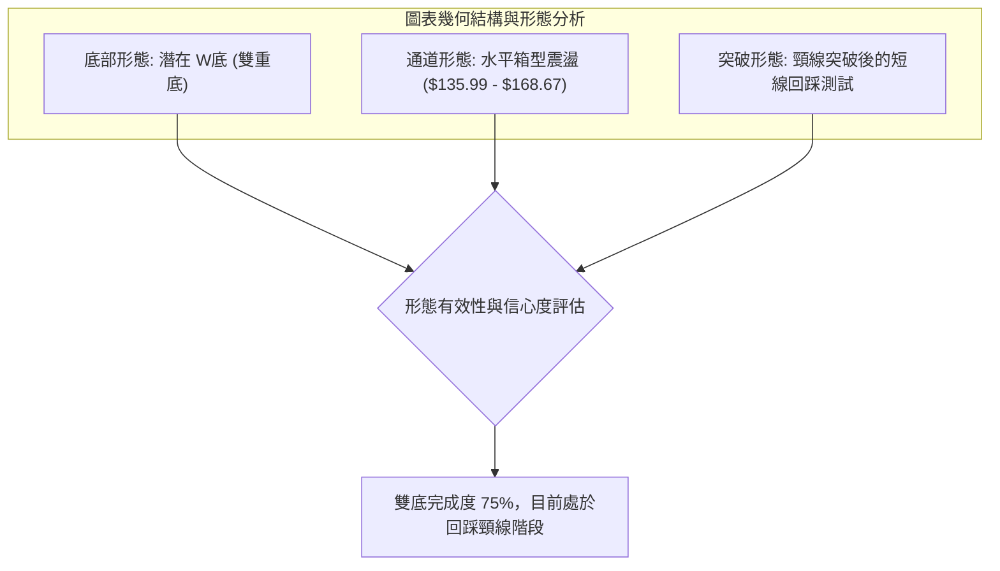
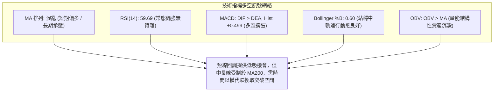
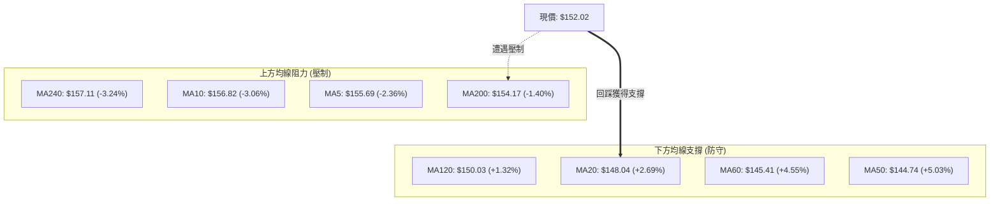
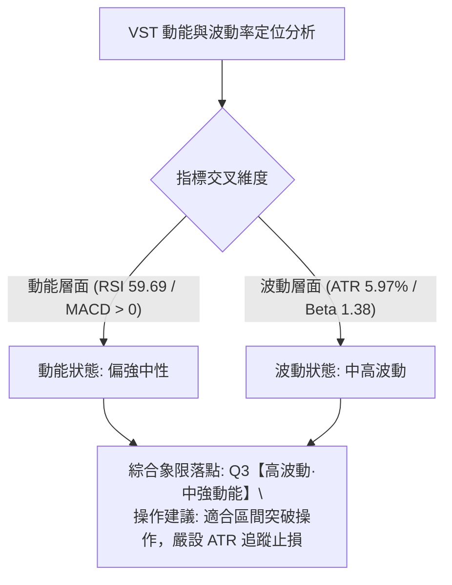
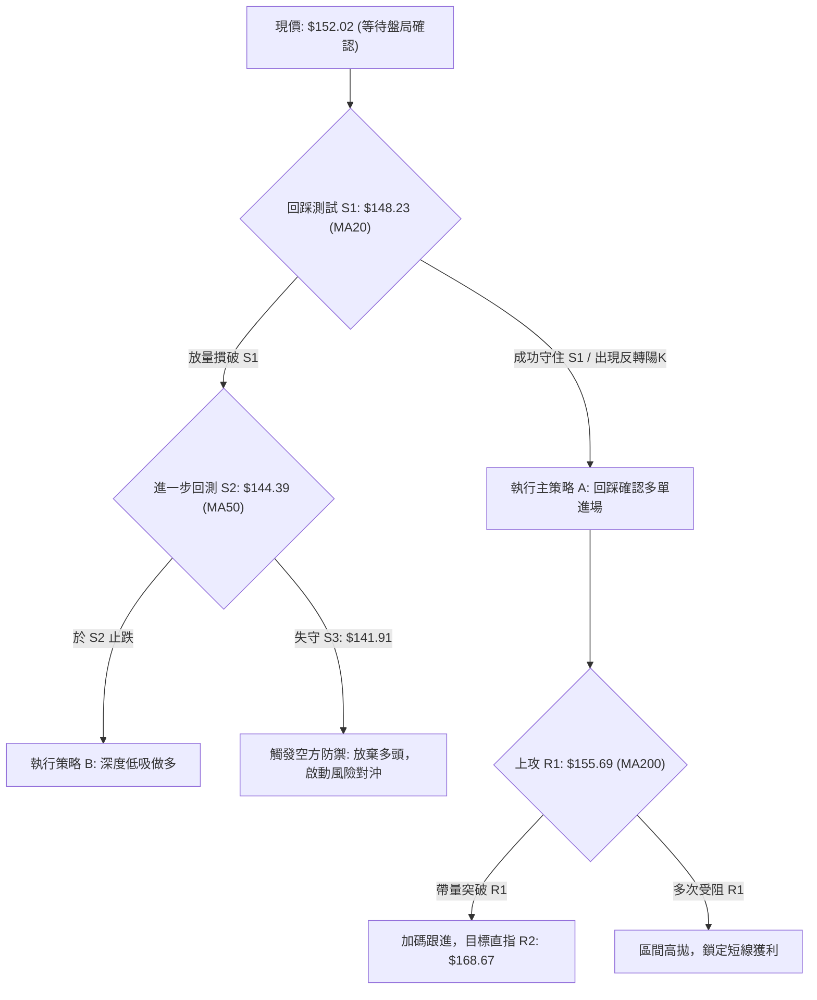
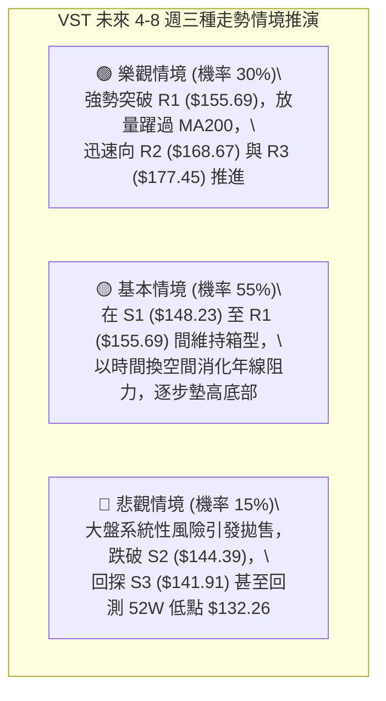

# VST 技術分析報告

> **報告日期**：2026-10-17 ｜ **語言**：繁體中文 ｜ **數據來源**：Yahoo Finance ｜ **當前價格**：$152.02

---

## 目錄

| 章節 | 內容 |
|------|------|
| [1. 技術面概覽](#1-技術面概覽) | 訊號儀表板、核心指標、評分卡 |
| [2. 趨勢分析](#2-趨勢分析) | 多時框趨勢、長中短期走勢、ADX解讀 |
| [3. 圖表形態分析](#3-圖表形態分析) | 形態識別、K線組合、目標價推算 |
| [4. 支撐與阻力](#4-支撐與阻力) | 關鍵價位、斐波那契回調結構 |
| [5. 技術指標深度解讀](#5-技術指標深度解讀) | 均線系統、RSI、MACD、布林通道、成交量 |
| [6. 動能與波動率](#6-動能與波動率) | 動能四象限、ATR波動度、Beta分析 |
| [7. 多時框架總結](#7-多時框架總結) | 時框架矩陣、多時框收斂定調 |
| [8. 交易策略建議](#8-交易策略建議) | 策略路由、價格情境、交易計畫 |
| [9. 風險提示與監控](#9-風險提示與監控) | 監控Checklist、風險情境與風控規範 |

---

## 1. 技術面概覽

### 🎯 技術訊號儀表板



### 📊 核心指標速覽表

| 指標類別 | 指標名稱 | 當前數值 | 訊號 | 專業解讀 |
|:---|:---|:---:|:---:|:---|
| **價格指標** | 當前收盤價 | $152.02 | 🟡 | 站回波段低點支撐，位於 52 週低位 ($132.26) 向上修復區間 (23.6%) |
| **短期均線** | MA20 | $148.04 | 🟢 | 現價高於 MA20 (+2.69%)，短期底部結構獲得支撐 |
| **中期均線** | MA50 | $144.74 | 🟢 | 現價高於 MA50 (+5.03%)，突破 50 日均線確認中期跌勢減緩 |
| **長期均線** | MA200 | $154.17 | 🔴 | 現價低於 MA200 (-1.40%)，上方年線壓制尚未有效放量攻克 |
| **動能震盪** | RSI(14) | 59.69 | 🟡 | 脫離超賣區進入中性溫和走強區間，無背離現象 |
| **趨勢動能** | MACD (12,26,9) | 3.579 / 3.081 | 🟢 | DIF 線位於 Signal 之上，紅柱擴張 (+0.499)，維持多頭發散 |
| **趨勢強度** | ADX(14) | 19.55 | 🔴 | ADX < 25 表示處於低趨勢動能的箱型整理行情，切忌追高 |
| **通道指標** | Bollinger %B | 0.60 | 🟡 | 現價位於中軌 ($148.04) 與上軌 ($168.14) 之間，偏向多方軌道 |
| **波動指標** | ATR(14) | $9.08 | 🟡 | 每日平均波動幅度佔股價 5.97%，短線具備高波幅洗盤特徵 |
| **量能指標** | 成交量 / 20日均量 | 0.70x | 🟡 | 短線回調縮量至 5.21M，量價配合維持縮量回洗格局 |

### 🏆 技術評分卡

```
╔══════════════════════════════════════════════════════════════════╗
║                   技術評分卡 — VST (2026-10-17)                  ║
╠══════════════════════════════════════════════════════════════════╣
║ 趨勢強度 (ADX=19.55)      ████████░░░░░░░░░░░░  40/100  🔴 弱勢盤整 ║
║ 動能指標 (MACD/RSI)       ██████████████░░░░░░  70/100  🟢 動能回暖 ║
║ 支撐穩定度 (S1/S2凝聚)    ██████████████░░░░░░  72/100  🟢 底部扎實 ║
║ 成交量配合 (OBV正向)      ████████████░░░░░░░░  60/100  🟡 縮量回測 ║
║ 形態完整度 (雙重底頸線)   ████████████░░░░░░░░  58/100  🟡 構築成形 ║
║ 均線排列 (混合纏繞)       ██████████░░░░░░░░░░  50/100  🟡 長短分歧 ║
╠══════════════════════════════════════════════════════════════════╣
║ 綜合評分                  ███████████░░░░░░░░░  58/100  🟡 區間偏多 ║
╚══════════════════════════════════════════════════════════════════╝
```

---

## 2. 趨勢分析

### 🌐 多時框趨勢分析



### 📈 長期趨勢 — 12個月走勢圖（Unicode）

以下為 VST 過去 12 個月（2025-11 至 2026-10）之月線收盤走勢全貌：

```
VST 月線走勢圖（過去12個月收盤價）
價格軸 ($)
$190 ┤
$180 ┤ ● (2025-11: $177.83)
$170 ┤                 ● (2026-02: $173.13)
$160 ┤       ● (12月: $160.62)    ●   ●   ●
$150 ┤           ● (01月: $157.65)  ●       ● (現在: $152.02) ◄ 現價
$140 ┤                                        ● (07月: $147.95)
$130 ┤                                            ● (08月: $137.15 低點)
     └─┬───┬───┬───┬───┬───┬───┬───┬───┬───┬───┬───┬───► 時間
      11  12  01  02  03  04  05  06  07  08  09  10 (月份)
```

#### 長期走勢階段特徵剖析

| 階段區間 | 收盤區間 | 累積漲跌幅 | 價量特徵與形態歸納 |
|:---|:---:|:---:|:---|
| **高位派發期**<br>(2025-11 ~ 2026-01) | $177.83 → $157.65 | -11.35% | 從歷史高檔震盪盤跌，均線由多頭排列轉為高檔死叉，長黑K線吞噬前期漲幅。 |
| **中繼反彈期**<br>(2026-02 ~ 2026-06) | $173.13 → $158.37 | -8.52% | 2 月反彈受阻於 $173.13（接近 50% 斐波那契回調位 $174.05），隨後在 $155-$160 區間橫盤。 |
| **探底出清期**<br>(2026-07 ~ 2026-09) | $147.95 → $138.35 | -6.49% | 連續破位下行，於 2026-08 觸及波段收盤低點 $137.15（週線最低 $135.99），恐慌盤湧出。 |
| **底部築底回升**<br>(2026-10 當前) | $138.35 → $152.02 | +9.88% | 10 月前兩週放量長紅突破多道短期均線，確立 $135 附近雙重底支撐，回升至 $150 關卡上方。 |

### 📊 中期趨勢（週線分析）

中期走勢（近 20 週）自 2026 年 8 月中旬探底 $135.99 後，出現明顯的量價配合回溫：
1. **二次探底確立**：2026-08-23 週收於 $135.99，隨後於 2026-09-27 週再次回測收於 $138.46，未跌破前低，確立中期底部底背離雛形。
2. **週線天量長紅**：2026-10-11 當週成交量爆發至 59,368,900 股（較均量激增逾 2 倍），單週強彈至收盤 $161.48，MACD 柱狀圖跳升至 +2.715。
3. **當週回測蓄勢**：本週（2026-10-18 當週）成交量萎縮至 31,678,900 股，股價拉回整理於 $152.02，屬於衝高遭遇 MA200 壓制後的良性回踩。

### ⚡ 趨勢強度評估（ADX 解讀）



#### ADX 趨勢強度量化矩陣

| 指標變數 | 當前數值 | 臨界標準值 | 盤勢屬性結論 |
|:---|:---:|:---:|:---|
| **ADX(14)** | **19.55** | 25.00 | **無趨勢 / 盤整震盪**：ADX < 25 且低於 20，多空雙方均無法發動單邊主升浪。 |
| **+DI** | **21.96** | — | 多方能量暫居上風，主導近期從低檔反彈的走勢。 |
| **-DI** | **17.36** | — | 空方力道自 8 月底高檔回落，下行動能減弱。 |
| **走勢定位** | **箱型多頭蓄勢** | — | **適用震盪操作模型**，以支撐位買進、阻力位獲利了結為主。 |

---

## 3. 圖表形態分析

### 🔍 形態識別系統



#### 圖表形態信心度評估表

依據技術嚴格要求，所有幾何形態均嚴格基於數據推算：

| 形態名稱 | 信心度 | 判定依據（嚴格引用歷史數據） | 完成度 | 目標價（附計算公式） |
|:---|:---:|:---|:---:|:---|
| **雙重底 (W底)** | **68%** | 兩次下探低點：低點1於 2026-08-23 週收 $135.99，低點2於 2026-09-27 週收 $138.46。兩點均精準守在 52W 低點 $132.26 之上。頸線位置取自波段反彈聚類高點 **R1: $155.69**。 | **75%** | **第一目標**：突破頸線 R1 後之等距映射：<br>形態高度 = $155.69 - $135.99 = $19.70<br>測幅目標價 = $155.69 + $19.70 = **$175.39**<br>*(非常貼近關鍵阻力 R3: $177.45 與 50% 回調位 $174.05)* |
| **水平箱型整理** | **82%** | ADX 19.55 證實市場處於無趨勢狀態。下邊界由支撐聚類 S1 ($148.23) / S2 ($144.39) 構成，上邊界由阻力 R2 ($168.67) 鎖定。 | **85%** | 箱型上限目標 = **$168.67** (直接引用阻力位 R2) |

*註：除上述基於波段頂底的形態外，日線未出現符合統計學顯著性的頭肩頂或對稱三角形，故不進行臆測性解讀。*

### 🕯️ 重要 K 線形態分析（近 5 個月關鍵轉換）

| 月份/週期 | 收盤價 | K線形態名稱 | 形態特徵解讀 | 技術訊號 |
|:---:|:---:|:---:|:---|:---:|
| **2026-07** | $147.95 | 中長黑實體K | 摜破 MA120，空頭反撲帶出殺跌量能，確認向尋底階段邁進。 | 🔴 強烈看空 |
| **2026-08** | $137.15 | 帶長下影線錘子狀K | 最低探至 $135.99 後獲得承接買盤，出現長達 $8 的下影線，釋放空頭竭盡訊號。 | 🟢 觸底反轉 |
| **2026-09** | $138.35 | 窄幅十字星 (Doji) | 月線實體極窄，成交量持平，代表市場多空雙方在此達到暫時平衡，二次探底獲支撐。 | 🟡 變盤築底 |
| **2026-10-11週** | $161.48 | 爆量長紅大陽棒 | 週成交量 59.3M，單週大漲 +15.3%，直接吞噬前 4 週跌幅，屬於標準的破底翻帶量突破。 | 🟢 強烈攻擊 |
| **2026-10-18當週** | $152.02 | 帶上影線十字星回調 | 衝高觸及 $161.48 後回吐，收盤落於 $152.02，回測 78.6% 斐波那契回調位 $150.15 尋求確認。 | 🟡 正常回踩 |

### 📉 ASCII 走勢形態示意圖

```
VST 雙重底 (W-Bottom) 與頸線結構圖
價格 ($)
$177.45 ┤                                                 [R3 目標 / 測幅 $175.39]
         │
$168.67 ┤                        ▲ (上週高點 $161.48)     [R2 阻力]
         │                       / \
$155.69 ┤───────頸線 (R1) ─────/───\───────────────────── [R1 頸線阻力]
         │     (09-06: $149.06) /     \ ◄ $152.02 (現價回踩中)
$148.23 ┤                      /       \───────           [S1 關鍵支撐]
         │                     /
$138.46 ┤            ●        /                           [底2: 2026-09-27]
         │           / \      /
$135.99 ┤          ●   \────●                             [底1: 2026-08-23]
         └──────────┴─────┴──┴──────────────────────────►
                   底1   頸  底2        突破     回踩
```

---

## 4. 支撐與阻力

### 🗺️ 關鍵價位分布圖（Unicode）

```
╔══════════════════════════════════════════════════════════════════╗
║               VST 關鍵價位結構分布圖 (由 OHLCV 聚類計算)          ║
╠══════════════════════════════════════════════════════════════════╣
║ $177.45 ║████████████████████████║ 強阻力 R3 (波段高點/形態極限) ║
║ $174.05 ║────────────────────────║ 50.0% 斐波那契重要多空分水嶺  ║
║ $168.67 ║████████████████████    ║ 次級阻力 R2 (布林上軌共振區)  ║
║ $164.19 ║────────────────────────║ 61.8% 斐波那契黃金分割位      ║
║ $155.69 ║████████████████████████║ 關鍵阻力 R1 (W底頸線/MA5/MA240)║
║ $154.17 ║························║ MA200 年線生死線              ║
║ $152.02 ╠════════════════════════╣ ◄◄◄ 當前收盤價 ($152.02)     ║
║ $150.15 ║────────────────────────║ 78.6% 斐波那契深次回撤支撐    ║
║ $148.23 ║▓▓▓▓▓▓▓▓▓▓▓▓▓▓▓▓▓▓▓▓    ║ 近期關鍵支撐 S1 (MA20 共振)   ║
║ $144.39 ║████████████████████    ║ 中期防守支撐 S2 (MA50 共振)   ║
║ $141.91 ║████████████████████████║ 核心波段支撐 S3 (雙底箱體底部)║
║ $132.26 ║████████████████████████║ 52 週最低點 (100.0% 斐波那契) ║
╚══════════════════════════════════════════════════════════════════╝
```

### 🚧 阻力位分析表

所有阻力數值嚴格引用近一年波段高點聚類分析結果：

| 阻力級別 | 準確價位 | 距現價空間 | 技術面形成原因與共振要素 | 突破難度 | 重要性權重 |
|:---|:---:|:---:|:---|:---:|:---:|
| **R1** | **$155.69** | +2.41% | 近期波段頸線密集處，與當前 **MA5 ($155.69)**、**MA200 ($154.17)**、**MA240 ($157.11)** 形成均線糾纏帶。 | 🟡 中等 | ★★★★☆ |
| **R2** | **$168.67** | +10.95% | 近期反彈波段頂部，與 **布林上軌 ($168.14)** 形成極強技術共振，為多頭第一階段目標。 | 🔴 較高 | ★★★★☆ |
| **R3** | **$177.45** | +16.73% | 2025-11 派發區起跌點，上方套牢籌碼密集，也是雙底測幅目標 ($175.39) 延伸之強阻力。 | 🔴 極高 | ★★★★★ |

### 🛡️ 支撐位分析表

所有支撐數值嚴格引用近一年波段低點聚類分析結果：

| 支撐級別 | 準確價位 | 距現價空間 | 技術面形成原因與共振要素 | 守住機率 | 重要性權重 |
|:---|:---:|:---:|:---|:---:|:---:|
| **S1** | **$148.23** | -2.49% | 波段拉回密集承接位，緊密共振 **MA20 / 布林中軌 ($148.04)**，多頭短期防守第一線。 | 75% | ★★★★☆ |
| **S2** | **$144.39** | -5.02% | 前期多根週K線收盤聚類位，與 **MA50 ($144.74)**、**MA60 ($145.41)** 形成雙重均線護城河。 | 85% | ★★★★★ |
| **S3** | **$141.91** | -6.65% | 8-9 月探底反彈之中軸，跌破此處將引發雙重底破局風險，直逼 52 週低點 $132.26。 | 90% | ★★★★★ |

### 📐 斐波那契回調位分析

依據 52 週高低點精準區間（$132.26 → $215.85，垂直空間 $83.59）計算之黃金分割架構：

| 斐波那契比例 | 精確對應價位 | 技術結構意義與當前相對位置 |
|:---|:---:|:---|
| **0.0% (52W High)** | **$215.85** | 歷史峰值，長期牛市終極目標位。 |
| **23.6%** | **$196.12** | 高檔牛熊轉折防守點。 |
| **38.2%** | **$183.92** | 多頭趨勢強支撐/反彈弱阻力。 |
| **50.0%** | **$174.05** | 整體 52 週區間之核心價值中樞，強阻力 R3 ($177.45) 關鍵緩衝區。 |
| **61.8%** | **$164.19** | 黃金分割反彈關鍵阻力位（上週高點 $161.48 於此處遇阻）。 |
| **78.6%** | **$150.15** | **深次回撤支撐位**。**當前價格 $152.02 正好位於 78.6% ($150.15) 之上！** |
| **100.0% (52W Low)**| **$132.26** | 週期底線，不可跌破之極限支撐。 |

**【斐波那契深度解讀】**：
當前收盤價 **$152.02** 精準運行於 **78.6% ($150.15)** 與 **61.8% ($164.19)** 之間。在技術分析中，78.6% 是「最後防守反彈線」。VST 自 52 週高點回撤至 8 月底接近 100% 處獲得強承接，隨後放量反彈並成功站回 78.6% ($150.15) 之上。只要後續回踩未實質跌破 $150.15，技術結構即處於「自底部脫離並向上回補至 61.8% ($164.19)」之健康上升通道中。

---

## 5. 技術指標深度解讀

### 🎛️ 指標訊號總覽



### 📈 移動平均線排列分析



#### 均線數據及趨勢特徵矩陣

| 均線名稱 | 當前價格 | 距現價差距 | 當前斜率/形態 | 多空訊號 | 戰略地位解讀 |
|:---|:---:|:---:|:---:|:---:|:---|
| **MA 5** | $155.69 | -2.36% | 短期下行頭部 | 🔴 | 衝高回落形成的超短期反壓，與阻力 R1 重合。 |
| **MA 10** | $156.82 | -3.06% | 走平彎頭 | 🔴 | 10 日均線未跟隨上攻，形成短線蓋頭壓力。 |
| **MA 20** | $148.04 | +2.69% | **快速向上揚升** | 🟢 | **短期生命線**，也是布林中軌，具有極強動態支撐。 |
| **MA 50** | $144.74 | +5.03% | 築底走平翻揚 | 🟢 | 中期防禦重鎮，確認中級底部的有效性。 |
| **MA 60** | $145.41 | +4.55% | 走平緩升 | 🟢 | 季線位置，與支撐 S2 ($144.39) 構成強大防護。 |
| **MA 120** | $150.03 | +1.32% | 走平偏下 | 🟢 | 半年線位置，現價維持其上方，具有初步支撐力道。 |
| **MA 200** | $154.17 | -1.40% | 微幅下彎 | 🔴 | **牛熊分界線**。現價受制其下，需要大成交量突破。 |
| **MA 240** | $157.11 | -3.24% | 緩降 | 🔴 | 長期年線密集區，突破後才能開啟全新牛市行情。 |

### 📉 RSI(14) 分析

當前數值：**59.69**
```
RSI(14) 數值進度條：
[0] ░░░░░░░░░░░░ [30] ▓▓▓▓▓▓▓▓▓▓▓ [50] ▓▓▓▓█░░░░░ [70] ░░░░░░░░░░░░ [100]
                             當前 RSI: 59.69 (多頭溫和區)
```

1. **區間位置**：RSI 位於 59.69，遠離 30 以下超賣區（8 月底曾觸及 26.1 極端超賣），目前處於 50-70 的常態強勢多方掌控區，既無過熱過度買入風險，亦具備持續向上推升的動能空間。
2. **背離判定**：
   - **底背離檢驗**：2026-08-23 收盤 $135.99（RSI: 26.1），2026-09-27 價格二次探底收盤 $138.46（RSI: 30.9）。價格底部抬高，RSI 指標底部亦大幅抬高，**呈現標準隱形底背離確認**，支撐了 10 月初的大反彈。
   - **頂背離檢驗**：目前價格從 $138.46 漲至 $152.02，RSI 自 30.9 升至 59.69，指標動能完全匹配價格漲勢，**無任何頂背離現象**。

### 📊 MACD(12/26/9) 訊號解讀


- **數值指標**：DIF = 3.579, DEA = 3.081, 柱狀圖差值 = +0.499。
- **訊號解析**：MACD 在零軸之上維持紅柱擴張狀態，表明自 10 月初由空翻多後，多頭主控權尚未喪失。儘管本週週線回吐使紅柱擴張速度稍有放緩，但 DIF 與 DEA 依然維持發散態勢，尚未出現死叉收斂訊號。

### 📦 布林通道分析

```
VST 日線布林通道 (20, 2) 示意圖
價格軸 ($)
$168.14 ┤──────────────── 上軌 (Upper Band: $168.14) ──────────────
         │
$160.00 ┤              ▲ (前高衝刺處 $161.48)
         │             │
$152.02 ┤───────────── ● ◄ 現價 ($152.02, %B = 0.60) ─────────────
         │             │
$148.04 ┤═════════════ 中軌 (MA20 / Middle Band: $148.04) ════════
         │
$138.00 ┤
         │
$127.93 ┤──────────────── 下軌 (Lower Band: $127.93) ──────────────
```

- **通道參數與軌道數據**：上軌 **$168.14**，中軌 **$148.04**，下軌 **$127.93**，帶寬 (Bandwidth) 為 $40.21。
- **相對位置 (%B)**：**0.60**。%B 大於 0.50 代表價格在中軌與上軌的多方強勢區運行。
- **通道軌跡**：上週突破上軌未果後向內收斂，目前正向布林中軌（$148.04，與支撐 S1 $148.23 完美共振）靠攏尋求支撐。若能於中軌上方止跌，將構成標準的「布林通道回踩中軌再上攻」模型。

### 💹 成交量分析（量價配合度）

1. **量能縮放結構**：
   - 最新交易日成交量為 **5,206,300 股**，較 20 日均量（7,404,955 股）萎縮，**量比僅 0.70x**。
   - 價格回調縮量、上漲放量（如 10 月 11 日週量達 59.3M），代表短線拉回是獲利回吐而非機構主力恐慌拋售。
2. **OBV (能量潮指標) 解讀**：
   - 系統數據明確提示：「**OBV > MA → 量能支撐上漲**」。
   - OBV 維持在均線上方持續上揚，顯示機構投資人持股比例高達 92.0% 的背景下，大資金在 $135 - $145 區間完成了實質籌碼沉澱，量能結構全面支持目前的價格反彈。

---

## 6. 動能與波動率

### ⚡ 動能評估四象限



#### 動能四象限特徵劃分表

| 象限 | 動能強度 | 波動率水準 | 當前狀態標註 | 戰術應對準則 |
|:---:|:---:|:---:|:---:|:---|
| **Q1** | 強動能 (RSI>65, ADX>25) | 低波動 (ATR%<3%) | — | 主升浪行情，最佳加碼與抱牢持股機會。 |
| **Q2** | 弱動能 (RSI 40-50, ADX<20) | 低波動 (ATR%<3%) | — | 沉悶牛皮市，資金利用效率低，謹慎觀望。 |
| **Q3** | **中強動能 (RSI 59.7, MACD>0)** | **高波動 (ATR 5.97%, Beta 1.38)**| **✓ VST 當前位置** | **高波幅反彈輪動，應於支撐區間低吸，切忌市價追價。** |
| **Q4** | 弱動能 (RSI<40, ADX>25) | 高波動 (ATR%>6%) | — | 主跌浪或恐慌拋售，絕對避免進場接刀。 |

### 📊 ATR 波動率分析

- **ATR(14) 絕對值**：**$9.08**
- **ATR 相對百分比**：**5.97% of price**（屬於公用事業/獨立發電商中的極高波動品種，主因受 AI 資料中心用電題材推動）。
- **停損與倉位設定建議**：
  - **一般波段停損距離**：建議設定 1.0 倍至 1.5 倍 ATR，即 **$9.08 ~ $13.62** 的價格保護空間。
  - **保守進場停損點**：若在 S1 ($148.23) 附近布局，設置約 0.6 倍 ATR 即可涵蓋 S2 ($144.39) 之外，兼顧風險控制與防洗盤需求。

### 📐 Beta 與市場相關性

- **Beta 係數**：**1.384**
- **市場特徵**：通常傳統公用事業（Utilities）Beta 小於 0.6，但 VST 身為獨立發電商龍頭，擁有高達 1.384 的 Beta，展現出高度的成長科技與半導體用電高彈性屬性。
- **市場連動反應**：當美股大盤標普 500 或科技板塊反彈 1% 時，VST 理論平均波動將達 1.38%；在大盤弱勢震盪時，VST 亦將面臨更為劇烈的震盪幅度。

---

## 7. 多時框架總結

### 📋 時框架評分表

| 時框架 | 趨勢方向 | 動能表現 | 均線系統狀態 | 形態特徵 | 綜合評分 | 操作建議方向 |
|:---|:---:|:---:|:---|:---|:---:|:---|
| **月線 (長期)** | 🟡 箱型回調中軸 | 🟡 中性平穩 | 承壓於 12 個月均線下方 | 自高檔回撤 78.6% 獲支撐 | 52/100 | 長線分批建倉，不追高 |
| **週線 (中期)** | 🟢 觸底反彈回升 | 🟢 MACD 翻紅 | 突破 10 週均線，測試 20 週線 | 雙重底雛形，破底翻大陽線 | 65/100 | 拉回回踩確認時積極做多 |
| **日線 (短期)** | 🟡 均線震盪纏繞 | 🟢 MACD 多頭擴張 | 站上 MA20/50，受阻 MA200 | 布林中軌與 S1 支撐爭奪 | 58/100 | 區間震盪操作，高拋低吸 |

### 🔲 綜合訊號矩陣

```
╔══════════════════════════════════════════════════════════════════╗
║               VST 短、中、長期維度訊號一致性評估矩陣             ║
╠══════════════════════════════════════════════════════════════════╣
║ 維度項目       短期 (日線)        中期 (週線)        長期 (月線) ║
╠══════════════════════════════════════════════════════════════════╣
║ 趨勢訊號       🟡 區間震盪        🟢 止跌反彈        🟡 大幅回調 ║
║ 均線結構       🟡 長短分歧        🟢 站回均線        🔴 空頭反壓 ║
║ 量價關係       🟡 縮量回洗        🟢 放量大陽        🟡 常態換手 ║
║ 關鍵位置       🟡 逼近 MA200      🟢 站穩 78.6%      🟢 守住 52W低║
╠══════════════════════════════════════════════════════════════════╣
║ 矩陣收斂結果   短線回測支撐中     中期反彈浪啟動     長期估值修復║
╚══════════════════════════════════════════════════════════════════╝
```

### ⚖️ 多時框收斂結論

依據多時框收斂規則嚴格檢驗：
1. **行情屬性定調**：當前 **ADX(14) 為 19.55（遠低於 25 臨界線）**，明確判定當前市場處於**「無趨勢之典型箱型盤整行情」**。
2. **主導規則套用**：根據規則 14，在 ADX < 25 的盤整市況下，**交易依日線布林通道上下軌（$127.93 ~ $168.14）與波段關鍵支撐阻力為核心交易區間**。
3. **多時框衝突收斂**：
   - 儘管中期週線展現出雙底長紅的反彈意圖，但短期日線遭遇 MA200 ($154.17) 與阻力 R1 ($155.69) 的強大壓制；
   - 綜合評分為 **58/100**，落於 [40, 60] 區間之偏多上緣；
   - **唯一方向性結論：【箱型區間操作·中性偏多·逢回低吸】**。不可盲目採取突破追買，策略重心應擺在回踩重要支撐位（S1: $148.23 附近）確認不破後介入，目標鎖定上方阻力階梯。

---

## 8. 交易策略建議

### 🗺️ 策略決策流程圖



### 🧭 策略路由

> **當前主策略方向 = 【區間震盪逢低做多】（依綜合評分 58/100 定調，以布林中軌支撐位操作為主，等待向上突破確認）**

由於綜合評分 58/100 處於 40-60 區間且偏向上限，技術面由雙重底回升與 OBV 量能背書，主策略推行**「回踩支撐買入」**與**「突破確認加碼」**兩套多頭推演，空頭僅列為關鍵跌破時的風控對沖信號。

### 🎯 價格情境階梯（Price Scenarios）

價位完全嚴格引用第 4 章計算之波段聚類數據與斐波那契點位：

| 觸發條件 | 下一目標價 | 後續延伸目標 | 情境實質技術含義 |
|:---|:---:|:---:|:---|
| **向上放量突破 R1 ($155.69)** | **R2: $168.67** | **R3: $177.45** | 攻克 MA200 與頸線，雙底完全激活，直奔布林上軌與形態測幅目標。 |
| **維持於現價至 S1 震盪** | **$150.15 ~ $155.69** | — | 消化 MA200 壓制，於 78.6% 斐波那契位與布林中軌構築攻擊平台。 |
| **跌破 S1 ($148.23)** | **S2: $144.39** | **S3: $141.91** | 短線回調加深，測試 MA50 中期生命線與前期箱體下沿。 |

### 📊 情境機率分佈

| 情境劇本 | 發生機率 | 主要技術與量化依據 |
|:---|:---:|:---|
| **情境一：震盪蓄勢後向上突破** | **55%** | MACD 柱狀圖翻紅 (+0.499)、OBV 持續在均線上方累積籌碼、分析師共識強烈看好（目標均價 $210.10）。 |
| **情境二：維持在 S1-R1 窄幅橫盤** | **30%** | ADX 僅 19.55 指標動能不足，MA200 下彎對短期股價構成實質壓制，市場需等待財報或外力催化。 |
| **情境三：摜破支撐再探雙底** | **15%** | 最新日成交量僅均量 0.70x，若大盤重挫引發科技與電力板塊去槓桿，恐回測 S3 ($141.91)。 |

### 🟢 主策略詳情

所有進場、止損、目標價嚴格錨定第 4 章數據：

| 策略要素 | 策略 A：回踩支撐低吸策略（穩健首選） | 策略 B：突破加碼追擊策略（激進右側） |
|:---|:---:|:---:|
| **策略邏輯** | 回測布林中軌與 MA20 共振支撐接刀 | 帶量突破年線與頸線阻力確認主升 |
| **進場條件** | 股價回踩至 S1 不破，日K出現下影線或止跌紅K | 日線收盤價實質突破 R1 且當日成交量突破 7.4M |
| **精確進場點** | **$148.23** (精確錨定支撐位 S1) | **$155.69** (精確錨定阻力位 R1) |
| **停損價格** | **$144.00** (設於支撐 S2 $144.39 下方，風險 $4.23) | **$150.00** (設於斐波那契 $150.15 下方，風險 $5.69) |
| **目標價 T1** | **$155.69** (阻力 R1 頸線處，獲利 $7.46) | **$168.67** (阻力 R2 / 布林上軌，獲利 $12.98) |
| **目標價 T2** | **$168.67** (阻力 R2 處，獲利 $20.44) | **$177.45** (阻力 R3 / 形態測幅，獲利 $21.76) |
| **風險報酬比 (R/R)**| 達 T1 為 **1.76 : 1** ｜ 達 T2 為 **4.83 : 1** | 達 T1 為 **2.28 : 1** ｜ 達 T2 為 **3.82 : 1** |
| **預估勝率** | **65%** | **55%** |
| **建議配置倉位** | **15% - 20%** 總投資資金 | **10%** 追擊倉位（或由策略 A 獲利後加碼） |

### 🔴 反向風險觸發點（對沖提示）

若出現以下訊號，宣告多頭策略失效，應果斷執行防禦性減倉或避險：
1. **實質收破 S2 ($144.39)**：代表 MA50 宣告失守，多頭底背離結構遭破壞，所有多單應立即無條件停損出場。
2. **量能異常放大破位**：若單日放量超過 1,000 萬股並收在 S3 ($141.91) 之下，預示將二度考驗 52 週低點 $132.26，可藉由買入認沽期權（Put Option）對沖現貨曝險。

### ⭐ 整體訊號強度評星

```
做多訊號強度：★★★☆☆  (3.5/5星 — 底部成形，量能溫和，惟受制年線)
做空訊號強度：★★☆☆☆  (2.0/5星 — 空頭動能衰退，底背離壓制空方)
整體可信度：  ★★★★☆  (4.0/5星 — 關鍵點位與斐波那契共振度極高)
```

---

## 9. 風險提示與監控

### ✅ 關鍵監控指標 Checklist

```
╔══════════════════════════════════════════════════════════════════╗
║                    技術監控核心清單 Checklist                     ║
╠══════════════════════════════════════════════════════════════════╣
║ [ ] 每日收盤是否穩守 78.6% 斐波那契回撤位 $150.15                ║
║ [ ] MA20 ($148.04) 支撐是否有效維持正斜率向上推升                ║
║ [ ] 能否放量突破 MA200 ($154.17) 與阻力 R1 ($155.69)             ║
║ [ ] MACD 柱狀圖是否持續在零軸之上運行（警惕紅柱翻綠）             ║
║ [ ] 日成交量能否在攻擊時放大超越 20日均量 (7,404,955 股)         ║
║ [ ] ADX(14) 是否由 19.55 突破 25，開啟單邊趨勢主升浪             ║
╚══════════════════════════════════════════════════════════════════╝
```

### ⚠️ 風險場景分析



### 🛡️ 風險管理重要提醒

1. **基本面槓桿風險提示**：
   - 技術面雖具備雙重底型態，但檢視財務數據顯示其 **淨負債高達 -$20.07B（總負債 $20.51B / 總現金 $435M）**，Debt/Equity 比率達 373.28，速動比率僅 0.258。
   - 儘管營業現金流強勁（$5.12B），但在高利率環境下，債務再融資成本對公用事業板塊估值具壓制作用，這也是為何股價在 MA200 附近躊躇不前的主因。
2. **高 Beta 波動防範**：
   - VST 的 **Beta 為 1.384**，遠高於同業平均，單日振幅高（ATR 達 $9.08，佔比近 6%）。
   - **嚴禁使用高槓桿操作**，單筆交易虧損上限應嚴格限制在總資產的 1.5% - 2.0% 範圍內。
3. **倉位管理守則**：
   - 盤整期（ADX < 25）整體持倉建議控制在 **30% - 40%** 的中等水位，保留充足現金部位，待日線確認放量收復 MA200 後，方可擴大曝險至 60% 以上。

---

## 📋 報告總結

```
╔══════════════════════════════════════════════════════════════════╗
║                    VST 技術分析報告終審總結卡                    ║
╠══════════════════════════════════════════════════════════════════╣
║ 報告日期：2026-10-17                                             ║
║ 當前價格：$152.02                                                ║
║ 綜合評級：⚖️【中性偏多·區間蓄勢】 (技術評分: 58/100)              ║
╠══════════════════════════════════════════════════════════════════╣
║ 關鍵技術結論：                                                   ║
║ ├─ 長期趨勢：🟡 月線完成 78.6% 深度回調 ($150.15)，守穩 $132.26   ║
║ ├─ 中期趨勢：🟢 週線構築雙底形態，帶量突破短期均線壓制           ║
║ ├─ 短期趨勢：🟡 於 MA20 ($148.04) 與 MA200 ($154.17) 之間震盪   ║
║ ├─ 關鍵支撐：S1: $148.23 ｜ S2: $144.39 ｜ 核心底限 S3: $141.91 ║
║ ├─ 關鍵阻力：R1: $155.69 ｜ R2: $168.67 ｜ 終極目標 R3: $177.45 ║
║ └─ 華爾街共識目標：$210.10 (21位分析師，評級 Strong Buy)        ║
╠══════════════════════════════════════════════════════════════════╣
║ 最優交易策略組合：                                               ║
║ 1. 🥇 最佳機會 (策略 A)：回踩 S1 ($148.23) 布局多單，停損設於    ║
║    $144.00，目標依序看 R1 ($155.69) 與 R2 ($168.67)，風報比優異║
║ 2. 🥈 次選機會 (策略 B)：右側突破 R1 ($155.69) 放量追擊，目標直指║
║    R2 ($168.67)，停損設於 $150.00                               ║
║ 3. 🥉 保守選擇：在 ADX < 25 的震盪期維持觀望，等待突破 MA200 確認║
╚══════════════════════════════════════════════════════════════════╝
```

---

> ⚠️ **免責聲明**：本報告為依據量化技術分析模型自動生成之研究報告，所有技術指標、支撐阻力位及情境推演均嚴格基於所提供之歷史交易數據與幾何模型推算。本報告**僅供學術研究與投資架構參考**，**不構成任何要約、招攬或具體買賣建議**。金融市場瞬息萬變，技術形態可能因重大突發事件失真，投資人應獨立評估財務狀況並自負投資風險。

---

*報告生成時間：2026-10-17 ｜ 數據來源：Yahoo Finance ｜ 分析框架：多時框技術分析體系*