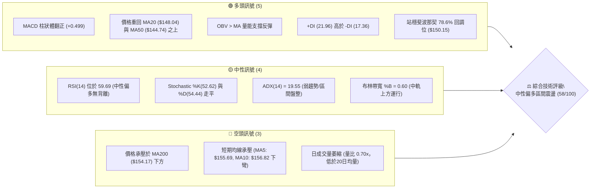
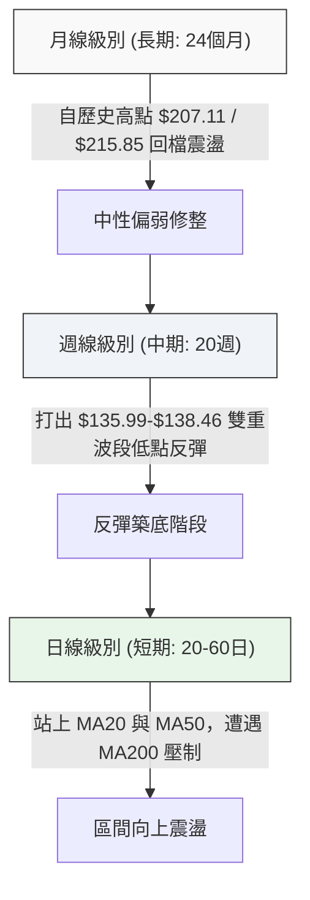
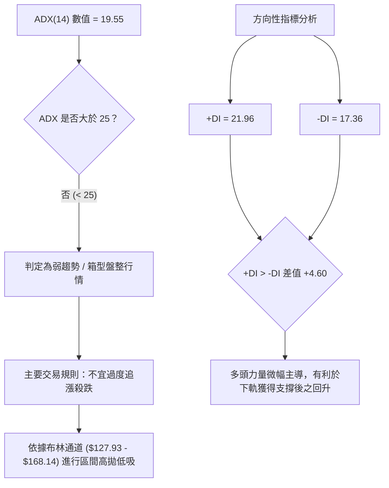
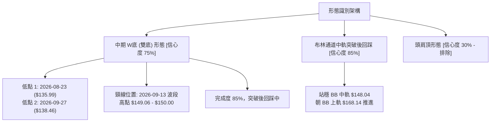
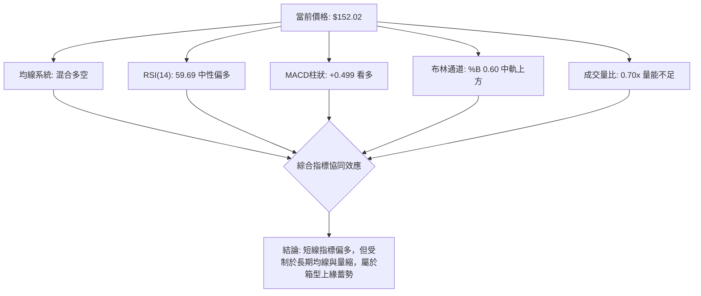
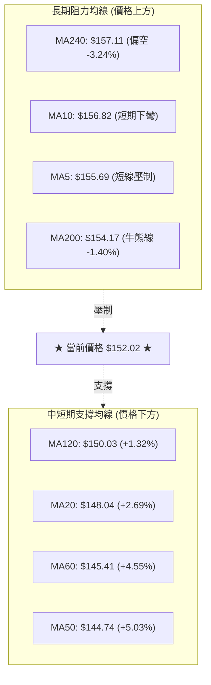
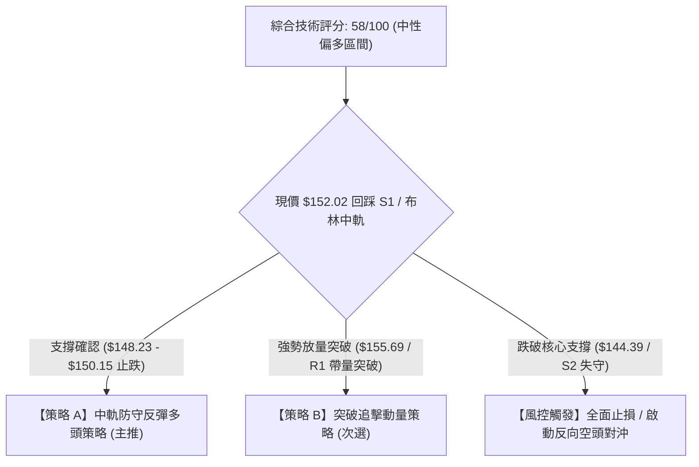
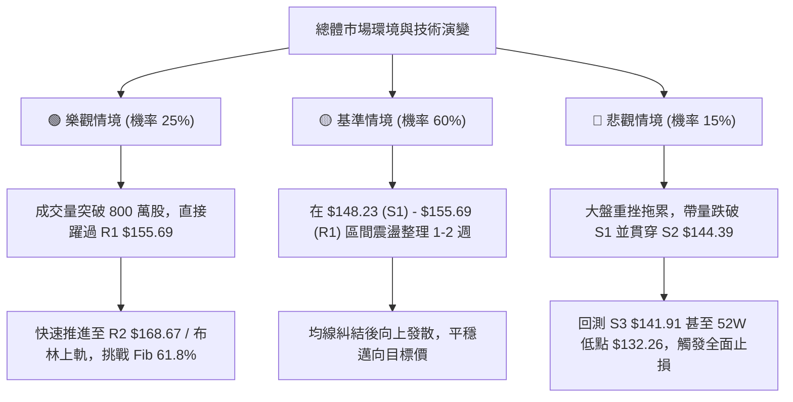

# VST 技術分析報告

> **報告日期**：2026-10-18 ｜ **語言**：繁體中文 ｜ **數據來源**：Yahoo Finance ｜ **當前價格**：$152.02

---

## 目錄

| 章節 | 內容 |
|------|------|
| [1. 技術面概覽](#1-技術面概覽) | 訊號儀表板、核心指標、評分卡 |
| [2. 趨勢分析](#2-趨勢分析) | 多時框趨勢、長中短期走勢、12個月走勢圖、ADX 解讀 |
| [3. 圖表形態分析](#3-圖表形態分析) | 形態識別信心度、K線組合、走勢圖、目標價推算 |
| [4. 支撐與阻力](#4-支撐與阻力) | 價位結構分布圖、阻力位、支撐位、斐波那契回調 |
| [5. 技術指標深度解讀](#5-技術指標深度解讀) | 均線系統、RSI、MACD、布林通道、量價與 OBV |
| [6. 動能與波動率](#6-動能與波動率) | 動能四象限、ATR 波動率與止損、Beta 與市場連動 |
| [7. 多時框架總結](#7-多時框架總結) | 時框架評分表、綜合訊號矩陣、多時框收斂結論 |
| [8. 交易策略建議](#8-交易策略建議) | 策略路由、價格情境階梯、機率分佈、多頭策略與風控 |
| [9. 風險提示與監控](#9-風險提示與監控) | 關鍵監控清單、情境模擬、倉位管理準則 |
| [📋 報告總結](#-報告總結) | 核心總結儀表板與策略精要 |

---

## 1. 技術面概覽

### 🎯 技術訊號儀表板



### 📊 核心指標速覽表

| 指標類別 | 指標名稱 | 當前數值 | 訊號 | 技術解讀 |
|:---|:---|:---|:---:|:---|
| **價格結構** | 當前收盤價 | $152.02 | 🟡 | 位於52週區間（$132.26 - $215.85）之 23.6% 分位，自底部反彈中 |
| **短期均線** | MA20 | $148.04 | 🟢 | 股價高於 MA20 (+2.69%)，短天期多頭防線穩固 |
| **中期均線** | MA50 | $144.74 | 🟢 | 股價高於 MA50 (+5.03%)，中期底部抬升獲得支撐 |
| **長期均線** | MA200 | $154.17 | 🔴 | 股價低於 MA200 (-1.40%)，長線牛熊分水嶺形成動態壓制 |
| **動能指標** | RSI(14) | 59.69 | 🟡 | 位於 50–60 溫和多頭區間，未觸及超買線（70），無背離跡象 |
| **趨勢動能** | MACD (12,26,9) | 3.579 / 3.081 | 🟢 | DIF 高於 Signal 線，Histogram 為 +0.499，維持多頭擴張 |
| **擺動指標** | KD (%K / %D) | 52.62 / 54.44 | 🟡 | 交叉走平於 50 中軸，短線多空拉鋸進入中立區 |
| **趨勢強度** | ADX(14) | 19.55 | 🟡 | 數值低於 25，確認市場處於弱趨勢／箱型盤整格局 |
| **通道指標** | Bollinger Bands | $127.93 - $168.14 | 🟢 | %B 為 0.60，站穩中軌（$148.04）朝上軌推進 |
| **量能狀態** | 成交量 / 20日均量| 5,206,300 (0.70x)| 🔴 | 短線量能低於均量 7,404,955，上攻力道需補量確認 |
| **量價指標** | OBV 趨勢 | OBV > MA | 🟢 | 能量潮指標高於均線，中期累積買盤優於賣盤 |
| **波動風險** | ATR(14) | $9.08 (5.97%) | 🟡 | 單日波動幅度約 $9.08，短線交易止損需預留緩衝空間 |

### 🏆 技術評分卡

```
╔══════════════════════════════════════════════════════════════════╗
║                   技術評分卡 — VST (2026-10-18)                  ║
╠══════════════════════════════════════════════════════════════════╣
║ 趨勢強度 (Trend)     ████████░░░░░░░░░░░░  42/100 🟡 弱趨勢盤整  ║
║ 動能指標 (Momentum)  █████████████░░░░░░░  65/100 🟢 MACD偏多    ║
║ 支撐穩定度 (Support) ██████████████░░░░░░  70/100 🟢 S1/S2牢固   ║
║ 成交量配合 (Volume)  ██████████░░░░░░░░░░  50/100 🟡 量能未放大  ║
║ 形態完整度 (Pattern) ████████████░░░░░░░░  60/100 🟡 底部成型中  ║
║ 均線系統 (Moving Av) ████████████░░░░░░░░  60/100 🟡 混合多空排列║
╠══════════════════════════════════════════════════════════════════╣
║ 綜合技術評分         ███████████░░░░░░░░░  58/100 🟡 區間震盪    ║
║ 策略定調：區間防守反擊（Range-Bound Trading），布林中上軌間操作  ║
╚══════════════════════════════════════════════════════════════════╝
```

---

## 2. 趨勢分析

### 🌐 多時框趨勢分析



### 📈 長期趨勢 — 12個月走勢圖（Unicode）

以下圖表展示 VST 從 2025 年 11 月至 2026 年 10 月期間的月線收盤價格軌跡與關鍵轉折結構：

```
VST 月線走勢圖（2025-11 至 2026-10）
價格軸 ($)
$180 ┤ ●($177.83)
$175 ┤                  ●($173.13)
$170 ┤
$165 ┤
$160 ┤       ●($160.62)            ●($159.74)
$155 ┤             ●($157.65) ●($157.36) ●($158.37)
$150 ┤                               ●($149.87)       ●($152.02)◄[現價]
$145 ┤                                          ●($147.95)
$140 ┤                                                    ●($138.35)
$135 ┤                                               ●($137.15)
     └─┬─────┬─────┬─────┬─────┬─────┬─────┬─────┬─────┬─────┬─────┬───
     11/25 12/25 01/26 02/26 03/26 04/26 05/26 06/26 07/26 08/26 09/26 10/26
```

#### 長期歷史月線走勢特徵分析表

| 階段區間 | 月份週期 | 起迄收盤價 | 漲跌幅 | 結構形態特徵 |
|:---|:---|:---|:---:|:---|
| **歷史高檔震盪** | 2025-05 ~ 2025-07 | $159.27 → $207.11 | +30.04% | 觸及 52 週高點 $215.85，動能耗竭出現波段頂部 |
| **震盪盤跌回調** | 2025-08 ~ 2025-12 | $187.82 → $160.62 | -14.48% | 高檔獲利回吐，跌破短期上升趨勢線 |
| **次高點抵抗** | 2026-01 ~ 2026-02 | $157.65 → $173.13 | +9.82%  | 弱勢反彈測試壓力，形成中長期下降次高點 |
| **箱型整理下破** | 2026-03 ~ 2026-06 | $149.87 → $158.37 | +5.67%  | 於 $150 - $160 區間橫向拉鋸，成交量沉澱 |
| **加速探底測試** | 2026-07 ~ 2026-08 | $147.95 → $137.15 | -7.30%  | 跌破區間下緣，下探 52 週最低點 $132.26 附近支撐 |
| **底部回升構築** | 2026-09 ~ 2026-10 | $138.35 → $152.02 | +9.88%  | 守住 $135 - $138 底部區，10月週線連收長陽脫離底部 |

### 📊 中期趨勢（週線分析）

中期走勢近 20 週呈現先挫後揚的「雙重底反彈」走勢。關鍵演變細節如下：
1. **波段低點聚類形成**：2026-08-23 週收盤 $135.99（成交量 2,150 萬股，RSI 降至 26.1 超賣），隨後於 2026-09-27 週再次回踩收盤 $138.46（RSI 為 30.9），兩次低點均未觸及 52 週絕對低點 $132.26，確認在 S3（$141.91）及 $135 區域獲得強力買盤支撐。
2. **大成交量反彈突破**：2026-10-11 當週錄得 59,368,900 股的爆發性巨量，單週股價飆升至 $161.48，MACD 柱狀體大幅擴張至 +2.715，直接突破中期均線壓力。
3. **當前技術回踩檢驗**：最新 2026-10-18 當週拉回至 $152.02，回踩確認斐波那契 78.6% 回調位（$150.15）與 MA20（$148.04）支撐帶。

```
中期週線波段支撐與阻力結構：
阻力 R2 ─── $168.67 ────── (2026-06 高點與波段平台區)
阻力 R1 ─── $155.69 ────── (MA200 / MA5 重合壓制帶)
當前現價─── $152.02 ◄───── (回踩 Fib 78.6% $150.15 支撐)
支撐 S1 ─── $148.23 ────── (MA20 與日線波段低點聚類)
支撐 S2 ─── $144.39 ────── (MA50 核心防線)
```

### ⚡ 趨勢強度評估（ADX 解讀）



#### ADX 趨勢強度等級對照表

| ADX 區間 | 行情特徵 | 當前狀態 (VST) | 策略應對指導 |
|:---:|:---|:---:|:---|
| 0 – 20 | 無趨勢 / 極度低迷盤整 | **19.55（當前數值）** | **趨勢跟隨無效；應採用震盪指標與邊界回歸策略** |
| 20 – 25 | 趨勢萌芽 / 方向不穩定 | 邊界過渡 | 需等待突破阻力位 R1（$155.69）伴隨成交量放大 |
| 25 – 40 | 強勁單邊趨勢 | 未達到 | 突破成立後方可轉為主動加碼順勢交易 |
| 40 – 60 | 極強趨勢（通常進入主升/主跌）| 未達到 | 暫無單邊爆發跡象 |

---

## 3. 圖表形態分析

### 🔍 形態識別系統

依據形態學標準與數據嚴格審核，VST 日線與週線圖表中可辨識之幾何形態如下：



#### 幾何形態判定與信心度評估表

| 形態名稱 | 信心度 | 判斷依據（數據引用） | 形態完成度 | 目標價（精確計算式） |
|:---|:---:|:---|:---:|:---|
| **中期雙底 (W-Bottom)** | **75%** | 兩次下探波段低點：2026-08-23 收盤 $135.99 與 2026-09-27 收盤 $138.46，未破前低且第二次低點墊高。低點聚類形成 S3（$141.91）。頸線取自 2026-09-06/13 高點聚類 $149.06。10/11 當週放量收 $161.48 實體突破頸線。 | **85%** | **形態量度目標價**：<br/>形態高度 = 頸線 $149.06 - 底部最低收盤 $135.99 = $13.07<br/>最小理論目標 = 頸線 $149.06 + 高度 $13.07 = **$162.13**<br/>*(註：10/11 高點已碰觸此區，現正進行頸線回踩測試)* |
| **布林帶向上擴張突破** | **85%** | 價格站上布林中軌（$148.04），%B 自 0.35 攀升至 0.60，MACD 柱狀線持續為正（+0.499）。 | **70%** | 上軌目標價直接對應數據布林上軌：**$168.14** |
| **大型頭肩頂 (Head & Shoulders)** | **30%** | 數據不足。2025 年雖有高點 $207.11 與 $215.85，但時間跨度已超過 14 個月，且近期處於 $135-$160 區間震盪築底，右肩結構發散無效，依規則不予採納。 | **無效** | 訊號不足，僅做指標型解讀 |

### 🕯️ 重要K線形態分析

近期連續 8 週之關鍵 K 線組合特徵解析：

| 週次日期 | 收盤價 | 週成交量 | K 線形態與組合 | 技術解讀 | 多空訊號 |
|:---:|:---:|:---:|:---|:---|:---:|
| 2026-08-23 | $135.99 | 21,503,400 | 長下影鎚頭線探底 | 跌破 $140 後爆出恐慌拋盤，但下檔買盤承接拉回，RSI 觸及 26.1 極端值 | 🟢 止跌初現 |
| 2026-08-30 | $136.87 | 18,698,700 | 低檔十字星孕線 | 跌勢暫歇，空方賣壓減弱，進入多空暫態平衡 | 🟡 變盤信號 |
| 2026-09-06 | $149.06 | 22,139,900 | 實體大陽線破均線 | 多頭反撲長紅棒，單週暴漲 8.9%，MACD 柱由負轉正（+1.364） | 🟢 多頭表態 |
| 2026-09-13 | $148.14 | 18,610,600 | 高檔倒鎚頭射擊之星 | 衝高 $150 頸線遇阻回落，RSI 達到 71.4 短期超買，預告拉回 | 🔴 短線獲利回吐 |
| 2026-09-20 | $140.44 | 23,879,600 | 中黑陰線回調 | 連續兩週震盪壓回，回測 $140 關卡確認底部有效性 | 🟡 健康回踩 |
| 2026-09-27 | $138.46 | 22,341,300 | 下影長十字線（次低點） | 測試 $138 獲得支撐，構成雙底右腳，量能維持平穩 | 🟢 右底確立 |
| 2026-10-04 | $140.02 | 34,710,000 | 放量啟動小陽線 | 週成交量激增至 3,471 萬股，買盤積極建倉，孕育突破動能 | 🟢 主力進場 |
| 2026-10-11 | $161.48 | 59,368,900 | 突破型巨量長紅棒 | 成交量暴增近 1.7 倍，一舉衝破頸線與 R1，週線 MACD 擴張至 +2.715 | 🟢 強烈買訊 |
| 2026-10-18 | $152.02 | 31,678,900 | 獲利回吐回踩陰線 | 遭遇 200 日均線及 R1 上方解套賣壓，回撤測試頸線支撐 | 🟡 正常回踩 |

### 📉 ASCII 走勢形態示意圖

```
VST 中期雙底（W-Bottom）形態結構解析圖：
─────────────────────────────────────────────────────────────────
價格
$168.67 ┤                                            [阻力 R2 / BB上軌 $168.14]
$161.48 ┤                                       ▲ (10/11 巨量衝高達標)
$155.69 ┤--------------------------------------/---\---- [阻力 R1 / MA200]
$152.02 ┤                                    /      ● 現價回踩測試頸線
$149.06 ┤                ▲ (頸線高點)       /
$148.23 ┤               /  \               /         [支撐 S1 / MA20]
$144.39 ┤              /    \            /           [支撐 S2 / MA50]
$138.46 ┤             /      \          ● (右腳 09/27)
$135.99 ┤   ● (左腳 08/23)    \        /
$132.26 ┤───┴──────────────────┴──────┴───────────── [52W 最低點]
        └──── 08/23 ──── 09/06 ──── 09/27 ──── 10/11 ──── 10/18 ──
─────────────────────────────────────────────────────────────────
```

### 🎯 形態目標價計算

1. **第一波量度等幅目標價**：
   $$\text{高度 } H = \text{頸線 } \$149.06 - \text{左腳最低收盤 } \$135.99 = \$13.07$$
   $$\text{目標價 } T_1 = \text{頸線 } \$149.06 + H = \$162.13$$
   *(該目標已於 2026-10-11 當週收盤 $161.48 基本完成)*

2. **第二波形態延伸目標價（若成功站穩 R1 $155.69）**：
   $$\text{波段擴展目標 } T_2 = \text{頸線 } \$149.06 + (1.5 \times H) = \$149.06 + \$19.61 = \$168.67$$
   *(精準對應阻力位聚類 R2: \$168.67 以及布林上軌 \$168.14)*

---

## 4. 支撐與阻力

### 🗺️ 關鍵價位分布圖（Unicode）

```
VST 價位結構分布圖（OHLCV 精確計算）
══════════════════════════════════════════════════════════════════
$215.85 ║██████████████████████████████║ 52週高點 (Fib 0.0%)
$196.12 ║████████████████████░░░░░░░░░░║ Fib 23.6% 回調位
$183.92 ║██████████████████░░░░░░░░░░░░║ Fib 38.2% 回調位
$177.45 ║██████████████████████████████║ 強阻力 R3 (波段頂部聚類)
$174.05 ║████████████████░░░░░░░░░░░░░░║ Fib 50.0% 中樞平衡位
$168.67 ║████████████████████░░░░░░░░░░║ 阻力 R2 (布林上軌 $168.14 聚類)
$164.19 ║██████████████░░░░░░░░░░░░░░░░║ Fib 61.8% 黃金分割位
$155.69 ║██████████████████████████████║ 關鍵阻力 R1 (MA200 $154.17 / MA5 壓制)
════════╠══════════════════════════════╣ ◄ 現價 $152.02 (位於 S1 與 R1 之間)
$150.15 ║▓▓▓▓▓▓▓▓▓▓▓▓▓▓▓▓▓▓▓▓▓▓▓▓▓▓▓▓▓▓║ Fib 78.6% 回調位 (現行支撐)
$148.23 ║▓▓▓▓▓▓▓▓▓▓▓▓▓▓▓▓▓▓▓▓▓▓▓▓▓▓▓▓▓▓║ 近期支撐 S1 (MA20 $148.04 雙重支撐)
$144.39 ║██████████████████████████████║ 強支撐 S2 (MA50 $144.74 防線)
$141.91 ║████████████████████░░░░░░░░░░║ 核心防守支撐 S3 (波段低點聚類)
$132.26 ║██████████████████████████████║ 52週低點 (Fib 100.0%)
══════════════════════════════════════════════════════════════════
```

### 🚧 阻力位分析表

以下價位嚴格引用自數據庫波段高點聚類：

| 阻力級別 | 精確價位 | 距離現價 | 技術結構與形成原因 | 突破難度 | 重要性權重 |
|:---:|:---:|:---:|:---|:---:|:---:|
| **R1** | **$155.69** | +2.41% | 近一年波段高點聚類；與 MA5（$155.69）、MA200（$154.17）高度重合，為當前多頭首要考驗 | 🟡 中等偏高 | ★★★★☆ |
| **R2** | **$168.67** | +10.95% | 近一年中期整理平台高點聚類；與布林通道上軌（$168.14）重合，為波段獲利了結密集區 | 🔴 極高 | ★★★★★ |
| **R3** | **$177.45** | +16.73% | 2025 年第四季套牢籌碼峰頂；波段高點聚類，突破此線象徵長線牛市全面回歸 | 🔴 巨大 | ★★★☆☆ |

### 🛡️ 支撐位分析表

以下價位嚴格引用自數據庫波段低點聚類：

| 支撐級別 | 精確價位 | 距離現價 | 技術結構與形成原因 | 守住機率 | 重要性權重 |
|:---:|:---:|:---:|:---|:---:|:---:|
| **S1** | **$148.23** | -2.49% | 近一年波段低點聚類；緊鄰 20 日移動平均線（$148.04）及布林中軌，短線強支撐 | 🟢 75% | ★★★★★ |
| **S2** | **$144.39** | -5.02% | 50 日均線（$144.74）與波段回踩低點聚類，中期上升通道下邊界防線 | 🟢 85% | ★★★★☆ |
| **S3** | **$141.91** | -6.65% | 9 月起漲前兩次震盪回踩之波段低點聚類，破位則代表雙底形態失效 | 🟢 90% | ★★★★★ |

### 📐 斐波那契回調位分析

依據 52 週波段高點 **$215.85** 至低點 **$132.26** 之完整落差（幅度 $83.59）進行黃金分割計算：

| 斐波那契回調層級 | 計算價位 | 技術意涵與當前關聯解讀 |
|:---:|:---:|:---|
| **0.0% (52W High)** | **$215.85** | 歷史峰值阻力，長線估值頂部 |
| **23.6%** | **$196.12** | 強勢回調阻力位，需宏觀能源週期共振方可挑戰 |
| **38.2%** | **$183.92** | 弱勢反彈極限阻力位，中期趨勢扭轉關鍵 |
| **50.0%** | **$174.05** | 多空平衡中樞線，前波下跌之 1/2 對稱回吐點 |
| **61.8%** | **$164.19** | 黃金分割核心阻力，上一週收盤 $161.48 曾逼近此線受阻 |
| **78.6%** | **$150.15** | **現價 ($152.02) 關鍵支撐**：股價剛站上此線 (+1.25%)，形成弱轉強的第一道防護基石 |
| **100.0% (52W Low)**| **$132.26** | 52週絕對底部，長線價值投資買盤底線 |

> **位置判定**：當前收盤價 **$152.02** 精準運行於 **Fib 78.6%（$150.15）** 與 **Fib 61.8%（$164.19）** 之間。守穩 $150.15 意味著自 52 週低點回升的波段反彈架構依然健康，空方未取得主控權。

---

## 5. 技術指標深度解讀

### 🎛️ 指標訊號總覽



### 📈 移動平均線排列分析



#### 均線體系深度矩陣

| 均線名稱 | 數值 | 偏離率 (Bias) | 斜率走勢特徵 | 訊號評級 | 技術實戰解讀 |
|:---|:---:|:---:|:---|:---:|:---|
| **MA5** | $155.69 | -2.36% | 下彎（短期獲利賣壓出籠） | 🔴 短線偏空 | 5日線下穿形成極短線阻力，限制日內反彈空間 |
| **MA10** | $156.82 | -3.06% | 下彎（自高點快速回落） | 🔴 短線偏空 | 10日線為次級壓制，需連續兩日收盤突破方能扭轉 |
| **MA20** | $148.04 | +2.69% | 上揚（底部墊高趨勢形成） | 🟢 偏多支撐 | 20日月線提供強力下檔依託，與布林中軌重合 |
| **MA50** | $144.74 | +5.03% | 走平轉上揚 | 🟢 中期支撐 | 中期生命線，守穩代表 2 個月內進場籌碼多數處於獲利 |
| **MA60** | $145.41 | +4.55% | 走平緩步墊高 | 🟢 中期支撐 | 季線位置穩固，構成 S2 輔助支撐帶 |
| **MA120** | $150.03 | +1.32% | 下降斜率趨緩 | 🟢 半年線支撐 | 半年線位於現價下方不到 $2，提供心理與技術雙重支撐 |
| **MA200** | $154.17 | -1.40% | 微幅下彎 | 🔴 長期阻力 | 關鍵年線，股價尚未站穩年線前，不可定義為長期多頭牛市 |
| **MA240** | $157.11 | -3.24% | 下降通道上緣 | 🔴 長期阻力 | 兩年均線密集帶，為中期多頭反轉之強大阻力堡壘 |

### 📉 RSI(14) 分析

當前 RSI(14) 數值為 **59.69**。

```
RSI(14) 動能強度刻度：
0 ────── 超賣(30) ────────── 中軸(50) ──── [59.69] ──── 超買(70) ────── 100
[░░░░░░░░░░░░░░░░░░░░░░░░░░░░░░░░░░░░░░░████████████░░░░░░░░░░░░░░░░░░░░]
強度進度條：████████████░░░░░░░░ 59.7% (處於健康多頭推進區)
```

- **超買超賣狀態**：數值既脫離了 8 月底的極端超賣區（26.1），又未進入 70 以上的過熱警戒區，屬於健康的多方掌控區間。
- **背離檢驗結論**：
  - **頂背離審查**：近期股價在 10/11 衝高至 $161.48 時，週線 RSI 為 69.4，日線 RSI 相應攀升，未出現「價格創新高而 RSI 走低」之現象。
  - **底背離審查**：08/23 低點 $135.99（RSI 26.1）與 09/27 次低點 $138.46（RSI 30.9），RSI 指標隨價格同步抬高，**無底背離，亦無頂背離**。
  - **指標結論**：動能中性偏多，無背離反轉風險，短線拉回純屬漲多整理。

### 📊 MACD(12/26/9) 訊號解讀


- **MACD 線位階**：快線（3.579）與慢線（3.081）均位於零軸上方，確認自 9 月以來的反彈已在日線級別建立多頭架構。
- **柱狀體變化**：柱狀線數值為 **+0.499**，雖然較 10/11 當週的爆發性峰值（+2.715）有所收斂，但依舊維持正向擴張，並未出現死叉走空訊號。
- **操作指引**：只要 Histogram 不跌破零軸，任何拉回至均線支撐皆視為良性籌碼整理。

### 📦 布林通道分析

當前布林通道（20日，2倍標準差）參數快照：
- **上軌 (Upper Band)**：$168.14
- **中軌 (Middle Band / MA20)**：$148.04
- **下軌 (Lower Band)**：$127.93
- **當前價格**：$152.02
- **帶寬指標 %B**：0.60，帶寬總寬度：$40.21

```
VST 布林通道空間分布示意圖：
$168.14 ┬────────────────────────────────────────── 上軌 (阻力極限)
        │
$160.00 ┼                     ▲ (10/11 曾刺穿上軌附近)
        │
$152.02 ┼───────────────● 現價 (位於中軌上方，%B=0.60)
        │
$148.04 ┼────────────────────────────────────────── 中軌 (MA20 強支撐)
        │
$135.00 ┼          ●   ● (8-9月雙底回踩下軌)
        │
$127.93 ┴────────────────────────────────────────── 下軌 (超賣邊界)
```

- **通道動態解讀**：%B 為 0.60，表明股價運行在強勢的多頭半區（中軌與上軌之間）。通道目前開口維持擴張態勢，未見收斂夾緊，現價回踩中軌 $148.04 具有顯著的技術買盤支撐力道。

### 💹 成交量分析（量價配合度）

1. **量能縮減特徵**：最新單日成交量為 **5,206,300 股**，相對於 20 日均量（7,404,955 股）之量比僅為 **0.70x**，顯示股價在回踩 $152 支撐時賣壓大幅減輕，呈現「跌時量縮」的健康整理態勢。
2. **OBV (能量潮指標) 確認**：技術指標明文化顯示「**OBV > MA → 量能支撐上漲**」。OBV 線持續運行於其均線之上，這印證了 10 月初暴增至 5,900 萬股的巨量買盤並未在本次小幅回調中出逃，中期主力籌碼穩定度極高。

---

## 6. 動能與波動率

### ⚡ 動能評估四象限

```
動能評估矩陣 (Momentum vs Volatility)
  高波動率 (High Volatility)
      │
  Q3  │  Q4
      │      ★ 當前狀態 VST: [Q2] 
  ────┼─────────────────────────
      │      [動能偏多 / 波動收斂盤整]
  Q1  │  Q2
      │
  ────┴───────────────────────── 低波動率 (Low Volatility)
 弱動能 ◄──────────────► 強動能
```

#### 四象限特徵定位分析

| 象限代號 | 動能狀態 | 波動狀態 | 當前定位 | 交易指導方針 |
|:---:|:---:|:---:|:---:|:---|
| **Q1** | 弱動能 (Bearish) | 低波動 (Low Vol) | — | 陰跌築底，觀望等待信號 |
| **Q2** | **強/偏多動能 (Bullish)** | **低/中波動 (Consolidation)** | **✓ (VST 當前位階)** | **最佳低吸機會：震盪回踩中軌尋找防守買點** |
| **Q3** | 弱動能 (Bearish) | 高波動 (High Vol) | — | 單邊崩跌，嚴格禁止抄底 |
| **Q4** | 強動能 (Bullish) | 高波動 (High Vol) | — | 主升衝刺，需防突破假訊號並收緊止損 |

### 📊 ATR 波動率分析

- **ATR(14) 數值**：**$9.08**，佔當前股價之百分比為 **5.97%**。
- **波動特性解讀**：每日平均震幅達 $9.08，表明 VST 具備高彈性特質。對於持倉策略而言，過於緊密的止損極易被市場雜訊震盪出局。
- **風控止損距離建議**：
  - **保守型波段交易**：建議止損距離設置為 $1.5 \times \text{ATR} = 1.5 \times \$9.08 = \mathbf{\$13.62}$。
  - **進取型短線交易**：建議止損距離設置為 $1.0 \times \text{ATR} = 1.0 \times \$9.08 = \mathbf{\$9.08}$。
  - **結構化價格止損**：直接設置於 S1（$148.23）或 S2（$144.39）關鍵防守點下方 $0.50 處。

### 📐 Beta 與市場相關性

- **Beta 係數**：**1.384**。
- **市場敏感度分析**：Beta 為 1.384，顯示 VST 的波動度比標普500大盤高出約 38.4%。該標的具備強烈的動量追隨特性，在美股大盤走強時具有放大漲幅的進攻優勢；但若大盤重挫，其下行波動亦較為劇烈，配置時需注意整體投資組合之權重平衡。

---

## 7. 多時框架總結

### 📋 時框架評分表

| 時框架 | 趨勢方向 | 動能狀態 | 均線排列 | 形態特徵 | 綜合評分 | 操作建議 |
|:---|:---:|:---:|:---:|:---:|:---:|:---|
| **日線級別 (短期)** | 區間反彈震盪 | RSI 59.7 溫和偏多 | 站上 MA20/50，承壓 MA200 | 箱型回踩中軌測試支撐 | **62/100 🟢** | 逢低回踩 S1（$148.23）佈局做多 |
| **週線級別 (中期)** | 底部反轉確立 | MACD 翻正放量 | 突破 20 週均線 | 雙重底 (W底) 突破回踩 | **65/100 🟢** | 持股續抱，以 S2（$144.39）為波段底線 |
| **月線級別 (長期)** | 高檔拉回整理 | 52週區間 23.6% 偏低 | 長期 MA240 緩步下壓 | 歷史頂部 $215.85 震盪回落 | **48/100 🟡** | 不宜過度追高，保持箱型防守思維 |

### 🔲 綜合訊號矩陣

```
綜合訊號矩陣與多維度對照：
┌─────────────┬───────────┬───────────┬───────────┬───────────┐
│ 分析維度    │ 短期 (日線)│ 中期 (週線)│ 長期 (月線)│ 系統收斂  │
├─────────────┼───────────┼───────────┼───────────┼───────────┤
│ 趨勢方向    │ 🟢 震盪上行│ 🟢 雙底突破│ 🟡 寬幅箱型│ 🟢 偏多   │
│ 均線架構    │ 🟡 混合交織│ 🟢 轉向多頭│ 🔴 年線壓制│ 🟡 中性   │
│ 動能強度    │ 🟢 MACD擴張│ 🟢 柱體翻紅│ 🟡 中性走平│ 🟢 偏多   │
│ 量價結構    │ 🔴 短線量縮│ 🟢 爆量突破│ 🟡 籌碼沉澱│ 🟢 偏多   │
│ 形態完整度  │ 🟢 回踩確認│ 🟢 W底成立 │ 🟡 頂部消化│ 🟢 偏多   │
└─────────────┴───────────┴───────────┴───────────┴───────────┘
```

### ⚖️ 多時框收斂結論

> **核心判定依據（嚴格遵守多時框收斂規則第 14 條）**：
> 1. 當前趨勢強度 **ADX(14) = 19.55（低於 25）**，明確定義當前市場處於**「盤整行情（Range-bound Consolidation）」**。
> 2. 依規則，盤整行情**以日線布林通道上下軌（$127.93 - $168.14）為主要交易區間**。
> 3. 雖然短期受阻於長期均線 MA200（$154.17），但中期週線級別已完成「雙重底反彈」，日線 MACD 維持紅柱，且價格穩守斐波那契 78.6%（$150.15）與中軌（$148.04）之上。
> 4. **唯一收斂方向結論**：**中性偏多區間操作（Mildly Bullish in Range）**。以守穩 S1（$148.23）與中軌為前提，向上尋求波段反彈測試 R1（$155.69）與 R2（$168.67 / 布林上軌）。

---

## 8. 交易策略建議

### 🗺️ 策略決策流程圖



### 🧭 策略路由（依評分卡分流）

> **當前主策略方向 = 中性偏多區間交易（依技術評分 58/100 定調）**
> 
> 因評分接近 60 且 ADX < 25，策略定位為**「布林通道與支撐位間的高低區間操作」**。以回踩 S1 / 布林中軌為主要進場點，主推**多頭防守反彈策略**；空頭僅列為關鍵支撐跌破時的反轉風險對沖提示，不兩頭下注。

### 🎯 價格情境階梯（Price Scenarios）

價位完全嚴格引用數據庫計算數值：

| 觸發條件 | 下一目標 | 後續延伸 | 情境技術含義 |
|:---|:---|:---|:---|
| **放量突破 R1 ($155.69)** | **R2 ($168.67)** | **R3 ($177.45)** | 短線全面轉強，突破 MA200 壓制，打開朝布林上軌及波段高點推進空間 |
| **站穩現價區間 ($150.15 - $152.02)** | **R1 ($155.69)** | **R2 ($168.67)** | 區間震盪築底，消化短期均線獲利賣壓，蓄勢二次攻堅 |
| **回踩守住 S1 ($148.23)** | **現價 ($152.02)** | **R1 ($155.69)** | 測試 MA20 支撐有效，提供絕佳低風險進場點 |
| **跌破 S1 下探 S2 ($144.39)** | **S3 ($141.91)** | **$132.26 (52W Low)**| 中期走勢轉弱，回調加深，雙底右腳頸線結構面臨嚴峻考驗 |

### 📊 情境機率分佈

```
情境機率分佈圖：
[繼續震盪反彈上行]  ██████████████████████████████░░░░░░░░░░  60%
[維持箱型區間整理]  ███████████████░░░░░░░░░░░░░░░░░░░░░░░░░  30%
[破位回落再探前底]  █████░░░░░░░░░░░░░░░░░░░░░░░░░░░░░░░░░░  10%
```

| 情境定義 | 機率 | 主要技術與量化依據 |
|:---|:---:|:---|
| **繼續震盪反彈上行 (Bullish Bounce)** | **60%** | MACD 柱狀體維持為正（+0.499）；OBV > MA 量能實質支撐；回調縮量至 0.70x 显示籌碼安定；Fib 78.6%（$150.15）展現強勁防守力道。 |
| **維持箱型區間整理 (Range Consolidation)**| **30%** | ADX 僅 19.55（強烈盤整信號）；MA200（$154.17）與 MA5（$155.69）形成上方密集壓制，短線需時間以橫代跌消化。 |
| **破位回落再探前底 (Bearish Breakdown)** | **10%** | 除非美股大盤遭遇系統性黑天鵝導致跌破 S2（$144.39），否則當前中期雙底結構不易遭到瞬間摧毀。 |

### 🟢 主策略詳情

本報告依據精確技術價位制定兩大多頭交易方案：

| 策略要素 | 策略 A：中軌回踩低吸策略（穩健主推） | 策略 B：突破加碼追擊策略（進取順勢） |
|:---|:---|:---|
| **適用場景** | 股價回踩 S1 及 MA20 支撐區止跌確認 | 股價放量強勢突破 R1 阻力線 |
| **進場條件** | 盤中回踩 $148.23 - $150.15 區間出現下影線 | 日 K 線實體收盤站上 $155.69 且成交量比 > 1.2x |
| **精確進場價格** | **$148.50**（貼近 S1 支撐位） | **$156.00**（突破 R1 確認後掛單） |
| **目標價 T1** | **$155.69**（第一阻力位 R1 / 獲利 +4.84%） | **$164.19**（Fib 61.8% / 獲利 +5.25%） |
| **目標價 T2** | **$168.67**（第二阻力位 R2 / 獲利 +13.58%）| **$168.67**（布林上軌聚類 / 獲利 +8.12%） |
| **精確止損價格** | **$143.90**（跌破 S2 $144.39 扣除緩衝 / -3.10%）| **$151.50**（跌破當前密集區 Fib 78.6% / -2.88%）|
| **風險報酬比 (R/R)**| **1 : 4.38**（以 T2 測算，具極佳非對稱優勢） | **1 : 2.82**（以 T2 測算，具良好順勢動能） |
| **估計成功機率** | **65%** | **55%** |
| **建議配置倉位** | **15% - 20%**（基礎波段部位） | **10%**（短線動能突破部位） |

### 🔴 反向風險觸發點（對沖提示）

- **多頭結構破壞點**：若日 K 線收盤價**跌破支撐位 S2（$144.39）**，意味著 50 日均線全面失守，中期雙底頸線支撐轉為阻力。
- **對沖處置動作**：主動將多頭多餘部位減半，並考慮以反向 ETF 或在跌破 **S3（$141.91）** 時建立空頭保護對沖倉位，下檔極限目標看至 52 週最低點 **$132.26**。

### ⭐ 整體訊號強度評星

```
做多訊號強度：★★★★☆  (4/5星 — 底部成型，支撐結構完備)
做空訊號強度：★★☆☆☆  (2/5星 — 僅有均線壓制，無頂背離無放量下殺)
整體策略可信度：★★★★☆  (4/5星 — 價位高度重合，符合區間震盪量化模型)
```

---

## 9. 風險提示與監控

### ✅ 關鍵監控指標 Checklist

```
╔══════════════════════════════════════════════════════════════════╗
║                   關鍵技術監控 Checklist (每日盤後檢視)          ║
╠══════════════════════════════════════════════════════════════════╣
║ [ ] 價格是否維持在 Fib 78.6% ($150.15) 與 S1 ($148.23) 之上？   ║
║ [ ] 日成交量能否回升至 20 日均量 (7,404,955 股) 之上帶動攻堅？  ║
║ [ ] MACD Histogram 柱狀體是否持續維持大於 0？                   ║
║ [ ] RSI(14) 能否守穩 50 中軸，並向 65 強勢區邁進？              ║
║ [ ] 股價挑戰 R1 ($155.69) 時，是否伴隨日線量比 > 1.2x？         ║
║ [ ] ADX(14) 數值是否開始由 19.55 抬頭向上穿越 20 (趨勢啟動信號)？║
╚══════════════════════════════════════════════════════════════════╝
```

### ⚠️ 風險場景分析



### 🛡️ 風險管理重要提醒

1. **波動管理（ATR 應用）**：由於 ATR 高達 **$9.08 (5.97%)**，單日波動極其劇烈。部位規模必須依止損幅度進行精確反推：
   $$\text{交易股數} = \frac{\text{總資金} \times 1\% \text{ 風險上限}}{\text{進場價} - \text{止損價}}$$
   嚴格控制單筆交易最大虧損不超過總帳戶權益的 1.0%–1.5%。
2. **Beta 敏感性防禦**：鑑於 Beta 達 **1.384**，在公佈重要經濟數據或公用事業板塊集體回調期間，切忌在高於 R1（$155.69）處盲目市價追高。
3. **區間操作紀律**：當前 ADX 為 19.55，在 ADX 未有效突破 25 之前，堅定執行「**支撐位附近低吸，阻力位附近部分獲利了結**」的區間節奏，勿以單邊狂牛行情視之。

---

## 📋 報告總結

```
╔══════════════════════════════════════════════════════════════════╗
║                   VST 技術分析報告總結儀表板                     ║
╠══════════════════════════════════════════════════════════════════╣
║ 報告日期：2026-10-18                                             ║
║ 當前價格：$152.02                                                ║
║ 綜合技術評級：⚖️ 中性偏多區間震盪 (評分: 58/100)                  ║
╠══════════════════════════════════════════════════════════════════╣
║ 關鍵技術趨勢結論：                                               ║
║ ├─ 長期趨勢 (月線)：🟡 中性整理 (自高點回調沉澱，52W區間23.6%)   ║
║ ├─ 中期趨勢 (週線)：🟢 偏多回升 (中期 W底構築完成，巨量突破回踩)  ║
║ ├─ 短期趨勢 (日線)：🟢 震盪偏多 (守穩布林中軌，MACD維持紅柱)     ║
║ ├─ 關鍵支撐：S1 $148.23 ｜ 核心生命線 S2 $144.39                 ║
║ ├─ 關鍵阻力：R1 $155.69 ｜ 強度阻力 R2 $168.67                   ║
║ └─ 華爾街共識目標：$210.10 (21位分析師 Strong Buy，溢價 +38.2%)  ║
╠══════════════════════════════════════════════════════════════════╣
║ 最優交易策略組合：                                               ║
║ 1. 🥇 最佳機會（策略 A - 穩健低吸）：                             ║
║    回踩 S1/中軌 $148.50 進場，止損 $143.90，目標 $168.67 (R/R 4.4)║
║ 2. 🥈 次選機會（策略 B - 突破追擊）：                             ║
║    帶量突破 R1 $156.00 進場，止損 $151.50，目標 $168.67 (R/R 2.8) ║
║ 3. 🥉 保守選擇（觀望等待）：                                     ║
║    等待日線連續兩日站穩 MA200 ($154.17) 且量比 > 1.0x 再行介入    ║
╚══════════════════════════════════════════════════════════════════╝
```

---

> ⚠️ **免責聲明**：本報告為依據客觀市場數據與技術分析模型生成之研究報告，文中所有支撐阻力價位與指標均嚴格基於歷史 OHLCV 數據計算。本報告**僅供學術研究與投資策略探討參考**，**不構成任何要約、招攬或具體投資買賣建議**。金融市場存在高度波動風險，投資人應獨立評估自身財務狀況與風險承受能力，並自負投資盈虧。

---

*報告生成時間：2026-10-18 ｜ 數據來源：Yahoo Finance ｜ 分析框架：多時框技術分析模型 (MTF-TA)*