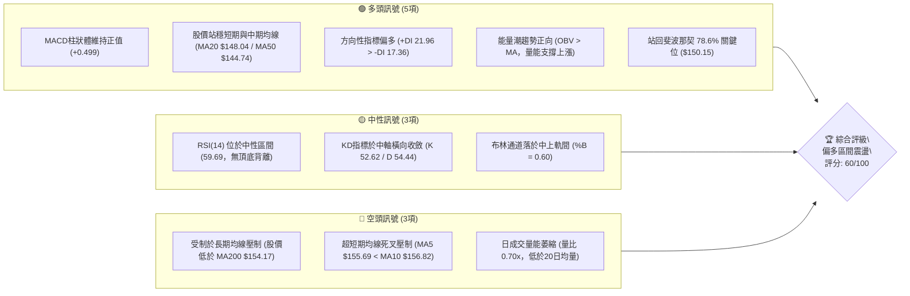
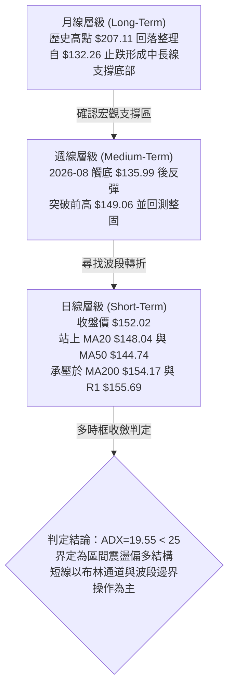
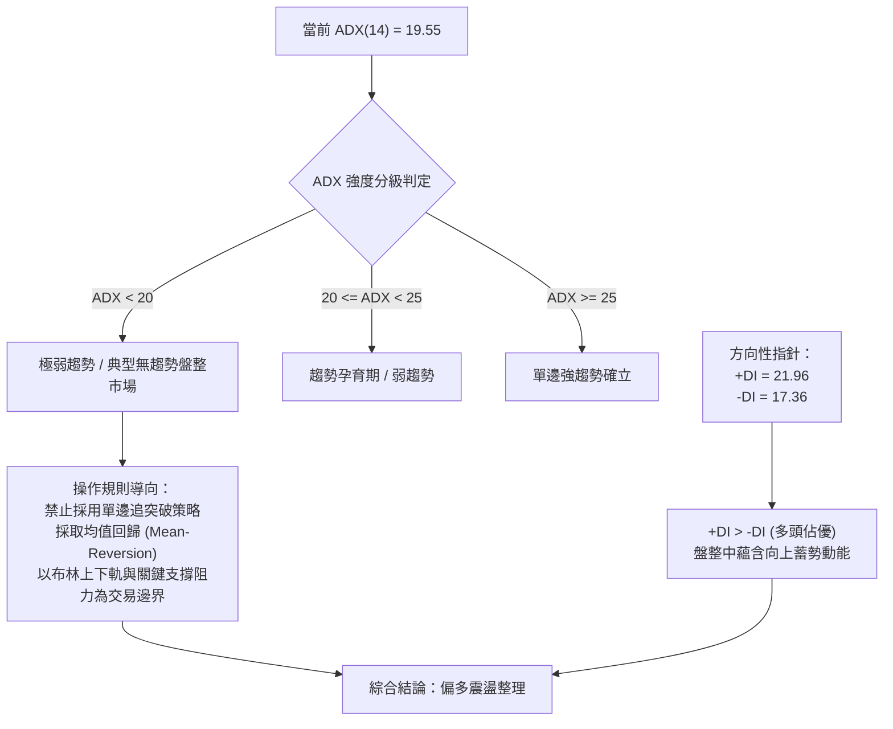
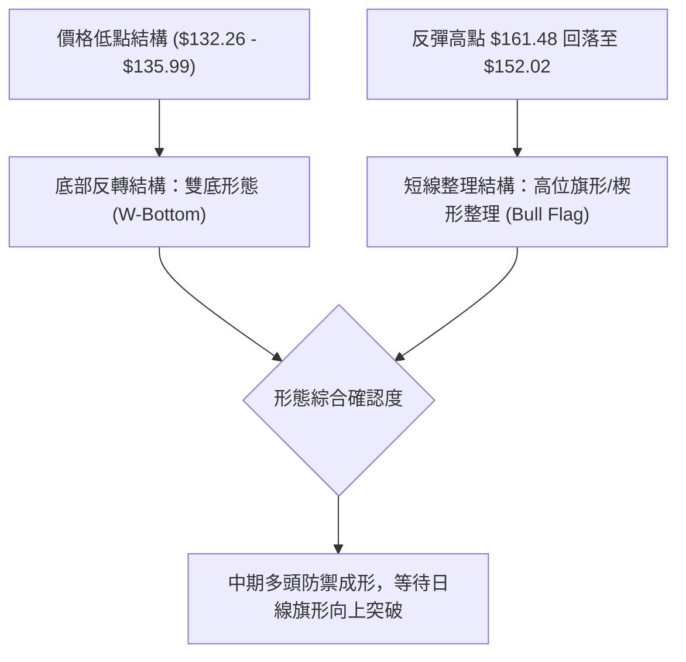
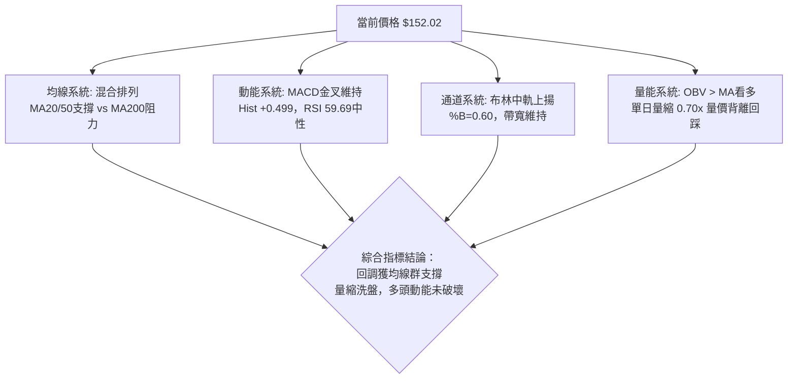
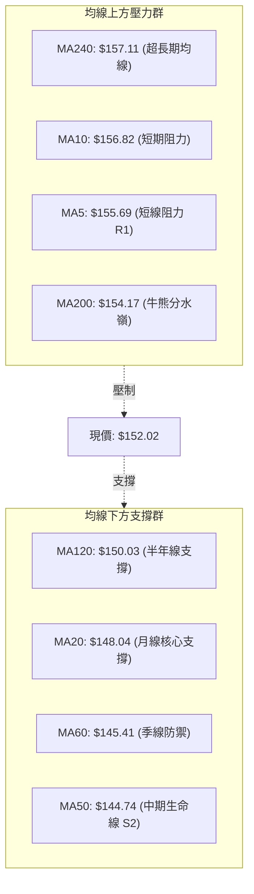
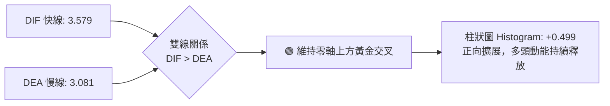
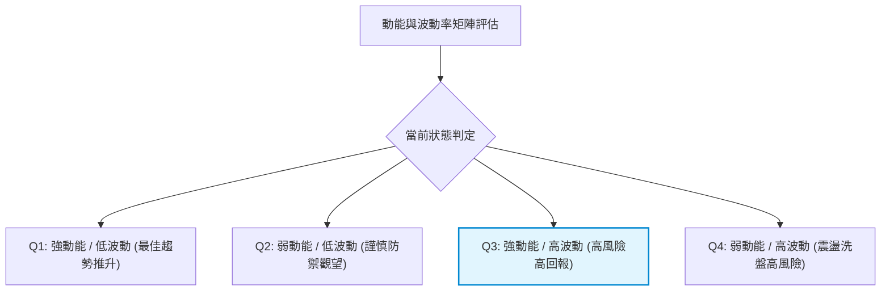
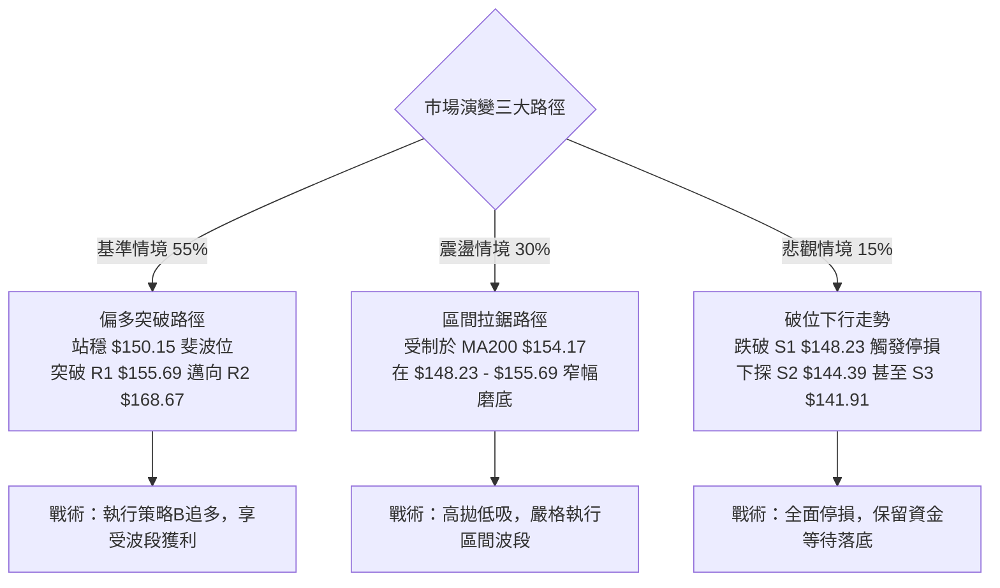

# VST 技術分析報告

> **報告日期**：2026-10-19 ｜ **語言**：繁體中文 ｜ **數據來源**：Yahoo Finance ｜ **當前價格**：$152.02

---

## 目錄

| 章節 | 內容 |
|------|------|
| [1. 技術面概覽](#1-技術面概覽) | 訊號儀表板、核心指標、評分卡 |
| [2. 趨勢分析](#2-趨勢分析) | 多時框趨勢、長中短期走勢、ADX解讀 |
| [3. 圖表形態分析](#3-圖表形態分析) | 形態識別、信心度評估、K線組合 |
| [4. 支撐與阻力](#4-支撐與阻力) | 關鍵價位分布、阻力支撐表、斐波那契回調 |
| [5. 技術指標深度解讀](#5-技術指標深度解讀) | 均線系統、RSI、MACD、布林通道、OBV |
| [6. 動能與波動率](#6-動能與波動率) | 動能四象限、ATR波幅、Beta相關性 |
| [7. 多時框架總結](#7-多時框架總結) | 時框矩陣、收斂規則、主導方向收斂 |
| [8. 交易策略建議](#8-交易策略建議) | 策略路由、情境階梯、進出場規劃 |
| [9. 風險提示與監控](#9-風險提示與監控) | 監控Checklist、三情境演變、倉位管理 |

---

## 1. 技術面概覽

### 🎯 技術訊號儀表板



### 📊 核心指標速覽表

| 指標類別 | 指標名稱 | 當前數值 | 訊號 | 專業技術解讀 |
|:---|:---|:---|:---:|:---|
| **價格** | 當前收盤價 | $152.02 | 🟡 | 位於52週區間23.6%相對低位，自低點反彈後進行整固 |
| **均線** | 短期 MA20 | $148.04 | 🟢 | 股價位於MA20上方 (+2.69%)，短期多頭支撐確立 |
| **均線** | 中期 MA50 | $144.74 | 🟢 | 股價位於MA50上方 (+5.03%)，中期波段呈現多頭防禦 |
| **均線** | 長期 MA200 | $154.17 | 🔴 | 股價位於MA200下方 (-1.40%)，尚未確認長期牛市重啟 |
| **動能** | RSI (14) | 59.69 | 🟡 | 處於40–60中性偏強區間，未見超買或頂背離鈍化現象 |
| **動能** | MACD (12,26,9) | 3.579 / 3.081 | 🟢 | DIF位於訊號線上方，Histogram維持紅柱 (+0.499) |
| **趨勢** | ADX (14) | 19.55 | 🟡 | ADX < 25 表明處於弱趨勢/區間震盪行情，趨勢尚未單邊發散 |
| **波動** | ATR (14) | $9.08 | 🟡 | 佔股價比 5.97%，日內波動偏大，需匹配足夠寬度的風控止損 |
| **通道** | 布林通道 %B | 0.60 | 🟢 | 位於中軌 $148.04 至上軌 $168.14 之間，呈健康震盪攀升 |
| **量能** | 20日均量比 | 0.70x | 🔴 | 單日成交量 5.21M 低於 20MA (7.40M)，上攻動能稍欠追價量 |

### 🏆 技術評分卡

```
╔══════════════════════════════════════════════════════════════╗
║              技術評分卡 — VST (2026-10-19)                  ║
╠══════════════════════════════════════════════════════════════╣
║ 趨勢強度 (Trend)     ██████████░░░░░░░░░░  50/100 🟡 中性盤整║
║ 動能指標 (Momentum)  ██████████████░░░░░░  70/100 🟢 多頭主導║
║ 支撐穩定度 (Support) ██████████████░░░░░░  70/100 🟢 底部墊高║
║ 成交量配合 (Volume)  ██████████░░░░░░░░░░  50/100 🟡 量能退潮║
║ 形態完整度 (Pattern) ████████████░░░░░░░░  60/100 🟢 雙底築基║
║ 均線排列 (MAs)       ████████████░░░░░░░░  60/100 🟡 混合糾結║
╠══════════════════════════════════════════════════════════════╣
║ 綜合評分             ████████████░░░░░░░░  60/100 🟢 偏多震盪║
╚══════════════════════════════════════════════════════════════╝
```

---

## 2. 趨勢分析

### 🌐 多時框趨勢分析



### 📈 長期趨勢 — 12個月走勢圖（Unicode）

```
VST 月線走勢圖（2025-10 至 2026-10）
價格軸 ($)
$210 ┤
$200 ┤
$190 ┤●(10月 $187.21)
$180 ┤    ●(11月 $177.83)
$170 ┤                 ●(02月 $173.13)
$160 ┤        ●(12月 $160.62)    ●(04月 $157.36)  ●(05月 $159.74)
$150 ┤             ●(01月 $157.65)   ●(03月 $149.87)   ●(06月 $158.37)       ●(現價 $152.02)
$140 ┤                                                     ●(07月 $147.95)   ●(09月 $138.35)
$130 ┤                                                         ●(08月低點 $137.15)
     └─────────────────────────────────────────────────────────────────────────────
       10    11    12    01    02    03    04    05    06    07    08    09    10  (月份)
```

#### 長期走勢特徵分析表

| 階段區間 | 時間跨度 | 價格起訖 | 漲跌幅 | 走勢特徵解讀 |
|:---|:---|:---|:---:|:---|
| 高位回撤期 | 2025-10 ~ 2026-01 | $187.21 → $157.65 | -15.79% | 頂部動能衰竭，資金獲利了結，成交量逐步收縮 |
| 震盪反彈期 | 2026-01 ~ 2026-02 | $157.65 → $173.13 | +9.82%  | 測試高檔阻力失敗，形成中期次高點壓力帶 |
| 次級下跌浪 | 2026-02 ~ 2026-08 | $173.13 → $137.15 | -20.78% | 連續破位下行，於 2026-08 創出 52 週低點區間 ($132.26) |
| 築底回升期 | 2026-08 ~ 2026-10 | $137.15 → $152.02 | +10.84% | 量能溫和放大，日線突破 MA20/MA50，完成初級回升段 |

### 📊 中期趨勢（週線分析）

從近20週數據觀察，VST 在 2026-08-23 該週創下低點 $135.99（成交量 21.50M，RSI 降至 26.1 極度超賣），隨後於 2026-09-27 週再次回踩 $138.46。此二次探底不破新低，構築了顯著的週線級別雙重底形態。

在 2026-10-11 該週，VST 爆出天量 59.37M 股，收盤大漲至 $161.48，MACD柱狀體暴增至 +2.715，確認突破中期下降趨勢線。隨後 2026-10-18 週回調至 $152.02（成交量降至 31.68M），屬於健康的突破後縮量回踩確認。

```
週線級別支撐與阻力示意圖：
$168.67 ─────────────────────────────────────────────── [中期強阻力 R2 / 7月回調平台]
$161.48 ─────────────────● [10-11 爆量突破週高點]
$155.69 ─────────────────────────────────────────────── [近期波段阻力 R1 / MA200帶]
$152.02 ─────────────── 現價 ◄─── 回踩整固中
$148.23 ─────────────────────────────────────────────── [回踩第一防線 S1 / 週線頸線]
$135.99 ──────●───────────────────● ───────────────── [中期雙重底部區間]
           (08-23週)          (09-27週)
```

### ⚡ 趨勢強度評估（ADX 解讀）



| 指標名稱 | 當前數值 | 臨界標準 | 狀態評估 | 實戰交易含義 |
|:---|:---:|:---:|:---:|:---|
| **ADX (14)** | 19.55 | 25.00 | 弱趨勢 / 盤整 | 市場處於無方向蓄勢期，趨勢跟隨策略易反覆停損 |
| **+DI (14)** | 21.96 | -DI (17.36) | 多方略佔上風 | 多頭推進意願大於空方拋壓，但尚未形成壓倒性優勢 |
| **-DI (14)** | 17.36 | 20.00 | 空方壓制減弱 | 空頭賣壓自8月高位顯著鈍化，未見強烈主動拋盤 |

---

## 3. 圖表形態分析

### 🔍 形態識別系統



#### 形態識別信心度評估表

| 形態名稱 | 信心度 | 判斷依據（嚴格引用數據） | 完成度 | 目標價（附嚴謹計算式） |
|:---|:---:|:---|:---:|:---|
| **週線雙重底 (W-Bottom)** | **75%** | 底部一：2026-08 低點 $135.99（52週低點 $132.26）；<br/>底部二：2026-09-27 低點 $138.46；<br/>頸線突破：2026-10-11 週收盤 $161.48 突破前高 $149.06。 | 85% | 頸線高點 $149.06 + (頸線 $149.06 - 低點 $135.99) = **$162.13**（已於10-11週觸及，第一目標達成） |
| **日線多頭旗形 (Bull Flag)** | **65%** | 爆量長紅突破至 $161.48 後，連續縮量回撤至現價 $152.02，振幅受到收斂，維持在 MA20 ($148.04) 之上。 | 60% | 旗桿底 $138.46 至旗頂 $161.48 (高度 $23.02)。<br/>若自回撤支撐 S1 $148.23 突破，測量目標 = $148.23 + $23.02 = **$171.25**（接近阻力位 R2 $168.67） |
| **長期頭肩底** | 35% | 數據時間跨度不足以確認左肩完整幾何對稱性。 | <40% | **訊號不足，僅做指標型解讀，不預設目標價** |

### 🕯️ 重要K線形態分析

| 週期/時間 | 收盤價 | K線形態名稱 | 形態特徵與多空技術解讀 | 技術訊號 |
|:---|:---:|:---|:---|:---:|
| 2026-08-23 週 | $135.99 | 錘頭線 (Hammer) | 探底 52W 低點 $132.26 後快速拉回，下影線長，伴隨 RSI 極度超賣 | 🟢 強烈止跌 |
| 2026-09-13 週 | $148.14 | 大陽線突破 (Bullish Marubozu) | 週成交量 18.61M，RSI 衝上 71.4，MACD柱首度強勢轉正 (+1.579) | 🟢 動能爆發 |
| 2026-10-11 週 | $161.48 | 巨量突破長陽 (Volume Breakout) | 成交量暴增至 59.37M 股，確立脫離底部盤整區，突破多條短期阻力 | 🟢 主力建倉 |
| 2026-10-18 週 | $152.02 | 縮量陰線回踩 (Pullback Candle) | 量能自 59.37M 急縮至 31.68M，測試支撐 S1 $148.23 與斐波 78.6% | 🟡 良性洗盤 |

### 📉 ASCII 走勢形態示意圖

```
雙底與旗形突破形態拓撲圖：
$168.67 ┤                                                 [R2 潛在延伸目標]
$161.48 ┤                             ● (旗桿頂部 10-11)
$155.69 ┤                           ╱   ╲ (旗面回踩)
$152.02 ┤                          ╱      ● (現價 $152.02 旗面整理中)
$148.23 ┤                ● (頸線突破)  ┌───┘ [S1 關鍵防線]
$140.00 ┤        ●     ╱   ╲       ╱
$135.99 ┤       ╱ ╲   ╱     ●   ╱  [底二 $138.46]
$132.26 ┤──────●────●─────────●───── [52W 低點築底區 / 底一 $135.99]
        └────────────────────────────────────────────────────────
               08月         09月        10月
```

### 🎯 形態目標價計算

1. **雙底第一測幅目標**：
   $$\text{頸線價位} (\$149.06) + (\text{頸線價位} \$149.06 - \text{底部最低點} \$135.99) = \$162.13$$
   *(該目標價已於 2026-10-11 週高點 $161.48 實質達成，引發技術性獲利回吐)*。

2. **多頭旗形第二測幅目標（波段延伸）**：
   $$\text{起漲基點} (\$138.46) \to \text{波段頂} (\$161.48) \implies \text{旗桿高度} = \$23.02$$
   若現價在回調支撐位 S1 ($148.23) 獲得支撐並有效突破 R1 ($155.69)，則推算延伸目標為：
   $$\text{支撐起點} \$148.23 + \text{旗桿高度} \$23.02 = \$171.25$$
   該推算值精準落在數據阻力區間 R2 ($168.67) 與 R3 ($177.45) 之間。

---

## 4. 支撐與阻力

### 🗺️ 關鍵價位分布圖（Unicode）

```
VST 價位結構分布圖 (當前收盤價: $152.02)
═════════════════════════════════════════════════════════════════
$177.45 ║██████████████████████████████║ 強阻力 R3 (波段高點/回撤50%)
$168.67 ║████████████████████          ║ 阻力 R2 (布林上軌/前期平台)
$155.69 ║████████████████████████      ║ 關鍵阻力 R1 (MA5/波段密集區)
$154.17 ║------------------------------║ 長期均線 MA200 壓制位
$152.02 ╠══════════════════════════════╣ ◄ 現價 (Current Price)
$150.15 ║······························║ 斐波那契 78.6% 回調關鍵點
$148.23 ║▓▓▓▓▓▓▓▓▓▓▓▓▓▓▓▓              ║ 近期支撐 S1 (MA20/波段頸線)
$144.39 ║████████████████████████      ║ 強支撐 S2 (MA50/波段聚類點)
$141.91 ║██████████████████████████████║ 核心防守支撐 S3 (回撤防線)
$132.26 ║██████████████████████████████║ 52週歷史絕對低點
═════════════════════════════════════════════════════════════════
```

### 🚧 阻力位分析表

| 阻力級別 | 精確價位 | 距現價空間 | 形成技術原因（數據聚類） | 突破難度評級 | 戰略重要性 |
|:---|:---:|:---:|:---|:---:|:---:|
| **R1** | **$155.69** | +2.41% | 近一年波段高點聚類、MA5位置、緊鄰MA200 ($154.17) | 🟡 中等 | 短線多空分水嶺，站穩方能宣告重回長牛 |
| **R2** | **$168.67** | +10.95% | 7月震盪平台密集籌碼區、布林通道上軌 ($168.14) 重合 | 🔴 高度 | 中期多頭反彈目標，此處解套與獲利拋壓沉重 |
| **R3** | **$177.45** | +16.73% | 2025年11月回落起跌點聚類、斐波那契 50% ($174.05) 上方 | 🔴 極高 | 宏觀多空反轉樞紐，突破則確立長線反轉成立 |

### 🛡️ 支撐位分析表

| 支撐級別 | 精確價位 | 距現價空間 | 形成技術原因（數據聚類） | 守住機率 | 戰略重要性 |
|:---|:---:|:---:|:---|:---:|:---:|
| **S1** | **$148.23** | -2.49% | 近一年波段低點聚類、MA20 ($148.04)、布林中軌共振 | 75% | 短線多頭防禦基石，守住維持偏多旗形結構 |
| **S2** | **$144.39** | -5.02% | MA50 ($144.74) 均線支撐帶、9月初反彈平台頂部 | 85% | 中期生命線，一旦跌破宣告雙底突破失敗 |
| **S3** | **$141.91** | -6.65% | 近一年強波段低點聚類、8月平台下沿核心防守位 | 90% | 空頭極限測試位，跌破將重探 52W 低點 $132.26 |

### 📐 斐波那契回調位分析

依據 52 週完整波動區間（高點 **$215.85** 至低點 **$132.26**，總垂直振幅 **$83.59**）：

```
0.0%  (52W High) ──────────────────────────────── $215.85
23.6%            ──────────────────────────────── $196.12
38.2%            ──────────────────────────────── $183.92
50.0%            ──────────────────────────────── $174.05
61.8%            ──────────────────────────────── $164.19  ▲ 阻力區間 R2 壓制
──────────────────────────────────────────────────────────
現價: $152.02 (位於 78.6% 與 61.8% 之間，極度靠近期望支撐位)
──────────────────────────────────────────────────────────
78.6%            ──────────────────────────────── $150.15  ▼ 短線核心吸籌防線
100.0% (52W Low) ──────────────────────────────── $132.26
```

#### 斐波那契技術解讀：
現價 $152.02 緊密運行於 **78.6% 回調位 ($150.15)** 與 **61.8% 黃金分割位 ($164.19)** 之間。在技術分析理論中，當深度回調股票自 100% 底部啟動並強勢站回 78.6% ($150.15) 之上時，代表底部左側籌碼清洗完畢，該價位由強阻力轉化為極強技術支撐。當前股價高於 $150.15 僅 +1.24%，提供極佳的多頭防守安全邊際。

---

## 5. 技術指標深度解讀

### 🎛️ 指標訊號總覽



### 📈 移動平均線排列分析



#### 均線數據明細表

| 均線名稱 | 當前價格 | 與現價偏差 | 乖離率 (%) | 均線趨勢斜率 | 技術意涵 |
|:---|:---:|:---:|:---:|:---|:---|
| **MA 5** | $155.69 | -$3.67 | -2.36% | 下彎 (▼) | 超短線獲利回吐，對日線構成微型壓制 |
| **MA 10** | $156.82 | -$4.80 | -3.06% | 下彎 (▼) | 短線回調壓力線，阻礙股價快速反撲 |
| **MA 20** | $148.04 | +$3.98 | +2.69% | 上揚 (▲) | 確立為第一防禦線，短中期多頭上升通道完整 |
| **MA 50** | $144.74 | +$7.28 | +5.03% | 上揚 (▲) | 走平後向上翻揚，中期趨勢正式扭轉為多頭 |
| **MA 60** | $145.41 | +$6.61 | +4.55% | 上揚 (▲) | 季線轉折向上，強化 $144–$145 區間支撐籌碼 |
| **MA120** | $150.03 | +$1.99 | +1.32% | 上揚 (▲) | 股價剛收復半年線，下檔形成複合支撐墊 |
| **MA200** | $154.17 | -$2.15 | -1.40% | 走平 (▼) | 長期牛熊分界線，突破此處將確認長牛反轉 |
| **MA240** | $157.11 | -$5.09 | -3.24% | 下緩 (▼) | 年線壓力，與短線 MA5/MA10 形成阻力聚類帶 |

**均線形態診斷**：當前均線系統呈現「**中短多、長線平**」的混合糾結特徵。股價夾在下檔密集支撐群 ($148.04–$150.03) 與上檔長期壓力群 ($154.17–$157.11) 之間，振幅壓縮僅約 5%，顯示變盤突破在即。

### 📉 RSI(14) 分析

```
RSI(14) 當前數值: 59.69
0           30                      50         59.69        70         100
├───────────┼───────────────────────┼────────────█───────────┼──────────┤
│  極度超賣  │      弱勢盤整區間      │   中性軸    │ 偏多增強區 │ 極度超買  │
└───────────┴───────────────────────┴────────────┴───────────┴──────────┘
進度條: ████████████░░░░░░░░  59.69% [多頭控盤中]
```

- **超買超賣判定**：數值 59.69 處於健康的多頭控盤區間（50–70），未觸及 70 以上的過熱警戒線，完全排除短期指標鈍化風險。
- **背離檢驗結論**：
  - **頂背離判定**：**無頂背離**。2026-10-11 週股價創反彈高點 $161.48 時，週線 RSI 達到 69.4，日線與週線動能創波段新高，高點與動能同步，未產生高位背馳。
  - **底背離判定**：**隱形底背離已確認完成**。8月低點 $135.99（RSI 26.1）與9月低點 $138.46（RSI 30.9），低點抬高且動能底背離，該結構已成功驅動當前升勢。

### 📊 MACD(12,26,9) 訊號解讀



- **MACD 深入解讀**：DIF (3.579) 與 DEA (3.081) 雙雙運行於零軸之上，此為經典的多頭波段控盤訊號。雖然柱狀體由 10-11 週的爆發值 (+2.715) 收斂至當前 (+0.499)，此為爆量突破後的動能消化現象，只要柱狀體未翻綠（維持 > 0），多頭進攻波段並未終結。

### 📦 布林通道分析

```
VST 布林通道日線走勢示意圖
$168.14 ┤───────────────────────────────────────────────── 上軌 (Upper Band)
$160.00 ┤                             *
$152.02 ┤─────────────────────────── 現價 (%B = 0.60) ─────
$148.04 ┤───────────────────────────────────────────────── 中軌 (MA20)
$140.00 ┤                   *
$127.93 ┤───────────────────────────────────────────────── 下軌 (Lower Band)
```

- **通道參數解讀**：
  - 上軌：**$168.14** ｜ 中軌 (MA20)：**$148.04** ｜ 下軌：**$127.93**
  - 通道帶寬 (Bandwidth)：$(168.14 - 127.93) / 148.04 = 27.16\%$。
  - 當前 **%B = 0.60**：代表價格穩定運行於中軌（0.50）與上軌（1.00）之間偏多區域，遠離下軌危險區。
- **通道形態**：中軌維持向上傾斜，開口呈現適度擴張後平移，顯示走勢處於良性上升通道內部，中軌 $148.04 具備強大技術引力與動態支撐效應。

### 💹 成交量分析（量價配合度）

```
量價結構比對：
今日成交量: 5,206,300 股
20日均量:   7,404,955 股 (量比 0.70x) ░░░░░░░░░░░░░░ 縮量回踩
50日均量:   5,546,352 股
10-11週量:  59,368,900 股 (爆發量能)  ██████████████ 主力建倉
```

- **量能屬性剖析**：
  - 最新單日成交量為 5.21M，量比僅 **0.70x**，相較 20 日均量明顯退潮。
  - **價跌量縮**：自高點 $161.48 回落至 $152.02 的過程中，成交量急劇萎縮（週成交量自 59.37M 降至 31.68M，日量降至 5.21M），並未出現主力大單派發的帶量長黑，符合標準的「多頭突破後縮量洗盤」特徵。
- **能量潮 (OBV) 解讀**：
  - 數據明確顯示：「**OBV > MA → 量能支撐上漲**」。OBV 指標領先於價格向上突破其均線，代表中長線資金在 $135–$145 區間有實質性的低位換手吸籌，量價配合結構總體維持正向。

---

## 6. 動能與波動率

### ⚡ 動能評估四象限



| 象限分級 | 動能強度 (RSI/MACD) | 波動率狀態 (ATR/Beta) | 當前落點 | 實戰環境評估 |
|:---:|:---:|:---:|:---:|:---|
| **第一象限 (Q1)** | 強 (RSI > 60) | 低 (ATR% < 3%) | — | 穩定單邊牛市，適合重倉趨勢持股 |
| **第二象限 (Q2)** | 弱 (RSI < 45) | 低 (ATR% < 3%) | — | 窄幅盤整低迷，流動性枯竭 |
| **第三象限 (Q3)** | **強 (MACD金叉/RSI 59.7)** | **高 (ATR% 5.97%/Beta 1.38)** | **✓ (VST當前)** | **高貝塔進攻型標的，彈性大，回撤快，需嚴控停損** |
| **第四象限 (Q4)** | 弱 (MACD死叉) | 高 (ATR% > 5%) | — | 空頭獵殺與破位行情，應嚴格空倉 |

### 📊 ATR 波動率分析

- **ATR(14) 數值**：**$9.08**，佔當前股價比例達 **5.97%**。
- **波動率特性**：在公用事業/獨立電力板塊（Utilities - IPP）中，接近 6% 的單日波幅屬於極高波動度，反映市場將 VST 視為 AI 算力中心能源驅動的成長型題材股進行高頻定價。
- **風控止損距離建議**：
  - **激進日內交易**：$0.5 \times \text{ATR} \approx \$4.54$（緩衝區間過窄，極易被隨機噪音掃出場，不建議）。
  - **波段短線交易**：$1.0 \times \text{ATR} \approx \$9.08$（以現價 $152.02 計算，止損底線為 $142.94，落在 S2 $144.39 下方）。
  - **標準風控配置（推薦）**：採用關鍵技術位扣減 $0.5 \times \text{ATR}$ 作為有效防守點（詳見第8章策略）。

### 📐 Beta 與市場相關性

- **Beta 係數**：**1.384**。
- **市場敏感度分析**：
  - VST 的 Beta 顯著高於標普500基準（1.0）及傳統防禦型公用事業指數（通常 0.5–0.7）。
  - 當大盤（S&P 500 / QQQ）出現系統性上漲 1% 時，理論上 VST 預期推升 1.38%；反之，大盤回檔時其承壓亦更劇烈。因此，技術操作時必須將宏觀指數的大盤環境納入勝率加權考量。

---

## 7. 多時框架總結

### 📋 時框架評分表

| 時框架 | 趨勢方向 | 動能指標 | 均線系統 | 圖表形態 | 綜合評分 | 操作戰術建議 |
|:---|:---:|:---:|:---:|:---|:---:|:---|
| **長期 (月線)** | 🟡 震盪整理 | 🟡 中性平緩 | 🟡 承壓於MA200下方 | 歷史高位ABC回撤完畢 | 55/100 | 長期投資者底倉持有，耐心等待月線級別大底成形 |
| **中期 (週線)** | 🟢 震盪回升 | 🟢 MACD柱擴大 | 🟢 突破下行趨勢線 | 雙重底確立 ($135.99) | 70/100 | 週線維持逢低買入邏輯，依托 S1 建立波段多單 |
| **短期 (日線)** | 🟢 旗形收斂 | 🟡 短線量縮 | 🟡 位於MA20上/MA5下 | 多頭旗形下軌震盪整理 | 60/100 | 拒絕追高，等待回踩 S1 或帶量突破 R1 進場 |

### 🔲 綜合訊號矩陣

```
時框與指標交互驗證矩陣：
╔═════════════╦══════════════╦══════════════╦══════════════╗
║ 指標維度    ║ 短期 (日線)  ║ 中期 (週線)  ║ 長期 (月線)  ║
╠═════════════╬══════════════╬══════════════╬══════════════╣
║ 趨勢方向    ║ 🟢 偏多排列  ║ 🟢 底部翻揚  ║ 🟡 寬幅震盪  ║
║ 均線支撐    ║ 🟢 站穩MA20  ║ 🟢 站穩MA50  ║ 🔴 位於MA200下║
║ 動能擺動    ║ 🟡 RSI 59.7  ║ 🟢 MACD金叉  ║ 🟡 KD平緩    ║
║ 量能支撐    ║ 🔴 單日量縮  ║ 🟢 爆發放量  ║ 🟢 OBV正向   ║
║ 波動狀態    ║ 🟡 振幅收斂  ║ 🟢 空間打開  ║ 🔴 ATR偏高   ║
╚═════════════╩══════════════╩══════════════╩══════════════╝
一致性評估：中短期多頭動能高度共振，長期受均線壓制，屬於「底部翻轉初期的震盪爬坡階段」。
```

### ⚖️ 多時框收斂結論

> **依多時框收斂規則嚴格裁定**：
> 1. **趨勢強度定性**：當前 **ADX(14) 為 19.55（< 25）**，系統明確鎖定當前為「**盤整震盪行情**」，而非無腦單邊趨勢市。
> 2. **主導維度收斂**：依照規則，盤整市以日線布林通道 ($127.93–$168.14) 與波段聚類支撐阻力為交易邊界。
> 3. **衝突收斂**：日線短均線（MA5/MA10）死叉下彎與週線強勢突破產生衝突。因週線成交量達 59M 且雙底成形，優先級高於日線噪音，故日線回調定義為「**上升途中的良性洗盤**」。
> 4. **唯一方向結論**：**【偏多區間震盪（Range-Bound Swing Bullish）】**。操作上嚴禁追高，應採取「**下軌支撐逢低吸納，上軌阻力分批獲利**」的震盪偏多策略，最終主策略全面偏向做多。

---

## 8. 交易策略建議

### 🗺️ 策略決策流程圖

```mermaid
graph TD
    START["當前價格 $152.02 (評分 60/100: 偏多震盪)"] --> ADX_CHECK{"ADX = 19.55 (<25)<br/>鎖定區間操作"}
    ADX_CHECK --> CHOICE{"進場路徑選擇"}
    
    CHOICE -->|"路徑 A: 左側/穩健回踩"| STRAT_A["策略 A: 支撐回踩吸籌<br/>掛單區: S1 $148.23 附近"]
    CHOICE -->|"路徑 B: 右側/動量突破"| STRAT_B["策略 B: 強勢突破追擊<br/>觸發點: 突破 R1 $155.69 且帶量"]
    
    STRAT_A --> T1_A["目標 T1: R1 $155.69<br/>目標 T2: R2 $168.67"]
    STRAT_B --> T1_B["目標 T1: R2 $168.67<br/>目標 T2: R3 $177.45"]
    
    STRAT_A --> SL_A["止損: 跌破 S2 $144.39"]
    STRAT_B --> SL_B["止損: 跌破 MA200 $154.17 (假突破)"]
```



### 🧭 策略路由

**當前主策略方向 = 【主推多頭策略（回調低吸與突破加碼）】（依綜合評分 60/100 偏多判定）**

由於綜合評分達 60 分且動能、支撐與週線結構偏多，空頭不具備單邊做空盈虧比，本報告將空頭策略全數轉化為「**持倉風險控制與反轉對沖觸發點**」。

### 🎯 價格情境階梯（Price Scenarios）

價位嚴格引用數據計算數值：

| 觸發條件 | 下一階段目標 | 後續延伸目標 | 情境實戰含義 |
|:---|:---:|:---:|:---|
| **強勢突破 R1 ($155.69)** | **R2 ($168.67)** | **R3 ($177.45)** | 短線突破確認，MA200被實質收復，空間打開挑戰前高 |
| **站穩現價區間 ($150.15–$152.02)** | **R1 ($155.69)** | **—** | 依託斐波那契 78.6% 進行籌碼消化，維持偏多橫盤震盪 |
| **跌破 S1 ($148.23)** | **S2 ($144.39)** | **S3 ($141.91)** | 短期形態轉弱，旗形失敗，回測MA50中期生命線防禦 |

### 📊 情境機率分佈

| 演變情境 | 機率預估 | 主要技術指標支撐依據 |
|:---|:---:|:---|
| **情境一：震盪蓄勢後向上突破** | **55%** | MACD 維持金叉紅柱 (+0.499)、OBV > MA 量能充沛、雙底形態頸線確認突破 |
| **情境二：維持區間寬幅拉鋸** | **30%** | ADX 僅 19.55（缺乏單邊動力）、日均成交量退潮 (量比 0.70x)、MA5/MA10短期壓制 |
| **情境三：破位向下再探波段底** | **15%** | 系統性風險爆發跌破 MA50 ($144.74)，但受制於 52W 低點強支撐，下行空間受限 |

### 🟢 主策略詳情

```
交易策略參數表（嚴格依據數據價位制訂）：
```

| 策略要素 | 策略 A（穩健型：回踩支撐低吸） | 策略 B（激進型：突破壓力追多） |
|:---|:---:|:---:|
| **操作邏輯** | 回測 S1 支撐不破，左側介入買點 | 帶量突破 R1 與 MA200，右側順勢追擊 |
| **進場價格** | **$148.50** (於 S1 $148.23 上方掛單) | **$156.00** (突破 R1 $155.69 確認站穩) |
| **目標價 T1** | **$155.69** (阻力位 R1，減倉 50%) | **$168.67** (阻力位 R2，減倉 60%) |
| **目標價 T2** | **$168.67** (阻力位 R2，出清剩餘) | **$177.45** (阻力位 R3，終極波段目標) |
| **止損價格** | **$144.00** (有效跌破 S2 $144.39 與 MA50) | **$153.50** (回落跌破 MA200 $154.17 假突破) |
| **潛在風險** | -$4.50 (-3.03%) | -$2.50 (-1.60%) |
| **潛在收益 (T1/T2)** | +$7.19 (+4.84%) / +$20.17 (+13.58%) | +$12.67 (+8.12%) / +$21.45 (+13.75%) |
| **風險報酬比** | **1 : 2.50** (以期望均值計算) | **1 : 4.20** |
| **執行勝率預估** | 65% | 55% |
| **建議總倉位** | **15% - 20%** (底倉配置) | **10% - 15%** (動量加碼) |

### 🔴 反向風險觸發點（對沖提示）

若持有多單，當市場出現以下極端訊號時，應無條件執行多單減倉或防禦對沖：
1. **多頭破位止損線**：收盤價實質跌破 **S1 ($148.23)** 且次日無法收復，多頭旗形結構失效，部位強制減半。
2. **中期多空反轉線**：收盤跌破 **S2 ($144.39)**，宣告雙底反彈浪終結，多單全部平倉離場觀望。
3. **空頭對沖觸發**：若股價反彈至 **R1 ($155.69)** 或 **R2 ($168.67)** 出現長上影線且成交量急劇萎縮（量價背離），可利用反向期權或融券建立保護性空頭部位。

### ⭐ 整體訊號強度評星

```
做多訊號強度：★★★★☆  (4/5星：形態築底成功，量價指標支持偏多)
做空訊號強度：★★☆☆☆  (2/5星：空頭賣壓收斂，僅存均線反彈阻力)
整體可信度：  ★★★★☆  (4/5星：多時框互相確認，數據聚類度高)
```

---

## 9. 風險提示與監控

### ✅ 關鍵監控指標 Checklist

```
╔══════════════════════════════════════════════════════════════╗
║                VST 日常技術面監控清單 (Checklist)            ║
╠══════════════════════════════════════════════════════════════╣
║ [ ] 價格防守線：每日收盤是否守穩 S1 ($148.23) 與 MA20 ($148.04)║
║ [ ] 關鍵突破點：盤中是否帶量衝破 R1 ($155.69) 與 MA200 ($154.17)║
║ [ ] 動能警報：日線 RSI(14) 是否跌破 50 中軸轉入弱勢區間      ║
║ [ ] 指標異動：MACD 柱狀體 (當前 +0.499) 是否發生翻綠死叉     ║
║ [ ] 量能驗證：上攻交易日單日成交量是否回升至 20MA (7.40M) 之上║
║ [ ] 波動異常：單日震盪幅度是否超過 1.5 倍 ATR ($13.62)       ║
╚══════════════════════════════════════════════════════════════╝
```

### ⚠️ 風險場景分析



### 🛡️ 風險管理重要提醒

1. **高 Beta 波動風險控制**：
   - VST 的 Beta 達 1.384，ATR 佔比高達 5.97%，日內波動極其劇烈。單筆交易承擔的總資產風險嚴格限制在 **1.0% - 1.5%** 以內。
   - **倉位計算實例**：若總資產為 $100,000 美元，單筆最大容忍虧損為 $1,000 美元。若執行策略 A（進場價 $148.50，止損價 $144.00，每股風險 $4.50），最大允許買入股數為：
     $$\text{可買股數} = \frac{\$1,000}{\$4.50} \approx 222 \text{ 股} \implies \text{合約規模} \approx \$32,967 \text{ (約佔總資產 33\%)}$$
   若採取保守配置，建議初始開倉 100–150 股，待突破確認後再行以利潤加碼。

2. **盤整市假突破防範**：
   - 當前 ADX 為 19.55，在弱趨勢環境中，向上突破 R1 ($155.69) 時極易產生「假突破」誘多現象。
   - **確認法則**：突破當日必須滿足「**收盤價高於 R1 超過 1%（即收於 $157.25 以上）**」且「**成交量大於 20 日均量 7.40M**」雙重過濾器，方可確立為真突破，否則切忌盲目市價追高。

---

## 📋 報告總結

```
╔══════════════════════════════════════════════════════════════╗
║                   VST 技術分析報告總結                       ║
╠══════════════════════════════════════════════════════════════╣
║ 報告日期：2026-10-19              當前收盤價：$152.02        ║
║ 分析評級：🟢 偏多區間震盪 (60/100) 趨勢偏好：多頭回調買入    ║
╠══════════════════════════════════════════════════════════════╣
║ 關鍵結構解讀：                                               ║
║ ├─ 長期趨勢：🟡 月線高位回撤於 $132.26 止跌，處於底部重構期 ║
║ ├─ 中期趨勢：🟢 週線雙重底成立，突破頸線回踩確認中          ║
║ ├─ 短期趨勢：🟡 日線多頭旗形整理，受制於 MA200 ($154.17)    ║
║ ├─ 關鍵支撐：S1 $148.23  /  S2 $144.39  /  S3 $141.91       ║
║ ├─ 關鍵阻力：R1 $155.69  /  R2 $168.67  /  R3 $177.45       ║
║ └─ 機構共識：分析師目標均價 $210.10 (評級: Strong Buy)      ║
╠══════════════════════════════════════════════════════════════╣
║ 最優交易策略推薦：                                           ║
║ 1. 🥇 最佳機會 (策略 A)：掛單 $148.50 回踩低吸 S1，止損設在  ║
║    $144.00，目標上看 R1 $155.69 與 R2 $168.67 (風報比 1:2.5) ║
║ 2. 🥈 次選機會 (策略 B)：若強勢帶量貫穿 $155.69 (R1)，右側追 ║
║    多加碼，止損設在 $153.50，目標看 R2 $168.67 (風報比 1:4.2)║
║ 3. 🥉 保守風控：嚴守 S1 $148.23，收盤破位則多單撤離觀望。    ║
╚══════════════════════════════════════════════════════════════╝
```

---

> ⚠️ **免責聲明**：本報告為依據定量技術數據自動生成之專業技術分析，所有數據、支撐阻力位及推算目標價均基於提供的市場歷史價格與交易量資訊。本報告**僅供學術研究與投資參考**，**不構成任何形式的個別投資邀約或買賣建議**。金融市場具有高風險特性，投資人應獨立評估自身風險承受能力並自負盈虧。

---

*報告生成時間：2026-10-19 ｜ 數據來源：Yahoo Finance ｜ 分析框架：多時框架收斂技術分析系統*