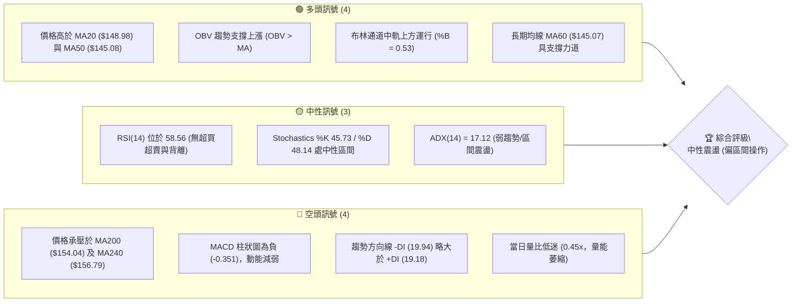
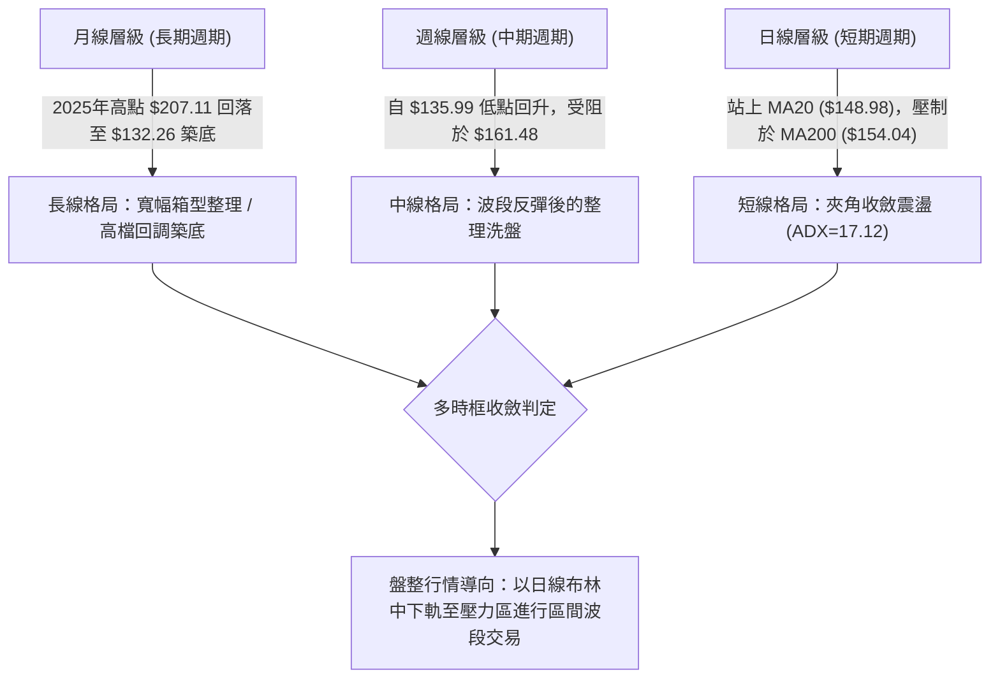
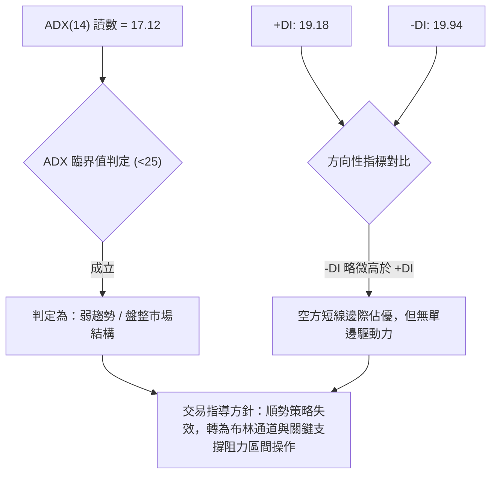
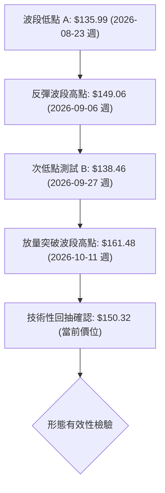
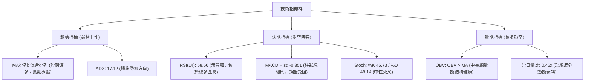
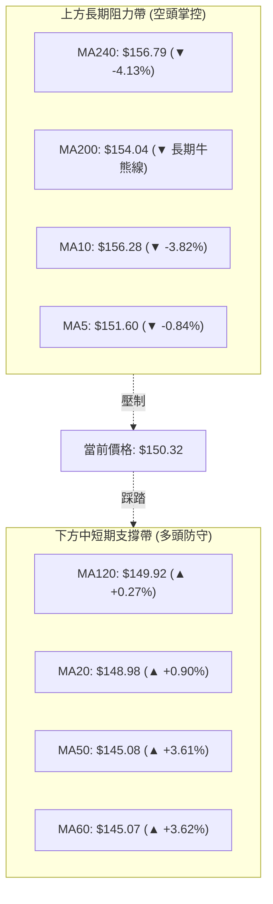
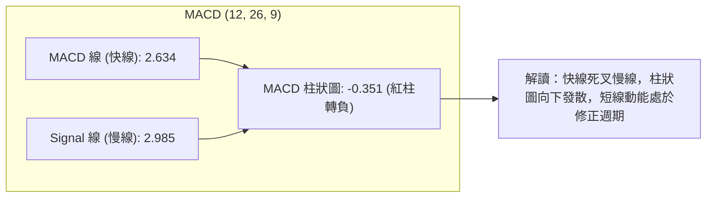
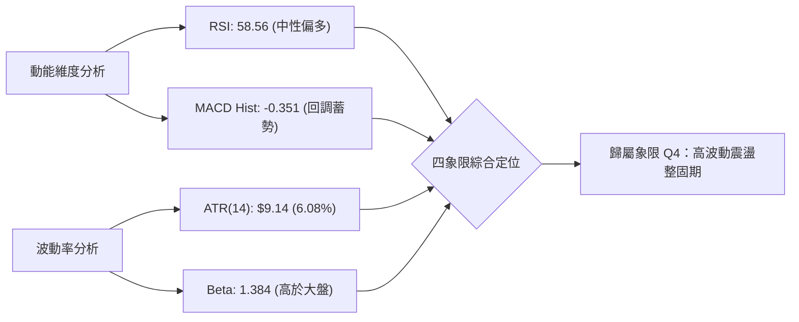
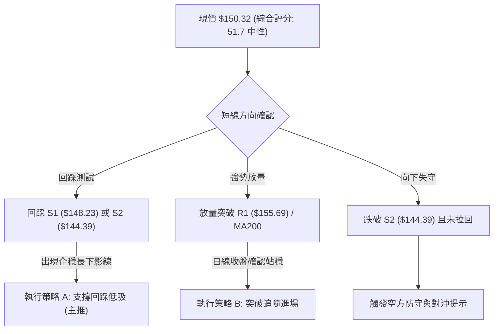
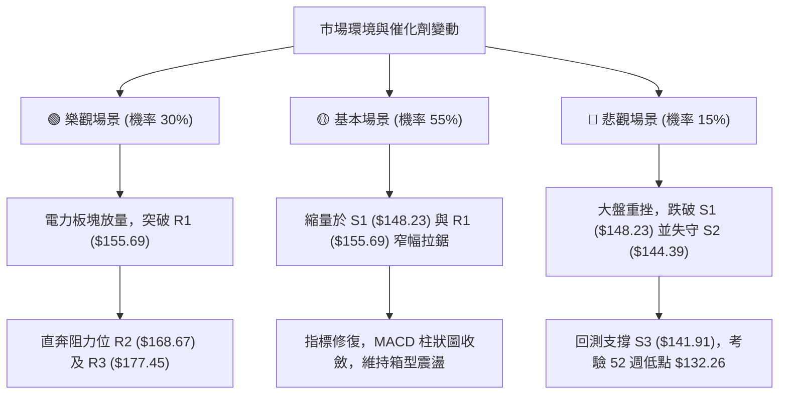

# VST 技術分析報告

> **報告日期**：2026-10-21 ｜ **語言**：繁體中文 ｜ **數據來源**：Yahoo Finance ｜ **當前價格**：$150.32

---

## 目錄

| 章節 | 內容 |
|------|------|
| [1. 技術面概覽](#1-技術面概覽) | 訊號儀表板、核心指標、評分卡 |
| [2. 趨勢分析](#2-趨勢分析) | 多時框趨勢、長中短期走勢 |
| [3. 圖表形態分析](#3-圖表形態分析) | 形態識別、K線組合、目標價 |
| [4. 支撐與阻力](#4-支撐與阻力) | 關鍵價位、斐波那契回調 |
| [5. 技術指標深度解讀](#5-技術指標深度解讀) | MA/RSI/MACD/布林/成交量 |
| [6. 動能與波動率](#6-動能與波動率) | 動能評估、ATR、Beta |
| [7. 多時框架總結](#7-多時框架總結) | 時框架評分矩陣 |
| [8. 交易策略建議](#8-交易策略建議) | 多空策略、風險報酬比 |
| [9. 風險提示與監控](#9-風險提示與監控) | 監控指標、風險場景 |

---

## 1. 技術面概覽

### 🎯 技術訊號儀表板



### 📊 核心指標速覽表

| 指標類別 | 指標名稱 | 當前數值 | 訊號 | 解讀 |
|----------|----------|----------|:----:|------|
| **價格** | 當前價格 | $150.32 | 🟡 | 位於 52 週區間 ($132.26 - $204.31) 之 25.1% 分位，處於波段築底反彈段 |
| **均線** | MA20 | $148.98 | 🟢 | 價格在 MA20 上方 (+0.90%)，短期波段均線提供動態支撐 |
| **均線** | MA50 | $145.08 | 🟢 | 價格在 MA50 上方 (+3.61%)，中期技術面維持多頭防守形態 |
| **均線** | MA200 | $154.04 | 🔴 | 價格在 MA200 下方 (-2.41%)，長期牛熊分界線構成即期上方壓力 |
| **動能** | RSI(14) | 58.56 | 🟡 | 位於 30-70 中性區域，動能溫和偏多但未進入超買區，無顯著背離 |
| **動能** | MACD | 2.634 | 🔴 | MACD 線低於 Signal 線 (2.985)，Hist 為 -0.351，多頭動能短線減弱 |
| **動能** | Stoch %K/%D | 45.73 / 48.14 | 🟡 | 位於平衡區間，短線動能無劇烈單向推力 |
| **趨勢** | ADX(14) | 17.12 | 🟡 | ADX < 25 表明處於弱趨勢或箱型盤整結構，由區間指標主導 |
| **趨勢** | DMI (+DI / -DI) | 19.18 / 19.94 | 🔴 | -DI 微幅高於 +DI，空頭力量邊際略佔優勢，但兩者貼合說明方向未明 |
| **通道** | 布林通道 | $129.51 - $168.44 | 🟡 | %B 為 0.53，價格剛好略高於中軌 ($148.98)，處於通道正常波動範圍 |
| **量能** | 當日成交量 | 3,302,000 | 🔴 | 相對 20 日均量 (7,320,745) 量比僅 0.45x，反彈伴隨量能萎縮 |
| **波動** | ATR(14) | $9.14 | 🔴 | 佔股價 6.08%，單日波動空間較大，需設置寬幅防守空間 |

### 🏆 技術評分卡

```
╔══════════════════════════════════════════════════════════════════╗
║                   技術評分卡 — VST (2026-10-21)                  ║
╠══════════════════════════════════════════════════════════════════╣
║ 趨勢強度 (ADX=17.12 盤整)     ▓▓▓▓▓▓▓░░░░░░░░░░░░░  35/100 🔴 弱勢 ║
║ 動能指標 (RSI 58 / MACD轉負)   ▓▓▓▓▓▓▓▓▓▓░░░░░░░░░░  50/100 🟡 中性 ║
║ 支撐穩定度 (S1/S2防守明確)     ▓▓▓▓▓▓▓▓▓▓▓▓▓▓░░░░░░  70/100 🟢 良好 ║
║ 成交量配合 (OBV偏多/日量偏枯)  ▓▓▓▓▓▓▓▓▓▓░░░░░░░░░░  50/100 🟡 普通 ║
║ 形態完整度 (箱型反彈測頸線)   ▓▓▓▓▓▓▓▓▓▓▓▓░░░░░░░░  60/100 🟡 中等 ║
║ 均線排列 (短多長空/MA200承壓)  ▓▓▓▓▓▓▓▓▓░░░░░░░░░░░  45/100 🔴 混合 ║
╠══════════════════════════════════════════════════════════════════╣
║ 綜合評分                       ▓▓▓▓▓▓▓▓▓▓░░░░░░░░░░  51.7/100      ║
║ 綜合技術評級                   ⚖️ 中性觀望 / 區間震盪佈局          ║
╚══════════════════════════════════════════════════════════════════╝
```

---

## 2. 趨勢分析

### 🌐 多時框趨勢分析



### 📈 長期趨勢 — 12個月走勢圖（Unicode）

依據月度歷史收盤價，自 2025 年 11 月至 2026 年 10 月之 12 個月價格變動軌跡如下：

```
VST 月線走勢圖（過去12個月：2025-11 至 2026-10）
價格軸 ($)
$180 ┤ ●($177.83)
$175 ┤                 ●($173.13)
$170 ┤
$165 ┤
$160 ┤       ●($160.62)             ●($159.74)
$155 ┤             ●($157.65)   ●($157.36)  ●($158.37)
$150 ┤                                                    ●($150.32:現價)
$145 ┤                       ●($149.87)        ●($147.95)
$140 ┤                                              ●($138.35)
$135 ┤                                         ●($137.15)
     └─────────────────────────────────────────────────────────────
       11    12    01    02    03    04    05    06    07    08    09    10 (月份)
     [2025] ───>  [2026]
```

#### 長期月線特徵分析表

| 階段時間 | 起訖點收盤價 | 區間漲跌幅 | 主要走勢特徵與量價意涵 |
|:---|:---|:---|:---|
| **2025-11 至 2026-01** | $177.83 → $157.65 | -11.35% | 自歷史頂峰回調後的首輪弱勢下探，多頭獲利了結盤湧出。 |
| **2026-01 至 2026-02** | $157.65 → $173.13 | +9.82% | 跌深反彈測頂，但受阻於 $175 一線阻力，形成次高點。 |
| **2026-02 至 2026-08** | $173.13 → $137.15 | -20.78% | 展開主跌修正段，跌破多條長期均線，並在 8 月錄得 52 週低點 $132.26 附近之收盤價。 |
| **2026-08 至 2026-10** | $137.15 → $150.32 | +9.60% | 雙重探底成功後展開技術性估值修復反彈，目前於 $150 關卡進行多空爭奪。 |

### 📊 中期趨勢（週線分析）

從近 20 週收盤走勢可見，VST 在 2026 年 8 月 23 日收於 $135.99、9 月 27 日收於 $138.46，確認了 $132.26 - $136.00 區間具有極強的實體買盤防守。隨後在 10 月 11 日當週拉出 $161.48 的長陽線，週成交量放大至 59,368,900 股，確立了波段底部的成形。

```
中期週線波段支撐與阻力結構：
$168.67 ────────────────────────────────────────── 阻力位 R2 (前期反彈密集成交區)
          ▲
          │ [受阻回落]
$161.48 ──┴── (10-11 放量反彈高點)
                 ▼
$155.69 ────────────────────────────────────────── 阻力位 R1 / MA200 壓制線
$150.32 ◄═══════ [當前價格收斂於此]
$148.23 ────────────────────────────────────────── 支撐位 S1 / MA20 防守線
                 ▲
                 │ [底部反彈支撐]
$144.39 ────────────────────────────────────────── 支撐位 S2 / MA50 支撐線
$132.26 ────────────────────────────────────────── 52週低點 / 結構性大底
```

### ⚡ 趨勢強度評估（ADX 解讀）



#### ADX 強度對照與市場狀態分析表

| ADX 數值區間 | 當前數值 | 市場狀態識別 | 技術意涵與操作紀律 |
|:---|:---:|:---|:---|
| **0 - 20** | **17.12** | **極弱趨勢 / 無方向盤整** | 市場缺乏明確單向動能，切勿追漲殺跌，均線交叉常伴隨假突破；應嚴格依賴靜態支撐阻力。 |
| 20 - 25 | - | 趨勢孕育期 | 動能嘗試聚集，觀察是否有突破通道邊界跡象。 |
| 25 - 40 | - | 強勁趨勢期 | 順勢指標 (如 MA/MACD) 效力提升，適合順勢持倉。 |
| 40 以上 | - | 極強 / 動能過熱 | 趨勢進入末端，隨時面臨動能耗盡回調。 |

---

## 3. 圖表形態分析

### 🔍 形態識別系統

在近半年的日線與週線結構中，VST 呈現出典型的「箱型區間雙重底打底」後「測試頸線回踩」之技術結構。



#### 圖表形態信心度與目標價評估表

| 形態名稱 | 信心度 | 判斷依據（嚴格引用數據） | 完成度 | 形態高度與目標價推算式 |
|:---|:---:|:---|:---:|:---|
| **中期雙重底 (W-Bottom)** | **65%** | 兩次波段低點分別位於 2026-08-23 週收盤 $135.99 及 2026-09-27 週收盤 $138.46（均高於 52W 低點 $132.26）；波段中繼高點為 $149.06。10-11 當週放量 (5,936.8 萬股) 突破中繼高點。 | 85% (已突破頸線，目前處於回抽確認階段) | 頸線基準：$149.06<br>形態底部：$135.99<br>形態高度：$149.06 - $135.99 = $13.07<br>理論目標價：$149.06 + $13.07 = **$162.13**（與 10-11 當週高點 $161.48 高度吻合） |
| **短線均線收斂三角夾角** | **55%** | 短期 MA20 ($148.98) 向上斜行，與上方下行的長期 MA200 ($154.04) 形成區間寬度僅 $5.06 的擠壓通道。 | 70% (波動幅度收斂中) | 形態上軌壓制：$154.04 (MA200)<br>形態下軌支撐：$148.98 (MA20)<br>目標區間：向上突破見 **$155.69 (R1)**；向下失守測 **$144.39 (S2)** |
| **頭肩底形態** | **30%** | 缺乏對稱的左肩結構，且 7 月至 8 月跌勢呈現單邊流暢下行，未見標準頭肩對稱結構。 | <30% | *數據不足以支撐幾何形態，依規則 15 判定訊號不足，僅做指標型解讀。* |

### 🕯️ 重要K線形態分析

| 週期/日期 | 收盤價 | K線組合與量能形態 | 技術解讀 | 訊號 |
|:---|:---:|:---|:---|:---:|
| **2026-08-23 週** | $135.99 | 長下影錘頭測底線 (RSI=26.1) | 於 52 週低點上方迎來恐慌盤釋放，RSI 嚴重超賣後買盤湧入。 | 🟢 |
| **2026-09-27 週** | $138.46 | 縮量長下影十字星 (量能 2,234 萬) | 二次探底不破前低，量能顯著萎縮，浮額清洗乾淨。 | 🟢 |
| **2026-10-11 週** | $161.48 | 巨量大陽實體柱 (5,936.8 萬股) | 突破 MA20、MA50 及頸線位，動能暴增，確立中期反轉基礎。 | 🟢 |
| **2026-10-18 週** | $152.02 | 帶上影線中陰回調線 | 受制於 MA200 及阻力區，獲利回吐，量能回落至 3,169 萬。 | 🔴 |
| **當前 (2026-10-21)**| $150.32 | 窄幅震盪小陰星線 (日量萎縮) | 於 MA20 之上暫時獲支撐，呈現縮量整固格局，方向等待打破。 | 🟡 |

### 📉 ASCII 走勢形態示意圖

```
VST 雙重底反彈與短線回抽形態示意圖：

 價位 ($)
 $168.67 ┤                                            (R2 強壓區間)
 $161.48 ┤                        ● 突破高點 (10-11週)
 $155.69 ┤                       / \                  (R1 / MA200 壓制)
 $150.32 ┤                      /   ●◄─── [現價 $150.32: 頸線回抽測驗中]
 $149.06 ┤--------● 頸線高點 ---/------\-----------------------------------
 $144.39 ┤       / \          /        ● (MA50 動態支撐 S2)
 $138.46 ┤      /   \       ● 第二隻腳 (09-27週: $138.46)
 $135.99 ┤     ● 第一隻腳 (08-23週: $135.99)
 $132.26 ┴─────┴─────────────────────────────────────── (52週最低點)
```

### 🎯 形態目標價計算

根據雙重底理論計算：
1. **第一波量度目標**：
   - 頸線位置：$149.06（2026-09-06 週收盤價）
   - 底層最低收盤：$135.99（2026-08-23 週收盤價）
   - 垂直深度（H）：$149.06 - $135.99 = $13.07
   - 第一目標價（T1）= 頸線 + H = $149.06 + $13.07 = **$162.13**（該目標已於 10-11 當週 $161.48 實質達成）。
2. **延伸波段目標**：
   - 若短線成功守住頸線上方（$148.23 - $149.06）並向上突破阻力位 R1（$155.69），則後續等長測量目標指向阻力位 **R2: $168.67**（亦與 50.0% 斐波那契回調位 $168.29 重合）。

---

## 4. 支撐與阻力

### 🗺️ 關鍵價位分布圖（Unicode）

```
╔══════════════════════════════════════════════════════════════════╗
║                   VST 價位結構分布圖                             ║
╠══════════════════════════════════════════════════════════════════╣
║ $177.45 ║██████████████████████████████║ 強阻力 R3 (波段頂部密集群)║
║ $168.67 ║████████████████████          ║ 關鍵阻力 R2 (Fib 50.0%) ║
║ $155.69 ║████████████████████████      ║ 關鍵阻力 R1 (MA200重合區)║
║ $150.32 ╠══════════════════════════════╣ ◄ 當前價格              ║
║ $148.23 ║▓▓▓▓▓▓▓▓▓▓▓▓▓▓▓▓              ║ 近期支撐 S1 (MA20/頸線) ║
║ $144.39 ║██████████████████████        ║ 強支撐 S2 (MA50/MA60)   ║
║ $141.91 ║████████████████              ║ 深度防守 S3 (區間平台底) ║
║ $132.26 ║██████████████████████████████║ 結構性大底 (52週低點)    ║
╚══════════════════════════════════════════════════════════════════╝
```

### 🚧 阻力位分析表

所有價位嚴格引用自關鍵數據區塊計算所得之數值：

| 阻力級別 | 價位 | 距離現價 | 形成原因與技術匯聚點 | 突破難度 | 重要性 |
|:---|:---:|:---:|:---|:---:|:---:|
| **R1** | **$155.69** | +3.57% | 近一年波段高點聚類；與日線 MA200 ($154.04) 及 MA240 ($156.79) 形成強大均線反壓密集帶。 | 🟡 中等 | ★★★★☆ |
| **R2** | **$168.67** | +12.20% | 波段高點群；精確共振布林通道上軌 ($168.44) 與 52 週區間之 50.0% 斐波那契回調位 ($168.29)。 | 🔴 極高 | ★★★★★ |
| **R3** | **$177.45** | +18.05% | 2025 年末至 2026 年初反彈波段頂部聚類；共振 38.2% 斐波那契回調位 ($176.79)。 | 🔴 極高 | ★★★☆☆ |

### 🛡️ 支撐位分析表

所有價位嚴格引用自關鍵數據區塊計算所得之數值：

| 支撐級別 | 價位 | 距離現價 | 形成原因與技術匯聚點 | 守住機率 | 重要性 |
|:---|:---:|:---:|:---|:---:|:---:|
| **S1** | **$148.23** | -1.39% | 近一年波段低點聚類；與日線 MA20 ($148.98) 及前期雙底頸線 ($149.06) 構成重疊支撐。 | 🟢 65% | ★★★★☆ |
| **S2** | **$144.39** | -3.94% | 波段低點聚類；與日線 MA50 ($145.08) 及 MA60 ($145.07) 均線匯合區形成中期防線。 | 🟢 75% | ★★★★★ |
| **S3** | **$141.91** | -5.60% | 9 月下旬震盪築底平台下沿支撐，跌破則宣告反彈形態失效。 | 🟡 85% | ★★★☆☆ |

### 📐 斐波那契回調位分析

依據 52 週極值區間（低點 $132.26 → 高點 $204.31，總垂直跨度 $72.05）計算之標準回調位如下：

```
0.0%  (52W High) ────────────────────────────── $204.31
23.6%            ────────────────────────────── $187.31
38.2%            ────────────────────────────── $176.79 (靠近 R3: $177.45)
50.0%            ────────────────────────────── $168.29 (高度重合 R2: $168.67)
61.8%            ────────────────────────────── $159.78 (靠近 10-11 週高點 $161.48)
---------------------------------------------------------------------------------
現價區間         ◄─── $150.32 (位於 61.8% 與 78.6% 回調位之間)
---------------------------------------------------------------------------------
78.6%            ────────────────────────────── $147.68 (緊鄰支撐位 S1: $148.23)
100.0% (52W Low) ────────────────────────────── $132.26
```

#### 技術意義深度解讀：
1. **當前位置意義**：現價 $150.32 處於回調位 61.8% ($159.78) 與 78.6% ($147.68) 之間的極深回撤修復帶。技術分析中，78.6% 回調位常被視為深度回調結構中多方的「最後防守堡壘」。
2. **多頭反轉驗證**：股價此前自 $132.26 反彈至 $161.48，成功衝破 61.8% ($159.78) 關卡，雖遭逢短線獲利回吐，但目前只要持續運行於 78.6% ($147.68) 之上，即表明長線多頭架構未遭破壞，具備構築大級別頭肩底或雙底的條件。

---

## 5. 技術指標深度解讀

### 🎛️ 指標訊號總覽



### 📈 移動平均線排列分析



#### 均線系統深度解讀：
- **混合排列格局**：短週期與長週期均線呈現相互交錯的「夾心餅乾」狀態。MA20 ($148.98)、MA50 ($145.08)、MA60 ($145.07) 以及 MA120 ($149.92) 均在現價下方發散向上，提供密集的階梯式動態支撐。
- **長線壓制未解**：價格位於 MA200 ($154.04) 及 MA240 ($156.79) 下方，且兩條超長週期均線呈現下行趨勢（MA240 偏離現價 -4.13%）。這意味著若無顯著的放量大陽線突破 $154.04 - $156.79 區域，任何上攻均會引發套牢盤解套賣壓。

### 📉 RSI(14) 分析

```
RSI(14) 讀數: 58.56
0 ─────── 30 超賣 ───────────── 50 中軸 ────── 58.56 ────────── 70 超買 ─────── 100
[░░░░░░░░░░░░░░░░░░░░░░░░░░░░░░░░░░░░░░░░░████████░░░░░░░░░░░░░░░░░░░░░░░░░░░░░░]
強度：████████████░░░░░░░░ 58.6%
```

- **區間狀態**：RSI 處於 58.56，穩定在 50 中軸上方，技術含義表明多頭佔據主動控盤權，但尚未進入 70 以上的超買極端區。
- **背離檢驗**：
  - 價格自 2026-08-23 收盤 $135.99（RSI=26.1）反彈至 2026-10-11 收盤 $161.48（RSI=69.4），呈現「價漲指標漲」的同步驗證走勢。
  - 當前自 $161.48 回調至 $150.32，RSI 自 69.4 回落至 58.6，亦屬健康的動能釋放，**無顯著頂背離或底背離現象**。

### 📊 MACD(12/26/9) 訊號解讀



- **數值關係**：MACD 快線為 2.634，慢線為 2.985。快線自上方跌破慢線，MACD 柱狀圖讀數為 **-0.351**，發出短線看空或動能休整訊號。
- **週期意義**：雖然柱狀圖為負，但快線與慢線數值均維持在零軸上方（>0），表明這是一次屬於「多頭市場內部的回調修正」，並非主跌浪的展開。修正目標以回踩支撐位 S1 ($148.23) 為觀察重點。

### 📦 布林通道分析

```
VST 布林通道日線結構示意圖 (帶寬: $38.93)
$168.44 ┤ ───────────────────────────────────── BB 上軌
        │
$155.69 ┤ ------------------------------------- 阻力位 R1
$150.32 ┤ ◄═══════ 現價 (%B = 0.53，位於中軌上方)
$148.98 ┤ ───────────────────────────────────── BB 中軌 (MA20)
        │
$144.39 ┤ ------------------------------------- 支撐位 S2 (MA50)
        │
$129.51 ┤ ───────────────────────────────────── BB 下軌
```

- **位置判定**：%B 讀數為 **0.53**，精確反映股價目前落於通道中央偏上一點的位置，中軌 $148.98 對現價構成即時支撐。
- **通道形態**：布林通道上下軌寬度為 $38.93（$129.51 至 $168.44），帶寬未見極端收窄（Squeeze）亦未極端擴張，表明市場處於穩定的區間內寬幅波動格局。操作上應遵循中軌不破持多、觸及上軌（$168.44）減倉之紀律。

### 💹 成交量分析（量價配合度）

```
成交量對比：
當日成交量:  3,302,000  [████░░░░░░] (量比: 0.45x)
20日均量:    7,320,745  [██████████]
50日均量:    5,448,828  [███████░░░]
```

- **量價背離現狀**：當前股價試圖反彈，但成交量僅 330 萬股，相對 20 日均量萎縮超過 55%（量比僅 0.45x）。這種縮量狀態表明市場在 MA200 壓力關卡前追價意願薄弱，向上突破動能嚴重匱乏。
- **OBV（能量潮）分析**：儘管短線量能低迷，但底層數據顯示 **OBV > OBV MA**。這說明在 10 月 11 日當週（成交量高達 59,368,900 股）的大幅吸籌中，機構資金有實質進駐，當前的回調呈現「縮量回抽」特徵，量能結構支持中長期波段回升，未見主力棄莊出逃跡象。

---

## 6. 動能與波動率

### ⚡ 動能評估

結合 ADX（趨勢維度）、RSI（動能維度）與 ATR（波動維度），VST 的動能與波動率定位如下：

| 象限 | 動能維度 (RSI/MACD) | 波動維度 (ATR/Bandwidth) | 當前狀態判定 | 戰略應對方針 |
|:---:|:---:|:---:|:---:|:---|
| **Q1 (高動能/低波動)** | 強勁突破 | 低度平穩 | — | 最佳波段順勢起漲點。 |
| **Q2 (低動能/低波動)** | 趨弱無向 | 低度平穩 | — | 縮量盤整，等待方向選擇。 |
| **Q3 (強動能/高波動)** | 衝刺極端 | 高度活躍 | — | 單邊大牛市或大熊市主升/主跌浪。 |
| **Q4 (混合/高波動)** | **溫和偏多 (RSI=58.6, MACD回調)** | **高度波動 (ATR% = 6.08%, Beta=1.38)** | **✓ (當前歸屬)** | **高波動區間震盪整理：適合利用關鍵支撐阻力高拋低吸，嚴格控制單筆虧損。** |



### 📊 ATR 波動率分析

- **ATR(14) 實體數值**：**$9.14**，佔現價比例高達 **6.08%**。
- **止損與風控設置意涵**：
  - 由於 VST 每日平均波動幅度超過 $9.00，常規的 2%-3% 緊密止損極易被盤中正常雜訊所掃出場。
  - **建議止損距離**：應設置在至少 **1.0 至 1.5 倍 ATR** 之外（即 $9.14 - $13.71 的風險緩衝空間），以避開日內隨機波動。
  - 結合支撐位，合理的技術性防守應置於關鍵支撐下方（例如跌破 S1 $148.23 後，防守點須拉開至 S2 $144.39 下方）。

### 📐 Beta 與市場相關性

- **Beta 係數**：**1.384**。
- **市場特徵分析**：
  - VST 作為獨立發電商（IPP），雖屬於公用事業板塊，但其 Beta 高達 1.384，顯示其股價波動性顯著超越標普 500 指數 38.4%。
  - 這反映出市場對其定價更多掛鉤於高彈性的「AI 數據中心電力需求」題材，而非傳統防禦型公用事業。在美股大盤動盪之際，該股將呈現顯著的放大波動特性。

---

## 7. 多時框架總結

### 📋 時框架評分表

| 時框架 | 趨勢方向 | 動能狀態 | 均線排列 | 關鍵圖表形態 | 綜合評分 | 戰略建議 |
|:---|:---:|:---:|:---:|:---|:---:|:---|
| **長期 (月線)** | 🟡 中性回調 | RSI 偏穩，處於 2025 年見頂後的回踩修復 | 價格在歷史高位均線下方震盪 | 歷史頂部回落後的 $132 築底平台 | **55/100** | 逢低分批吸籌，佈局長期電力增長 |
| **中期 (週線)** | 🟢 震盪反彈 | MACD 週線在 10 月初金叉後微幅休整 | 突破 20 週均線，受阻於阻力位 R1 | 雙重底反彈完成度 85%，回抽測頸線 | **60/100** | 回踩支撐不破時買入，目標看 R2 |
| **短期 (日線)** | 🔴 橫盤偏弱 | MACD Hist 為負 (-0.351)，量比萎縮 (0.45x) | 夾在 MA20 ($148.98) 與 MA200 ($154.04) 之間 | 縮量收斂小三角形整理 | **45/100** | 避免追高，等待突破或回測支撐 |

### 🔲 綜合訊號矩陣

| 維度 | 短期 (日線) | 中期 (週線) | 長期 (月線) | 多時框一致性分析 |
|:---|:---:|:---:|:---:|:---|
| **趨勢方向** | 橫向盤整 (ADX=17) | 弱向向上 | 寬幅震盪 | 各週期趨勢處於過渡期，未形成共振推力 |
| **關鍵均線** | MA20 上 / MA200 下 | 站上中期均線 | 高於長週期歷史均價 | 長期承壓、短中期有支撐，屬於夾層整理 |
| **動能指標** | MACD 死叉向下 | RSI 處 58-60 偏多區 | RSI 遠離超賣 | 動能指標反映短期修正、中期蓄勢特徵 |
| **量能特徵** | 當日極度縮量 (0.45x) | 突破週爆出巨量 | 歷史均量平穩 | 機構大資金已在底部進場，短線呈現浮額清洗 |

### ⚖️ 多時框收斂結論

依據多時框收斂規則第 14 條嚴格執行：
1. **行情屬性判定**：當前日線 **ADX(14) = 17.12**，遠低於趨勢臨界值 25，明確定義當前市場為**「盤整行情（震盪市）」**。
2. **主導時框與交易邊界**：在盤整行情中，單邊趨勢追隨策略失效，市場由日線層級之**「布林通道上下軌及靜態關鍵支撐阻力」**主導。
3. **矛盾取捨與收斂方向**：日線雖然短線承壓於 MA200 且 MACD 轉弱，但週線雙重底形態完整且站穩頸線，OBV 長期量能結構偏多。收斂後的**唯一定向結論為：【中性偏多觀望 / 箱型下沿逢低佈局】**。
4. **戰略核心**：絕不在當前價位（$150.32）與阻力位 R1（$155.69）之間盲目追多，而應耐心等待股價回踩支撐位 S1 ($148.23) 甚至 S2 ($144.39) 企穩，或等待放量有效站上 MA200 ($154.04) 後再行介入。

---

## 8. 交易策略建議

### 🗺️ 策略決策流程圖



### 🧭 策略路由

> **當前主策略方向 = 中性震盪區間低吸佈局（依綜合評分 51.7/100 路由為區間操作）**

依據評分卡分數 51.7/100（落於 40-60 中性區間），當前盤面不具備直接單邊做多的強趨勢特徵，嚴禁激進追漲；主推策略定位為**「布林中軌與關鍵支撐處之逢低買入」**，空頭僅列為風險對沖觸發提示。

### 🎯 價格情境階梯（Price Scenarios）

價位嚴格引用自第 4 章數據：

| 觸發條件 | 第一目標 (T1) | 後續延伸 (T2) | 情境技術含義與應對紀律 |
|:---|:---:|:---:|:---|
| **向上突破 R1 ($155.69)** | **R2 ($168.67)** | **R3 ($177.45)** | 短線突破 MA200 牛熊分界線，形態確立為新一輪主升，挑戰布林上軌與 Fib 50%。 |
| **維持於現價 ($150.32) 震盪** | S1 ($148.23) | R1 ($155.69) | 於 MA20 與 MA200 夾角內縮量整固，耐心等待方向明確。 |
| **向下擊穿 S1 ($148.23)** | **S2 ($144.39)** | **S3 ($141.91)** | 跌破日線布林中軌，短線動能走弱，回探 MA50 中期生命線尋求支撐。 |

### 📊 情境機率分佈

| 情境劇本 | 機率估算 | 核心支撐依據（引用指標狀態） |
|:---|:---:|:---|
| **區間震盪蓄勢 (震盪市)** | **55%** | **ADX=17.12** 確立無趨勢狀態；布林 %B 為 0.53 緊貼中軌；成交量能縮至 0.45x，缺乏單向突破資金。 |
| **回踩企穩後上攻 (轉多)** | **30%** | **OBV > MA** 顯示主力底層資金未退；週線雙底完成 85%；RSI 維持於 58.56 強勢中性區間。 |
| **深幅回落再探底 (轉空)** | **15%** | **MACD 柱為負 (-0.351)**；-DI (19.94) 略大於 +DI；若大盤劇烈回調，高 Beta (1.38) 將加速下跌。 |

### 🟢 主策略詳情

所有價位與目標均引用自系統既有支撐阻力位（S1/S2/S3、R1/R2/R3）：

| 策略要素 | 策略 A：區間回踩低吸（首選方案） | 策略 B：突破確認加碼（次選方案） |
|:---|:---:|:---:|
| **策略類型** | 逢低伏擊（回踩支撐位低吸） | 右側追隨（突破阻力位跟進） |
| **進場條件** | 價格回踩 S1 不破，或在 S2 獲得長下影線企穩確認 | 日線實體放量突破並收在 R1 及 MA200 之上 |
| **進場價格** | **$148.23** (支撐位 S1) | **$155.69** (突破阻力位 R1) |
| **目標價 T1** | **$155.69** (阻力位 R1 / 空間 +5.03%) | **$168.67** (阻力位 R2 / 空間 +8.34%) |
| **目標價 T2** | **$168.67** (阻力位 R2 / 空間 +13.79%) | **$177.45** (阻力位 R3 / 空間 +13.98%) |
| **止損價格** | **$144.00** (略低於 S2 $144.39 / 風險 -2.85%) | **$150.32** (原突破點下方即現價 / 風險 -3.45%) |
| **預期報酬比 (T1)** | **1.76 : 1** | **2.42 : 1** |
| **預期報酬比 (T2)** | **4.84 : 1** | **4.05 : 1** |
| **歷史勝率估計** | **65%** (在盤整市中支撐買入勝率較高) | **50%** (在 ADX<25 時突破易面臨假突破) |
| **建議配置倉位** | **15% - 20%** (控制在總資產合理水準) | **10%** (嚴格防範假突破風險) |

### 🔴 反向風險觸發點（對沖提示）

- **全面轉空防守點**：若日線收盤價**跌破支撐位 S2 ($144.39)**，意味著跌破 MA50 及 MA60 兩條重要中期支撐，雙重底頸線反抽徹底失敗。
- **對沖應對指引**：持有現貨者應減倉 50% 以上，激進交易者可在 $144.39 破位後建立短期下行對沖保護，目標下看 **S3: $141.91** 乃至 **52 週低點: $132.26**。

### ⭐ 整體訊號強度評星

```
做多訊號強度：★★★☆☆  (3.0/5星 — 中期支撐與形態紮實，但缺乏短期量能與均線配合)
做空訊號強度：★★☆☆☆  (2.0/5星 — 僅有短線均線反壓，深層量能未顯著走熊)
整體可信度：  ★★★☆☆  (3.5/5星 — 指標間邏輯吻合，盤整行情中關鍵價位邊界清晰)
```

---

## 9. 風險提示與監控

### ✅ 關鍵監控指標 Checklist

```
╔══════════════════════════════════════════════════════════════════╗
║                   VST 核心技術風險監控 Checklist                 ║
╠══════════════════════════════════════════════════════════════════╣
║ [ ] 1. 均線生命線：每日檢視收盤是否穩在 MA20 ($148.98) 之上     ║
║ [ ] 2. 長期牛熊線：觀察向上挑戰 MA200 ($154.04) 時的成交量能     ║
║ [ ] 3. 動能柱翻轉：監控 MACD Hist (當前 -0.351) 是否收斂翻紅     ║
║ [ ] 4. 趨勢爆發點：監控 ADX(14) (當前 17.12) 是否穿越 25 臨界線 ║
║ [ ] 5. 突破真實性：攻擊 R1 ($155.69) 時單日成交量需大於 700 萬股 ║
║ [ ] 6. 結構破位警報：日線收盤嚴禁跌破 S2 ($144.39)               ║
╚══════════════════════════════════════════════════════════════════╝
```

### ⚠️ 風險場景分析



### 🛡️ 風險管理重要提醒

1. **ATR 波動風險匹配**：VST 當前每日 ATR 高達 **$9.14 (6.08%)**，屬於高波動品種。倉位規模配置必須根據「單筆交易最大虧損不超過總賬戶 1%-2%」進行逆向推算，嚴禁重倉孤注一擲。
2. **財報與基本面負債結構**：技術數據中顯示公司總債務高達 $20.51B，Debt/Equity 達到 373.28，流動比率為 0.973。在宏觀利率維持高檔環境下，公用事業發電商的利息負擔可能形成基本面擾動，技術止損必須果斷，不可因分析師一致目標價（$210.10）而忽視短期破位風險。
3. **假突破辨識**：在 ADX 低於 25 的盤整市中，任何未帶成交量（當日成交量低於 20 日均量 7,320,745）的向上摸高均為潛在誘多，切勿於盤中急拉時追進，嚴格遵循「買在支撐、賣在阻力」之震盪交易法則。

---

## 📋 報告總結

```
╔══════════════════════════════════════════════════════════════════╗
║                   VST 技術分析報告總結                           ║
╠══════════════════════════════════════════════════════════════════╣
║ 報告日期：2026-10-21                                            ║
║ 當前價格：$150.32                                               ║
║ 分析評級：⚖️ 中性觀望 / 區間操作 (評分: 51.7/100)               ║
║                                                                  ║
║ 關鍵結論：                                                       ║
║ ├─ 長期趨勢：🟡 中性整理 (自 $207 回調至 $132 後築底反彈)         ║
║ ├─ 中期趨勢：🟢 震盪回升 (完成 $135-$138 雙重底，完成度 85%)    ║
║ ├─ 短期趨勢：🔴 縮量整固 (受制於 MA200 反壓，MACD Hist 負值)     ║
║ ├─ 關鍵支撐：S1: $148.23 ｜ S2: $144.39 ｜ S3: $141.91           ║
║ ├─ 關鍵阻力：R1: $155.69 ｜ R2: $168.67 ｜ R3: $177.45           ║
║ └─ 52W 區間：$132.26 - $204.31 (現處 25.1% 低位分位)             ║
║                                                                  ║
║ 最優策略組合：                                                   ║
║ 1. 🥇 最佳機會：等待回踩 S1 ($148.23) 不破低吸，止損設 $144.00    ║
║    目標 T1 看 R1 ($155.69)，目標 T2 看 R2 ($168.67)              ║
║ 2. 🥈 次選機會：若放量 (>700萬股) 突破 R1 ($155.69)，順勢追進    ║
║    目標看 R2 ($168.67)，止損設 $150.32                           ║
║ 3. 🥉 保守選擇：空倉觀望，等待日線 ADX 突破 25 出現單邊趨勢      ║
╚══════════════════════════════════════════════════════════════════╝
```

---

> ⚠️ **免責聲明**：本報告為 AI 自動生成之技術分析，所有數據及估算均基於提供的歷史價格資訊。本報告**僅供研究與學術參考**，**不構成任何投資建議**。投資有風險，入市需謹慎。

---

*報告生成時間：2026-10-21 ｜ 數據來源：Yahoo Finance ｜ 分析框架：多時框技術分析*