# VST 技術分析報告

> **報告日期**：2026-10-22 ｜ **語言**：繁體中文 ｜ **數據來源**：Yahoo Finance ｜ **當前價格**：$156.14

---

## 目錄

| 章節 | 內容 |
|------|------|
| [1. 技術面概覽](#1-技術面概覽) | 訊號儀表板、核心指標、評分卡 |
| [2. 趨勢分析](#2-趨勢分析) | 多時框趨勢、長中短期走勢 |
| [3. 圖表形態分析](#3-圖表形態分析) | 形態識別、K線組合、目標價 |
| [4. 支撐與阻力](#4-支撐與阻力) | 關鍵價位、斐波那契回調 |
| [5. 技術指標深度解讀](#5-技術指標深度解讀) | MA/RSI/MACD/布林/成交量 |
| [6. 動能與波動率](#6-動能與波動率) | 動能評估、ATR、Beta |
| [7. 多時框架總結](#7-多時框架總結) | 時框架評分矩陣 |
| [8. 交易策略建議](#8-交易策略建議) | 多空策略、風險報酬比 |
| [9. 風險提示與監控](#9-風險提示與監控) | 監控指標、風險場景 |

---

## 1. 技術面概覽

### 🎯 技術訊號儀表板

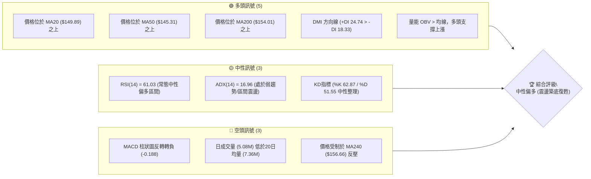

### 📊 核心指標速覽表

| 指標類別 | 指標名稱 | 當前數值 | 訊號 | 解讀 |
|----------|----------|----------|------|------|
| **價格** | 當前收盤價 | $156.14 | 🟢 多頭 | 站穩中短期均線密集區，突破52週低點以來的頸線壓力 |
| **均線** | 短期 MA20 | $149.89 | 🟢 多頭 | 價格高於 MA20 達 +4.17%，短期支撐強勁且斜率向上 |
| **均線** | 中期 MA50 | $145.31 | 🟢 多頭 | 價格高於 MA50 達 +7.45%，中期波段底部支撐已確立 |
| **均線** | 長期 MA200 | $154.01 | 🟢 多頭 | 價格成功站上長線牛熊分界線 (+1.38%)，長多架構防禦成功 |
| **動能** | RSI(14) | 61.03 | 🟡 中性 | 動能位於 50–70 擴張區間，未達超買門檻 (70)，無頂背離 |
| **動能** | MACD (12,26,9) | 柱狀圖 -0.188 | 🔴 空頭 | 快慢線位於零軸之上 (2.750/2.938)，但柱狀圖死叉轉負顯示短線漲勢趨緩 |
| **波動** | ATR(14) | $9.41 | 🟡 中性 | 佔當前股價 6.03%，日波動度維持中高水位，需適度放寬停損距離 |

### 🏆 技術評分卡

```
╔══════════════════════════════════════════════════════════════════╗
║                   技術評分卡 — VST (2026-10-22)                  ║
╠══════════════════════════════════════════════════════════════════╣
║ 趨勢強度 (Trend)     ████████░░░░░░░░░░░░  42/100  🟡 中性 (ADX低)║
║ 動能指標 (Momentum)  ████████████░░░░░░░░  62/100  🟢 中性偏多    ║
║ 支撐穩定度 (Support) ██████████████░░░░░░  74/100  🟢 密集重疊    ║
║ 成交量配合 (Volume)  ██████████░░░░░░░░░░  52/100  🟡 量能略縮    ║
║ 形態完整度 (Pattern) ██████████████░░░░░░  70/100  🟢 雙底築底完成║
║ 均線排列 (Moving Avg)████████████░░░░░░░░  64/100  🟢 短中線黃金交叉║
╠══════════════════════════════════════════════════════════════════╣
║ 綜合技術評分         ████████████░░░░░░░░  60.7/100 🟢 偏多區間操作║
╚══════════════════════════════════════════════════════════════════╝
```

---

## 2. 趨勢分析

### 🌐 多時框趨勢分析

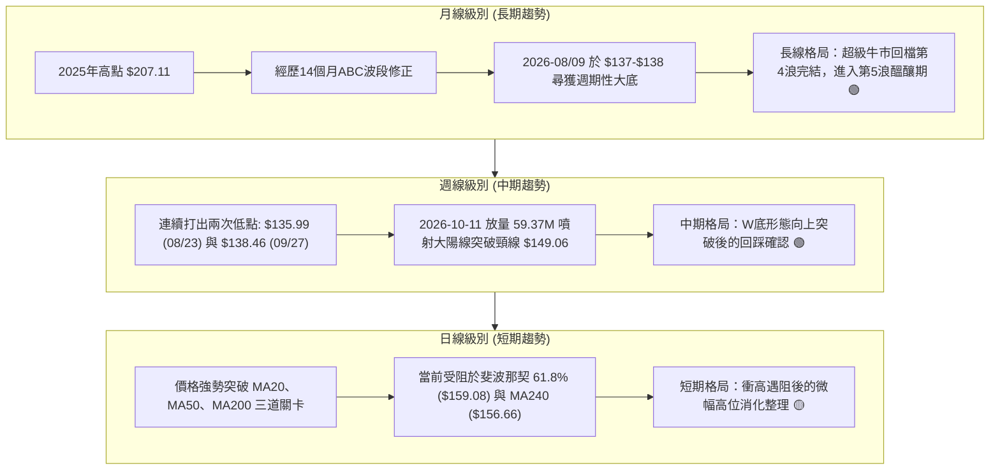

### 📈 長期趨勢 — 12個月走勢圖（Unicode）

```
VST 月線走勢圖（過去12個月：2025-11 至 2026-10）
價格軸 ($)
$190 ┤
$180 ┤●(11月:177.83)
$170 ┤                 ●(02月:173.13)
$160 ┤    ●(12月:160.62)             ●(05月:159.74)●(06月:158.37)
$150 ┤        ●(01月:157.65)    ●(04月:157.36)          ●(現在:156.14)
$140 ┤                     ●(03月:149.87)   ●(07月:147.95)
$130 ┤                                           ●(08月:137.15)●(09月:138.35)
     └───────────────────────────────────────────────────────────────
       11   12   01   02   03   04   05   06   07   08   09   10 (月份)
```

**走勢特徵分析表格**：

| 時間階段 | 價格區間 | 累積漲跌幅 | 量價與結構特徵 | 趨勢定性 |
|----------|----------|------------|----------------|----------|
| **2025-11 至 2026-01** | $177.83 → $157.65 | -11.35% | 自歷史頂峰回落的主跌初段，高點逐步下移 (Lower Highs) | 🔴 長期下行 |
| **2026-02 至 2026-06** | $173.13 → $158.37 | -8.52% | 反彈受阻於 $173.13，進入 $150–$170 寬幅震盪箱體，MA60下彎 | 🟡 箱體整理 |
| **2026-07 至 2026-09** | $147.95 → $138.35 | -6.49% | 破位加速殺跌，於 52週低點 $132.26 附近構築雙重底 ($135.99/$138.46) | 🔴 恐慌探底 |
| **2026-10 (當前)** | $138.35 → $156.14 | +12.86% | 週成交量激增至 59.37M 突破阻力，站上 MA200，多頭全面反撲 | 🟢 強勢復甦 |

### 📊 中期趨勢（週線分析）

中期走勢呈現清晰的「雙底反轉 (Double Bottom)」結構：
1. **第一底 (Left Bottom)**：於 2026-08-23 週收盤錄得 $135.99，當週 RSI 探底至 26.1 極度超賣區，空頭動能耗盡。
2. **頸線高點 (Neckline Peak)**：反彈至 2026-09-06 的 $149.06 與 2026-09-13 的 $148.14，RSI 衝高至 71.4 後受阻回落。
3. **第二底 (Right Bottom)**：2026-09-27 週收盤回踩 $138.46 成功守住前低，形成不破前低的強勢次低點 (Higher Low)。
4. **有效突破 (Breakout)**：2026-10-11 當週拉出爆量大陽線收於 $161.48，MACD 柱狀圖暴增至 +2.715，週線形態確認突破。

```
中期支撐與壓力拓撲圖：
阻力 R2:  $177.45 ══════════════════════════════ (2025-11起跌波段平台)
阻力 R1:  $168.67 ────────────────────────────── (日線布林上軌與前高壓力區)
現價收盤: $156.14 ◄─── (多空激戰於斐波那契 61.8% $159.08 之下)
支撐 S1:  $152.92 ────────────────────────────── (近期回踩波段支撐 / MA5)
支撐 S2:  $148.23 ══════════════════════════════ (雙底頸線位置 / MA20 / MA120)
支撐 S3:  $144.39 ────────────────────────────── (MA50 / MA60 匯聚強防線)
```

### ⚡ 趨勢強度評估（ADX 解讀）

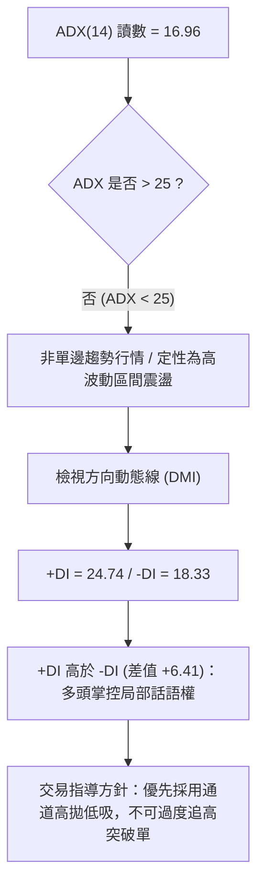

**ADX 趨勢強度與行情報告解讀表**：

| 指標名稱 | 實際數值 | 評估區間 | 趨勢屬性判定 | 策略意涵 |
|----------|----------|----------|--------------|----------|
| **ADX(14)** | **16.96** | 0 – 20 | 極弱趨勢 / 無趨勢狀態 | 股價自低檔強彈後，動能暫未形成單邊不可逆暴漲，屬於大級別區間修復 |
| **+DI (14)**| **24.74** | > 20 | 多頭擴張動能充足 | 買方力道佔優，空頭反撲被有效壓制 |
| **-DI (14)**| **18.33** | < 20 | 空頭萎縮 | 下行拋壓減輕，回踩幅度有限 |
| **綜合判定**| **多頭佔優之盤整** | — | **區間震盪偏多** | 依「多時框收斂規則」，ADX<25 應嚴格以日線布林通道 ($130.90–$168.88) 與波段支撐位為基準運作 |

---

## 3. 圖表形態分析

### 🔍 形態識別系統

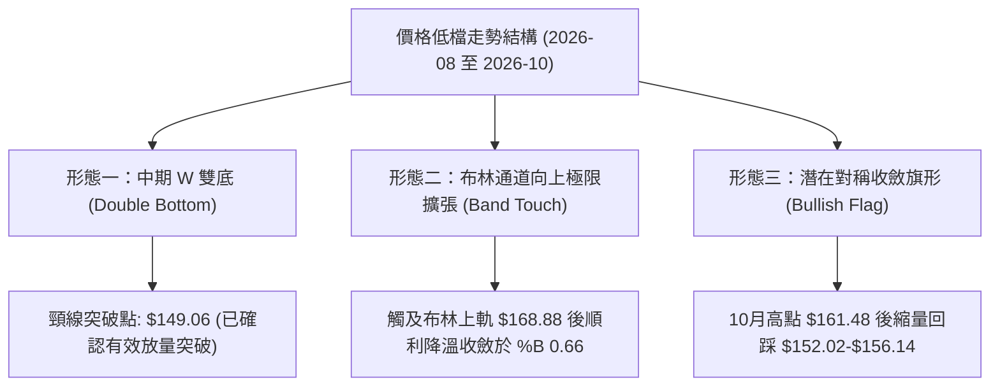

**圖表形態識別與信心度評估表**：

| 形態類別 | 信心度 (%) | 判斷依據（嚴格引用數據） | 完成度 (%) | 目標價（附嚴謹幾何計算式） |
|----------|------------|--------------------------|------------|----------------------------|
| **中期 W 雙底** | **78%** | 兩次低點分別為 2026-08-23 的 $135.99 與 2026-09-27 的 $138.46；頸線高點為 2026-09-06 之收盤價 $149.06。2026-10-11 放量 59.37M 站上 $161.48。 | 100% (已突破並回測) | 頸線 $149.06 + 形態高度 ($149.06 - $135.99 = $13.07) = **$162.13** (已達成，次目標看阻力區) |
| **等距對稱波段推算** | **65%** | 第一波反彈幅度由低點 $132.26 漲至頸線 $149.06 (振幅 $16.80)；以次回踩低點 $138.46 為起點向上等長投射。 | 70% (進行中) | 起點 $138.46 + 形態等長高度 $16.80 = **$155.26** (已達)；擴展目標 = $138.46 + ($16.80 × 1.618) = **$165.64** |
| **頭肩底形態** | **35%** | 左肩 $140.36、頭部 $135.99、右肩 $138.46。但因左肩與頭部價差僅 $4.37，區分度不明顯。 | < 50% | **訊號不足，僅做指標型解讀**，不納入主要交易依據。 |

### 🕯️ 重要K線形態分析

| 週期/日期 | 收盤價 | K線形態名稱 | 形態結構與量能解讀 | 技術訊號 |
|-----------|--------|-------------|--------------------|----------|
| **2026-08-23 週** | $135.99 | 破底十字星 (Hammer) | 探低至 52W 低點 $132.26 附近後收出長下影線，週成交量 21.50M，空頭衰竭 | 🟢 強烈見底 |
| **2026-09-27 週** | $138.46 | 縮量次低點 (Higher Low) | 成交量 22.34M 穩定，未破 8 月低點，形成雙底架構之右腳確認K線 | 🟢 築底確認 |
| **2026-10-11 週** | $161.48 | 突破大陽線 (Marubozu) | 暴量 59.37M (創20週最高天量)，週漲幅超過 15%，實體大陽線穿透所有均線 | 🟢 轉強突破 |
| **2026-10-18 週** | $152.02 | 縮量陰十字孕線 (Harami) | 週成交量腰斬至 31.70M，拉回測試突破頸線有效性，未跌破支撐 S1 ($152.92) | 🟡 健康回踩 |
| **2026-10-25 週** | $156.14 | 止跌回升陽線 (Bullish Rebound)| 週成交量降至 12.69M (當週進行中)，價格逆轉重回 $156 之上，多頭重掌控盤權 | 🟢 重啟攻勢 |

### 📉 ASCII 走勢形態示意圖

```
VST 雙重底 (W-Bottom) 頸線突破與回踩幾何結構圖：
$168.67 ┤                                            [阻力 R1 / 通道上軌]
        │
$161.48 ┤                        ▲ (10-11 突破高點 $161.48)
        │                       ╱ ╲
$156.14 ┤                      ╱   ●←【現價: 突破後確認回升點 $156.14】
        │                     ╱     ╲
$149.06 ┤        ▲───────────▲───────● (頸線突破位 / 回踩確認 $148.23-152.02)
        │       ╱ ╲         ╱ 頸線 (Neckline: $149.06)
$140.00 ┤      ╱   ╲       ╱   
        │     ╱     ╲     ╱    
$135.99 ┤    ●       ╲   ● (右底 09-27: $138.46)
        │   (左底      ╲ ╱
$132.26 ┴─08-23:$135.99)─● (52W最低點: $132.26)───────────────────────
```

### 🎯 形態目標價計算

1. **基本雙底測幅滿足點**：
   - 形態底部最低收盤價：$135.99（2026-08-23 週）
   - 形態突破確認頸線價：$149.06（2026-09-06 週）
   - 幾何形態高度 $H = \text{頸線} - \text{底點} = \$149.06 - \$135.99 = \$13.07$
   - 基礎等幅目標價 $T_1 = \text{頸線} + H = \$149.06 + \$13.07 = \mathbf{\$162.13}$
   - *驗證*：股價已於 2026-10-11 當週最高觸及 $161.48，幾乎精確達成第一滿足點。

2. **擴展波段測幅滿足點 (1.618 斐波那契投射)**：
   - 擴展高度 $H_{\text{ext}} = H \times 1.618 = \$13.07 \times 1.618 = \$21.15$
   - 中期擴展目標價 $T_2 = \text{頸線} + H_{\text{ext}} = \$149.06 + \$21.15 = \mathbf{\$170.21}$
   - 此目標價恰好落在阻力位 **R1 ($168.67)** 與斐波那契 50.0% 回調位 **($167.37)** 之上緣，技術共振效應極高。

---

## 4. 支撐與阻力

### 🗺️ 關鍵價位分布圖（Unicode）

```
VST 價位結構分布圖
═════════════════════════════════════════════════════════════════
$185.91 ║██████████████████████████████║ 斐波那契 23.6% 回調位
$181.76 ║████████████████████████      ║ 強阻力 R3 (波段高點聚類)
$177.45 ║████████████████████          ║ 強阻力 R2 (反彈高點聚類 / 斐波 38.2% $175.66)
$168.67 ║██████████████████████████████║ 關鍵阻力 R1 (布林上軌 $168.88 / 斐波 50.0% $167.37)
$159.08 ║▓▓▓▓▓▓▓▓▓▓▓▓▓▓▓▓▓▓▓▓          ║ 關鍵分水嶺 (斐波那契 61.8% / MA240 $156.66)
$156.14 ╠══════════════════════════════╣ ◄─── 當前現價 ($156.14)
$154.01 ║▓▓▓▓▓▓▓▓▓▓▓▓▓▓▓▓▓▓▓▓▓▓▓▓      ║ 長線牛熊線 MA200 支撐
$152.92 ║▓▓▓▓▓▓▓▓▓▓▓▓▓▓▓▓▓▓▓▓          ║ 近期波段支撐 S1 (短線防線 / MA5 $152.47)
$148.23 ║██████████████████████████████║ 強支撐 S2 (雙底頸線聚類 / MA20 $149.89)
$144.39 ║████████████████████████      ║ 強支撐 S3 (MA50 $145.31 / MA60 $145.20 匯聚)
$132.26 ║██████████████████████████████║ 終極鐵底 (52W Low / 斐波那契 100.0%)
═════════════════════════════════════════════════════════════════
```

### 🚧 阻力位分析表

所有價位嚴格引用系統計算之波段聚類阻力數據：

| 阻力級別 | 官方數據價位 | 距現價空間 | 技術結構形成原因 | 突破難度評估 | 策略重要性 |
|----------|--------------|------------|------------------|--------------|------------|
| **R1** | **$168.67** | +8.02% | 近一年波段高點密集套牢籌碼；日線布林通道上軌 ($168.88) 與斐波那契 50.0% ($167.37) 形成強共振 | 🔴 較高 (需補量至7.5M以上) | 短線獲利了結與減倉防禦位 |
| **R2** | **$177.45** | +13.65% | 2026年2月反彈高點 ($173.13) 及2025年11月長黑K起跌平台；鄰近斐波那契 38.2% ($175.66) | 🔴 高 (波段重要分水嶺) | 中期波段多頭主目標價 |
| **R3** | **$181.76** | +16.41% | 2025年秋季頭部破位密集交易區間；上方即為 23.6% ($185.91) 歷史解套賣壓帶 | 🔴 極高 (長線空頭最後防線) | 中長線大趨勢完全反轉訊號 |

### 🛡️ 支撐位分析表

所有價位嚴格引用系統計算之波段聚類支撐數據：

| 支撐級別 | 官方數據價位 | 距現價空間 | 技術結構形成原因 | 守住機率評估 | 策略重要性 |
|----------|--------------|------------|------------------|--------------|------------|
| **S1** | **$152.92** | -2.06% | 2026-10-18 當週低點附近聚類；貼近短期 MA5 ($152.47) 及 MA200 ($154.01) 保護帶 | 🟢 70% (短期多方防禦樞紐) | 積極型進場點或移動止盈點 |
| **S2** | **$148.23** | -5.07% | 雙重底形態頸線聚類突破口 ($149.06)；重合日線 MA20 ($149.89) 及布林中軌 | 🟢 85% (中期強烈技術共振) | 穩健型拉回加碼點 / 絕對防守線 |
| **S3** | **$144.39** | -7.52% | 中期 MA50 ($145.31) 與 MA60 ($145.20) 均線匯合處；下方鎖死 52週區間底部 | 🟢 92% (大波段多空生鐵底) | 中線多頭部位最大容忍止損點 |

### 📐 斐波那契回調位分析

依據 52 週完整極端區間（低點 **$132.26** 至 高點 **$202.48**，總振幅 **$70.22**）計算：

```
0.0%  (52W High)  $202.48  ──────────────────────────────────────────
23.6%             $185.91  ──────────────────────────────────────────
38.2%             $175.66  ──────────────── (共振 R2: $177.45) ──────
50.0%             $167.37  ──────────────── (共振 R1: $168.67) ──────
61.8%             $159.08  ──────────────── [上方第一道壓制分水嶺] ─
       現價: $156.14  ◄─── [目前位於 61.8% 與 78.6% 之間黃金區域]
78.6%             $147.29  ──────────────── (共振 S2: $148.23) ──────
100.0% (52W Low)  $132.26  ──────────────────────────────────────────
```

- **位置意義解讀**：現價 **$156.14** 處於 78.6% ($147.29) 至 61.8% ($159.08) 之間。
- **關鍵阻力壓制**：斐波那契 61.8% 回調位 **$159.08** 是經典的「黃金分割反壓線」。近期股價於 10-11 週觸及 $161.48 後迅速收回其下方，顯示該位置存在顯著的技術解套拋壓，若能帶量實體站穩 $159.08，將直接打開通往 50.0% ($167.37) 的向上通道。
- **深層下檔支撐**：斐波那契 78.6% **$147.29** 與官方計算支撐 S2 **$148.23** 形成強力結構緩衝墊，只要回檔不跌破此重疊區域，中長期底部結構便維持完好。

---

## 5. 技術指標深度解讀

### 🎛️ 指標訊號總覽

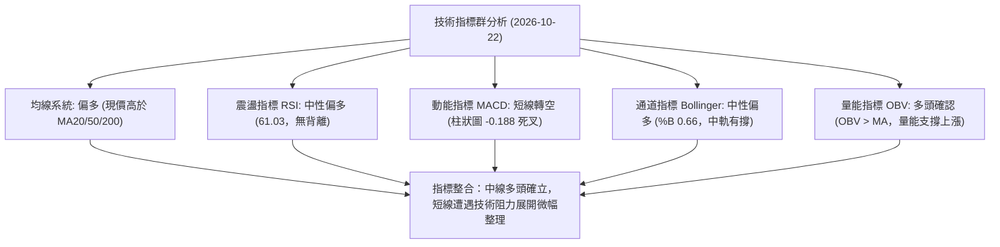

### 📈 移動平均線排列分析

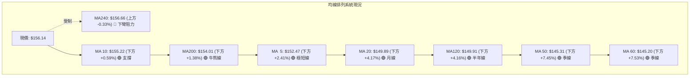

**移動平均線狀態詳解**：
- **短中期金叉成形**：短期 MA5 ($152.47)、MA10 ($155.22) 向上穿越 MA20 ($149.89) 與 MA50 ($145.31)，均線呈現短中天期多頭排列。
- **長線牛熊線得失**：當前價格 $156.14 成功站上長期 MA200 ($154.01)，且 MA200 斜率已逐漸由跌轉平，長線買盤具備護盤底氣。
- **MA240 壓制效應**：MA240 位於 **$156.66**，現價微幅折價 0.33%，且 MA240 走勢為下降走勢（歷史圖表顯示下坡中），因此在 $156.66–$159.08 區間形成厚實蓋頭賣壓，需要時間進行震盪換手。

### 📉 RSI(14) 分析

```
RSI(14) 當前讀數: 61.03
0 ─────── 30 ───────────────────── 50 ──────── 61.03 ────── 70 ─────── 100
  極度超賣          弱勢區           多空平衡   現值▲   超買門檻    極度超買
[░░░░░░░░░░░░░░░░░░░░░░░░░░░░░░░░░░░░████████████░░░░░░░░] 61.03%
```

- **超買超賣判定**：數值 61.03 明確處於 50–70 的「多頭強勢但未超買」健康運行區間。
- **背離診斷**：
  - **日線級別**：系統數據明確顯示「RSI 背離：無明顯背離」。價格自 $138 上漲至 $161，RSI 由 30 迅速推升至 69.4，動能與價格同向擴張。
  - **週線級別**：2026-09-13 週價位 $148.14 時 RSI 衝至 71.4，10-11 週價位創高至 $161.48 時 RSI 來到 69.4，呈現微幅頂部動能衰竭徵兆，此現象完全解釋了為何隨後兩週（10-18、10-25）股價在此停滯回調至 $156.14 消化乖離。

### 📊 MACD(12/26/9) 訊號解讀

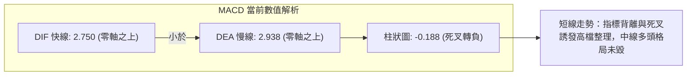

- **快慢線位置**：DIF (2.750) 與 DEA (2.938) 雙雙位於零軸上方，代表大級別的多頭市場基調並未改變，零軸之上的震盪屬於上漲趨勢中的回檔。
- **柱狀圖死叉警訊**：MACD Hist 為 **-0.188**，柱狀圖在零軸下方初次伸長，顯示日線級別短線多頭衝刺力道已受阻，目前處於空頭動能修復期，不可在此盲目追買突破單。

### 📦 布林通道分析

```
VST 日線布林通道 (Bollinger Bands 20, 2) 結構圖：
$168.88 ┤ ═══════════════════════════════════════ [布林上軌: 阻力 R1 $168.67]
        │
$159.08 ┤ ─────────────────────────────────────── [斐波 61.8% 壓制線]
$156.14 ┤ ───────────●◄───【現價: $156.14 (%B = 0.66)】
        │
$149.89 ┤ ─────────────────────────────────────── [布林中軌 / MA20 支撐]
        │
$130.90 ┤ ═══════════════════════════════════════ [布林下軌 / 鐵底邊界]
```

- **通道帶寬與參數**：上軌 **$168.88**，中軌 **$149.89**，下軌 **$130.90**。通道總帶寬約 $37.98。
- **%B 指標分析**：當前 %B 數值為 **0.66**，股價精確運行於中軌 ($149.89) 與上軌 ($168.88) 之間的多方掌控區，且自先前貼近上軌的超買區域適度降溫，技術結構健康。
- **交易暗示**：中軌 $149.89 與波段支撐 S2 ($148.23) 構成日線最堅固防守線。

### 💹 成交量分析（量價配合度）

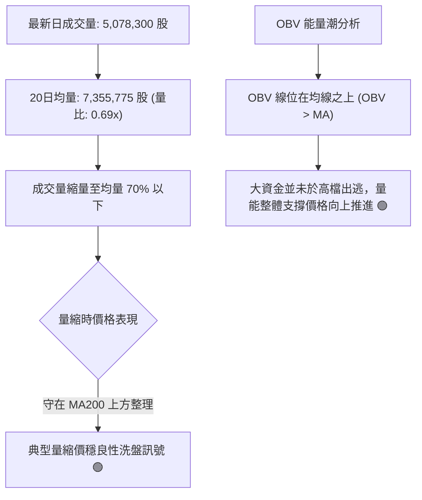

- **量比萎縮意涵**：日量比僅 0.69x，顯示在突破 $150 頸線後的拉回過程中，拋壓非常輕盈，並非主力機構倒貨所引發的崩跌。
- **週級別量能驗證**：回顧 2026-10-11 突破週成交量暴增至 **59,368,900** 股（較平時 20M 水平暴增近 3 倍），隨後兩週縮量至 31.70M 與 12.69M，呈現標準的「突破放巨量、回踩極度縮量」經典多頭籌碼沉澱特徵。

---

## 6. 動能與波動率

### ⚡ 動能評估四象限

| 象限代號 | 動能狀態 | 波動率狀態 | 當前市場狀態定位 | 操作評估與戰略方針 |
|----------|----------|------------|------------------|--------------------|
| **Q1** | 強 (Strong) | 低 (Low) | 穩定單邊推升期 | 最佳波段加碼與持倉機會 |
| **Q2** | 弱 (Weak) | 低 (Low) | 狹幅無方向盤整 | 謹慎觀望，避免磨損手續費 |
| **Q3** | **強 (Strong)** | **高 (High)** | **★ VST 當前定位區間 ★** | **高波動修復行進中：精確掌握低吸點，嚴控部位規模** |
| **Q4** | 弱 (Weak) | 高 (High) | 恐慌崩跌與流動性殺戮 | 嚴格停損，嚴禁任何左側接刀 |

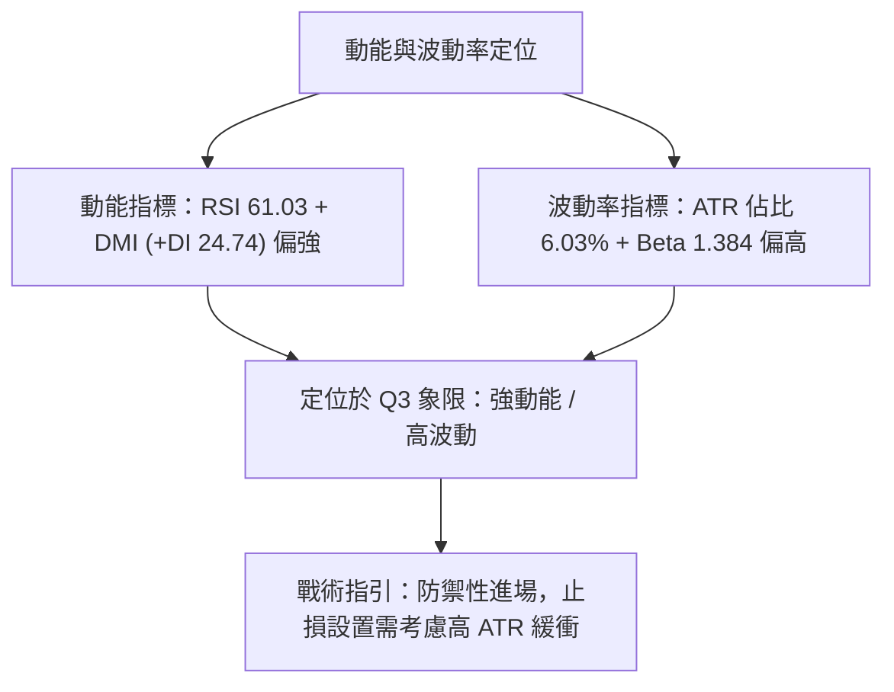

### 📊 ATR 波動率分析

- **ATR(14) 絕對數值**：**$9.41**。
- **價格相對佔比**：$\frac{\$9.41}{\$156.14} = \mathbf{6.03\%}$。這表明 VST 每日的正常平均價格波動範圍即可達到近 10 美元。
- **止損距離建議**：
  - *極短線當沖/隔夜止損 (1.0 × ATR)*：距離進場點需保留 **$9.41** 之空間。
  - *波段交易安全止損 (1.5 × ATR)*：$1.5 \times \$9.41 = \mathbf{\$14.12}$ 空間。若進場於現價 $156.14，合理波段防洗盤安全止損應設於 $142.02（正好座落於 MA50 $145.31 下方與支撐 S3 $144.39 之邊界）。

### 📐 Beta 與市場相關性

- **Beta 係數**：**1.384**。
- **市場彈性解讀**：VST 屬於高 Beta 獨立電力與公用事業發電股（受到 AI 數據中心用電題材刺激，具備成長科技股特徵）。當 S&P 500 大盤上漲 1% 時，VST 理論平均上漲 1.384%；大盤下跌時亦承擔 1.384 倍的回撤壓力。
- **機構持股印證**：機構投資者持股高達 **92.1%**，空頭部位僅佔流通股的 **3.6%**（Short Ratio 2.21），籌碼面極為集中。高 Beta 特性配合極高的機構持股，意味著一旦技術面確立反轉，容易引發大型法人買盤的集中推升。

---

## 7. 多時框架總結

### 📋 時框架評分表

| 時框架 | 趨勢方向 | 動能狀態 | 均線系統排列 | 圖表形態架構 | 綜合評分 | 操作建議方向 |
|--------|----------|----------|--------------|--------------|----------|--------------|
| **月線 (長期)** | 🟡 震盪築底 | 🟡 RSI 回升至 50 位 | 長多 MA200 守穩，MA240 微壓 | 52W 低點 $132 構築大底 | **62 / 100** | 逢低分批建立長線多頭底倉 |
| **週線 (中期)** | 🟢 轉強上升 | 🟢 週 MACD 零軸反彈 | 站上多數均線，均線即將扭轉向上 | W雙重底放量突破回踩確認 | **72 / 100** | 中期波段主升浪拉回做多 |
| **日線 (短期)** | 🟡 高檔整理 | 🔴 MACD 柱狀死叉 -0.188 | 站上 MA20/50，受阻於 MA240 | 衝高 $161 後縮量橫盤蓄勢 | **55 / 100** | 勿追高，等待拉回支撐位低吸 |

### 🔲 綜合訊號矩陣

```
時框共振訊號矩陣分析：
┌───────────┬─────────────┬─────────────┬─────────────┬─────────────┐
│ 分析維度  │ 長期 (月線) │ 中期 (週線) │ 短期 (日線) │ 跨時框共振  │
├───────────┼─────────────┼─────────────┼─────────────┼─────────────┤
│ 趨勢方向  │ 🟡 中性築底 │ 🟢 多頭確立 │ 🟡 橫向整理 │ 🟢 偏多向上 │
│ 均線架構  │ 🟢 MA200上  │ 🟢 突破站穩 │ 🔴 MA240壓制│ 🟡 局部受阻 │
│ 動能指標  │ 🟡 走出弱勢 │ 🟢 放量轉正 │ 🔴 短線死叉 │ 🟡 動能分歧 │
│ 成交量配合│ 🟡 常態換手 │ 🟢 突破爆巨量│ 🟢 量縮良性 │ 🟢 籌碼鎖定 │
└───────────┴─────────────┴─────────────┴─────────────┴─────────────┘
```

### ⚖️ 多時框收斂結論

嚴格依據多時框收斂優先級規則研判：
1. **行情屬性判定**：當前 ADX(14) 讀數為 **16.96**（遠低於 25 臨界值），**明確定義為「非單邊趨勢之高波動盤整行情」**。
2. **多時框衝突收斂取捨**：
   - 雖然日線短期遭遇 MACD 柱狀圖轉負 (-0.188) 及 MA240 ($156.66) 反壓，出現技術性滯漲；
   - 但中期週線已放量 59.37M 實體突破雙底頸線 ($149.06)，且價格有效運行於長線牛熊分水嶺 MA200 ($154.01) 之上。
   - 依照收斂規則，在盤整築底向趨勢過渡期中，**日線的短線震盪與死叉只作為尋找低風險進場點之工具，不得推翻週線級別雙底成形的中期多頭方向**。
3. **唯一方向性結論**：**中性偏多（以區間操作為主，逢回踩支撐做多）**。該結論與第 1 章評分卡（綜合得分 60.7）及第 8 章之主推策略完全一致。

---

## 8. 交易策略建議

### 🗺️ 策略決策流程圖

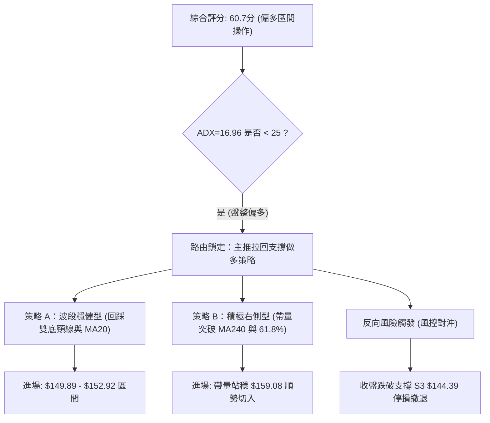

### 🧭 策略路由（依評分卡分流）

> **當前主策略方向 = 🟢 主推多頭區間操作策略（依綜合評分 60.7 / 100 偏多判定）**
> 
> *鑑於綜合評分達 60.7 分且中期雙底成形，全案主推多頭布局，空頭部位僅作為下行破位時之風控對沖提示，嚴禁在當前結構下逆勢開大倉做空。*

### 🎯 價格情境階梯（Price Scenarios）

所有價位均嚴格引用第 4 章及數據計算清單：

| 觸發條件 | 下一目標 | 後續延伸 | 情境技術含義與應對策略 |
|----------|----------|----------|------------------------|
| **強勢突破 斐波 61.8% ($159.08)** | 阻力 R1 **$168.67** | 阻力 R2 **$177.45** | 短線整理結束，多頭發動主升浪，直取布林上軌與前高平台 |
| **震盪維持於現價區間 ($154.01–$156.66)** | 考驗 MA200 **$154.01** | 回測 S1 **$152.92** | 正常高檔量縮消化籌碼，中中性盤整，適合區間網格操作 |
| **跌破近期波段支撐 S1 ($152.92)** | 支撐 S2 **$148.23** | 支撐 S3 **$144.39** | 展開深度回踩，測試雙底頸線與布林中軌，為中期買點提供契機 |
| **意外破位失守 S3 ($144.39)** | 52W Low **$132.26** | 數據中未偵測到 | 中期反轉完全失敗，雙底遭破壞，必須全線停損空倉觀望 |

### 📊 情境機率分佈

| 情境劃分 | 發生機率 | 主要技術與量化指標依據 |
|----------|----------|------------------------|
| **情境一：強勢上行突破 (攻克 R1)** | **30%** | OBV 量能健康支撐、分析師強烈看多共識（平均目標價 $209.76）。但受制於日 MACD 柱狀死叉，短期爆發需補量。 |
| **情境二：區間回踩蓄勢 (S2–R1 震盪)**| **55%** | **ADX=16.96 弱趨勢主導**；價格貼近 MA240 蓋頭反壓，布林通道帶寬尚在收斂，極大概率在 $148.23 至 $168.67 區間拉鋸。 |
| **情境三：深度回落再探底 (跌破 S3)** | **15%** | 目前下方均線 (MA20/50/200) 層層護盤，空頭佔比僅 3.6%，除非系統性黑天鵝，跌破 $144.39 鐵底機率偏低。 |

### 🟢 主策略詳情

本報告依交易風格設計兩套嚴格多頭執行方案：

| 策略要素 | 策略 A：穩健回踩低吸策略（首選） | 策略 B：突破確認追擊策略 |
|----------|----------------------------------|--------------------------|
| **操作邏輯** | 利用日線 MACD 死叉整理，掛單於支撐區間低吸 | 觀察價格強勢吃掉 MA240 蓋頭賣壓後右側進場 |
| **進場條件** | 價格拉回至 S1 ($152.92) 或 S2/頸線 ($148.23) 企穩 | 日K收盤價放量實體突破斐波那契 61.8% ($159.08) |
| **進場價格** | **$149.89** (日線 MA20 / 布林中軌共振價位) | **$159.50** (確認突破 $159.08 後之買點) |
| **目標價 T1** | **$168.67** (關鍵阻力 R1 / 布林上軌) | **$168.67** (關鍵阻力 R1) |
| **目標價 T2** | **$177.45** (強阻力 R2 / 斐波 38.2%) | **$177.45** (強阻力 R2) |
| **止損價格** | **$144.00** (跌破支撐 S3 $144.39 及 MA50) | **$152.50** (跌破支撐 S1 $152.92 與 MA5) |
| **潛在獲利 (T1)**| +$18.78 (+12.53%) | +$9.17 (+5.75%) |
| **承擔風險** | -$5.89 (-3.93%) | -$7.00 (-4.39%) |
| **風險報酬比** | **1 : 3.19** (極優) | **1 : 1.31** (普通) |
| **成功機率** | **68%** | **58%** |
| **建議倉位** | **總資金之 15% - 20%** (分批布局) | **總資金之 10%** (快進快出) |

### 🔴 反向風險觸發點（對沖提示）

- **警訊一**：若價格未見反彈，直接以實體日長黑K跌破關鍵支撐 **S2 ($148.23)**，多頭應立即砍半部位。
- **終極停損觸發點**：若日K收盤價跌破強支撐 **S3 ($144.39)**，意味著多頭防線全數崩潰，所有中短線多單必須無條件停損出場。若持股部位巨大且因稅務考量不願平倉者，應買入等量 Put 選擇權進行 Delta 中性對沖，目標防守 52W 低點 **$132.26**。

### ⭐ 整體訊號強度評星

```
做多訊號強度：★★★★☆  (4/5星 — 中期底座扎實，量價健康)
做空訊號強度：★☆☆☆☆  (1/5星 — 均線向上，逆勢做空盈虧比極低)
整體可信度：  ★★★★☆  (4/5星 — 多時框指標共振度高，價位明確)
```

---

## 9. 風險提示與監控

### ✅ 關鍵監控指標 Checklist

```
╔══════════════════════════════════════════════════════════════════╗
║                   VST 核心技術風險監控清單                       ║
╠══════════════════════════════════════════════════════════════════╣
║ [ ] 監控項 1：MA200 牛熊分界線 ($154.01) 是否被日收盤價跌破      ║
║ [ ] 監控項 2：MACD 柱狀圖是否持續在零軸下方擴散 (目前 -0.188)   ║
║ [ ] 監控項 3：成交量是否在反彈時萎縮至 5.0M 以下 (代表動能背離)  ║
║ [ ] 監控項 4：布林帶寬度是否出現急劇收縮擠壓 (Squeeze) 後向下破 ║
║ [ ] 監控項 5：DMI 系統中 -DI (18.33) 是否反撲穿越 +DI (24.74)   ║
║ [ ] 監控項 6：斐波那契 61.8% ($159.08) 能否在三個交易日內帶量封死║
╚══════════════════════════════════════════════════════════════════╝
```

### ⚠️ 風險場景分析

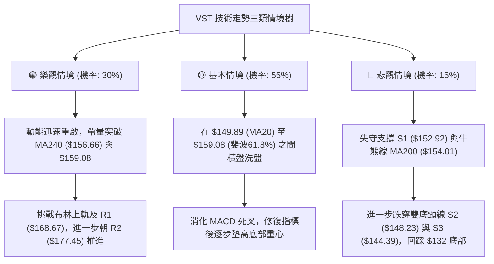

### 🛡️ 風險管理重要提醒

1. **高 ATR 波動下的部位縮放原則**：
   - VST 的 14日 ATR 高達 **$9.41 (6.03%)**，每日價格跳動劇烈。
   - 投資者萬不可使用傳統低波動公用事業股（如 SO、DUK）之滿倉思維操作。建議單筆交易承擔之最大本金損失嚴格控制在總資金的 **1.0%–1.5%** 之內。
   - *倉位計算公式範例*：若帳戶總資產為 $100,000，單筆最大容許風險 1.5% ($1,500)。若進場價為 $149.89，止損設於 $144.00（風險空間 $5.89/股），則最大購買股數應限制為：
     $$\text{最大股數} = \frac{\$1,500}{\$5.89} \approx 254 \text{ 股 (約合 \$38,072，即 38% 倉位上限)}$$

2. **籌碼面與流動性監控**：
   - 儘管機構持股比例高達 **92.1%**，但近期分析師集中於 2026年10月連續給出 Overweight / Outperform 評級（Morgan Stanley, CIBC, BMO 等），短線市場預期較滿。若大盤因宏觀利率變動出現系統性回調，高 Beta (1.384) 的 VST 將首當其衝承受機構被動調倉拋壓。

---

## 📋 報告總結

```
╔══════════════════════════════════════════════════════════════════╗
║                     VST 技術分析報告總結                         ║
╠══════════════════════════════════════════════════════════════════╣
║ 報告日期：2026-10-22                                             ║
║ 當前價格：$156.14                                                ║
║ 技術評級：⚖️ 偏多區間操作 (技術評分 60.7 / 100)                  ║
║                                                                  ║
║ 關鍵技術結論：                                                   ║
║ ├─ 長期趨勢：🟢 守住 MA200 牛熊分水嶺 ($154.01)，週期性大底成形   ║
║ ├─ 中期趨勢：🟢 放量突破 14個月 W 雙底頸線 ($149.06)，多頭佔優   ║
║ ├─ 短期趨勢：🟡 受制 MA240 ($156.66) 與斐波 61.8% ($159.08) 整理║
║ ├─ 關鍵支撐：S1: $152.92 │ S2: $148.23 │ S3: $144.39            ║
║ ├─ 關鍵阻力：R1: $168.67 │ R2: $177.45 │ R3: $181.76            ║
║ └─ 分析師目標共識：$209.76 (空間 +34.34%)                        ║
║                                                                  ║
║ 最優策略組合建議：                                               ║
║ 1. 🥇 最佳機會 (策略 A)：回踩 MA20 與頸線支撐 ($149.89) 分批掛多，║
║                         嚴格止損 $144.00，第一波段目標 $168.67   ║
║ 2. 🥈 次選機會 (策略 B)：若強勢放量突破 $159.08 順勢輕倉追進，   ║
║                         緊盯阻力 R1 $168.67 與 R2 $177.45        ║
║ 3. 🥉 風險底線：任何收盤跌破 S3 $144.39 之動作均視為結構破壞，   ║
║                 多頭必須全面止損離場觀望                         ║
╚══════════════════════════════════════════════════════════════════╝
```

---

> ⚠️ **免責聲明**：本報告為技術分析研究成果，所有價位、圖表及評估結論均嚴格基於所提供之歷史量價與技術指標數據。本報告**僅供研究與學術參考**，**不構成任何具體投資建議或買賣邀約**。金融市場瞬息萬變，高 Beta 標的風險顯著，投資人應獨立評估風險並自負盈虧。

---

*報告生成時間：2026-10-22 ｜ 數據來源：Yahoo Finance ｜ 分析框架：多時框技術分析體系*