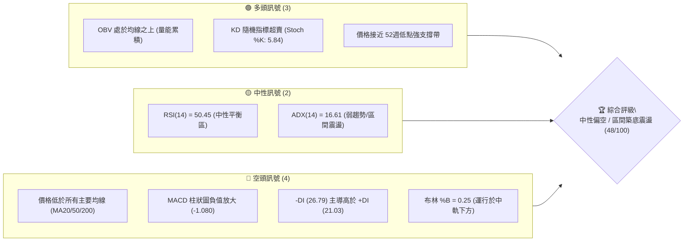
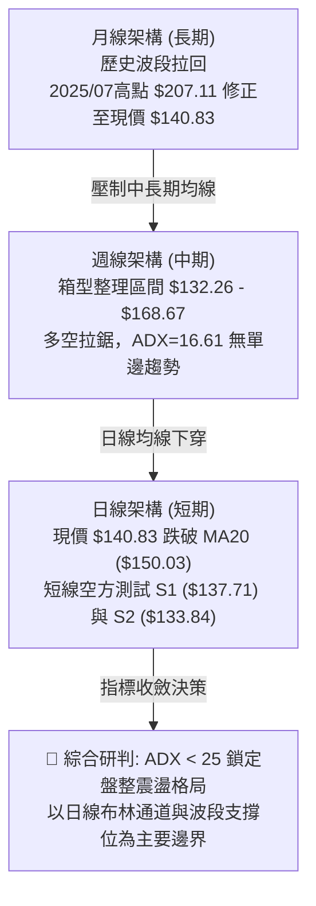
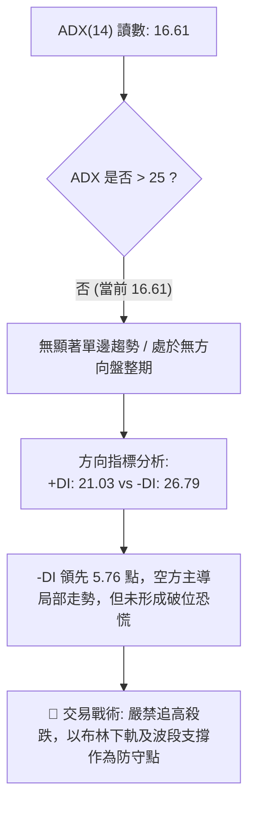
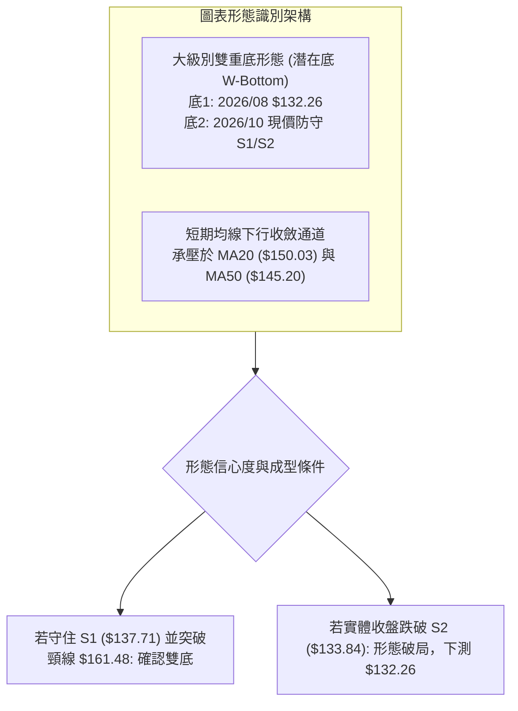
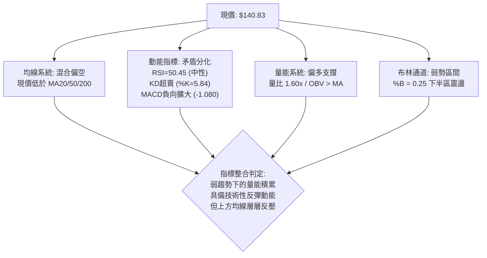
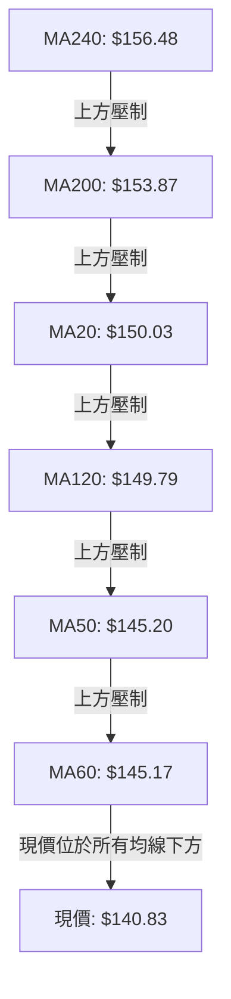
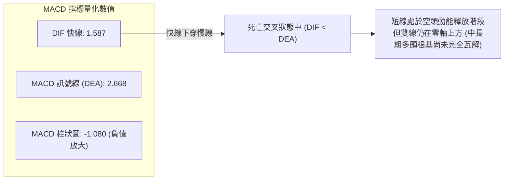
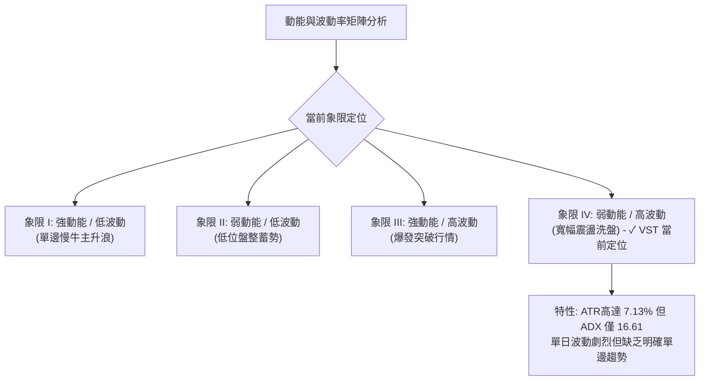
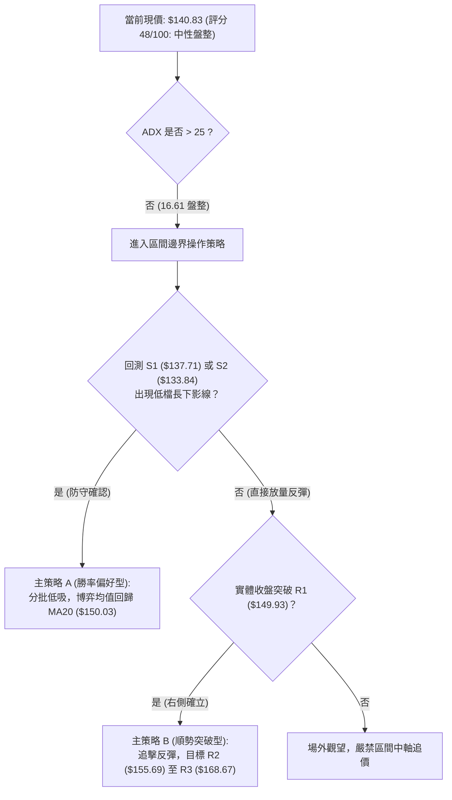
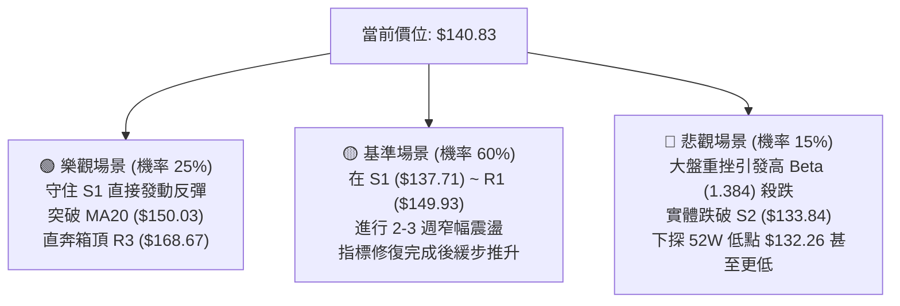

# VST 技術分析報告

> **報告日期**：2026-10-23 ｜ **語言**：繁體中文 ｜ **數據來源**：Yahoo Finance ｜ **當前價格**：$140.83 USD

---

## 目錄

| 章節 | 內容 |
|------|------|
| [1. 技術面概覽](#1-技術面概覽) | 訊號儀表板、核心指標速覽表、技術評分卡 |
| [2. 趨勢分析](#2-趨勢分析) | 多時框趨勢分析、長期12個月走勢圖、中期趨勢、ADX強度解讀 |
| [3. 圖表形態分析](#3-圖表形態分析) | 形態識別系統、重要K線形態分析、ASCII走勢示意圖、形態目標價推算 |
| [4. 支撐與阻力](#4-支撐與阻力) | 關鍵價位分布圖、阻力位分析表、支撐位分析表、斐波那契回調結構 |
| [5. 技術指標深度解讀](#5-技術指標深度解讀) | 指標訊號總覽、均線系統、RSI背離檢驗、MACD量化解讀、布林通道與OBV |
| [6. 動能與波動率](#6-動能與波動率) | 動能評估四象限、ATR波動分析與止損測算、Beta市場相關性 |
| [7. 多時框架總結](#7-多時框架總結) | 時框架評分矩陣、多時框收斂結論與主導方向 |
| [8. 交易策略建議](#8-交易策略建議) | 策略決策流程圖、策略路由分流、價格情境階梯、情境機率、主策略與對沖提示 |
| [9. 風險提示與監控](#9-風險提示與監控) | 關鍵監控指標 Checklist、風險情境路徑圖、部位管理重要提醒 |
| [📋 報告總結](#-報告總結) | 全文核心結論與最優操作配置速查 |

---

## 1. 技術面概覽

### 🎯 技術訊號儀表板



### 📊 核心指標速覽表

| 指標類別 | 指標名稱 | 當前數值 | 訊號 | 解讀 |
|----------|----------|----------|:----:|------|
| **價格** | 當前收盤價 | $140.83 | 🟡 | 位於52週區間 12.2% 處，處於低位防守區間 |
| **均線** | 短期 MA20 | $150.03 | 🔴 | 現價低於 MA20 (-6.13%)，短期反彈第一重反壓 |
| **均線** | 中期 MA50 | $145.20 | 🔴 | 現價低於 MA50 (-2.99%)，中期趨勢受壓制 |
| **均線** | 長期 MA200 | $153.87 | 🔴 | 現價低於 MA200 (-8.47%)，長期多空分水嶺失守 |
| **動能** | RSI(14) | 50.45 | 🟡 | 處於 30–70 中性水平，動能無極端過熱或衰竭 |
| **動能** | MACD(12,26,9) | 1.587 / 2.668 | 🔴 | 柱狀圖為 -1.080，空頭動能短期占優 |
| **動能** | Stoch %K / %D | 5.84 / 38.15 | 🟢 | %K 深度超賣，短線存在均值回歸反彈需求 |
| **趨勢** | ADX / DMI | 16.61 (-DI 26.79) | 🟡 | ADX < 25 為典型盤整震盪市場，空方略占優 |
| **波動** | ATR(14) | $10.04 (7.13%) | 🔴 | 波動度高，單日波幅大，需嚴格控制停損距離 |
| **量能** | OBV 與量比 | 量比 1.60x / OBV>MA | 🟢 | 日成交量放大至 12.45M，量能未隨下跌崩潰 |

### 🏆 技術評分卡

```
╔══════════════════════════════════════════════════════════════════╗
║                技術評分卡 — VST (2026-10-23)                     ║
╠══════════════════════════════════════════════════════════════════╣
║ 趨勢強度 (Trend)     ████░░░░░░░░░░░░░░░░  25/100 🔴 均線空頭/弱勢  ║
║ 動能指標 (Momentum)  ████████░░░░░░░░░░░░  42/100 🟡 KD超賣但MACD偏弱║
║ 支撐穩定度 (Support) ██████████████░░░░░░  70/100 🟢 靠近波段雙支撐帶║
║ 成交量配合 (Volume)  ████████████░░░░░░░░  60/100 🟢 量比1.6x無恐慌 ║
║ 形態完整度 (Pattern) ██████████░░░░░░░░░░  50/100 🟡 箱型低位震盪中 ║
║ 均線架構 (MA System) ██████░░░░░░░░░░░░░░  32/100 🔴 現價位於均線下 ║
╠══════════════════════════════════════════════════════════════════╣
║ 綜合評分             █████████░░░░░░░░░░░  48/100 🟡 中性盤整區間   ║
╚══════════════════════════════════════════════════════════════════╝
```

---

## 2. 趨勢分析

### 🌐 多時框趨勢分析



### 📈 長期趨勢 — 12個月走勢圖（Unicode）

```
VST 月線收盤走勢圖（2025-11 至 2026-10）
價格軸 ($)
$187.21 ┤                 
$177.83 ┤ ● [11月]               
$173.13 ┤                   ● [02月]
$160.62 ┤       ● [12月]           ● [05月]
$157.36 ┤             ● [01月]       ● [04月]  ● [06月]
$149.87 ┤                         ● [03月]
$147.95 ┤                                       ● [07月]
$140.83 ┤━━━━━━━━━━━━━━━━━━━━━━━━━━━━━━━━━━━━━━━━━●← [現價 10月 $140.83]
$137.15 ┤                                             ● [08月]  ● [09月]
        └─────────────────────────────────────────────────────────────
          11月  12月  01月  02月  03月  04月  05月  06月  07月  08月  09月  10月
```

**12個月價格軌跡與特徵分析**：

| 時間階段 | 起訖價格 ($) | 漲跌幅 (%) | 走勢特徵與結構 |
|----------|:------------:|:----------:|----------------|
| **2025-11 ~ 2025-12** | $177.83 → $160.62 | -9.68% | 自2025年中歷史高點展開的第一波主跌段，成交量收縮。 |
| **2026-01 ~ 2026-02** | $157.65 → $173.13 | +9.82% | 跌深反彈波，一度站上中短期均線，但未能突破 $180 關卡。 |
| **2026-03 ~ 2026-06** | $149.87 → $158.37 | +5.67% | 進入大箱型築底階段，價格在 $149 至 $160 間進行橫向收斂。 |
| **2026-07 ~ 2026-08** | $147.95 → $137.15 | -7.30% | 二次回測測試 52週低點區間，最低觸及 $132.26 支撐位。 |
| **2026-09 ~ 2026-10** | $138.35 → $140.83 | +1.79% | 在波段低點區間縮量抗跌，企圖於 $137–$140 構築箱底支撐。 |

### 📊 中期趨勢（週線分析）

從近20週收盤資料觀察，中期走勢呈現「寬幅箱型震盪」。2026-10-11 當週曾強勢放量突破至 $161.48（週成交量達 59.37M），但隨後兩週迅速回落至 $152.02 及 $140.83，顯示高檔套牢賣壓在 R1 ($149.93) 與 R2 ($155.69) 聚集嚴重。目前週線 MACD 柱狀圖由正轉負（-1.080），週線 RSI 落於 50.5，代表中期多頭衝高失敗後重新回歸箱型中下緣尋求支撐。

```
VST 中期週線支撐與壓力區間示意圖
══════════════════════════════════════════════════════════════
[箱頂阻力]   $168.67 (R3 / 布林上軌 $168.68 / Fib 50.0% $167.37)
                ▲
                │   週線高檔衝高回落區 ($161.48 - $168.67)
                ▼
[中期均線帶] $150.03 (MA20 / BB中軌) ~ $155.69 (R2)
                ▲
                │   多空爭奪中軸線
                ▼
[當前價格]   $140.83 ◄── 位於箱型下半部，多方最後防線邊界
                ▲
                │   緩衝防守區間 (幅度約 -2.2% 至 -6.0%)
                ▼
[箱底強支撐] $137.71 (S1) ~ $133.84 (S2) / 52W低點 $132.26
══════════════════════════════════════════════════════════════
```

### ⚡ 趨勢強度評估（ADX 解讀）



| ADX 區間 | 趨勢分類 | 當前狀態判定 | 戰術指引 |
|:--------:|:--------:|:------------:|----------|
| **0 – 20** | **極弱 / 無趨勢盤整** | **✓ 當前值 16.61** | 趨勢策略失效，區間高拋低吸或觀望 |
| **20 – 25** | 趨勢萌芽 / 方向確認中 | — | 密切觀察均線交叉與放量方向 |
| **25 – 40** | 強趨勢行情 | — | 順應中長期均線單邊順勢操作 |
| **40 – 100** | 極強趨勢 / 超買超賣爆發 | — | 隨時防範趨勢力竭與反轉 |

---

## 3. 圖表形態分析

### 🔍 形態識別系統



**形態信心度與測算表**：

| 形態名稱 | 信心度 | 判斷依據（引用客觀數據） | 完成度 | 目標價計算式與目標數值 |
|----------|:------:|--------------------------|:------:|------------------------|
| **潛在雙重底 (W-Bottom)** | **58%** | 2026年8月低點 $132.26，近期低點聚類於 S1 ($137.71) 與 S2 ($133.84) 上方形成二次探底支撐。 | 45% (尚未突破頸線) | 頸線 (2026-10-11 高點 $161.48) + 形態高度 ($161.48 - $132.26 = $29.22) = **$190.70** |
| **矩形箱型整理區間** | **78%** | 過去 6 個月價格始終運行於 52週低點 $132.26 至 R3 ($168.67) 之間，ADX 16.61 高度佐證無單邊趨勢。 | 85% (箱體運行中) | 箱頂目標 = **$168.67** (R3 阻力位)<br/>箱底防守 = **$132.26** (52W Low) |
| **頭肩底形態** | 25% | 數據中左肩與右肩結構不對稱，成交量分佈不符。 | 0% | *訊號不足，信心度低於50%，僅做指標型解讀，不予測算目標價。* |

### 🕯️ 重要K線形態分析

| 期間/月份 | 收盤價 ($) | K線形態特徵 | 技術含義解讀 | 訊號方向 |
|-----------|:----------:|-------------|--------------|:--------:|
| **2026-08** | $137.15 | 帶長下影線之探底錘頭線 | 股價探至 52週低點 $132.26 後迅速獲得買盤承接，確認 S2 強支撐。 | 🟢 看多反彈 |
| **2026-09** | $138.35 | 低檔小實體十字星 | 賣壓大幅收斂，市場進入觀望平衡期，築底蓄勢。 | 🟡 變盤蓄勢 |
| **2026-10-11 (週)** | $161.48 | 放量實體大陽線 (週量 59.37M) | 多方主力放量衝高，嘗試上攻 MA200，但面臨高檔獲利了結盤。 | 🟢 短線爆發 |
| **2026-10-25 (週)** | $140.83 | 回落陰線包裹 | 回吐前週漲幅，重新考驗 MA60 與 S1，顯示籌碼換手尚未完全穩定。 | 🔴 短線拉回 |

### 📉 ASCII 走勢形態示意圖

```
VST 箱型震盪與潛在雙底形態架構圖
價格 ($)
$168.67 ┬──────────────────────────────────────────────── R3 箱頂阻力帶
        │                         ╭─● 10/11 突刺高點 ($161.48)
$161.48 ┼ ─ ─ ─ ─ ─ ─ ─ ─ ─ ─ ─ ─ ┼ ─ ─ ─ ─ ─ ─ ─ ─ ─ 潛在雙底頸線位
        │                       ╭╯  ╰╮
$150.03 ┼ ─ ─ ─ ─ ─ ─ ─ ─ ─ ─ ─ ┼ ─ ─ ─ ─ ─ ─ ─ ─ ─ ─ MA20 / BB中軌
        │         ╭─╮           │    ╰╮
$140.83 ┼ ─ ─ ─ ─ ┼ ─ ┼ ─ ─ ─ ─ ─ ┼ ─ ─ ─ ● 現價 ($140.83)
        │       ╭╯   ╰╮       ╭╯        │ 
$137.71 ┼ ─ ─ ─ ┼ ─ ─ ┼ ─ ─ ─ ─ ┼ ─ ─ ─ ─ ┼ ─ ─ ─ ─ ─ S1 第一支撐
        │     ╭╯       ╰╮   ╭╯           ▼ 尋求底2支撐
$132.26 ┴────● 底1 ─────┴───● (測試中) ──────────────── S2 ($133.84) / 52W Low
       2026-08        2026-09        2026-10
```

### 🎯 形態目標價計算

若多方能成功守住下方 S1 ($137.71) 與 S2 ($133.84) 支撐區間，並依據雙底形態突破頸線展開等幅測距，其目標價測算路徑如下：

1. **第一階段形態目標（箱型中軌回歸）**：
   - 測算邏輯：現價至 MA20 / BB中軌均值回歸。
   - 計算數值：**$150.03**（對應波段高點聚類 R1: **$149.93**，空間約 +6.46%）。
2. **第二階段形態目標（箱頂測試）**：
   - 測算邏輯：完整箱型反彈至波段阻力 R3。
   - 計算數值：**$168.67**（與布林上軌 $168.68 及 Fib 50.0% $167.37 共振，空間約 +19.77%）。
3. **第三階段形態突破目標（雙底完成測距）**：
   - 計算式：頸線高點 ($161.48) + 形態垂直深度 ($161.48 - $132.26 = $29.22) = **$190.70**（接近 Fib 23.6% $185.91）。

---

## 4. 支撐與阻力

### 🗺️ 關鍵價位分布圖（Unicode）

```
VST 價位結構分布圖（OHLCV 實際計算值）
══════════════════════════════════════════════════════════════
$168.67 ║██████████████████████████████║ 強阻力 R3 / Fib 50.0% ($167.37)
$159.08 ║████████████████████          ║ 斐波那契 61.8% 關鍵回調位
$155.69 ║████████████████████████      ║ 波段阻力 R2 / MA240 反壓帶
$149.93 ║████████████████████████████  ║ 關鍵阻力 R1 / MA20 重合區 ($150.03)
$147.29 ║████████████████              ║ 斐波那契 78.6% 回調位
$140.83 ╠══════════════════════════════╣ ◄ 現價位置 ($140.83)
$137.71 ║▓▓▓▓▓▓▓▓▓▓▓▓▓▓▓▓▓▓▓▓          ║ 近期核心支撐 S1 (距現價 -2.22%)
$133.84 ║▓▓▓▓▓▓▓▓▓▓▓▓▓▓▓▓▓▓▓▓▓▓▓▓▓▓▓   ║ 強力防守支撐 S2 (距現價 -4.97%)
$132.26 ║██████████████████████████████║ 52週歷史低點 / 終極多空止損線
══════════════════════════════════════════════════════════════
```

### 🚧 阻力位分析表

所有阻力數值完全源自提供之技術數據中近一年波段高點聚類：

| 阻力級別 | 精確價位 | 距離現價 | 技術結構形成原因 | 突破難度評估 | 重要性 |
|:--------:|:--------:|:--------:|------------------|:------------:|:------:|
| **R1** | **$149.93** | +6.46% | 近期波段密集成交高點，且與 MA20 ($150.03) 及 MA120 ($149.79) 形成緊密均線反壓叢。 | 中等 🟡 | 關鍵短期分水嶺 |
| **R2** | **$155.69** | +10.55% | 長期均線 MA240 ($156.48) 附近的次級高點聚集區，上方存在解套賣壓。 | 較高 🔴 | 中期空頭阻力牆 |
| **R3** | **$168.67** | +19.77% | 近一年大箱型頂部，與布林上軌 ($168.68) 及斐波那契 50.0% ($167.37) 形成三重共振。 | 極高 🔴 | 多頭波段反轉核心關卡 |

### 🛡️ 支撐位分析表

所有支撐數值完全源自提供之技術數據中近一年波段低點聚類：

| 支撐級別 | 精確價位 | 距離現價 | 技術結構形成原因 | 守住機率評估 | 重要性 |
|:--------:|:--------:|:--------:|------------------|:------------:|:------:|
| **S1** | **$137.71** | -2.22% | 近一年波段低點聚類第一層，9月至10月多次下探均在此獲得日內買盤承接。 | 68% 🟢 | 短線首要防守線 |
| **S2** | **$133.84** | -4.97% | 次低點密集帶，距離布林下軌 ($131.38) 與 52W Low ($132.26) 僅咫尺之遙，多頭主力底線。 | 82% 🟢 | 中期多頭生死防線 |

### 📐 斐波那契回調位分析

依據 52週高點 **$202.48** 至 52週低點 **$132.26** 之完整波段（垂直落差 $70.22）進行測算：

| 斐波那契回調比例 | 精確對應價位 | 現價相對位置與技術意義 |
|:----------------:|:------------:|------------------------|
| **0.0% (52W High)** | **$202.48** | 歷史波段頂部，長期多頭終極目標。 |
| **23.6%** | **$185.91** | 強勢多頭回調支撐（目前在上方深處，構成遠期阻力）。 |
| **38.2%** | **$175.66** | 多空長期強弱分水嶺。 |
| **50.0%** | **$167.37** | 多空半數分界點，與阻力位 R3 ($168.67) 形成強共振。 |
| **61.8%** | **$159.08** | 黃金分割重要位，為中期反彈是否升格為新一輪升浪的門檻。 |
| **78.6%** | **$147.29** | **現價上方第一道黃金分割阻力**，落於現價與 R1 ($149.93) 之間。 |
| **100.0% (52W Low)**| **$132.26** | **現價下方終極斐波那契基底**，不可跌破之極限。 |

**結構解讀**：現價 **$140.83** 目前運行於 **78.6% ($147.29)** 與 **100.0% ($132.26)** 的弱勢探底區間。在此極深的回調區間內，若能守住 100% 基底，通常具備極佳的下檔不對稱風險報酬比（Downside limited, Upside to 50% / 61.8%）。

---

## 5. 技術指標深度解讀

### 🎛️ 指標訊號總覽



### 📈 移動平均線排列分析



**均線詳細數據評估表**：

| 均線名稱 | 數值 ($) | 與現價乖離 | 走勢微型圖解 | 訊號解讀 |
|:--------:|:--------:|:----------:|:------------:|----------|
| **MA 5** | $149.80 | -5.99% | ▄▄▃▂▂▁▁▁▁▁▁▁▁▁▁▁▁▃▅▆▇██▇▇▇▆▅▅▅ | 短期向下陡峭，反映近週急跌賣壓 |
| **MA 10**| $153.69 | -8.37% | ▃▃▃▃▃▃▃▂▂▁▁▁▁▁▁▁▁▂▃▄▅▆▇▇█████▇ | 快速遠離現價，負乖離偏大 |
| **MA 20**| $150.03 | -6.13% | ▁▁▁▁▁▁▁▁▁▁▁▁▁▁▁▁▁▁▂▂▃▄▅▅▆▇▇▇██ | 短線生命線下行，首道強反壓 |
| **MA 50**| $145.20 | -2.99% | 中期走平偏下，距現價最近的反彈阻力 |
| **MA 60**| $145.17 | -2.99% | ███▇▇▆▅▅▄▄▃▃▃▂▂▂▁▁▂▁▂▂▂▂▁▁▁▁▁▁ | 與 MA50 粘合於 $145.20 附近 |
| **MA120**| $149.79 | -5.98% | ████▇▇▇▆▆▅▅▅▄▄▃▃▂▂▂▂▂▂▂▂▂▁▁▁▁▁ | 半年線走平，與 MA20/R1 重疊 |
| **MA200**| $153.87 | -8.47% | 長期牛熊分水嶺，跌破代表長線需修復 |
| **MA240**| $156.48 | -10.00%| ████▇▇▇▆▆▅▅▅▄▄▄▃▃▃▃▃▂▂▂▂▂▁▁▁▁▁ | 年線位置，構成波段強大天花板 |

**排列總結**：均線呈現「空頭發散混合排列」。所有週期均線（從 MA5 到 MA240）全數位於現價上方，顯示中期多頭結構受損嚴重，反彈過程將面臨密集解套賣壓。

### 📉 RSI(14) 分析

- **RSI(14) 讀數**：**50.45**
- **強度視覺條**：
  `RSI(14): 50.45 [ 0 ░░░░░░░░░░░░░░░░██████████░░░░░░░░░░ 100 ] 🟡 中性平衡`
- **超買超賣區間判斷**：RSI 位於 50.45，精確處於多空平衡軸心，既無 70 以上超買過熱，亦無 30 以下超賣鈍化。
- **背離檢驗結論**：
  - **頂背離**：無。近兩週價格回落伴隨 RSI 從 69.4 回調至 50.5，屬順勢回撤。
  - **底背離**：無顯著底背離。8月低點 $135.99 時 RSI 為 26.1，現價 $140.83 高於當時低點，RSI 50.5 亦相應抬高，未形成指標與價格背道而馳之底背離特徵。
  - **綜合判定**：動能中性，後續方向取決於布林下軌與支撐 S1 能否引發買盤共振。

### 📊 MACD(12,26,9) 訊號解讀



**MACD 結構深度解析**：
當前 MACD 快線（1.587）低於訊號線（2.668），且柱狀圖為 -1.080，顯示短期價格調整動能仍在延續。然而，快慢線仍處於零軸（0.00）上方運行，這意味著從長期趨勢維度來看，當前的下跌在性質上屬於「多頭市場的大級別深幅回檔」，而非全面轉入長期熊市的崩跌階段。

### 📦 布林通道分析

```
VST 布林通道當前位置示意圖（20日參數，2倍標準差）
══════════════════════════════════════════════════════════════
$168.68 ┬─────────────────────────────────────── 上軌 (Upper Band)
        │
        │
$150.03 ┼─────────────────────────────────────── 中軌 (MA20 生命線)
        │ 
        │ 
$140.83 ┼───────● 現價 (BB %B = 0.25)
        │
$131.38 ┴─────────────────────────────────────── 下軌 (Lower Band)
══════════════════════════════════════════════════════════════
```

- **上軌**：**$168.68**（與阻力位 R3 $168.67 精確重合）
- **中軌 (MA20)**：**$150.03**（與阻力位 R1 $149.93 構成共振反壓）
- **下軌**：**$131.38**（低於波段支撐 S2 $133.84，覆蓋 52W Low $132.26）
- **通道指標 %B**：**0.25**。數值處於 0.0 至 0.5 的弱勢下半區間，但並未跌破下軌（%B < 0），表示價格處於通道下緣的「潛在超賣反彈區」，隨時存在向中軌 $150.03 進行均值回歸的拉力。

### 💹 成交量分析（量價配合度）

- **最新日成交量**：**12,451,100 股**
- **20日均量**：**7,796,845 股**
- **量比 (Volume Ratio)**：**1.60x**（顯著放量）
- **OBV (能量潮)**：**OBV > MA**，明確呈現量能累積型態。

**量價關係深入解讀**：
通常在股價跌破 MA20 的過程中，放量常被視為恐慌殺跌；然而結合 **Stoch %K 達到 5.84 極度超賣** 以及 **OBV 始終維持在均線之上** 綜合研判，當日 1.60 倍的量能放大更傾向於「低位換手與機構被動吸籌」。數據顯示機構持股高達 92.1%，在股價逼近近一年低點聚類 S1 ($137.71) 與 S2 ($133.84) 時，場外承接買盤積極進場換手，並未出現縮量陰跌或無量崩盤的極端流動性風險。

---

## 6. 動能與波動率

### ⚡ 動能評估四象限



| 象限 | 動能維度 | 波動維度 | 代表特徵 | 當前狀態判定與戰術 |
|:----:|:--------:|:--------:|----------|:------------------:|
| **Q1** | 強 | 低 | 趨勢穩健、風險報酬比最高 | — |
| **Q2** | 弱 | 低 | 沉悶築底、流動性匱乏 | — |
| **Q3** | 強 | 高 | 暴漲暴跌、突破追價階段 | — |
| **Q4** | **弱** | **高** | **震盪洗盤、多空假突破頻繁** | **✓ VST 當前狀態**（需放大防守緩衝，忌追高） |

### 📊 ATR 波動率分析

- **ATR(14) 絕對值**：**$10.04**
- **ATR 佔比 (ATR % of Price)**：**7.13%**
- **波動率等級**：🔴 **極高波動**

**ATR 交易風控測算表**：

| 風控測算項目 | 計算公式 | 數值 ($) | 實戰交易意義 |
|--------------|----------|:--------:|--------------|
| **日內正常噪音波動** | 1.0 × ATR | **$10.04** | 日內隨機震盪區間，日內停損不可小於此幅度。 |
| **常規波段止損距離** | 1.5 × ATR | **$15.06** | 依現價計算之標準止損帶 ($140.83 - $15.06 = $125.77)。 |
| **收緊型結構止損** | 結合結構位 S2 | **$6.99** | 以 S2 ($133.84) 破位作為客觀技術止損，幅度約 4.97%。 |
| **單日建議最大波幅** | 2.0 × ATR | **$20.08** | 出現此級別單日波動代表極端事件發生。 |

### 📐 Beta 與市場相關性

- **Beta 係數**：**1.384**（對標 S&P 500 指數）
- **放量敏感度**：高於大盤 38.4%，具備典型的高彈性特質。
- **市場環境適配性**：在公用事業（Utilities - IPP 獨立發電商）板塊中，VST 1.384 的 Beta 顯著高於傳統防禦性公用事業股（通常 Beta < 0.6）。這反映市場將其定價為「AI數據中心電力需求爆發」的成長型標的，當市場大盤或科技板塊承壓時，VST 往往會承受放大的回撤壓力；反之，市場風險偏好回暖時反彈力度亦遠超傳統同業。

---

## 7. 多時框架總結

### 📋 時框架評分表

| 時框架 | 趨勢方向 | 動能狀態 | 均線排列狀況 | 圖表形態識別 | 綜合評分 | 操作戰術建議 |
|:------:|:--------:|:--------:|:------------:|:------------:|:--------:|--------------|
| **月線 (長期)** | 🟡 橫向修正 | 🟡 中性回落 | 🟢 處於長期基底上方 | 歷史高點大幅拉回修正 | **58/100** | 長線多頭未死，逢低價值布局 |
| **週線 (中期)** | 🟡 箱型震盪 | 🔴 動能收斂 | 🟡 跌破週線 MA20 | 大級別矩形箱體震盪 | **46/100** | 箱型下緣防守，不破不殺跌 |
| **日線 (短期)** | 🔴 弱勢回落 | 🟢 KD超賣鈍化 | 🔴 全線空頭壓制 | 測試波段雙底頸線支撐 | **40/100** | 待止跌訊號確立，博弈均值回歸 |

### 🔲 綜合訊號矩陣

```
╔══════════════════════════════════════════════════════════════════╗
║               VST 多時框訊號一致性收斂矩陣                       ║
╠══════════════════════════════════════════════════════════════════╣
║ 維度         短期 (日線)          中期 (週線)          長期 (月線) ║
╠══════════════════════════════════════════════════════════════════╣
║ 趨勢軌道     🔴 弱勢回檔          🟡 箱型震盪          🟢 寬幅牛市 ║
║ 均線結構     🔴 位於均線下方      🔴 跌破MA20          🟢 遠高於歷史底║
║ 動能擺動     🟢 KD深度超賣        🟡 RSI=50.5 中性     🟡 動能降溫 ║
║ 量能支撐     🟢 量比 1.6x 換手    🟢 週量維持高位      🟢 OBV維持強勢 ║
╠══════════════════════════════════════════════════════════════════╣
║ 衝突協調     依據收斂規則：ADX=16.61 (<25) 判定為【盤整震盪市場】 ║
║              日線均線空頭排列僅為箱型內部回落，不可作為單邊崩跌解讀 ║
╚══════════════════════════════════════════════════════════════════╝
```

### ⚖️ 多時框收斂結論

> **唯一確定方向性結論：【中性偏多，區間築底觀望（等待回測確認）】**

**收斂決策邏輯嚴格說明（依據規則 14）**：
1. **行情屬性判定**：當前 ADX(14) 讀數為 **16.61**（顯著低於 25 臨界線），確認目前市場完全處於**「無單邊趨勢的寬幅盤整震盪行情」**。
2. **時框衝突化解**：短期日線均線全線下壓（偏空），但週線與月線均處於大箱型下半區間的極端支撐帶。依規則，在 ADX < 25 的盤整市中，日線均線空頭排列經常引發指標鈍化與假破位，交易必須以**日線布林通道下軌 ($131.38)**、**波段低點支撐 S1 ($137.71) / S2 ($133.84)** 作為主要博弈邊界。
3. **最終裁決**：短線跌勢已逼近強支撐區，且 Stochastic %K 已達 5.84 極度超賣區，空方進一步向下打壓的空間受到 52週低點 $132.26 的強力硬核壓制。因此，拒絕盲目追空，整體定調為**「箱底防守、準備迎接技術性反彈」**。

---

## 8. 交易策略建議

### 🗺️ 策略決策流程圖



### 🧭 策略路由（依評分卡分流）

> **當前主策略方向 = 【中性區間低吸 / 均值回歸策略（依綜合評分 48/100）】**

依據評分卡 48/100（介於 40–60 中性區間），本報告嚴格執行區間分流策略，不進行單邊強烈推多或殺空。策略重點在於利用布林下軌與波段支撐進行高盈虧比（R:R）的左側低吸，並以均線壓力帶作為第一停利點。

### 🎯 價格情境階梯（Price Scenarios）

所有觸發價位與目標數值嚴格引用第 4 章計算之數據：

| 觸發條件 | 下一目標價位 | 後續延伸目標 | 情境技術含義與應對 |
|----------|:------------:|:------------:|--------------------|
| **強勢突破 R1 ($149.93)** | **R2 ($155.69)** | **R3 ($168.67)** | 短線全面轉強，收復 MA20 生命線，進入空頭回補浪。 |
| **突破 R2 ($155.69)** | **R3 ($168.67)** | **$185.91 (Fib 23.6%)** | 突破年線 MA240 反壓，大雙底形態確認成型。 |
| **守穩現價至 S1 區間** | **R1 ($149.93)** | — | 在 $137.71–$140.83 區間完成築底換手，展開反彈。 |
| **跌破 S1 ($137.71)** | **S2 ($133.84)** | **$132.26 (52W Low)** | 短線支撐下移，多頭退守最後防線，進入極限洗盤。 |
| **實體跌破 S2 ($133.84)** | **$132.26** | **$106.00 (分析師最低價)**| 箱底徹底瓦解，52週支撐告急，所有多頭部位必須嚴格止損。 |

### 📊 情境機率分佈

| 價格運行情境 | 發生機率 | 主要技術依據與量化支持 |
|--------------|:--------:|------------------------|
| **情境一：區間築底並展開反彈** | **55%** | Stoch %K (5.84) 深度超賣；OBV 維持在均線上方顯示買盤累積；價格逼近強支撐 S1 ($137.71)。 |
| **情境二：箱型下半部窄幅震盪** | **30%** | ADX 16.61 顯示趨勢極度匱乏；RSI 50.45 處於多空平衡軸，市場等待進一步基本面催化劑。 |
| **情境三：跌破 S2 再探 52週新低** | **15%** | 均線系統全面呈現空頭排列壓制；MACD 柱狀圖 -1.080 負向動能尚未收斂。 |

### 🟢 主策略詳情

本策略專注於利用下方不對稱支撐帶進場，嚴禁於均線反壓區追價：

| 策略要素 | 策略 A（左側低吸型 — 推薦） | 策略 B（右側突破確認型） |
|----------|------------------------------|--------------------------|
| **進場條件** | 價格回踩 S1 ($137.71) 附近出現縮量止跌或小十字星 | 日線收盤價帶量突破 R1 ($149.93) 與 MA20 |
| **進場價格** | **$138.50**（S1 支撐上方緩衝進場） | **$150.50**（突破 R1 確認後掛單） |
| **目標價 T1** | **$149.93** (波段高點阻力 R1) | **$155.69** (波段阻力 R2 / MA240) |
| **目標價 T2** | **$168.67** (箱頂阻力 R3 / 布林上軌) | **$168.67** (大箱體頂部 R3) |
| **止損價格** | **$132.00** (嚴格跌破 52W Low $132.26 離場) | **$144.50** (跌回 MA50 $145.20 下方離場) |
| **風險空間** | $138.50 - $132.00 = **$6.50** | $150.50 - $144.50 = **$6.00** |
| **獲利空間 (T1)** | $149.93 - $138.50 = **$11.43** | $155.69 - $150.50 = **$5.19** |
| **獲利空間 (T2)** | $168.67 - $138.50 = **$30.17** | $168.67 - $150.50 = **$18.17** |
| **風險報酬比 (T1)** | **1 : 1.76** | **1 : 0.87** (不建議只看 T1) |
| **風險報酬比 (T2)** | **1 : 4.64** (極具吸引力) | **1 : 3.03** |
| **預估勝率** | **58%** | **65%** |
| **建議配置倉位** | **總資金之 10%–15%** | **總資金之 15%–20%** |

### 🔴 反向風險觸發點（對沖與風控提示）

若發生下列客觀技術破位，代表主策略假設失效，必須立即啟動風控：
1. **空頭破位觸發點**：日線實體收盤價**跌破 S2 ($133.84)**，且伴隨成交量超過 20日均量（> 7.8M）。
2. **對沖應對指引**：若跌破 $133.84，多頭部位應無條件止損出清；進階交易者可於 $132.00 建立反向下行對沖保護，下一回補支撐直接下看分析師最低預估價 **$106.00** 區域。

### ⭐ 整體訊號強度評星

```
做多訊號強度：★★★☆☆  (3.0/5星 — 支撐強固、KD超賣、量能支撐，但受均線壓制)
做空訊號強度：★★☆☆☆  (2.0/5星 — ADX弱勢，空方下行空間受限於52W低點)
整體可信度：  ★★★★☆  (4.0/5星 — 多項技術指標高度收斂於箱型區間)
```

---

## 9. 風險提示與監控

### ✅ 關鍵監控指標 Checklist

```
╔══════════════════════════════════════════════════════════════════╗
║                 VST 每日盤後核心技術監控清單                     ║
╠══════════════════════════════════════════════════════════════════╣
║ [ ] 1. 收盤價是否維持在 S1 ($137.71) 與 S2 ($133.84) 之上？       ║
║ [ ] 2. Stochastic %K 是否由超賣區 (<20) 向上金叉 %D？            ║
║ [ ] 3. MACD 柱狀圖是否停止負向擴大 (數值由 -1.080 開始回升)？    ║
║ [ ] 4. 日成交量是否保持在 20日均量 (7.80M) 之上且 OBV 續創新高？  ║
║ [ ] 5. 布林通道 %B 是否重新站回 0.35 以上並挑戰中軌 ($150.03)？   ║
║ [ ] 6. ADX 數值是否向上突破 20，釋放新一輪趨勢啟動訊號？         ║
╚══════════════════════════════════════════════════════════════════╝
```

### ⚠️ 風險場景分析



### 🛡️ 風險管理重要提醒

1. **ATR 波動風險溢價控制**：
   VST 當前 ATR 高達 **$10.04**（佔比 7.13%），單日股價波動幅度極大。交易者切忌滿倉操作，單筆交易的最大資金虧損風險應嚴格控制在總投資組合淨值的 **1.0% – 1.5%** 以內。
2. **財報與基本面債務負擔**：
   數據顯示 VST 總負債達 **$20.51B**（淨負債 -$20.07B，Debt/Equity 高達 373.28，流動比率 0.973）。在當前高利率與公用事業再融資環境下，基本面債務槓桿會顯著放大股價在技術破位時的下行連鎖反應。
3. **假突破與震盪洗盤防範**：
   在 ADX 僅有 16.61 的盤整行情中，日內向上突破均線（如穿過 MA50 $145.20）經常屬於誘多走勢。嚴禁在盤中急拉時追高，所有買進訊號均應等待日線收盤確認，或採取限價單在支撐位 S1 附近掛單。

---

## 📋 報告總結

```
╔══════════════════════════════════════════════════════════════════╗
║                     VST 技術分析報告總結                         ║
╠══════════════════════════════════════════════════════════════════╣
║ 報告日期：2026-10-23            當前價格：$140.83 USD            ║
║ 分析評級：⚖️ 中性觀望 / 箱底分批布局 (評分: 48/100)              ║
╠══════════════════════════════════════════════════════════════════╣
║ 關鍵結論：                                                       ║
║ ├─ 長期趨勢：🟢 大牛市格局深幅拉回，歷史支撐依然有效             ║
║ ├─ 中期趨勢：🟡 $132.26 - $168.67 寬幅箱型矩形震盪               ║
║ ├─ 短期趨勢：🔴 均線空頭排列，但 KD 深度超賣 (5.84) 醞釀反彈     ║
║ ├─ 關鍵支撐：S1: $137.71 ｜ S2: $133.84 ｜ 52W Low: $132.26     ║
║ ├─ 關鍵阻力：R1: $149.93 ｜ R2: $155.69 ｜ R3: $168.67          ║
║ └─ 機構共識：Strong Buy (22位分析師目標均價: $208.86)            ║
╠══════════════════════════════════════════════════════════════════╣
║ 最優策略組合：                                                   ║
║ 1. 🥇 最佳機會：在 S1 ($137.71) 附近分批低吸，博弈均值回歸 MA20 ║
║                 ($150.03)，止損設於 $132.00，風報比達 1:4.64。   ║
║ 2. 🥈 次選機會：等待日線帶量收盤突破 R1 ($149.93) 後右側跟進，   ║
║                 順勢波段持有至 R3 ($168.67)。                   ║
║ 3. 🥉 保守選擇：完全空倉觀望，直至 ADX 回升至 25 且 MACD 零軸上 ║
║                 形成黃金交叉後再行介入。                         ║
╚══════════════════════════════════════════════════════════════════╝
```

---

> ⚠️ **免責聲明**：本報告為依據客觀市場數據進行之量化技術分析，所有價位均嚴格取自歷史成交與技術指標計算。本報告**僅供研究與學術參考**，**不構成任何形式的要約、招攬或投資買賣建議**。金融市場波動劇烈，投資人應獨立評估自身財務狀況與風險承受能力，入市需極度謹慎並自負盈虧。

---

*報告生成時間：2026-10-23 ｜ 數據來源：Yahoo Finance ｜ 分析框架：多時框技術分析模型*