# VST 技術分析報告

> **報告日期**：2026-10-24 ｜ **語言**：繁體中文 ｜ **數據來源**：Yahoo Finance ｜ **當前價格**：$140.16

---

## 目錄

| 章節 | 內容 |
|------|------|
| [1. 技術面概覽](#1-技術面概覽) | 訊號儀表板、核心指標、評分卡 |
| [2. 趨勢分析](#2-趨勢分析) | 多時框趨勢、長中短期走勢 |
| [3. 圖表形態分析](#3-圖表形態分析) | 形態識別、K線組合、目標價 |
| [4. 支撐與阻力](#4-支撐與阻力) | 關鍵價位、斐波那契回調 |
| [5. 技術指標深度解讀](#5-技術指標深度解讀) | MA/RSI/MACD/布林/成交量 |
| [6. 動能與波動率](#6-動能與波動率) | 動能評估、ATR、Beta |
| [7. 多時框架總結](#7-多時框架總結) | 時框架評分矩陣 |
| [8. 交易策略建議](#8-交易策略建議) | 多空策略、風險報酬比 |
| [9. 風險提示與監控](#9-風險提示與監控) | 監控指標、風險場景 |

---

## 1. 技術面概覽

### 🎯 技術訊號儀表板

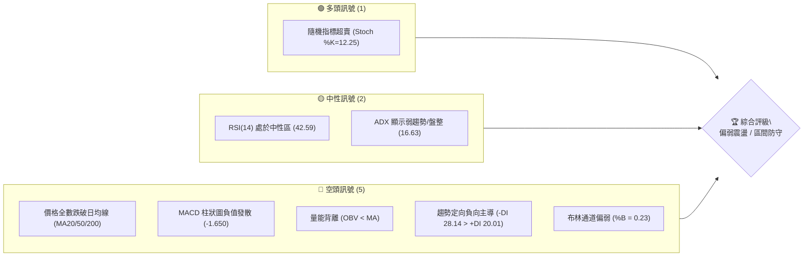

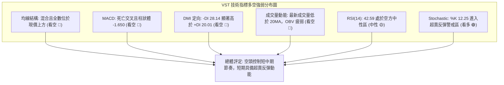

### 📊 核心指標速覽表

| 指標類別 | 指標名稱 | 當前數值 | 訊號 | 解讀 |
|----------|----------|----------|------|------|
| **價格** | 當前收盤價 | $140.16 | 🔴 | 位於 52 週區間 11.3% 位置，貼近年度底部運行 |
| **均線** | MA20 | $150.12 | 🔴 | 現價低於 MA20 達 -6.63%，短期下行壓力沉重 |
| **均線** | MA50 | $145.08 | 🔴 | 現價低於 MA50 達 -3.39%，中期支撐轉為強阻力 |
| **均線** | MA200 | $153.80 | 🔴 | 現價低於長期牛熊分界線 -8.87%，長期趨勢轉弱 |
| **動能** | RSI(14) | 42.59 | 🟡 | 位於 40–50 中性偏弱區間，無明顯背離跡象 |
| **動能** | MACD (12,26,9) | 0.605 / 2.255 | 🔴 | MACD 線跌破 Signal 線，柱狀圖 -1.650 加速向下 |
| **動能** | Stoch %K / %D | 12.25 / 26.98 | 🟢 | 進入極度超賣區間（<20），短線具備技術性修正動能 |
| **趨勢** | ADX (14) | 16.63 | 🟡 | ADX < 25 表明處於無趨勢或盤整震盪行情 |
| **趨勢** | 方向指標 (+DI / -DI) | 20.01 / 28.14 | 🔴 | -DI 大於 +DI，盤整偏下傾格局，空頭略佔主導 |
| **通道** | 布林帶 %B | 0.23 | 🔴 | 位於中軌 $150.12 與下軌 $131.67 間偏下軌區域 |
| **波動** | ATR(14) | $7.92 | 🟡 | 佔現價 5.65%，每日波動範圍約 $7.92，波動度中等 |
| **成交量** | 20日量比 | 0.85x | 🔴 | 最新量 6.73M 低於 20 日均量 7.88M，OBV 疲弱 |

### 🏆 技術評分卡

```
╔══════════════════════════════════════════════════════════════╗
║               技術評分卡 — VST (2026-10-24)                 ║
╠══════════════════════════════════════════════════════════════╣
║ 趨勢強度 (ADX=16.63, 弱勢震盪)  ██████░░░░░░░░░░░░░░  30/100 🔴 ║
║ 動能指標 (RSI=42.6, MACD柱轉負) ████████░░░░░░░░░░░░  40/100 🟡 ║
║ 支撐穩定度 (靠近S1 $137.71)    ██████████░░░░░░░░░░  50/100 🟡 ║
║ 成交量配合 (量縮, OBV < MA)    ██████░░░░░░░░░░░░░░  30/100 🔴 ║
║ 形態完整度 (區間築底中)        ████████░░░░░░░░░░░░  40/100 🟡 ║
║ 均線排列 (混合排列, 價格破線)  ████░░░░░░░░░░░░░░░░  20/100 🔴 ║
╠══════════════════════════════════════════════════════════════╣
║ 綜合評分 (六項算術平均四捨五入)  ███████░░░░░░░░░░░░░  35/100 🔴 ║
║ 評級結論: 偏空弱勢震盪 (主推逢高佈空或區間下軌高拋低吸防守)   ║
╚══════════════════════════════════════════════════════════════╝
```

---

## 2. 趨勢分析

### 🌐 多時框趨勢分析

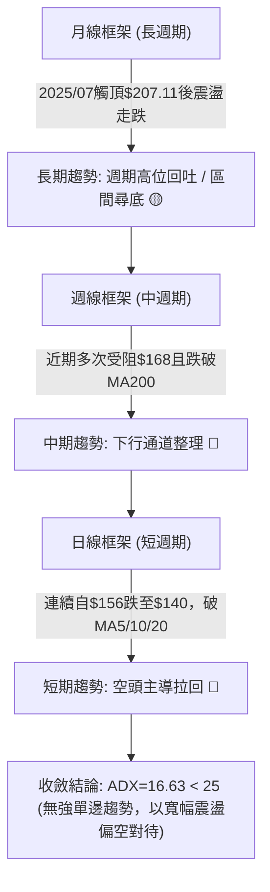

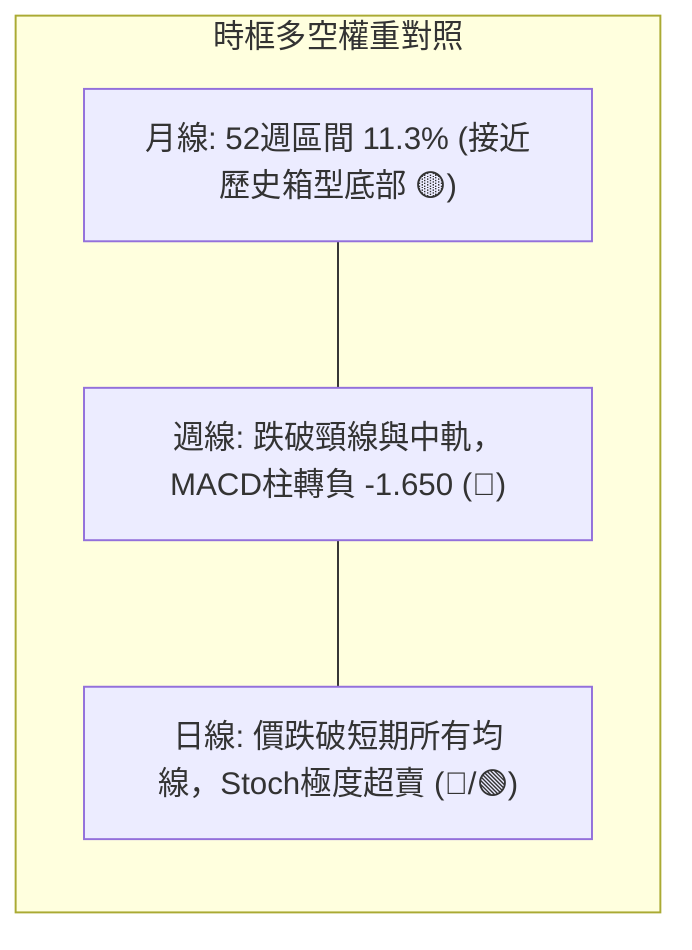

### 📈 長期趨勢 — 12個月走勢圖（Unicode）

```
VST 月線走勢圖（過去12個月：2025-11 至 2026-10）
價格軸 ($)
$180 ┤ ● (2025-11: 177.83)
$170 ┤             ● (2026-02: 173.13)
$160 ┤       ●(12月)     ●(01月)     ●(05月)
$150 ┤                                   ●(04月)   ●(06月)
$140 ┤                                                 ●(03月)   ●(07月)   ●(10月: 140.16)←現價
$130 ┤                                                                 ●(08月: 137.15)
     └─────────────────────────────────────────────────────────────────────────────
       11M   12M   01M   02M   03M   04M   05M   06M   07M   08M   09M   10M
```

#### 走勢特徵分析表格

| 週期階段 | 起訖月份 | 起點收盤 | 終點收盤 | 區間漲跌幅 | 主要走勢特徵 |
|----------|----------|----------|----------|------------|--------------|
| **高檔回撤期** | 2025-11 ~ 2026-01 | $177.83 | $157.65 | -11.35% | 自歷史峰值（2025-07 的 $207.11）回落後持續下探尋找平衡點 |
| **次高反彈期** | 2026-01 ~ 2026-02 | $157.65 | $173.13 | +9.82% | 季報前的波段性空頭回補，形成中長期次高點後迅速受阻回落 |
| **波段修正期** | 2026-02 ~ 2026-03 | $173.13 | $149.87 | -13.44% | 假突破後引發多頭踩踏，長陰線灌破 $160 整數心理關卡 |
| **箱型整理期** | 2026-03 ~ 2026-06 | $149.87 | $158.37 | +5.67% | 在 $150–$160 形成密集成交帶，長短期均線在此高度黏合收斂 |
| **二度破底期** | 2026-06 ~ 2026-08 | $158.37 | $137.15 | -13.40% | 跌破整理區間，最低測試 52 週低點聚類區（$132.26 附近） |
| **築底震盪期** | 2026-08 ~ 2026-10 | $137.15 | $140.16 | +2.19% | 於 $135–$145 區間反覆洗盤打底，目前價格仍壓制於 MA200 下方 |

### 📊 中期趨勢（週線分析）

```
週線等級關鍵架構示意圖（壓力與支撐帶）
────────────────────────────────────────────────────────────────
[壓力 R3]   $168.67  ══════════════════════ (2026-10-09 波段高點受阻區)
                       ↑
[壓力 R2]   $155.69  ────────────────────── (200日均線 $153.80 附近強阻力)
                       ↑
[壓力 R1]   $149.93  - - - - - - - - - - -  (MA20 / MA50 均線重疊帶)
                       ↑
[現  價]   $140.16  ◄── 目前位置 (週收盤跌破多條短期均線)
                       ↓
[支撐 S1]   $137.71  - - - - - - - - - - -  (近一年低點聚類 / 2026-08 收盤支撐)
                       ↓
[支撐 S2]   $133.84  ══════════════════════ (52週極限低點 $132.26 前哨站)
────────────────────────────────────────────────────────────────
```

在週線等級上，VST 呈現顯著的「寬幅箱型震盪築底」架構。2026-10-09 當週曾伴隨 59.37M 的天量向上脈衝至最高 $168.75（收盤 $161.48），然而隨後兩週（10-16、10-23）接連下挫，收盤連續走跌至 $152.02 及 $140.16，幾乎回吐所有爆量漲幅。週線 MACD 柱狀圖由正轉負（自 +2.715 驟降至 -1.650），週線 RSI 降至 42.6，暗示中期多頭突圍失敗，重回區間下軌尋求防守。

### ⚡ 趨勢強度評估（ADX 解讀）

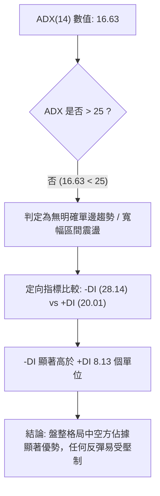

#### ADX 趨勢強度指標對照

| 數值區間 | 當前數值 | 趨勢強度等級 | 盤勢特徵解讀 | 適用交易策略 |
|----------|----------|--------------|--------------|--------------|
| **0 – 20** | **16.63** | **弱趨勢 / 盤整市場** | 價格缺乏單向持續性動能，均線容易反覆穿梭打結 | 布林帶上下軌高拋低吸，避免盲目追高殺跌 |
| 20 – 25 | — | 趨勢醞釀期 | 動能開始聚集，留意突破方向 | 縮小部位，觀望邊界突破 |
| 25 – 50 | — | 強趨勢市場 | 具備明顯波段推動力 | 順勢交易，均線回踩進場 |
| 50 – 100 | — | 極強 / 趨勢竭盡 | 趨勢過熱，注意隨時轉向 | 緊設移動止損，尋找背離反轉 |

---

## 3. 圖表形態分析

### 🔍 形態識別系統

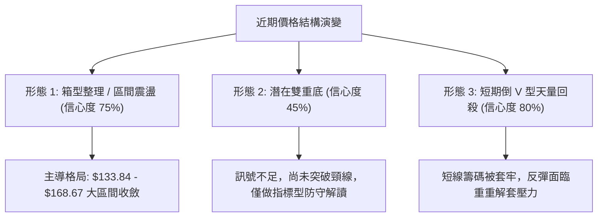

#### 圖表形態信心度評估表

| 形態名稱 | 信心度 | 判斷依據（引用數據） | 完成度 | 目標價（附計算式） |
|----------|--------|----------------------|--------|--------------------|
| **寬幅箱型整理** | **75%** | 價格在 S1 $137.71 / S2 $133.84 與 R3 $168.67 之間反覆來回超過 4 個月 | 80% | 箱頂突破目標價 = 頸線 $168.67 + 箱高($168.67 - $133.84 = $34.83) = **$203.50**（若向下跌破則反向推算為 $99.01） |
| **潛在雙重底** | **45%** | 2026-08 低點 $137.15 與近期低點 $136.17 接近，但未突破頸線 $168.67 | 30% | 訊號不足，僅做指標型解讀（頸線未過前不滿足雙底確認要件） |
| **倒 V 型天量回殺** | **80%** | 2026-10-09 爆 59.37M 天量衝高 $168.75 後連續兩週急速崩落至 $140.16 | 90% | 形態回吐目標已達起漲區間 S1 **$137.71**（由高點下跌形態高度回吐） |

### 🕯️ 重要K線形態分析

#### 近 10 根日 K 線形態解讀（依規則 19 嚴格列出開高低收）

| 日期（日K） | 開盤價 | 最高價 | 最低價 | 收盤價 | K線形態 | 解讀 | 訊號 |
|-------------|--------|--------|--------|--------|---------|------|------|
| **2026-10-12** | $162.67 | $164.25 | $156.85 | $158.13 | 中陰線 | 開高走低，自前週高點回吐，空方開始反撲 | 🔴 |
| **2026-10-13** | $153.51 | $163.63 | $153.51 | $162.36 | 長陽收斂線 | 低開高走，盤中反彈逾 $10，展現短線多頭抗跌抵抗力 | 🟢 |
| **2026-10-14** | $159.53 | $161.09 | $149.66 | $151.79 | 長陰吞噬 | 幾乎完全吞噬前一日漲幅，直接擊破 $150 整數防線 | 🔴 |
| **2026-10-15** | $148.35 | $154.46 | $145.85 | $154.17 | 下影陽線 | 探底 $145.85 後獲得支撐回升，低檔有初步承接盤 | 🟡 |
| **2026-10-16** | $152.55 | $155.16 | $151.15 | $152.02 | 窄幅陰十字星 | 上下影線對稱，多空在 MA200 附近陷入僵持與觀望 | 🟡 |
| **2026-10-19** | $154.10 | $155.33 | $145.85 | $149.70 | 長下影小陰線 | 盤中二度回測 $145.85，收盤跌破 $150 關卡 | 🔴 |
| **2026-10-20** | $148.90 | $151.34 | $147.10 | $150.32 | 縮量小陽線 | 成交量僅 3.34M，量能極度萎縮之超跌喘息線 | 🟡 |
| **2026-10-21** | $153.35 | $158.74 | $151.83 | $156.14 | 帶上影中陽線 | 衝高觸及 $158.74 但受制於 MA200，形成誘多假突破 | 🟡 |
| **2026-10-22** | $153.00 | $154.27 | $139.10 | $140.83 | 大爆量長黑K | 成交量暴增至 12.47M，重挫破位，帶出極度恐慌盤 | 🔴 |
| **2026-10-23** | $139.06 | $141.52 | $136.17 | $140.16 | 下影小陽十字星 | 探底 $136.17（逼近 S1 $137.71）後收回，空方動能減弱 | 🟢 |

#### 近 8 根週 K 線形態解讀（依規則 19 嚴格列出開高低收）

| 日期（週K） | 開盤價 | 最高價 | 最低價 | 收盤價 | K線形態 | 解讀 | 訊號 |
|-------------|--------|--------|--------|--------|---------|------|------|
| **2026-09-04** | $136.57 | $149.21 | $134.68 | $149.06 | 長陽大反彈 | 自底部強勁回抽，週線吞噬前兩週整理平台 | 🟢 |
| **2026-09-11** | $150.75 | $154.65 | $146.43 | $148.14 | 倒錘頭小陰線 | 向上試探 $154.65 失敗，高檔遭遇均線蓋頂阻力 | 🔴 |
| **2026-09-18** | $143.76 | $145.87 | $139.39 | $140.44 | 中陰線回落 | 回測 $140 整數心理防線，延續弱勢修正走勢 | 🔴 |
| **2026-09-25** | $142.00 | $142.64 | $135.98 | $138.46 | 破底陰線 | 下探 $135.98 創波段新低，空方持續掌控話語權 | 🔴 |
| **2026-10-02** | $138.08 | $143.51 | $133.44 | $140.02 | 長下影紡錘線 | 測試 52 週低點聚類區（低點 $133.44），長下影宣告支撐有效 | 🟢 |
| **2026-10-09** | $144.04 | $168.75 | $140.90 | $161.48 | 爆量長陽巨棒 | 伴隨 59.37M 超級天量向上突破，創數月波段高點 | 🟢 |
| **2026-10-16** | $162.67 | $164.25 | $145.85 | $152.02 | 高位吊頸大陰線 | 天量之後量能急縮，未能續創新高反而大幅回跌 | 🔴 |
| **2026-10-23** | $154.10 | $158.74 | $136.17 | $140.16 | 長黑破線大陰棒 | 吞噬前週所有支撐，直接跌回天量起漲點，空方極強 | 🔴 |

### 📉 ASCII 走勢形態示意圖

```
VST 日線短期「爆量衝頂後破位回踩」形態示意圖
────────────────────────────────────────────────────────────────
$168.75 ┤              ▲ (2026-10-09 天量假突破點，成交量 59.37M)
$160.00 ┤            ╱  ╲
$156.14 ┤           ╱    ╲      ▲ (2026-10-21 次高反彈點 $158.74 受阻)
$150.00 ┤──────────╱──────╲────╱─╲───────────────── (頸線阻力 R1: $149.93)
$145.00 ┤         ╱        ╲  ╱   ╲
$140.16 ┤        ╱          ╲╱     ● (2026-10-23 現價 $140.16 弱勢盤整)
$137.71 ┤───────╱───────────────────── (近期關鍵支撐 S1)
$136.17 ┤      ● (起漲低點)       ▼ (10-23 探底低點 $136.17 尋求支撐)
        └───────────────────────────────────────────────────────
           09月下旬    10月上旬   10月中旬   10月下旬
```

### 🎯 形態目標價計算

根據上述已識別且信心度最高的「倒 V 型天量回吐」與「大箱型區間整理」進行目標價推算：

1. **倒 V 型天量回殺回吐目標**：
   - 形態波段起點：2026-10-02 低點聚類區約 $138.08。
   - 形態頂點：2026-10-09 高點 $168.75。
   - 形態推算邏輯：天量突圍若在兩週內完全失守起漲帶，代表籌碼全面套牢，價格需向下回歸箱體底部尋求均勻買盤。
   - 形態第一目標：回測近一年波段低點聚類支撐 **S1 = $137.71**（已在 2026-10-23 低點 $136.17 處初步碰觸）。

2. **寬幅箱體突破延伸測幅（中長線參考）**：
   - 箱體頂部（頸線）：**R3 = $168.67**。
   - 箱體底部（支撐）：**S2 = $133.84**。
   - 箱體高度 $H = R3 - S2 = \$168.67 - \$133.84 = \$34.83$。
   - **向上突破理論目標** $= R3 + H = \$168.67 + \$34.83 = \mathbf{\$203.50}$（恰好貼合 52 週高點 $202.48）。
   - **向下跌破理論目標** $= S2 - H = \$133.84 - \$34.83 = \mathbf{\$99.01}$（此為極端破位劇本）。

---

## 4. 支撐與阻力

### 🗺️ 關鍵價位分布圖（Unicode）

```
╔══════════════════════════════════════════════════════════════╗
║                   VST 價位結構分布圖                         ║
╠══════════════════════════════════════════════════════════════╣
║ $168.67 ║████████████████████████║ 強阻力 R3 (波段天量頂部聚類) ║
║ $155.69 ║████████████████████    ║ 阻力 R2 (MA200密集反壓區)    ║
║ $149.93 ║████████████████████████║ 關鍵阻力 R1 (MA20/50均線重合) ║
║ $140.16 ╠════════════════════════╣ ◄ 當前收盤價 ($140.16)       ║
║ $137.71 ║▓▓▓▓▓▓▓▓▓▓▓▓▓▓▓▓        ║ 近期支撐 S1 (一年低點聚類)   ║
║ $133.84 ║████████████████████████║ 強支撐 S2 (年度底部極限防線) ║
╚══════════════════════════════════════════════════════════════╝
```

### 🚧 阻力位分析表

所有價位均直接嚴格引用自數據之「關鍵價位」與「均線系統」區塊：

| 阻力級別 | 價位 | 形成原因（嚴格引用數據） | 突破難度 | 重要性 |
|----------|------|--------------------------|----------|--------|
| **阻力 R1** | **$149.93** | 數據計算之近一年波段高點聚類位，且與 MA20 ($150.12)、MA50 ($145.08) 形成均線反壓密集帶 | 中等 🟡 | ★★★★☆ |
| **阻力 R2** | **$155.69** | 數據計算之第二波段阻力聚類，緊鄰 MA200 ($153.80) 及 MA240 ($156.27)，為牛熊分界天塹 | 極高 🔴 | ★★★★★ |
| **阻力 R3** | **$168.67** | 數據計算之第三波段高點聚類，與布林上軌 ($168.56) 及 10-09 週最高價 ($168.75) 重疊 | 堡壘級 🔴 | ★★★★★ |

### 🛡️ 支撐位分析表

所有價位均直接嚴格引用自數據之「關鍵價位」與「52週低點」區塊：

| 支撐級別 | 價位 | 形成原因（嚴格引用數據） | 守住機率 | 重要性 |
|----------|------|--------------------------|----------|--------|
| **支撐 S1** | **$137.71** | 數據計算之近一年波段低點第一聚類，距離現價僅 -1.75%，2026-08 收盤重疊區 | 65% 🟢 | ★★★★☆ |
| **支撐 S2** | **$133.84** | 數據計算之第二低點聚類，距離現價 -4.51%，緊鄰布林下軌 ($131.67) 與 52W 低點 | 80% 🟢 | ★★★★★ |
| **支撐 S3** | **N/A（數據未提供）** | 數據中未偵測到低於 S2 之波段低點聚類數據（僅提供至 S1 與 S2） | N/A | N/A |

### 📐 斐波那契回調位分析

依據提供數據中 52 週區間（低點 $132.26 → 高點 $202.48）計算所得之回調位，標明現價落點：

```
斐波那契回調位與現價位置階梯圖：
0.0%  (52W High)  $202.48 ─── 極端歷史峰值
23.6%             $185.91 ─── 弱回撤區
38.2%             $175.66 ─── 強勢回調防守線
50.0%             $167.37 ─── 多空平衡中軸 (緊鄰阻力 R3: $168.67)
61.8%             $159.08 ─── 黃金分割生命線
78.6%             $147.29 ─── 深幅回撤警戒線 (阻力 R1 $149.93 之下)
                   ▲
[現 價]           $140.16 ◄── 落於 78.6% ($147.29) 與 100.0% ($132.26) 之間
                   ▼
100.0% (52W Low)  $132.26 ─── 52週絕對底部 (強支撐 S2: $133.84 之下)
```

**回調位深度解讀**：
當前收盤價 $140.16 已經實質跌破斐波那契 78.6% 回調位（$147.29），這意味著自 $132.26 至 $202.48 的整輪多頭漲勢已經回吐了將近九成。在技術分析架構中，跌破 78.6% 代表多頭趨勢結構遭到嚴重破壞，市場進入極深度的二次築底或盤整尋底階段。當前下方僅存的最後防線即為 100.0% 回調位 **$132.26**（配合 S2 的 $133.84），若此區域再度失守，將打開下行空間；若能在該區域獲得買盤承接，則有機會構築中長期的寬幅大底。

---

## 5. 技術指標深度解讀

### 🎛️ 指標訊號總覽

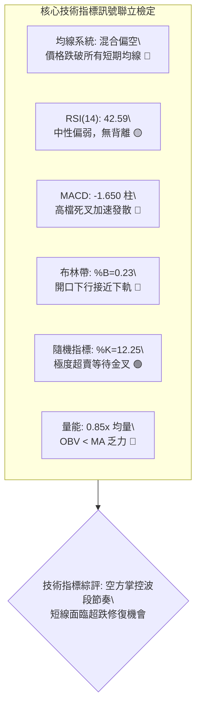

### 📈 移動平均線排列分析

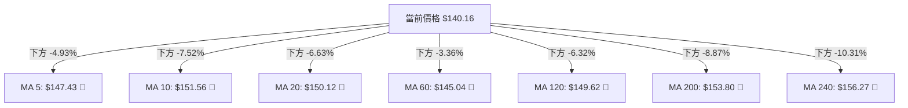

#### 均線體系狀態表

| 均線名稱 | 當前價位 | 現價相對距離 | 斜率/走勢特徵 | 訊號解讀 |
|----------|----------|--------------|----------------|----------|
| **MA 5** | $147.43 | -4.93% | 急速向下彎頭（▼） | 短線超跌，乖離率擴大 |
| **MA 10** | $151.56 | -7.52% | 下穿多條均線（▼） | 短期空頭排列加速點 |
| **MA 20** | $150.12 | -6.63% | 下彎（▼） | 布林中軌，短線第一道反壓 |
| **MA 60** | $145.04 | -3.36% | 平緩下行（▼） | 季線阻力，壓制反彈空間 |
| **MA 120** | $149.62 | -6.32% | 下行（▼） | 半年線下彎，中期趨勢受阻 |
| **MA 200** | $153.80 | -8.87% | 下行（▼） | 牛熊分界線失守，長期走勢轉弱 |
| **MA 240** | $156.27 | -10.31% | 走平微跌（▼） | 年線反壓沉重 |

當前均線系統定義為「**混合排列**」。長天期均線（MA120、MA200、MA240）集中於 $149–$156 區間，形成沉重而密集的「均線死結壓力帶」。現價 $140.16 位於所有均線下方，屬於典型的空頭壓制格局。

### 📉 RSI(14) 分析

```
RSI(14) 當前數值: 42.59 (Wilder 平滑計算)
[0] ────────── [30] ─────────────── [70] ────────── [100]
                ▲         ▲
              超賣區    42.59(中性偏弱)   超買區
進度條: ████████░░░░░░░░░░░░  42.59%
```

- **區間評估**：RSI(14) 讀數為 42.59，位於 30 至 70 之間的中性偏弱區域。尚未觸及 30 之極端超賣區，表示下行賣壓雖強，但尚未引發全面性的恐慌拋售盤。
- **背離檢驗結論**：根據近 20 根 K 棒的首尾對比，價格由 $158 附近下挫至 $140.16，RSI 同步自 64.5 回落至 42.6，兩者趨勢方向完全吻合，**明確無頂背離亦無底背離**現象。這證實近期的拉回屬於技術面的合理釋放，而非動能背離引發的趨勢衰竭。

### 📊 MACD(12/26/9) 訊號解讀

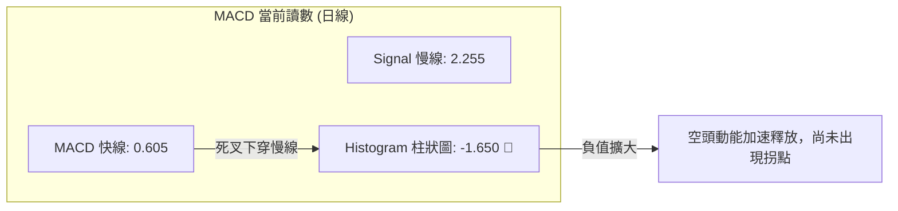

日線 MACD 快線（0.605）已實質跌破訊號線（2.255），且 MACD 柱狀體擴大至 **-1.650**。週線 MACD 柱狀圖亦由前期的 +2.715 與 +0.499 驟降至 **-1.650**。日線與週線的 MACD 柱狀圖同步翻黑擴大，顯示中短期動能正在劇烈釋放，空方動能強勁，目前尚未看見底背離或柱狀體收斂跡象，暗示築底過程仍需時間震盪消化。

### 📦 布林通道分析

```
VST 日線布林通道 (20, 2) 結構圖
────────────────────────────────────────────────────────────────
$168.56 ┬ 上軌 ═════════════════════════════════════════════════
        │
$150.12 ┼ 中軌(MA20) ───────────────────────────────────────────
        │
$140.16 ┼ 現價 ◄── %B = 0.23 (運行於中軌與下軌間之弱勢帶)
        │
$131.67 ┴ 下軌 ═════════════════════════════════════════════════
────────────────────────────────────────────────────────────────
通道帶寬: $168.56 - $131.67 = $36.89 (帶寬開展，波動度上升)
```

當前布林通道 %B 數值為 **0.23**，顯示價格已經高度貼近布林帶下軌（$131.67）。通道帶寬呈現擴張態勢，屬於下行發散格局。然而，只要現價未跌破下軌且 %B 未跌至負值，通常意味著價格在下軌附近具有均值回歸的防守引力。

### 💹 成交量分析（量價配合度）

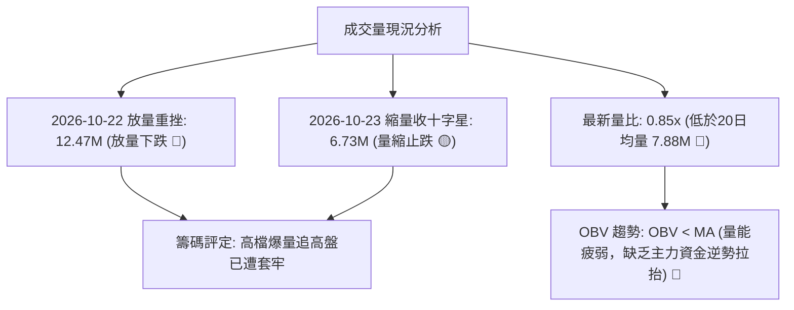

成交量呈現典型「漲勢縮量、跌勢爆量、低檔量縮」的弱勢特徵。2026-10-09 天量 59.37M 創下近期最高點後，拉回過程中成交量並未良性退潮，而在 10-22 出現 12.47M 的長陰放量下殺，反映出持股信心的崩解。目前 OBV 指標運行於其移動平均線下方，證實主力資金尚未在此位置展開大規模吸籌，仍屬弱勢量能結構。

---

## 6. 動能與波動率

### ⚡ 動能評估四象限

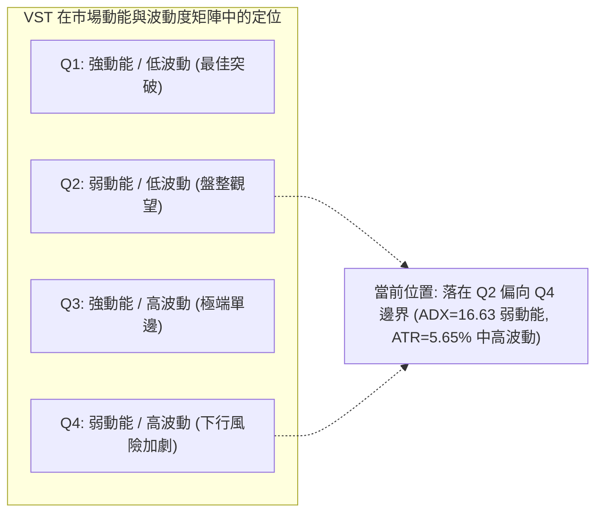

#### 動能四象限狀態表

| 象限代號 | 動能狀態 | 波動率狀態 | 當前符合度 | 戰略特徵與應對方針 |
|----------|----------|------------|------------|--------------------|
| **Q1** | 強 | 低 | ✕ | 最佳趨勢機會，可加碼順勢持股 |
| **Q2** | **弱** | **低至中** | **✓ (主要)** | **ADX=16.63 呈現盤整格局，缺乏單向突破動能，建議謹慎觀望，多看少動** |
| **Q3** | 強 | 高 | ✕ | 高風險高收益，適合追隨單邊大行情 |
| **Q4** | **弱 (下行)** | **高** | **✓ (次要)** | **短線快速下殺帶來波動率驟升，空方衝擊力大，嚴禁盲目重倉抄底** |

### 📊 ATR 波動率分析

- **ATR(14) 讀數**：**$7.92**（Wilder 平滑計算）。
- **ATR 佔比**：約佔當前股價 $140.16 的 **5.65%**。
- **日間波動預期**：在一個標準交易日內，VST 的典型真實波動幅度約為 $7.92 美元。
- **止損與風控建議**：
  - 超短線或當沖交易者應以至少 $1.0 \times \text{ATR}$（約 **$7.92**）作為最小容錯距離。
  - 波段操作者建議採取 $1.5 \times \text{ATR}$（約 **$11.88**）作為合理止損空間，以避免在寬幅震盪市場中被常態雜訊掃出場。

### 📐 Beta 與市場相關性

- **Beta 係數**：**1.384**。
- **市場屬性解析**：VST 雖歸屬於公用事業板塊（Utilities），但其 Beta 高達 1.384，顯示其波動彈性顯著高於標普 500 指數（S&P 500）。這與其獨立發電商（IPP）業務、零售電力市場曝險以及近期 AI 資料中心電力需求概念股的高彈性交易特徵高度吻合。
- **系統性風險權衡**：當整體大盤（美股指數）出現回檔修正時，VST 往往會承受放大 1.38 倍的下行波動；反之，若公用事業板塊或能源概念股迎來資金回流，其反彈動能亦將具備較高槓桿放大效應。

---

## 7. 多時框架總結

### 📋 時框架評分表

| 時框架 | 趨勢方向 | 動能 (RSI/MACD) | 均線排列 | 形態結構 | 綜合評分 | 建議方針 |
|--------|----------|-----------------|----------|----------|----------|----------|
| **月線 (長期)** | 震盪偏中性 🟡 | RSI 偏弱，自高點回吐 🟡 | 跌破 52W 中軸，但高於歷史極值 🟡 | 歷史大箱型震盪 🟡 | **50/100** | 長期投資者等待底部確認 |
| **週線 (中期)** | 偏空 🔴 | MACD 柱翻黑 (-1.650) 🔴 | 跌破多條短期均線 🔴 | 倒 V 回吐，天量後修正 🔴 | **30/100** | 減碼觀望，嚴格控制部位 |
| **日線 (短期)** | 空頭壓制 🔴 | RSI=42.6，Stoch 超賣 🟢 | 均線全數在上方形成反壓 🔴 | 探底尋求 S1 支撐 🟡 | **35/100** | 不盲目追空，等待超賣反彈 |

### 🔲 綜合訊號矩陣

```
╔══════════════════════════════════════════════════════════════╗
║                   VST 多維度訊號矩陣                         ║
╠══════════════════════════════════════════════════════════════╣
║ 訊號維度     │ 短期 (日線)  │ 中期 (週線)  │ 長期 (月線)  ║
╠══════════════════════════════════════════════════════════════╣
║ 趨勢方向     │ 🔴 空頭壓制  │ 🔴 下行回吐  │ 🟡 寬幅箱型  ║
║ 動能強弱     │ 🟢 極度超賣  │ 🔴 動能發散  │ 🟡 動能趨緩  ║
║ 均線位置     │ 🔴 全線破位  │ 🔴 跌破均線  │ 🟡 混合糾結  ║
║ 量價配合     │ 🔴 跌放量漲縮│ 🔴 天量退潮  │ 🟡 常態量能  ║
║ 波動狀態     │ 🟡 帶寬擴張  │ 🟡 震盪加劇  │ 🟢 歷史均值  ║
╚══════════════════════════════════════════════════════════════╝
```

### ⚖️ 多時框收斂結論

依據多時框收斂規則（規則 14）：
1. **行情屬性判定**：當前 ADX(14) 讀數為 **16.63 (< 25)**，嚴格判定當前市場處於**無趨勢的寬幅盤整震盪行情**，而非單邊趨勢行情。
2. **主導時框與依據**：在盤整行情中，依規則應以**日線布林通道上下軌（$131.67 – $168.56）作為主要交易區間**。
3. **時框衝突取捨**：雖然日線隨機指標（Stoch %K=12.25）進入深度超賣區、具備強烈的反彈修復衝動，但週線 MACD 柱狀體加速向下發散（-1.650），且日線均線全數壓制於上方，因此反彈空間將受到中短期密集阻力（MA20 $150.12 與 R1 $149.93）的強大壓制。
4. **唯一方向性結論**：收斂判定為「**中性偏空觀望（弱勢區間震盪）**」。第 8 章交易策略必須依此結論，主推**空頭策略（或逢反彈佈空）**，並將多頭反彈嚴格限制為「依託支撐 S1/S2 的極短線區間防守對沖」。

---

## 8. 交易策略建議

### 🗺️ 策略決策流程圖

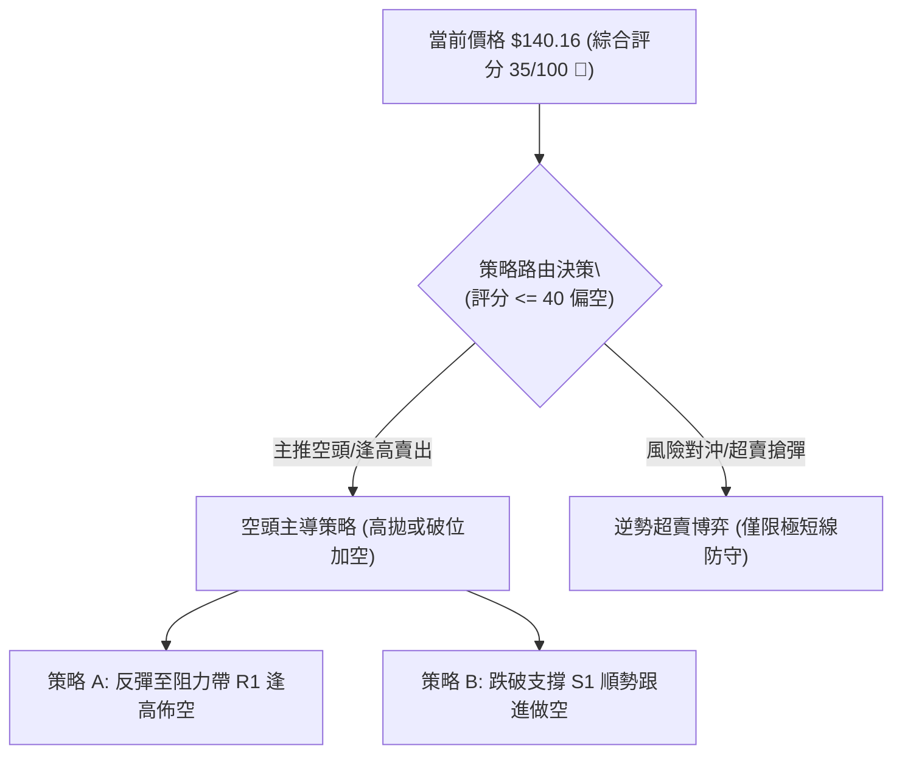

### 🧭 策略路由（依評分卡分流）

> **當前主策略方向 = 主推空頭／反彈逢高佈空策略（依評分卡綜合評分 35/100）**

依據規則 18，綜合評分低於 40 分（當前為 35 分），技術面處於空方壓制架構。主推策略為空頭交易策略；多頭操作僅列為極低倉位之反向風險提示與超賣對沖。

### 🎯 價格情境階梯（Price Scenarios）

所有價位均嚴格引用第 4 章及數據中的計算點位：

| 觸發條件 | 下一目標 | 後續延伸 | 情境含義 |
|----------|----------|----------|----------|
| **強勢突破 R1 $149.93** | 測試 R2 **$155.69** | 上探 R3 **$168.67** | 短線轉強，突破均線死結，空單必須全面離場觀望 |
| **站穩現價 $140.16 區間** | 向上測試 R1 **$149.93** | 向下回測 S1 **$137.71** | 在布林帶下半部進行低檔弱勢橫盤築底 |
| **跌破支撐 S1 $137.71** | 測試 S2 **$133.84** | 測試 52W 低點 **$132.26** | 中期走勢進一步破位惡化，空頭發動新一輪尋底衝擊 |

### 📊 情境機率分佈

| 情境劃分 | 發生機率 | 主要判定依據（引用指標狀態） |
|----------|----------|------------------------------|
| **弱勢回落 / 再探低點** | **55%** | MACD 柱狀體 -1.650 加速向下發散；-DI (28.14) 遠高於 +DI (20.01)；OBV 量能持續疲弱 |
| **區間震盪 / 築底橫盤** | **35%** | ADX 僅 16.63 顯示缺乏單邊趨勢；隨機指標 %K=12.25 極度超賣，限制短線連續暴跌空間 |
| **反轉向上 / 強力突破** | **10%** | 上方有 MA20/50/200 形成三重重壓，在無巨量配合下難以一口氣突破 R1 $149.93 |

### 🟢 主策略詳情（方向依上方路由：空頭策略）

*註：做空之風險報酬比計算式嚴格遵守規則 17：*
$$\text{風險報酬比} = \frac{\text{進場價} - \text{目標價 T1}}{\text{止損價} - \text{進場價}}$$

| 策略要素 | 策略 A（反彈逢高佈空） | 策略 B（破位順勢追空） |
|----------|------------------------|------------------------|
| **進場條件** | 股價受超賣帶動反彈，觸及 R1 阻力位遇阻回落時進場 | 股價實質跌破關鍵支撐 S1，日K收盤確認跌破時順勢跟進 |
| **進場價格** | **$149.93**（精確引用阻力 R1） | **$137.71**（精確引用支撐 S1） |
| **目標價 T1** | **$140.16**（回測當前收盤價位） | **$133.84**（精確引用強支撐 S2） |
| **目標價 T2** | **$133.84**（下探強支撐 S2） | **$132.26**（測試 52 週最低點） |
| **止損價格** | **$155.69**（精確引用阻力 R2，突破則停損） | **$140.16**（假跌破回抽收復現價時止損） |
| **風險報酬比** | **1 : 1.70（以 T1 計）**<br>*(計算: (149.93-140.16)/(155.69-149.93) = 9.77/5.76)*<br>*(以 T2 計則為 1 : 2.80)* | **1 : 1.58（以 T1 計）**<br>*(計算: (137.71-133.84)/(140.16-137.71) = 3.87/2.45)*<br>*(以 T2 計則為 1 : 2.22)* |
| **成功機率** | **60%** | **55%** |
| **建議倉位** | **15%** | **10%** |

### 🔴 反向風險觸發點（對沖提示）

若出現以下情境，主推之空頭策略將被正式推翻，投資人應立即執行空單止損或轉為多頭防守：
1. **關鍵價位逆轉**：若日K線以放量長陽收盤實質**站上 R1 $149.93**，且連續兩日穩於 MA20（$150.12）之上，空頭波段優勢即告瓦解。
2. **動能指標異動**：日線 MACD 柱狀體由負翻正，或隨機指標在超賣區形成向上黃金交叉並突破 30，代表技術性修復展開，空方應迅速離場觀望。

### ⭐ 整體訊號強度評星

```
做多訊號強度：★★☆☆☆  (2/5星 - 僅依託超賣與低位支撐，勝率有限)
做空訊號強度：★★★★☆  (4/5星 - 均線全數破位，中短期動能向下)
整體可信度：  ★★★☆☆  (3/5星 - ADX<25 顯示無趨勢，震盪雜訊較多)
```

---

## 9. 風險提示與監控

### ✅ 關鍵監控指標 Checklist

```
╔══════════════════════════════════════════════════════════════╗
║                VST 日常技術風控監控清單                      ║
╠══════════════════════════════════════════════════════════════╣
║ [ ] 價格防線: S1 $137.71 是否失守 (盤中跌破需提高警戒)        ║
║ [ ] 價格防線: S2 $133.84 極限防線 (跌破意味著年度破底)        ║
║ [ ] 阻力壓制: 現價反彈至 R1 $149.93 時的量價表現 (是否縮量)  ║
║ [ ] 動能拐點: Stoch %K 是否自 12.25 向上突破 20 形成黃金交叉  ║
║ [ ] 動能惡化: MACD 柱狀體 (-1.650) 是否繼續擴大負值           ║
║ [ ] 量能突變: 成交量是否超過 20日均量 (7.88M) 的 1.5 倍       ║
║ [ ] 波動警戒: 日內震盪是否突破 ATR $7.92 的正常波動邊界       ║
╚══════════════════════════════════════════════════════════════╝
```

### ⚠️ 風險場景分析

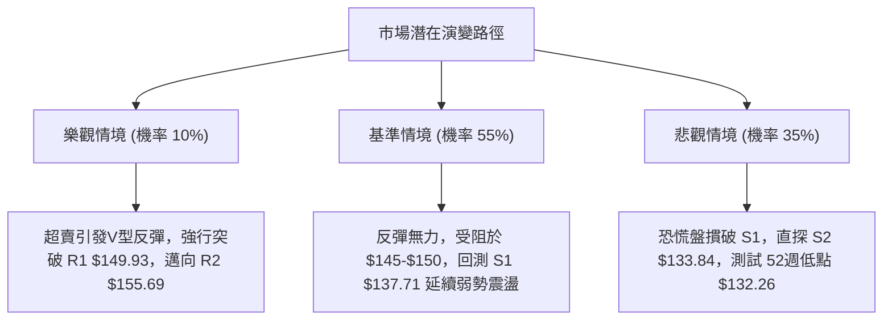

### 🛡️ 風險管理重要提醒

1. **基本面與技術面背離風險**：
   - 儘管華爾街 22 位分析師給予一致的「強烈買入（Strong Buy）」評級，平均目標價高達 **$208.86**，但技術圖表呈現出明確的均線壓制與空頭動能發散。身為嚴謹的技術交易者，切忌僅因分析師高目標價而忽視盤面破位事實。
2. **公用事業高 Beta 與槓桿特性**：
   - VST 的 Beta 值高達 **1.384**，且資產負債表顯示總債務達 $20.51B（Debt/Equity 為 373.28）。在高利率或大盤劇烈波動環境下，其股價波動極度劇烈，絕非傳統防禦性公用事業股票。
3. **倉位管理與資金曝險紀律**：
   - 由於目前 ADX(14) 僅 16.63，屬於無明確單邊趨勢的震盪市，任何單一策略的倉位配置**不得超過總投資組合的 15%**。
   - 所有交易必須嚴格執行預設之止損價位，嚴禁因虧損而盲目向下攤平。

---

## 📋 報告總結

```
╔══════════════════════════════════════════════════════════════╗
║                   VST 技術分析報告總結                       ║
╠══════════════════════════════════════════════════════════════╣
║ 報告日期：2026-10-24                                         ║
║ 當前價格：$140.16                                            ║
║ 分析評級：⚖️ 偏弱弱勢震盪 / 逢高佈空防守 (評分: 35/100 🔴)     ║
║                                                              ║
║ 關鍵結論：                                                   ║
║ ├─ 長期趨勢：🟡 寬幅箱型整理 (運行於 52週區間 11.3% 低檔帶)    ║
║ ├─ 中期趨勢：🔴 天量突圍後倒 V 型回吐，週線 MACD 柱翻黑      ║
║ ├─ 短期趨勢：🔴 跌破所有短期均線，受阻於均線死結密集帶       ║
║ ├─ 關鍵支撐：S1: $137.71  ｜  S2: $133.84                    ║
║ ├─ 關鍵阻力：R1: $149.93  ｜  R2: $155.69  ｜  R3: $168.67   ║
║ └─ 分析師目標：$208.86 (基本面共識與當前技術盤面背離)        ║
║                                                              ║
║ 最優策略組合：                                               ║
║ 1. 🥇 最佳機會：反彈至阻力 R1 $149.93 逢高佈空，止損設於 R2 ║
║ 2. 🥈 次選機會：實質跌破支撐 S1 $137.71 順勢追空，下看 S2    ║
║ 3. 🥉 保守選擇：空倉觀望，等待日線突破布林通道中軌或打底成型 ║
╚══════════════════════════════════════════════════════════════╝
```

---

> ⚠️ **免責聲明**：本報告為技術分析研究，所有數據、圖表及估算均基於歷史價格與客觀技術指標資訊。本報告**僅供研究與學術參考**，**不構成任何形式的投資建議、買賣要約或獲利保證**。市場有風險，交易需依個人風險承受能力獨立判斷並自負盈虧。

---

*報告生成時間：2026-10-24 ｜ 數據來源：Yahoo Finance ｜ 分析框架：多時框量化技術分析*