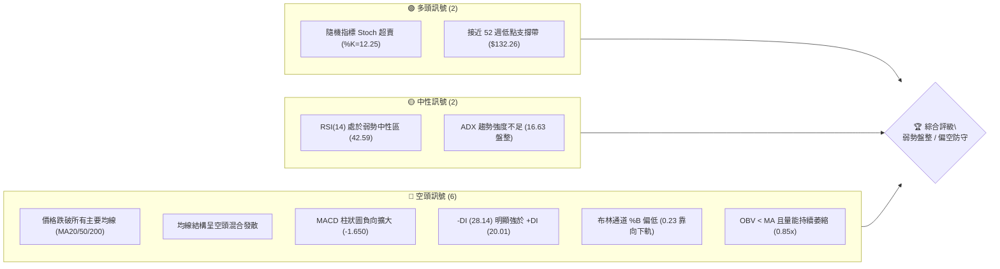
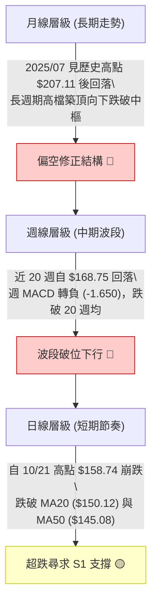
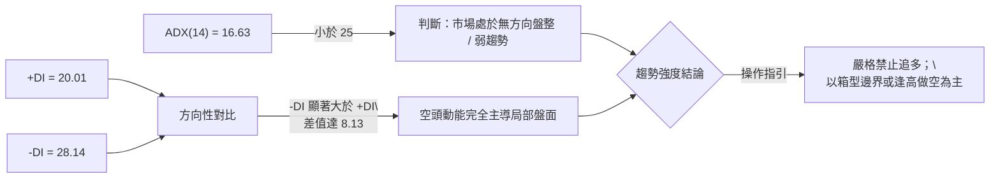
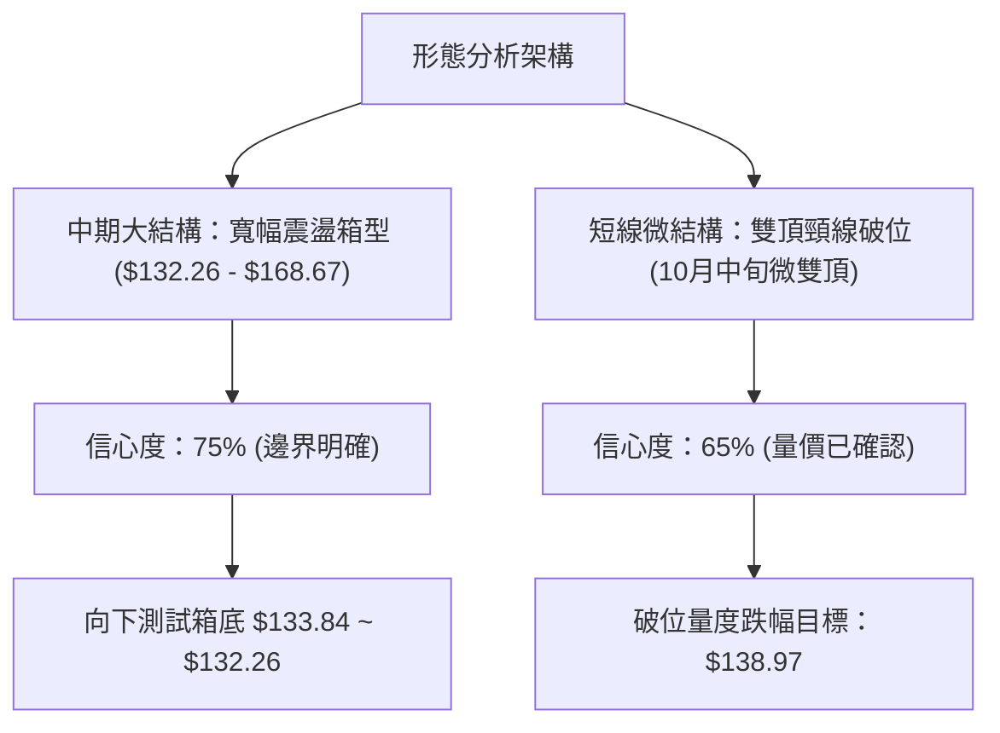
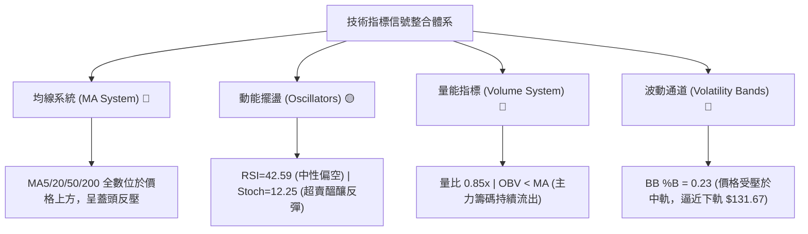
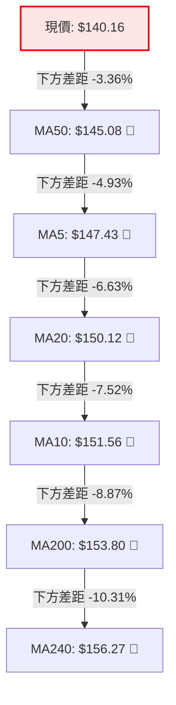
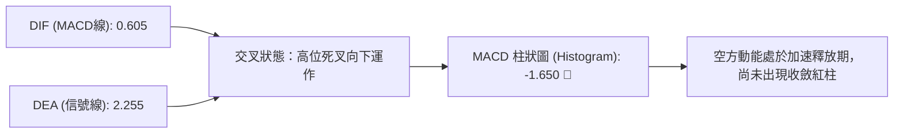
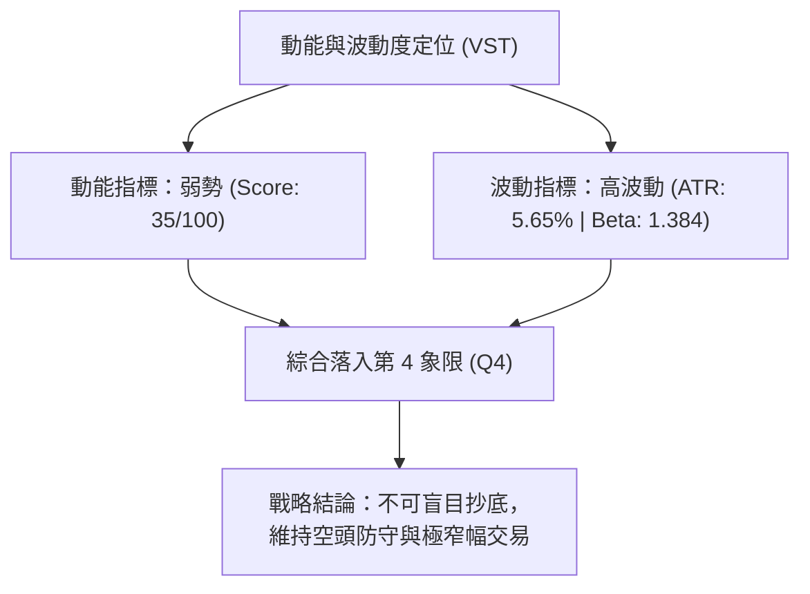
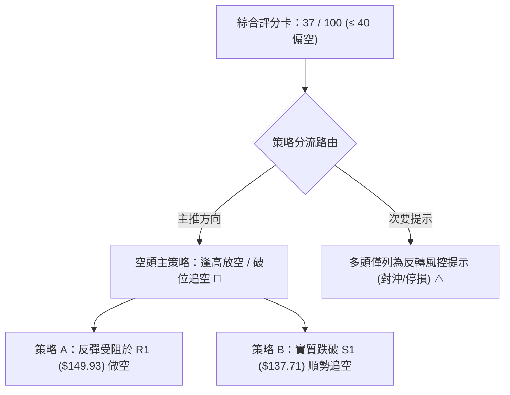
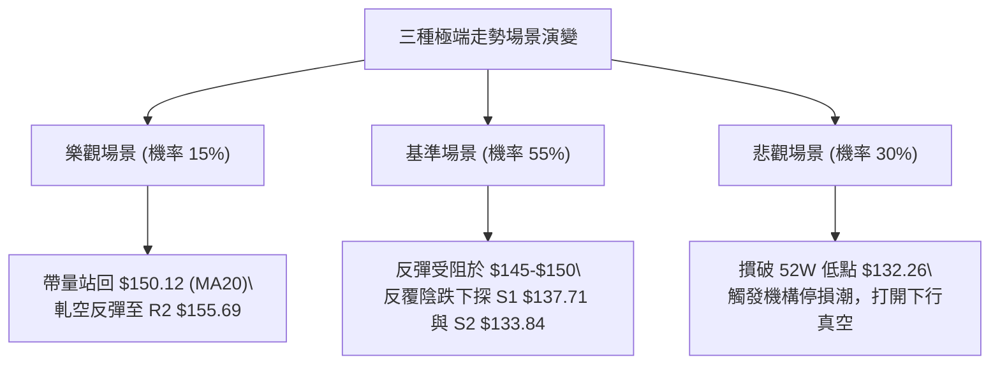

# VST 技術分析報告

> **報告日期**：2026-10-25 ｜ **語言**：繁體中文 ｜ **數據來源**：Yahoo Finance ｜ **當前價格**：$140.16

---

## 目錄

| 章節 | 內容 |
|------|------|
| [1. 技術面概覽](#1-技術面概覽) | 訊號儀表板、核心指標、評分卡 |
| [2. 趨勢分析](#2-趨勢分析) | 多時框趨勢、長中短期走勢、ADX 解讀 |
| [3. 圖表形態分析](#3-圖表形態分析) | 形態識別、K線組合、目標價計算 |
| [4. 支撐與阻力](#4-支撐與阻力) | 關鍵價位、斐波那契回調結構 |
| [5. 技術指標深度解讀](#5-技術指標深度解讀) | MA/RSI/MACD/布林/量能結構 |
| [6. 動能與波動率](#6-動能與波動率) | 動能矩陣、ATR 波動度、Beta 敏感度 |
| [7. 多時框架總結](#7-多時框架總結) | 時框架評分矩陣與多時框收斂 |
| [8. 交易策略建議](#8-交易策略建議) | 策略路由、階梯情境、風報比計算 |
| [9. 風險提示與監控](#9-風險提示與監控) | 監控指標 Checklist、場景分析與風控 |

---

## 1. 技術面概覽

### 🎯 技術訊號儀表板



### 📊 核心指標速覽表

| 指標類別 | 指標名稱 | 當前數值 | 訊號 | 解讀 |
| :--- | :--- | :--- | :---: | :--- |
| **價格** | 當前收盤價 | $140.16 | 🔴 | 位於 52 週區間 11.3% 低位，距離年內低點僅一步之遙 |
| **均線** | MA20 (短月線) | $150.12 | 🔴 | 現價大幅落後 6.63%，短線處於均線下方反壓區 |
| **均線** | MA50 (中期線) | $145.08 | 🔴 | 現價落後 3.36%，中期生命線失守，反彈面臨重壓 |
| **均線** | MA200 (長期線)| $153.80 | 🔴 | 現價落後 8.87%，長期牛熊分界線失守，多頭結構受損 |
| **動能** | RSI(14) | 42.59 | 🟡 | 位於中性偏弱區（30–50），尚未進入極端超賣區 |
| **動能** | MACD (12,26,9)| DIF: 0.605 / DEA: 2.255 | 🔴 | 雙線高檔死叉向下，Hist: -1.650 空頭動能持續釋放 |
| **動能** | Stoch %K/%D | 12.25 / 26.98 | 🟢 | 進入極度超賣區（<20），短線具備技術性跌深反彈動能 |
| **趨勢** | ADX(14) | 16.63 (-DI: 28.14) | 🔴 | ADX < 25 為盤整格局，但空頭主導力道顯著高於多頭 |
| **通道** | 布林通道 %B | 0.23 (下軌 $131.67) | 🔴 | 價格貼近下軌運作，通道開口微擴，下行壓力未消 |
| **成交量**| OBV 與量比 | 量比 0.85x (OBV < MA) | 🔴 | 20日均量 7.88M，現量 6.73M，量價配合不足且量能疲弱 |
| **波動** | ATR(14) | $7.92 (5.65%) | 🟡 | 日內平均波動度達 5.65%，操作需預留足夠止損緩衝 |

### 🏆 技術評分卡

```
╔══════════════════════════════════════════════════════════════════════════════╗
║                          技術評分卡 — VST (2026-10-25)                        ║
╠══════════════════════════════════════════════════════════════════════════════╣
║ 評估維度         進度條與強度得分                   權重分值    訊號強度     ║
╠══════════════════════════════════════════════════════════════════════════════╣
║ 趨勢強度         ██████░░░░░░░░░░░░░░  30/100         30       🔴 顯著偏空   ║
║ 動能指標         ███████░░░░░░░░░░░░░  35/100         35       🔴 弱勢鈍化   ║
║ 支撐穩定度       ███████████░░░░░░░░░  55/100         55       🟡 考驗低位   ║
║ 成交量配合       ███████░░░░░░░░░░░░░  35/100         35       🔴 量能渙散   ║
║ 形態完整度       ████████░░░░░░░░░░░░  40/100         40       🟡 區間下尋   ║
║ 均線排列         █████░░░░░░░░░░░░░░░  25/100         25       🔴 全面承壓   ║
╠══════════════════════════════════════════════════════════════════════════════╣
║ 綜合評分         ███████░░░░░░░░░░░░░  37/100         37       🔴 偏空震盪   ║
║ 評級結論         (30 + 35 + 55 + 35 + 40 + 25) / 6 = 36.67 ≈ 37 (弱勢防守)   ║
╚══════════════════════════════════════════════════════════════════════════════╝
```

---

## 2. 趨勢分析

### 🌐 多時框趨勢分析



### 📈 長期趨勢 — 12個月走勢圖（Unicode）

```
VST 月線走勢圖（過去12個月：2025-11 至 2026-10）
價格軸 ($)
$200 ┤
$190 ┤
$180 ┤ ● (11月: 177.83)
$170 ┤                 ● (2月: 173.13)
$160 ┤       ● (12月: 160.62)    ● (4月: 157.36)  ● (5月: 159.74)  ● (6月: 158.37)
$150 ┤             ● (1月: 157.65)     ● (3月: 149.87)  ● (7月: 147.95)
$140 ┤                                                         ● (10月: 140.16) ◄ 現價
$130 ┤                                                               ● (8月: 137.15)  ● (9月: 138.35)
     └─┬─────┬─────┬─────┬─────┬─────┬─────┬─────┬─────┬─────┬─────┬─────┬───
      11月  12月  01月  02月  03月  04月  05月  06月  07月  08月  09月  10月
```

#### 過去 12 個月走勢特徵分析表

| 階段月份 | 區間收盤價 | 漲跌幅 (%) | 形態走勢特徵 | 量價結構與技術含義 |
| :--- | :--- | :---: | :--- | :--- |
| **2025-11 ~ 2025-12** | $177.83 → $160.62 | -9.68% | 高檔震盪破位 | 自 2025 年 7 月歷史極值 $207.11 展開之主跌段延伸 |
| **2026-01 ~ 2026-02** | $157.65 → $173.13 | +9.82% | 跌深反彈波段 | 於 $157 構築小雙底，回抽確認上方頸線壓力失敗 |
| **2026-03 ~ 2026-06** | $149.87 → $158.37 | +5.67% | 弱勢橫盤中繼 | 長達 4 個月在 $150–$160 窄幅整理，籌碼嚴重沈澱 |
| **2026-07 ~ 2026-08** | $147.95 → $137.15 | -7.30% | 破位尋底階段 | 跌破整理平台，並於 8 月下探波段低位 $135.99 |
| **2026-09 ~ 2026-10** | $138.35 → $140.16 | +1.31% | 底部鈍化震盪 | 10月上旬一度衝高至 $168.75，但下旬迅速吐回所有漲幅 |

### 📊 中期趨勢（週線分析）

中期走勢呈現「高點持續降低（Lower Highs）」與「低點反覆測試（Testing Lows）」的典型弱勢箱型演變。在 2026-10-09 當週，VST 在市場消息激勵下衝高至 $168.75，週成交量暴增至 59,368,900 股，然而隨後兩週迅速量縮重挫至 $140.16，顯示上方套牢賣壓極其沉重，該衝高已被確立為「假突破」與多頭陷阱（Bull Trap）。

```
中期週線價格通道示意圖：
$170 ┤           ▲ 假突破高點 ($168.75, 10/09週)
$160 ┤          / \
$150 ┤         /   ▼ 快速回落破位 ($152.02, 10/16週)
$140 ┤───────────────▼ 現價 ($140.16, 10/23週)
$130 ┤═══════════════════════════════ S2 強支撐帶 ($133.84 ~ $132.26)
```

### ⚡ 趨勢強度評估（ADX 解讀）



#### ADX 趨勢強度對照解讀

| 指標參數 | 實際數值 | 臨界門檻 | 狀態歸類 | 市場結構解讀 |
| :--- | :---: | :---: | :---: | :--- |
| **ADX (14)** | **16.63** | < 25.0 | 無趨勢 / 盤整 | 股價無單邊持續推升動能，波段行情容易反覆洗盤 |
| **+DI (14)** | **20.01** | — | 多方力量衰竭 | 買盤缺乏推動價格創高的意願，多頭抵抗疲軟 |
| **-DI (14)** | **28.14** | > 25.0 | 空方壓制明顯 | 賣盤穩固主導短線方向，任何反彈均面臨主動性拋售 |
| **DI 差值** | **-8.13** | — | 空頭發散中 | 負向擴大趨勢，暗示價格仍有向下方支撐尋求測試之慣性 |

---

## 3. 圖表形態分析

### 🔍 形態識別系統



#### 形態識別與信心度評估表

| 識別形態 | 信心度 (%) | 判斷依據（嚴格引用數據） | 當前完成度 | 形態目標價（附精確計算式） |
| :--- | :---: | :--- | :---: | :--- |
| **寬幅箱型整理** | **75%** | 52週低點 $132.26 至阻力 R3 $168.67 區間反覆震盪；歷史價格在 $135–$165 波動 | 85% | **$133.84**（測試箱型下軌，取支撐位 S2） |
| **短線微型雙頂** | **65%** | 10/13 高點 $163.63 與 10/21 高點 $158.74 形成雙峰，頸線為 10/19 低點 $145.85 | 100% (已破) | **$132.96**（頸線 $145.85 - 形態高度 $12.89［$158.74-$145.85］） |
| **下降通道邊界** | **45%** | 訊號不足，僅做指標型解讀（近 10 日回落角度過陡，尚未構成規則旗形） | 30% | 數據不足以支撐幾何通道，依規則不予計算 |

### 🕯️ 重要 K 線形態分析

依據數據提供之「近10根日K」與「近8根週K」，精確解析價格行為：

#### 近 10 根日 K 線形態解讀表

| 日期 (日K) | 開盤價 | 最高價 | 最低價 | 收盤價 | 成交量 | K線形態名稱 | 技術解讀與訊號指示 |
| :---: | :---: | :---: | :---: | :---: | :---: | :--- | :--- |
| **10-12** | 162.67 | 164.25 | 156.85 | 158.13 | 6,526,300 | 中黑實體棒 | 開高走低，上攻動能受阻，高檔獲利了結 🔴 |
| **10-13** | 153.51 | 163.63 | 153.51 | 162.36 | 5,296,900 | 長紅反撲線 | 低開高走，多頭反撲但成交量縮，量價背離 🟡 |
| **10-14** | 159.53 | 161.09 | 149.66 | 151.79 | 7,391,700 | 長黑吞噬線 | 放量摜破 $150 整數關卡，吞噬前日大部分漲幅 🔴 |
| **10-15** | 148.35 | 154.46 | 145.85 | 154.17 | 7,257,700 | 下影長中紅 | 測底 $145.85 後快速拉升，多方展現低檔防守 🟢 |
| **10-16** | 152.55 | 155.16 | 151.15 | 152.02 | 5,226,800 | 窄幅孕線 | 縮量震盪，多空進入短暫均衡觀望期 🟡 |
| **10-19** | 154.10 | 155.33 | 145.85 | 149.70 | 4,271,100 | 光頭中黑線 | 再次下探前低 $145.85，收盤失守 $150 關卡 🔴 |
| **10-20** | 148.90 | 151.34 | 147.10 | 150.32 | 3,336,500 | 縮量十字星 | 極致縮量（僅 3.33M），方向選擇前夕的沉寂 🟡 |
| **10-21** | 153.35 | 158.74 | 151.83 | 156.14 | 5,093,600 | 帶上影中紅 | 多頭誘多反撲，觸及阻力位 R2 前即遭遇空頭截殺 🟡 |
| **10-22** | 153.00 | 154.27 | 139.10 | 140.83 | 12,469,400| **放量崩跌長黑** | **暴量 12.47M 摜破多道支撐，空方全面碾壓 🔴** |
| **10-23** | 139.06 | 141.52 | 136.17 | 140.16 | 6,729,900 | 帶下影紡錘線 | 測低 $136.17 後獲得初步抵抗，量能萎縮至 6.73M 🟡 |

#### 近 8 根週 K 線形態解讀表

| 日期 (週K) | 開盤價 | 最高價 | 最低價 | 收盤價 | 成交量 | 週K形態名稱 | 技術解讀與訊號指示 |
| :---: | :---: | :---: | :---: | :---: | :---: | :--- | :--- |
| **09-04** | 136.57 | 149.21 | 134.68 | 149.06 | 22,139,900| 週陽包陰 | 自低檔放量大漲，確立 $134.68 為有效底部 🟢 |
| **09-11** | 150.75 | 154.65 | 146.43 | 148.14 | 18,610,600| 倒錘頭陰線 | 衝高 $154.65 後遇阻，高檔獲利回吐 🟡 |
| **09-18** | 143.76 | 145.87 | 139.39 | 140.44 | 23,879,600| 週下行黑K | 跌破 $145 中樞，向下回補前波起漲區 🔴 |
| **09-25** | 142.00 | 142.64 | 135.98 | 138.46 | 22,341,300| 探底小黑K | 測試低點 $135.98，空方主控但跌勢趨緩 🔴 |
| **10-02** | 138.08 | 143.51 | 133.44 | 140.02 | 34,710,000| 長下影錘頭週K| 巨量 34.71M 測低 $133.44 後強力拉升，築底強烈 🟢 |
| **10-09** | 144.04 | 168.75 | 140.90 | 161.48 | 59,368,900| **爆量長陽巨棒**| **單週暴量近 60M 噴出，然而觸及 R3 形成衝頂假象 🟡** |
| **10-16** | 162.67 | 164.25 | 145.85 | 152.02 | 31,699,400| 高位長陰吞噬 | 回吐逾半數漲幅，多頭遭高位套牢 🔴 |
| **10-23** | 154.10 | 158.74 | 136.17 | 140.16 | 31,900,500| 連續覆蓋大陰 | 週跌幅極深，完全封閉 10/09 之起漲跳空與陽線實體 🔴 |

### 📉 ASCII 走勢形態示意圖

```
VST 日線近兩週走勢與破位結構示意圖：
$165 ┤       ● (10/12 高 $164.25)
$160 ┤      / \         ● (10/21 高 $158.74 假反彈)
$155 ┤     /   \       / \
$150 ┤────/─────\─────/───\────────────────── MA20 ($150.12) / R1 ($149.93)
$145 ┤   /       ●───●     \ 頸線破位 ($145.85)
$140 ┤  /        (10/15,19) \      ● (10/23 收 $140.16)
$135 ┤ /                     \    /   ◄ 探底 $136.17 暫獲支撐
$130 ┤════════════════════════●═══ S2 ($133.84) / 52W Low ($132.26)
     └───────────────────────────────────────
```

### 🎯 形態目標價計算

1. **雙頂結構高度計算**：
   - 頂部最高峰（10/21 次高點）：$158.74
   - 頸線關鍵位（10/15 及 10/19 共同低點）：$145.85
   - 形態垂直高度 $H = \$158.74 - \$145.85 = \$12.89$
2. **第一等幅下行量度目標價**：
   - $\text{Target 1} = \text{頸線} - H = \$145.85 - \$12.89 = \$132.96$
   - 該目標價與數據中之 **52週低點 $132.26** 及 **支撐位 S2 ($133.84)** 形成極高度的量化重合共振，印證下檔核心防守區間即落在 **$132.26 至 $133.84**。

---

## 4. 支撐與阻力

### 🗺️ 關鍵價位分布圖（Unicode）

```
╔══════════════════════════════════════════════════════════════════════════════╗
║                          VST 價位結構分布圖 (OHLCV 精確計算)                  ║
╠══════════════════════════════════════════════════════════════════════════════╣
║ $168.67 ║████████████████████████████████████║ 強阻力 R3 (年內極端反彈高點)  ║
║ $155.69 ║████████████████████████            ║ 阻力 R2 (反彈次高與密集成交)║
║ $149.93 ║████████████████████████████        ║ 關鍵阻力 R1 (MA20/整數心理關卡)║
║ $147.29 ║░░░░░░░░░░░░░░░░░░░░                ║ 斐波那契 78.6% 回調分水嶺    ║
╠═════════╬════════════════════════════════════╬══════════════════════════════╣
║ $140.16 ╠════════════════════════════════════╣ ◄ 當前收盤價 ($140.16)       ║
╠═════════╬════════════════════════════════════╬══════════════════════════════╣
║ $137.71 ║▓▓▓▓▓▓▓▓▓▓▓▓▓▓▓▓▓▓▓▓                ║ 近期支撐 S1 (波段低點聚類)   ║
║ $133.84 ║████████████████████████            ║ 強支撐 S2 (中期週線防守底線)  ║
║ $132.26 ║████████████████████████████████████║ 核心支撐 52W Low (年度生命線) ║
╚══════════════════════════════════════════════════════════════════════════════╝
```

### 🚧 阻力位分析表

價位嚴格引用數據中「關鍵價位」區塊由 OHLCV 聚類計算之數值：

| 阻力級別 | 精確價位 | 距現價幅烈 | 形成原因與籌碼結構 | 突破難度 | 重要性評級 |
| :---: | :---: | :---: | :--- | :---: | :---: |
| **R1** | **$149.93** | +6.97% | 近一年波段高點聚類；與 MA20 ($150.12) 及 $150 整數大關形成重疊壓制 | 🟡 中等偏高 | ★★★★☆ |
| **R2** | **$155.69** | +11.08% | 近一年次級高點聚類；與 10/21 反彈高點 $158.74 前之密集成交區重合 | 🔴 極高 | ★★★★☆ |
| **R3** | **$168.67** | +20.34% | 10/09 暴量衝高之波段極值高點聚類；套牢近 60M 股巨量資金之頂部天花板 | 🔴 難以逾越 | ★★★★★ |

### 🛡️ 支撐位分析表

價位嚴格引用數據中「關鍵價位」區塊由 OHLCV 聚類計算之數值：

| 支撐級別 | 精確價位 | 距現價幅度 | 形成原因與籌碼結構 | 守住機率 | 重要性評級 |
| :---: | :---: | :---: | :--- | :---: | :---: |
| **S1** | **$137.71** | -1.75% | 近一年波段低點聚類；10/23 日K實體下緣及短線多頭第一道防線 | 🟡 50% | ★★★☆☆ |
| **S2** | **$133.84** | -4.51% | 近一年密集波段低點聚類；10/02 週線長下影線低點 $133.44 之共振區 | 🟢 70% | ★★★★☆ |
| **52W Low**| **$132.26** | -5.64% | 過去 52 週絕對最低點；跌破將引發機構停損與技術性崩盤 | 🟢 85% | ★★★★★ |

### 📐 斐波那契回調位分析

依據 52 週完整波動區間（低點 $132.26 至 高點 $202.48，全波段落差 $70.22）進行嚴格量化定位：

| 回調比例 | 精確價位 | 相對現價位置 | 結構意義與多空攻防解讀 |
| :---: | :---: | :---: | :--- |
| **0.0% (52W High)** | **$202.48** | +44.46% | 年內最高峰，多頭終極極限位置 |
| **23.6%** | **$185.91** | +32.64% | 強勢回檔位，失守後宣告中長線多頭推升行情終結 |
| **38.2%** | **$175.66** | +25.33% | 中級回檔位，2025 年底至 2026 年初回抽遇阻之區域 |
| **50.0%** | **$167.37** | +19.41% | 多空平衡分水嶺，與阻力位 R3 ($168.67) 形成精確量化共振 |
| **61.8% (黃金分割)**| **$159.08** | +13.50% | 關鍵防守線，跌破後確認行情由多轉空，轉為弱勢修復結構 |
| **78.6%** | **$147.29** | +5.09% | **極深回調位**；當前價格已跌破此線，顯示多頭防線全面退守 |
| **100.0% (52W Low)**| **$132.26** | -5.64% | **全波段起漲點**；為目前下行趨勢之終極防守底線 |

> **當前位置解讀**：現價 **$140.16** 目前精確運行於 **78.6% 回調位 ($147.29)** 與 **100.0% 回調位 ($132.26)** 之間。在技術分析中，當資產跌破 61.8% 與 78.6% 斐波那契防線時，意味著過去一年的整體上漲波段已被侵蝕逾八成，市場不再具備順勢多頭動能，而是演變為「瀕臨破底測試」的箱底保衛戰。

---

## 5. 技術指標深度解讀

### 🎛️ 指標訊號總覽



### 📈 移動平均線排列分析



#### 均線數據與排列特徵解析

| 均線名稱 | 當前數值 | 距現價差距 | 排列狀態 | 技術意涵與防守/反壓解讀 |
| :--- | :---: | :---: | :---: | :--- |
| **MA5** | $147.43 | -4.93% | 空頭排列 | 短線下壓極陡，5 日扣高壓制，每日壓低短線反彈空間 |
| **MA10** | $151.56 | -7.52% | 空頭排列 | 雙週持股成本線，下穿 MA20 形成雙重死叉 |
| **MA20** | $150.12 | -6.63% | 空頭排列 | 月線中樞，與阻力位 R1 ($149.93) 構成多頭難以逾越的第一道鐵壁 |
| **MA50** | $145.08 | -3.36% | 走平下彎 | 季線下行，現價落於其下，中期結構喪失上升動能 |
| **MA60** | $145.04 | -3.36% | 下行 | 與 MA50 高度重疊，加固 $145 處之反壓強度 |
| **MA120** | $149.62 | -6.32% | 下行 | 半年線防線崩塌，成為反彈解套之主要供給帶 |
| **MA200** | $153.80 | -8.87% | 下行 | 年線（牛熊分水嶺）遭到實質性跌破，確認長期趨勢轉弱 |
| **MA240** | $156.27 | -10.31% | 下行 | 長週期均線下壓，長期機構部位轉為減碼防守 |

### 📉 RSI(14) 分析

```
RSI(14) 當前數值：42.59 (Wilder)
0 ──── 20 ──────── 40 ─── 42.59 ──── 60 ──────── 80 ──── 100
[ 極度超賣 ]        [ 弱勢區間 ▓▓░░ ]       [ 強勢區間 ]       [ 極度超買 ]
進度條展示：████████░░░░░░░░░░░░ 42.59%
```

- **超買超賣區間判斷**：RSI(14) 當前讀數為 **42.59**，處於 30 至 50 之「弱勢修正區」。雖未觸及 30 以下之極端超賣區，但顯示空方在動能上仍佔據相對優勢。
- **背離判斷結論**：
  - **日線層級**：嚴格檢視近 20 根日 K 棒首尾（價格自 10/12 高點 $158.13 回落至 10/23 收盤 $140.16，RSI 同步走低至 42.59），**明確判定為：無明顯背離**。
  - **擺盪特性**：隨機指標 Stoch %K (12.25) 已深入超賣區，與 RSI 形成「指標不同步」現象，暗示短線具備由 Stoch 觸發的微型反彈契機，但缺乏 RSI 背離之有效結構支撐，反彈空間受限。

### 📊 MACD(12,26,9) 訊號解讀



- **MACD 數值結構**：DIF 降至 0.605，大幅低於信號線 DEA 2.255，兩者差距擴大導致 MACD Hist 降至 **-1.650**。
- **動能評估**：柱狀圖呈現持續向下發散形態，表明賣壓仍在積極釋放。在柱狀圖未出現連續 2 根縮腳收斂之前，技術面上不可盲目判定底部已現。

### 📦 布林通道分析

```
VST 布林通道 (20, 2) 結構圖：
$170 ┤                                              上軌: $168.56
     │
$160 ┤
     │
$150 ┤────────────────────────────────────────────── 中軌 (MA20): $150.12
     │
$140 ┤                         ● 現價: $140.16 (%B = 0.23)
     │
$130 ┤══════════════════════════════════════════════ 下軌: $131.67
```

- **通道帶寬與位置**：
  - 布林通道帶寬由中軌 $150.12 向兩側展開，帶寬幅度為 $36.89。
  - 當前 **%B 數值為 0.23**（0 代表下軌 $131.67，0.5 代表中軌 $150.12，1 代表上軌 $168.56）。
  - 現價位於下半軌且貼近下軌，表明市場處於「弱勢單邊貼軌震盪」態勢。若無法迅速站回中軌 $150.12，價格下尋通道下軌 $131.67 之技術引力依然顯著。

### 💹 成交量分析（量價配合度）

1. **量能指標讀數**：
   - 最新成交量：**6,729,900 股**
   - 20 日均量：**7,883,940 股**（量比：**0.85x**，顯著量縮）
   - 50 日均量：**5,757,846 股**
2. **量價關係解讀**：
   - **量價背離與破位確認**：在 10/22 大跌之日，成交量激增至 **12,469,400 股**（達 20 日均量之 1.58 倍），顯示機構籌碼於破位時有實質性拋售；而 10/23 價格探底反彈時，成交量迅速萎縮至 **6,729,900 股**，呈現典型的「下跌放量、反彈無量」之弱勢空頭量價特徵。
   - **OBV 趨勢狀態**：官方數據明確標示 **OBV < MA**，代表能量潮指標處於均線下方，資金淨流出趨勢尚未逆轉，量能無法確認價格具備可持續反轉條件。

---

## 6. 動能與波動率

### ⚡ 動能評估四象限

| 象限分區 | 動能強度 (RSI/MACD) | 波動率水準 (ATR/Beta) | 當前標的狀態 | 操作戰術評估 |
| :---: | :---: | :---: | :---: | :--- |
| **Q1 (最佳擴張)** | 強 (RSI > 60) | 低 (ATR < 4%) | — | 穩定多頭主升段，全力順勢持有 |
| **Q2 (盤整中繼)** | 弱 (RSI 40-50) | 低 (ATR < 4%) | — | 狹幅無方向盤整，資金運用效率低 |
| **Q3 (極端投機)** | 強 (RSI > 60) | 高 (ATR > 5%) | — | 突破噴出或瘋狂追漲，高風險高回報 |
| **Q4 (弱勢震盪)** | **弱 (RSI: 42.59)** | **高 (ATR: 5.65%)** | **✓ VST 當前定位** | **高波動空頭主導；嚴控倉位、逢高防守** |



### 📊 ATR 波動率分析

- **ATR(14) 精確數值**：**$7.92**（Wilder 計算，佔當前股價之 **5.65%**）。
- **波動度特徵解讀**：日均波動接近 8 美元，這意味著該標的在公用事業板塊中具備極罕見的「類科技股高波動性」（受 AI 資料中心電力題材驅動）。
- **量化風控止損參數設定**：
  - **短線戰術止損（1.0x ATR）**：$\$7.92$。
  - **波段常規止損（1.5x ATR）**：$\$11.88$。
  - **保守防洗盤止損（2.0x ATR）**：$\$15.84$。
  - *實務建議*：當前市場波動劇烈，任何交易部位必須將止損空間拉寬至至少 1.0x 至 1.5x ATR 之外，並相應縮小本金部位，以防被日內雜訊洗盤出場。

### 📐 Beta 與市場相關性

- **Beta 數值**：**1.384**。
- **市場屬性解讀**：相較於標普 500 指數，VST 呈現高達 38.4% 的超額波動敏感性。當美股大盤走弱時，該標的面臨高 Beta 屬性的放大性回調；當前在公用事業板塊與 AI 題材退潮共振下，高 Beta 成為下行趨勢中的助跌加速器。

---

## 7. 多時框架總結

### 📋 時框架評分表

| 時框架 | 趨勢方向 | 動能狀態 | 均線排列 | 形態特徵 | 綜合評分 | 戰略建議 |
| :---: | :---: | :---: | :---: | :---: | :---: | :--- |
| **長期 (月線)** | 🔴 偏空回調 | 弱勢中性 | 跌破短期均 | 歷史頂部回落破位 | 35/100 | 長期部位維持觀望，靜待估值修復 |
| **中期 (週線)** | 🔴 空頭壓制 | 負向擴大 | 均線下彎 | 爆量假突破後連續長黑 | 35/100 | 中期波段反彈逢高減碼，禁止追多 |
| **短期 (日線)** | 🟡 跌深反抽 | 超賣鈍化 | 空頭死叉 | 測試前低 S1 支撐 | 40/100 | 僅限超短線高手博取微型反彈 |

### 🔲 綜合訊號矩陣

```
╔══════════════════════════════════════════════════════════════════════════════╗
║                          多維度技術訊號收斂矩陣                               ║
╠══════════════════════════╦══════════════╦══════════════╦═════════════════════╣
║ 分析維度                 ║ 短期 (日線)  ║ 中期 (週線)  ║ 長期 (月線)         ║
╠══════════════════════════╬══════════════╬══════════════╬═════════════════════╣
║ 趨勢方向 (Trend)         ║ 🔴 下行尋底  ║ 🔴 假突破破位║ 🔴 高檔主跌延伸     ║
║ 動能指標 (Momentum)      ║ 🟡 超賣反抽  ║ 🔴 MACD死叉  ║ 🟡 弱勢修正         ║
║ 均線系統 (MA System)     ║ 🔴 混合反壓  ║ 🔴 跌破MA20  ║ 🔴 考驗MA10支撐     ║
║ 量價結構 (Volume/Price)  ║ 🔴 下跌放量  ║ 🔴 頂部巨量  ║ 🔴 籌碼鬆動散落     ║
║ 支撐/阻力 (S/R Position) ║ 🟡 接近 S1   ║ 🔴 遠離高位  ║ 🟢 接近 52W Low     ║
╠══════════════════════════╬══════════════╬══════════════╬═════════════════════╣
║ 維度收斂方向             ║ 偏空震盪 🔴  ║ 強烈看空 🔴  ║ 防守觀望 🔴         ║
╚══════════════════════════╩══════════════╩══════════════╩═════════════════════╝
```

### ⚖️ 多時框收斂結論

依據多時框收斂規則（規則 14）：
1. **行情性質判定**：當前 **ADX(14) = 16.63 < 25**，客觀確認市場處於 **「弱趨勢 / 寬幅區間盤整」**，缺乏強烈的單邊單日推動趨勢。
2. **主導維度取捨**：依規則，盤整行情中應以日線布林通道（上軌 $168.56、中軌 $150.12、下軌 $131.67）與核心支撐阻力結構作為交易主要參考邊界。日線雖然在 Stoch %K=12.25 出現短線超賣訊號，但週線與均線系統呈絕對空頭壓制，且 ADX 之 -DI (28.14) 牢牢掌控盤面。
3. **唯一方向性結論**：**偏空震盪，逢高做空，防守測試 S1/S2（評分：37/100）**。此結論與第 1 章評分卡（37 分）及第 8 章之空頭主策略完全一致。

---

## 8. 交易策略建議

### 🗺️ 策略決策流程圖



### 🧭 策略路由

> **當前主策略方向 = 空頭防守與反彈放空（依據第 1 章綜合評分 37/100，落入 ≤ 40 偏空區間，主推空頭策略）**

### 🎯 價格情境階梯（Price Scenarios）

價位嚴格引用第 4 章由 OHLCV 計算之精確數值：

| 觸發條件 | 下一目標 | 後續延伸 | 情境技術含義 |
| :--- | :---: | :---: | :--- |
| **向上突破 R1 $149.93** | **R2 $155.69** | **R3 $168.67** | 短線轉強，封閉破位缺口，挑戰布林中軌 |
| **震盪運行於 $137.71–$149.93** | — | — | 弱勢築底震盪，消化套牢浮額 |
| **向下實質跌破 S1 $137.71** | **S2 $133.84** | **52W Low $132.26** | 中期破位轉弱，引發加速停損，尋求年線大底 |

### 📊 情境機率分佈

| 演變情境 | 發生機率 | 主要量化依據與技術支撐 |
| :--- | :---: | :--- |
| **情境一：回落再探底 (測試 S1/S2)** | **55%** | MACD Hist 負值擴大 (-1.650)、均線全面蓋頭、OBV 能量疲弱 |
| **情境二：區間低位橫盤震盪** | **30%** | ADX=16.63 無強趨勢、Stoch 超賣引發空頭回補抵抗 |
| **情境三：強勢反彈衝破 R1** | **15%** | 缺乏量能支撐（量比僅 0.85x），技術面暫無 V 型反轉條件 |

### 🟢 主策略詳情（空頭專屬策略）

嚴格依據規則 17 計算風險報酬比：$\text{風險報酬比} = (\text{進場價} - \text{目標價 T1}) \div (\text{止損價} - \text{進場價})$。

| 策略要素 | 策略 A：反彈受阻空（最佳盈虧比） | 策略 B：跌破追空（動能順勢） |
| :--- | :--- | :--- |
| **進場條件** | 股價弱勢反抽至 R1 遇阻出現日K長上影線 | 日K收盤價實質跌破支撐 S1 |
| **進場價格** | **$148.00**（接近 R1 $149.93 阻力區間） | **$137.00**（確認跌破 S1 $137.71） |
| **目標價 T1** | **$137.71**（支撐位 S1） | **$133.84**（支撐位 S2） |
| **目標價 T2** | **$133.84**（支撐位 S2） | **$132.26**（52 週最低點） |
| **止損價格** | **$152.00**（站上 MA20 $150.12 與 R1 之上） | **$139.50**（假突破重返 S1 之上 1.79 美元）|
| **風險報酬比** | **1 : 2.57（以 T1 計）**<br>計算式：$(148.00 - 137.71) \div (152.00 - 148.00) = 10.29 \div 4.00$ | **1 : 1.26（以 T1 計）**<br>計算式：$(137.00 - 133.84) \div (139.50 - 137.00) = 3.16 \div 2.50$ |
| **風報比 (至 T2)**| **1 : 3.54（以 T2 計）**<br>計算式：$(148.00 - 133.84) \div 4.00 = 14.16 \div 4.00$ | **1 : 1.90（以 T2 計）**<br>計算式：$(137.00 - 132.26) \div 2.50 = 4.74 \div 2.50$ |
| **預估勝率** | **60%** | **50%** |
| **建議倉位** | **總資金 8%–10%**（輕倉分批佈局） | **總資金 5%**（嚴格動態停損） |

### 🔴 反向風險觸發點（對沖提示）

- **全面推翻空頭觀點之價位**：若日 K 收盤價以放量長紅實體**突破並站穩 R1 ($149.93) 及 MA20 ($150.12)**，空頭部位必須無條件全數停損出場。
- **對沖啟動訊號**：若 RSI(14) 向上突破 55，且 MACD 柱狀圖由負轉正翻紅，顯示短期動能發生質變，投資人可考慮建立小額多頭對沖部位。

### ⭐ 整體訊號強度評星

```
做多訊號強度：★★☆☆☆  (2/5星 — 僅有超賣技術指標，無量無結構)
做空訊號強度：★★★★☆  (4/5星 — 均線與動能結構齊全，順應大勢)
整體可信度：  ★★★★☆  (4/5星 — 多時框量化共振，盤面邏輯嚴密)
```

---

## 9. 風險提示與監控

### ✅ 關鍵監控指標 Checklist

```
╔══════════════════════════════════════════════════════════════════════════════╗
║                          每日盤後技術監控清單 (Checklist)                     ║
╠══════════════════════════════════════════════════════════════════════════════╣
║ [ ] 支撐防守測試：收盤價是否跌破支撐位 S1 ($137.71)？                         ║
║ [ ] 極端低點預警：價格是否逼近或失守 52 週低點 ($132.26)？                     ║
║ [ ] 阻力反彈測試：反彈是否於 MA20 ($150.12) 與 R1 ($149.93) 遇阻收上影？      ║
║ [ ] 動能收斂驗證：MACD Hist 是否出現縮腳（大於 -1.650）？                     ║
║ [ ] 超賣指標修復：Stoch %K 是否自 12.25 低位向上金叉 %D (26.98)？            ║
║ [ ] 異常巨量監控：單日成交量是否再度爆發逾 12,000,000 股進行惡意殺跌？        ║
║ [ ] 通道破位風險：收盤價是否實質跌破布林通道下軌 ($131.67) 形成跌破擴軌？    ║
╚══════════════════════════════════════════════════════════════════════════════╝
```

### ⚠️ 風險場景分析



### 🛡️ 風險管理重要提醒

1. **基本面催化劑風險**：近月消息面多空紛陳（如新聞提及之「$4.2B 核能貸款」與「Meta 財報後資料中心電力預期下修」）。公用事業股已轉變為 AI 算力基礎設施題材股，重大新聞極易引發單日跳空高開或低開，持倉切忌過夜重押。
2. **波動率調控倉位**：鑑於當前 ATR 達 **$7.92（5.65%）**，單筆交易虧損金額切勿超過總投資組合淨值之 **1.0%**。以 10 萬美元帳戶為例，單筆最大停損風險額度為 1,000 美元；若依策略 A 承擔 4.00 美元之止損空間，則最大交易股數應嚴格限制在 250 股以內。

---

## 📋 報告總結

```
╔══════════════════════════════════════════════════════════════════════════════╗
║                          VST 技術分析報告總結                                ║
╠══════════════════════════════════════════════════════════════════════════════╣
║ 報告日期：2026-10-25                                                        ║
║ 當前價格：$140.16                                                            ║
║ 技術評級：🔴 弱勢防守 / 偏空震盪 (綜合評分: 37 / 100)                         ║
╠══════════════════════════════════════════════════════════════════════════════╣
║ 關鍵結論：                                                                   ║
║ ├─ 長期趨勢：🔴 高檔回落主跌段延伸，年線 MA200 ($153.80) 失守               ║
║ ├─ 中期趨勢：🔴 假突破暴量套牢，週線 MACD 死叉負值發散                      ║
║ ├─ 短期趨勢：🟡 短線超賣醞釀微幅反抽，但上方均線層層反壓                   ║
║ ├─ 核心支撐：S1: $137.71 ｜ S2: $133.84 ｜ 52W Low: $132.26                 ║
║ ├─ 核心阻力：R1: $149.93 ｜ R2: $155.69 ｜ R3: $168.67                     ║
║ └─ 外資共識：買方目標價均值 $208.86 (技術面短線嚴重背離，基本面長線仍看好)  ║
╠══════════════════════════════════════════════════════════════════════════════╣
║ 最優策略組合：                                                               ║
║ 1. 🥇 最佳機會：等待反彈至 R1 ($148.00–$149.93) 遇阻建立空頭部位 (風報比 1:2.57)║
║ 2. 🥈 次選機會：實質跌破 S1 ($137.71) 後輕倉順勢追空，下看 S2/52W低點       ║
║ 3. 🥉 保守選擇：完全空倉觀望，靜待股價回測 $132.26 不破且出現底背離再行佈局║
╚══════════════════════════════════════════════════════════════════════════════╝
```

---

> ⚠️ **免責聲明**：本報告為依據量化技術分析模型生成之研究報告，所有數據、圖表及推算均嚴格基於所提供之歷史價格與成交量資訊。本報告**僅供學術研究與投資策略探討參考**，**不構成任何要約、招攬或實質投資買賣建議**。金融市場瞬息萬變，投資人應獨立評估自身財務狀況與風險承受能力，並自負盈虧。

---

*報告生成時間：2026-10-25 ｜ 數據來源：Yahoo Finance ｜ 分析框架：資深多時框架量化技術體系*