# VST 技術分析報告

> **報告日期**：2026-10-26 ｜ **語言**：繁體中文 ｜ **數據來源**：Yahoo Finance ｜ **當前價格**：$140.16 USD

---

## 目錄

| 章節 | 內容 |
|------|------|
| [1. 技術面概覽](#1-技術面概覽) | 訊號儀表板、核心指標、評分卡 |
| [2. 趨勢分析](#2-趨勢分析) | 多時框趨勢、長中短期走勢、ADX解讀 |
| [3. 圖表形態分析](#3-圖表形態分析) | 形態識別、K線組合、目標價計算 |
| [4. 支撐與阻力](#4-支撐與阻力) | 關鍵價位、斐波那契回調結構 |
| [5. 技術指標深度解讀](#5-技術指標深度解讀) | MA/RSI/MACD/布林/成交量量價關係 |
| [6. 動能與波動率](#6-動能與波動率) | 動能評估、ATR波動性、Beta分析 |
| [7. 多時框架總結](#7-多時框架總結) | 時框架矩陣、多時框收斂結論 |
| [8. 交易策略建議](#8-交易策略建議) | 策略路由、情境階梯、風報比精算 |
| [9. 風險提示與監控](#9-風險提示與監控) | 監控清單、情境模擬、風控防線 |
| [📋 報告總結](#-報告總結) | 核心結論與執行綱領 |

---

## 1. 技術面概覽

### 🎯 技術訊號儀表板

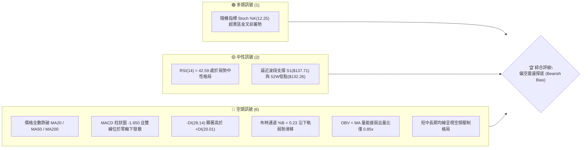

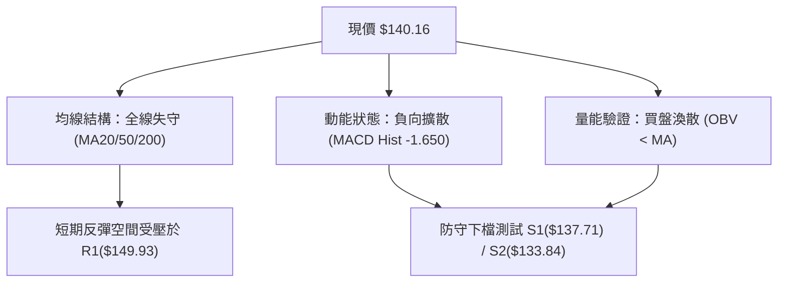

### 📊 核心指標速覽表

| 指標類別 | 指標名稱 | 當前數值 | 訊號 | 解讀 |
|:---|:---|:---|:---:|:---|
| **價格** | 當前收盤價 | $140.16 | 🔴 | 位於52週區間下緣 11.3%，短線處於下行探底結構 |
| **均線** | MA20 (月線) | $150.12 | 🔴 | 現價低於MA20達 -6.63%，短期下行斜率陡峭，形成第一動態壓制 |
| **均線** | MA50 (季線) | $145.08 | 🔴 | 現價低於MA50達 -3.36%，中期生命線遭跌破，轉化為上方實質反彈阻力 |
| **均線** | MA200 (年線)| $153.80 | 🔴 | 現價低於MA200達 -8.87%，長期多空分水嶺失守，長線多頭架構破壞 |
| **動能** | RSI(14) | 42.59 | 🟡 | 位於弱勢中性區間（30–70），未達極端超賣，下檔仍有慣性釋放空間 |
| **動能** | MACD (12,26,9)| 0.605 / 2.255| 🔴 | MACD低於信號線，柱狀圖為 -1.650，空方動能主導擴散 |
| **擺動** | KD (Stoch 14)| %K: 12.25 / %D: 26.98 | 🟢 | 進入極度超賣鈍化區，隨時具備技術性短抽潛力，但尚未形成金叉 |
| **趨勢強度**| ADX(14) | 16.63 | 🟡 | ADX < 25 指示當前非強單邊趨勢，屬空方主導的弱勢震盪磨底行情 |
| **方向指標**| +DI / -DI | 20.01 / 28.14 | 🔴 | -DI 大幅壓制 +DI，空方持有盤面定價權 |
| **通道指標**| 布林通道帶寬| 上軌 $168.56 / 下軌 $131.67 | 🔴 | %B 為 0.23，價格貼近下軌運行，通道開口向下發散 |
| **量能指標**| 最新量 / 均量| 6,729,900 / 7,883,940 | 🔴 | 量比 0.85x，OBV < MA，反彈縮量、殺跌帶量，籌碼無接盤意願 |
| **波動** | ATR(14) | $7.92 | 🟡 | 佔現價 5.65%，每日真實波動劇烈，單日波幅接近 8 美元 |

### 🏆 技術評分卡

```
╔══════════════════════════════════════════════════════════════╗
║                技術評分卡 — VST (2026-10-26)                 ║
╠══════════════════════════════════════════════════════════════╣
║ 評估維度      評分進度條                         分值   訊號 ║
╠══════════════════════════════════════════════════════════════╣
║ 趨勢強度      ██████░░░░░░░░░░░░░░░░░░          32/100   🔴  ║
║ 動能指標      ████████░░░░░░░░░░░░░░░░          38/100   🔴  ║
║ 支撐穩定度    ██████████░░░░░░░░░░░░░░          52/100   🟡  ║
║ 成交量配合    ███████░░░░░░░░░░░░░░░░░          36/100   🔴  ║
║ 形態完整度    ████████░░░░░░░░░░░░░░░░          42/100   🟡  ║
║ 均線排列      █████░░░░░░░░░░░░░░░░░░░          28/100   🔴  ║
╠══════════════════════════════════════════════════════════════╣
║ 綜合評分      ████████░░░░░░░░░░░░░░░░          38/100   🔴  ║
║ 評級結論      偏空震盪尋底（主推逢高放空 / 反彈減碼）         ║
╚══════════════════════════════════════════════════════════════╝
```

> **評分計算驗證（規則 18）**：
> 綜合評分 = (32 + 38 + 52 + 36 + 42 + 28) ÷ 6 = 228 ÷ 6 = **38 / 100**（四捨五入至整數）。依策略路由定義，綜合評分 ≤ 40 進入**主推空頭策略**模式。

---

## 2. 趨勢分析

### 🌐 多時框趨勢分析

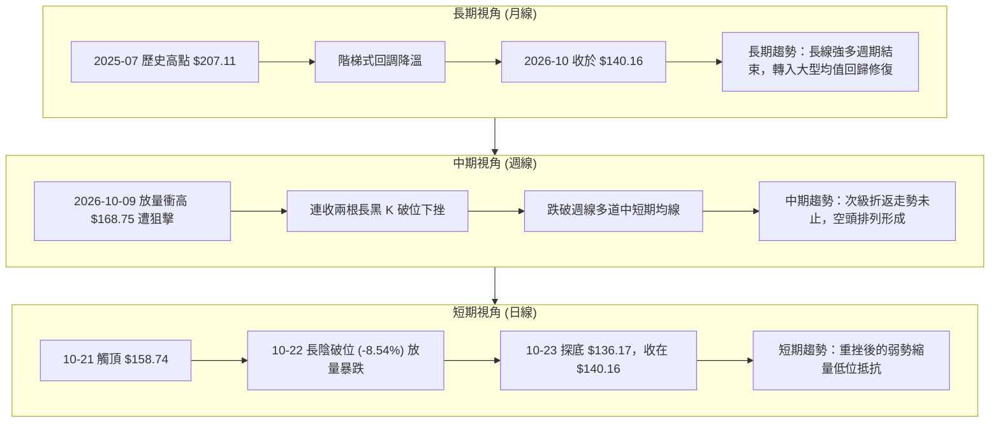

### 📈 長期趨勢 — 12個月走勢圖（Unicode）

```
VST 月線走勢圖（2025-11 至 2026-10）
價格軸 ($)
$190 ┤
$180 ┤ ●($177.83)
$170 ┤                 ●($173.13)
$160 ┤       ●($160.62)             ●($159.74)
$150 ┤             ●($157.65) ●($149.87) ●($157.36) ●($158.37)
$140 ┤                                                 ●($147.95)   ●($140.16)←現價
$130 ┤                                                       ●($137.15) ●($138.35)
     └──────────────────────────────────────────────────────────────────────────
       11    12    01    02    03    04    05    06    07    08    09    10 (月份)
     [── 2025 ──] [────────────────────────── 2026 ──────────────────────────]
```

#### 月線走勢特徵分析表

| 週期區間 | 區間起訖點 ($) | 漲跌幅 (%) | 量價與結構特徵 |
|:---|:---|:---:|:---|
| **2025-11 ~ 2025-12** | 177.83 → 160.62 | -9.68% | 見頂於 2025-07 之 $207.11 後的第一波主動去槓桿回調 |
| **2026-01 ~ 2026-02** | 157.65 → 173.13 | +9.82% | 第一次次級反彈波，受制於 175.00 斐波那契壓力帶，形成雙重頂下傾態勢 |
| **2026-03 ~ 2026-06** | 149.87 → 158.37 | +5.67% | 於 150–160 美元構建中樞收斂平台，多空拉鋸頻繁，換手充分 |
| **2026-07 ~ 2026-08** | 147.95 → 137.15 | -7.30% | 平台向下破位下探，2026-08 創下波段低點 $137.15，接近 52 週低位 $132.26 |
| **2026-09 ~ 2026-10** | 138.35 → 140.16 | +1.31% | 歷經 10 月初假突破衝高 $168.75 後快速回吐，重回 $140.00 底部平台震盪 |

### 📊 中期趨勢（週線分析）

中期走勢呈現典型「衝高誘多後之均線瀑布下殺」。
2026-10-09 當週爆出 59,368,900 股的天量，最高觸及 $168.75（恰好精確受阻於年內阻力帶 R3: $168.67），但週線收盤僅於 $161.48，留下高達 7.27 美元的長上影線。隨後兩週（10-16 與 10-23）接連收黑，週跌幅分別達 -5.86% 與 -7.80%，將前波長紅 K 棒全數吞噬，形成週線級別的「烏雲蓋頂後續破」架構。

```
中期週線空間拓撲圖
┌─────────────────────────────────────────────────────────────┐
│ 阻力位 R3: $168.67 (2026-10-09 遇阻天量陰線高點 $168.75)     │ ▲ 頂部強阻
│                   ▼ 下滑幅度 -16.9%                         │
│ 阻力位 R2: $155.69 (週 K 線頸線密集反壓 / MA200 反壓 $153.80) │
│                   ▼ 下滑幅度 -9.9%                          │
│ 阻力位 R1: $149.93 (MA20: $150.12 重合區)                   │
├─────────────────────────────────────────────────────────────┤
│ ★ 現價基準: $140.16 (多空爭奪中軸)                          │
├─────────────────────────────────────────────────────────────┤
│ 支撐位 S1: $137.71 (2026-08/09 多個週線收盤支撐密集區)       │
│                   ▼ 潛在下探空間 -4.5%                      │
│ 支撐位 S2: $133.84 (2026-10-02 週 K 探底低點 $133.44 重合)    │ ▼ 52W 底防線
│ 52週低點:   $132.26 (斐波那契 100.0% 終極支撐防線)            │
└─────────────────────────────────────────────────────────────┘
```

### ⚡ 趨勢強度評估（ADX 解讀）

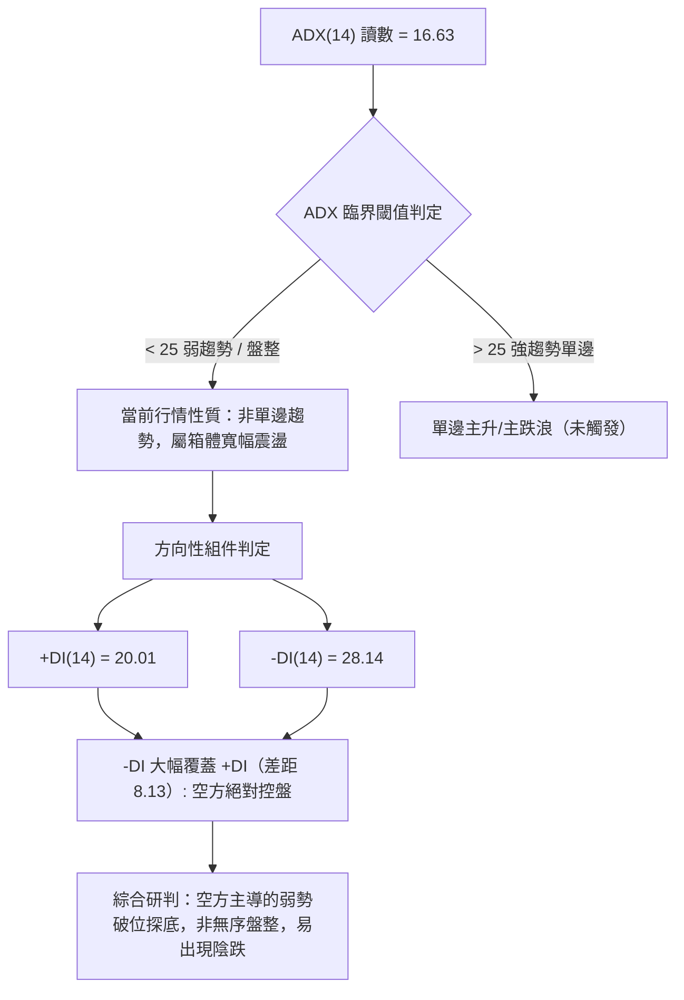

#### ADX 指標強度對照分析

| 指標變量 | 數值 | 狀態評估 | 實質交易含義 |
|:---|:---:|:---:|:---|
| **ADX(14)** | 16.63 | 弱趨勢 / 盤整結構 | 價格處於大級別區間震盪整理後期，單邊趨勢動能尚未完全爆發，追空需防假破位抽洗 |
| **+DI(14)** | 20.01 | 多頭動能匱乏 | 多方攻擊能量萎縮，任何反彈均缺乏後續買盤支撐 |
| **-DI(14)** | 28.14 | 空頭力量掌控 | 空方動能處於活躍區，盤面賣壓隨時可引發跳水 |
| **多時框收斂指引** | 盤整行情優先 | 依規則 14，以日線布林通道 ($131.67–$168.56) 與關鍵支撐阻力為交易基點 |

---

## 3. 圖表形態分析

### 🔍 形態識別系統

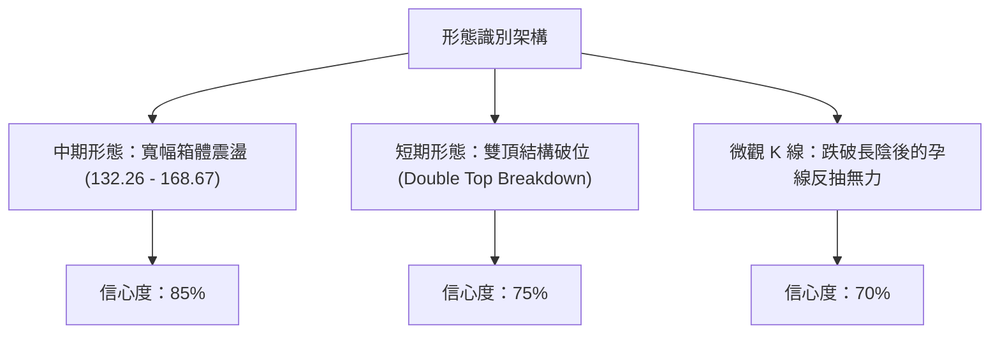

#### 形態識別與信心度評估表（依規則 15）

| 形態類別 | 信心度 | 判斷依據（引用數據） | 完成度 | 目標價（附嚴格計算式） |
|:---|:---:|:---|:---:|:---|
| **短期雙頂形態**<br>(Double Top) | 75% | 頂1為 2026-10-09 高點 $168.75（遇阻於 R3 $168.67），頂2為 2026-10-21 高點 $158.74（次級高點下移），頸線位於 2026-10-15 低點 $145.85。10-22 長黑 K 跌破頸線。 | 90% | 由雙頂形態高度推算：<br>頸線 $145.85 − 形態高度($158.74 − $145.85 = $12.89) = **$132.96**（極接近 S2 $133.84 與 52W 低點 $132.26） |
| **箱體震盪整理**<br>(Trading Range) | 85% | 過去四個月價格反覆受阻於 R3: $168.67，並在波段低點聚類 S1: $137.71 及 S2: $133.84 獲得支撐，ADX 16.63 驗證箱體特徵。 | 100% | 箱體底部支撐即為 **$133.84** (S2) 與 **$132.26** (52W Low) |
| **大型頭肩頂**<br>(Head & Shoulders) | 35% | 左肩為 2026-06 高點 $163.25，頭部為 2026-10 高點 $168.75，但右肩目前結構殘缺且時間跨度不對稱。 | 20% | 訊號不足，信心度低於 50%，依規則 15 不予採納，僅做指標型解讀。 |

### 🕯️ 重要K線形態分析（依規則 19 嚴格依數據解讀）

#### 近10根日K棒形態深度解讀

| 日期 | 開 | 高 | 低 | 收 | 成交量 | K線形態名稱 | 技術解讀與訊號指示 |
|:---|:---:|:---:|:---:|:---:|:---:|:---:|:---|
| **10-12** | 162.67 | 164.25 | 156.85 | 158.13 | 6,526,300 | 衝高回落小黑K | 🔴 跳空低走，高點承壓於 $164.25，獲利了結賣壓湧現 |
| **10-13** | 153.51 | 163.63 | 153.51 | 162.36 | 5,296,900 | 下探回升大紅K | 🟢 開盤即最低，多頭強力反撲收復失土，但量能未放大 |
| **10-14** | 159.53 | 161.09 | 149.66 | 151.79 | 7,391,700 | 長黑實體破位K | 🔴 實體下挫 $7.74，完全吞噬前日陽線，構成「陰包陽」空頭吞噬 |
| **10-15** | 148.35 | 154.46 | 145.85 | 154.17 | 7,257,700 | 下影線反彈小紅K | 🟡 探底 $145.85 獲得支撐回升，顯示頸線附近存在多頭護盤抵抗 |
| **10-16** | 152.55 | 155.16 | 151.15 | 152.02 | 5,226,800 | 窄幅十字星小黑K | 🔴 衝高受制於 $155.16，買動能顯著衰竭，多空分歧陷入停滯 |
| **10-19** | 154.10 | 155.33 | 145.85 | 149.70 | 4,271,100 | 下影黑K線 | 🔴 再次下測 $145.85，收盤跌破 $150.00 整數關卡，重心下移 |
| **10-20** | 148.90 | 151.34 | 147.10 | 150.32 | 3,336,500 | 縮量十字星陽線 | 🟡 極度縮量（333萬股），市場觀望情緒濃厚，變盤在即 |
| **10-21** | 153.35 | 158.74 | 151.83 | 156.14 | 5,093,600 | 帶上影中紅K | 🟡 次級高點形成，高點 $158.74 遭空頭迎頭痛擊，構成雙頂之右頂 |
| **10-22** | 153.00 | 154.27 | 139.10 | 140.83 | 12,469,400 | 放量斷頭大陰K | 🔴 爆量 1246 萬股（20日均量1.58倍），暴跌破位，徹底瓦解多方防線 |
| **10-23** | 139.06 | 141.52 | 136.17 | 140.16 | 6,729,900 | 探底回升低位孕星 | 🟡 創近期新低 $136.17，收於前日實體內，縮量止跌，屬弱勢孕線整理 |

#### 近8根週K棒形態深度解讀

| 日期 | 開 | 高 | 低 | 收 | 成交量 | 週K形態名稱 | 技術解讀與訊號指示 |
|:---|:---:|:---:|:---:|:---:|:---:|:---:|:---|
| **09-04** | 136.57 | 149.21 | 134.68 | 149.06 | 22,139,900 | 底部放量長紅K | 🟢 自 52W 低點附近拔地而起，確立中樞箱體底部有效性 |
| **09-11** | 150.75 | 154.65 | 146.43 | 148.14 | 18,610,600 | 高位懸空倒錘頭 | 🔴 突破 $150 後未能站穩，上方賣壓初現 |
| **09-18** | 143.76 | 145.87 | 139.39 | 140.44 | 23,879,600 | 週線回踩黑K | 🔴 連續回調測試 $140 關卡支撐 |
| **09-25** | 142.00 | 142.64 | 135.98 | 138.46 | 22,341,300 | 下探黑K | 🔴 最低見 $135.98，逼近 S1 支撐位 |
| **10-02** | 138.08 | 143.51 | 133.44 | 140.02 | 34,710,000 | 長下影打樁錘頭K | 🟢 最低刺穿至 $133.44（測試 S2 $133.84），爆量拉回，完成假破位誘空洗盤 |
| **10-09** | 144.04 | 168.75 | 140.90 | 161.48 | 59,368,900 | 巨量衝高長上影陽K | 🔴 創天量衝擊 R3 $168.67，上影線長達 $7.27，天量天價誘多出貨特徵極濃 |
| **10-16** | 162.67 | 164.25 | 145.85 | 152.02 | 31,699,400 | 反噬長黑K | 🔴 高開低走，吞噬前週實體逾半，確認 10-09 巨量為機構套牢盤 |
| **10-23** | 154.10 | 158.74 | 136.17 | 140.16 | 31,900,500 | 破位續跌大黑K | 🔴 跌破多重週均線，最低打到 $136.17，空方動能宣洩，確立中期回調格局 |

### 📉 ASCII 走勢形態示意圖

```
VST 短期雙頂破位與箱體震盪示意圖
========================================================================
$168.75 ┤           ▲ 頂 1 (2026-10-09 天量遇阻 R3: $168.67)
$165.00 ┤          / \
$160.00 ┤         /   \            ▲ 頂 2 (2026-10-21 反抽次頂 $158.74)
$155.00 ┤        /     \          / \
$150.00 ┤       /       \  頸線  /   \
$145.85 ┼──────/─────────\──────/─────\───────────────────────────── [破位頸線]
$140.16 ┤     /           \    /       \          ● 10-23 現價收盤 $140.16
$136.17 ┤    /             \  /         \        / (探底回升孕線)
$133.84 ┼───● (10-02 探底 $133.44)───────▼─────── [強支撐 S2]
$132.26 ┴───────────────────────────────────────── [52W 低點終極支撐]
========================================================================
```

### 🎯 形態目標價計算

1. **雙頂形態量度跌幅計算**：
   - 頂部基準價（取次頂以求保守）：$158.74
   - 頸線位置（2026-10-15 / 10-19 低點）：$145.85
   - 形態垂直高度 $H = \$158.74 - \$145.85 = \$12.89$
   - **量度滿足目標價** $= \text{頸線} - H = \$145.85 - \$12.89 =$ **$132.96**
   - *驗證*：此價位精準契合波段支撐 **S2 ($133.84)** 與 52 週最低點 **$132.26** 形成的共振買盤緩衝帶。

2. **箱體波段反彈目標計算（若回測支撐有效）**：
   - 箱體底部：$136.17–$137.71 (S1)
   - 箱體中軸阻力：**R1 ($149.93)** 與 MA20 ($150.12)
   - 反彈空間高度：約 $9.77 美元。

---

## 4. 支撐與阻力

### 🗺️ 關鍵價位分布圖（Unicode）

```
VST 價位結構分布圖 (Price Architecture)
═══════════════════════════════════════════════════════════════════════
$168.67 ║████████████████████████████████████║ 強阻力 R3 (52W 高點回調 50.0% / 年內頂)
$159.08 ║████████████████████████            ║ 斐波那契 61.8% 重要壓力位
$155.69 ║████████████████████████████        ║ 阻力 R2 (MA240 $156.27 / 近一年波段高點)
$149.93 ║████████████████████████████████    ║ 關鍵阻力 R1 (MA20 $150.12 / 密集整數關卡)
$147.29 ║████████████████                    ║ 斐波那契 78.6% 回調位
────────╫────────────────────────────────────╫──────────────────────────────────
$140.16 ╠════════════════════════════════════╣ ◄ 當前價格 (收盤價)
────────╫────────────────────────────────────╫──────────────────────────────────
$137.71 ║▓▓▓▓▓▓▓▓▓▓▓▓▓▓▓▓▓▓▓▓▓▓▓▓            ║ 近期支撐 S1 (近一年波段低點聚類)
$133.84 ║██████████████████████████████      ║ 強支撐 S2 (近一年波段低點聚類 / 雙頂滿足)
$132.26 ║████████████████████████████████████║ 終極鐵底 52W Low (斐波那契 100.0%)
═══════════════════════════════════════════════════════════════════════
```

### 🚧 阻力位分析表（嚴格引用數據）

| 阻力級別 | 價位 | 形成原因與技術重合性 | 突破難度 | 重要性 |
|:---|:---:|:---|:---:|:---:|
| **關鍵阻力 R1** | **$149.93** | 近一年波段高點聚類；與日線 MA20 ($150.12)、布林中軌 ($150.12) 及 $150 整數心理關卡高度重疊。 | 中等偏高 | ★★★★☆ |
| **波段阻力 R2** | **$155.69** | 近一年波段高點聚類；與長期均線 MA240 ($156.27) 及前波次級反彈高點平台（10-21 之 $158.74 下方）共振。 | 極高 | ★★★★★ |
| **強阻力 R3** | **$168.67** | 近一年波段高點聚類；與布林通道上軌 ($168.56)、斐波那契 50.0% 回調位 ($167.37) 及 2026-10-09 天量高點 ($168.75) 形成三位一體強反壓。 | 牢不可破 | ★★★★★ |

### 🛡️ 支撐位分析表（嚴格引用數據）

| 支撐級別 | 價位 | 形成原因與技術重合性 | 守住機率 | 重要性 |
|:---|:---:|:---|:---:|:---:|
| **近期支撐 S1** | **$137.71** | 近一年波段低點聚類；2026-08、09 月多個波段底聚合區，且鄰近 10-23 下影線低點 $136.17。 | 55% | ★★★☆☆ |
| **強支撐 S2** | **$133.84** | 近一年波段低點聚類；與 2026-10-02 爆量打樁針尖低點 $133.44 及雙頂形態量度跌幅 $132.96 形成強大買盤承接帶。 | 75% | ★★★★★ |
| **52W 低點** | **$132.26** | 52 週最低點，斐波那契 100.0% 終極絕對防線；跌破將引發大規模停損與估值崩潰。 | 85% | ★★★★★ |

### 📐 斐波那契回調位分析

依據 52 週區間波段（低點 $132.26 → 高點 $202.48，全波段落差 $70.22）計算之黃金分割架構：

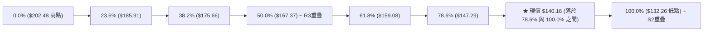

#### 斐波那契點位深度解讀

1. **現價區間定位**：
   當前收盤價 **$140.16** 嚴格運行於 **78.6% 回調位 ($147.29)** 與 **100.0% 基準位 ($132.26)** 之間的極深次回調真空帶。此區域表明前期自 $132.26 至 $202.48 的整輪多頭漲幅已被蠶食近 89%，技術結構屬於典型的「深幅回撤防守期」。
2. **上方關鍵壓制層**：
   78.6% ($147.29) 是多頭若展開反彈所面臨的第一道幾何回調阻力，緊接著與 R1 ($149.93) 共振。若無法帶量有效收復 $147.29–$150.12 區間，所有反彈均屬「超跌抽頭」。
3. **下檔安全緩衝墊**：
   下方距離 100.0% ($132.26) 僅剩 **$7.90 美元**（剛好約為 1 個 ATR 單位 $7.92），空間極為有限，意味著做空的盈虧比在未見反彈前已逐漸收窄，空頭將在 S1 ($137.71) 至 S2 ($133.84) 遭遇長線價值買盤的強烈抵抗。

---

## 5. 技術指標深度解讀

### 🎛️ 指標訊號總覽

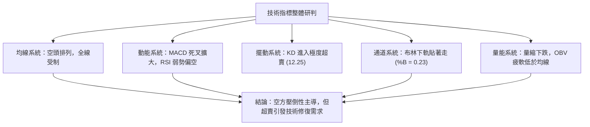

### 📈 移動平均線排列分析

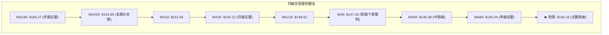

#### 各週期移動平均線偏離度數據表

| 均線名稱 | 數值 ($) | 價格相對位置 | 偏離價差 ($) | 偏離幅度 (%) | 走勢特徵與技術含義 |
|:---|:---:|:---:|:---:|:---:|:---|
| **MA 5** | 147.43 | 現價在下方 | -7.27 | -4.93% | 超短線極速下墜，斜率陡峭，構成第一動態反彈攔截位 |
| **MA 10** | 151.56 | 現價在下方 | -11.40 | -7.52% | 短線雙頂頸線下壓通道，持續提供動態阻力 |
| **MA 20** | 150.12 | 現價在下方 | -9.96 | -6.63% | 月線趨勢轉折向下，布林中軌同步下移 |
| **MA 50** | 145.08 | 現價在下方 | -4.88 | -3.36% | 中期生命線遭跳空跌破，宣告中期多頭趨勢告終 |
| **MA 60** | 145.04 | 現價在下方 | -4.88 | -3.36% | 與 MA50 高度重合，形成 $145.00 處的中期密集壓制帶 |
| **MA 120** | 149.62 | 現價在下方 | -9.46 | -6.32% | 半年線失守，中長期持倉籌碼全線轉入浮虧鎖死狀態 |
| **MA 200** | 153.80 | 現價在下方 | -13.64 | -8.87% | 長期牛熊分界線失守，宣告大級別進入空頭或大型震盪市 |
| **MA 240** | 156.27 | 現價在下方 | -16.11 | -10.31% | 年線反壓沉重，長線多頭架構徹底破壞 |

### 📉 RSI(14) 分析

```
RSI(14) 當前水平進度條：
0 ══════════════ 30 ══════════════ 50 ══════════════ 70 ══════════════ 100
[ 超賣警戒區 ]   │  [ 弱勢區 ]    │  [ 強勢區 ]    │   [ 超買警戒區 ]
░░░░░░░░░░░░░░░░████████████░░░░░░░░░░░░░░░░░░░░░░░░░░░░░░░░░░░░░░░░░
                 ▲ RSI = 42.59 (弱勢中性格局)
```

- **超買超賣狀態**：
  RSI(14) 最新讀數為 **42.59**。指標雖然脫離了 50 多空平衡軸，進入空方主導的弱勢區間，但尚未觸及 30 以下的極端超賣閾值。這意味著：從動能角度來看，空頭動能的釋放尚未達到衰竭邊界，盤面依然存在慣性下探 S1 ($137.71) 的空間。
- **背離檢驗結論（嚴格依數據規則 7）**：
  - **價格軌跡**：近 20 根 K 棒中，價格自 10-09 高點 $168.75 及 10-21 高點 $158.74 持續創出次低點，隨後跌至 10-23 之 $140.16；
  - **RSI 軌跡**：週線 RSI 自 64.5 快速滑落至 42.6，日線 RSI 亦自 50 上方回落至 42.59；
  - **背離判定**：**無明顯背離（Neither Bullish nor Bearish Divergence）**。價格創新低與 RSI 走低完全同步，為典型的動能確認價格下行，不存在底背離反轉徵兆。

### 📊 MACD(12,26,9) 訊號解讀

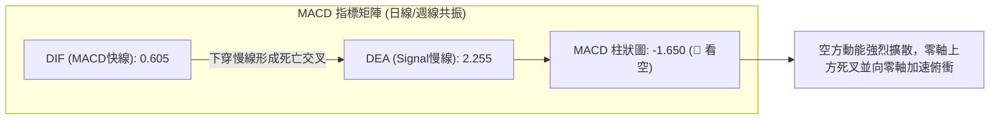

- **數值結構**：
  MACD 快線為 **0.605**，信號線（Signal）為 **2.255**，柱狀圖（Histogram）為 **-1.650**。
- **形態分析**：
  MACD 在高位跌破信號線形成高位死叉後，柱狀圖負值連續三個交易日加速擴大（週線柱狀圖亦由 +0.499 急遽轉為 -1.650）。快線正以大角度斜率俯衝迫近零軸，一旦下穿零軸進入負值區，將由「強勢回調」演變為「實質弱勢空頭行情」。空頭排列維持完整，反彈均屬弱勢修復。

### 📦 布林通道分析（Bollinger Bands）

```
VST 布林通道空間分佈 (20日, 2倍標準差)
══════════════════════════════════════════════════════════════════════
$168.56 ┬────────────────────────────────────────── 布林上軌 (強阻力 R3)
        │
$150.12 ┼────────────────────────────────────────── 布林中軌 (MA20 / R1)
        │                                           
$140.16 ┼─────────────────────────● 現價 (%B = 0.23, 逼近下軌)
        │
$131.67 ┴────────────────────────────────────────── 布林下軌 (極限支撐帶)
══════════════════════════════════════════════════════════════════════
```

- **通道寬度與形態**：
  上軌 **$168.56**，中軌 **$150.12**，下軌 **$131.67**。帶寬達 $36.89 美元。
- **%B 位置解讀**：
  當前 **%B = 0.23**。在技術分析中，%B < 0.30 代表價格已進入下軌壓制之極弱區域，但尚未跌破 0.00（即收盤價未跌破下軌）。這顯示價格正沿著下軌「步行下行」（Walking down the band）。由於下軌 $131.67 與 52 週低點 $132.26 幾乎完全重疊，該帶區將構成極強的空間幾何下限支撐。

### 💹 成交量分析（量價配合度）

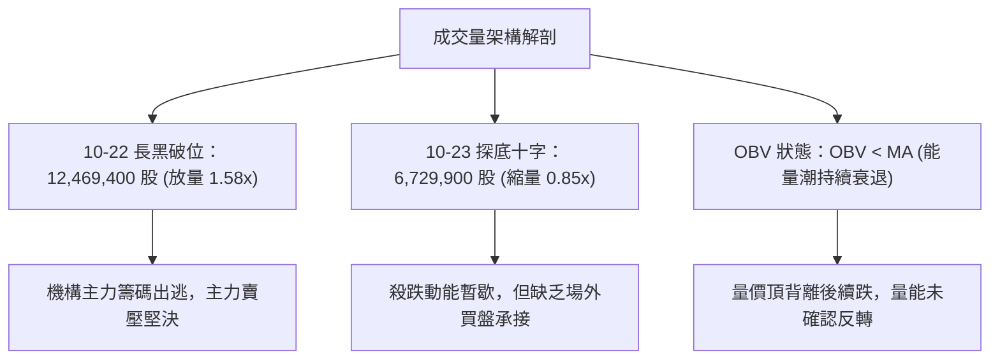

- **量比與均量比對**：
  最新日成交量為 **6,729,900 股**，相較於 20 日均量 **7,883,940 股**，量比僅為 **0.85x**。而在前一日（10-22）暴跌長黑中，成交量激增至 **12,469,400 股**。這呈現標準的「下跌放量、反抽縮量」空頭籌碼特徵。
- **OBV 趨勢判定**：
  數據明確指出「**OBV < MA → 量能疲弱**」。在資金流向指標上，OBV 跌破其自身的移動平均線，驗證資金持續淨流出，籌碼處於發散（Distribution）階段，量能並未對任何技術性反彈給予背書。

---

## 6. 動能與波動率

### ⚡ 動能評估

| 象限 | 動能強度 | 波動率水平 | 當前所屬狀態 | 技術評估與操作意涵 |
|:---:|:---:|:---:|:---:|:---|
| **第一象限 (Q1)** | 強動能 (Bullish) | 低波動 (Low Vol) | — | 最佳波段順勢作多環境（穩定主升浪） |
| **第二象限 (Q2)** | 弱動能 (Bearish) | 低波動 (Low Vol) | — | 陰跌盤整行情，流動性枯竭 |
| **第三象限 (Q3)** | 強動能 (Bullish) | 高波動 (High Vol) | — | 高風險高收益狂熱噴發行情（容易見頂） |
| **第四象限 (Q4)** | **弱動能 (Bearish)** | **高波動 (High Vol)** | **✓ (當前狀態)** | **空方宣洩主跌段，ATR 高達 5.65%，多單極易受損，應逢高放空或持幣觀望** |

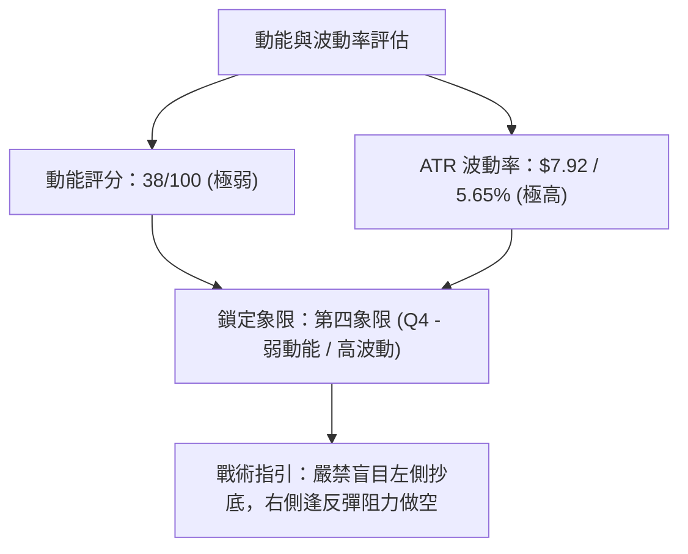

### 📊 ATR 波動率分析

- **ATR(14) 讀數**：**$7.92 USD**（佔當前股價之 **5.65%**，Wilder 平滑法）。
- **波動特徵**：
  VST 作為獨立電力生產商（IPP），當前 5.65% 的日均波幅顯著超越傳統公用事業板塊（通常 < 1.5%），具備典型 AI 數據中心題材驅動之高 Beta 成長股特徵。
- **風控止損距離精算**：
  - **激進日內交易止損**：$1.0 \times \text{ATR} = \$7.92$
  - **波段交易防守止損**：$1.5 \times \text{ATR} = 1.5 \times \$7.92 = \mathbf{\$11.88}$
  - **極限趨勢容忍止損**：$2.0 \times \text{ATR} = 2.0 \times \$7.92 = \mathbf{\$15.84}$
  - *實務意義*：若在現價 $140.16 建立空頭或多頭部位，合理的技術噪音緩衝區至少需要 8–12 美元，任何小於 1 個 ATR 的狹窄止損極易被日常隨機波動「掃單出場」。

### 📐 Beta 與市場相關性

- **Beta 係數**：**1.384**。
- **技術意涵解構**：
  VST 的價格波動彈性是大盤（S&P 500）的 **1.384 倍**。當美股大盤回調時，VST 傾向於以放大近 1.4 倍的烈度下挫；反之在市場情緒回暖時反彈亦更為劇烈。
- **機構籌碼背景**：
  機構持股比例高達 **92.2%**，內部人持股僅 0.8%。當宏觀流動性或 AI 電力重估預期發生轉向時，機構集中調倉拋售引發的踩踏效應極強，這完全解釋了 10-22 單日重挫放量的籌碼成因。

---

## 7. 多時框架總結

### 📋 時框架評分表

| 時框架 | 趨勢方向 | 動能狀態 | 均線排列 | 形態結構 | 綜合評分 | 建議戰術取向 |
|:---|:---:|:---:|:---:|:---:|:---:|:---|
| **長期 (月線)** | 🟡 中性偏多 | 緩慢回落 | 多頭排列受損 | 歷史高位均值回歸中樞 | 55/100 | 長期投資者暫停加碼，等待 $132 底部確立 |
| **中期 (週線)** | 🔴 明確看空 | 空方主導 | 均線開始纏繞死叉 | 烏雲蓋頂後的大二浪回撤 | 35/100 | 中期波段逢高做空，或建立空頭對沖保護 |
| **短期 (日線)** | 🔴 空方主導 | 超賣鈍化 | 徹底空頭排列 | 放量破位後的超跌十字星 | 30/100 | 短線等待反抽 R1 阻力做空，嚴禁盲目追多 |

### 🔲 綜合訊號矩陣

```
╔══════════════════════════════════════════════════════════════════════╗
║                    VST 多維度技術訊號矩陣                          ║
╠════════════════╦════════════════════════╦═════════════╦══════════════╣
║ 分析維度       ║ 短期 (1-5日)           ║ 中期 (1-4週) ║ 長期 (1-3月) ║
╠════════════════╬════════════════════════╬═════════════╬══════════════╣
║ 趨勢方向       ║ 🔴 空頭抵抗            ║ 🔴 空頭破位 ║ 🟡 大箱體震盪║
║ 均線壓制       ║ 🔴 MA5/MA10 下壓       ║ 🔴 MA20/MA50║ 🔴 跌破MA200 ║
║ 動能指標       ║ 🟢 KD超賣蓄勢          ║ 🔴 MACD擴散 ║ 🟡 RSI下行   ║
║ 成交量驗證     ║ 🔴 縮量反彈/放量下跌   ║ 🔴 OBV跌破  ║ 🟡 籌碼換手  ║
║ 關鍵水平位     ║ S1: $137.71 支撐測試   ║ R1: $149.93 ║ S2: $133.84  ║
╚════════════════╩════════════════════════╩═════════════╩══════════════╝
```

### ⚖️ 多時框收斂結論（依規則 14 嚴格收斂）

1. **行情性質仲裁**：
   當前日線 **ADX(14) 讀數為 16.63（顯著低於 25 臨界線）**，依規則 14 判定當前**非單邊單向主升/主跌趨勢，而屬於大級別「寬幅箱體盤整中的次級回落折返」**。
2. **主導時框與交易邊界收斂**：
   在 ADX < 25 的盤整結構中，分析邏輯必須以**日線布林通道 ($131.67–$168.56) 與關鍵支撐阻力結構**為核心導航。
3. **多空衝突收斂取捨**：
   日線 Stoch 出現超賣（%K: 12.25），暗示隨時有技術性反抽；然而週線與日線均線全數死叉向下，MACD 柱狀圖 -1.650 持續擴散。依規則 14 優先級原則，**中短期空頭趨勢強烈壓制日線短線指標，超賣僅能引發短暫的反抽修復，無法扭轉空頭格局**。日線的反彈僅能作為「空頭尋找更佳做空點位的進場契機」。
4. **唯一確定結論**：
   **偏空觀望 / 逢高做空（Bearish Bias）**。綜合評分為 **38/100**，全面觸發空頭策略路由。

---

## 8. 交易策略建議

### 🗺️ 策略決策流程圖

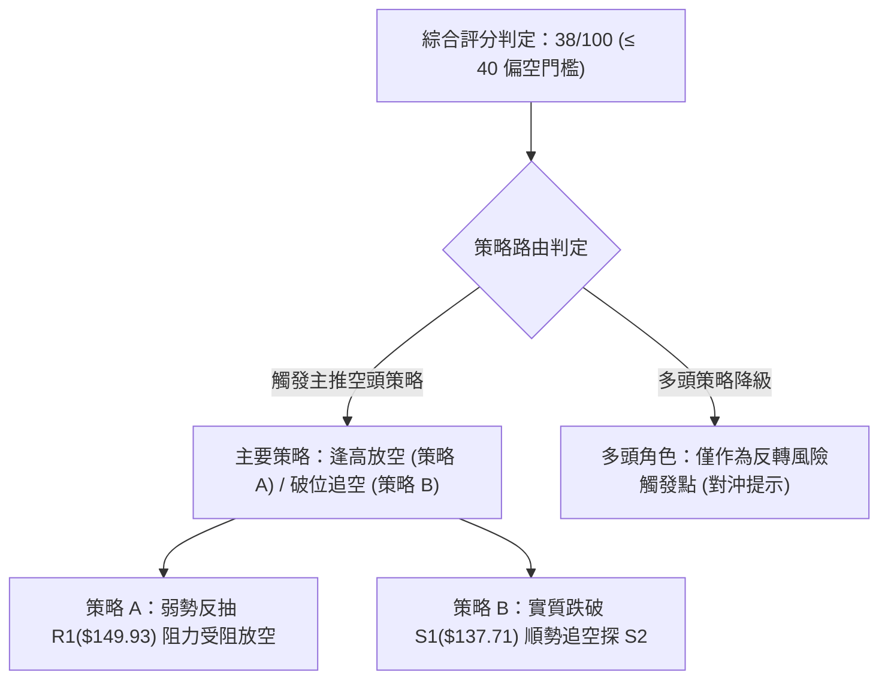

### 🧭 策略路由（依規則 18 評分卡分流）

> **當前主策略方向 = 主推空頭策略（依綜合評分 38 / 100 判定）**
> 由於綜合評分 ≤ 40，市場處於空方動能壓制階段。交易核心邏輯為「順應中短期均線空頭排列，逢反彈至阻力位建立空頭倉位，或等待跌破關鍵支撐後順勢做空」，嚴禁任何激進的逆勢做多重倉操作。

### 🎯 價格情境階梯（Price Scenarios，嚴格引用第 4 章數據）

| 觸發條件 | 下一目標 | 後續延伸 | 情境含義與操作對策 |
|:---|:---:|:---:|:---|
| **反彈受阻 R1 ($149.93)** | S1 ($137.71) | S2 ($133.84) | 弱勢反彈結束，空頭重啟主跌，最佳波段放空點 |
| **強勢突破 R1 ($149.93)** | R2 ($155.69) | R3 ($168.67) | 短線轉強，空頭必須停損，格局重回箱體中軸 |
| **現價 $140.16 區間震盪** | S1 ($137.71) | R1 ($149.93) | 低位縮量磨底，等待指標修復，觀望或極小倉位差價操作 |
| **有效跌破 S1 ($137.71)** | S2 ($133.84) | 52W Low ($132.26)| 破位加速下探，觸發雙頂形態量度跌幅，空頭加碼追擊 |
| **擊穿 52W Low ($132.26)**| 歷史低位區間 | N/A（數據未提供）| 長期基本面與估值崩潰，引發機構去槓桿無底深淵 |

### 📊 情境機率分佈

| 情境劃分 | 機率估計 | 主要技術指標依據 |
|:---|:---:|:---|
| **情境一：反抽受阻後回落 / 再探底** | **55%** | 均線系統呈空頭排列，MACD 柱狀圖 -1.650 持續發散，-DI(28.14) 牢牢掌控盤面，OBV < MA 顯示資金持續淨流出。 |
| **情境二：低位區間震盪整理** | **30%** | ADX 僅 16.63（盤整無趨勢），Stoch 進入極端超賣（%K: 12.25），布林下軌 $131.67 提供空間托底。 |
| **情境三：V型強勢反轉上行** | **15%** | 缺乏任何技術底背離確認，上方套牢籌碼峰壓制沉重，唯有爆量突發利多方能實現。 |

### 🔴 主策略詳情（空頭主推，依規則 5 及 17 嚴格計算）

```
╔══════════════════════════════════════════════════════════════════════╗
║                     VST 空頭主策略配置規格表                         ║
╚══════════════════════════════════════════════════════════════════════╝
```

| 策略要素 | 策略 A：反彈阻力位放空（主推） | 策略 B：跌破關鍵支撐追空（次選） |
|:---|:---|:---|
| **戰術邏輯** | 利用短線超賣引發的技術性反抽，於強阻力區逢高布局空單 | 待盤面跌破近期波段低點聚類支撐後，順勢追擊空頭下挫浪 |
| **進場條件** | 股價反彈至 R1 阻力位附近滯漲，日 K 出現長上影線或轉折黑 K | 日 K 線實體收盤明確跌破 S1 支撐位（帶量確認） |
| **進場價格** | **$149.93**（精確取自 R1 阻力位） | **$137.71**（精確取自 S1 支撐位） |
| **目標價 T1** | **$137.71**（近期支撐 S1） | **$133.84**（強支撐 S2） |
| **目標價 T2** | **$133.84**（強支撐 S2） | **$132.26**（52W Low 終極支撐） |
| **止損價格** | **$155.69**（精確取自 R2 阻力位） | **$140.16**（當前收盤價，破位前原中樞） |
| **風險報酬比** | **1 : 2.12（以 T1 計）**<br>*(計算式見下方)* | **1 : 1.58（以 T1 計）**<br>*(計算式見下方)* |
| **T2 風報比** | **1 : 2.79（以 T2 計）** | **1 : 2.22（以 T2 計）** |
| **成功機率** | 65% | 55% |
| **建議倉位** | 總倉位之 15%–20% | 總倉位之 10%–15% |

> **風險報酬比嚴格驗算（依規則 17 做空公式）**：
> 做空風報比 = $(\text{進場價} - \text{目標價}) \div (\text{止損價} - \text{進場價})$
> - **策略 A (以 T1 計)**：
>   $$(\$149.93 - \$137.71) \div (\$155.69 - \$149.93) = \$12.22 \div \$5.76 = \mathbf{2.12} \implies \mathbf{1 : 2.12}$$
> - **策略 A (以 T2 計)**：
>   $$(\$149.93 - \$133.84) \div (\$155.69 - \$149.93) = \$16.09 \div \$5.76 = \mathbf{2.79} \implies \mathbf{1 : 2.79}$$
> - **策略 B (以 T1 計)**：
>   $$(\$137.71 - \$133.84) \div (\$140.16 - \$137.71) = \$3.87 \div \$2.45 = \mathbf{1.58} \implies \mathbf{1 : 1.58}$$
> - **策略 B (以 T2 計)**：
>   $$(\$137.71 - \$132.26) \div (\$140.16 - \$137.71) = \$5.45 \div \$2.45 = \mathbf{2.22} \implies \mathbf{1 : 2.22}$$

### 🟢 反向風險觸發點（多頭對沖提示，非主推建議）

若市場突發重大利多或空頭回補踩踏，導致盤面出現以下條件，則**空頭主策略全面宣告失效，必須無條件平倉並啟動多頭對沖**：
1. **多頭反轉翻轉點**：日線收盤價帶量（日成交量 > 1,200 萬股）強勢站穩 **$150.12 (MA20)** 及 **$149.93 (R1)** 之上。
2. **多頭目標進階位**：一旦突破 R1，第一目標看向 **$155.69 (R2)**，延伸目標看向 **$168.67 (R3)**。
3. **風控警示**：在未有效站上 $149.93 之前，任何多頭進場均屬極高風險之火中取栗，嚴格禁止左側無保護抄底。

### ⭐ 整體訊號強度評星

```
做多訊號強度：★☆☆☆☆  (1/5星 - 僅超賣指標支撐，均線與動能全空)
做空訊號強度：★★★★☆  (4/5星 - 均線空頭排列，破位放量，動能發散)
整體可信度：  ★★★★☆  (4/5星 - 多時框指標高度共振收斂)
```

---

## 9. 風險提示與監控

### ✅ 關鍵監控指標 Checklist

```
╔══════════════════════════════════════════════════════════════════════╗
║                     VST 交易防禦與風險監控清單                       ║
╠══════════════════════════════════════════════════════════════════════╣
║ [ ] 監控項 1：S1 支撐位 $137.71 是否失守（空單加碼 / 多單最後防線）   ║
║ [ ] 監控項 2：R1 阻力位 $149.93 突破情況（空單絕對防禦與止損基準）    ║
║ [ ] 監控項 3：MACD 柱狀圖是否由負值 -1.650 轉向收斂（空頭衰竭警訊）    ║
║ [ ] 監控項 4：KD 隨機指標在超賣區是否形成金叉（日線短抽即將啟動）     ║
║ [ ] 監控項 5：成交量是否再度超越 1000 萬股（放量方向即為突破方向）    ║
║ [ ] 監控項 6：ADX(14) 是否向上突破 25（預示震盪結束，單邊趨勢來臨）  ║
║ [ ] 監控項 7：52 週低點 $132.26 破位保護（長線牛熊生死線）            ║
╚══════════════════════════════════════════════════════════════════════╝
```

### ⚠️ 風險場景分析

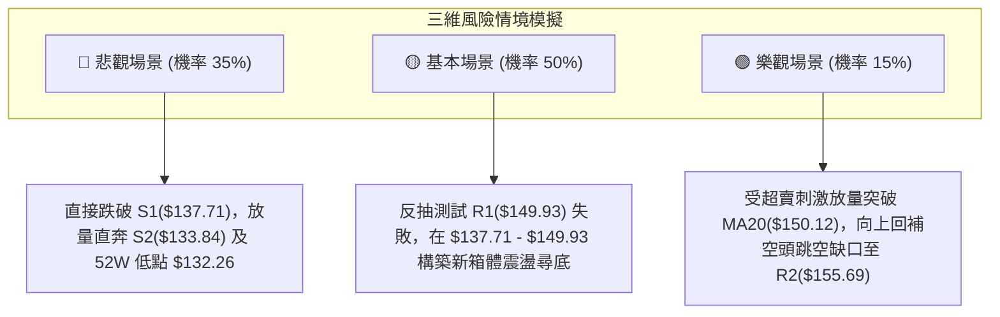

### 🛡️ 風險管理重要提醒

1. **ATR 波動風險匹配**：
   VST 當前 ATR 為 **$7.92**，佔股價比重高達 **5.65%**。這意味著正常的日間隨機波動極易高達 8 美元。持倉槓桿必須受到嚴格限制，單筆交易所承受的停損金額絕對不可超過總投資組合淨值的 **1.0%–1.5%**。
2. **財報與事件驅動風險**：
   作為涉足數據中心供電與核電概念之 IPP 企業，近期新聞指出市場對「Meta 財報後的 AI 電力重估」產生定價分歧。雖然華爾街分析師普遍維持 Strong Buy（平均目標價 $208.86），但技術面上機構正處於淨減碼拋售週期，切勿以「基本面目標價」盲目否定技術面破位之事實。
3. **流動性與止損執行**：
   做空標的若遭遇融券成本變動或軋空行情，需注意隔夜跳空風險。在設定止損時，嚴格遵循 R2 **$155.69**（策略 A）與 **$140.16**（策略 B）之紀律防線，絕不允許被套後轉為被動長期持有。

---

## 📋 報告總結

```
╔══════════════════════════════════════════════════════════════════════╗
║                     VST 技術分析報告總結                             ║
╠══════════════════════════════════════════════════════════════════════╣
║ 報告日期：2026-10-26                                                 ║
║ 當前價格：$140.16 USD                                                ║
║ 分析評級：🔴 偏空震盪探底 (技術綜合評分: 38 / 100)                    ║
╠══════════════════════════════════════════════════════════════════════╣
║ 關鍵技術維度結論：                                                   ║
║ ├─ 長期趨勢 (月線)：🟡 中性整理，歷史高點回落之大型均值回歸中樞       ║
║ ├─ 中期趨勢 (週線)：🔴 空頭下挫，10-09 天量誘多後連收兩根長黑吞噬    ║
║ ├─ 短期趨勢 (日線)：🔴 破位超跌，雙頂量度跌幅指向 $132.96 區域        ║
║ ├─ 關鍵支撐架構：S1: $137.71 │ S2: $133.84 │ 52W 低點: $132.26       ║
║ ├─ 關鍵阻力架構：R1: $149.93 │ R2: $155.69 │ R3: $168.67             ║
║ └─ 趨勢強度指標：ADX(14) = 16.63 (弱趨勢/寬幅箱體盤整)               ║
╠══════════════════════════════════════════════════════════════════════╣
║ 最優交易策略組合 (主推空頭路由)：                                   ║
║ 1. 🥇 最佳機會 (策略 A - 逢高放空)：                                 ║
║    反彈至 R1 ($149.93) 阻力受阻建立空單，止損設於 R2 ($155.69)，     ║
║    目標價 T1: $137.71 (風報比 1 : 2.12)，T2: $133.84 (1 : 2.79)     ║
║ 2. 🥈 次選機會 (策略 B - 破位追空)：                                 ║
║    實質跌破 S1 ($137.71) 順勢做空，止損設於 $140.16，                ║
║    目標價 T1: $133.84 (風報比 1 : 1.58)，T2: $132.26 (1 : 2.22)     ║
║ 3. 🥉 保守選擇 (空倉觀望)：                                         ║
║    鑑於 Stoch 處於 12.25 極度超賣區且 ADX < 25，未持倉者可靜待股價   ║
║    回測 S2 ($133.84) 或 52W 低點 ($132.26) 出現底背離後再行評估。   ║
╚══════════════════════════════════════════════════════════════════════╝
```

---

> ⚠️ **免責聲明**：本報告為依據量化技術指標與圖表形態所生成之客觀技術分析，所有數據及估算均基於歷史價格資訊。本報告**僅供研究與學術參考**，**不構成任何要約、招攬或投資建議**。市場有風險，交易需嚴格執行資金管理與止損紀律。

---
*報告生成時間：2026-10-26 ｜ 數據來源：Yahoo Finance ｜ 分析框架：多時框技術分析模型*