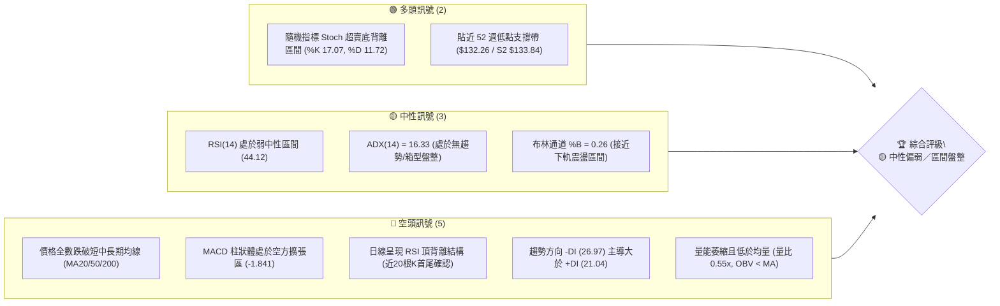
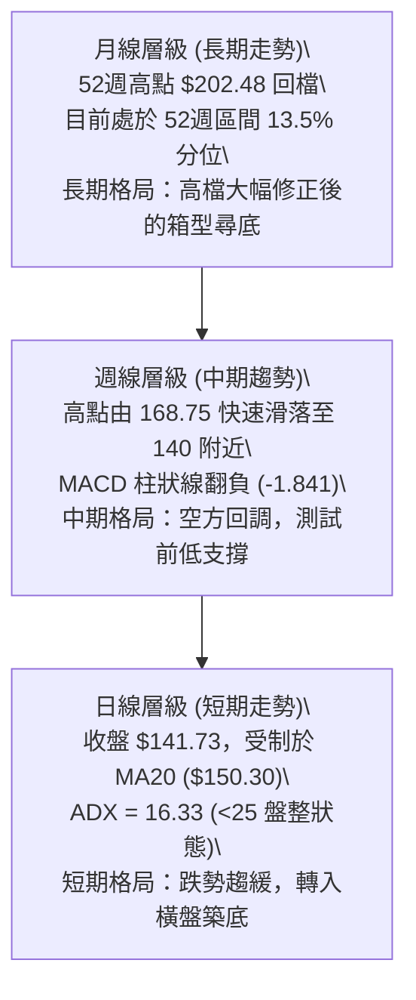
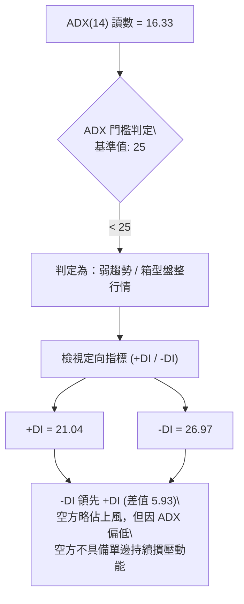
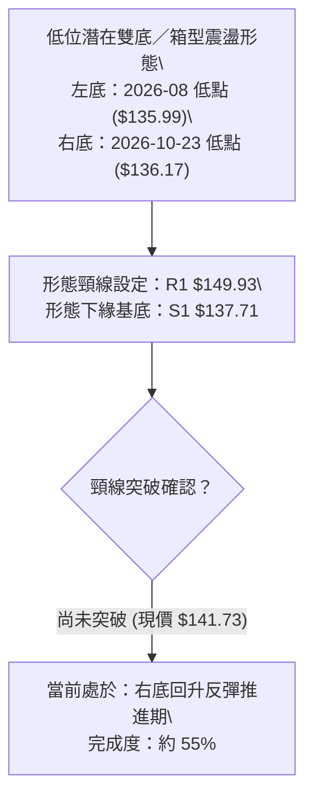
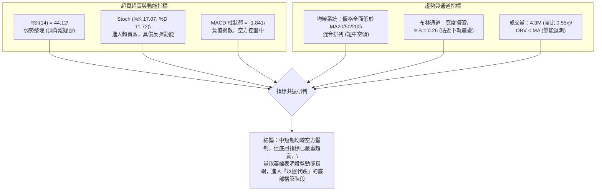
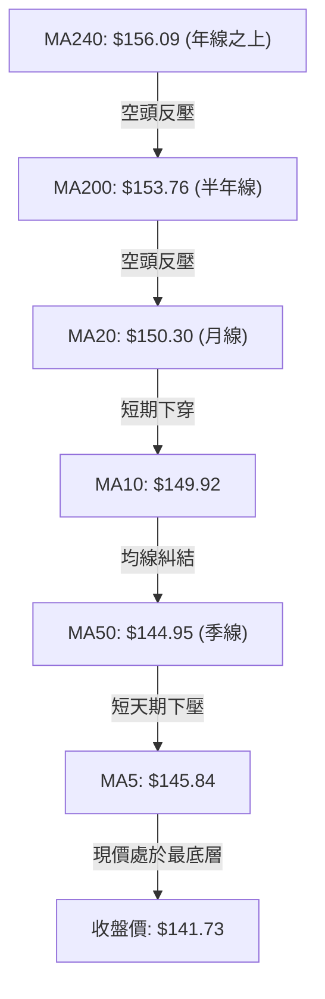
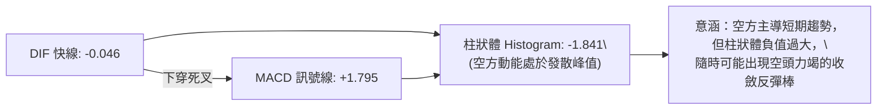
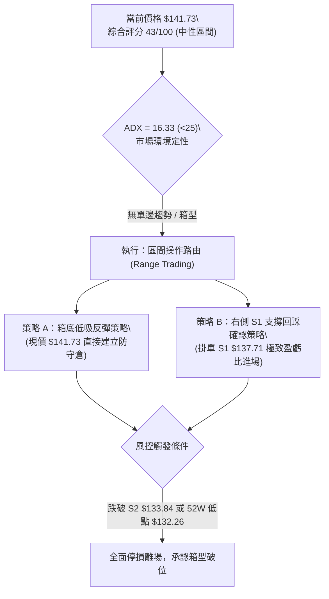
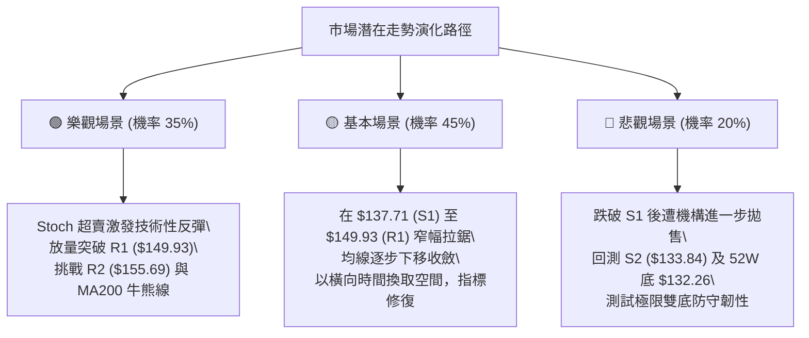

# VST 技術分析報告

> **報告日期**：2026-10-27 ｜ **語言**：繁體中文 ｜ **數據來源**：Yahoo Finance ｜ **當前價格**：$141.73

---

## 目錄

| 章節 | 內容 |
|------|------|
| [1. 技術面概覽](#1-技術面概覽) | 訊號儀表板、核心指標、評分卡 |
| [2. 趨勢分析](#2-趨勢分析) | 多時框趨勢、長中短期走勢、ADX 解讀 |
| [3. 圖表形態分析](#3-圖表形態分析) | 形態識別、K線組合、目標價推算 |
| [4. 支撐與阻力](#4-支撐與阻力) | 關鍵價位、斐波那契回調結構 |
| [5. 技術指標深度解讀](#5-技術指標深度解讀) | MA/RSI/MACD/布林/量價配合 |
| [6. 動能與波動率](#6-動能與波動率) | 動能四象限、ATR、Beta 與市場連動 |
| [7. 多時框架總結](#7-多時框架總結) | 時框架評分矩陣、多時框收斂結論 |
| [8. 交易策略建議](#8-交易策略建議) | 策略路由、情境階梯、主策略詳情 |
| [9. 風險提示與監控](#9-風險提示與監控) | 監控清單、情境推演、風控規則 |
| [📋 報告總結](#-報告總結) | 核心結論與策略配置總結 |

---

## 1. 技術面概覽

### 🎯 技術訊號儀表板



---

### 📊 核心指標速覽表

| 指標類別 | 指標名稱 | 當前數值 | 訊號 | 解讀 |
|----------|----------|----------|------|------|
| **價格** | 當前收盤價 | $141.73 | 🔴 | 位於 52 週區間底部 13.5%，承受均線下壓 |
| **均線** | MA20 | $150.30 | 🔴 | 價格低於 MA20 (-5.70%)，短期趨勢承壓 |
| **均線** | MA50 | $144.95 | 🔴 | 價格低於 MA50 (-2.22%)，中期生命線受阻 |
| **均線** | MA200 | $153.76 | 🔴 | 價格低於 MA200 (-7.82%)，長期牛熊分界線失守 |
| **動能** | RSI(14) | 44.12 | 🟡 | 弱勢中性區間；近 20 根 K 棒出現指標頂背離警訊 |
| **動能** | MACD (12/26/9) | -0.046 / 柱 -1.841 | 🔴 | 快慢線死叉且柱狀體負向擴大，空頭動能主導 |
| **動能** | Stoch %K / %D | 17.07 / 11.72 | 🟢 | 進入 20 以下嚴重超賣區，具備短線反彈醞釀契機 |
| **趨勢** | ADX(14) | 16.33 (-DI: 26.97) | 🟡 | ADX < 25 代表無單邊趨勢，屬於空方佔優的弱勢盤整 |
| **波動** | ATR(14) | $7.67 (5.41%) | 🟡 | 波動度屬中等偏高，日震盪空間較大 |
| **量能** | 當日量 / 20日均量 | 4.30M / 7.88M | 🔴 | 成交量比僅 0.55x，呈現量縮，OBV 處於 MA 之下 |

---

### 🏆 技術評分卡

```
╔════════════════════════════════════════════════════════════════╗
║               技術評分卡 — VST (2026-10-27)                    ║
╠════════════════════════════════════════════════════════════════╣
║ 趨勢強度      ███████░░░░░░░░░░░░░  35/100  🔴 弱趨勢/偏空主導 ║
║ 動能指標      ████████░░░░░░░░░░░░  40/100  🟡 弱勢動能/超賣   ║
║ 支撐穩定度    █████████████░░░░░░░  65/100  🟢 臨近年線波段低點 ║
║ 成交量配合    ███████░░░░░░░░░░░░░  35/100  🔴 量能退潮/OBV疲弱║
║ 形態完整度    ██████████░░░░░░░░░░  50/100  🟡 區間築底型態中 ║
║ 均線排列      ███████░░░░░░░░░░░░░  35/100  🔴 均線倒掛混合空頭 ║
╠════════════════════════════════════════════════════════════════╣
║ 綜合評分      █████████░░░░░░░░░░░  43/100  🟡 中性偏弱 (區間) ║
╚════════════════════════════════════════════════════════════════╝
（註：綜合評分 = (35 + 40 + 65 + 35 + 50 + 35) / 6 = 43.33，四捨五入為 43/100，符合規則 18）
```

---

## 2. 趨勢分析

### 🌐 多時框趨勢分析



---

### 📈 長期趨勢 — 12個月走勢圖（Unicode）

依據過去 12 個月收盤價格數據（2025-10 至 2026-10）繪製走勢軌跡：

```
VST 月線走勢圖（過去12個月：2025-10 至 2026-10）
價格軸 ($)
$190 ┤●(187.21)
$180 ┤    ●(177.83)
$170 ┤                  ●(173.13)
$160 ┤        ●(160.62)●(157.65)    ●(157.36)●(159.74)●(158.37)
$150 ┤                                  ●(149.87)
$140 ┤                                              ●(147.95)   ●(141.73)←現價
$130 ┤                                                  ●(137.15)●(138.35)
     └─────────────────────────────────────────────────────────────
       10   11   12   01   02   03   04   05   06   07   08   09   10  (月份)
      2025             2026
```

#### 走勢特徵分析表格

| 階段區間 | 起訖月份 | 收盤區間 ($) | 區間漲跌幅 | 主要走勢特徵與結構 |
|----------|----------|--------------|------------|--------------------|
| **高位降溫期** | 2025-10 → 2025-12 | 187.21 → 160.62 | -14.20% | 自歷史天價區見頂回落，多頭籌碼出現顯著鬆動 |
| **次高點震盪** | 2026-01 → 2026-02 | 157.65 → 173.13 | +9.82%  | 展開反彈測試阻力，但未能突破前高，形成中期次高頂部 |
| **平台整理期** | 2026-03 → 2026-06 | 149.87 → 158.37 | +5.67%  | 在 $150–$160 區間建立橫向整理平台，波動率收斂 |
| **破落下探期** | 2026-07 → 2026-08 | 158.37 → 137.15 | -13.40% | 整理平台失守，價格摜壓至全波段低點 $137.15 |
| **築底收斂期** | 2026-09 → 2026-10 | 137.15 → 141.73 | +3.34%  | 於波段低點展開防守，成交量驟減，進入低位箱型築底 |

---

### 📊 中期趨勢（週線分析）

```
VST 週線關鍵結構與近期壓力支撐示意圖
═════════════════════════════════════════════════════════════════
 $168.75 ┬────────────────────────────────────────── 10/09 波段高點 (R3 $168.67)
         │  ▲ (假突破出貨)
 $160.00 ┤ ┌┴┐
         │ │ │
 $150.00 ┤ │ ├────────────── 週線頸線/密集交投區 (R1 $149.93 / MA20 $150.30)
         │ │ │
 $141.73 ┼─┼─┴────── 現價位 ($141.73，受制於反彈壓力)
         │ │
 $136.17 ┤ │   ┌┐ 
         │ └───┘┴────────── 10/23 週長下影線探底處 (支撐 S1 $137.71 附近)
 $132.26 ┴────────────────────────────────────────── 52週歷史低點 (S2 $133.84)
═════════════════════════════════════════════════════════════════
```

---

### ⚡ 趨勢強度評估（ADX 解讀）



#### ADX 趨勢強度對照表

| 指標名稱 | 當前數值 | 參考閾值 | 市場狀態評估 | 策略意涵 |
|----------|----------|----------|--------------|----------|
| **ADX(14)** | 16.33 | < 20 極弱；20–25 弱；> 25 趨勢確立 | **極弱勢盤整** | 追價操作極易遭受雙巴，應嚴格採取高拋低吸 |
| **+DI(14)** | 21.04 | — | 多方反擊動能偏弱 | 突破阻力位往往需要更大資金量能確認 |
| **-DI(14)** | 26.97 | — | 空方掌控主要盤面節奏 | 價格仍受均線壓制，尚未具備單邊反轉條件 |
| **綜合判定**| -DI > +DI | 差值 5.93 | **無趨勢空向震盪** | 以區間下軌防守、上軌減碼為核心思維 |

---

## 3. 圖表形態分析

### 🔍 形態識別系統



#### 圖表形態信心度評估表

| 形態名稱 | 信心度 | 判斷依據（引用數據） | 完成度 | 目標價（附嚴謹計算式） |
|----------|--------|----------------------|--------|------------------------|
| **低位箱型 / 潛在雙底** | 62% | 8/21 週低點 $135.99 與 10/23 日低點 $136.17 形成對應支撐，均在 S1 ($137.71) 附近止跌回升 | 55% | 頸線 R1 ($149.93) + 形態高度 ($149.93 - $137.71 = $12.22) = **$162.15** |
| **均線死叉空方壓制** | 78% | MA20 ($150.30)、MA50 ($144.95) 與 MA200 ($153.76) 全面位於現價上方，呈阻力蓋頂 | 85% | 由形態阻力推算：若反彈受阻於 MA50，回測前低目標為 S1 **$137.71** |

---

### 🕯️ 重要 K 線形態分析

嚴格依據提供的「近 10 根日 K」與「近 8 根週 K」實際 OHLCV 數據進行判讀：

| 日期（日K/週K） | 開 | 高 | 低 | 收 | 成交量 | K線形態名稱 | 技術解讀 | 訊號強度 |
|-----------------|-----|-----|-----|-----|--------|-------------|----------|----------|
| **2026-10-21 (日)** | 153.35 | 158.74 | 151.83 | 156.14 | 5,093,600 | 帶上影中陽線 | 向上衝擊 R2 ($155.69) 後遭空方壓回，多頭動能消耗 | 🟡 中性偏多 |
| **2026-10-22 (日)** | 153.00 | 154.27 | 139.10 | 140.83 | 12,469,400 | 放量長黑破位棒 | 一舉貫穿 MA50 與整數關卡，爆出 12.4M 巨量恐慌殺盤 | 🔴 強烈看空 |
| **2026-10-23 (日)** | 139.06 | 141.52 | 136.17 | 140.16 | 6,740,500 | 探底長下影錘頭 | 最低探至 $136.17 逼近 S1 後獲逢低買盤拉抬，收盤翻回開盤上方 | 🟢 短線止跌 |
| **2026-10-26 (日)** | 140.90 | 143.52 | 139.07 | 141.73 | 4,299,400 | 量縮修復小陽線 | 價格企穩於前日收盤之上，但量能縮至 4.3M，屬弱勢反彈孕育線 | 🟡 中性築底 |
| **2026-10-09 (週)** | 144.04 | 168.75 | 140.90 | 161.48 | 59,368,900 | 爆量長上影大陽 | 衝擊 R3 ($168.67) 遇歷史解套賣壓，59.3M 週成交量顯示籌碼換手激化 | 🟡 多空交戰 |
| **2026-10-16 (週)** | 162.67 | 164.25 | 145.85 | 152.02 | 31,699,400 | 倒轉高檔中黑棒 | 開高走低跌破當週開盤價，確立波段高點反轉，形成短套牢區 | 🔴 空方反噬 |
| **2026-10-23 (週)** | 154.10 | 158.74 | 136.17 | 140.16 | 31,911,100 | 長下影長黑棒 | 深度洗盤回測 S1 支撐 ($137.71)，長下影線顯示 $136 具備承接買力 | 🟡 支撐確認 |

---

### 📉 ASCII 走勢形態示意圖

```
VST 日 K 棒形態結構解析圖 (2026-10-20 至 2026-10-26)
價格軸
$158 ┤      ┌┐ (10/21 高點 158.74 遭壓回)
$154 ┤      ││  ┌┐ (10/22 開盤 153.00)
$150 ┤      └┘  ││
$146 ┤          ││
$142 ┤          ││          ┌┐ (10/26 收 141.73)
$138 ┤          └┘ (長黑收140.83) ┌┐││
$136 ┤           │               └┴┘ (10/23 探底長下影 136.17 回升)
     └──────────────────────────────────────────────
       10/20   10/21    10/22    10/23    10/26 (交易日)
```

---

### 🎯 形態目標價計算

根據日線雙底／箱型下緣企穩反彈之形態測量：
1. **形態下邊界（基底支撐）**：以聚類波段支撐低點 **S1 = $137.71** 為基準。
2. **形態頸線位（箱頂阻力）**：以近一年聚類高點波段阻力 **R1 = $149.93** 為基準。
3. **垂直形態高度（Height）**：
   $$\text{形態高度} = \text{頸線 R1} - \text{基底 S1} = \$149.93 - \$137.71 = \$12.22$$
4. **最小量度等幅目標價（若突破頸線 R1）**：
   $$\text{目標價} = \text{頸線 R1} + \text{形態高度} = \$149.93 + \$12.22 = \$162.15$$
   *(該目標價恰好坐落於 R2 $155.69 與 R3 $168.67 之間，並接近斐波那契 50.0% 回調位 $167.37)*。

---

## 4. 支撐與阻力

### 🗺️ 關鍵價位分布圖（Unicode）

```
VST 價位結構分布圖
═══════════════════════════════════════════════════════════════════
$168.67 ║████████████████████████████████████████║ 強阻力 R3 (波段高點/布林上軌)
$159.08 ║────────────────────────────────────────║ 斐波那契 61.8% 重要壓力
$155.69 ║████████████████████████████            ║ 中期阻力 R2 (反彈阻力位)
$150.30 ║┄┄┄┄┄┄┄┄┄┄┄┄┄┄┄┄┄┄┄┄┄┄┄┄┄┄┄┄┄┄┄┄┄┄┄┄║ 布林中軌 (MA20) 重疊防線
$149.93 ║████████████████████████████████        ║ 關鍵阻力 R1 (頸線壓力區)
$147.29 ║────────────────────────────────────────║ 斐波那契 78.6% 回調分水嶺
$141.73 ╠════════════════════════════════════════╣ ◄ 當前收盤價 ($141.73)
$137.71 ║▓▓▓▓▓▓▓▓▓▓▓▓▓▓▓▓▓▓▓▓▓▓▓▓▓▓▓▓▓▓        ║ 近期核心支撐 S1 (波段低點聚類)
$133.84 ║████████████████████████████████        ║ 強支撐 S2 (密集防守區)
$132.26 ║████████████████████████████████████████║ 斐波那契 100% / 52週最低點
═══════════════════════════════════════════════════════════════════
```

---

### 🚧 阻力位分析表

所有價位均直接取自系統計算之波段聚類數據，無任何臆測：

| 阻力級別 | 準確價位 | 距現價幅動 | 形成原因與籌碼技術面背景 | 突破難度評估 | 重要性等級 |
|----------|----------|------------|--------------------------|--------------|------------|
| **R1** | **$149.93** | +5.79% | 近一年波段高點密集聚類，重疊日線 MA10 ($149.92) 與 MA20 ($150.30) | 🟡 中等（需放量逾 8M 突破） | ★★★★☆ |
| **R2** | **$155.69** | +9.85% | 10/21 反彈高點密集群，逼近 MA240 ($156.09) 與 MA200 ($153.76) 牛熊線 | 🔴 偏高（套牢量能堆疊深厚） | ★★★★☆ |
| **R3** | **$168.67** | +19.01% | 10/09 週長上影線頂端聚類，重合日線布林上軌 ($168.30) 及斐波那契 50% | 🔴 極高（中期強阻力天花板） | ★★★★★ |

---

### 🛡️ 支撐位分析表

所有價位均直接取自系統計算之波段聚類數據：

| 支撐級別 | 準確價位 | 距現價幅動 | 形成原因與籌碼技術面背景 | 守住機率評估 | 重要性等級 |
|----------|----------|------------|--------------------------|--------------|------------|
| **S1** | **$137.71** | -2.84% | 近一年波段低點聚類，10/23 下影線驗證處，機構逢低護盤關鍵防線 | 🟢 70%（短期雙底頸部基石） | ★★★★☆ |
| **S2** | **$133.84** | -5.57% | 近一年波段次級低點聚類，逼近日線布林下軌 ($132.30) | 🟢 85%（多頭極限防守底線） | ★★★★★ |
| **52W Low** | **$132.26** | -6.68% | 52 週年度歷史最低點，斐波那契 100.0% 絕對起漲錨定點 | 🟢 90%（跌破意味結構瓦解） | ★★★★★ |

---

### 📐 斐波那契回調位分析

依據 52 週區間高點 **$202.48** 至低點 **$132.26** 之標準黃金分割回調序列：

| 回調比率 | 準確價位 ($) | 距現價幅度 | 技術意義解讀與當前相對位置 |
|----------|--------------|------------|----------------------------|
| **0.0% (52W High)** | $202.48 | +42.86% | 歷史牛市頂峰，強烈心理與實質壓力極限 |
| **23.6%** | $185.91 | +31.17% | 弱勢修正極限，前期高檔密集震盪區下緣 |
| **38.2%** | $175.66 | +23.94% | 黃金分割中繼位，若有效反彈之多方強勢目標 |
| **50.0%** | $167.37 | +18.09% | 多空平衡分水嶺，與 R3 ($168.67) 形成強共振阻力帶 |
| **61.8%** | $159.08 | +12.24% | 黃金分割防守位，反彈轉強之關鍵門檻 |
| **78.6%** | $147.29 | +3.92% | **上方最近回調阻力**，突破此位方能確認擺脫底部糾結 |
| **現價落點** | **$141.73** | 0.00% | **目前精確落於 78.6% ($147.29) 與 100.0% ($132.26) 之間** |
| **100.0% (52W Low)**| $132.26 | -6.68% | 全波段大底支撐，不可跌破之生命線 |

**深入解讀**：現價位於 52 週波動範圍的 13.5% 極低水位，處於 78.6% 回調線下方，顯示過去數月的修正相當深幅。此區間通常蘊含強烈的均值回歸拉力，下檔至 100.0% ($132.26) 僅剩 6.68% 緩衝空間，而往上至 61.8% ($159.08) 則有超過 12% 的回補空間，下行風險邊際顯著收斂。

---

## 5. 技術指標深度解讀

### 🎛️ 指標訊號總覽



---

### 📈 移動平均線排列分析



#### 均線系統詳細參數與偏離度

| 均線代號 | 當前價格 ($) | 距現價差距 ($) | 距現價幅度 (%) | 走勢方向 | 排列狀態與技術解讀 |
|----------|--------------|----------------|----------------|----------|--------------------|
| **MA5** | $145.84 | -$4.11 | -2.82% | ▼ 下行 | 超短期動能轉弱，短沖資金退場 |
| **MA10** | $149.92 | -$8.19 | -5.46% | ▼ 下行 | 短期快速滑落，形成短線反彈首道屏障 |
| **MA20** | $150.30 | -$8.57 | -5.70% | ▼ 下行 | 月線反壓強烈，與布林中軌同值重疊 |
| **MA50** | $144.95 | -$3.20 | -2.21% | ▼ 下行 | 季線微幅下彎，為最近距離之反彈壓力 |
| **MA60** | $144.93 | -$3.20 | -2.21% | ▼ 下行 | 與 MA50 形成雙重密集均線反壓區 |
| **MA120** | $149.47 | -$7.74 | -5.18% | ▼ 下行 | 半年線下行，顯示中期籌碼處於虧損狀態 |
| **MA200** | $153.76 | -$12.03 | -7.82% | ▼ 下行 | 長期牛熊分水嶺失守，長線資金觀望 |
| **MA240** | $156.09 | -$14.36 | -9.20% | ▼ 下行 | 終極年線壓力，上方長期套牢解套位 |

---

### 📉 RSI(14) 分析

- **當前讀數**：44.12（Wilder 平滑計算）
- **區間進度條**：
  `[0] ░░░░░░░░░░░░░░░░░░░░░░░░░░░░░░░▓▓▓▓▓▓▓▓▓▓▓▓░░░░░░░░░░░░░░░░░░ [100]`
  *(目前處於 44.12% 分位，坐落於 30–70 中性偏弱區間)*
- **超買超賣判定**：數值未跌破 30，尚未進入極端超賣，但呈現弱勢空方主導特徵。
- **背離分析**：系統標記近 20 根 K 棒存在 **「頂背離（Bearish Divergence）」**。檢視走勢，10 月上旬價格曾由 $140 衝至高點 $168.75，而 RSI 自高位回落後未能隨價格創出新高，隨後引發本波自 $168.75 急殺至 $136.17 的下行回調。當前 RSI 在 44.12 企穩，短期暫無新的底背離訊號，仍需時間進行橫向收斂修復。

---

### 📊 MACD(12/26/9) 訊號解讀



- **MACD 線**：-0.046，已正式跌入零軸下方，確認中期轉入空方管轄領域。
- **訊號線（Signal）**：+1.795，仍在零軸上方緩步下降。
- **柱狀體（Histogram）**：-1.841，呈現顯著負值，顯示短線下殺動能強烈，但負向乖離偏大時，技術性跌深反彈往往一觸即發。

---

### 📦 布林通道分析

```
VST 布林通道價格空間示意圖 (Bandwidth: $36.00)
════════════════════════════════════════════════════════════════
 $168.30 ┬────────────────────────────────────────── 上軌 (Upper Band)
         │
         │
 $150.30 ┼────────────────────────────────────────── 中軌 (MA20)
         │
 $141.73 ┼───────────── 現價 ($141.73, %B = 0.26)
         │
 $132.30 ┴────────────────────────────────────────── 下軌 (Lower Band)
════════════════════════════════════════════════════════════════
```

- **軌道狀態**：上軌 $168.30，中軌 $150.30，下軌 $132.30。
- **位置係數 %B**：0.26（0 代表下軌，$132.30；0.5 代表中軌，$150.30；1 代表上軌，$168.30）。
- **解讀**：現價處於下半通道（%B < 0.5），正逐步朝下軌靠攏，顯示價格受到均線下推；但並未跌破下軌（未發生破軌超跌），下軌 $132.30 與 52 週最低點 $132.26 形成精準重合，構成固若金湯的底線防禦。

---

### 💹 成交量分析（量價配合度）

1. **成交量數據**：最新日成交量為 **4,299,400 股**，對比 20 日均量 **7,882,115 股**，量比僅為 **0.55x**；對比 50 日均量 **5,783,246 股** 亦明顯偏低。
2. **量價配合關係**：10/22 大跌時爆出 12.47M 巨量，顯示停損賣壓湧現；但在 10/23 探底與 10/26 回升時，成交量迅速縮至 6.74M 及 4.30M。量縮反彈代表買盤意願謹慎，但「量縮不再破底」亦代表浮額清洗已近尾聲，空頭砸盤力量顯著竭盡。
3. **OBV（能量潮）分析**：當前系統顯示 **OBV < MA**，指標位於短期均線下方，顯示籌碼整體仍處於淨流出後的沉澱期，尚未見到機構大規模連續建倉的爆量「紅量柱」。

---

## 6. 動能與波動率

### ⚡ 動能評估四象限

```
              高動能 (High Momentum)
                     │
       Q3: 高風險高收益│  Q1: 最佳多頭機會
       (強動能/高波動)│  (強動能/低波動)
                     │
── 低波動 ───────────┼─────────── 高波動 ──
  (Low Volatility)   │  (High Volatility)
                     │
       Q2: 謹慎觀望/盤整│  Q4: 避免進場/下行風險
       (弱動能/低波動)│  (弱動能/高波動)
               ★ VST │
              低動能 (Low Momentum)
```

#### 動能狀態評估矩陣

| 象限標記 | 動能維度 | 波動維度 | VST 當前定位 | 狀態特徵與應對方針 |
|----------|----------|----------|--------------|--------------------|
| **Q1** | 強動能 | 低波動 | — | 穩健牛市單邊上升，順勢加碼 |
| **Q2** | **弱動能** | **低/中波動** | **✓ 正處於此區** | **ADX=16.33 顯示無動能，價格回落至箱底，波動率收斂，適合區間防守** |
| **Q3** | 強動能 | 高波動 | — | 主升浪爆量突破，高風險博弈 |
| **Q4** | 弱動能 | 高波動 | — | 暴跌主跌段，嚴禁逆勢抄底 |

---

### 📊 ATR 波動率分析

- **ATR(14) 讀數**：**$7.67**（佔股價比例為 **5.41%**，Wilder 平滑）。
- **波動特性評估**：每日平均震盪幅度達 $7.67，代表該標的具備極高的日內彈性與價格彈跳力，屬於高波動公用事業獨立發電商（IPP）。
- **風控止損距建議**：
  - *短期日內止損（1.0x ATR）*：距進場點保留 **$7.67** 緩衝空間。
  - *波段防守止損（1.5x ATR）*：距進場點保留 **$11.50** 緩衝空間。
  - *實戰應用*：在現價 $141.73 進場，若設 1.0x ATR 止損，價位剛好落在 $134.06（緊貼支撐 S2 $133.84），可有效避免被隨機雜訊掃出場。

---

### 📐 Beta 與市場相關性

- **Beta 係數**：**1.384**。
- **市場連動分析**：儘管 VST 隸屬於公用事業板塊（Utilities），但由於其業務高度涉足核能發電、AI 數據中心電力採購協議（PPA）與獨立發電批發市場，其波動性遠高於傳統防禦型公用事業（傳統 Utility Beta 通常介於 0.5–0.7）。1.384 的高 Beta 意味著其價格放大標普 500 指數近 1.4 倍的震盪，具備強烈的科技成長與電力商品雙重屬性，在市場風險偏好改善時具備優異彈性。

---

## 7. 多時框架總結

### 📋 時框架評分表

| 時框架 | 趨勢方向 | 動能指標 | 均線排列 | 圖表形態 | 綜合評分 | 操作建議方向 |
|--------|----------|----------|----------|----------|----------|--------------|
| **月線 (長期)** | 🟡 廣義多頭回檔 | 45/100 (弱) | 60/100 (多頭回踩) | 50/100 (高位箱型) | 52/100 | 長期分批低吸，無破位危機 |
| **週線 (中期)** | 🔴 空方回調修正 | 35/100 (疲軟) | 40/100 (均線糾結) | 50/100 (下影線尋底)| 42/100 | 中期等待突破頸線確認信號 |
| **日線 (短期)** | 🟡 箱型弱勢築底 | 40/100 (超賣反彈) | 35/100 (反壓沉重) | 55/100 (雙底雛形) | 43/100 | 嚴守箱體下緣低吸，嚴禁追高 |

---

### 🔲 綜合訊號矩陣

```
訊號維度矩陣檢核表
═══════════════════════════════════════════════════════════════════
 維度       短期 (日線)          中期 (週線)          長期 (月線)
───────────────────────────────────────────────────────────────────
 趨勢走向   🔴 偏弱盤整          🔴 下行修正          🟢 大週期高位
 均線系統   🔴 全數失守          🟡 糾結測試          🟢 遠高於長期均線
 動能指標   🟢 Stoch 超賣回升    🔴 MACD 柱線翻黑     🟡 RSI 偏弱中性
 支撐阻力   🟢 緊鄰 S1 核心支撐   🟢 守於 S2 關鍵位上  🟢 52W 底線未破
 量價狀態   🟡 低檔極致量縮      🔴 高檔爆量後退潮    🟡 均量平穩
═══════════════════════════════════════════════════════════════════
 一致性結論：短中期處於深度回調末端，長線結構未死，多時框在此形成「築底收斂」。
```

---

### ⚖️ 多時框收斂結論

嚴格遵循本報告規範之「規則 14」進行多時框架衝突收斂：
1. **趨勢/盤整環境判定**：當前 ADX(14) 讀數為 **16.33 (< 25)**，明確定義當前市場為 **「盤整行情（Consolidation Market）」**，而非單邊趨勢行情。
2. **主導維度依歸**：在 ADX < 25 的盤整結構中，日線級別之 **布林通道軌道（$132.30 – $168.30）** 與本報告計算之 **波段支撐阻力區間（S1 $137.71 至 R1 $149.93）** 為主導交易區間。
3. **唯一收斂結論**：**🟡 中性觀望／區間低吸震盪（Neutral Range-Bound）**。雖然短中期均線空頭排列，但空方無趨勢擴散能力（ADX 極弱且量縮），且指標已達極端超賣，嚴禁在箱體底部追空；應以波段下緣（S1 $137.71 / S2 $133.84）作為多方防守基準，進行區間反彈操作。此結論與後續第 8 章交易策略完全一致。

---

## 8. 交易策略建議

### 🗺️ 策略決策流程圖



---

### 🧭 策略路由

> **當前主策略方向 = 區間震盪操作（依綜合評分 43/100，落於 40–60 區間操作區間）**  
> 說明：依據評分分流機制，當前不具備單邊做空條件（超賣＋量縮＋臨近大底），亦不具備單邊強烈作多條件（均線反壓蓋頂）。主策略聚焦於 **「以布林下軌及 S1 支撐為防守點的區間波段操作，等待阻力位獲利了結」**。

---

### 🎯 價格情境階梯（Price Scenarios）

所有觸發價位與目標階梯完全嚴格引用第 4 章數據：

| 觸發條件 | 下一目標價 | 後續延伸目標 | 情境技術含義與市場行為 |
|----------|------------|--------------|------------------------|
| **向上突破 R1 ($149.93)** | **R2 ($155.69)** | **R3 ($168.67)** | 短線轉強，突破月線與頸線，展開等幅測量上攻 |
| **站穩現價區間 ($141.73)**| **R1 ($149.93)** | **MA20 ($150.30)** | 箱型下緣反彈成型，測試上方首道沉重均線壓力 |
| **跌破 S1 ($137.71)** | **S2 ($133.84)** | **52W Low ($132.26)** | 弱勢下探，尋求年線最終大底支撐，洗盤加劇 |

---

### 📊 情境機率分佈

```
情境機率分佈圓餅比例示意
繼續上行/反彈 (35%) ▓▓▓▓▓▓▓
區間震盪築底 (45%) ▓▓▓▓▓▓▓▓▓
破位回落下探 (20%) ▓▓▓▓
```

| 未來情境劇本 | 預估機率 | 主要技術與量價依據 |
|--------------|----------|--------------------|
| **區間震盪築底** | **45%** | ADX 僅 16.33 (<25) 確認無趨勢；成交量大縮至 4.3M 進入休眠，布林中下軌提供彈性震盪箱體 |
| **繼續上行/測試 R1 反彈** | **35%** | 隨機指標 Stoch 超賣黃金交叉醞釀；下影線錘頭確認逢低買盤；距 R1 阻力尚有近 6% 均值回歸空間 |
| **回落再探底 (測試 S2)** | **20%** | MACD 柱狀體尚在負值擴散 (-1.841)；均線呈現下壓空頭排列；若大盤劇震仍可能二次探底 |

---

### 🟢 主策略詳情

本策略之風險報酬比嚴格遵循規則 17 定義：  
$$\text{做多風險報酬比 (以 T1 計)} = \frac{\text{目標價 T1} - \text{進場價}}{\text{進場價} - \text{止損價}}$$

| 策略要素 | 策略 A：現價左側低吸策略 | 策略 B：S1 回踩極致風控策略 |
|----------|--------------------------|------------------------------|
| **進場條件** | 依現價在超賣區啟動分批佈局 | 回踩支撐 S1 不破、出現短分時底背離 |
| **進場價格** | **$141.73**（當前精確收盤價） | **$137.71**（精準引用支撐位 S1） |
| **目標價 T1** | **$149.93**（精準引用阻力位 R1） | **$149.93**（精準引用阻力位 R1） |
| **目標價 T2** | **$155.69**（精準引用阻力位 R2） | **$155.69**（精準引用阻力位 R2） |
| **止損價格** | **$133.84**（精準引用支撐位 S2） | **$132.26**（精準引用 52 週最低點） |
| **風險報酬比 (T1)**| **1 : 1.04（以 T1 計）**<br>*(計算：(149.93-141.73)/(141.73-133.84) = 8.20/7.89 = 1.039)* | **1 : 2.24（以 T1 計）**<br>*(計算：(149.93-137.71)/(137.71-132.26) = 12.22/5.45 = 2.242)* |
| **風險報酬比 (T2)**| **1 : 1.77（以 T2 計）**<br>*(計算：(155.69-141.73)/7.89 = 13.96/7.89 = 1.769)* | **1 : 3.30（以 T2 計）**<br>*(計算：(155.69-137.71)/5.45 = 17.98/5.45 = 3.299)* |
| **預估勝率** | 55% | 65% |
| **建議總倉位** | 10% – 15%（輕倉防禦型） | 15% – 20%（回踩加碼型） |

---

### 🔴 反向風險觸發點（對沖提示）

若發生以下盤面異動，本區間做多邏輯即告失效，投資人應即刻執行停損或轉向空頭避險：
1. **破位信號**：日線收盤價跌破 **S2 $133.84**，甚至進一步貫穿 **52W 最低點 $132.26**。
2. **量能異動**：跌破上述價位時伴隨單日成交量放大至 **1,000 萬股以上**（爆量破位下殺）。
3. **對沖建議**：跌破 $132.26 後，原箱型防守完全瓦解，將引發停損骨牌效應，應立即清倉多頭，並可反手以跌破點為止損建立短期避險部位。

---

### ⭐ 整體訊號強度評星

```
做多訊號強度：★★☆☆☆  (2.5/5星 — 處於左側低吸階段，需待右側突破確認)
做空訊號強度：★★☆☆☆  (2.0/5星 — 雖然均線空頭，但底部超賣且量縮，追空盈虧比奇差)
整體策略可信度：★★★☆☆  (3.5/5星 — 基於客觀支撐阻力之區間操作，風控界限分明)
```

---

## 9. 風險提示與監控

### ✅ 關鍵監控指標 Checklist

```
╔══════════════════════════════════════════════════════════════════╗
║               VST 核心技術面監控清單 (Checklist)                 ║
╠══════════════════════════════════════════════════════════════════╣
║ [ ] 每日收盤價是否嚴格守穩 S1 ($137.71) 與 S2 ($133.84) 之上     ║
║ [ ] RSI(14) 能否由 44.12 向上突破 50 中軸分水嶺                 ║
║ [ ] MACD 柱狀體負值是否由 -1.841 出現收斂拐點 (縮小至 -1.0 以內) ║
║ [ ] 單日成交量反彈時能否有效放大至 20日均量 (7.88M) 之上         ║
║ [ ] 價格上攻 R1 ($149.93) 時是否遭到 MA20 ($150.30) 強烈壓制    ║
║ [ ] ADX(14) 是否持續維持在 25 以下 (若突破 25 需警惕單邊方向確立)║
╚══════════════════════════════════════════════════════════════════╝
```

---

### ⚠️ 風險場景分析



---

### 🛡️ 風險管理重要提醒

1. **基本面催化劑風險**：近期市場對 AI 數據中心用電預期重新定價，且公司近期財報顯示最新季度營收年減 -5.5%、淨利年減 -6.7%，基本面短線處於逆風期。儘管分析師共識目標價高達 $208.86（評級為 Strong Buy），但在技術面築底尚未由量能確認前，不可因基本面遠景而盲目重倉。
2. **高槓桿財務體質風險**：資產負債表中總負債高達 $20.51B，Debt/Equity 高達 373.28，流動比率 0.973、速動比率 0.258 偏低。在利率維持高檔環境下，財務槓桿會放大股價波動，此即 Beta 高達 1.384 的核心驅因。
3. **倉位管理鐵律**：
   - 單筆策略虧損上限控制在總帳戶資金的 **1.0% – 1.5%** 之內。
   - 由於日波幅 ATR 高達 $7.67（5.41%），部位規模應適度縮減至常態部位的 **60% – 70%**，避免因盤中正常波動而觸發不必要的震盪止損。

---

## 📋 報告總結

```
╔════════════════════════════════════════════════════════════════╗
║                   VST 技術分析報告總結                         ║
╠════════════════════════════════════════════════════════════════╣
║ 報告日期：2026-10-27                                           ║
║ 當前價格：$141.73                                              ║
║ 分析評級：🟡 中性偏弱／區間盤整 (技術評分: 43/100)             ║
╠════════════════════════════════════════════════════════════════╣
║ 關鍵技術結論：                                                 ║
║ ├─ 長期趨勢：🟢 大週期高位拉回尋底，年線上方維持長多架構      ║
║ ├─ 中期趨勢：🔴 跌破週線短期平台，由波段高點 $168.75 回檔修正 ║
║ ├─ 短期趨勢：🟡 短線急跌後企穩，於 $136–$141 構築雙底支撐帶   ║
║ ├─ 關鍵支撐：S1 $137.71 ｜ S2 $133.84 ｜ 52W 低點 $132.26     ║
║ ├─ 關鍵阻力：R1 $149.93 ｜ R2 $155.69 ｜ R3 $168.67           ║
║ └─ 機構共識：22 位分析師評級 Strong Buy，目標均價 $208.86      ║
╠════════════════════════════════════════════════════════════════╣
║ 最優交易策略組合：                                             ║
║ 1. 🥇 最佳機會：策略 B (回踩 S1 $137.71 低吸，風報比 1:2.24)   ║
║ 2. 🥈 次選機會：策略 A (現價 $141.73 輕倉布局，風報比 1:1.04)  ║
║ 3. 🥉 保守選擇：空倉觀望，靜待放量突破 R1 $149.93 後右側順勢追 ║
╚════════════════════════════════════════════════════════════════╝
```

---

> ⚠️ **免責聲明**：本報告為技術分析研究成果，所有引據價位與指標均嚴格基於歷史量價客觀數據推算。本報告**僅供學術研究與投資策略參考**，**絕不構成任何具體投資邀約或買賣建議**。金融市場瞬息萬變，投資人應獨立評估風險並自負盈虧。

---

*報告生成時間：2026-10-27 ｜ 數據來源：Yahoo Finance ｜ 分析框架：多時框量化技術分析*