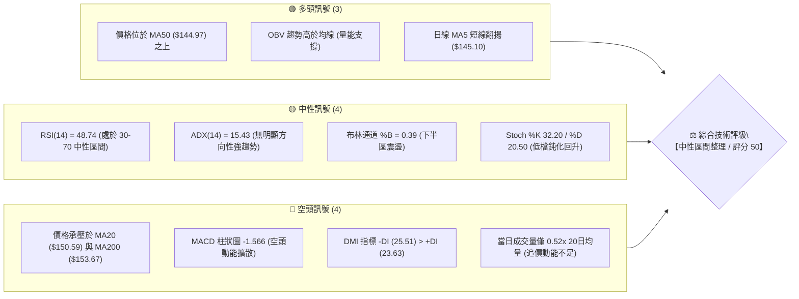
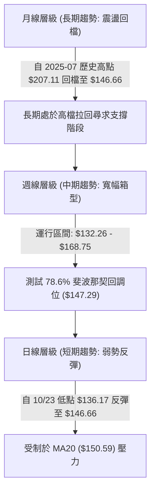
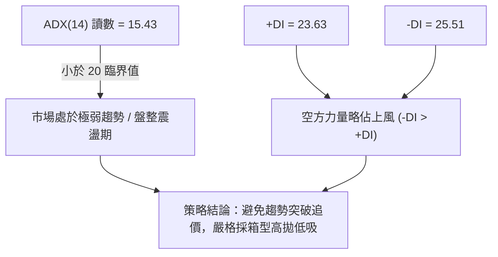
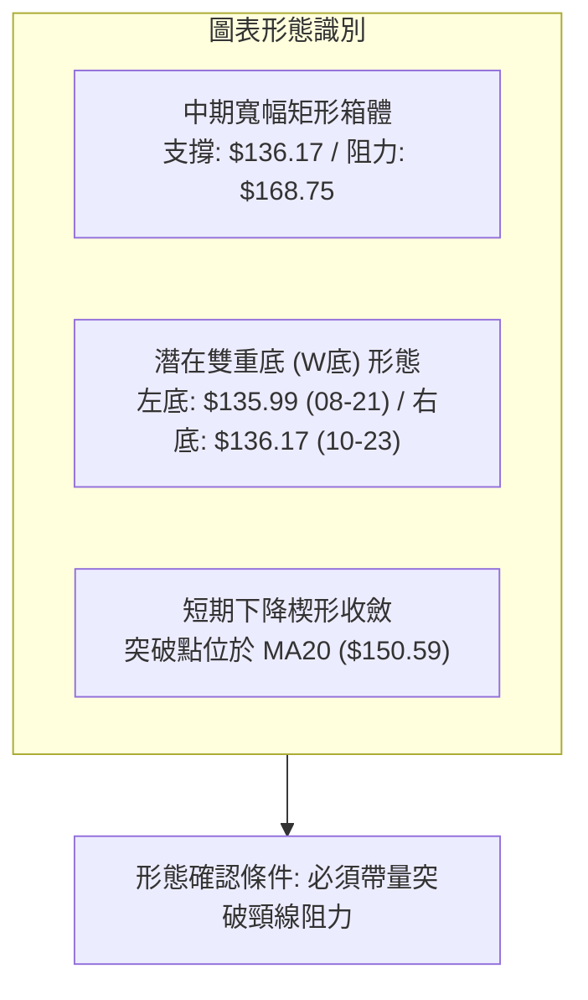
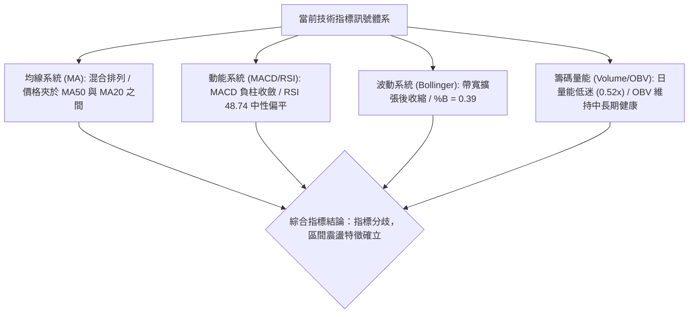
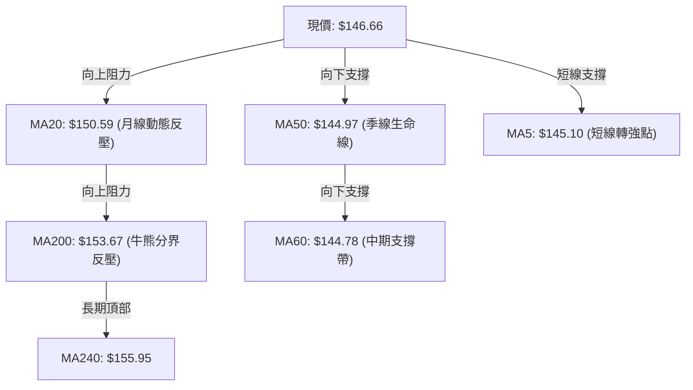
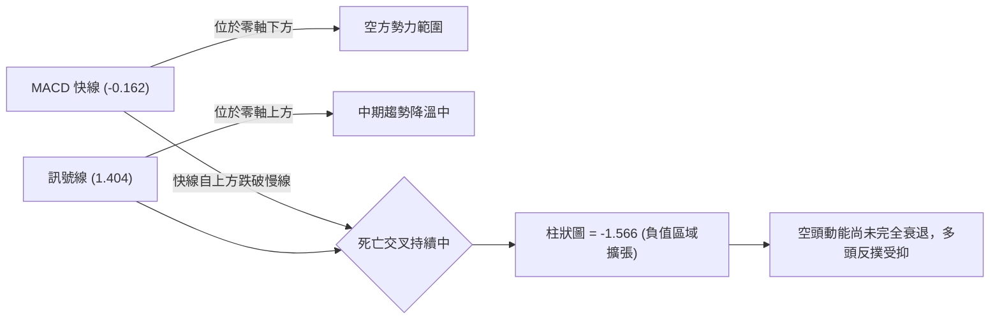
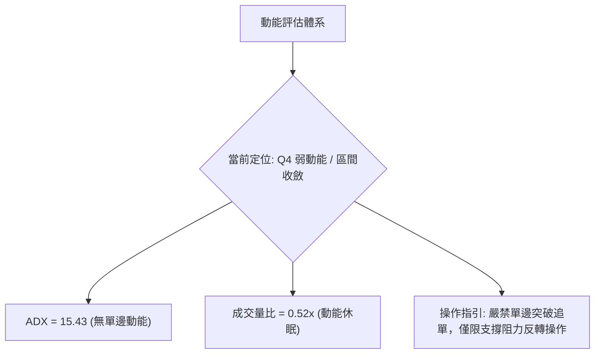
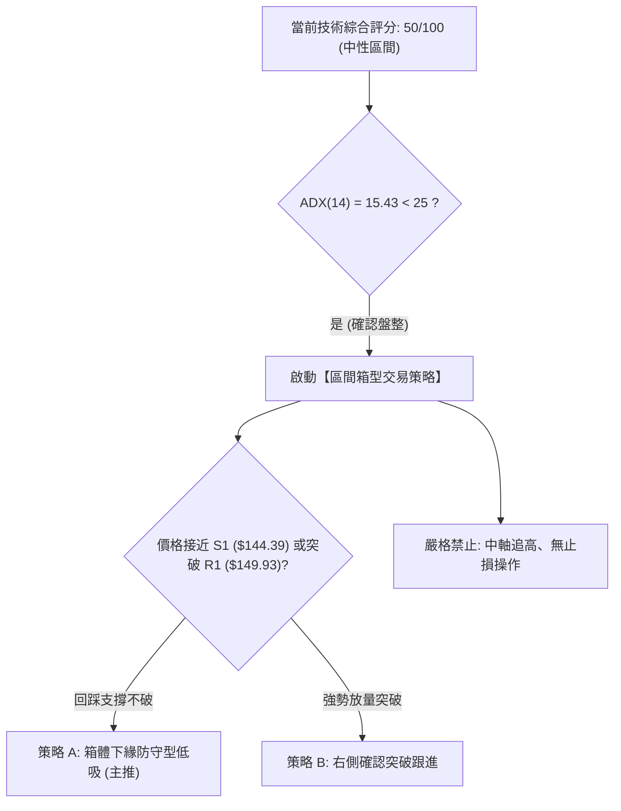
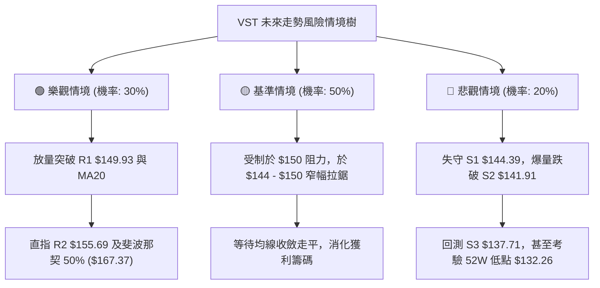

# VST 技術分析報告

> **報告日期**：2026-10-28 ｜ **語言**：繁體中文 ｜ **數據來源**：Yahoo Finance ｜ **當前價格**：$146.66 USD

---

## 目錄

| 章節 | 內容 |
|------|------|
| [1. 技術面概覽](#1-技術面概覽) | 訊號儀表板、核心指標、評分卡 |
| [2. 趨勢分析](#2-趨勢分析) | 多時框趨勢、長中短期走勢 |
| [3. 圖表形態分析](#3-圖表形態分析) | 形態識別、K線組合、目標價 |
| [4. 支撐與阻力](#4-支撐與阻力) | 關鍵價位、斐波那契回調 |
| [5. 技術指標深度解讀](#5-技術指標深度解讀) | MA/RSI/MACD/布林/成交量 |
| [6. 動能與波動率](#6-動能與波動率) | 動能評估、ATR、Beta |
| [7. 多時框架總結](#7-多時框架總結) | 時框架評分矩陣 |
| [8. 交易策略建議](#8-交易策略建議) | 多空策略、風險報酬比 |
| [9. 風險提示與監控](#9-風險提示與監控) | 監控指標、風險場景 |

---

## 1. 技術面概覽

### 🎯 技術訊號儀表板

本儀表板綜合整合日線與週線之動能、均線、趨勢強度及量價結構。當前 VST 處於寬幅區間震盪整理階段，短線指標呈現中性偏弱，但中期量能結構與支撐位展現防守韌性。



---

### 📊 核心指標速覽表

下表列出 VST 截至 2026-10-27 收盤之關鍵技術指標數值，嚴格對標官方數據：

| 指標類別 | 指標名稱 | 當前數值 | 訊號 | 技術解讀 |
|:---|:---|:---|:---:|:---|
| **價格** | 當前價格 | $146.66 | 🟡 | 位於 52 週區間 ($132.26 - $202.48) 之 20.5% 分位，低檔震盪 |
| **均線** | MA20 (月線) | $150.59 | 🔴 | 價格低於 MA20 (-2.61%)，短線反彈面臨動態阻力 |
| **均線** | MA50 (季線) | $144.97 | 🟢 | 價格站於 MA50 之上 (+1.17%)，中期生命線提供下檔緩衝 |
| **均線** | MA200 (年線) | $153.67 | 🔴 | 價格位於 MA200 下方 (-4.56%)，長期均線未形成多頭排列 |
| **動能** | RSI(14) | 48.74 | 🟡 | 處於 30-70 常態區間，多空力量拉鋸，無超買超賣 |
| **動能** | MACD (12,26,9) | -0.162 / 1.404 | 🔴 | 快線低於慢線，Hist 柱狀圖為 -1.566，空方動能佔優 |
| **趨勢強度** | ADX(14) | 15.43 | 🟡 | ADX < 25 表明處於弱趨勢/區間震盪行情，趨勢交易策略需轉為箱型操作 |
| **方向指標** | DMI (+DI / -DI) | 23.63 / 25.51 | 🔴 | -DI 大於 +DI，空頭略微主導盤面，但差距不大 |
| **通道指標** | 布林帶 (%B) | 0.39 | 🟡 | 位於中軌 ($150.59) 與下軌 ($133.06) 間，震盪偏弱 |
| **波動度** | ATR(14) | $7.53 | 🟡 | 佔現價 5.13%，每日真實波幅適中，具備日內操作區間 |
| **量能指標** | 成交量比 | 0.52x | 🔴 | 成交量 4,107,900 遠低於 20MA (7,844,455)，呈縮量整理 |
| **能量潮** | OBV 趨勢 | OBV > MA | 🟢 | 能量潮位於均線上方，顯示中期主力籌碼並未大幅鬆動棄守 |

---

### 🏆 技術評分卡

依據規則 18，綜合評分採六項子評分之算術平均值（四捨五入至整數）。各子項評分標準依據指標與價位結構精確賦分：

```
╔══════════════════════════════════════════════════════════════════╗
║                 技術評分卡 — VST (2026-10-28)                    ║
╠══════════════════════════════════════════════════════════════════╣
║ 趨勢強度 (ADX=15.43, -DI>+DI)   ████████░░░░░░░░░░░░  40/100 🔴  ║
║ 動能指標 (RSI=48.74, MACD Hist) █████████░░░░░░░░░░░  45/100 🟡  ║
║ 支撐穩定度 (守住 S1/S2 與 78.6%) █████████████░░░░░░░  65/100 🟢  ║
║ 成交量配合 (OBV>MA 但量比0.52x)  ███████████░░░░░░░░░  55/100 🟡  ║
║ 形態完整度 (箱型測試, 潛在雙底)  ██████████░░░░░░░░░░  50/100 🟡  ║
║ 均線排列 (混合排列, 承壓於MA20)  █████████░░░░░░░░░░░  45/100 🔴  ║
╠══════════════════════════════════════════════════════════════════╣
║ 綜合評分 (六項算術平均值)        ██████████░░░░░░░░░░  50/100 🟡  ║
║ 評級結論：中性觀望 / 區間箱型震盪 (Range-Bound Neutral)          ║
╚══════════════════════════════════════════════════════════════════╝
```

*計算式驗證*：$(40 + 45 + 65 + 55 + 50 + 45) \div 6 = 300 \div 6 = 50.0 \rightarrow 50/100$。

---

## 2. 趨勢分析

### 🌐 多時框趨勢分析

分析多時框架走勢，依據長線保護短線原則解析結構：



---

### 📈 長期趨勢 — 12個月走勢圖（Unicode）

以下為 VST 過去 12 個月（2025-11 至 2026-10）之月線收盤價歷史走勢圖，標注高低點與結構位：

```
VST 月線走勢圖（過去12個月收盤價變動）
價格軸 ($)
$190 ┤
$180 ┤ ● (2025-11: 177.83)
$170 ┤                  ● (2026-02: 173.13)
$160 ┤       ● (12: 160.62)          ● (05: 159.74)
$150 ┤            ● (01: 157.65)  ● (04: 157.36)  ● (06: 158.37)
$140 ┤                                 ● (03: 149.87)  ● (07: 147.95)  ● (10: 146.66)◄現價
$130 ┤                                                      ● (08: 137.15)  ● (09: 138.35)
     └─┬────┬────┬────┬────┬────┬────┬────┬────┬────┬────┬────┘
      11月 12月  1月  2月  3月  4月  5月  6月  7月  8月  9月 10月 (2025-2026)
```

#### 走勢特徵分析表格

| 階段時間 | 起訖收盤價 | 區間漲跌幅 | 形態特徵與技術解讀 |
|:---|:---|:---:|:---|
| **2025-11 ~ 2026-01** | $177.83 $\rightarrow$ $157.65$ | -11.35% | 自高位初次退潮，跌破短期均線支撐，進入高位震盪出貨期 |
| **2026-01 ~ 2026-02** | $157.65 $\rightarrow$ $173.13$ | +9.82% | 次級多頭反撲，形成中期次高點，隨後動能衰竭 |
| **2026-02 ~ 2026-04** | $173.13 $\rightarrow$ $157.36$ | -9.11% | 跌破反彈支撐線，空方再度主導，均線呈現死叉糾結 |
| **2026-04 ~ 2026-06** | $157.36 $\rightarrow$ $158.37$ | +0.64% | 橫盤窄幅築底平台，多空短暫平衡於 $158 關鍵防線 |
| **2026-06 ~ 2026-08** | $158.37 $\rightarrow$ $137.15$ | -13.40% | 平台破位下殺，測試 52 週低點區間，恐慌盤湧現 |
| **2026-08 ~ 2026-10** | $137.15 $\rightarrow$ $146.66$ | +6.93% | 築雙底反彈，$136-$137 支撐確認強烈，回升至箱體中下部 |

---

### 📊 中期趨勢（週線分析）

中期走勢結構展示了近半年來形成的寬幅箱型通道。下圖標記了重要波段高低點與支撐阻力聚集區域：

```
中期週線結構示意圖 ($)
$170 ┤                                  ● (2026-10-09 週高: $168.75) ───[波段頂部阻力 R3]
$165 ┤
$160 ┤                   ● (06-18: 163.25)
$155 ┤                                                  ───[MA200 / R2: $155.69]
$150 ┤                                              ● (現價 $146.66)
$145 ┤                                                  ───[MA50: $144.97 / S1: $144.39]
$140 ┤          ● (08-07: 140.36)           ● (10-23: 140.16)
$135 ┤                   ● (08-21週低: $135.99) ● (10-23週低: $136.17) ───[雙底支撐區域 S3]
$130 ┤ ───[52週低點 $132.26]
```

週線指標反饋：近兩週（10-16、10-23）連續拉回修正，自 $161.48 快速滑落至 $140.16，週 MACD 柱狀圖轉為負值（-1.566），顯示中期反彈浪潮遭遇強勁賣壓阻截，需時間沉澱消化。

---

### ⚡ 趨勢強度評估（ADX 解讀）

當前趨勢強度分析流程如下圖所示：



#### ADX 強度對照表

| 指標變數 | 當前讀數 | 狀態級別 | 意涵與操作指引 |
|:---|:---:|:---:|:---|
| **ADX (14)** | **15.43** | 弱趨勢 / 盤整 (<25) | 均線相互糾結，缺乏強烈的單邊驅動力，任何突破皆具假突破風險 |
| **+DI (14)** | **23.63** | 多方動能偏弱 | 多頭買盤力道收縮，無法維持連貫推升 |
| **-DI (14)** | **25.51** | 空方動能微幅佔優 | 雖略高於 +DI，但未跨越 30 強勢門檻，空方亦無能力展開主跌浪 |
| **多空淨值 (DI Diff)** | **-1.88** | 勢均力敵 | 差值微小，預示價格將收斂至均線密集區進行波動壓縮 |

---

## 3. 圖表形態分析

### 🔍 形態識別系統

根據近三個月價格軌跡與結構高低點，已識別之形態圖如下：



#### 形態信心度評估表（依規則 15）

| 形態名稱 | 信心度 | 判斷依據（嚴格引用數據） | 完成度 | 目標價計算式（依規則 13/15） |
|:---|:---:|:---|:---:|:---|
| **雙重底 (W-Bottom)** | **65%** | 兩次波段低點分別為 2026-08-21 週低 $135.99 與 2026-10-23 日低 $136.17，兩者差距僅 $0.18，具備高對稱性；且獲支撐 S3 ($137.71) 確認。 | 70% | 頸線取 2026-10-09 週高 $168.75（接近阻力 R3 $168.67）。<br>形態高度 = $168.75 - $136.08 = $32.67。<br>量化理論目標價 = 頸線 $168.75 + $32.67 = **$201.42**（接近 52W 高點 $202.48）。 |
| **矩形整理箱體** | **80%** | 箱體下緣受波段低點 S3 ($137.71) 與 52W 低點 $132.26 支撐，箱體上緣受阻於 R3 ($168.67)；價格在內部已完成兩次來回測試。 | 85% | 區間震盪上限即為阻力 R3: **$168.67**，下限為 S3: **$137.71**。 |
| **頭肩底形態** | **35%** | 數據中左肩與右肩結構缺乏對稱週期，且頸線傾斜度過大，信號不足。 | 30% | *訊號不足，僅做指標型解讀，不預設目標價。* |

---

### 🕯️ 重要K線形態分析

依規則 19，僅針對數據中「近10根日K」與「近8根週K」之精確 OHLC 數據進行解讀：

#### 近10根日K形態精確拆解

| 日期 | 開盤價 | 最高價 | 最低價 | 收盤價 | K線形態名稱 | 形態深度解讀 | 訊號強度 |
|:---|:---:|:---:|:---:|:---:|:---|:---|:---:|
| **2026-10-14** | 159.53 | 161.09 | 149.66 | 151.79 | 長黑大陰線 | 高開低走，盤中重挫破 $150，留下長實體黑K，空方主導。 | 🔴 強空 |
| **2026-10-15** | 148.35 | 154.46 | 145.85 | 154.17 | 破底翻陽包陰 | 低開高走，實體陽線吞噬前日收盤，多頭展開自救抵抗。 | 🟢 偏多 |
| **2026-10-16** | 152.55 | 155.16 | 151.15 | 152.02 | 吊頸小陰線 | 上影線測試 $155.16 遇阻，實體收於低檔，顯示向上跟進買盤猶豫。 | 🟡 中性偏弱 |
| **2026-10-19** | 154.10 | 155.33 | 145.85 | 149.70 | 倒垂回檔陰線 | 盤中再度下探 $145.85 低點，收黑於 $150 之下，反彈動能衰竭。 | 🔴 弱勢 |
| **2026-10-20** | 148.90 | 151.34 | 147.10 | 150.32 | 窄幅十字陽線 | 成交量萎縮至 3,336,500，多空於 $150 關卡形成暫時性弱勢平衡。 | 🟡 觀望 |
| **2026-10-21** | 153.35 | 158.74 | 151.83 | 156.14 | 衝高紅三兵式陽棒 | 多頭放量攻堅，最高觸及 $158.74，測試中軌上方阻力。 | 🟢 轉強 |
| **2026-10-22** | 153.00 | 154.27 | 139.10 | 140.83 | 爆量長黑灌壓 | 成交量驟增至 12,469,400，實體大跌逾 $15，形成穿頭破腳空頭吞噬。 | 🔴 極空 |
| **2026-10-23** | 139.06 | 141.52 | 136.17 | 140.16 | 錘頭下影線 (Hammer) | 探底 $136.17 後獲強勁買盤承接拉回，長下影線達 $3.99，低檔買盤浮現。 | 🟢 短底訊號 |
| **2026-10-26** | 140.90 | 143.52 | 139.07 | 141.73 | 溫和收紅孕線 (Harami) | 波動壓縮，收盤站於前日之上，量縮築底特徵明顯。 | 🟡 止跌醞釀 |
| **2026-10-27** | 143.95 | 147.45 | 143.40 | 146.66 | 實體中陽線 | 連續第二日推升，收於當日相對高點，正式站上季線 MA50 ($144.97)。 | 🟢 短線反彈 |

#### 近8根週K形態精確拆解

| 週末日期 | 開盤價 | 最高價 | 最低價 | 收盤價 | 週K形態名稱 | 形態深度解讀 | 訊號強度 |
|:---|:---:|:---:|:---:|:---:|:---|:---|:---:|
| **2026-09-11** | 150.75 | 154.65 | 146.43 | 148.14 | 墓碑小陰十字 | 衝高 $154.65 後承壓回落，多空爭奪 $148。 | 🟡 震盪 |
| **2026-09-18** | 143.76 | 145.87 | 139.39 | 140.44 | 連續下挫中黑K | 跌破 $145 關卡，空頭持續施壓至 $140 邊界。 | 🔴 偏空 |
| **2026-09-25** | 142.00 | 142.64 | 135.98 | 138.46 | 探底低檔長黑 | 最低 $135.98 觸及前波低點，形成短底測試。 | 🔴 弱勢 |
| **2026-10-02** | 138.08 | 143.51 | 133.44 | 140.02 | 爆量長下影紅棒 | 週量達 3,471 萬股，下探 52W 低點附近 ($133.44) 後被強勢拉起。 | 🟢 破底翻多 |
| **2026-10-09** | 144.04 | 168.75 | 140.90 | 161.48 | 巨量衝頂長陽棒 | 成交量暴增至 5,936.8 萬股，週漲幅巨大，直逼 $168.75 頂部。 | 🟢 極強多頭 |
| **2026-10-16** | 162.67 | 164.25 | 145.85 | 152.02 | 高檔反轉大長黑 | 高位獲利了結盤湧出，週跌近 $10，抹去前週過半漲幅。 | 🔴 轉弱回檔 |
| **2026-10-23** | 154.10 | 158.74 | 136.17 | 140.16 | 二次探底長陰線 | 最低殺至 $136.17，與 9 月底低點形成右底結構。 | 🟡 築底分歧 |
| **2026-10-27** | 140.90 | 147.45 | 139.07 | 146.66 | 縮量回升小陽線 | 本週截至 10-27 穩步回升，低點墊高至 $139.07，重返季線。 | 🟢 偏多回升 |

---

### 📉 ASCII 走勢形態示意圖

下圖直觀展示近期「雙重底（W底）」與「區間箱體」相互嵌套之結構：

```
VST 關鍵圖表形態結構解析 (2026-08 至 2026-10)
價格 ($)
$170 ┤                                      ▲ (10-09 高點 $168.75 / R3) ─── 形態頸線 / 箱體頂
$165 ┤                                     ╱ ╲
$160 ┤                                    ╱   ╲
$155 ┤                                   ╱     ╲
$150 ┤          頸線平台 $149.93 (R1) ─[─╱───────╲───────▲ (現價 $146.66) ]
$145 ┤                                  ╱         ╲     ╱
$140 ┤   ● (08-14: 147.89)             ╱           ╲   ╱
$135 ┤────▼───────────────────────────▼─────────────▼─ (10-23: $136.17 / S3) ─── W底基底
       左底 (08-21: $135.99)                   右底 (10-23: $136.17)
```

---

## 4. 支撐與阻力

### 🗺️ 關鍵價位分布圖（Unicode）

本圖依據數據源中嚴格計算之波段高低點與斐波那契位繪製，杜絕任何臆測點位：

```
VST 價位結構分布圖 (由 OHLCV 精確計算)
══════════════════════════════════════════════════════════════════
$168.67 ║████████████████████████████████║ 強波段阻力 R3 (+15.00%)
$167.37 ║────────────────────────────────║ 50.0% 斐波那契分水嶺
$159.08 ║────────────────────────────────║ 61.8% 斐波那契重要回調位
$155.69 ║████████████████████            ║ 關鍵波段阻力 R2 (+6.16%)
$150.59 ║································║ 布林中軌 / MA20 動態阻力
$149.93 ║████████████████████████        ║ 短線突破阻力 R1 (+2.23%)
$147.29 ║────────────────────────────────║ 78.6% 斐波那契回調位
$146.66 ╠════════════════════════════════╣ ◄ 當前收盤價 ($146.66)
$144.97 ║································║ 季線 MA50 動態支撐
$144.39 ║▓▓▓▓▓▓▓▓▓▓▓▓▓▓▓▓                ║ 近期關鍵支撐 S1 (-1.55%)
$141.91 ║▓▓▓▓▓▓▓▓▓▓▓▓▓▓▓▓▓▓▓▓            ║ 波段防守支撐 S2 (-3.24%)
$137.71 ║████████████████████████        ║ 強支撐/W底底頸 S3 (-6.10%)
$132.26 ║████████████████████████████████║ 52週絕對低點 (100.0% 回調位)
══════════════════════════════════════════════════════════════════
```

---

### 🚧 阻力位分析表

數據完全引自「關鍵價位」區塊，禁止自行編造：

| 阻力級別 | 準確價位 | 距離現價 | 形成原因與技術共振 | 突破難度 | 重要性等級 |
|:---|:---:|:---:|:---|:---:|:---:|
| **R1** | **$149.93** | +2.23% | 近期多次日內反彈高點聚類；與日線 MA20 ($150.59) 形成緊密共振反壓區。 | 中等 🟡 | ★★★☆☆ |
| **R2** | **$155.69** | +6.16% | 10月中旬反彈平台次高點（10-21 高點 $158.74 回落密集成交區）；緊鄰年線 MA200 ($153.67)。 | 較高 🔴 | ★★★★☆ |
| **R3** | **$168.67** | +15.00% | 2026-10-09 週線衝頂最高價 $168.75 聚類；與布林通道上軌 ($168.13) 重疊，為中期頂部天花板。 | 極高 🔴 | ★★★★★ |

---

### 🛡️ 支撐位分析表

數據完全引自「關鍵價位」區塊：

| 支撐級別 | 準確價位 | 距離現價 | 形成原因與技術共振 | 守住機率 | 重要性等級 |
|:---|:---:|:---:|:---|:---:|:---:|
| **S1** | **$144.39** | -1.55% | 近 10 個交易日整理低點密集處；下方緊靠 MA50 ($144.97) 及 MA60 ($144.78)。 | 70% 🟢 | ★★★★☆ |
| **S2** | **$141.91** | -3.24% | 10-23 與 10-26 築底K棒實體下緣支撐聚類，跌破則宣告短線反彈失敗。 | 60% 🟡 | ★★★☆☆ |
| **S3** | **$137.71** | -6.10% | 8月低點 ($135.99) 與 10-23 長下影探底 ($136.17) 上方波段承接區，為多頭底線。 | 85% 🟢 | ★★★★★ |

---

### 📐 斐波那契回調位分析

依據 52 週完整波動區間（低點 $132.26 $\rightarrow$ 高點 $202.48，總落差 $70.22）計算：

| 回調比例 | 精確對應價位 | 技術意涵與位置解讀 |
|:---|:---:|:---|
| **0.0% (52W High)** | **$202.48** | 歷史峰值阻力，長期多頭終極目標 |
| **23.6%** | **$185.91** | 強勢回檔保護位，目前處於其下方 |
| **38.2%** | **$175.66** | 多頭轉強臨界分水嶺 |
| **50.0%** | **$167.37** | 多空中線均衡樞紐（接近 R3 $168.67） |
| **61.8%** | **$159.08** | 黃金分割重要防線，前期密集成交平台 |
| **78.6%** | **$147.29** | **極限回調支撐位（現價 $146.66 正緊貼此位下方測試）** |
| **100.0% (52W Low)**| **$132.26** | 52週低點，全波段多頭最後防線 |

**解讀結論**：
現價 $146.66 剛好落於 **78.6% 回調位 ($147.29)** 與 **100.0% 回調位 ($132.26)** 之間，且距離 78.6% 位僅差 $0.63（-0.43%）。在技術分析中，78.6% 回調常作為深度洗盤後的最後多頭防線。若收盤能有效站上 $147.29，將觸發向 61.8% ($159.08) 的均值回歸修復走勢。

---

## 5. 技術指標深度解讀

### 🎛️ 指標訊號總覽



---

### 📈 移動平均線排列分析

數據顯示均線系統處於典型的「混合排列（Mixed Alignment）」狀態：



#### 均線數據明細表

| 均線名稱 | 數值 | 價格相對於均線 | 均線斜率與走勢狀態 |
|:---|:---:|:---:|:---|
| **MA 5** | $145.10 | ▲ +1.07% (高於均線) | 走勢微幅向上 (+1.56)，短線具備止跌反彈慣性 |
| **MA 10** | $148.35 | ▼ -1.14% (低於均線) | 走勢向下 (-1.69)，即將與現價於 $148 遭遇碰撞 |
| **MA 20** | $150.59 | ▼ -2.61% (低於均線) | 走勢向下 (-3.93)，為布林中軌，構成最關鍵短線反壓 |
| **MA 50** | $144.97 | ▲ +1.17% (高於均線) | 走勢平緩向上 (+1.88)，多方中期依託的重要陣地 |
| **MA 60** | $144.78 | ▲ +1.30% (高於均線) | 與 MA50 形成雙重聚合支撐帶 ($144.78 - $144.97) |
| **MA 120** | $149.38 | ▼ -1.82% (低於均線) | 走勢微跌 (-2.72)，壓制中期反彈空間 |
| **MA 200** | $153.67 | ▼ -4.56% (低於均線) | 年線反壓顯著，未突破前無法確認長期多頭回歸 |
| **MA 240** | $155.95 | ▼ -5.96% (低於均線) | 長期均線下彎，顯示近一年籌碼處於解套拋壓狀態 |

---

### 📉 RSI(14) 分析

當前數值：**48.74**（Wilder 算法平滑）

- **指標刻度展示**：
  ```
  超賣 [0] ────────── [30] ───── [48.74] ───── [70] ────────── [100] 超買
  進度條：████████████░░░░░░░░░░░░░  48.74% (中性平衡區)
  ```
- **超買超賣判斷**：處於 48.74，完全落於 30 至 70 常態區間。既無盲目殺跌的超賣超跌動能，亦無過度亢奮的追價過熱現象。
- **背離嚴格檢驗**：
  比對近 20 根 K 棒走勢（自 2026-09-25 底部的 $138.46 至 10-27 的 $146.66，期間 RSI 自 42.8 微升至 48.74）：
  價格首尾呈現震盪微升，RSI 同步微升，**結論：無明顯頂背離或底背離**。指標完全確認目前之價格無趨勢橫盤特徵。

---

### 📊 MACD(12/26/9) 訊號解讀

- **MACD 線**：-0.162
- **訊號線 (Signal)**：1.404
- **柱狀圖 (Histogram)**：**-1.566**（空頭掌控）



**解讀結論**：MACD 線在零軸附近出現死叉後下穿，柱狀圖目前維持在 -1.566 負值區，顯示自 10-09 衝頂以來的調整波尚未徹底完成指標翻正，任何向上進攻若無柱狀圖收斂配合，易引發二次回踩。

---

### 📦 布林通道分析

當前布林參數（20, 2）數值如下：
- **上軌 (Upper Band)**：$168.13
- **中軌 (Middle Band / MA20)**：$150.59
- **下軌 (Lower Band)**：$133.06
- **通道帶寬**：$168.13 - $133.06 = $35.07
- **%B 讀數**：**0.39**

```
布林通道當前位置 ASCII 示意圖
$168.13 ┬────────────────────────────────────────── 上軌 (Upper)
        │
$150.59 ┼────────────────────────────────────────── 中軌 (MA20)
        │                 ● 現價 $146.66 (%B = 0.39)
$133.06 ┴────────────────────────────────────────── 下軌 (Lower)
```

**解讀結論**：%B 為 0.39（介於 0 與 0.5 之間），說明現價處於弱勢下半區。由於下軌 $133.06 距離現價仍有 $13.60（約 -9.27%），現價並未觸及下軌極限，通道呈現平行橫向延伸，確認市場為標準的**寬幅震盪箱體走勢**。

---

### 💹 成交量分析（量價配合度）

1. **量能縮減態勢**：
   - 最新交易日（10-27）成交量為 **4,107,900**。
   - 20 日均量為 **7,844,455**（量比僅 **0.52x**）。
   - 50 日均量為 **5,784,650**。
   - 現象解讀：量能萎縮至均量一半左右，顯示 10-22 爆量殺跌（1,246 萬股）後，市場殺跌拋壓已顯著衰竭，但多頭尚未展開主動性攻擊放量。
2. **OBV (能量潮) 趨勢解析**：
   - 指標反饋：`OBV > MA`。
   - 技術意涵：雖然日線成交量萎縮，但中長期 OBV 仍然維持於其移動平均線上方。這表明主力機構在中長線層面（92.2% 機構持股比）並未出現實質性資金潰逃，量價結構顯示為「縮量良性回踩」而非「放量出逃」。

---

## 6. 動能與波動率

### ⚡ 動能評估四象限

根據當前動能指標（RSI=48.74，MACD Hist=-1.566）與波動率指標（ATR=$7.53，ADX=15.43）分析：

| 象限 | 動能維度 | 波動維度 | 當前狀態標註 | 戰術應對策略 |
|:---:|:---:|:---:|:---:|:---|
| **第一象限 (Q1)** | 強動能 (趨勢成型) | 高波動 | ─ | 趨勢突破追價，嚴設移動止盈 |
| **第二象限 (Q2)** | 強動能 | 低波動 | ─ | 趨勢醞釀期，積極順勢加碼 |
| **第三象限 (Q3)** | 弱動能 (無單邊趨勢) | 高波動 | ─ | 假突破頻發，觀望或減少手續費磨損 |
| **第四象限 (Q4)** | **弱動能 (ADX < 20)** | **中低波動 (量能萎縮)** | **✓ [VST 當前定位]** | **箱型操作，於 S1/S2 逢低吸納，R1/R2 獲利了結** |



---

### 📊 ATR 波動率分析

- **ATR(14) 讀數**：**$7.53**（佔當前股價之 **5.13%**，Wilder 計算）。
- **日內波動特徵**：近 14 日平均真實波動區間達 $7.53，代表日內震盪幅度較大，短線持倉承受之雜音波動不可忽視。
- **風控止損距離量化建議**：
  - **保守型擺動止損**：$1.5 \times \text{ATR} = 1.5 \times \$7.53 = \mathbf{\$11.30}$。
  - **積極型短線止損**：$1.0 \times \text{ATR} = 1.0 \times \$7.53 = \mathbf{\$7.53}$。
  - **緊密結構止損**：$0.5 \times \text{ATR} = 0.5 \times \$7.53 = \mathbf{\$3.77}$（適合結合特定支撐位使用）。

---

### 📐 Beta 與市場相關性

- **Beta 係數**：**1.384**。
- **特徵解讀**：VST 雖歸屬於公用事業（Utilities - IPP），但受電力需求暴增與 AI 數據中心題材帶動，其股價彈性顯著高於標普 500 指數。Beta = 1.384 代表大盤上漲 1% 時，VST 理論平均上漲 1.384%；大盤下跌時亦將放大波動。在目前中性震盪格局下，高 Beta 特性意味著極易受大盤整體情緒擾動而出現寬幅洗盤。

---

## 7. 多時框架總結

### 📋 時框架評分表

依據不同交易週期之技術指標收斂評估：

| 時框架 | 趨勢方向 | 動能狀態 | 均線排列 | 形態特徵 | 綜合評分 | 操作建議 |
|:---|:---:|:---:|:---:|:---|:---:|:---|
| **日線 (短期)** | 震盪反彈 🟡 | RSI 48.74 中性 🟡 | 承壓於 MA20，站上 MA50 🟡 | 探底長下影後孕線回升 🟢 | **50/100** | 區間下緣逢低試單，快進快出 |
| **週線 (中期)** | 寬幅箱型 🟡 | MACD 負柱擴散 🔴 | 位於 MA50 附近，未破大結構 🟡 | $136-$168 寬幅矩形 🟡 | **50/100** | 箱型高拋低吸，等待方向抉擇 |
| **月線 (長期)** | 多頭回檔 🟢 | 自歷史天花板拉回修正 🟡 | 仍高於長週期中樞 🟢 | 歷史高點 $207 下方整理 🟢 | **60/100** | 逢低分批布局核心現貨籌碼 |

---

### 🔲 綜合訊號矩陣

各週期指標一致性檢驗：

| 分析維度 | 短期 (日線) | 中期 (週線) | 長期 (月線) | 多時框一致性評價 |
|:---|:---:|:---:|:---:|:---|
| **趨勢強度** | 弱勢整理 (ADX=15) | 震盪無方向 | 均值回歸中 | 🟡 高度一致（均指向盤整震盪） |
| **動能方向** | 短線向上反彈 | 中期向下修正 | 長線動能放緩 | 🔴 分歧（短線反彈遭遇中期阻力） |
| **量價配合** | 縮量築底 (0.52x) | 高檔放量後萎縮 | 長期籌碼穩定 (OBV>MA) | 🟢 偏良性（無恐慌性出逃量） |
| **關鍵位共振**| 緊貼 78.6% 回調位 | 考驗 S1/S2 防線 | 支撐於 $132 低點上方 | 🟢 高度共振（下檔支撐具備扎實度） |

---

### ⚖️ 多時框收斂結論（依規則 14）

1. **行情性質定調**：當前日線 **ADX(14) 讀數為 15.43，遠低於 25 臨界線**。依規則 14 之強制收斂原則，當前市場確立為**「標準盤整震盪行情」而非「趨勢行情」**。
2. **主導維度取捨**：在 ADX < 25 的盤整結構中，以**日線布林通道區間（下軌 $133.06 至上軌 $168.13）及波段水平支撐阻力為核心交易架構**。不應採用順勢追突破策略，而應採取箱體邊界反轉邏輯。
3. **唯一方向性結論**：**【中性觀望，區間箱型低吸高拋】**。此結論嚴格貫徹至第 8 章之策略路由中。

---

## 8. 交易策略建議

### 🗺️ 策略決策流程圖



---

### 🧭 策略路由（依規則 18 評分卡分流）

> **當前主策略方向 = 【中性區間箱型操作】（依技術評分卡：50/100）**
> 
> *理由依據*：評分落於 40–60 之中性區間，且 ADX(14) = 15.43 證實趨勢動能匱乏，市場正於 $137.71 (S3) 至 $155.69 (R2) 之間進行收斂整理。主策略以「逢支撐位低吸，遇阻力位減碼」為核心架構。

---

### 🎯 價格情境階梯（Price Scenarios）

價位嚴格引用數據源之客觀點位：

| 觸發條件 | 下一目標 | 後續延伸目標 | 情境含義與技術演繹 |
|:---|:---:|:---:|:---|
| **強勢突破 R1 ($149.93)** | **R2 ($155.69)** | **R3 ($168.67)** | 短線突破 MA20 月線反壓，動能翻多，挑戰年線與箱頂。 |
| **站穩現價區間 ($146.66)** | **R1 ($149.93)** | **R2 ($155.69)** | 季線 MA50 ($144.97) 防守成功，於 78.6% 回調位展開均值修復。 |
| **有效跌破 S1 ($144.39)** | **S2 ($141.91)** | **S3 ($137.71)** | 失守季線支撐，短線反彈告終，下探回測 10-23 低點尋求雙底支撐。 |

---

### 📊 情境機率分佈

| 預測情境 | 發生機率 | 主要技術與量化依據 |
|:---|:---:|:---|
| **區間震盪整理 (主情境)** | **50%** | ADX = 15.43 弱趨勢確認；布林通道帶寬收窄；日線成交量僅 0.52x，缺乏單邊動能。 |
| **向上反彈修復 (次情境)** | **30%** | OBV > MA 籌碼未潰散；近兩日收紅且守住 MA50；分析師共識強烈看多 (Mean $208.77)。 |
| **破位再探低點 (風險情境)**| **20%** | MACD Hist = -1.566 仍處空頭區；-DI > +DI；若大盤劇烈回檔易受高 Beta (1.384) 拖累。 |

---

### 🟢 主策略詳情（方向：中性區間操作）

所有數值均直接採用第 4 章計算之波段價位。
風險報酬比計算公式遵循規則 17：$\text{RRR} = (\text{目標價 T1} - \text{進場價}) \div (\text{進場價} - \text{止損價})$。

| 策略要素 | 策略 A：箱體下緣低吸（左側防守型） | 策略 B：突破確認跟進（右側追擊型） |
|:---|:---|:---|
| **核心邏輯** | 依託 MA50 ($144.97) 與 S1 ($144.39) 聚合支撐回踩吸納 | 放量突破 R1 ($149.93) 及 MA20 ($150.59) 阻力後順勢切入 |
| **進場價格** | **$144.39**（精確對應支撐 S1） | **$150.00**（有效站上 R1 $149.93 之確認點） |
| **目標價 T1** | **$149.93**（精確對應阻力 R1） | **$155.69**（精確對應阻力 R2 / 年線附近） |
| **目標價 T2** | **$155.69**（精確對應阻力 R2） | **$168.67**（精確對應阻力 R3 / 箱體上緣） |
| **止損價格** | **$141.91**（精確對應支撐 S2） | **$146.66**（以當前收盤價作為回踩防守底線） |
| **風險報酬比 (T1)** | **1 : 2.23（以 T1 計）**<br>*計算：$(149.93 - 144.39) \div (144.39 - 141.91) = 5.54 \div 2.48 = 2.23$* | **1 : 1.70（以 T1 計）**<br>*計算：$(155.69 - 150.00) \div (150.00 - 146.66) = 5.69 \div 3.34 = 1.70$* |
| **風險報酬比 (T2)** | **1 : 4.56（以 T2 計）**<br>*計算：$(155.69 - 144.39) \div (144.39 - 141.91) = 11.30 \div 2.48 = 4.56$* | **1 : 5.59（以 T2 計）**<br>*計算：$(168.67 - 150.00) \div (150.00 - 146.66) = 18.67 \div 3.34 = 5.59$* |
| **預估勝率** | **65%** | **55%** |
| **建議配置倉位** | **15% - 20%**（輕倉防禦試探） | **10% - 15%**（突破確認後加碼） |

---

### 🔴 反向風險觸發點（對沖與止損提示）

若出現以下情境，宣告區間震盪與多頭反彈邏輯徹底失效，應立即執行防禦措施：
1. **日線收盤價跌破 $141.91 (S2)**：代表 10-23 以來之反彈結構瓦解，空頭將直接摜壓至 $137.71 (S3) 乃至 52 週低點 $132.26。此時所有多單必須無條件止損離場。
2. **放量跌破 $137.71 (S3)**：宣告「潛在雙底」構建失敗，形成大型頭肩頂破位或矩形破位，建議啟動反向空頭對沖工具。
3. **MACD 柱狀圖進一步跌破 -2.000**：代表空頭主跌動能二次爆發，切忌盲目抄底。

---

### ⭐ 整體訊號強度評星

```
做多訊號強度：★★☆☆☆  (2.5/5星 — 支撐強固但均線反壓沉重，缺乏放量配合)
做空訊號強度：★★☆☆☆  (2.5/5星 — 雖然動能偏空，但接近區間底，下殺盈虧比不佳)
整體可信度：  ★★★☆☆  (3.5/5星 — 價位結構分明，箱體特徵確立，適合高拋低吸)
```

---

## 9. 風險提示與監控

### ✅ 關鍵監控指標 Checklist

```
╔══════════════════════════════════════════════════════════════════╗
║                   每日交易監控指標清單 (Checklist)               ║
╠══════════════════════════════════════════════════════════════════╣
║ [ ] 價格是否成功守住季線 MA50 ($144.97) 及支撐 S1 ($144.39)     ║
║ [ ] 日成交量是否顯著放大突破 20日均量 (7,844,455 股)            ║
║ [ ] RSI(14) 能否向上穿越 50.0 中軸阻力線進入多方強勢區          ║
║ [ ] MACD 柱狀圖負值是否持續收斂至 0 軸以上 (當前: -1.566)       ║
║ [ ] 價格能否放量站穩 MA20 ($150.59) 及阻力 R1 ($149.93)         ║
║ [ ] ADX(14) 是否由 15.43 回升至 25 以上 (確認單邊趨勢啟動)      ║
╚══════════════════════════════════════════════════════════════════╝
```

---

### ⚠️ 風險場景分析



---

### 🛡️ 風險管理重要提醒

1. **基本面與高財務槓桿風險共振**：
   - 財務數據警示：VST 總負債高達 **$20.51B**，負債淨額達 **$-20.07B**，Debt/Equity 高達 **373.28**，流動比率為 **0.973**。
   - 技術意涵：極高的債務負擔與利息敏感度，使得市場對利率預期極為敏感。若總體環境不利，高槓桿特質將加速技術面支撐的擊穿速度，因此技術操作必須嚴守 **$141.91 (S2)** 止損位，嚴禁扛單。
2. **倉位管理紀律**：
   - 由於當前處於 ADX < 25 的震盪無趨勢市場，單筆交易風險敞口不應超過總資金的 **1.0%**。
   - 計算範例：若總帳戶為 $100,000，1% 最大虧損為 $1,000。採策略 A 進場（進場 $144.39，止損 $141.91，每股風險 $2.48），最大建倉股數為 $1,000 \div 2.48 \approx 403 \text{ 股}$（動用資金約 $58,189，即約 58% 名義倉位，此時建議搭配分批建倉，首批僅下單 150-200 股）。

---

## 📋 報告總結

```
╔══════════════════════════════════════════════════════════════════╗
║                   VST 技術分析報告總結 (Executive Summary)      ║
╠══════════════════════════════════════════════════════════════════╣
║ 報告日期：2026-10-28                                             ║
║ 當前價格：$146.66 USD                                            ║
║ 分析評級：⚖️ 中性震盪 / 區間箱型操作 (技術評分: 50/100)          ║
╠══════════════════════════════════════════════════════════════════╣
║ 關鍵結論：                                                       ║
║ ├─ 長期趨勢：🟢 歷史多頭回檔整理，未跌破 52週低點 ($132.26)      ║
║ ├─ 中期趨勢：🟡 $136 - $168 寬幅震盪箱體，目前處於箱體中下部    ║
║ ├─ 短期趨勢：🟡 於 S1 ($144.39) 築底反彈，正面臨 MA20 ($150.59) 反壓║
║ ├─ 關鍵支撐：S1: $144.39 ｜ S2: $141.91 ｜ S3: $137.71          ║
║ ├─ 關鍵阻力：R1: $149.93 ｜ R2: $155.69 ｜ R3: $168.67          ║
║ └─ 華爾街目標價：Mean: $208.77 (強烈看多, 偏向長線基本面溢價)   ║
╠══════════════════════════════════════════════════════════════════╣
║ 最優策略組合：                                                   ║
║ 1. 🥇 最佳機會：策略 A (逢回踩 S1 $144.39 低吸，止損 S2 $141.91，║
║                 目標 R1 $149.93，風報比 1 : 2.23，高勝率守株待兔)║
║ 2. 🥈 次選機會：策略 B (放量突破 R1 $150.00 後追進，目標 R2 $155.69║
║                 風報比 1 : 1.70，右側順勢交易)                  ║
║ 3. 🥉 保守選擇：維持現金觀望，靜待 ADX 升穿 25 確認突破單邊方向 ║
╚══════════════════════════════════════════════════════════════════╝
```

---

> ⚠️ **免責聲明**：本報告為依據客觀量化指標與圖表形態演算生成之技術分析報告，所有數值均源自歷史公開交易數據。本報告**僅供研究與學術參考**，**絕不構成任何形式的證券買賣邀約或投資建議**。金融市場瞬息萬變，高 Beta 與高槓桿個股波動風險巨大，投資人應獨立評估財務狀況並嚴格控制風險。

---

*報告生成時間：2026-10-28 ｜ 數據來源：Yahoo Finance ｜ 分析框架：多時框技術分析 (MTF-TA)*