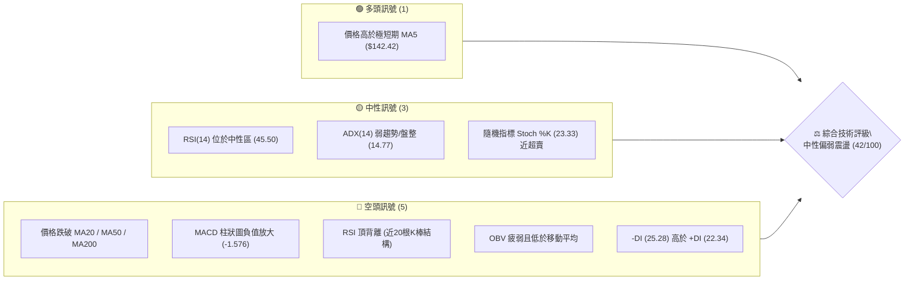
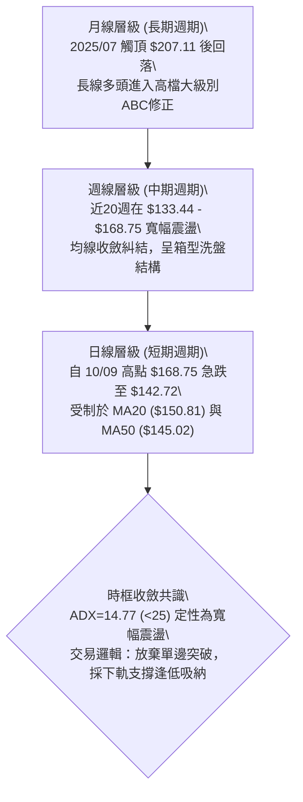
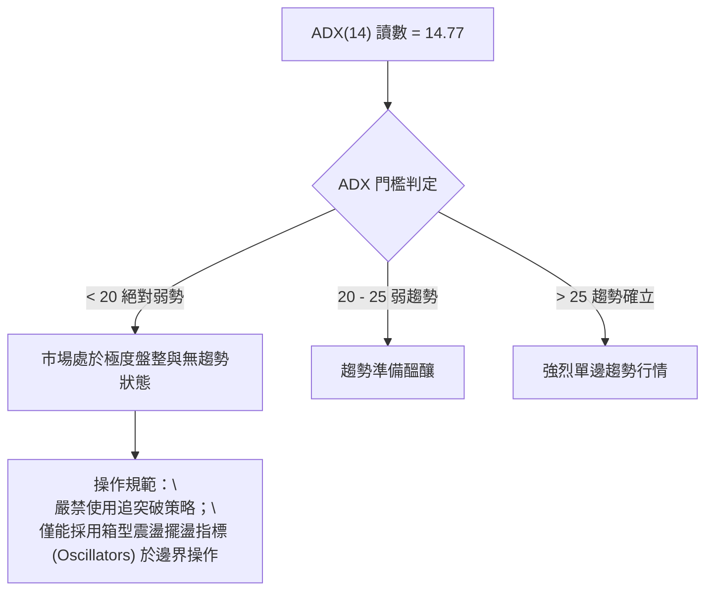
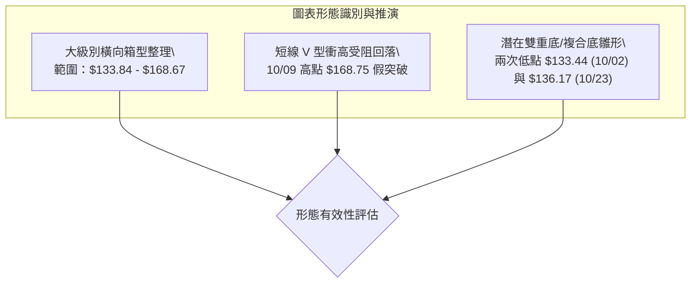
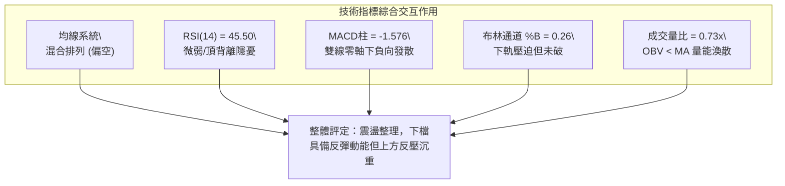
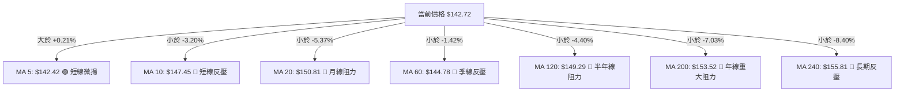
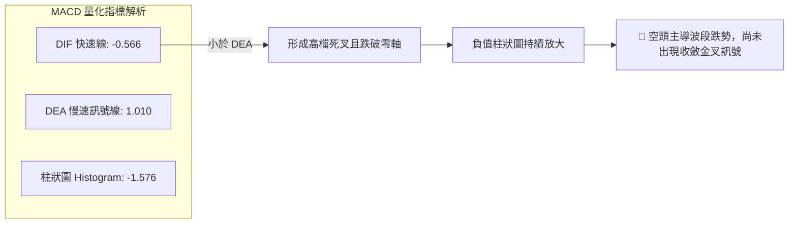
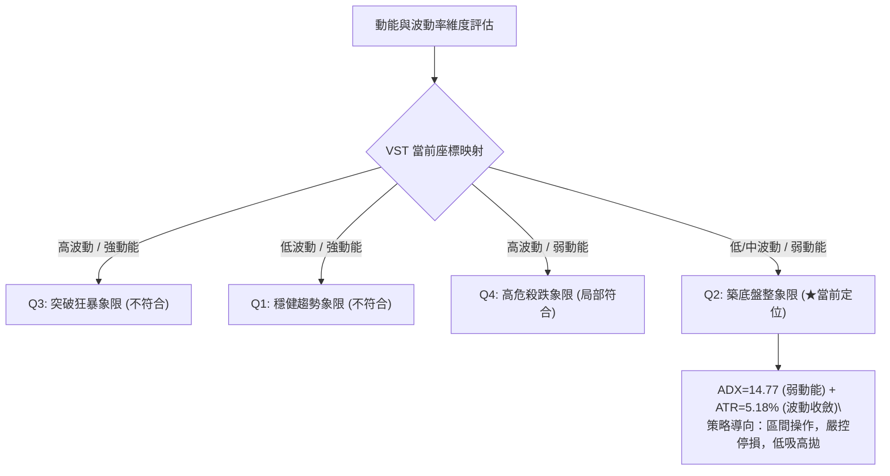
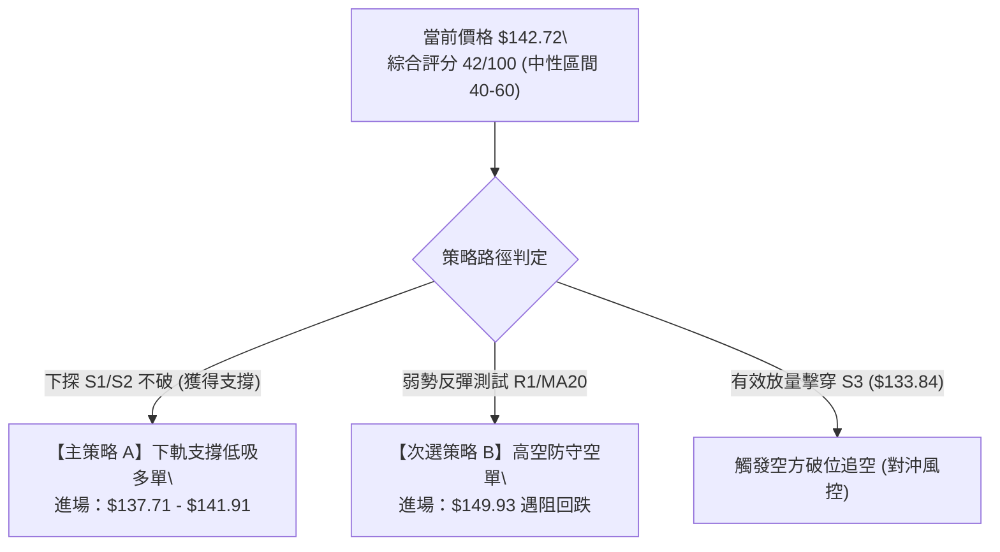
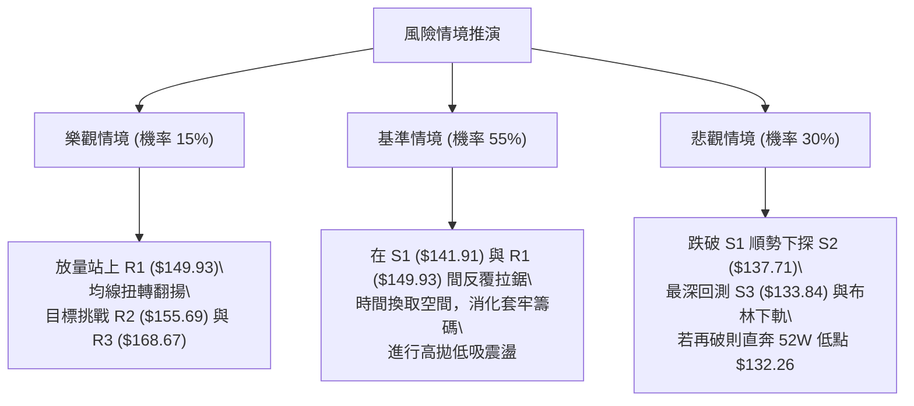

# VST 技術分析報告

> **報告日期**：2026-10-29 ｜ **語言**：繁體中文 ｜ **數據來源**：Yahoo Finance ｜ **當前價格**：$142.72 USD

---

## 目錄

| 章節 | 內容 |
|------|------|
| [1. 技術面概覽](#1-技術面概覽) | 訊號儀表板、核心指標、評分卡 |
| [2. 趨勢分析](#2-趨勢分析) | 多時框趨勢、長中短期走勢、ADX 解讀 |
| [3. 圖表形態分析](#3-圖表形態分析) | 形態識別、K線組合、目標價計算 |
| [4. 支撐與阻力](#4-支撐與阻力) | 關鍵價位分布、阻力與支撐表、斐波那契回調 |
| [5. 技術指標深度解讀](#5-技術指標深度解讀) | MA均線系統、RSI、MACD、布林通道、成交量 |
| [6. 動能與波動率](#6-動能與波動率) | 動能四象限、ATR 波動度、Beta 敏感度 |
| [7. 多時框架總結](#7-多時框架總結) | 時框架矩陣、多時框收斂定調 |
| [8. 交易策略建議](#8-交易策略建議) | 決策路徑、價格情境階梯、策略執行表 |
| [9. 風險提示與監控](#9-風險提示與監控) | 關鍵監控清單、情境分析、風控準則 |

---

## 1. 技術面概覽

### 🎯 技術訊號儀表板



### 📊 核心指標速覽表

| 指標類別 | 指標名稱 | 當前數值 | 訊號 | 解讀 |
|:---|:---|:---|:---:|:---|
| **價格** | 當前收盤價 | $142.72 | 🟡 | 位於52週區間 15.5% 分位，逼近波段下軌 |
| **均線** | MA20 (月線) | $150.81 | 🔴 | 現價低於 MA20 達 -5.37%，短期承壓嚴重 |
| **均線** | MA50 (季線) | $145.02 | 🔴 | 現價低於 MA50 達 -1.59%，中期反彈受阻 |
| **均線** | MA200 (年線) | $153.52 | 🔴 | 跌破長期生命線，長週期結構轉為弱勢修復 |
| **動能** | RSI(14) | 45.50 | 🟡 | 位於 30–70 中性弱勢區，且存在近20日頂背離 |
| **動能** | MACD (12,26,9) | -0.566 | 🔴 | DIF 低於 DEA (1.010)，柱狀圖 -1.576 空方發散 |
| **動能** | 隨機指標 %K/%D | 23.33 / 24.20 | 🟡 | 位於低檔區間，醞釀超賣鈍化或短線反彈 |
| **趨勢** | ADX(14) | 14.77 | 🟡 | ADX < 25，單邊趨勢衰竭，進入大區間箱型整理 |
| **通道** | 布林通道 %B | 0.26 | 🔴 | 落在下軌 ($133.82) 與中軌 ($150.81) 間之弱勢區 |
| **波動** | ATR(14) | $7.39 (5.18%) | 🟡 | 波動率處於中高水準，需預留較大止損防守空間 |
| **量能** | 20日成交量比 | 0.73x (5.63M) | 🔴 | 量能持續萎縮，OBV < MA，追價買盤動能不足 |

### 🏆 技術評分卡

```
╔════════════════════════════════════════════════════════════════════════════╗
║                   技術評分卡 — VST (2026-10-29)                           ║
╠════════════════════════════════════════════════════════════════════════════╣
║  維度項目         評分進度條                         得分     狀態標籤     ║
╟────────────────────────────────────────────────────────────────────────────╢
║  趨勢強度 (Trend) ███████░░░░░░░░░░░░░              35/100   🔴 空方主導   ║
║  動能指標 (Mom.)  ████████░░░░░░░░░░░░              38/100   🔴 動能疲軟   ║
║  支撐穩定 (Supp.) ███████████░░░░░░░░░              54/100   🟡 下檔具防守 ║
║  成交量能 (Vol.)  ███████░░░░░░░░░░░░░              37/100   🔴 量能渙散   ║
║  形態結構 (Patt.) ██████████░░░░░░░░░░              49/100   🟡 箱型構築中 ║
║  均線系統 (MA)    ████████░░░░░░░░░░░░              39/100   🔴 均線反壓   ║
╠════════════════════════════════════════════════════════════════════════════╣
║  綜合評分 (Avg)   ████████░░░░░░░░░░░░              42/100   🟡 區間偏弱   ║
║  計算依據：(35 + 38 + 54 + 37 + 49 + 39) ÷ 6 = 42.0 (四捨五入至整數)      ║
╚════════════════════════════════════════════════════════════════════════════╝
```

---

## 2. 趨勢分析

### 🌐 多時框趨勢分析



### 📈 長期趨勢 — 12個月走勢圖（Unicode）

以下為 VST 過去 12 個月（2025-11 至 2026-10）之月線收盤價走勢圖與關鍵高低點標註：

```
VST 月線走勢圖（過去12個月收盤軌跡）
價格軸 ($)
$180 ┤ ● ($177.83)
$175 ┤           ● ($173.13)
$170 ┤
$165 ┤
$160 ┤    ● ($160.62)    ● ($157.36) ● ($159.74) ● ($158.37)
$155 ┤       ● ($157.65)
$150 ┤                       ● ($149.87)
$145 ┤                                       ● ($147.95)   ● ($142.72 ◄現價)
$140 ┤                                                ● ($138.35)
$135 ┤                                            ● ($137.15)
     └─┬────┬────┬────┬────┬────┬────┬────┬────┬────┬────┬────┬──
      11月 12月 01月 02月 03月 04月 05月 06月 07月 08月 09月 10月
      (2025)                     (2026)
```

#### 走勢特徵分析表格

| 時間階段 | 月份區間 | 價格區間 (收盤) | 漲跌幅 | 走勢特徵與結構解讀 |
|:---|:---:|:---:|:---:|:---|
| **高檔出貨期** | 2025-11 ~ 2025-12 | $177.83 → $160.62 | -9.68% | 跌破 $180 整數支撐，自歷史高點回落之主跌初段 |
| **反彈築頂期** | 2026-01 ~ 2026-02 | $157.65 → $173.13 | +9.82% | 測試高檔壓力失敗，形成中期次高點，量能背離 |
| **寬幅箱型期** | 2026-03 ~ 2026-06 | $149.87 → $158.37 | +5.67% | 圍繞 $155 水平軸進行四個月之中樞整理，波動度收縮 |
| **下行探底期** | 2026-07 ~ 2026-08 | $147.95 → $137.15 | -7.30% | 空方發力擊穿中樞，下探年度低點區域尋求防守 |
| **築底修復期** | 2026-09 ~ 2026-10 | $138.35 → $142.72 | +3.16% | 在 $137 支撐上方反覆打底，短均線微幅走平 |

### 📊 中期趨勢（週線分析）

從近 20 週收盤走勢觀察，VST 中期核心波動範圍界定於 $135.98 至 $168.75 之間。

```
週線級別價格壓力與支撐結構示意圖：
  $168.75 ───────────────────────────── 2026-10-09 波段衝高頂部（阻力 R3: $168.67）
             ▲           ▲
             │           │  假突破後快速長黑下殺
  $155.69 ───┼───────────┼───────────── 中期籌碼密集反壓帶（阻力 R2）
             │   ◄現價 $142.72
  $141.91 ───┴───────────────────────── 近期關鍵低點防線（支撐 S1）
  $133.44 ~ $133.84 ─────────────────── 2026-10-02 低點與布林下軌（強支撐 S3）
```

- **週線動能演變**：2026-10-09 當週因爆量（59.37M 股）長紅衝高至 $168.75，RSI 衝至 64.5、MACD 柱狀圖放大至 +2.715；但隨後兩週（10-16、10-23）量能迅速回落至 31M 水平，且收盤價分別暴跌至 $152.02 與 $140.16，MACD 柱狀圖迅速翻負至 -1.650。這表明該次衝高為標準的「流動性誘多假突破」，高檔套牢賣壓沉重。

### ⚡ 趨勢強度評估（ADX 解讀）



#### 指向指標 (DMI) 強度對照表

| 指標變數 | 數值 | 狀態評估 | 實質意義解讀 |
|:---|:---:|:---:|:---|
| **ADX(14)** | 14.77 | 弱趨勢 / 盤整 | 趨勢強度微弱，多空雙方均無法維持連續性單邊推進 |
| **+DI** | 22.34 | 空方壓制 | 多方攻擊能量消退，低於 -DI |
| **-DI** | 25.28 | 佔據優勢 | 賣盤略佔上風，但尚未達到 >30 的強烈單邊拋售標準 |
| **綜合研判** | 盤整偏空 | 區間交易格局 | 價格在無明顯方向感的大箱型內進行均值回歸與洗盤 |

---

## 3. 圖表形態分析

### 🔍 形態識別系統



#### 形態識別信心度與計算表格

| 形態名稱 | 信心度 | 判斷依據（引用數據） | 完成度 | 目標價（附嚴格計算式） |
|:---|:---:|:---|:---:|:---|
| **寬幅箱型整理** | 85% | 價格在 S3 ($133.84) 與 R3 ($168.67) 之間往返震盪已逾 4 個月 | 90% | 箱型頂部阻力目標：**$168.67**（引用 R3）；箱型底部支撐目標：**$133.84**（引用 S3） |
| **潛在雙底 (W底)** | 52% | 兩次下探低點：10/02 週低 $133.44、10/23 週低 $136.17，且未破前低 | 40% | 若突破頸線 R1 ($149.93)，形態高度 = 149.93 - 133.44 = $16.49；<br>推算等幅測量目標 = 149.93 + 16.49 = **$166.42**（接近 R3 $168.67） |
| **短線下降旗形** | 45% | 10/21 反彈至高點 $158.74 後連續回落，但量能持續萎縮 | 35% | 訊號不足，僅做指標型解讀；尚未構成旗形突破確認點 |

### 🕯️ 重要K線形態分析

嚴格依據近 10 根日K棒與近 8 根週K棒的真實開高低收數據進行客觀解讀：

#### 近 10 根日K線解讀

| 日期 | 開 | 高 | 低 | 收 | K線形態 | 解讀與量價關係 | 訊號 |
|:---|:---:|:---:|:---:|:---:|:---|:---|:---:|
| **2026-10-15** | 148.35 | 154.46 | 145.85 | 154.17 | 中實體長紅棒 | 放量 7.26M 吞噬前日陰線，多頭展現反彈企圖 | 🟢 |
| **2026-10-16** | 152.55 | 155.16 | 151.15 | 152.02 | 高檔量縮黑K | 留有上影線，受制於 MA200 ($153.52) 反壓 | 🟡 |
| **2026-10-19** | 154.10 | 155.33 | 145.85 | 149.70 | 長黑實體棒 | 跌破 150 整數關卡，上衝無力引發停損賣壓 | 🔴 |
| **2026-10-20** | 148.90 | 151.34 | 147.10 | 150.32 | 縮量小陽十字 | 量能僅 3.34M 極度萎縮，多空進入暫時均衡 | 🟡 |
| **2026-10-21** | 153.35 | 158.74 | 151.83 | 156.14 | 帶上影長紅K | 上攻遇阻於阻力 R2 ($155.69) 上方，長上影線顯示賣壓重 | 🟡 |
| **2026-10-22** | 153.00 | 154.27 | 139.10 | 140.83 | 巨量長黑重挫 | 放量 12.47M 灌破 MA50，形成標準「看跌吞噬」暴跌棒 | 🔴 |
| **2026-10-23** | 139.06 | 141.52 | 136.17 | 140.16 | 下影線小陽星 | 守住 S2 ($137.71) 附近低點，出現初步逢低承接盤 | 🟢 |
| **2026-10-26** | 140.90 | 143.52 | 139.07 | 141.73 | 低檔小紅K | 量能降至 4.30M，價格站穩 S1 ($141.91) 附近震盪 | 🟡 |
| **2026-10-27** | 143.95 | 147.45 | 143.40 | 146.66 | 溫和放量陽線 | 向上挑戰斐波 78.6% 回調位 ($146.66) 剛好觸頂 | 🟢 |
| **2026-10-28** | 146.88 | 147.82 | 142.20 | 142.72 | 倒轉中黑棒 | 開高走低留長上影線，收盤回落至 S1 ($141.91) 邊緣 | 🔴 |

#### 近 8 根週K線解讀

| 日期 | 開 | 高 | 低 | 收 | K線形態 | 解讀與量價關係 | 訊號 |
|:---|:---:|:---:|:---:|:---:|:---|:---|:---:|
| **2026-09-11** | 150.75 | 154.65 | 146.43 | 148.14 | 紡錘陰線 | 於 MA20 附近震盪蓄勢，成交量 18.61M | 🟡 |
| **2026-09-18** | 143.76 | 145.87 | 139.39 | 140.44 | 破位中長黑 | 放量 23.88M 摜破季線支撐，空方控盤 | 🔴 |
| **2026-09-25** | 142.00 | 142.64 | 135.98 | 138.46 | 探底小黑棒 | 下探測試 52 週低點支撐帶，成交量 22.34M | 🔴 |
| **2026-10-02** | 138.08 | 143.51 | 133.44 | 140.02 | 長下影錘頭K | 爆量 34.71M 探底 $133.44 後強力拉升，形成強烈止跌訊號 | 🟢 |
| **2026-10-09** | 144.04 | 168.75 | 140.90 | 161.48 | 巨量衝高長陽 | 爆天量 59.37M 飆漲，但高點 $168.75 留下長上影線 | 🟡 |
| **2026-10-16** | 162.67 | 164.25 | 145.85 | 152.02 | 吊頸長陰棒 | 成交量急縮至 31.70M，高檔獲利了結與套牢賣壓湧現 | 🔴 |
| **2026-10-23** | 154.10 | 158.74 | 136.17 | 140.16 | 貫穿下殺長黑 | 再度回測 10/02 低檔，空方力量徹底宣洩 | 🔴 |
| **2026-10-28** | 140.90 | 147.82 | 139.07 | 142.72 | 縮量孕線 (收平) | 4個交易日量能僅 14.04M，跌勢趨緩進入整理 | 🟡 |

### 📉 ASCII 走勢形態示意圖

```
VST 日線假突破與箱型結構示意圖
價格軸 ($)
$170 ┤                   ┌─● (2026-10-09 衝高 $168.75，巨量假突破)
$165 ┤                  ╱│
$160 ┤  (反彈阻力 R2)  ╱ │  ● ($158.74)
$155 ┤ ──────────────●───┼─╱│─────────────── 阻力 R2: $155.69
$150 ┤ (箱型中軸)    ╱    │╱ │               阻力 R1: $149.93
$145 ┤             ╱     ●  │   ● ($146.66)
$140 ┤   ● ($140) ╱          ▼   │ ◄現價 $142.72
$135 ┤    ╲      ╱           ●───● (低點支撐 S2: $137.71 ~ S1: $141.91)
$130 ┤     ● ($133.44 雙底一腳)
     └─────┴──────┴───────────┴───┴──────────
          10/02  10/09       10/22 10/28
```

### 🎯 形態目標價計算

依據形態學幾何高度計算規則，嚴格引用資料內已有之高低點數值：
1. **箱型波動目標**：
   - 上軌阻力標靶：**$168.67**（數據提供之關鍵阻力 R3）
   - 下軌支撐標靶：**$133.84**（數據提供之關鍵支撐 S3）
2. **潛在雙重底（Double Bottom）高度推算**：
   - 形態底部低點：$133.44（2026-10-02 週K最低價）
   - 形態確認頸線：$149.93（數據提供之關鍵阻力 R1）
   - 形態垂直高度 $H$：$149.93 - 133.44 = \$16.49$
   - 向上突破目標價：$\text{頸線} + H = 149.93 + 16.49 =$ **$166.42**（與 R3 $168.67 高度聚類）
   - 向下跌破頸線測量：$\text{支撐} - H = 133.84 - 16.49 =$ **$117.35**（若破位之理論下檔延伸，數據中未有此價位，僅供極端風控參考）

---

## 4. 支撐與阻力

### 🗺️ 關鍵價位分布圖（Unicode）

```
╔════════════════════════════════════════════════════════════════════════════╗
║                        VST 價位結構分布圖                                  ║
╠════════════════════════════════════════════════════════════════════════════╣
║  $168.67 ║██████████████████████████████║ 強阻力 R3 (年內波段頂部聚類)    ║
║  $155.69 ║████████████████████          ║ 阻力 R2 (MA200 / 斐波61.8%反壓) ║
║  $149.93 ║████████████████████████      ║ 關鍵阻力 R1 (MA20 / 中期中樞)   ║
║  $146.66 ║▓▓▓▓▓▓▓▓▓▓                    ║ 斐波那契 78.6% 回調關鍵分水嶺   ║
║  $142.72 ╠══════════════════════════════╣ ◄ 當前收盤價 (現價位區)         ║
║  $141.91 ║▓▓▓▓▓▓▓▓▓▓▓▓▓▓▓▓▓▓            ║ 近期支撐 S1 (短線波段密集低點)  ║
║  $137.71 ║████████████████████          ║ 支撐 S2 (次級波段防守點位)      ║
║  $133.84 ║██████████████████████████████║ 強支撐 S3 (52W低點/布林下軌共振)║
╚════════════════════════════════════════════════════════════════════════════╝
```

### 🚧 阻力位分析表

數據中由 OHLCV 波段高點聚類計算所得之嚴格數值如下：

| 阻力級別 | 價位 | 與現價距離 | 形成原因與籌碼解讀 | 突破難度 | 重要性 |
|:---|:---:|:---:|:---|:---:|:---:|
| **關鍵阻力 R1** | **$149.93** | +5.05% | 緊鄰 MA20 ($150.81) 與 MA120 ($149.29)，為多空短期分水嶺 | 中等 🟡 | ★★★★☆ |
| **強阻力 R2** | **$155.69** | +9.09% | 逼近 MA200 ($153.52) 與斐波那契 61.8% ($157.97)，長期解套賣壓帶 | 極高 🔴 | ★★★★★ |
| **重大阻力 R3** | **$168.67** | +18.18% | 2026-10-09 波段高點 ($168.75) 所在，巨量假突破歷史套牢天花板 | 巨大 🔴 | ★★★★★ |

### 🛡️ 支撐位分析表

數據中由 OHLCV 波段低點聚類計算所得之嚴格數值如下：

| 支撐級別 | 價位 | 與現價距離 | 形成原因與籌碼解讀 | 守住機率 | 重要性 |
|:---|:---:|:---:|:---|:---:|:---:|
| **近期支撐 S1** | **$141.91** | -0.57% | 緊貼現價，為近 10 日多根 K 棒收盤防線與短均 MA5 支撐區 | 60% 🟢 | ★★★☆☆ |
| **強支撐 S2** | **$137.71** | -3.51% | 近 3 個月多次回測之密集成交平台，下影線密集防禦區間 | 75% 🟢 | ★★★★☆ |
| **終極防線 S3** | **$133.84** | -6.22% | 與布林下軌 ($133.82) 及 52 週最低點 ($132.26) 形成多重強共振 | 88% 🟢 | ★★★★★ |

### 📐 斐波那契回調位分析

依據 52 週極值區間（波段高點 $199.57 至 低點 $132.26）計算之斐波那契回調點位結構：

| 回調比率 | 斐波那契價位 | 當前價位相對位置 | 技術意涵與結構分析 |
|:---:|:---:|:---:|:---|
| **0.0% (52W High)** | $199.57 | 現價下方 -28.49% | 2025年夏季歷史大頂，長週期多頭天花板 |
| **23.6%** | $183.68 | 現價上方 +28.70% | 極強勢回調支撐位（已跌破轉為長線重大反壓） |
| **38.2%** | $173.86 | 現價上方 +21.82% | 弱勢反彈極限位，對應 2026 年初反彈高點 |
| **50.0%** | $165.91 | 現價上方 +16.25% | 多空平衡中軸線，10/09 當週收盤 $161.48 挑戰此位失敗 |
| **61.8% (黃金分割)** | $157.97 | 現價上方 +10.69% | 牛熊多空分界線，與阻力位 R2 ($155.69) 構成重度反壓 |
| **78.6%** | $146.66 | 現價上方 +2.76% | **當前價格直接受制之分水嶺**（10/27 衝高 $147.45 遇阻回落） |
| **100.0% (52W Low)**| $132.26 | 現價下方 -7.33% | 本輪牛市最後護城河，與支撐位 S3 ($133.84) 緊密相鄰 |

- **現價區間解讀**：當前收盤價 **$142.72** 精確運行於 **78.6% 回調位 ($146.66)** 與 **100.0% 底部 ($132.26)** 之間。在技術分析定義中，回調跌破 61.8% 甚至承壓於 78.6% 之下，確認 VST 處於「深幅回調修復期」，不具備發動即時單邊牛市的條件，底部需要充分震盪換手以消化上方 78.6%~61.8% 區間的套牢賣壓。

---

## 5. 技術指標深度解讀

### 🎛️ 指標訊號總覽



### 📈 移動平均線排列分析



#### 均線結構量化表

| 均線天數 | 均線價位 | 價格相對位置 | 乖離率 (%) | 均線走勢形態 (Sparkline) | 趨勢研判 |
|:---|:---:|:---:|:---:|:---|:---:|
| **MA 5** | $142.42 | ▲ 上方 | +0.21% | ` ▂▁▁▁▁▁▁▁▁▁▁▁▃▅▆▇██▇▇▇▆▅▅▅▄▃▃▂` | 止跌微勾，短線有微弱支撐 |
| **MA 10** | $147.45 | ▼ 下方 | -3.20% | `▃▃▃▂▂▁▁▁▁▁▁▁▁▂▃▄▅▆▇▇█████▇▆▅▅▄` | 快速下彎，短線第一道反壓 |
| **MA 20** | $150.81 | ▼ 下方 | -5.37% | `▁▁▁▁▁▁▁▁▁▁▁▁▁▁▂▂▃▄▄▅▅▆▆▇██████` | 高檔下行，布林中軌阻力 |
| **MA 50** | $145.02 | ▼ 下方 | -1.59% | 中期生命線，剛被長黑跌破 | 空頭阻力 |
| **MA 60** | $144.78 | ▼ 下方 | -1.42% | `██▇▆▆▅▅▄▄▃▃▂▂▂▂▂▃▃▃▂▂▂▁▁▁▁▁▁▁▁` | 持續走低，中期趨勢偏弱 |
| **MA 120**| $149.29 | ▼ 下方 | -4.40% | `████▇▇▆▆▆▅▅▄▄▄▄▄▄▄▄▄▃▃▃▃▃▂▂▁▁▁` | 下行走平，半年線反壓密集 |
| **MA 200**| $153.52 | ▼ 下方 | -7.03% | 跌破牛熊線，長期趨勢轉入修正 | 嚴重反壓 |
| **MA 240**| $155.81 | ▼ 下方 | -8.40% | `███▇▇▇▆▆▆▅▅▄▄▄▄▄▃▃▃▃▃▂▂▂▂▁▁▁▁▁` | 緩步下移，長期均線全面蓋頭 |

**解讀**：均線呈現「空頭糾結混合排列」。價格目前僅站上微幅上彎的極短期 MA5，其餘所有中長期均線（MA10、MA20、MA50、MA60、MA120、MA200、MA240）全數位於現價上方，形成密不透風的層層反壓帶。任何未帶量突破 MA20 ($150.81) 的上漲，均只能視為技術性反抽。

### 📉 RSI(14) 分析

```
RSI(14) 當前數值：45.50
0        20        40   45.5 50        60        80       100
├────────┼────────┼─────●──┼────────┼────────┼────────┤
│ 超賣區 │ 弱勢累積區 │   中性區   │ 強勢進攻區 │ 超買區 │
[█████████████████████░░░░░░░░░░░░░░░░░░░░░░░░░] 45.50%
```

- **區間定位**：RSI(14) 目前為 45.50，處於 30 至 70 之中性偏弱區間，多空動能無極端超買或超賣狀態。
- **背離判斷（頂背離成立）**：
  - 數據檢測顯示：**RSI 存在頂背離 (Bearish Divergence)**。
  - 具體成因：比對近 20 根 K 棒走勢，價格於 10/09 衝出高點 $168.75（收盤 $161.48，RSI 為 64.5）；而後續於 10/21 價格反彈至 $158.74 時，RSI 卻已衰退至 52.5 附近，未能創出動能新高。隨後價格急轉直下灌破 $142，確認頂背離引發之空方釋放已進入中後段。目前尚未出現底部背離訊號。

### 📊 MACD(12/26/9) 訊號解讀



- **指標特徵**：DIF 已經跌破零軸（-0.566），DEA 處於 1.010，兩者利差形成負向柱狀圖 -1.576。週線級別 MACD 柱狀圖亦從 10/09 的 +2.715 急速崩塌至當前的 -1.576，反映中期與短期動能出現共振衰退，空方掌控波段主動權。

### 📦 布林通道分析

```
VST 布林通道 (20, 2) 結構分布圖
通道上軌 (Upper Band): $167.81 ───────────────────────────────
                                    ▲
                                    │ 通道寬度 = $33.99 (高波動)
通道中軌 (MA20):       $150.81 ─────┼─────────────────────────
                                    │
當前價格 (Close):      $142.72 ◄────┼── %B = 0.26 (弱勢下半區)
                                    │
通道下軌 (Lower Band): $133.82 ─────┴─────────────────────────
```

- **%B 指標解讀**：%B 讀數為 **0.26**（公式：$(Price - Lower) / (Upper - Lower) = (142.72 - 133.82) / (167.81 - 133.82) = 8.90 / 33.99 = 0.262$）。
- **結構研判**：數值小於 0.5 表明價格運行在中軌與下軌之間的空方弱勢通道；但 %B 接近 0.20~0.25 區間時，意味價格逐漸接近統計學上的 2 倍標準差下軌邊界 ($133.82)，空間下行邊際效益遞減，技術性超賣反彈機會正在累積。

### 💹 成交量分析（量價配合度）

- **量比檢驗**：最新成交量為 5,632,100 股，相較於 20 日均量 7,722,755 股，量比僅 **0.73x**。相較於 10/22 大跌時的 12.47M 巨量，近期呈現「下跌縮量」格局。
- **能量潮 (OBV) 趨勢**：OBV 指標明確處於移動平均線下方（`OBV < MA`），反映主力資金未在大跌後大幅進場抄底，資金呈流出與觀望態勢。
- **量價背離分析**：10/26 至 10/28 的反彈與企圖回穩過程中，成交量均未越過 50 日均量 (5.81M)，量價呈現典型的「量縮反抽」，說明缺乏增量資金推動，上方空間受限。

---

## 6. 動能與波動率

### ⚡ 動能評估四象限



#### 四象限特徵定位表

| 象限 | 動能強度 (Momentum) | 波動率水準 (Volatility) | 當前狀態映射 | 操盤應對方針 |
|:---:|:---:|:---:|:---:|:---|
| **Q1** | 強 (ADX>25, RSI>60) | 低 (ATR%<3%) | — | 最佳趨勢波段持有機會 |
| **Q2** | **弱 (ADX<25, RSI=45.5)** | **中/低 (ATR%=5.18%)** | **✓ (VST 當前位置)** | **箱型邊界逆向操作，謹慎觀望等待放量** |
| **Q3** | 強 (動能爆發) | 高 (ATR%>6%) | — | 主升浪或主跌浪，順勢加碼 |
| **Q4** | 弱 (負向動能極大) | 高 (巨量長黑) | — | 避免盲目接飛刀，嚴格現金防守 |

### 📊 ATR 波動率分析

- **當前 ATR(14) 讀數**：**$7.39**（以收盤價 $142.72 計算，波動幅度達 **5.18%**）。
- **波動特性分析**：VST 身處獨立發電商 (IPP) 族群，兼具公用事業與 AI 資料中心用電概念，其單日 5.18% 的 ATR 遠高於傳統公用事業（傳統公用事業通常 <2%）。這意味著日內震盪劇烈，假突破與假跌破發生頻率高。
- **風控止損距離量化建議**：
  - **超短線交易 (日內/T+1)**：設定 1.0 倍 ATR = **$7.39** 防守空間。
  - **波段擺動交易 (Swing Trade)**：建議設定 1.5 倍 ATR = $7.39 \times 1.5 =$ **$11.09**，以防被常態隨機雜訊洗出場。
  - **保守型頭寸**：設定 2.0 倍 ATR = **$14.78**。

### 📐 Beta 與市場相關性

- **Beta 係數**：**1.384**。
- **市場特徵解析**：通常公用事業類股 Beta 小於 1.0（防禦性），但 VST 的 Beta 高達 1.384，顯示其具備高度的「科技成長股/大宗電力期權」屬性，走勢受大盤科技板塊（尤其是 AI 基礎設施主題）情緒主導。當標普 500 指數或那斯達克回檔時，VST 傾向放大跌幅；反之在大盤走牛時亦能產生超額 Alpha。

---

## 7. 多時框架總結

### 📋 時框架評分表

| 時框架 | 趨勢方向 | 動能狀態 | 均線排列 | 形態結構 | 綜合評分 | 戰術建議 |
|:---:|:---:|:---:|:---:|:---:|:---:|:---|
| **日線 (短期)** | 空方主導 🔴 | RSI 45.5 / MACD柱 -1.576 | 破 MA20/50，僅在 MA5 上 | 探底小K棒，守 S1 | **38/100** | 逢反彈減碼，短線僅宜防守型低吸 |
| **週線 (中期)** | 箱型盤整 🟡 | 巨量假突破後動能驟降 | MA 糾結走平，受制 MA200 | $133-$168 寬幅大箱型 | **45/100** | 箱型下緣分批佈局，嚴設跌破停損 |
| **月線 (長期)** | 多頭修正 🟡 | 自歷史高點 $207 回檔整理 | 仍高於長週期上升軌道 | 長線上升 ABC 波修復 | **50/100** | 長線多頭未死，但需數月築底消化 |

### 🔲 綜合訊號矩陣

```
時框架訊號交叉驗證表：
維度               短期 (日線)          中期 (週線)          長期 (月線)
──────────────────────────────────────────────────────────────────
趨勢方向           🔴 偏弱下行          🟡 寬幅箱型          🟢 慢牛回檔
動能指標           🔴 空方佔優          🔴 柱狀圖翻負        🟡 動能收縮
支撐位防守         🟢 逼近 S1 ($141.91) 🟢 依託 S3 ($133.84) 🟢 依託 52W低點
成交量配合         🔴 萎縮無量          🟡 天量衝高後回落    🟡 常態萎縮
均線反壓           🔴 全面壓制          🔴 糾結受阻          🟢 均線仍墊高
```

### ⚖️ 多時框收斂結論

依據多時框收斂優先級規則：
1. **趨勢/盤整定性**：當前日線與週線 **ADX(14) 均為 14.77 (< 25)**，嚴格定性為**「無趨勢的寬幅盤整行情」**。
2. **收斂法則**：在 ADX < 25 的盤整市中，依據規範應以**日線布林通道上下軌（$133.82 ~ $167.81）與關鍵聚類價位（S3 $133.84 ~ R3 $168.67）為主要交易區間**。中長期週線雖有 AI 長期題材支撐，但在短線均線反壓與頂背離壓力下，日線級別無法發動單邊行情。
3. **唯一方向性結論**：**中性偏弱震盪（等待下軌支撐回測確立）**。策略重點在於「不追高、不殺跌」，耐心等待股價回測 S1 ($141.91) 或 S2 ($137.71) 企穩，以極高風報比進行箱體下軌的多頭防守佈局。

---

## 8. 交易策略建議

### 🗺️ 策略決策流程圖



### 🧭 策略路由

> **當前主策略方向 = 中性區間操作（震盪箱型下緣低吸為主，評分 42/100）**
> 
> 依據技術評分卡 42/100 處於 40–60 中性區間，且 ADX=14.77 確認為箱型盤整市，本報告**主推以布林下軌與關鍵支撐為依託的區間震盪低吸策略**；高檔遇阻則保留短空操作，並嚴格設置破位對沖觸發點。

### 🎯 價格情境階梯（Price Scenarios）

嚴格引用數據中 OHLCV 計算之精準關鍵點位：

| 觸發條件 | 下一目標價 | 後續延伸目標 | 情境技術含義解讀 |
|:---|:---:|:---:|:---|
| **強勢突破 R1 ($149.93)** | **R2 ($155.69)** | **R3 ($168.67)** | 短線重回月線之上，化解空頭反壓，開啟箱型上軌挑戰 |
| **守穩 S1 ($141.91) 震盪** | **R1 ($149.93)** | — | 箱型下半區築底拉鋸，消化近 10 日空方賣壓 |
| **跌破 S1 ($141.91)** | **S2 ($137.71)** | **S3 ($133.84)** | 下跌尋找次級防線，測試 10/02 週K低點及布林下軌 |
| **有效擊穿 S3 ($133.84)** | **$132.26 (52W低)**| N/A（數據未提供） | 徹底破位，大級別雙頂或長週期 ABC 跌勢延伸 |

### 📊 情境機率分佈

| 運行情境 | 發生機率 | 主要技術依據 |
|:---|:---:|:---|
| **情境一：區間震盪盤整 (S1~R1 波動)** | **55%** | ADX 僅 14.77 無趨勢，量比萎縮至 0.73x，布林通道進入收斂，多空無力發動單邊行情 |
| **情境二：回落探底 (回測 S2/S3 後反彈)**| **30%** | MACD 柱狀圖 -1.576 負向擴散，均線全面蓋頭，RSI 頂背離餘波尚存，需二次測底 |
| **情境三：強勢反轉直接突破 R1/R2** | **15%** | 缺乏量能（成交量低於 50 日均量），OBV < MA，若無重大利多難以直接克服套牢賣壓 |

### 🟢 主策略詳情

嚴格按照規則 17 計算風險報酬比：$\text{風險報酬比} = (\text{目標價 T1} - \text{進場價}) \div (\text{進場價} - \text{止損價})$。進場價若為區間，以**區間中點**計算。

| 策略要素 | 策略 A（下軌支撐吸納 — 主策略） | 策略 B（反彈高檔承壓作空 — 輔助策略） |
|:---|:---|:---|
| **策略類型** | 箱體下緣低吸做多 (Range Long) | 箱體中軸遇阻做空 (Range Short) |
| **進場條件** | 股價回踩 S1~S2 區間企穩，出現日K下影線 | 股價反彈至 R1 遇阻回跌，出現日K上影線 |
| **進場價格** | **$139.81**（取 S1 $141.91 與 S2 $137.71 區間中點） | **$149.93**（精準引用 R1 關鍵阻力） |
| **目標價 T1** | **$149.93**（引用阻力位 R1） | **$141.91**（引用支撐位 S1） |
| **目標價 T2** | **$155.69**（引用阻力位 R2） | **$137.71**（引用支撐位 S2） |
| **止損價格** | **$133.84**（引用強支撐 S3 下方） | **$155.69**（引用阻力位 R2 上方） |
| **風險報酬比** | **1 : 1.70（以 T1 計）**<br>計算：$(149.93 - 139.81) \div (139.81 - 133.84) = 10.12 \div 5.97 = 1.70$<br>另：**1 : 2.66（以 T2 計）** | **1 : 1.39（以 T1 計）**<br>計算：$(149.93 - 141.91) \div (155.69 - 149.93) = 8.02 \div 5.76 = 1.39$<br>另：**1 : 2.12（以 T2 計）** |
| **成功機率** | 60% 🟢 | 50% 🟡 |
| **建議倉位** | 10% ~ 15% 輕倉試單 | 5% ~ 10% 短線對沖倉 |

### 🔴 反向風險觸發點（對沖提示）

- **多單全面撤離點**：若日K收盤價**實體跌破 $133.84 (S3)**，代表大箱型底部徹底失守，潛在雙底失效，必須立即市價停損多單，並可建立空頭對沖頭寸，下看 52 週最低點 $132.26。
- **空單全面停損點**：若日K收盤價**帶量（單日成交量 > 8M）突破 $150.81 (MA20) 與 $155.69 (R2)**，代表假突破殺跌洗盤結束，新一輪上升浪啟動，所有波段空單必須無條件離場。

### ⭐ 整體訊號強度評星

```
做多訊號強度：★★☆☆☆  (2.5/5星 — 僅具備下軌防守勝率，缺乏進攻動能)
做空訊號強度：★★★☆☆  (3.0/5星 — 均線與MACD偏空，但受制下軌空間有限)
整體可信度：  ★★★☆☆  (3.5/5星 — 數據結構完整，箱型邊界清晰明確)
```

---

## 9. 風險提示與監控

### ✅ 關鍵監控指標 Checklist

```
╔════════════════════════════════════════════════════════════════════════════╗
║                      每日盤後技術監控清單 (Checklist)                      ║
╠════════════════════════════════════════════════════════════════════════════╣
║  [ ] 價格是否跌破 S1 ($141.91)？若跌破，次日需密切觀察 S2 ($137.71) 防守    ║
║  [ ] 成交量是否放大超過 7.72M (20日均量)？放量方向為收陽或收陰？           ║
║  [ ] MACD 柱狀圖負值是否開始收斂 (數值由 -1.576 回升往 0 軸走)？           ║
║  [ ] RSI(14) 是否在 40 附近出現底背離訊號 (價格破底而 RSI 未破底)？       ║
║  [ ] 布林通道帶寬是否收縮？價格是否觸及下軌 $133.82 產生長下影線？        ║
║  [ ] 股價能否收復 MA50 ($145.02) 及斐波那契 78.6% 回調點 ($146.66)？       ║
╚════════════════════════════════════════════════════════════════════════════╝
```

### ⚠️ 風險場景分析



### 🛡️ 風險管理重要提醒

1. **Beta 敏感度風控**：VST 的 Beta 高達 1.384，對大盤極度敏感。若標普 500 指數出現系統性拋售，公用事業題材無法提供防禦庇護，跌幅恐擴大。
2. **財報與電力基本面負向訊號**：數據顯示 VST 最新季度營收衰退 -5.5%、淨利衰退 -6.7%，且總負債高達 $20.51B（淨負債 -$20.07B），流動比率 0.973、速動比率 0.258，基本面債務負擔沉重。技術面任何破位均可能引發基本面機構的去槓桿拋售。
3. **倉位管理法則**：在 ADX < 25 的震盪市況下，單一標的總持倉上限不得超過投資組合總資金的 15%，單筆交易虧損必須嚴格限制在總淨值的 1% 以內（按 ATR $7.39 逆推合適股數）。

---

## 📋 報告總結

```
╔════════════════════════════════════════════════════════════════════════════╗
║                        VST 技術分析報告總結                                ║
╠════════════════════════════════════════════════════════════════════════════╣
║  報告日期：2026-10-29                                                      ║
║  當前價格：$142.72 USD                                                     ║
║  分析評級：⚖️ 中性偏弱寬幅震盪 (綜合評分: 42/100)                         ║
║                                                                            ║
║  關鍵結論：                                                                ║
║  ├─ 長期趨勢：🟢 慢牛回檔（處於 2025 年高點後之大級別中樞修正）            ║
║  ├─ 中期趨勢：🟡 寬幅箱型（在 $133.84 至 $168.67 大區間內往返震盪）       ║
║  ├─ 短期趨勢：🔴 偏空承壓（受制於 MA20 $150.81，MACD 柱負值擴散）         ║
║  ├─ 關鍵支撐：S1: $141.91 ｜ S2: $137.71 ｜ S3: $133.84                   ║
║  ├─ 關鍵阻力：R1: $149.93 ｜ R2: $155.69 ｜ R3: $168.67                   ║
║  └─ 分析師目標：均價 $207.32 (最高 $305.00 / 最低 $106.00，共22位分析師)   ║
║                                                                            ║
║  最優操作策略組合：                                                        ║
║  1. 🥇 最佳機會：等待回測 S1~S2 ($137.71~$141.91) 企穩，採【策略A】低吸    ║
║  2. 🥈 次選機會：反彈無量遇阻 R1 ($149.93) 時，採【策略B】短空對沖       ║
║  3. 🥉 保守選擇：空倉觀望，靜待日線放量突破 MA20 ($150.81) 後再順勢跟進   ║
╚════════════════════════════════════════════════════════════════════════════╝
```

---

> ⚠️ **免責聲明**：本報告為技術分析研究，所有數據、圖表及價位推算均嚴格基於所提供之歷史 OHLCV 市場行情數據。本報告**僅供學術研究與投資策略參考**，**不構成任何形式的個別投資要約或買賣建議**。金融市場瞬息萬變，技術指標存在隨機鈍化或失效風險，投資人應獨立評估財務狀況並嚴格執行風控紀律。

---

*報告生成時間：2026-10-29 ｜ 數據來源：Yahoo Finance ｜ 分析框架：多時框技術分析體系*