# VST 技術分析報告

> **報告日期**：2026-10-30 ｜ **語言**：繁體中文 ｜ **數據來源**：Yahoo Finance ｜ **當前價格**：$140.95

---

## 目錄

| 章節 | 內容 |
|------|------|
| [1. 技術面概覽](#1-技術面概覽) | 訊號儀表板、核心指標、評分卡 |
| [2. 趨勢分析](#2-趨勢分析) | 多時框趨勢、長中短期走勢、ADX強度 |
| [3. 圖表形態分析](#3-圖表形態分析) | 形態識別、K線組合、目標價推算 |
| [4. 支撐與阻力](#4-支撐與阻力) | 關鍵價位結構、斐波那契回調位 |
| [5. 技術指標深度解讀](#5-技術指標深度解讀) | MA/RSI/MACD/布林通道/成交量 |
| [6. 動能與波動率](#6-動能與波動率) | 動能四象限、ATR、Beta係數 |
| [7. 多時框架總結](#7-多時框架總結) | 時框矩陣、收斂與優先級判定 |
| [8. 交易策略建議](#8-交易策略建議) | 策略路由、主策略、情境階梯 |
| [9. 風險提示與監控](#9-風險提示與監控) | 監控清單、情境分析、風控提醒 |
| [10. 報告總結](#-報告總結) | 核心結論與策略全貌 |

---

## 1. 技術面概覽

### 🎯 技術訊號儀表板

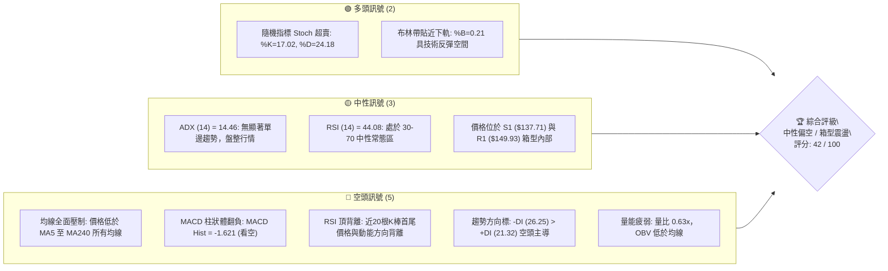

---

### 📊 核心指標速覽表

| 指標類別 | 指標名稱 | 當前數值 | 訊號 | 解讀 |
|----------|----------|----------|:----:|------|
| **價格** | 當前價格 | $140.95 | 🟡 | 位於52週區間12.9%低位，貼近波段支撐區 |
| **均線** | MA20 (月線) | $150.87 | 🔴 | 價格位於下方 -6.58%，短期均線下彎形成阻力 |
| **均線** | MA50 (季線) | $144.99 | 🔴 | 價格位於下方 -2.79%，中期均線反壓明顯 |
| **均線** | MA200 (年線) | $153.37 | 🔴 | 價格位於下方 -8.10%，長期牛熊分界線失守 |
| **動能** | RSI(14) | 44.08 | 🟡 | 中性偏弱，未達超賣但伴隨首尾頂背離警訊 |
| **動能** | MACD(12,26,9) | -1.017 / 柱 -1.621 | 🔴 | DIF 低於信號線(0.604)，負柱狀體擴大，動能偏空 |
| **動能** | KD(14,3,3) | %K 17.02 / %D 24.18 | 🟢 | 進入 20 以下超賣區，短線隨時醞釀技術性抽頭 |
| **趨勢** | ADX(14) | 14.46 | 🟡 | 數值遠低於 25，單邊趨勢衰竭，確認為箱型盤整 |
| **通道** | 布林通道 | 下軌 $134.03 / %B 0.21 | 🟢 | 價格接近下軌，乖離修正與下檔支撐買盤逐步增強 |
| **量能** | 20日成交量比 | 0.63x (4.89M vs 7.73M) | 🔴 | 成交量萎縮，OBV 跌破均線，市場追價意願低迷 |
| **波動** | ATR(14) | $7.19 (5.10%) | 🟡 | 日內平均振幅較大，止損設定需預留足夠空間 |

---

### 🏆 技術評分卡

```
╔══════════════════════════════════════════════════════════════════════╗
║                    技術評分卡 — VST (2026-10-30)                    ║
╠══════════════════════════════════════════════════════════════════════╣
║  趨勢強度      ███████░░░░░░░░░░░░░  35/100  🟡 弱趨勢/低ADX箱型     ║
║  動能指標      ████████░░░░░░░░░░░░  38/100  🔴 MACD空頭/KD超賣      ║
║  支撐穩定度    ████████████░░░░░░░░  58/100  🟡 S1/S2歷史低點聚類    ║
║  成交量配合    ███████░░░░░░░░░░░░░  36/100  🔴 縮量整理/OBV疲弱     ║
║  形態完整度    ██████████░░░░░░░░░░  50/100  🟡 寬幅矩形震盪箱體     ║
║  均線排列      ███████░░░░░░░░░░░░░  35/100  🔴 全均線反壓混合排列   ║
╠══════════════════════════════════════════════════════════════════════╣
║  綜合評分      ████████░░░░░░░░░░░░  42/100  🟡 中性震盪 / 區間操作  ║
╚══════════════════════════════════════════════════════════════════════╝
```

> **評分計算依據（規則 18）**：
> 綜合評分 = (35 + 38 + 58 + 36 + 50 + 35) ÷ 6 = 252 ÷ 6 = **42 / 100**。
> 評級定位：**中性偏空（40–60 區間）**，市場進入低波動盤整，以區間低吸高拋為主要操作指引。

---

## 2. 趨勢分析

### 🌐 多時框趨勢分析

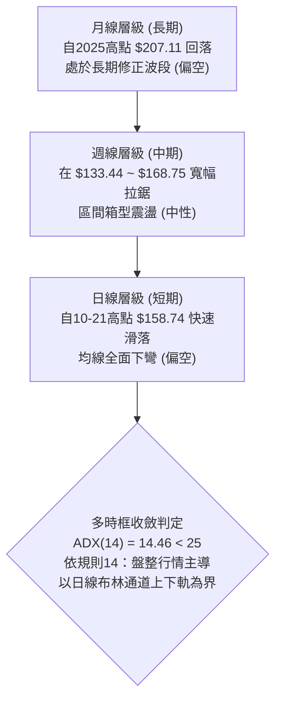

---

### 📈 長期趨勢 — 12個月走勢圖（Unicode）

以下為 VST 過去 12 個月（2025-11 至 2026-10）收盤價歷史走勢圖：

```
VST 月線收盤走勢圖（2025-11 至 2026-10）
價格軸 ($)
$180 ┤  ● $177.83 (高點)
$175 ┤              ● $173.13
$170 ┤
$165 ┤
$160 ┤      ● $160.62   ● $157.65       ● $157.36  ● $159.74  ● $158.37
$155 ┤
$150 ┤                          ● $149.87                         ● $147.95
$145 ┤
$140 ┤                                                                      ● $140.95 ◄ 當前
$135 ┤                                                        ● $137.15  ● $138.35 (低點)
     └────┬─────┬─────┬─────┬─────┬─────┬─────┬─────┬─────┬─────┬─────┬────
        25-11 25-12 26-01 26-02 26-03 26-04 26-05 26-06 26-07 26-08 26-09 26-10
```

#### 走勢特徵分析表格

| 階段區間 | 起止價格 | 漲跌幅 | 趨勢特徵描述 |
|----------|----------|:------:|--------------|
| **2025-11 ~ 2026-01** | $177.83 → $157.65 | -11.35% | 自高位初段急跌，動能明顯降溫，進入獲利回吐期 |
| **2026-01 ~ 2026-02** | $157.65 → $173.13 | +9.82% | 跌深反彈波，受多頭均線慣性推升，但未能創波段新高 |
| **2026-02 ~ 2026-04** | $173.13 → $157.36 | -9.11% | 二度探底，跌破前波低點，中長期均線開始糾結走平 |
| **2026-04 ~ 2026-06** | $157.36 → $158.37 | +0.64% | 連續三個月狹幅拉鋸於 $158 附近，市場多空呈現勢均力敵 |
| **2026-06 ~ 2026-08** | $158.37 → $137.15 | -13.40% | 破位重挫，創下 12 個月收盤新低 $137.15，空方全面掌控 |
| **2026-08 ~ 2026-10** | $137.15 → $140.95 | +2.77% | 低檔回穩，於 $137 支撐上方進行打底整理，短線反覆爭奪 |

---

### 📊 中期趨勢（週線分析）

中期走勢顯示，VST 正處於一個上下邊界分明的大型震盪結構：

```
週線中期格局示意圖
$168.75 ─────────────────────────────────────── 阻力高點 (2026-10-09 週最高點 / 阻力 R3 $168.67)
              ▲             ▲
              │             │  假突破回落
       ───────┼─────────────┼────────────────── 頸線 / MA200 ($153.37)
              │             ▼
$140.95 ──────┴──────────────────────────────── 現價位置 ($140.95)
              ▲             ▲
              │  多次回測支撐 │  未跌破
$132.26 ─────────────────────────────────────── 52週低點 ($132.26) / 支撐 S2 ($133.84)
```

週線指標顯示，在 2026-10-09 爆出天量 59,368,900 股並拉出最高點 $168.75 之後，隨後三週連續下挫，成交量逐步萎縮（31.7M → 31.9M → 18.96M），顯示多頭在衝擊阻力 R3 ($168.67) 後追價動能衰竭，資金快速撤出。

---

### ⚡ 趨勢強度評估（ADX 解讀）

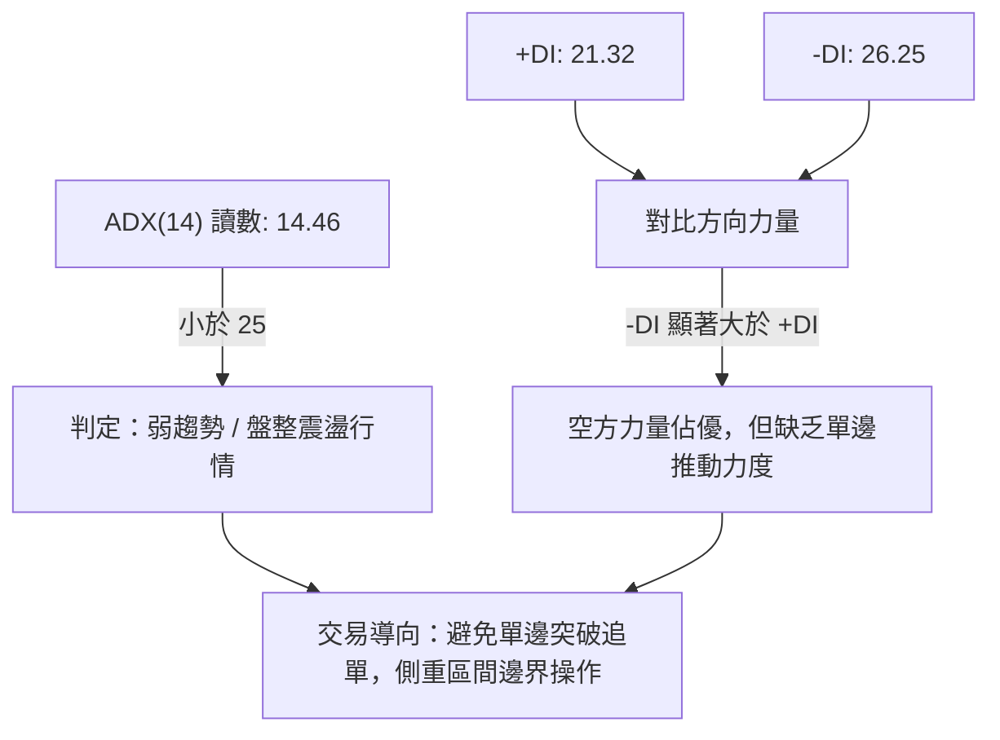

#### ADX 強度對照表

| 指標名稱 | 當前數值 | 參考臨界值 | 狀態評估 | 實戰交易含義 |
|----------|:--------:|:----------:|:--------:|--------------|
| **ADX (14)** | 14.46 | 25.00 | 弱勢無趨勢 | 趨勢跟隨策略（Trend-following）容易遭雙向洗盤，勝率極低 |
| **+DI (14)** | 21.32 | — | 多方能量偏弱 | 多頭無力組織連續性進攻波段 |
| **-DI (14)** | 26.25 | — | 空方能量佔優 | 價格受制於賣壓，空方掌握定價權，反彈高度受限 |
| **趨勢方向** | -DI > +DI | 差值 4.93 | 空頭主導盤整 | 逢高遭遇阻力反壓回落機率大於向上突破 |

---

## 3. 圖表形態分析

### 🔍 形態識別系統

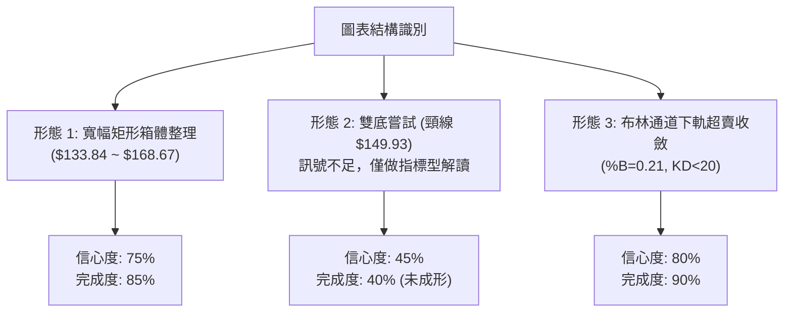

#### 形態識別與信心度評估表（依規則 15）

| 形態名稱 | 信心度 | 判斷依據（引用數據） | 完成度 | 目標價（附精確計算式） |
|----------|:------:|----------------------|:------:|------------------------|
| **寬幅矩形箱體整理** | 75% | 價格在 S2 ($133.84) 與 R3 ($168.67) 內往返震盪，高點受壓於週高 $168.75，低點守於週低 $133.44 | 85% | 箱體震盪，上軌目標即為 R3: **$168.67**；下軌邊界為 S2: **$133.84** |
| **雙重底雛形 (W底)** | 45% | **訊號不足，僅做指標型解讀**。2026-10-02 低點 $133.44 與 10-23 低點 $136.17 嘗試打底，但 10-22 出現長黑爆量下殺，且未過頸線 R1 ($149.93) | 40% | 若突破頸線 R1 ($149.93)，形態高度 = $149.93 − $133.84 = $16.09；推算目標 = $149.93 + $16.09 = **$166.02**（未確認） |
| **布林通道下軌回測** | 80% | 指標型形態：%B 為 0.21，價格 $140.95 接近下軌 $134.03，KD 出現低檔超賣，具備均值回歸特徵 | 90% | 均值回歸中軌目標（由布林中軌 MA20 計算）：**$150.87** |

---

### 🕯️ 重要K線形態分析

嚴格依據規則 19，僅使用數據中「近 10 根日 K」與「近 8 根週 K」之開、高、低、收數據進行客觀解讀：

#### 近 10 根日 K 棒形態分析表

| 日期（日K） | 開盤價 | 最高價 | 最低價 | 收盤價 | K線形態名稱 | 技術解讀 | 訊號 |
|:-----------:|:------:|:------:|:------:|:------:|:------------|:---------|:----:|
| **2026-10-16** | 152.55 | 155.16 | 151.15 | 152.02 | 吊首狀小黑K | 實體極小，高檔獲利了結賣壓湧現 | 🟡 |
| **2026-10-19** | 154.10 | 155.33 | 145.85 | 149.70 | 長下影中陰線 | 盤中重挫至 $145.85 後獲得低吸買盤拉回 | 🟡 |
| **2026-10-20** | 148.90 | 151.34 | 147.10 | 150.32 | 縮量小陽線 | 震盪修復，成交量萎縮至 3.34M，多方觀望 | 🟡 |
| **2026-10-21** | 153.35 | 158.74 | 151.83 | 156.14 | 長上影實體陽線 | 多頭猛烈反撲，但受阻於 $158.74 遭空頭壓制 | 🟢 |
| **2026-10-22** | 153.00 | 154.27 | 139.10 | 140.83 | 爆量長陰吞噬線 | 成交量激增至 12.47M，一舉跌破多根均線，結構重創 | 🔴 |
| **2026-10-23** | 139.06 | 141.52 | 136.17 | 140.16 | 長下影錘頭十字星 | 下探 $136.17 逼近 S1 ($137.71)，多方出手護盤 | 🟢 |
| **2026-10-26** | 140.90 | 143.52 | 139.07 | 141.73 | 窄幅微幅陽線 | 縮量整理，確認前日錘頭線支撐效應 | 🟡 |
| **2026-10-27** | 143.95 | 147.45 | 143.40 | 146.66 | 溫和放量中陽線 | 反彈觸碰斐波那契 78.6% 回調位 $146.66 遇阻 | 🟢 |
| **2026-10-28** | 146.88 | 147.82 | 142.20 | 142.72 | 倒轉長上影黑K | 上攻無量遭壓回，收盤落在 $142.72，反彈遇阻 | 🔴 |
| **2026-10-29** | 142.18 | 144.67 | 140.06 | 140.95 | 縮量小陰線 | 量縮至 4.89M，多空僵持，收盤貼近整數關卡 | 🔴 |

#### 近 8 根週 K 棒形態分析表

| 日期（週K最後日） | 開盤價 | 最高價 | 最低價 | 收盤價 | 週K形態名稱 | 技術解讀 | 訊號 |
|:-----------------:|:------:|:------:|:------:|:------:|:------------|:---------|:----:|
| **2026-09-11** | 150.75 | 154.65 | 146.43 | 148.14 | 上影小陰線 | 遇阻回落，週成交量 18.61M 溫和 | 🟡 |
| **2026-09-18** | 143.76 | 145.87 | 139.39 | 140.44 | 破位中陰線 | 跌破 $145 關卡，空方主導推進 | 🔴 |
| **2026-09-25** | 142.00 | 142.64 | 135.98 | 138.46 | 連續下行陰線 | 持續走弱，成交量維持 22.34M 穩定放量 | 🔴 |
| **2026-10-02** | 138.08 | 143.51 | 133.44 | 140.02 | 爆量長下影錘頭週K | 週量增至 34.71M，探底 $133.44 形成波段底部 | 🟢 |
| **2026-10-09** | 144.04 | 168.75 | 140.90 | 161.48 | 巨量衝天長陽線 | 爆出 59.37M 天量，上探 $168.75 逼近箱頂 R3 | 🟢 |
| **2026-10-16** | 162.67 | 164.25 | 145.85 | 152.02 | 吊頸長黑週K | 週跌幅顯著，多頭獲利竭盡，實質反轉起點 | 🔴 |
| **2026-10-23** | 154.10 | 158.74 | 136.17 | 140.16 | 巨幅重挫長陰線 | 週內高低振幅達 $22.57，長陰灌破多重均線 | 🔴 |
| **2026-10-29** | 140.90 | 147.82 | 139.07 | 140.95 | 窄幅縮量孕線 | 週量驟降至 18.96M，下殺動能暫竭，進入修復期 | 🟡 |

---

### 📉 ASCII 走勢形態示意圖

```
VST 近期價格走勢與震盪箱體示意圖
$168.75 ─────── 2026-10-09 天量尖頭高點 (逼近阻力 R3 $168.67)
                 /\
                /  \  10-16 吊頸確認
               /    \
$155.69 ──────/──────\─────── 阻力位 R2 (MA240 $155.69)
             /        \  10-21 假突破
$149.93 ────/──────────\───── 阻力位 R1 (布林中軌 MA20 $150.87 / 頸線)
           /            \
          /              \  10-22 放量跳水長黑K (12.47M)
$140.95 ─/────────────────\── 現價 $140.95 (處於震盪下半部)
        /                  \
$137.71 ────────────────────\ 支撐位 S1 (10-23 探底 $136.17 獲支撐回升)
                             \___
$133.84 ───────────────────────── 強支撐位 S2 (10-02 低點 $133.44 聚類)
```

---

### 🎯 形態目標價計算

1. **矩形整理箱體目標**：
   - 上邊界阻力取自高點聚類 **R3: $168.67**。
   - 下邊界支撐取自低點聚類 **S2: $133.84**。
   - 箱體中軸：($168.67 + $133.84) ÷ 2 = **$151.25**（極度貼近 MA20 $150.87 與 R1 $149.93）。
2. **潛在反彈推算目標**：
   - 若短線守穩 S1 ($137.71)，第一回抽目標為箱體中軸與波段阻力 **R1: $149.93**。
   - 若有效站穩 R1，則延伸推進至 **R2: $155.69**。

---

## 4. 支撐與阻力

### 🗺️ 關鍵價位分布圖（Unicode）

```
╔══════════════════════════════════════════════════════════════════════╗
║                          VST 價位結構分布圖                          ║
╠══════════════════════════════════════════════════════════════════════╣
║ $168.67 ║████████████████████████║ 強阻力 R3 (近一年波段高點/週高天花板)
║ $155.69 ║██████████████████      ║ 阻力 R2 (MA240/年線上方密集套牢區) ║
║ $149.93 ║████████████████████████║ 關鍵阻力 R1 (MA20/反彈頸線反壓)     ║
║         ║                        ║                                    ║
║ $140.95 ╠════════════════════════╣ ◄ 當前收盤價 ($140.95)              ║
║         ║                        ║                                    ║
║ $137.71 ║▓▓▓▓▓▓▓▓▓▓▓▓▓▓▓▓        ║ 近期支撐 S1 (10-23長下影低點防線)   ║
║ $133.84 ║████████████████████████║ 強支撐 S2 (波段雙底/52週低點聚類)   ║
╚══════════════════════════════════════════════════════════════════════╝
```

---

### 🚧 阻力位分析表

所有價位均嚴格引用自數據之「關鍵價位」與指標計算：

| 阻力級別 | 價位 | 與現價距離 | 形成原因 | 突破難度 | 重要性 |
|:--------:|:----:|:----------:|----------|:--------:|:------:|
| **R1** | **$149.93** | +6.37% | 近一年波段高點聚類、MA20 ($150.87) 與 MA120 ($149.23) 均線糾結處 | 🟡 中等 | ★★★★☆ |
| **R2** | **$155.69** | +10.46% | 波段高點聚類、MA240 長期均線反壓位，10-21 反彈高點密集套牢區 | 🔴 偏高 | ★★★★☆ |
| **R3** | **$168.67** | +19.66% | 2026-10-09 週線衝刺高點 $168.75、布林帶上軌 ($167.71) 聚類 | 🔴 極高 | ★★★★★ |

---

### 🛡️ 支撐位分析表

| 支撐級別 | 價位 | 與現價距離 | 形成原因 | 守住機率 | 重要性 |
|:--------:|:----:|:----------:|----------|:--------:|:------:|
| **S1** | **$137.71** | -2.30% | 近一年波段低點聚類、2026-10-23 日K探底低點 $136.17 守穩處 | 70% | ★★★★☆ |
| **S2** | **$133.84** | -5.05% | 2026-10-02 週K低點 $133.44、布林下軌 $134.03、52週低點 $132.26 聚類 | 85% | ★★★★★ |
| **S3** | **N/A** | — | **數據中未偵測到**（依規則 13，數據未提供 S3，不予編造） | N/A | ☆☆☆☆☆ |

---

### 📐 斐波那契回調位分析

依據數據提供的 52 週完整區間（$132.26 至 $199.57，總空間 $67.31）之黃金分割比率分析如下：

```
斐波那契回調位階梯圖 (以 52W 高點 $199.57 至 52W 低點 $132.26 計算)
0.0%  (52W High)  $199.57 ──────────────────────────────────────
23.6%             $183.68 ──────────────────
38.2%             $173.86 ───────────────────────
50.0%             $165.91 ──────────────────────────── (箱體頂部 R3 $168.67 所在處)
61.8%             $157.97 ───────────────────────────────── (黃金分割反壓位)
78.6%             $146.66 ────────────────────────────────────── (10-27 反彈受阻位)
[現價 $140.95] ──► 位於 78.6% ($146.66) 與 100.0% ($132.26) 之間震盪
100.0% (52W Low)  $132.26 ─────────────────────────────────────────── (全波段防守底線)
```

#### 斐波那契回調位解讀

1. **現價區間位置**：
   當前收盤價 **$140.95** 落在 **78.6% ($146.66)** 與 **100.0% ($132.26)** 之間，屬於深度回調區域（僅高於 52 週低點 6.57%）。
2. **阻力驗證**：
   在近 10 日 K 線中，2026-10-27 最高反彈至 $147.45，收於 $146.66，精確受阻於 78.6% 斐波那契回調位 $146.66，隨後連續兩日收黑，充分印證該點位的壓制效力。
3. **支撐意義**：
   下方 100.0% 基準位 $132.26 與 S2 ($133.84) 形成雙重鐵底結構，為多頭最後的防守底線。

---

## 5. 技術指標深度解讀

### 🎛️ 指標訊號總覽

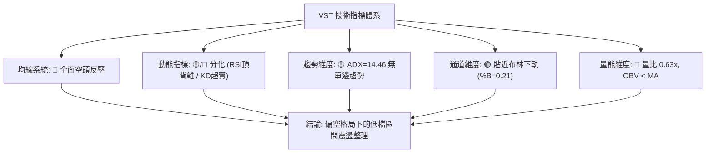

---

### 📈 移動平均線排列分析

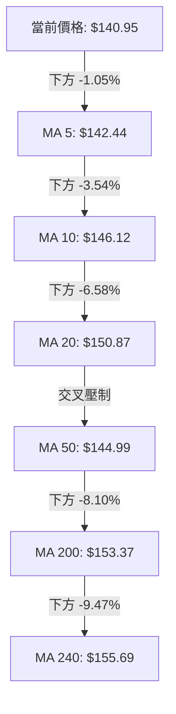

#### 均線數據與排列特徵

| 均線名稱 | 價位 | 與現價乖離 | 排列狀態 | 趨勢涵義 |
|:--------:|:----:|:----------:|:--------:|----------|
| **MA 5** | $142.44 | -1.05% | 下彎壓制 | 超短期阻力，壓制每日微幅反彈 |
| **MA 10** | $146.12 | -3.54% | 下彎壓制 | 短期進攻防守線，空方控盤 |
| **MA 20** | $150.87 | -6.58% | 走平偏下 | 月線反壓，布林通道中軌所在，強反壓 |
| **MA 50** | $144.99 | -2.65% | 走平糾結 | 季線位置，與現價貼近但仍居上方 |
| **MA 60** | $144.79 | -2.65% | 走平糾結 | 與 MA50 形成雙重密集帶 |
| **MA 120** | $149.23 | -5.55% | 走平偏下 | 半年線壓制，反彈天花板之一 |
| **MA 200** | $153.37 | -8.10% | 走平微下 | 長期牛熊線失守，長期走勢進入防守期 |
| **MA 240** | $155.69 | -9.47% | 走平反壓 | 年線阻力，等同阻力位 R2 |

> **排列評估**：
> 現價低於全週期均線，呈現典型「混合偏空排列」。短期均線迅速下插，但中期均線（MA50/60 在 $144.8 附近）與長期均線（MA200/240 在 $153-$155 附近）尚未形成陡峭空頭發散，而是呈現大區間走平糾結，進一步印證「缺乏單邊趨勢、處於箱型寬幅震盪」的本質。

---

### 📉 RSI(14) 分析

- **RSI 當前讀數**：44.08（Wilder 算法）
- **區間定位**：處於 30 至 70 之常態中性格局，未進入超賣極值（<30）。
- **進度條展示**：
  ```
  RSI(14): 44.08  [████████░░░░░░░░░░░░] 44.08% (中性偏弱)
  ```
- **背離判斷（頂背離確認 ⚠️）**：
  數據明確提示：`RSI 背離: ⚠️ 頂背離 (Bearish Divergence)`（比較近20根K棒首尾價格與RSI方向）。在 10 月中旬價格向上抽升至 $158.74（收 $156.14）時，RSI 動能未能同步創出相稱強勢，隨後價格迅速崩跌引發頂背離確認。目前 RSI 跌回 44.08，顯示動能處於空方釋放後的低位修復期。

---

### 📊 MACD(12/26/9) 訊號解讀

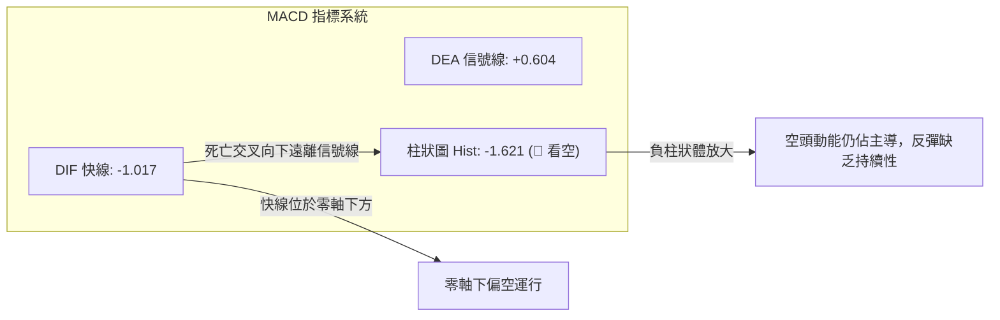

- **MACD 快線**：-1.017
- **信號線 (Signal)**：+0.604
- **柱狀體 (Histogram)**：-1.621
- **訊號解讀**：DIF 線已向下跌破零軸，且柱狀體為負值（-1.621），明確發出空頭信號。然而負柱狀體在最近兩個交易日未再顯著擴大，顯示下殺動能初顯鈍化跡象。

---

### 📦 布林通道分析

```
VST 日線布林通道結構 (20日, 2倍標準差)
═════════════════════════════════════════════════════════
$167.71 ─────────────────────────────── 布林上軌 (Upper Band)
                  ↑
                  │ 帶寬 (Bandwidth) = $33.68 (22.3%)
                  ▼
$150.87 ─────────────────────────────── 布林中軌 (MA20 / 中軸反壓)
                  ↑
                  │
$140.95 ──────────┼──────────────────── ◄ 當前收盤價 (%B = 0.21)
                  │
$134.03 ─────────────────────────────── 布林下軌 (Lower Band / 支撐區間)
═════════════════════════════════════════════════════════
```

- **布林上軌**：$167.71（高度契合 R3: $168.67）
- **布林中軌 (MA20)**：$150.87（高度契合 R1: $149.93）
- **布林下軌**：$134.03（高度契合 S2: $133.84）
- **%B 指標**：**0.21**
- **解讀**：%B 讀數為 0.21，代表價格已回落至通道下緣五分之一區域。在 ADX 僅 14.46 的盤整市道中，布林下軌具有極強的統計學支撐效力，未被單邊「向下開口破軌」，短線具備回歸中軌的均值修復動能。

---

### 💹 成交量分析（量價配合度）

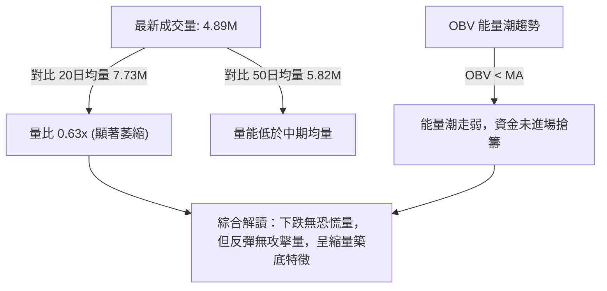

1. **量價背離與縮量特徵**：
   - 2026-10-22 長黑下殺時爆出 12.47M 巨量，顯示高檔套牢賣盤集中宣洩。
   - 隨後在 10-26 至 10-29 四個交易日中，日成交量分別降至 4.30M、4.11M、5.66M、4.89M，量比僅 0.63x。
2. **OBV 趨勢**：
   - 數據顯示 `OBV < MA`，能量潮處於疲弱軌跡，反映籌碼在當前點位雖然拋壓暫止，但機構買盤仍處於觀望狀態，缺乏放量拉升的主動買盤。

---

## 6. 動能與波動率

### ⚡ 動能評估四象限

動能評估體系聚焦於「動能方向與強度（以 MACD / RSI 為代表）」與「波動率水平（以 ATR / 布林帶寬為代表）」之交集：

| 象限 | 動能方向 | 波動狀態 | VST 當前位置 | 實戰環境評估 |
|:----:|:--------:|:--------:|:------------:|--------------|
| **Q1** | 強多頭 | 低波動 | — | 最佳波段穩健上推區 |
| **Q2** | 弱/空頭 | 低波動 | — | 陰跌磨底，等待放量 |
| **Q3** | 強多頭 | 高波動 | — | 高風險高收益狂熱區 |
| **Q4** | **弱/空頭** | **高波動** | **✓ 當前狀態** | **洗盤震盪劇烈，嚴格控制倉位，專注邊界交易** |

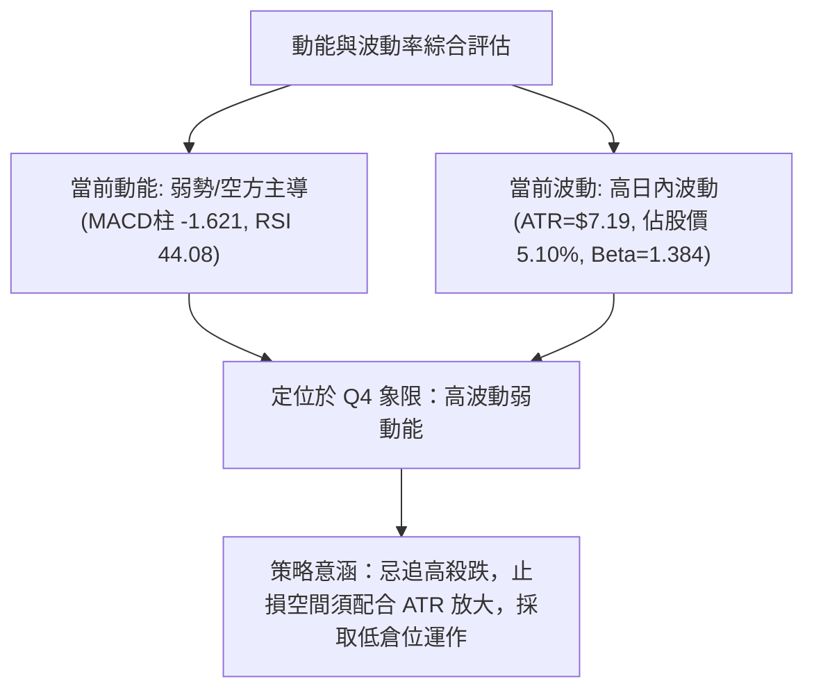

---

### 📊 ATR 波動率分析

- **ATR(14) 數值**：**$7.19**（Wilder 平滑）
- **波動率比例**：佔當前股價之 **5.10%**
- **市場意義**：VST 每日平均潛在波幅超過 $7 美元，屬於典型的高波動標的。
- **止損距離建議**：
  - 超短線日內止損：至少預留 1.0 × ATR = **$7.19** 空間。
  - 波段交易止損：建議設置 1.5 × ATR = **$10.79** 空間，以防範盤中正常噪聲引發的假突破擊潰止損。

---

### 📐 Beta 與市場相關性

- **Beta 係數**：**1.384**
- **市場敏感度分析**：
  VST 的 Beta 為 1.384，顯示其對標普 500 等大盤指數具有較高的放大效應（大盤波動 1%，該股理論波動 1.38%）。在當前技術面偏空整理的背景下，若大盤出現系統性調整，VST 容易面臨加劇的下檔 beta 敞口風險；反之，若公用事業/電力板塊迎來資金回流，其反彈彈性亦將顯著高於防禦型公用事業同業。

---

## 7. 多時框架總結

### 📋 時框架評分表

| 時框架 | 趨勢方向 | 動能狀態 | 均線排列 | 圖表形態 | 綜合評分 | 建議策略 |
|:------:|:--------:|:--------:|:--------:|:--------:|:--------:|:---------|
| **日線 (短期)** | 空頭主導 | 偏弱 (MACD負柱) | 混合空頭 | 探底小K線 | 38/100 | 等待企穩，忌盲目搶反彈 |
| **週線 (中期)** | 區間震盪 | 中性 (RSI 44) | 糾結均線 | 寬幅矩形箱體 | 48/100 | 箱體下軌分批布局 |
| **月線 (長期)** | 震盪回調 | 轉弱 (自高位修正) | 長期均線走平 | 高位拉回洗盤 | 40/100 | 嚴守長期底線支撐 |

---

### 🔲 綜合訊號矩陣

| 維度 | 短期（日線） | 中期（週線） | 長期（月線） | 跨週期一致性解讀 |
|------|:------------:|:------------:|:------------:|------------------|
| **方向一致性** | 🔴 偏空 | 🟡 中性 | 🟡 中性 | 中長期支撐抑制短期進一步崩跌 |
| **動能一致性** | 🔴 走弱 | 🔴 轉弱 | 🟡 趨緩 | 動能全線處於退潮後的出清階段 |
| **量能一致性** | 🔴 縮量 | 🔴 縮量 | 🟡 常態 | 缺乏主動攻擊買盤，為存量資金博弈 |

---

### ⚖️ 多時框收斂結論（依規則 14）

> **【收斂裁決與主導依據】**：
> 1. **行情性質判定**：當前日線 ADX(14) 讀數僅為 **14.46**，遠低於趨勢臨界線 25，明確判定當前**不存在單邊趨勢**，市場屬於典型的**「盤整行情」**。
> 2. **優先級收斂規則**：依嚴格規則 14，在 ADX < 25 的盤整市況中，**以日線布林通道上下軌 ($134.03 ~ $167.71) 為主要交易區間**；中長期均線（MA50/MA200）僅提供箱體內部的主要壓力基準，不以突破趨勢看待。
> 3. **唯一方向性結論**：**中性偏空觀望 / 區間下軌防守（Neutral Range-Bound）**。此結論嚴格對齊第 1 章評分卡（42/100），並將在第 8 章指導區間邊界操作。

---

## 8. 交易策略建議

### 🗺️ 策略決策流程圖

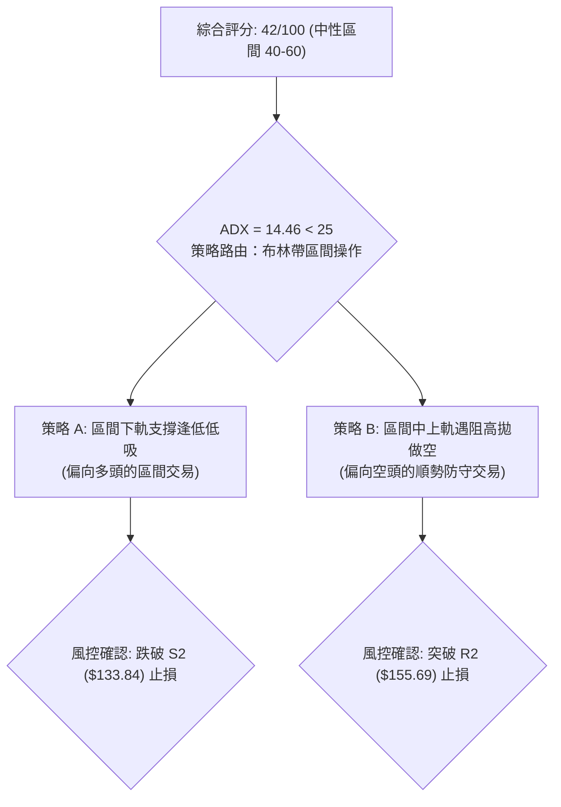

---

### 🧭 策略路由（依評分卡分流）

> **當前主策略方向 = 區間震盪操作（Range-Bound Trading），以布林通道與 S/R 為界，等待明確突破訊號（依技術評分卡 42 / 100）。**

根據規則 18 與評分分流準則，評分 42 處於 40–60 之中性區間，市場進入低波盤整，不宜單邊重倉追逐趨勢，應鎖定關鍵支撐位與阻力位進行區間高低點博弈。

---

### 🎯 價格情境階梯（Price Scenarios）

價位完全嚴格引用數據中「關鍵價位」之精確數值：

| 觸發條件 | 下一目標 | 後續延伸 | 情境含義 |
|----------|:--------:|:--------:|----------|
| **向上突破 R1 ($149.93)** | **R2: $155.69** | **R3: $168.67** | 短線破位修復，挑戰年線與箱體上軌 |
| **於現價 [$137.71 ~ $149.93] 盤整** | — | — | 箱體底部反覆拉鋸打底，時間換取空間 |
| **向下跌破 S1 ($137.71)** | **S2: $133.84** | **52W Low: $132.26** | 尋求強支撐確認，考驗波段多頭底線 |

---

### 📊 情境機率分佈

| 情境劇本 | 預估機率 | 主要技術依據 |
|----------|:--------:|--------------|
| **區間震盪築底** | **55%** | ADX 僅 14.46，成交量萎縮至 0.63x，市場缺乏打破 $134-$150 區間的宏觀催化劑 |
| **回踩強支撐 (探 S2)** | **30%** | MACD 負柱狀體尚在，-DI 佔優，價格受制於 MA5/MA10 下彎壓制，存在下探慣性 |
| **強勢向上突破 (破 R1)** | **15%** | 全均線反壓沉重，OBV < MA 顯示資金追價意願不足，短線難以直接逆轉長黑壓力 |

---

### 🟢 主策略詳情

本策略組合嚴格遵循規則 13 與規則 17，價位**僅引用**關鍵價位（S1, S2, R1, R2），風報比依公式精確計算：

$$\text{多頭風險報酬比} = \frac{\text{目標價 T1} - \text{進場價}}{\text{進場價} - \text{止損價}}$$
$$\text{空頭風險報酬比} = \frac{\text{進場價} - \text{目標價 T1}}{\text{止損價} - \text{進場價}}$$

| 策略要素 | 策略 A：區間下軌低吸多單 (Buy Support) | 策略 B：阻力位高拋做空 (Sell Resistance) |
|----------|----------------------------------------|------------------------------------------|
| **策略邏輯** | 於支撐位 S1 企穩低吸，博弈均值回歸中軌 | 於關鍵阻力 R1 遇阻做空，順應均線反壓格局 |
| **進場價格** | **$137.71**（精準引用支撐位 S1） | **$149.93**（精準引用阻力位 R1） |
| **目標價 T1** | **$149.93**（引用阻力位 R1） | **$137.71**（引用支撐位 S1） |
| **目標價 T2** | **$155.69**（引用阻力位 R2） | **$133.84**（引用強支撐位 S2） |
| **止損價格** | **$133.84**（引用強支撐位 S2） | **$155.69**（引用阻力位 R2） |
| **風險報酬比** | **1 : 3.16（以 T1 計）**<br>計算式：$(149.93 - 137.71) \div (137.71 - 133.84) = 12.22 \div 3.87$ | **1 : 2.12（以 T1 計）**<br>計算式：$(149.93 - 137.71) \div (155.69 - 149.93) = 12.22 \div 5.76$ |
| **T2 風報比** | **1 : 4.65（以 T2 計）**<br>計算式：$(155.69 - 137.71) \div 3.87 = 17.98 \div 3.87$ | **1 : 2.79（以 T2 計）**<br>計算式：$(149.93 - 133.84) \div 5.76 = 16.09 \div 5.76$ |
| **預估勝率** | 52% | 58% |
| **建議倉位** | 10% ~ 15%（輕倉分批操作） | 10% ~ 15%（輕倉試單） |

---

### 🔴 反向風險觸發點（對沖提示）

- **多單失效 / 空方加速條件**：
  若日 K 收盤價有效跌破 **S2: $133.84**，伴隨成交量放大超過 20 日均量（>7.73M），宣告區間支撐全面瓦解，所有低吸多單必須無條件止損出局，並警惕向 52 週低點 **$132.26** 尋求破位支撐。
- **空單失效 / 多方強勢逆轉條件**：
  若日 K 帶量長陽突破並收穩於 **R1: $149.93** 甚至突破 **R2: $155.69**，則確認空頭下殺遭強力吸籌終結，空頭結構被逆轉，空單應即刻離場對沖。

---

### ⭐ 整體訊號強度評星

```
╔══════════════════════════════════════════════════════╗
║  做多訊號強度：★★☆☆☆  (2.0/5星 — 僅屬低檔超賣博弈)   ║
║  做空訊號強度：★★★☆☆  (3.0/5星 — 均線與MACD偏空)     ║
║  整體可信度：  ★★★☆☆  (3.0/5星 — 低ADX盤整洗盤期)   ║
╚══════════════════════════════════════════════════════╝
```

---

## 9. 風險提示與監控

### ✅ 關鍵監控指標 Checklist

```
╔══════════════════════════════════════════════════════════════════════╗
║                     交易員關鍵監控指標 Checklist                     ║
╠══════════════════════════════════════════════════════════════════════╣
║ [ ] 價位確認：每日收盤價是否持續守在 S1 ($137.71) 之上              ║
║ [ ] 動能翻轉：MACD Histogram 是否出現負值收窄（邁向黃金交叉）       ║
║ [ ] 超賣修復：Stochastic %K 是否上穿 %D 形成 20 以下低檔金叉         ║
║ [ ] 量能驗證：單日成交量是否回升至 20日均量 (7.73M) 以上            ║
║ [ ] 通道擠壓：布林帶帶寬是否收窄至極限並重新向外開口 (方向選擇)     ║
║ [ ] 均線挑戰：日K線能否有效突破並站穩 MA5 ($142.44) 與 MA10 ($146.12)║
╚══════════════════════════════════════════════════════════════════════╝
```

---

### ⚠️ 風險場景分析

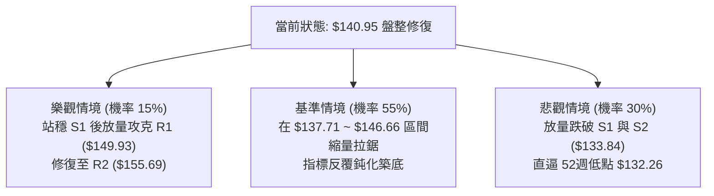

---

### 🛡️ 風險管理重要提醒

1. **ATR 止損保護機制**：
   VST 的 ATR(14) 高達 $7.19，波動率為 5.10%。極度忌諱將止損點設得過緊。若參與當前價格區間交易，進出場必須嚴格以每日收盤價作為確認基準，避免在盤中因高 Beta (1.384) 帶來的脈衝性下影線被誘殺出場。
2. **倉位管理守則**：
   在技術綜合評分僅 42 分、ADX < 25 的中性偏弱震盪環境中，單筆交易的最大資金風險暴露不得超過總帳戶權益的 **1.0%**。建議總倉位控制在 **10% ~ 15%** 以內，保留充裕的流動性以應對突破時的右側順勢加碼機會。

---

## 📋 報告總結

```
╔══════════════════════════════════════════════════════════════════════╗
║                        VST 技術分析報告總結                          ║
╠══════════════════════════════════════════════════════════════════════╣
║  報告日期：2026-10-30                                                ║
║  當前價格：$140.95                                                   ║
║  分析評級：⚖️ 中性偏弱 / 區間震盪操作 (評分: 42 / 100)              ║
╠══════════════════════════════════════════════════════════════════════╣
║  關鍵結論：                                                          ║
║  ├─ 長期趨勢：🟡 中性修正，自 2025 高點回落後處於寬幅整理結構        ║
║  ├─ 中期趨勢：🟡 矩形震盪，受限於 S2 ($133.84) 與 R3 ($168.67) 之間  ║
║  ├─ 短期趨勢：🔴 偏空運行，價格受壓於 MA5/10/20 等所有短中期均線     ║
║  ├─ 關鍵支撐：S1: $137.71 ｜ S2: $133.84                             ║
║  ├─ 關鍵阻力：R1: $149.93 ｜ R2: $155.69 ｜ R3: $168.67             ║
║  └─ 分析師目標：均價 $206.95 (區間: $106.00 ~ $306.00)               ║
╠══════════════════════════════════════════════════════════════════════╣
║  最優策略組合：                                                      ║
║  1. 🥇 最佳機會：於 S1 ($137.71) 附近執行策略 A 低吸，博弈均值回歸   ║
║  2. 🥈 次選機會：反彈至 R1 ($149.93) 遇阻執行策略 B 順勢放空         ║
║  3. 🥉 保守選擇：完全空倉觀望，靜待日線站穩 MA20 或跌破 S2 再行進場 ║
╚══════════════════════════════════════════════════════════════════════╝
```

---

> ⚠️ **免責聲明**：本報告為 AI 自動生成之技術分析研究成果，所有數據、圖表及價位推算均基於提供之歷史市場資訊。本報告**僅供學術研究與投資分析參考**，**絕不構成任何形式之個人化投資建議、要約或交易邀請**。金融市場具有高度風險，投資人應獨立思考並自行承擔盈虧風險。

---

*報告生成時間：2026-10-30 ｜ 數據來源：Yahoo Finance ｜ 分析框架：多時框技術分析體系*