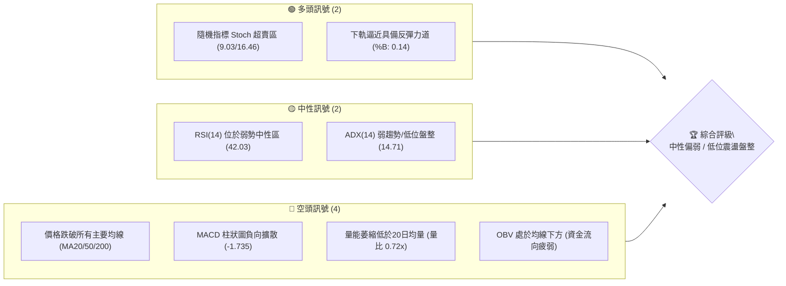
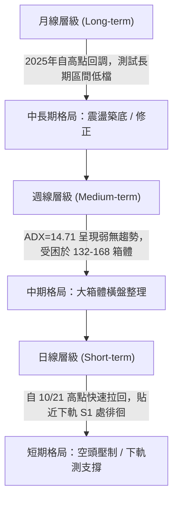
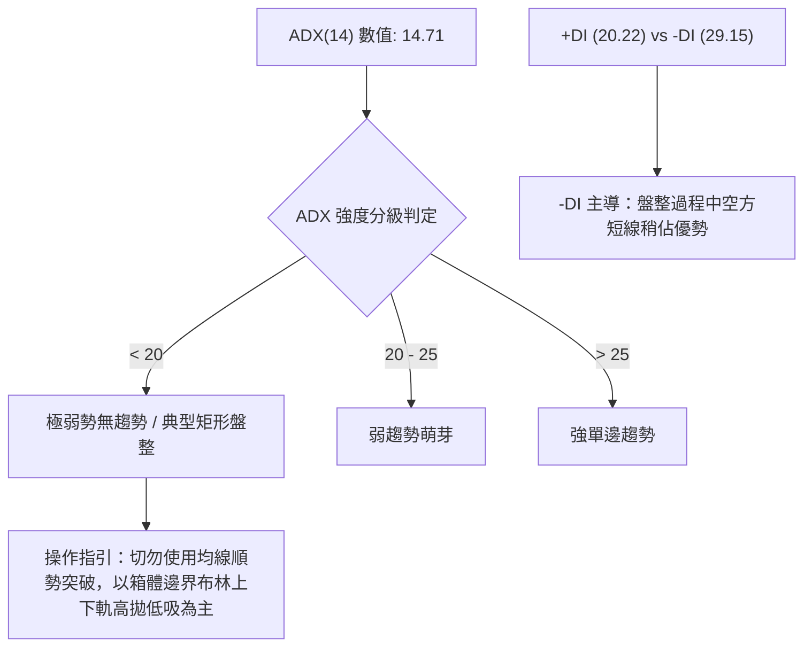
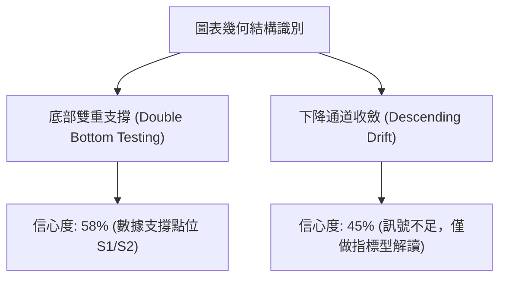
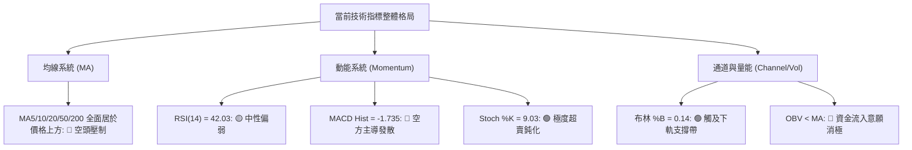
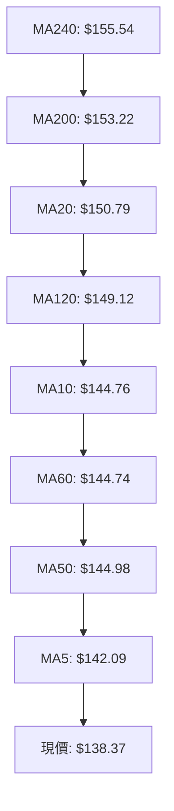
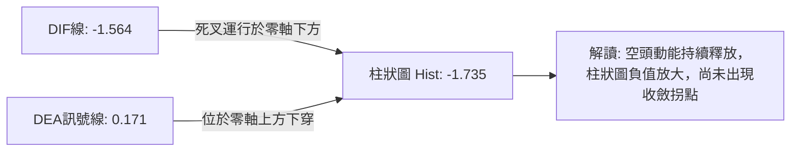
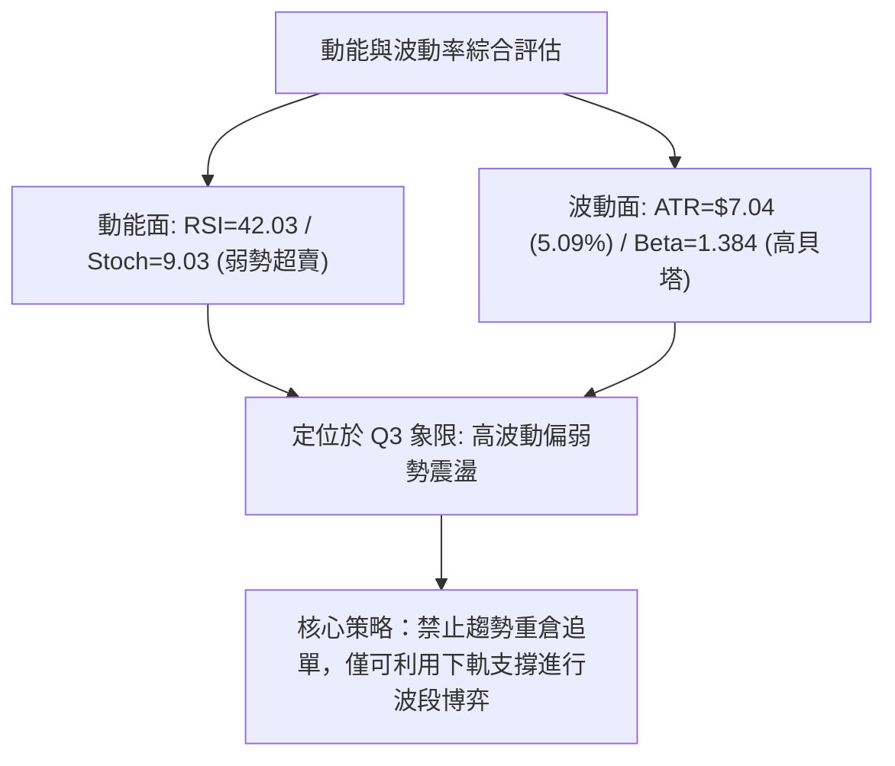
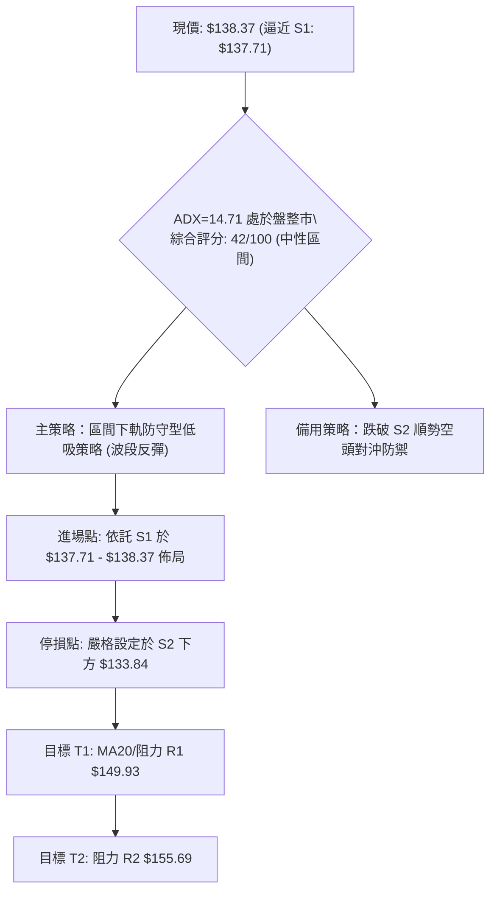
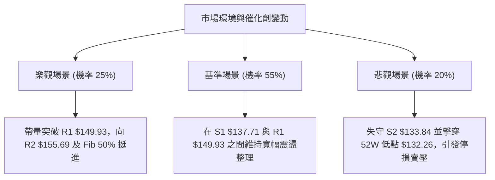

# VST 技術分析報告

> **報告日期**：2026-10-31 ｜ **語言**：繁體中文 ｜ **數據來源**：Yahoo Finance ｜ **當前價格**：$138.37

---

## 目錄

| 章節 | 內容 |
|------|------|
| [1. 技術面概覽](#1-技術面概覽) | 訊號儀表板、核心指標、評分卡 |
| [2. 趨勢分析](#2-趨勢分析) | 多時框趨勢、長中短期走勢 |
| [3. 圖表形態分析](#3-圖表形態分析) | 形態識別、K線組合、目標價 |
| [4. 支撐與阻力](#4-支撐與阻力) | 關鍵價位、斐波那契回調 |
| [5. 技術指標深度解讀](#5-技術指標深度解讀) | MA/RSI/MACD/布林/成交量 |
| [6. 動能與波動率](#6-動能與波動率) | 動能評估、ATR、Beta |
| [7. 多時框架總結](#7-多時框架總結) | 時框架評分矩陣 |
| [8. 交易策略建議](#8-交易策略建議) | 多空策略、風險報酬比 |
| [9. 風險提示與監控](#9-風險提示與監控) | 監控指標、風險場景 |

---

## 1. 技術面概覽

### 🎯 技術訊號儀表板



### 📊 核心指標速覽表

| 指標類別 | 指標名稱 | 當前數值 | 訊號 | 解讀 |
|----------|----------|----------|------|------|
| **價格** | 當前收盤價 | $138.37 | 🔴 | 位於52週區間低位 9.3% 分位處，貼近一年低點 |
| **均線** | 短期 MA20 | $150.79 | 🔴 | 價格低於 MA20 達 -8.24%，短線呈承壓態勢 |
| **均線** | 中期 MA50 | $144.98 | 🔴 | 價格低於 MA50 達 -4.56%，中期反彈受壓 |
| **均線** | 長期 MA200| $153.22 | 🔴 | 價格跌破年線支撐，長線多頭架構遭到破壞 |
| **動能** | RSI(14) | 42.03 | 🟡 | 位於中性偏弱區間（30–50），尚未進入極度超賣 |
| **動能** | MACD 柱狀 | -1.735 | 🔴 | DIF（-1.564）低於 DEA（0.171），空頭動能主導 |
| **動能** | KD(9,3) | %K 9.03 / %D 16.46 | 🟢 | 進入極度超賣鈍化區，隨時具備技術性跌深反彈需求 |
| **波動** | ATR(14) | $7.04 (5.09%) | 🟡 | 日內波動幅度適中，區間洗盤震盪特徵明顯 |
| **趨勢** | ADX(14) | 14.71 | 🟡 | 數值低於 25，表明缺乏單邊趨勢，屬於盤整震盪市場 |

### 🏆 技術評分卡

```
╔══════════════════════════════════════════════════════════════╗
║                技術評分卡 — VST (2026-10-31)                 ║
╠══════════════════════════════════════════════════════════════╣
║ 趨勢強度      ███████░░░░░░░░░░░░░  35/100  🔴 空頭/無趨勢   ║
║ 動能指標      ████████░░░░░░░░░░░░  40/100  🟡 弱勢偏超賣   ║
║ 支撐穩定度    ███████████░░░░░░░░░  55/100  🟡 考驗低位支撐 ║
║ 成交量配合    ████████░░░░░░░░░░░░  38/100  🔴 縮量陰跌格局 ║
║ 形態完整度    ██████████░░░░░░░░░░  48/100  🟡 底部箱體構築 ║
║ 均線排列      ███████░░░░░░░░░░░░░  36/100  🔴 全均線壓制   ║
╠══════════════════════════════════════════════════════════════╣
║ 綜合評分      ████████░░░░░░░░░░░░  42/100  🟡 中性區間觀望 ║
║               （算術平均四捨五入：(35+40+55+38+48+36)/6 = 42）║
╚══════════════════════════════════════════════════════════════╝
```

---

## 2. 趨勢分析

### 🌐 多時框趨勢分析



### 📈 長期趨勢 — 12個月走勢圖（Unicode）

```
VST 月線走勢圖（2025-11 至 2026-10）
價格軸 ($)
$180 ┤ ●(2025-11: $177.83)
$170 ┤             ●(2026-02: $173.13)
$160 ┤   ●      ●        ●   ●   ●
$150 ┤                       ●       ●
$140 ┤                                   ●   ●   ●($138.37 ← 現價)
$130 ┤                                 ●(2026-08: $137.15)
     └────────────────────────────────────────────────────────
      11  12  01  02  03  04  05  06  07  08  09  10 (月份)
```

**走勢特徵分析表格**：

| 階段 | 時間區間 | 起訖價格區間 | 漲跌幅變動 | 走勢特徵與量價行為 |
|------|----------|--------------|------------|--------------------|
| 第一階段：衝高回落 | 2025-11 至 2026-01 | $177.83 → $157.65 | -11.35% | 自 2025 年歷史高點（$207.11）持續回檔，高位賣壓沉重。 |
| 第二階段：波段反彈 | 2026-01 至 2026-02 | $157.65 → $173.13 | +9.82% | 測試高位阻力，但未能突破 $175 關卡，隨後快速回調。 |
| 第三階段：中樞下移 | 2026-03 至 2026-06 | $149.87 → $158.37 | +5.67% | 圍繞 $150–$160 中樞進行收斂窄幅整理。 |
| 第四階段：探底築底 | 2026-07 至 2026-10 | $147.95 → $138.37 | -6.47% | 測試 52 週低點區間（$132.26–$137.15），形成長期下檔支撐帶。 |

### 📊 中期趨勢（週線分析）

中期走勢呈現典型「寬幅箱體震盪」。自 2026 年 6 月中旬以來，股價多次在 $133–$136 獲得支撐反彈，並在 $160–$168 遭遇強大技術阻力（如 2026-10-09 週線衝高至 $168.75 後迅速遭逢賣壓拉回）。

```
週線支撐與阻力結構示意：
$168.75 ──────────────────────────────── (2026-10-09 波段高點 / R3: $168.67)
          ▲ 上衝遇阻
          │ 震盪拉回
$150.79 ──┼───────────────────────────── (布林中軌 / MA20)
          │ 
          ▼ 下測支撐
$132.26 ──────────────────────────────── (52週低點 / S2: $133.84 支撐帶)
```

### ⚡ 趨勢強度評估（ADX 解讀）



**ADX 趨勢強度對照表**：

| 指標參數 | 當前讀數 | 門檻區間 | 技術解讀 | 趨勢屬性結論 |
|----------|----------|----------|----------|--------------|
| **ADX(14)** | 14.71 | < 25.00 | 當前處於極弱趨勢狀態，缺乏單邊動能 | **盤整行情（震盪市）** |
| **+DI** | 20.22 | 參考基準 | 多方攻擊意願疲弱，未形成發散 | 多方動能不足 |
| **-DI** | 29.15 | 參考基準 | 空方佔據相對優勢，但未形成趨勢崩跌 | 空方短線主控 |

---

## 3. 圖表形態分析

### 🔍 形態識別系統



**形態信心度與目標價評估表**：

| 形態類別 | 信心度 | 判斷依據（引用數據） | 完成度 | 目標價（附計算式） |
|----------|--------|----------------------|--------|--------------------|
| **低位箱體雙重底** | 58% | 2026-08 低點 $137.15 及 2026-10-30 低點 $135.86 於支撐位 S1（$137.71）及 S2（$133.84）上方獲得承接。 | 60% | 頸線阻力 R1（$149.93）若突破，形態高度 = $149.93 − $135.86 = $14.07。<br>目標價 = $149.93 + $14.07 = **$164.00**（接近斐波那契 50.0% 回調位 $164.96）。 |
| **短期反彈破位旗形** | 45% | 10/09 放量衝高 $168.75 後回調，10/22 出現放量大陰線跌破均線密集區。 | 70% | *信心度 < 50%，依規則 15 判定為「訊號不足，僅做指標型解讀」，不強行預測空頭延伸目標。* |

### 🕯️ 重要K線形態分析

嚴格依據數據中「近 10 根日 K」與「近 8 根週 K」實際數據進行形態識別：

#### 近 10 根日 K 線形態解讀

| 日期（日K） | 開盤價 | 最高價 | 最低價 | 收盤價 | K線形態 | 技術解讀 | 訊號 |
|-------------|--------|--------|--------|--------|---------|----------|------|
| 2026-10-19 | 154.10 | 155.33 | 145.85 | 149.70 | 中黑實體 | 跌破 MA20，高位獲利回吐盤湧現 | 🔴 |
| 2026-10-20 | 148.90 | 151.34 | 147.10 | 150.32 | 縮量小紅K | 均線下方的弱勢技術抽頭抵抗 | 🟡 |
| 2026-10-21 | 153.35 | 158.74 | 151.83 | 156.14 | 帶上影中紅K | 向上挑戰阻力 R2（$155.69），高檔遭遇解套賣壓 | 🟡 |
| 2026-10-22 | 153.00 | 154.27 | 139.10 | 140.83 | 放量長陰破位 | 成交量爆出 1,246 萬股，長黑貫穿多條均線，確立跌勢 | 🔴 |
| 2026-10-23 | 139.06 | 141.52 | 136.17 | 140.16 | 低位長下影線 | 最低觸及 $136.17 後獲低接買盤拉回，於 S1 附近展現承接 | 🟢 |
| 2026-10-26 | 140.90 | 143.52 | 139.07 | 141.73 | 窄幅縮量陽十字 | 跌勢暫緩，多空雙方在 $140 關卡形成短線觀望平衡 | 🟡 |
| 2026-10-27 | 143.95 | 147.45 | 143.40 | 146.66 | 光腳小陽線 | 向上修復乖離，反彈受阻於下彎的 MA10 與阻力帶 | 🟡 |
| 2026-10-28 | 146.88 | 147.82 | 142.20 | 142.72 | 倒狀長上影陰K | 衝高 $147.82 受阻於 Fib 78.6%（$146.26）上方，空頭反撲 | 🔴 |
| 2026-10-29 | 142.18 | 144.67 | 140.06 | 140.95 | 弱勢小陰線 | 延續前日回落走勢，反彈動能衰竭 | 🔴 |
| 2026-10-30 | 136.95 | 139.82 | 135.86 | 138.37 | 探底長下影小陽 | 低開至 $136.95，下探 $135.86 後收窄跌幅，確認 S1 支撐 | 🟢 |

#### 近 8 根週 K 線形態解讀

| 日期（週K最後日） | 開盤價 | 最高價 | 最低價 | 收盤價 | K線形態 | 技術解讀 | 訊號 |
|-------------------|--------|--------|--------|--------|---------|----------|------|
| 2026-09-11 | 150.75 | 154.65 | 146.43 | 148.14 | 紡錘陰線 | 於中軌附近多空拉鋸，動能膠著 | 🟡 |
| 2026-09-18 | 143.76 | 145.87 | 139.39 | 140.44 | 中黑實體 | 跌破 $145 中樞，向下尋求支撐 | 🔴 |
| 2026-09-25 | 142.00 | 142.64 | 135.98 | 138.46 | 下影陰線 | 測試 $136 支撐位，賣壓有所減弱 | 🟡 |
| 2026-10-02 | 138.08 | 143.51 | 133.44 | 140.02 | 長下影錘頭週K | 下探 S2（$133.44）獲強勁買盤承接，週線止跌訊號初顯 | 🟢 |
| 2026-10-09 | 144.04 | 168.75 | 140.90 | 161.48 | 爆量長陽線 | 成交量高達 5,936 萬股，強勢突破多條均線衝至 R3 | 🟢 |
| 2026-10-16 | 162.67 | 164.25 | 145.85 | 152.02 | 長上影高位陰K | 高位獲利了結盤激增，形成倒V型反轉壓力 | 🔴 |
| 2026-10-23 | 154.10 | 158.74 | 136.17 | 140.16 | 連續中黑破位 | 回吐前兩週全部漲幅，宣告假突破並重回箱體下軌 | 🔴 |
| 2026-10-30 | 140.90 | 147.82 | 135.86 | 138.37 | 下探反彈縮量陰 | 再次於 S1/S2 區間探底回升，成交量萎縮至 2,426 萬股 | 🟡 |

### 📉 ASCII 走勢形態示意圖

```
VST 日線近兩週形態結構（2026-10-19 至 2026-10-30）：
$158.74 ┤       ●(10/21) 
$154.00 ┤     ●   ╲
$150.00 ┤   ●       ╲  長黑崩跌 (10/22 放量大陰)
$146.00 ┤            ╲        ●(10/27 反彈遇阻)
$142.00 ┤             ●      ● ╲
$138.00 ┤              ╲    ●   ╲   ●($138.37 現價)
$135.86 ┤               ●(10/23) ╲ ●(10/30 二次探底)
        └──────────────────────────────────────────────
         10-19 21  22  23   26 27 28 29 30 (交易日)
         形態特徵：雙重探底架構（$136.17 與 $135.86 守住 S1/S2）
```

---

## 4. 支撐與阻力

### 🗺️ 關鍵價位分布圖（Unicode）

```
VST 價位結構分布圖
══════════════════════════════════════════════════════════════
$197.67 ║██████████████████████████████║ 52週歷史高點 (Fib 0.0%)
$168.67 ║████████████████████████████  ║ 強阻力 R3 (10/09 高點聚類)
$155.69 ║████████████████████          ║ 阻力 R2 (MA200 / 10/21 反彈高點)
$149.93 ║████████████████████████      ║ 關鍵阻力 R1 (MA20 中軌 / 箱體頸線)
$146.26 ║──────────────────────────────║ 斐波那契回調位 78.6%
$138.37 ╠══════════════════════════════╣ ◄ 現價 (收盤價)
$137.71 ║▓▓▓▓▓▓▓▓▓▓▓▓▓▓▓▓              ║ 近期波段支撐 S1 (-0.48%)
$133.84 ║████████████████████████      ║ 強支撐 S2 / 布林下軌 ($133.71)
$132.26 ║██████████████████████████████║ 52週歷史低點 (Fib 100.0%)
══════════════════════════════════════════════════════════════
```

### 🚧 阻力位分析表

價位嚴格引用 OHLCV 計算之關鍵價位聚類：

| 阻力級別 | 價位 | 形成原因 | 突破難度 | 重要性 |
|----------|------|----------|----------|--------|
| **阻力 R1** | **$149.93** | 近一年波段高點聚類位，高度重合 BB 中軌與 MA20（$150.79），為短線多空分水嶺。 | 中等 | ★★★★☆ |
| **阻力 R2** | **$155.69** | 近一年波段高點聚類位，疊加 MA200（$153.22）與 MA240（$155.54）之長週期均線密集帶。 | 偏高 | ★★★★☆ |
| **阻力 R3** | **$168.67** | 近一年波段高點聚類位，接近 2026-10-09 爆量週 K 高點（$168.75）與布林上軌（$167.86）。 | 極高 | ★★★★★ |

### 🛡️ 支撐位分析表

價位嚴格引用 OHLCV 計算之關鍵價位聚類：

| 支撐級別 | 價位 | 形成原因 | 守住機率 | 重要性 |
|----------|------|----------|----------|--------|
| **支撐 S1** | **$137.71** | 近一年波段低點聚類位，距現價僅 -0.48%，10/23 及 10/30 下影線均於此獲得確認。 | 65% | ★★★★☆ |
| **支撐 S2** | **$133.84** | 近一年波段低點聚類位，疊加布林下軌（$133.71）與 10/02 週 K 低點（$133.44）。 | 85% | ★★★★★ |
| **52W 低點** | **$132.26** | 52 週絕對極值低點，同時為 52 週波段 Fibonacci 100.0% 完全回撤基底。 | 95% | ★★★★★ |

### 📐 斐波那契回調位分析

依據 52 週區間波段（$132.26 → $197.67）標準計算：

| 回調比率 | 價位 | 技術意涵與現價相對位置 |
|----------|------|------------------------|
| **0.0% (52W High)** | $197.67 | 一年內波段最高點，長線多頭終極目標 |
| **23.6%** | $182.23 | 強勢回調防守線，失守後宣告多頭波段結束 |
| **38.2%** | $172.68 | 修正關鍵壓力區，2026 年初反彈高點受阻於此 |
| **50.0%** | $164.96 | 多空中樞平衡位，10/09 週 K 衝高受阻於此附近 |
| **61.8%** | $157.25 | 黃金分割防守位，當前已由支撐轉為重要中阻力 |
| **78.6%** | $146.26 | 深度回調警戒線，現價運行於此線之下，顯示深度修正特徵 |
| **100.0% (52W Low)**| $132.26 | 52 週絕對底部，本波週線大震盪架構的底線基石 |

**現價落點解讀**：
當前收盤價 **$138.37** 落於 **Fib 78.6%（$146.26）** 與 **Fib 100.0%（$132.26）** 之間。這表明股價已經回吐了過去一年內所有漲幅的 78.6% 以上，正式進入極度深度的回撤區域。在此區域中，下行賣壓在 $132.26–$133.84 具備極強的邊界效應，通常伴隨空頭動能衰竭與技術性長線價值買盤浮現。

---

## 5. 技術指標深度解讀

### 🎛️ 指標訊號總覽



### 📈 移動平均線排列分析



**均線狀態解讀**：
1. **價格嚴重受制**：收盤價 $138.37 處於所有長、中、短期移動平均線下方，短期乖離率偏大（MA20 負乖離達 -8.24%）。
2. **排列性質**：均線系統呈現「混合空頭排列」。短期均線（MA5、MA10、MA20）向下俯衝，MA50（$144.98）與 MA200（$153.22）呈死叉下行狀態，顯示反彈至均線集群時均會遭遇套牢籌碼的技術性解套賣壓。

### 📉 RSI(14) 分析

* RSI(14) 數值進度條：
```
RSI(14) [42.03]  ▓▓▓▓▓▓▓▓▓▓░░░░░░░░░░░░░░  42.03% (中性弱勢區間 30-70)
```
* **超買超賣評估**：當前數值 42.03，未跌破 30 超賣線，說明價格並非處於恐慌拋售的極端低點，而是處於陰跌整理的弱勢平衡期。
* **背離判斷結論**：
  - 根據近 20 根 K 棒的首尾走勢與 RSI 方向比對：價格首尾由 $161 附近回調至 $138.37，RSI 同步自 60 水平下滑至 42.03。
  - **結論**：**無明顯背離現象**。價格與動能方向一致向下，未出現標準的底背離或頂背離特徵。

### 📊 MACD(12/26/9) 訊號解讀



* **數據狀態**：DIF（-1.564）已跌破零軸，且遠低於 Signal 線（0.171），MACD 柱狀圖讀數為 -1.735。
* **結論**：空方動能處於短線主導擴散階段，技術面上尚未見到紅柱翻綠或綠柱縮短的背離反轉跡象，短期切忌盲目左側追高。

### 📦 布林通道分析

```
VST 布林通道日線分佈圖 (通道帶寬: $133.71 - $167.86)
$167.86 ┬──────────────────────────────────────── 上軌 (BB Upper)
        │
$150.79 ┼┄┄┄┄┄┄┄┄┄┄┄┄┄┄┄┄┄┄┄┄┄┄┄┄┄┄┄┄┄┄┄┄┄┄┄┄┄┄┄ 中軌 (MA20)
        │
$138.37 ┼────────────── ◄ 現價 (%B: 0.14)
$133.71 ┴──────────────────────────────────────── 下軌 (BB Lower)
```

* **位置與比例**：當前布林通道 %B 讀數為 **0.14**，表明現價已經緊密貼近布林下軌（$133.71）。
* **技術意涵**：在 ADX < 25 的盤整震盪市場中，布林通道下軌往往構成強力的「價格防禦線」，價格在 %B < 0.20 處通常具備向中軌（$150.79）回歸的均值修復動能。

### 💹 成交量分析（量價配合度）

| 指標 | 數值 | 參考均值 | 量比 / 狀態 | 解讀 |
|------|------|----------|-------------|------|
| **當日成交量** | 5,270,200 | 20日均量 7,362,450 | **0.72x** | 成交量顯著萎縮，低位買盤謹慎 |
| **中期成交量** | 5,270,200 | 50日均量 5,854,494 | **0.90x** | 低於中期均量，反映多空交投清淡 |
| **OBV 能量潮** | 走勢向下 | 處於均線下方 | **疲弱** | 資金持續呈現淨流出，量能未能確認反轉 |

* **量價背離分析**：10/22 大跌時成交量爆出 1,246 萬股（放量下挫），而隨後 10/23–10/30 在 $138 附近的探底過程中成交量快速萎縮至 400–500 萬股，呈現「跌深縮量」特徵。這說明在 S1 支撐位（$137.71）附近，主動性殺跌賣壓已經大幅減退，但缺乏主動性增量資金推動，量能未形成共振突破。

---

## 6. 動能與波動率

### ⚡ 動能評估四象限

| 象限 | 動能強度 (RSI/MACD) | 波動率水準 (ATR/Beta) | 當前判定 | 技術特徵與策略指引 |
|------|---------------------|-----------------------|----------|--------------------|
| **Q1 (最佳動能)** | 強 (RSI>50, MACD>0) | 低 (ATR收斂) | ─ | 強勢順勢突破機會（非當前狀態） |
| **Q2 (震盪沉澱)** | 弱 (RSI<50, MACD<0) | 低 (ATR收斂) | ─ | 窄幅無量磨底（非當前狀態） |
| **Q3 (極限修復)** | 弱 (RSI中性偏弱, Stoch超賣) | 中高 (ATR 5.09%, Beta 1.38) | **✓ 當前狀態** | **高彈性區間震盪：空頭打壓後彈性大，適合嚴格風控下的區間反彈操作** |
| **Q4 (主升/主跌)** | 強 (爆量單邊趨勢) | 高 (波動率飆升) | ─ | 單邊爆發階段（非當前狀態） |



### 📊 ATR 波動率分析

* **當前 ATR(14)**：**$7.04**（佔收盤價比重為 **5.09%**）。
* **市場波動度特徵**：每日平均波動超過 $7.00，波動幅度偏高，說明該股具有典型的高貝塔公用事業電力交易股特徵。
* **風控與止損距離建議**：
  - **短線交易止損緩衝（1.0 × ATR）**：$7.04。在現價 $138.37 基礎上，若跌破一個 ATR 空間（約 $131.33），則視為徹底跌穿 52 週低點支撐。
  - **保守交易止損緩衝（0.5 × ATR）**：$3.52。適合用於依託支撐位 S1（$137.71）進場時的緊密止損，防守價設定於 S2（$133.84）即為約 1.0 倍 ATR 防護。

### 📐 Beta 與市場相關性

* **Beta 係數**：**1.384**。
* **市場聯動性解讀**：該股對標普500指數（S&P 500）具備超額敏感性（波動幅度為大盤的 1.38 倍）。當大盤出現系統性調整時，該股跌幅可能加劇；反之，當市場企穩反彈時，該股將展現極高的彈性。近期機構持股高達 92.4%，反映其具備大型機構底倉配置屬性，但短期投機波動因高 Beta 而放大了震盪區間。

---

## 7. 多時框架總結

### 📋 時框架評分表

| 時框架 | 趨勢方向 | 動能狀態 | 均線排列 | 圖表形態 | 綜合評分 | 操作建議 |
|--------|----------|----------|----------|----------|----------|----------|
| **月線** | 震盪回檔 | 弱勢回落 | 均線高位走平 | 自高點下測長線支撐 | 48/100 🟡 | 長線逢低關注，等待企穩 |
| **週線** | 寬幅箱體 | 中性膠著 | 均線纏繞穿梭 | $133–$168 區間震盪 | 45/100 🟡 | 靠近下軌尋求波段反彈機會 |
| **日線** | 偏空震盪 | 超賣背離醞釀 | 空頭排列壓制 | 測試 S1/S2 底部防守 | 38/100 🔴 | 觀望等待止跌確認，防守區間操作 |

### 🔲 綜合訊號矩陣

| 維度 | 短期 (日線) | 中期 (週線) | 長期 (月線) | 跨週期共振結論 |
|------|-------------|-------------|-------------|----------------|
| **趨勢 (Trend)** | 🔴 下行跌勢 | 🟡 箱體橫盤 | 🟡 大週期拉回 | 短期空頭與中長期箱體在下軌產生碰撞 |
| **動能 (Momentum)**| 🟢 跌深超賣 | 🟡 動能持平 | 🔴 動能回落 | 短期具備修復超賣動能，但中長線缺乏合力 |
| **量能 (Volume)** | 🔴 縮量反彈 | 🔴 量能回縮 | 🟡 中性平穩 | 缺乏增量買盤，難以發動大級別突破 |
| **結構 (Structure)**| 🟡 測試S1支撐 | 🟢 下軌防線穩固 | 🟢 位於52W下檔 | 下檔具備結構性硬支撐，下跌空間受限 |

### ⚖️ 多時框收斂結論

嚴格遵循多時框收斂規則（規則 14）：
1. **行情性質判定**：ADX(14) 讀數為 **14.71（遠低於 25）**，明確定義當前市場為**「低位盤整行情（震盪市）」**，而非單邊趨勢行情。
2. **主導維度選擇**：依規則，盤整行情中應**以「日線布林通道上下軌（$133.71–$167.86）」與「關鍵支撐阻力結構（S1: $137.71 / S2: $133.84 至 R1: $149.93）」作為主要交易區間**。
3. **收斂方向性結論**：**中性偏多防守（區間下軌高拋低吸觀望）**。日線層級雖然受制於均線空頭壓制，但已抵達中長期週線級別的大箱體底部（$133–$137 支撐帶），且隨機指標極度超賣。因此，**不可在此位置盲目追空，應在嚴格跌破 S2 止損的前提下，以區間震盪下軌低吸反彈視之**。

---

## 8. 交易策略建議

### 🗺️ 策略決策流程圖



### 🧭 策略路由（依評分卡分流）

> **當前主策略方向 = 區間震盪操作（布林下軌支撐反彈，以等待反彈突破確認為主）（依評分 42/100）**

依據規則 18，綜合評分為 **42/100（落於 40–60 中性區間）**，且 ADX 為 14.71。因此交易邏輯**嚴格定義為「區間震盪操作」**，以布林下軌（$133.71）與關鍵支撐 S1（$137.71）為防守基準，博弈向布林中軌（$150.79）與阻力 R1（$149.93）的均值修復。

### 🎯 價格情境階梯（Price Scenarios）

價位完全嚴格引用數據中計算之關鍵價位：

| 觸發條件 | 下一目標 | 後續延伸 | 情境含義 |
|----------|----------|----------|----------|
| **向上突破 R1 $149.93** | 阻力 R2 $155.69 | 阻力 R3 $168.67 | 短線趨勢徹底轉強，收復 MA20/MA200，展開中級反彈波段 |
| **站穩現價 $138.37 區間** | 阻力 R1 $149.93 | 斐波那契 78.6% $146.26 | 依託 S1 形成箱體震盪築底，指標逐步進行超賣修復 |
| **有效跌破 S1 $137.71** | 支撐 S2 $133.84 | 52W 低點 $132.26 | 短期弱勢尋底加劇，回測一年最低點支撐位 |

### 📊 情境機率分佈

| 情境 | 機率 | 主要依據 |
|------|------|----------|
| **情境 A：區間震盪築底反彈** | **55%** | ADX=14.71（盤整無趨勢）、KD 極度超賣（%K: 9.03）、布林 %B 逼近下軌（0.14），S1/S2 一年低點支撐聚類效應強烈。 |
| **情境 B：低位窄幅橫盤拉鋸** | **30%** | 成交量持續低迷（量比 0.72x）、OBV 處於均線下方，多方缺乏足夠動能發動連續攻擊。 |
| **情境 C：跌破支撐加速下挫** | **15%** | 均線全面下彎壓制、MACD 負柱狀圖放大（-1.735），若市場出現系統性風險可能引發破位。 |

### 🟢 主策略詳情（區間操作策略）

嚴格依據規則 17，風險報酬比公式 = `(目標價 T1 − 進場價) ÷ (進場價 − 止損價)`，進場區間取中點計算。所有點位完全引用數據中之關鍵價位。

| 策略要素 | 策略 A（現價區間分批低吸策略） | 策略 B（左側強支撐 S2 極限低吸策略） |
|----------|--------------------------------|--------------------------------------|
| **進場條件** | 依託 S1 支撐回踩不破，且 KD 出現低位金叉 | 價格快速下探測試 S2 支撐位時掛單低吸 |
| **進場價格** | **$138.04**（區間 $137.71–$138.37 中點） | **$133.84**（支撐位 S2） |
| **目標價 T1** | **$149.93**（阻力位 R1 / 近 MA20 中軌） | **$149.93**（阻力位 R1） |
| **目標價 T2** | **$155.69**（阻力位 R2 / MA200 壓力） | **$155.69**（阻力位 R2） |
| **止損價格** | **$133.84**（支撐位 S2，跌破果斷止損） | **$132.26**（52 週歷史最低點） |
| **風險報酬比 (T1)** | **1 : 2.83（以 T1 計）**<br>*(149.93 - 138.04)/(138.04 - 133.84) = 11.89 / 4.20* | **1 : 10.18（以 T1 計）**<br>*(149.93 - 133.84)/(133.84 - 132.26) = 16.09 / 1.58* |
| **風險報酬比 (T2)** | **1 : 4.20（以 T2 計）**<br>*(155.69 - 138.04)/(138.04 - 133.84) = 17.65 / 4.20* | **1 : 13.83（以 T2 計）**<br>*(155.69 - 133.84)/(133.84 - 132.26) = 21.85 / 1.58* |
| **成功機率** | **55%** | **45%**（掛單未必完全成交） |
| **建議倉位** | **15%**（控制試探性倉位） | **10%**（極限波段底倉） |

### 🔴 反向風險觸發點（對沖提示）

若出現以下情境，將徹底推翻上述主推的震盪反彈主策略，應立即止損離場或啟動空頭對沖：
1. **破位止損點**：收盤價實體**跌破 $133.84（S2）**，特別是若進一步摜破 **52 週低點 $132.26**，宣告大箱體破位，空頭單邊主跌浪展開。
2. **反彈動能衰竭信號**：股價反抽至 **$146.26（Fib 78.6%）** 或 **$149.93（R1）** 遇阻並錄得放量倒錘頭線，應主動獲利了結，切勿戀戰。

### ⭐ 整體訊號強度評星

```
做多訊號強度：★★☆☆☆  (2.5/5 星 — 僅限於超賣支撐區的波段反彈，非右側反轉)
做空訊號強度：★★★☆☆  (3.0/5 星 — 均線與動能空頭主導，但下方空間受制於強支撐)
整體可信度：  ★★★☆☆  (3.5/5 星 — 盤整市特徵明確，邊界價位清晰可控)
```

---

## 9. 風險提示與監控

### ✅ 關鍵監控指標 Checklist

```
╔══════════════════════════════════════════════════════════════╗
║               VST 每日交易關鍵監控 Checklist                 ║
╠══════════════════════════════════════════════════════════════╣
║ [ ] 價格防禦：收盤價是否守穩 S1 ($137.71) 與 S2 ($133.84)   ║
║ [ ] 動能修復：Stoch %K 是否向上金叉 %D (9.03 脫離超賣區)     ║
║ [ ] 量能變化：單日成交量是否回升至 20日均量 (736 萬股) 以上   ║
║ [ ] 均線挑戰：能否向上突破 MA5 ($142.09) 展開連續陽線反彈     ║
║ [ ] MACD 轉折：MACD 柱狀圖是否由 -1.735 出現向上收斂拐點      ║
║ [ ] 破位警報：盤中是否跌穿 52 週低點 $132.26 (無條件止損)     ║
╚══════════════════════════════════════════════════════════════╝
```

### ⚠️ 風險場景分析



### 🛡️ 風險管理重要提醒

1. **嚴格禁止逆勢重倉**：當前綜合評分僅 42 分，價格處於所有均線下方，本質仍屬弱勢格局。任何多頭操作均屬於「邊界超賣反彈交易」，總倉位建議嚴格控制在 **25% 以內**。
2. **波動率緩衝設置**：鑑於 ATR 高達 **$7.04**（單日波幅 5.09%），日內震盪劇烈，切忌在盤中急拉時追價，應盡量於 $137.71 支撐附近以限價單介入，並以 S2（$133.84）作為剛性止損點，控制單筆最大虧損不超過總資產的 1.5%。
3. **高 Beta 聯動防範**：VST 具備 1.384 的高 Beta 特徵，需高度防範美股大盤整體的流動性抽離與回調風險。若大盤指數走弱，應優先保護本金，迅速退場觀望。

---

## 📋 報告總結

```
╔══════════════════════════════════════════════════════════════╗
║                    VST 技術分析報告總結                      ║
╠══════════════════════════════════════════════════════════════╣
║ 報告日期：2026-10-31                                         ║
║ 當前價格：$138.37                                            ║
║ 分析評級：⚖️ 中性觀望 / 區間下軌高拋低吸 (評分: 42/100)        ║
║                                                              ║
║ 關鍵結論：                                                   ║
║ ├─ 長期趨勢：🟡 中性回調（自歷史高點回撤至 52 週低點支撐帶） ║
║ ├─ 中期趨勢：🟡 寬幅箱體（受困於 $133 - $168 大區間震盪）    ║
║ ├─ 短期趨勢：🔴 弱勢承壓（均線空頭排列，但已逼近區間底層）   ║
║ ├─ 關鍵支撐：S1: $137.71 ｜ S2: $133.84 ｜ 52W低點: $132.26  ║
║ ├─ 關鍵阻力：R1: $149.93 ｜ R2: $155.69 ｜ R3: $168.67      ║
║ └─ 分析師目標均價：$206.86 (基本面共識強烈看好，技術面脫節)   ║
║                                                              ║
║ 最優策略組合：                                               ║
║ 1. 🥇 最佳機會：依託支撐 S1 ($137.71) 於 $138.04 附近低吸，   ║
║                嚴格以 S2 ($133.84) 止損，目標看 R1 ($149.93)，║
║                風險報酬比達 1 : 2.83。                       ║
║ 2. 🥈 次選機會：若下探至 S2 ($133.84)，以 $132.26 破位為止損 ║
║                博弈超跌強彈，風險報酬比可達 1 : 10.18。       ║
║ 3. 🥉 保守選擇：完全空倉觀望，耐心等待價格帶量突破 R1         ║
║                ($149.93) 並站穩 MA20 後再行右側追隨。         ║
╚══════════════════════════════════════════════════════════════╝
```

---

> ⚠️ **免責聲明**：本報告為 AI 自動生成之技術分析，所有數據及估算均基於提供的歷史價格資訊。本報告**僅供研究與學術參考**，**不構成任何投資建議**。投資有風險，入市需謹慎。

---

*報告生成時間：2026-10-31 ｜ 數據來源：Yahoo Finance ｜ 分析框架：多時框技術分析*