# VST 技術分析報告

> **報告日期**：2026-11-01 ｜ **語言**：繁體中文 ｜ **數據來源**：Yahoo Finance ｜ **當前價格**：$138.37

---

## 目錄

| 章節 | 內容 |
|------|------|
| [1. 技術面概覽](#1-技術面概覽) | 訊號儀表板、核心指標、評分卡 |
| [2. 趨勢分析](#2-趨勢分析) | 多時框趨勢、長中短期走勢 |
| [3. 圖表形態分析](#3-圖表形態分析) | 形態識別、K線組合、目標價 |
| [4. 支撐與阻力](#4-支撐與阻力) | 關鍵價位、斐波那契回調 |
| [5. 技術指標深度解讀](#5-技術指標深度解讀) | MA/RSI/MACD/布林/成交量 |
| [6. 動能與波動率](#6-動能與波動率) | 動能評估、ATR、Beta |
| [7. 多時框架總結](#7-多時框架總結) | 時框架評分矩陣 |
| [8. 交易策略建議](#8-交易策略建議) | 多空策略、風險報酬比 |
| [9. 風險提示與監控](#9-風險提示與監控) | 監控指標、風險場景 |

---

## 1. 技術面概覽

### 🎯 技術訊號儀表板

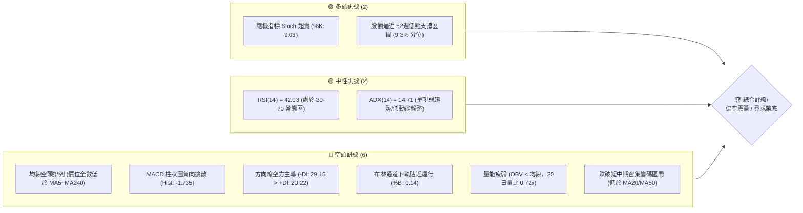

### 📊 核心指標速覽表

| 指標類別 | 指標名稱 | 當前數值 | 訊號 | 解讀 |
|----------|----------|----------|------|------|
| **價格** | 當前收盤價 | $138.37 | 🔴 | 位於 52週區間底部 9.3% 位置，空方壓制明顯 |
| **均線** | MA20 (月線) | $150.79 | 🔴 | 價格低於 MA20 達 -8.24%，短中期趨勢疲弱 |
| **均線** | MA50 (季線) | $144.98 | 🔴 | 價格低於 MA50 達 -4.56%，反彈第一道主要均線壓力 |
| **均線** | MA200 (年線) | $153.22 | 🔴 | 價格低於 MA200 達 -9.69%，長期多空分水嶺失守 |
| **動能** | RSI(14) | 42.03 | 🟡 | 位於中性偏弱區間，未見超賣極值，下行慣性仍在 |
| **動能** | MACD (12,26,9) | -1.564 / Hist -1.735 | 🔴 | 快慢線均處零軸下方且負柱體擴大，空頭動能強勁 |
| **震盪** | Stoch %K / %D | 9.03 / 16.46 | 🟢 | 進入極度超賣區間 (<20)，短線隨時存在技術性反抽 |
| **趨勢** | ADX(14) | 14.71 | 🟡 | ADX < 25 代表非單邊強趨勢，當前屬於區間弱勢盤整 |
| **通道** | 布林帶 %B | 0.14 | 🔴 | 價格貼近下軌 ($133.71)，帶寬開展呈現下壓開口 |
| **量能** | 成交量 / 20日均量 | 5.27M / 7.36M (0.72x) | 🔴 | 反彈無量、下跌放量，OBV 疲軟未見主力吸籌 |
| **波動** | ATR(14) | $7.04 (5.09%) | 🟡 | 日內平均振幅達 5% 以上，短線波動度高，操作需擴大風控 |

### 🏆 技術評分卡

```
╔══════════════════════════════════════════════════════════════╗
║                 技術評分卡 — VST (2026-11-01)                 ║
╠══════════════════════════════════════════════════════════════╣
║ 趨勢強度      █████░░░░░░░░░░░░░░░  25/100  🔴 空頭壓制       ║
║ 動能指標      ███████░░░░░░░░░░░░░  35/100  🔴 動能向下       ║
║ 支撐穩定度    ██████████░░░░░░░░░░  50/100  🟡 考驗低位       ║
║ 成交量配合    ███████░░░░░░░░░░░░░  35/100  🔴 量能萎縮       ║
║ 形態完整度    ████████░░░░░░░░░░░░  40/100  🟡 弱勢箱型       ║
║ 均線排列      █████░░░░░░░░░░░░░░░  25/100  🔴 空頭排列       ║
╠══════════════════════════════════════════════════════════════╣
║ 綜合評分      ███████░░░░░░░░░░░░░  35/100  🔴 偏空承壓       ║
╚══════════════════════════════════════════════════════════════╝
```

> **評分計算依據（規則 18）**：
> 綜合評分 = (25 + 35 + 50 + 35 + 40 + 25) ÷ 6 = 210 ÷ 6 = **35 / 100**。
> 評級結論：技術面處於空方主導的弱勢震盪探底格局，短線跌幅雖深但未現明確止跌反轉訊號。

---

## 2. 趨勢分析

### 🌐 多時框趨勢分析

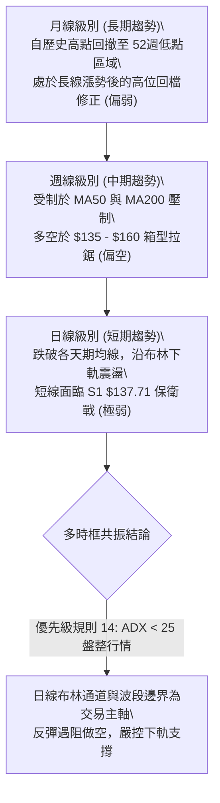

### 📈 長期趨勢 — 12個月走勢圖（Unicode）

VST 過去 12 個月（2025-11 至 2026-10）價格走勢經歷了自高位回落、中樞整理到破位下探的過程：

```
VST 月線走勢圖（過去12個月收盤價變動）
價格軸 ($)
$180 ┤ ● (2025-11: $177.83)
$175 ┤                           ● (2026-02: $173.13)
$170 ┤
$165 ┤
$160 ┤       ● (12: $160.62)                   ● (05: $159.74)
$155 ┤             ● (01: $157.65)   ● (04: $157.36) ● (06: $158.37)
$150 ┤                                     ● (03: $149.87)
$145 ┤                                                 ● (07: $147.95)
$140 ┤                                                             ● (09: $138.35)
$135 ┤                                                       ● (08: $137.15) ━●←現價 $138.37 (10月)
     └─────────────────────────────────────────────────────────────────────────────
        11    12    01    02    03    04    05    06    07    08    09    10 (月份)
```

#### 走勢特徵分析表格

| 階段區間 | 時間跨度 | 起訖收盤價 | 區間漲跌幅 | 主要走勢特徵與量價結構 |
|----------|----------|------------|------------|------------------------|
| **高位派發期** | 2025-11 ~ 2026-01 | $177.83 → $157.65 | -11.35% | 自 2025年高點回落，月線連收黑K，均線開始高位走平彎頭 |
| **次高反彈期** | 2026-01 ~ 2026-02 | $157.65 → $173.13 | +9.82% | 迎來技術性抽腳反彈，未能重返 $180 關口，構築雙頂右肩 |
| **中樞拉鋸期** | 2026-03 ~ 2026-06 | $149.87 → $158.37 | +5.67% | 股價於 $150–$160 區間橫盤 4 個月，籌碼密集換手，均線糾纏 |
| **破位尋底期** | 2026-07 ~ 2026-10 | $158.37 → $138.37 | -12.63% | 箱型下緣失守，重心逐步下移至 $135–$140，月K連續收在低位 |

### 📊 中期趨勢（週線分析）

中期走勢呈現「高點持續壓低（Lower Highs）」與「支撐受測頻繁」的空方慣性。

```
VST 中期週線支撐與阻力結構示意圖
══════════════════════════════════════════════════════════════════
[阻力 R3] $168.67 ─────── 2026-10-09 週線衝高引發套牢巨量 (59.3M)
                             ▲
[阻力 R2] $155.69 ─────── 近期多次反彈高點聚類 / MA240 壓制位 ($155.54)
                             ▲
[阻力 R1] $149.93 ─────── 跌破之週線中樞頸線 / MA20 關鍵壓力 ($150.79)
──────────────────────────────────────────────────────────────────
[當前現價] $138.37 ◄───── 位於 52週低點上方徘徊，多空拉鋸
──────────────────────────────────────────────────────────────────
[支撐 S1] $137.71 ─────── 10月多根日K低點支撐聚類 (-0.48%)
                             ▼
[支撐 S2] $133.84 ─────── 2026-10-02 週K低點 ($133.44) 與布林下軌重疊區
[極限 S3] $132.26 ─────── 52週歷史低點 (Fib 100.0% 終極防線)
══════════════════════════════════════════════════════════════════
```

### ⚡ 趨勢強度評估（ADX 解讀）

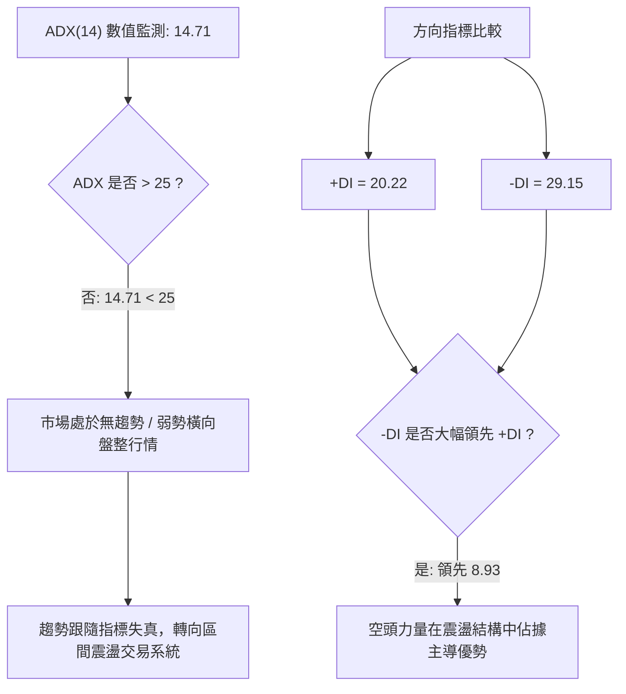

#### ADX 趨勢強度對照表

| 指標變數 | 當前讀數 | 門檻區間 | 趨勢狀態判定 | 交易指引 |
|----------|----------|----------|--------------|----------|
| **ADX(14)** | **14.71** | 0 ~ 20 | **極弱趨勢 / 雜訊震盪** | 避免追漲殺跌，趨勢策略無效 |
| **+DI(14)** | **20.22** | — | 多方買盤力道偏弱 | 多頭動能匱乏，反彈易夭折 |
| **-DI(14)** | **29.15** | — | 空方賣壓主導格局 | 空方控盤，反彈受阻放空勝率較高 |
| **DI 差值** | **-8.93** | 負值擴大 | 空方佔優 | 當前市場脆弱，承接盤薄弱 |

---

## 3. 圖表形態分析

### 🔍 形態識別系統

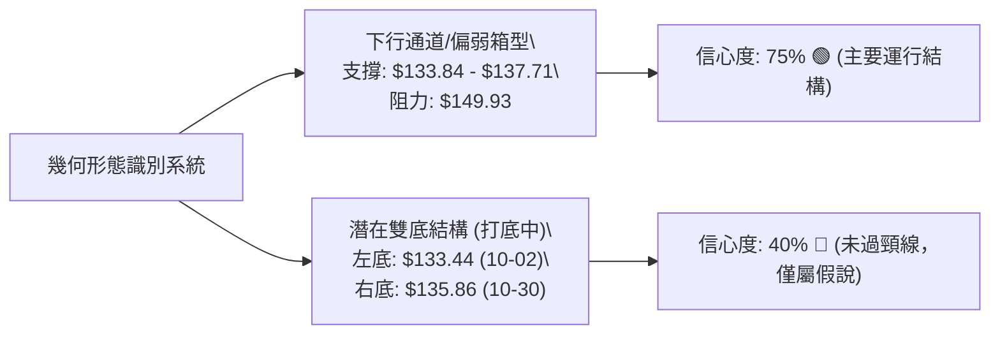

#### 形態識別與評估表

| 形態名稱 | 信心度 | 判斷依據（引用數據） | 完成度 | 目標價（附精確計算式） |
|----------|--------|----------------------|--------|------------------------|
| **下行箱型震盪** | 75% | 價格持續受制於 R1 $149.93，下檔多次受測 S1 $137.71 與 S2 $133.84 | 85% | 跌破箱底：S1 $137.71 − (R1 $149.93 − S1 $137.71) = **$125.49**（由形態高度推算） |
| **潛在雙重底** | 40% | 10-02 低點 $133.44 與 10-30 低點 $135.86 形成雙低，但未破頸線 | 35% | 突破頸線：R1 $149.93 + (R1 $149.93 − S2 $133.84) = **$166.02**（由形態高度推算） |

*註：潛在雙重底因信心度 40% 低於 50%，依嚴格規則 15，僅視為未確認之指標型反彈觀察，不作為突破建倉依據。*

### 🕯️ 重要 K 線形態分析

依規則 19，以下分析完全採樣自提供的近 10 根日 K 與近 8 根週 K 之開、高、低、收數據：

#### 近 10 根日 K 棒分析

| 日期 | 開盤價 | 最高價 | 最低價 | 收盤價 | 成交量 | K線形態名稱 | 技術解讀與多空含義 | 訊號 |
|:---:|:---:|:---:|:---:|:---:|:---:|:---:|:---|:---:|
| 10-19 | 154.10 | 155.33 | 145.85 | 149.70 | 4,271,100 | 中長黑K破位 | 開高走低，實體長達 4.40 元，正式跌破 $150 關卡 | 🔴 |
| 10-20 | 148.90 | 151.34 | 147.10 | 150.32 | 3,336,500 | 縮量十字小紅 | 於低位橫向弱勢整理，反彈無量，買盤觀望 | 🟡 |
| 10-21 | 153.35 | 158.74 | 151.83 | 156.14 | 5,093,600 | 衝高長上影陽K | 向上試探 R2 壓力區受阻，留長達 2.60 元之上影線 | 🟡 |
| 10-22 | 153.00 | 154.27 | 139.10 | 140.83 | 12,469,400 | **巨量長黑暴跌** | 成交量激增至 12.4M，跌幅 9.8%，空方絕對主導殺盤 | 🔴 |
| 10-23 | 139.06 | 141.52 | 136.17 | 140.16 | 6,740,500 | 帶下影線十字星 | 探底 $136.17 後微幅拉回，出現空頭力竭初步跡象 | 🟡 |
| 10-26 | 140.90 | 143.52 | 139.07 | 141.73 | 4,299,400 | 低檔窄幅紅K | 抵抗型小紅K，反彈未能越過 10-22 長黑中軸 | 🟡 |
| 10-27 | 143.95 | 147.45 | 143.40 | 146.66 | 4,107,900 | 溫和反彈陽K | 連續收紅測試 MA50 壓力，但成交量僅 4.1M，量價背離 | 🟡 |
| 10-28 | 146.88 | 147.82 | 142.20 | 142.72 | 5,656,900 | 吞噬型中黑K | 高開低走，完全吞沒前一日漲幅，反彈宣告終結 | 🔴 |
| 10-29 | 142.18 | 144.67 | 140.06 | 140.95 | 4,935,200 | 空頭延續黑K | 延續跌勢收低，重心再次逼近 $140 關口 | 🔴 |
| 10-30 | 136.95 | 139.82 | 135.86 | 138.37 | 5,270,200 | **低檔長下影陽錘** | 探底 $135.86 獲 S1 支撐拉回，但收盤仍受制於 $139 | 🟢 |

#### 近 8 根週 K 棒分析

| 週最後交易日 | 開盤價 | 最高價 | 最低價 | 收盤價 | 週成交量 | 週K形態特徵 | 中期趨勢研判 | 訊號 |
|:---:|:---:|:---:|:---:|:---:|:---:|:---|:---|:---:|
| 09-11 | 150.75 | 154.65 | 146.43 | 148.14 | 18,610,600 | 衝高回落黑K | 受制於季線壓力，反彈受阻 | 🔴 |
| 09-18 | 143.76 | 145.87 | 139.39 | 140.44 | 23,879,600 | 帶量破位黑K | 跌破 $145 中樞，週線連收兩黑 | 🔴 |
| 09-25 | 142.00 | 142.64 | 135.98 | 138.46 | 22,341,300 | 下探回升星線 | 首次下測 $136 支撐位 | 🟡 |
| 10-02 | 138.08 | 143.51 | 133.44 | 140.02 | 34,710,000 | 巨量長下影紅錘 | 創下 52週次低 $133.44 後爆量拉回 | 🟢 |
| 10-09 | 144.04 | 168.75 | 140.90 | 161.48 | 59,368,900 | **天量爆發長紅** | 暴力衝高至 R3 $168.67，形成假突破巨量套牢區 | 🔴 |
| 10-16 | 162.67 | 164.25 | 145.85 | 152.02 | 31,699,400 | 高位吞噬大黑K | 多頭潰敗，實體跌逾 10 元，確立 10-09 為誘多頂部 | 🔴 |
| 10-23 | 154.10 | 158.74 | 136.17 | 140.16 | 31,911,100 | 長黑重挫破線 | 連續第二週暴跌，直接打回起漲原點 | 🔴 |
| 10-30 | 140.90 | 147.82 | 135.86 | 138.37 | 24,269,600 | 弱勢下探收黑 | 反彈受阻於 $147.82，收盤逼近 S1 支撐 | 🔴 |

### 📉 ASCII 走勢形態示意圖

```
VST 日線假突破與瀑布式下跌形態示意圖
══════════════════════════════════════════════════════════════════════
$168.75 ┤        ▲ (10-09 天量假突破高點 / 近一年強阻力 R3: $168.67)
$160.00 ┤       ╱ ╲
$155.00 ┤      ╱   ╲           ▲ (10-21 反抽次高 $158.74 / R2: $155.69)
$150.00 ┤─────╱─────╲─────────╱─╲────── [頸線破位位 / R1: $149.93]
$145.00 ┤    ╱       ╲       ╱   ╲     ▲ (10-27 弱勢反彈高點 $147.45)
$140.00 ┤   ╱         ╲     ╱     ╲   ╱ ╲
$138.37 ┤  ●           ●   ●       ●─●───● ◄── [當前收盤價 $138.37]
$135.00 ┤ ╱             ╲ ╱         (10-30 下影低點 $135.86)
$133.44 ┤● (10-02 低點)  ▼ (10-23 低點 $136.17)
══════════════════════════════════════════════════════════════════════
```

---

## 4. 支撐與阻力

### 🗺️ 關鍵價位分布圖（Unicode）

```
VST 價位結構分布圖
═══════════════════════════════════════════════════════════════
$168.67 ║██████████████████████████████║ 強阻力 R3 (波段天量套牢頂部)
$155.69 ║████████████████████          ║ 阻力 R2 (MA240 均線重壓區)
$149.93 ║████████████████████████      ║ 關鍵阻力 R1 (MA20/波段頸線密集區)
════════╠══════════════════════════════╣
$138.37 ║ ◄─────────────── 當前收盤價   ║ (弱勢下行通道內)
════════╠══════════════════════════════╣
$137.71 ║▓▓▓▓▓▓▓▓▓▓▓▓▓▓▓▓▓▓            ║ 近期支撐 S1 (近一年波段低點聚類)
$133.84 ║████████████████████████      ║ 強支撐 S2 (布林下軌 / 10月低位)
$132.26 ║██████████████████████████████║ 終極支撐 (52W Low / 斐波 100%)
═══════════════════════════════════════════════════════════════
```

### 🚧 阻力位分析表

依規則 13，價位完全引用自關鍵數據區塊計算值：

| 阻力級別 | 價位 | 與現價距離 | 形成原因與籌碼特徵 | 突破難度 | 重要性 |
|:---:|:---:|:---:|:---|:---:|:---:|
| **R1** | **$149.93** | +8.36% | 近一年波段高點聚類；與 MA20 ($150.79) 及 MA120 ($149.12) 重合 | 🔴 極高 | ★★★★★ |
| **R2** | **$155.69** | +12.52% | 近一年密集震盪頂部；接近長期 MA240 ($155.54) 均線防線 | 🔴 極高 | ★★★★☆ |
| **R3** | **$168.67** | +21.90% | 2026-10-09 天量巨黑套牢峰值 (週量 59.3M)；布林上軌 ($167.86) | 🔴 難以逾越 | ★★★★★ |

### 🛡️ 支撐位分析表

依規則 13，價位完全引用自關鍵數據區塊計算值：

| 支撐級別 | 價位 | 與現價距離 | 形成原因與籌碼特徵 | 守住機率 | 重要性 |
|:---:|:---:|:---:|:---|:---:|:---:|
| **S1** | **$137.71** | -0.48% | 近一年波段低點聚類；與 10-30 收盤價緊鄰，短線第一防線 | 🟡 50% | ★★★★☆ |
| **S2** | **$133.84** | -3.28% | 10-02 波段低點聚類 ($133.44)；布林下軌 ($133.71) 強支撐共振 | 🟢 65% | ★★★★★ |
| **S3** | **$132.26** | -4.42% | **52週絕對歷史低點**；斐波那契 100.0% 回調位，多頭最後防線 | 🟢 80% | ★★★★★ |

### 📐 斐波那契回調位分析

以 52週波段區間：最低點 **$132.26** 至 最高點 **$197.67**（總振幅 $65.41）進行回調測算：

```
斐波那契回調層級分布示意圖 (52週區間 $132.26 → $197.67)
═════════════════════════════════════════════════════════════════════
  0.0% ── $197.67 (52週歷史高點)
 23.6% ── $182.23 (回調第一關，已大幅失守)
 38.2% ── $172.68 (多頭強勢回檔線，已失守)
 50.0% ── $164.96 (多空平衡中樞線，已失守)
 61.8% ── $157.25 (黃金分割關鍵防線，跌破轉為熊市主導)
 78.6% ── $146.26 (深度回撤極限位，當前上方強壓)
─────────────────────────────────────────────────────────────────────
 當前現價: $138.37 (位於 78.6% 與 100.0% 深度回撤盲區)
─────────────────────────────────────────────────────────────────────
100.0% ── $132.26 (52週歷史最低點，終極回歸基石)
═════════════════════════════════════════════════════════════════════
```

- **位置解讀**：當前股價 $138.37 處於 78.6% 回調位 ($146.26) 與 100.0% 回調位 ($132.26) 之間，回調幅度超過波段總幅度的 90%。
- **技術意義**：跌破 61.8% ($157.25) 與 78.6% ($146.26) 確立了中長期多頭結構的瓦解。現價距 100% 回調位僅剩 $6.11（4.42%），意味著空方獲利盤隨時可能面臨「雙底買盤」或「多頭死守 52週低點」的頑強抵抗。

---

## 5. 技術指標深度解讀

### 🎛️ 指標訊號總覽

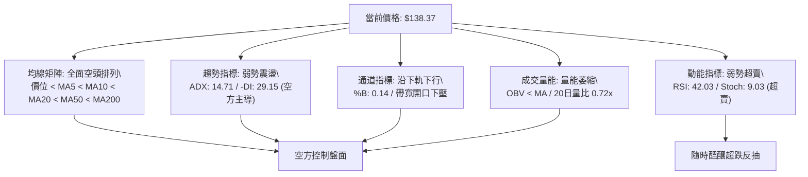

### 📈 移動平均線排列分析

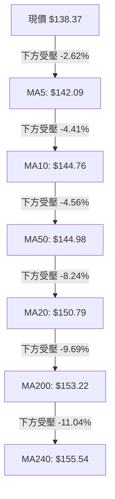

#### 移動平均線系統數據對照表

| 均線名稱 | 數值 | 與現價乖離 | 均線走向 | 狀態評估 |
|:---:|:---:|:---:|:---:|:---|
| **MA5** | $142.09 | -2.62% | 陡峭向下 ▁▁ | 短線空頭下壓線，反彈首道減倉點 |
| **MA10** | $144.76 | -4.41% | 拐頭向下 ▂▃ | 短期均線壓制，與 MA50 形成死叉 |
| **MA20** | $150.79 | -8.24% | 加速向下 ▇█ | 月線級別破位，中期生命線轉為重壓 |
| **MA50** | $144.98 | -4.40% | 震盪向下 ▁▁ | 季線下行，中期趨勢翻空 |
| **MA120** | $149.12 | -7.21% | 緩步下行 ▄▄ | 半年線防線失守 |
| **MA200** | $153.22 | -9.69% | 持續走低 ▆▅ | 長期牛熊分界線失守，長期走勢轉弱 |
| **MA240** | $155.54 | -11.04% | 平緩下彎 ▁▁ | 年線重壓，高檔套牢帶重疊 |

*結論：現價被所有長短期均線層層壓制，呈現典型的完全空頭排列，任何無量反彈皆屬均線負乖離過大所引發的技術性修正。*

### 📉 RSI(14) 分析

```
RSI(14) 讀數: 42.03
[0] ────────── [30 超賣] ────●───── [50 中軸] ────────── [70 超買] ────────── [100]
                            42.03
強度指標: ████████░░░░░░░░░░░░  42.03% (處於弱勢空方主導區間)
```

- **超買超賣判定**：RSI(14) 當前數值為 42.03，處於 30 至 50 之弱勢整理區。雖未進入 30 以下之嚴重超賣區，但整體動能明顯低於 50 多空分水嶺，表明市場賣壓持續壓制買盤。
- **背離分析**：
  - 根據系統近 20 根 K 棒的首尾數據比對，價格自 10-19 之 $149.70 下跌至 10-30 之 $138.37，RSI 亦同步走低，**目前確認「無明顯背離」**。
  - 動能與價格走勢同向共振，未現底背離止跌訊號，警惕下行慣性延續。

### 📊 MACD(12,26,9) 訊號解讀

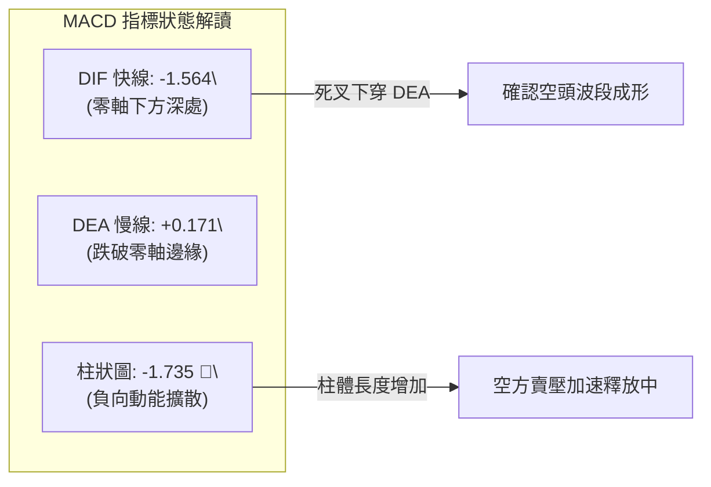

- 快線 DIF 跌至 -1.564，慢線 DEA 亦被拖拽至 +0.171 瀕臨跌破零軸。
- 柱狀圖（Histogram）讀數為 -1.735，維持在顯著負值且未見收斂跡象，表明自 10-09 天量假突破以後的空頭殺盤波段仍未結束。

### 📦 布林通道分析

```
VST 布林通道空間定位 (Bollinger Bands 20, 2)
══════════════════════════════════════════════════════════════════
$167.86 ┤ 上軌 (Upper Band)
        │
$150.79 ┤ 中軌 (Middle Band = MA20)
        │
$138.37 ┼ ─── 現價 ($138.37) ─── [%B = 0.14] ◄── 緊貼下軌運行
$133.71 ┤ 下軌 (Lower Band)
══════════════════════════════════════════════════════════════════
```

- **通道帶寬與位置**：帶寬顯著放大，中軌位於 $150.79，下軌位於 $133.71。
- **%B 指標分析**：%B = 0.14，表明股價正沿著布林通道下軌弱勢滑落（處於下軌上方僅 14% 的狹窄空間），屬於典型之「跌破開口」空頭釋放行情。若後續價格無法迅速收復中軌，下軌將持續被向下推擠，帶來連續陰跌風險。

### 💹 成交量分析（量價配合度）

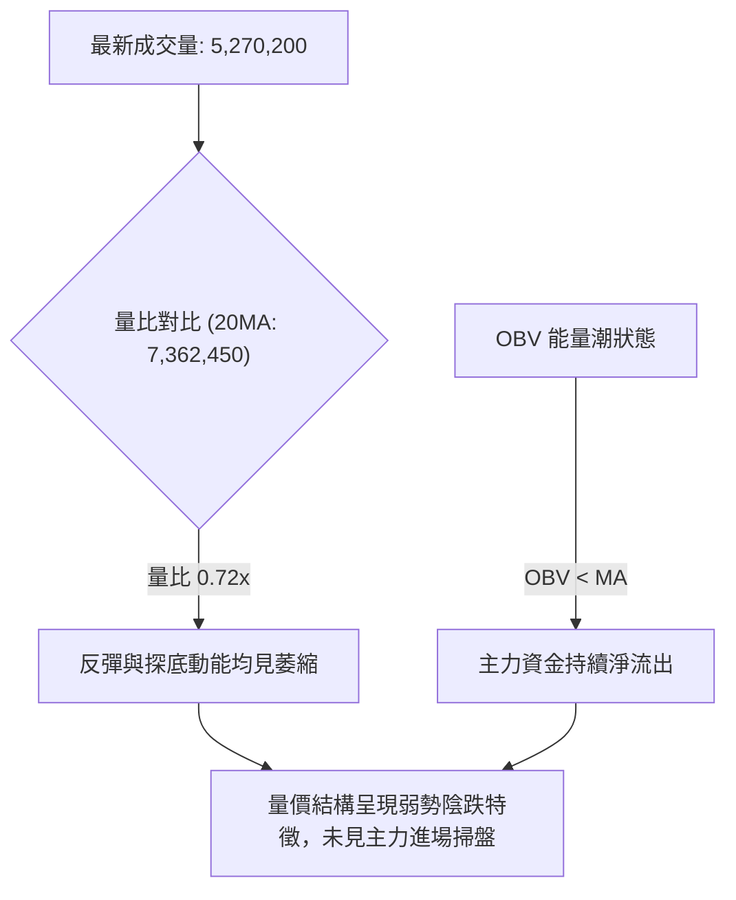

- **量比與均量特徵**：最新成交量 5.27M，大幅低於 20日均量 7.36M（量比僅 0.72x），亦低於 50日均量 5.85M。
- **量價背離診斷**：回顧 10-22 暴跌時放出 12.4M 巨量，隨後幾日反彈量能急凍（4.1M~4.2M），展現「下跌有量、反彈無量」的典型空頭量價架構。能量潮指標 OBV 低於均線，量能疲弱確認了當前下行趨勢的有效性。

---

## 6. 動能與波動率

### ⚡ 動能評估四象限

| 象限分區 | 動能強度 | 波動率狀態 | 當前匹配 | 象限特徵與策略對策 |
|:---:|:---:|:---:|:---:|:---|
| **第一象限 (Q1)** | 強動能 (多方) | 低波動 | — | 穩定多頭趨勢，逢回拉回加碼 |
| **第二象限 (Q2)** | 弱動能 (中性) | 低波動 | — | 窄幅無序盤整，觀望等待方向 |
| **第三象限 (Q3)** | 強動能 (多方) | 高波動 | — | 高風險進攻區，順勢波段追擊 |
| **第四象限 (Q4)** | **弱動能 (空方)** | **高波動** | **✓ (VST匹配)** | **高風險失速區：空方控盤伴隨劇烈振幅，嚴禁盲目摸底** |

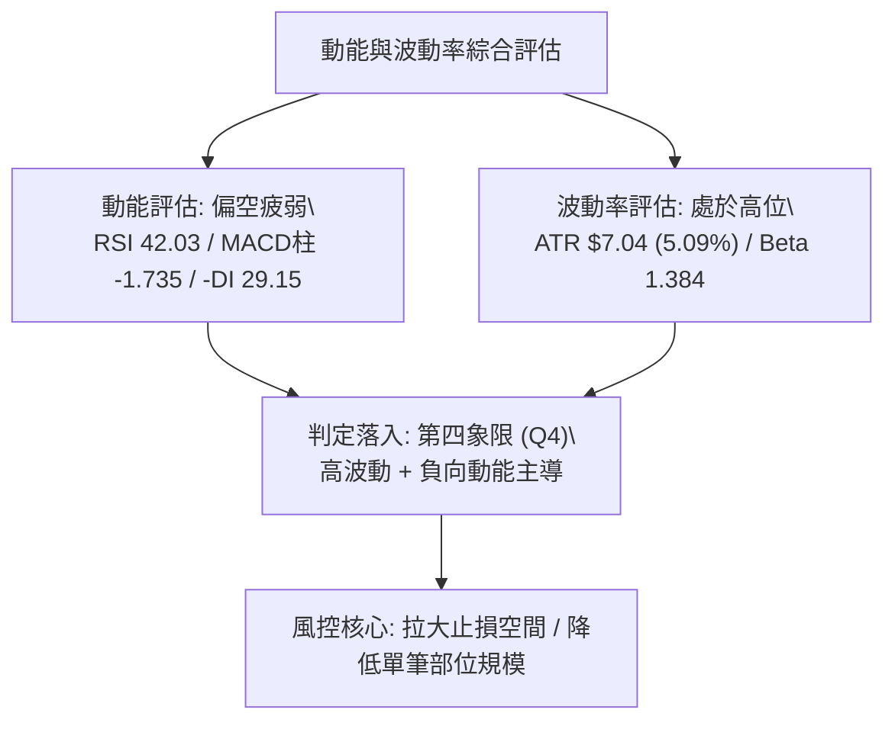

### 📊 ATR 波動率分析

- **ATR(14) 讀數**：**$7.04**（佔當前股價之 **5.09%**，採 Wilder 平滑算法）。
- **波動特性**：對於公用事業（Utilities）板塊個股而言，5% 以上的日振幅屬於極高波動度，反映其受 AI 數據中心用電主題炒作後的劇烈多空搏殺特性。
- **止損距離建議**：
  - **保守型（1.5 倍 ATR）**：$7.04 × 1.5 = **$10.56**（需容忍至少 10.5 元之震盪區間）。
  - **進取型（1.0 倍 ATR）**：$7.04 × 1.0 = **$7.04**（波段操作之最小止損保護寬度）。

### 📐 Beta 與市場相關性

- **Beta 係數**：**1.384**。
- **市場敏感度**：VST 表現出顯著高於標普 500 指數的波動放大效應。當大盤下行時，VST 傾向承受 1.38 倍的下行放大賣壓；反之，若大盤止跌回升，其亦具備極強的反彈彈性。
- **機構持股與空頭**：機構持股高達 92.5%，空頭佔流通股比例僅 3.4%（Short Ratio 1.42），表明當前下跌並非源於投機性空頭突襲，而是機構投資者在季報前夕進行去槓桿與防禦性調倉拋售。

---

## 7. 多時框架總結

### 📋 時框架評分表

| 時框架 | 趨勢方向 | 動能指標狀態 | 均線排列狀況 | 形態特徵 | 綜合評分 | 操作建議方向 |
|:---:|:---:|:---:|:---:|:---:|:---:|:---|
| **日線 (短線)** | 🔴 偏空下探 | RSI 42.03 / Stoch 超賣 | 嚴重空頭排列 (價低於所有MA) | 沿下軌弱勢尋底 | **25 / 100** | 嚴禁盲目抄底，逢反彈阻力放空 |
| **週線 (中線)** | 🔴 轉弱整理 | MACD 負柱體擴大 | 失守 MA20，測試 MA200 防線 | 衝高假突破後瀑布式下殺 | **35 / 100** | 防範進一步向下回測 52週低點 |
| **月線 (長線)** | 🟡 高位回檔 | 52週高點大幅回吐逾 30% | 依然維持在長期長牛基底之上 | 雙頂高位破位修正 | **45 / 100** | 靜待長期籌碼沈澱，暫不建長倉 |

### 🔲 綜合訊號矩陣

```
╔══════════════════════════════════════════════════════════════════════╗
║                    VST 多時框架訊號矩陣一覽表                        ║
╠═════════════════════╦══════════════╦══════════════════╦══════════════╣
║ 分析維度            ║ 日線 (短期)  ║ 週線 (中期)      ║ 月線 (長期)  ║
╠═════════════════════╬══════════════╬══════════════════╬══════════════╣
║ 趨勢方向判定        ║ 🔴 極弱空頭  ║ 🔴 偏弱下行      ║ 🟡 寬幅震盪  ║
║ 均線系統壓力        ║ 🔴 MA5/10/20 ║ 🔴 MA20/50 壓制  ║ 🟢 守於 MA240║
║ 動能擺盪表現        ║ 🟢 嚴重超賣  ║ 🔴 負向加速      ║ 🟡 中性減速  ║
║ 成交量配合度        ║ 🔴 反彈無量  ║ 🔴 高位天量套牢  ║ 🟡 縮量消化  ║
║ 關鍵結構位置        ║ 🟡 逼近 S1   ║ 🔴 跌破頸線 R1   ║ 🟢 遠高於谷底║
╚═════════════════════╩══════════════╩══════════════════╩══════════════╝
```

### ⚖️ 多時框收斂結論

依據本報告設定之**嚴格要求 14（多時框收斂規則）**：
1. **行情模式判斷**：當前日線 ADX(14) 讀數為 **14.71**（低於 25 臨界線），定義為**「無單邊強趨勢之盤整行情（Consolidation Regime）」**。
2. **時框主導優先級**：在此模式下，市場以日線布林通道（帶寬 $133.71 ~ $167.86）與密集波段高低點為主要操作區間，中長期均線方向則作為反彈之上檔阻力壓制參考。
3. **收斂統一結論**：**【偏空震盪／高空為主】**。
   - 儘管短期日線因隨機指標 Stoch 超賣（%K 9.03）具備技術性脈衝反抽動能，但週線與日線均線全數向下蓋頭，反彈空間受制於 R1 $149.93 與季線 $144.98。
   - 技術面路徑優先選擇：**股價向上回抽均線密集壓力區時順勢做空，或在跌破關鍵支撐 S1 $137.71 時順勢跟進，下看 S2 $133.84 至 52週低點**。本結論嚴格主導第 8 章之策略路由。

---

## 8. 交易策略建議

### 🗺️ 策略決策流程圖

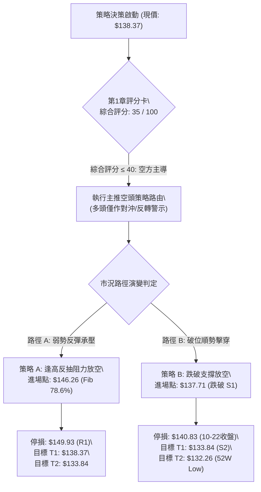

### 🧭 策略路由（依評分卡分流）

> **當前主策略方向 = 【主推空頭策略（逢高反抽放空 / 破位順勢做空）】（依評分卡 35 / 100 分流）**
> *依規則說明：綜合評分 35 ≤ 40，技術面由空頭絕對主導，多頭策略嚴禁主推，僅列為空方停損與反轉對沖提示。*

### 🎯 價格情境階梯（Price Scenarios）

依規則 13，價位完全引用自關鍵數據區塊計算值：

| 觸發條件 | 下一目標 | 後續延伸 | 情境技術含義解讀 |
|----------|----------|----------|------------------|
| **強勢突破 R1 $149.93** | R2 $155.69 | R3 $168.67 | 突破月線與頸線重壓，空頭形態失效，短線全面轉強 |
| **反彈受阻於 $146.26** | 現價 $138.37 | S1 $137.71 | 斐波 78.6% 遇阻回落，確認為均線負乖離修正，延續空勢 |
| **跌破支撐 S1 $137.71** | S2 $133.84 | S3 $132.26 | 考驗布林下軌支撐，中期弱勢結構加速探底 |

### 📊 情境機率分佈

| 演變情境 | 發生機率 | 主要技術指標依據 |
|----------|:---:|:---|
| **延續弱勢 / 破位再探底** | **55%** | 均線空頭排列、MACD 柱狀體擴大 (-1.735)、OBV 疲軟、-DI 佔優 (29.15) |
| **下軌弱勢箱型震盪 (S1~MA50)** | **35%** | ADX 14.71 顯示非單邊強趨勢、Stoch 處於超賣區、S1/S2 具備支撐聚類效應 |
| **反轉向上收復 R1 阻力** | **10%** | 上方套牢籌碼沉重、量比僅 0.72x、尚未出現任何底部背離結構 |

### 🟢 主策略詳情（空頭主推）

依規則 17，所有數值嚴格基於提供數據，風險報酬比公式 = (進場價 − 目標價) ÷ (止損價 − 進場價)：

| 策略要素 | 策略 A（反彈遇阻做空） | 策略 B（破位順勢追空） |
|----------|------------------------|------------------------|
| **策略類型** | 均線負乖離反抽遇阻放空 | 關鍵支撐破位順勢放空 |
| **進場條件** | 反彈至斐波 78.6% 阻力出現受阻陰K | 日K實體跌破近期支撐位 S1 |
| **進場價格** | **$146.26** (Fib 78.6% 回調位) | **$137.71** (關鍵支撐 S1) |
| **目標價 T1** | **$138.37** (當前收盤價位) | **$133.84** (關鍵支撐 S2 / 布林下軌) |
| **目標價 T2** | **$133.84** (關鍵支撐 S2) | **$132.26** (52週歷史低點 / Fib 100%) |
| **止損價格** | **$149.93** (關鍵阻力 R1 頸線) | **$140.83** (10-22暴跌收盤壓力點) |
| **風險報酬比** | **1 : 2.15（以 T1 計）** *(註1)* | **1 : 1.24（以 T1 計）** *(註2)* |
| **次目標風報比** | （以 T2 計: 1 : 3.38） | （以 T2 計: 1 : 1.75） |
| **勝率估計** | **65%** | **55%** |
| **建議倉位** | **8% ~ 10%** 總投資組合規模 | **5%** 總投資組合規模 |

> **精確風險報酬比算式驗證（規則 17）**：
> - **策略 A (以 T1 計)**：
>   - 潛在獲利空間 = $146.26 − $138.37 = $7.89
>   - 承擔風險空間 = $149.93 − $146.26 = $3.67
>   - 風險報酬比 = 7.89 ÷ 3.67 = **2.15** ➔ 記為 **1 : 2.15（以 T1 計）**
>   - *(以 T2 計)*: ($146.26 − $133.84) ÷ $3.67 = 12.42 ÷ 3.67 = **3.38** ➔ 記為 **（以 T2 計: 1 : 3.38）**
> - **策略 B (以 T1 計)**：
>   - 潛在獲利空間 = $137.71 − $133.84 = $3.87
>   - 承擔風險空間 = $140.83 − $137.71 = $3.12
>   - 風險報酬比 = 3.87 ÷ 3.12 = **1.24** ➔ 記為 **1 : 1.24（以 T1 計）**
>   - *(以 T2 計)*: ($137.71 − $132.26) ÷ $3.12 = 5.45 ÷ 3.12 = **1.75** ➔ 記為 **（以 T2 計: 1 : 1.75）**

### 🔴 反向風險觸發點（對沖提示）

- **推翻做空邏輯之關鍵訊號**：
  1. 日線以巨量實體陽K**向上強勢收復 R1 $149.93**（突破月線 MA20 與箱型頸線）。
  2. MACD 於零軸下方出現黃金交叉，且 RSI(14) 強勢站上 55 以上多方強勢區。
- **對沖應對指引**：一旦股價收盤站穩 $149.93，所有空頭倉位必須無條件執行停損離場；激進型交易者可反手建立小額輕倉多頭，博弈向 R2 $155.69 延伸之反彈波段。

### ⭐ 整體訊號強度評星

```
做多訊號強度：★★☆☆☆  (2/5星 - 僅存超跌技術反抽預期)
做空訊號強度：★★★★☆  (4/5星 - 均線空頭排列與動能負向共振)
整體可信度：  ★★★★☆  (4/5星 - 關鍵價位結構嚴密明確)
```

---

## 9. 風險提示與監控

### ✅ 關鍵監控指標 Checklist

```
╔══════════════════════════════════════════════════════════════╗
║               VST 交易風險即時監控清單 (Checklist)           ║
╠══════════════════════════════════════════════════════════════╣
║ [ ] 價位防線: 是否跌破支撐 S1 $137.71 (跌破將加速滑向 S2)     ║
║ [ ] 終極支撐: 是否測試 52週低點 $132.26 (多頭最後防線)         ║
║ [ ] 均線空頭: MA20 ($150.79) 是否持續下壓限制反彈空間         ║
║ [ ] 動能警訊: MACD 負柱體是否縮小 (轉折收斂為空單平倉訊號)    ║
║ [ ] 異常放量: 日成交量是否超越 20日均量 7.36M (放量長紅需警戒) ║
║ [ ] 波動預警: 單日波動是否超出 ATR $7.04 (提防被洗盤掃損)     ║
╚══════════════════════════════════════════════════════════════╝
```

### ⚠️ 風險場景分析

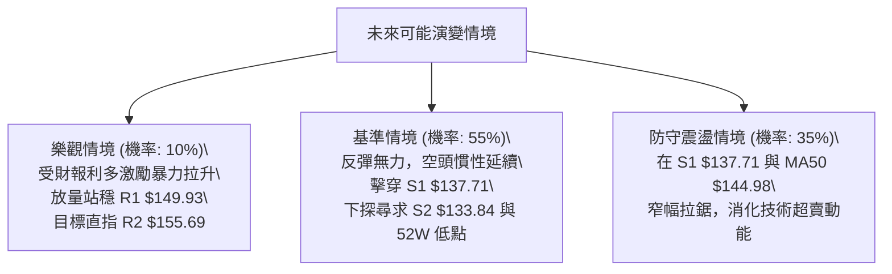

### 🛡️ 風險管理重要提醒

1. **業績發布前夕的不確定性**：
   - 新聞顯示 VST 即將公布 Q3 財報。公用事業板塊近期受 AI 數據中心題材炒作，市場預期波動極大。若財報或指引不及預期，股價脆弱的技術結構極易觸發斷崖式跳空低開，**建議在財報公布日前將整體倉位降至 5% 以下或透過選擇權避險**。
2. **高 ATR 波動下的倉位控管**：
   - 當前 ATR 高達 $7.04（5.09%），單日波動極其劇烈。依據 2% 資金風險模型（單筆交易虧損不超過總帳戶 2%），以策略 A 止損幅度 $3.67 計算，單筆部位規模上限建議不超過總資產之 **8%**，切忌重倉賭單邊。
3. **52週低點附近的空頭陷阱**：
   - 現價距 52週低點 $132.26 僅 4.42%，逼近年線長週期支撐。空單在獲利達到 T1 或 T2 後應果斷執行分批止盈，嚴防主力在歷史低點附近利用「破底翻」或「空頭陷阱」展開報復性軋空拉抬。

---

## 📋 報告總結

```
╔════════════════════════════════════════════════════════════════╗
║                   VST 技術分析報告總結                         ║
╠════════════════════════════════════════════════════════════════╣
║ 報告日期：2026-11-01                                           ║
║ 當前價格：$138.37                                              ║
║ 分析評級：🔴 偏空承壓 / 弱勢尋底 (技術綜合評分: 35/100)        ║
╠════════════════════════════════════════════════════════════════╣
║ 關鍵結論：                                                     ║
║ ├─ 長期趨勢：🟡 高位回檔整理，回吐去年漲幅逾 30%               ║
║ ├─ 中期趨勢：🔴 假突破天量套牢後，跌破 MA20 頸線形成下行波段   ║
║ ├─ 短期趨勢：🔴 空頭排列壓制，沿布林下軌震盪，Stoch 呈超賣     ║
║ ├─ 關鍵支撐：S1 $137.71 ｜ S2 $133.84 ｜ 52W Low $132.26       ║
║ ├─ 關鍵阻力：R1 $149.93 ｜ R2 $155.69 ｜ R3 $168.67           ║
║ └─ 分析師目標：華爾街平均目標價 $206.86 (技術面短線嚴重背離)   ║
╠════════════════════════════════════════════════════════════════╣
║ 最優策略組合：                                                 ║
║ 1. 🥇 最佳機會：策略 A (反彈至 Fib 78.6% $146.26 遇阻放空，     ║
║                 停損設於 R1 $149.93，風報比 1 : 2.15)          ║
║ 2. 🥈 次選機會：策略 B (實體跌破 S1 $137.71 順勢追空，         ║
║                 下看 S2 $133.84 與 52W 低點，風報比 1 : 1.24)   ║
║ 3. 🥉 保守選擇：場外空倉觀望，等待股價於 52週低點 $132.26 構築 ║
║                 明確日線級別「雙底背離」訊號後再行介入做多     ║
╚════════════════════════════════════════════════════════════════╝
```

---

> ⚠️ **免責聲明**：本報告為 AI 自動生成之技術分析研究，所有數據、圖表及推算均嚴格基於歷史量價資訊（Yahoo Finance）。本報告**僅供學術研究與投資策略討論參考**，**絕對不構成任何要約、招攬或具體投資建議**。市場具有高度不確定性，金融衍生品與股票交易存在虧損風險，投資人應審慎評估自身風險承受能力並自負盈虧。

---
*報告生成時間：2026-11-01 ｜ 數據來源：Yahoo Finance ｜ 分析框架：多時框技術分析體系*