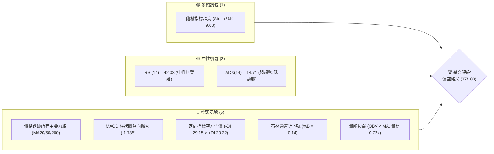
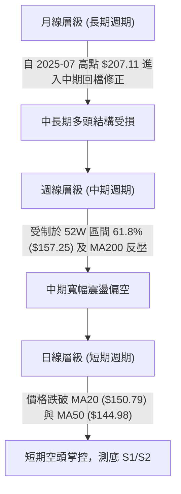
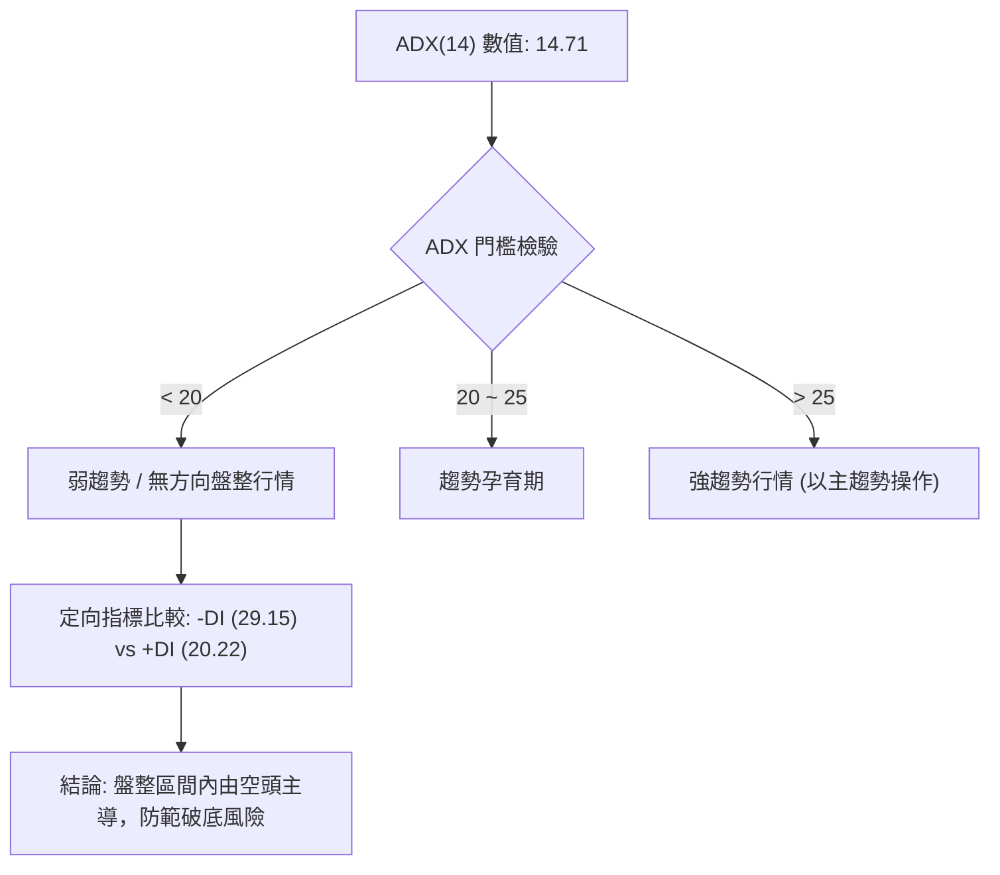
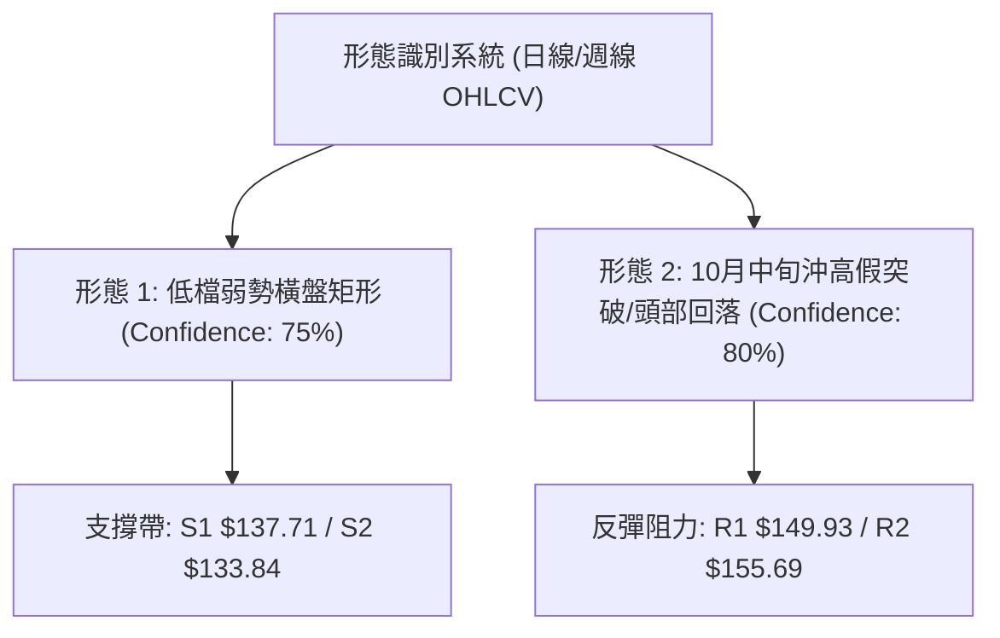
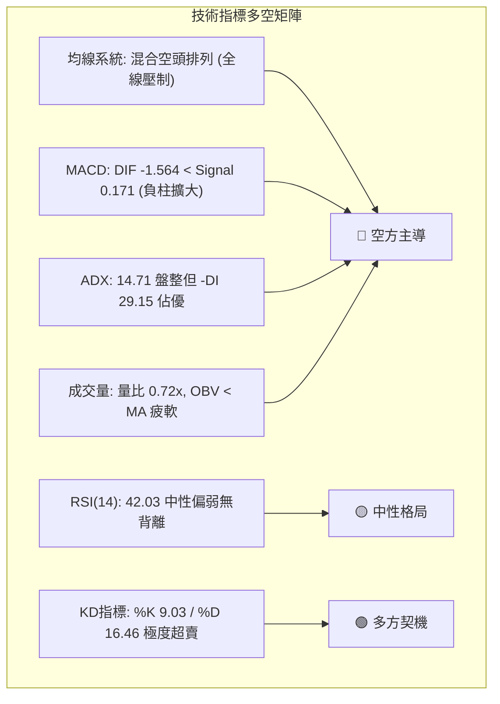
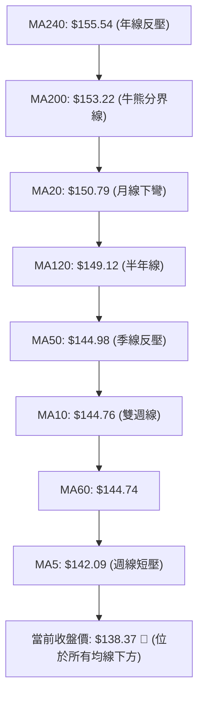
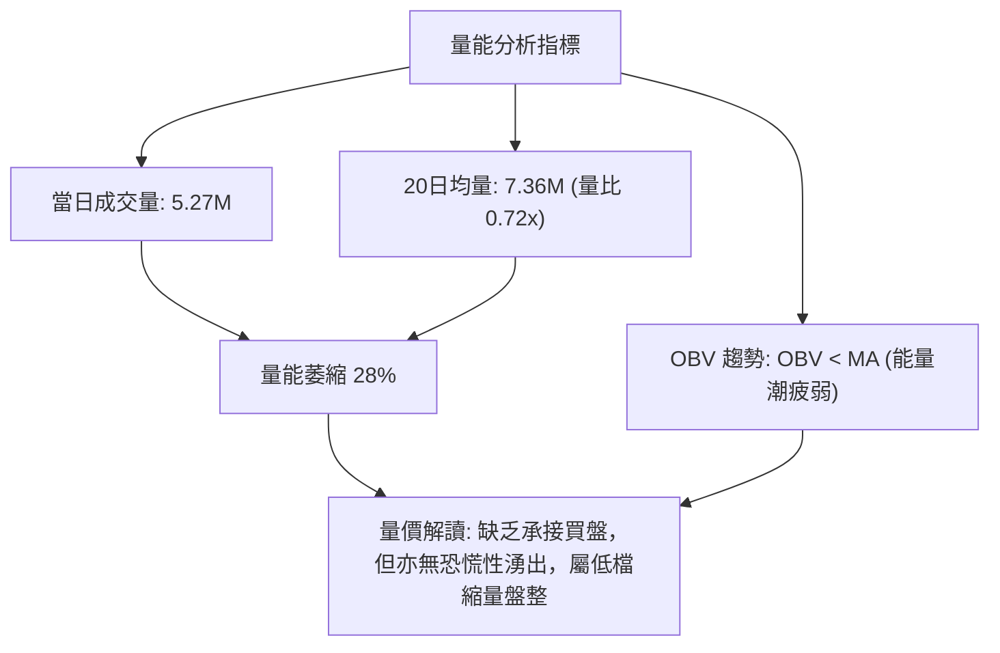
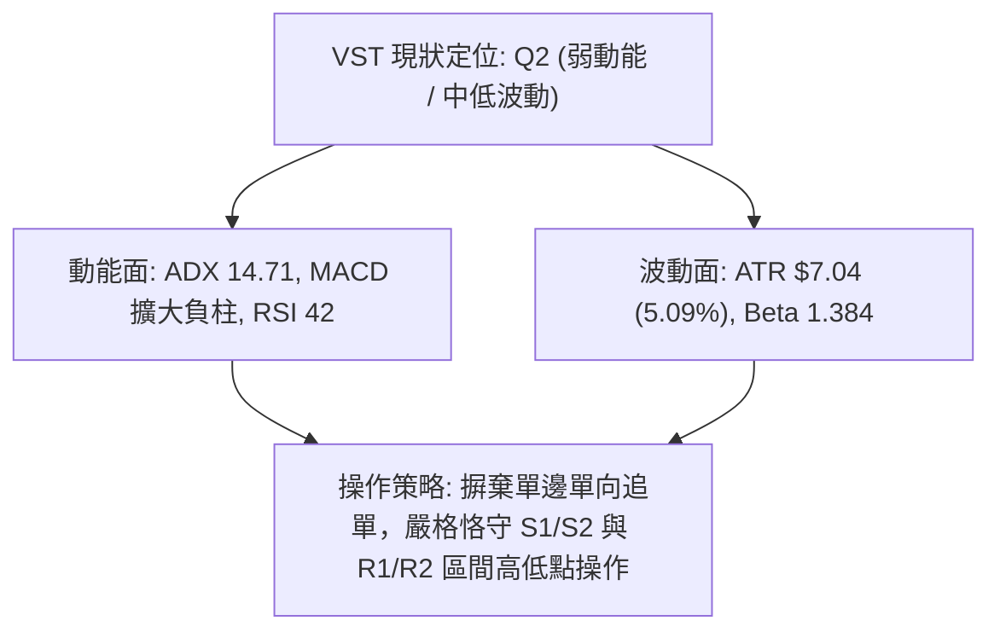
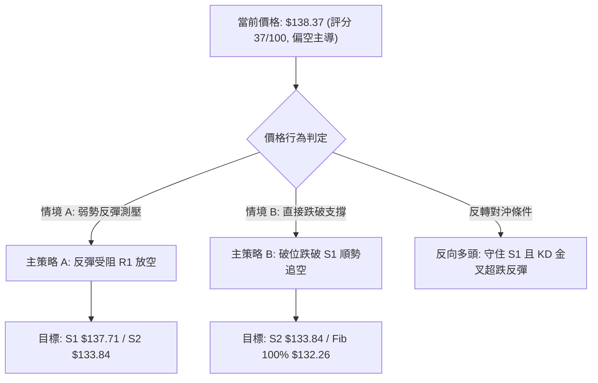
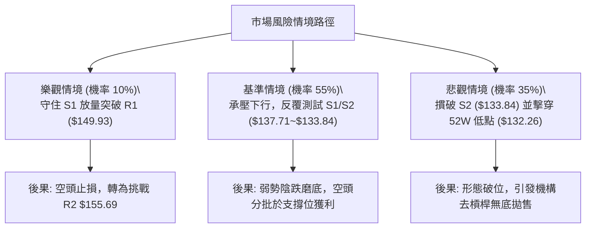

# VST 技術分析報告

> **報告日期**：2026-11-02 ｜ **語言**：繁體中文 ｜ **數據來源**：Yahoo Finance ｜ **當前價格**：$138.37

---

## 目錄

| 章節 | 內容 |
|------|------|
| [1. 技術面概覽](#1-技術面概覽) | 訊號儀表板、核心指標、評分卡 |
| [2. 趨勢分析](#2-趨勢分析) | 多時框趨勢、長中短期走勢 |
| [3. 圖表形態分析](#3-圖表形態分析) | 形態識別、K線組合、目標價 |
| [4. 支撐與阻力](#4-支撐與阻力) | 關鍵價位、斐波那契回調 |
| [5. 技術指標深度解讀](#5-技術指標深度解讀) | MA/RSI/MACD/布林/成交量 |
| [6. 動能與波動率](#6-動能與波動率) | 動能評估、ATR、Beta |
| [7. 多時框架總結](#7-多時框架總結) | 時框架評分矩陣 |
| [8. 交易策略建議](#8-交易策略建議) | 多空策略、風險報酬比 |
| [9. 風險提示與監控](#9-風險提示與監控) | 監控指標、風險場景 |

---

## 1. 技術面概覽

### 🎯 技術訊號儀表板



### 📊 核心指標速覽表

| 指標類別 | 指標名稱 | 當前數值 | 訊號 | 解讀 |
|----------|----------|----------|------|------|
| **價格** | 當前價格 | $138.37 | 🔴 | 位於 52 週區間之 9.3%，極度靠近下緣 |
| **均線** | MA20 | $150.79 | 🔴 | 價格在 MA20 下方 -8.24%，短線承壓明顯 |
| **均線** | MA50 | $144.98 | 🔴 | 價格在 MA50 下方 -4.56%，中期走勢偏弱 |
| **均線** | MA200 | $153.22 | 🔴 | 價格在 MA200 下方 -9.69%，跌破長期生命線 |
| **動能** | RSI(14) | 42.03 | 🟡 | 位於中性區間偏空（30–70），無背離跡象 |
| **動能** | MACD(12,26,9) | -1.564 / 0.171 / -1.735 | 🔴 | DIF 線跌破信號線，Hist 柱狀圖看空擴張 |
| **動能** | Stoch %K / %D | 9.03 / 16.46 | 🟢 | 進入極度超賣區（<20），短線具跌深反彈潛力 |
| **趨勢** | ADX(14) / ±DI | 14.71 (-DI 29.15 > +DI 20.22) | 🔴 | ADX<25 為弱趨勢盤整，但空頭主導動能 |
| **通道** | Bollinger Bands | $133.71 ~ $167.86 (%B 0.14) | 🔴 | 貼近下軌邊界震盪，通道開口略向下 |
| **量能** | 20日均量 / 成交量 | 5,270,200 (量比 0.72x) | 🔴 | OBV 低於均線，量能衰退，買盤缺乏承接力道 |
| **波動** | ATR(14) | $7.04 (5.09%) | 🟡 | 日內平均振幅約 5.09%，處於中等波動區間 |

### 🏆 技術評分卡

```
╔══════════════════════════════════════════════════════════════════╗
║                   技術評分卡 — VST (2026-11-02)                  ║
╠══════════════════════════════════════════════════════════════════╣
║ 趨勢強度      ██████░░░░░░░░░░░░░░  30/100  🔴 (ADX 14.71, 空頭) ║
║ 動能指標      ████████░░░░░░░░░░░░  40/100  🟡 (MACD空/KD極超賣) ║
║ 支撐穩定度    ██████████░░░░░░░░░░  50/100  🟡 (緊貼S1/S2支撐帶) ║
║ 成交量配合    ██████░░░░░░░░░░░░░░  30/100  🔴 (OBV走疲/量比0.72)║
║ 形態完整度    ████████░░░░░░░░░░░░  40/100  🟡 (高檔回落打底期)  ║
║ 均線排列      ██████░░░░░░░░░░░░░░  30/100  🔴 (全均線反壓蓋頭)  ║
╠══════════════════════════════════════════════════════════════════╣
║ 綜合評分      ███████░░░░░░░░░░░░░  37/100  🔴 偏空 (算術平均36.7)║
╚══════════════════════════════════════════════════════════════════╝
```

---

## 2. 趨勢分析

### 🌐 多時框趨勢分析



### 📈 長期趨勢 — 12個月走勢圖（Unicode）

```
VST 月線走勢圖（過去12個月：2025-11 至 2026-10）
價格軸 ($)
$180 ┤ ●(177.83)
$170 ┤                 ●(173.13)
$160 ┤       ●(160.62)           ●(159.74)
$150 ┤             ●(157.65)           ●(157.36) ●(158.37)
$140 ┤                       ●(149.87)                 ●(147.95)
$130 ┤                                                       ●(137.15) ●(138.35) ●(138.37)←現在
     └─────────────────────────────────────────────────────────────────────────────
       11/25 12/25 01/26 02/26 03/26 04/26 05/26 06/26 07/26 08/26 09/26 10/26
```

#### 走勢特徵分析表格

| 階段區間 | 月份區間 | 起訖收盤價 | 區間漲跌幅 | 核心技術特徵 |
|----------|----------|------------|------------|--------------|
| 高檔盤整回落 | 2025-11 ~ 2026-01 | $177.83 → $157.65 | -11.35% | 多頭動能減退，獲利了結賣壓湧現，連續跌破月均支撐 |
| 弱勢反彈受阻 | 2026-02 ~ 2026-06 | $173.13 → $158.37 | -8.53% | 2月急彈至 $173.13 遇阻，隨後 3~6 月在 $150~$160 區間橫向築頂 |
| 破位向下探底 | 2026-07 ~ 2026-08 | $147.95 → $137.15 | -7.30% | 破位下殺，跌破半年線支撐，8月創波段低點 $137.15 |
| 低檔弱勢築底 | 2026-09 ~ 2026-10 | $138.35 → $138.37 | +0.01% | 價格在 $138 附近橫盤停滯，波動幅度急縮，等待基本面催化劑 |

### 📊 中期趨勢（週線分析）

```
VST 週線價格區間與壓力支撐示意圖
══════════════════════════════════════════════════════════════════
[壓力區]  $168.67 ── 週線頂部壓力 (10/09 週高 $168.75 聚類)
          │
          $155.69 ── 中期波段反彈反壓位 (R2)
          │
          $149.93 ── 頸線轉折阻力 (R1, 近 MA20 $150.79)
──────────────────────────────────────────────────────────────────
[現  價]  $138.37 ── 徘徊於低檔區間震盪
──────────────────────────────────────────────────────────────────
[支撐區]  $137.71 ── 近一年波段低點支撐帶 (S1)
          │
          $133.84 ── 週線密集下影線支撐 (S2)
          │
          $132.26 ── 52週歷史極端低點 (Fib 100.0%)
══════════════════════════════════════════════════════════════════
```

近期週線結構顯示：10/09 當週在 59.3M 天量推升下衝高至 $168.75，但隨後三週量能驟降並連續收黑（$161.48 → $152.02 → $140.16 → $138.37），MACD 柱狀圖轉為擴大之負值（-1.735），顯示該次衝高為主力拉高出貨或假突破，市場重回防守 S1（$137.71）之弱勢格局。

### ⚡ 趨勢強度評估（ADX 解讀）



#### ADX 數值強度對照表

| 指標名稱 | 當前數值 | 參考閾值 | 市場狀態評估 | 戰術指引 |
|----------|----------|----------|--------------|----------|
| **ADX(14)** | 14.71 | < 25.00 | 極弱趨勢／無方向盤整 | 避免追高殺跌，以通道上下軌高拋低吸為主 |
| **+DI(14)** | 20.22 | 中性低階 | 多頭進攻意願匱乏 | 缺乏推動價格持續走高的主動性多頭動能 |
| **-DI(14)** | 29.15 | 偏高空方 | 空方佔據相對優勢 | 賣盤控制盤面，下檔支撐面臨持續測試壓力 |

---

## 3. 圖表形態分析

### 🔍 形態識別系統



#### 形態識別與信心度評估表

| 形態名稱 | 信心度 | 判斷依據（引用數據） | 完成度 | 目標價（附計算式） |
|----------|--------|----------------------|--------|--------------------|
| **低檔箱型橫盤整理** | 75% | 8/21低 $135.99、8/28低 $136.87、9/25低 $135.98、10/30低 $135.86，底部高度聚類於 S1/S2 | 80% | 由箱體高度推算：箱頂 R1 $149.93 − 箱底 S1 $137.71 = 形態高度 $12.22。<br>上破目標 = $149.93 + $12.22 = **$162.15**<br>下破目標 = $137.71 − $12.22 = **$125.49** |
| **沖高回落長黑反轉** | 80% | 10/09衝高至 $168.75 爆量後，連續三週長陰摜破起漲點，確立假突破 | 90% | 由週K高檔回吐計算：高點 $168.75 回測起漲箱底 $133.44（10/02週低），已完成回撤目標。 |

*註：當前 ADX 為 14.71 處於盤整，日線級別並無大型頭肩底或旗形延續結構，嚴格依據實際 OHLCV 定義為區間震盪箱型。*

### 🕯️ 重要 K 線形態分析

依據提供的近 10 根日 K 與近 8 根週 K 原始數據進行組合形態解讀：

| 日期（週期） | 開盤價 | 最高價 | 最低價 | 收盤價 | 成交量 | K線形態名稱 | 專業技術解讀 | 訊號 |
|--------------|--------|--------|--------|--------|--------|-------------|--------------|------|
| **10-21 (日)** | 153.35 | 158.74 | 151.83 | 156.14 | 5,093,600 | 衝高小陽線 | 盤中嘗試挑戰 $158.74，但帶有上影線，多頭推升力道轉竭 | 🟡 |
| **10-22 (日)** | 153.00 | 154.27 | 139.10 | 140.83 | 12,469,400 | 放量長陰破位線 | 實體高達 $12.17，跌破短期多條均線，爆量顯示機構賣盤出逃 | 🔴 |
| **10-23 (日)** | 139.06 | 141.52 | 136.17 | 140.16 | 6,740,500 | 低檔下影十字星 | 探底 $136.17 後獲得買盤抵抗，多空在 $140 展開爭奪 | 🟡 |
| **10-26 (日)** | 140.90 | 143.52 | 139.07 | 141.73 | 4,299,400 | 窄幅縮量陽十字 | 縮量橫盤，顯示市場在重挫後賣壓減弱，進入休整 | 🟡 |
| **10-27 (日)** | 143.95 | 147.45 | 143.40 | 146.66 | 4,107,900 | 弱勢小陽線 | 試圖向上回補缺口，但量能僅 4.1M，呈現無量反抽特徵 | 🟡 |
| **10-28 (日)** | 146.88 | 147.82 | 142.20 | 142.72 | 5,656,900 | 帶長上影倒狀陰線 | 盤中拉升至 $147.82 即遭遇解套賣壓摜壓，收於低檔，反彈結束 | 🔴 |
| **10-29 (日)** | 142.18 | 144.67 | 140.06 | 140.95 | 4,935,200 | 震盪回落小陰線 | 持續走低，均線下壓顯著，多頭毫無還手之力 | 🔴 |
| **10-30 (日)** | 136.95 | 139.82 | 135.86 | 138.37 | 5,270,200 | 低檔弱勢小陽實體 | 跳空低開於 $136.95，下探 $135.86 後收斂，收在 $138.37 守住 S1 | 🟡 |
| **10-09 (週)** | 144.04 | 168.75 | 140.90 | 161.48 | 59,368,900 | 巨量衝高長上影陽線 | 單週爆出 59.3M 天量，雖漲幅達 15%，但上影線高達 $7.27 留隱憂 | 🟡 |
| **10-30 (週)** | 140.90 | 147.82 | 135.86 | 138.37 | 24,269,600 | 縮量探底小黑K | 連續三週下挫後收縮量小陰線，下影線微幅回測 $135.86，逼近箱底 | 🔴 |

### 📉 ASCII 走勢形態示意圖

```
VST 日線近兩週價格震盪箱型走勢
$160.00 ┤          ● (10/21 高 $158.74)
$155.00 ┤         ╱ ╲
$150.00 ┤        ●   ╲ (10/22 放量跳空暴跌)
$145.00 ┤             ╲   ●─● (10/27-28 弱勢反彈受阻 $147.82)
$140.00 ┤              ●─●   ╲   ● (10/30 收盤 $138.37)
$135.00 ┤                      ●─┴─● (下探測試 S1/S2 支撐帶 $135.86)
        └────────────────────────────────────────────────────────
          10/19 10/21 10/23 10/26 10/28 10/30
```

### 🎯 形態目標價計算

根據日線箱型形態高度與突破方向進行嚴格推導：
1. **箱體上限（頸線阻力）**：採用近一年波段阻力 R1 = **$149.93**
2. **箱體下限（底部支撐）**：採用近一年波段支撐 S1 = **$137.71**
3. **形態垂直高度**：$149.93 − $137.71 = **$12.22**
4. **理論突破目標推算**：
   - **向上突破等距目標** = $149.93 + $12.22 = **$162.15**（若放量突破 R1，將回測 52W 區間 50.0% 回調位 $164.96 附近）
   - **向下破位等距目標** = $137.71 − $12.22 = **$125.49**（若實體跌破 S1/S2，將延伸跌向 $125.49）

---

## 4. 支撐與阻力

### 🗺️ 關鍵價位分布圖（Unicode）

```
VST 價位結構分布圖
══════════════════════════════════════════════════════════════
$197.67 ║████████████████████████║ 52週歷史高點 (Fib 0.0%)
$168.67 ║████████████████████████║ 強阻力 R3 (波段高點/週K影線峰值)
$157.25 ║▓▓▓▓▓▓▓▓▓▓▓▓▓▓▓▓▓▓▓▓    ║ 關鍵黃金分割位 (Fib 61.8%)
$155.69 ║████████████████████    ║ 阻力 R2 (反彈高點聚類)
$149.93 ║████████████████████████║ 關鍵阻力 R1 (頸線/MA20反壓)
$146.26 ║▓▓▓▓▓▓▓▓▓▓▓▓▓▓▓▓        ║ 斐波那契回調位 (Fib 78.6%)
────────╫────────────────────────╫─────────────────────────────
$138.37 ╠════════════════════════╣ ◄ 現價 (收盤價)
────────╫────────────────────────╫─────────────────────────────
$137.71 ║▓▓▓▓▓▓▓▓▓▓▓▓▓▓▓▓▓▓▓▓▓▓  ║ 近期支撐 S1 (近一年波段低點聚類)
$133.84 ║████████████████████████║ 強支撐 S2 (密集下影線結構支撐)
$132.26 ║████████████████████████║ 52週極端底限 (Fib 100.0%)
══════════════════════════════════════════════════════════════
```

### 🚧 阻力位分析表

所有數值均引用技術數據之「波段高點聚類」：

| 阻力級別 | 價位 | 形成原因 | 突破難度 | 重要性 |
|----------|------|----------|----------|--------|
| **R1 (第一阻力)** | $149.93 (+8.36%) | 近一年波段高點密集聚類，重疊布林中軌 MA20 ($150.79) 與 MA120 ($149.12) | 🔴 高 | 極高。多空短線分水嶺，未放量站穩前皆屬弱勢反抽 |
| **R2 (第二阻力)** | $155.69 (+12.52%) | 中期波段反彈高點聚類，緊鄰 MA240 ($155.54) 及 Fib 61.8% ($157.25) | 🔴 極高 | 高。中期空頭防守核心防線，具重度解套賣壓阻力 |
| **R3 (強阻力)** | $168.67 (+21.90%) | 近一年最高波段聚類，10/09 當週天量高點 ($168.75) 構築之天花板 | 🔴 險峻 | 中長線頂部。需巨量基本面利多方能撼動 |

### 🛡️ 支撐位分析表

所有數值均引用技術數據之「波段低點聚類」：

| 支撐級別 | 價位 | 形成原因 | 守住機率 | 重要性 |
|----------|------|----------|----------|--------|
| **S1 (第一支撐)** | $137.71 (-0.48%) | 近一年波段低點聚類，日線箱體下緣支撐帶（距現價僅 $0.66） | 🟡 60% | 極高。短線最後多頭防線，失守將引發技術性停損拋壓 |
| **S2 (第二支撐)** | $133.84 (-3.28%) | 近期多次下影線波段低點（如 10/02 週低 $133.44）及布林下軌 ($133.71) | 🟢 75% | 極高。中期價值買盤與區間防守核心，若跌破恐探 52W 底 |
| **S3 (歷史底限)** | $132.26 (-4.42%) | 52 週歷史最低點（Fib 100.0%），長期趨勢絕對停損位 | 🟢 85% | 戰略級。跌破代表中長期多頭結構徹底瓦解 |

### 📐 斐波那契回調位分析

依據 52 週區間波段低點 $132.26 至波段高點 $197.67 之完整回調測算：

| 回調比例 | 對應價位 | 與現價距離 (%) | 技術意涵與當前關聯解讀 |
|----------|----------|----------------|------------------------|
| **0.0% (高點)** | $197.67 | +42.86% | 52 週歷史高點，長期回調起點 |
| **23.6%** | $182.23 | +31.70% | 歷史強勢多頭強支撐，現已轉為極強遠期阻力 |
| **38.2%** | $172.68 | +24.80% | 2026年2月反彈高點 ($173.13) 聚落，反彈衰竭點 |
| **50.0%** | $164.96 | +19.22% | 多空平衡中樞，10月中旬放量上影線壓制處 |
| **61.8%** | $157.25 | +13.64% | 黃金分割關鍵反壓，與 MA240 ($155.54) 形成共振阻力區 |
| **78.6%** | $146.26 | +5.70% | 深度回調防守線，上週反彈高點 ($147.82) 於此受挫 |
| **100.0% (低點)**| $132.26 | -4.42% | 52 週波段最低點，回撤 100% 之最終防禦陣地 |

**現價定位解讀**：
當前收盤價 **$138.37** 嚴格落於 **Fib 78.6% ($146.26)** 與 **Fib 100.0% ($132.26)** 之間的極深度回撤區（位於 52W 區間之 9.3%）。技術意義顯示，自 $197.67 起算之回檔已抹去過去一年超過 90% 的漲幅。跌破 78.6% 象徵中期多頭架構已破壞殆盡，行情退化為「測試 52 週低點支撐穩定度」之築底戰。

---

## 5. 技術指標深度解讀

### 🎛️ 指標訊號總覽



### 📈 移動平均線排列分析



#### 均線系統數據分析表

| 均線名稱 | 當前價格 | 與現價乖離率 | 短期趨勢斜率 | 技術意涵解讀 |
|----------|----------|--------------|--------------|--------------|
| **MA5** | $142.09 | -2.62% | ▼ 下行 | 短線直接壓制線，近5日均受此線壓制 |
| **MA10** | $144.76 | -4.41% | ▼ 下行 | 快速走低，阻斷短線連續反彈企圖 |
| **MA20** | $150.79 | -8.24% | ▼ 下行 | 月線反壓強烈，與布林中軌重合 |
| **MA50** | $144.98 | -4.56% | ▼ 下行 | 季線轉折向下，中期趨勢翻空 |
| **MA60** | $144.74 | -4.40% | ▼ 下行 | 與 MA50 形成雙重反壓帶 ($144.7~$145.0) |
| **MA120** | $149.12 | -7.21% | ▼ 下行 | 半年線持續走跌，中長期籌碼沉澱不良 |
| **MA200** | $153.22 | -9.69% | ▼ 下行 | 跌破年線/長期生命線，長多行情終結 |
| **MA240** | $155.54 | -11.04% | ▼ 下行 | 歷史總成本反壓，構成 R2 阻力屏障 |

**排列狀態總結**：所有短、中、長期移動平均線均呈現順向空頭下傾斜率，現價 $138.37 處於「全均線蓋頂」之極度被動狀態，未收復 MA20 之前，任何拉升均僅能以跌深技術性反抽視之。

### 📉 RSI(14) 分析

- **當前數值**：**42.03**（Wilder 計算方法）
- **指標進度條**：
  ```
  RSI(14) [42.03] ░░░░░░░░████████████░░░░░░░░░░░░░░░░ 42% (中性偏空)
  [0=超賣區-------------30------42------70-------------100=超買區]
  ```
- **區間評估**：處於 30–70 中性區間，但低於 50 多空分界軸，顯示空方仍具盤面主控權。
- **背離診斷**：
  - *診斷方法*：比較近 20 根 K 棒首尾之價格與 RSI 方向。
  - *結論*：**無明顯背離**。近 20 根 K 線價格由高檔震盪走低，RSI 亦同步自 50~60 水平回落至 42.03，量價動能一致，未見底背離或頂背離訊號。

### 📊 MACD(12/26/9) 訊號解讀

```mermaid
graph LR
    subgraph MACD_STATUS ["MACD("12,26,9") 動能架構"]
        DIF["DIF 線 (快線): -1.564"]
        DEA["Signal 線 (慢線): 0.171"]
        HIST["MACD 柱狀圖: -1.735"]
        DIF -->|"死叉發散 (快線在慢線下方)"| HIST
    end
    HIST --> RESULT["🔴 看空訊號: 零軸下方死叉且負柱放大，空頭動能尚未收斂"]
```

- **核心數據**：MACD 線 = **-1.564**，信號線 = **0.171**，柱狀圖 = **-1.735**。
- **訊號解讀**：DIF 已經跌破 0 軸並下穿 Signal 線形成標準「零下死叉」，負柱狀圖自前期的正值迅速反轉擴大至 -1.735。這意味著中短期動能正由中性轉向主動放空，空方回擊力道強勁。

### 📦 布林通道分析

```
VST 日線布林通道 (20, 2) 結構圖
$167.86 ┬────────────────────────────────────────── 布林上軌 (阻力)
        │
$150.79 ┼────────────────────────────────────────── 布林中軌 (MA20)
        │
$138.37 ┼─► 現價 ($138.37, %B = 0.14)
$133.71 ┴────────────────────────────────────────── 布林下軌 (支撐)
```

- **通道參數**：上軌 **$167.86** ｜ 中軌 **$150.79** ｜ 下軌 **$133.71**
- **帶寬與位置**：%B 為 **0.14**（處於下軌上方邊緣 14% 位置）。
- **結構特徵**：現價貼近布林下軌震盪，屬於「沿通道下軌運行」的弱勢走勢。通道帶寬並未出現劇烈擴張或收斂擠壓，配合 ADX 14.71，表明當前下行仍屬於盤整型陰跌，下軌 $133.71 與支撐 S2 ($133.84) 高度重疊，將發揮第一道實質攔截功能。

### 💹 成交量分析（量價配合度）



- **成交量對比**：最新成交量 5,270,200 股，較 20 日均量（7,362,450 股）萎縮約 28.4%（量比 0.72x），高於 50 日均量（5,854,494 股）的差距不大。
- **量價背離檢視**：
  - 10/22 放量重挫 12.47M 股，收大長陰線，確立主力大單賣出。
  - 後續五個交易日（10/26~10/30）成交量均維持在 4.1M~5.6M 之低量水準，價格小幅滑落。
  - **結論**：OBV 指標持續位於其均線下方，量能呈現疲態，顯示場外增量資金在財報或新催化劑明朗前抱持觀望態度，市場由存量散戶與做市商被動撮合。

---

## 6. 動能與波動率

### ⚡ 動能評估四象限

| 象限 | 動能維度 | 波動維度 | 典型特徵 | 當前狀態評估 | 策略指引 |
|------|----------|----------|----------|--------------|----------|
| **第一象限 (Q1)** | 強動能 | 低波動 | 穩定單邊牛皮走強 | — | 順勢波段持股 |
| **第二象限 (Q2)** | 弱動能 | 低波動 | 區間無趨勢築底橫盤 | **✓ 當前定位 (VST)** | **區間低吸高拋，輕倉防守** |
| **第三象限 (Q3)** | 強動能 | 高波動 | 爆發性突破/主升主跌 | — | 激進追突破，設嚴格止損 |
| **第四象限 (Q4)** | 弱動能 | 高波動 | 恐慌崩跌/多空劇烈洗盤 | — | 觀望為主，避免頻繁磨損 |



### 📊 ATR 波動率分析

- **ATR(14) 數值**：**$7.04**（佔當前股價之 **5.09%**，採 Wilder 平滑法）。
- **市場意義**：VST 每日平均真實波動空間約 $7.04 美元，屬於公共事業板塊中波動較大者（受獨立發電與核電題材驅動）。
- **止損距離建議**：
  - *短期日內/隔夜交易（1.0 × ATR）*：設定安全防護距離為 **$7.04**。
  - *波段擺盪交易（1.5 × ATR）*：設定安全防護距離為 1.5 × $7.04 = **$10.56**。
  - *防假破底過濾（0.5 × ATR）*：若跌破支撐位超過 0.5 × $7.04 = **$3.52**，視為實質破位。

### 📐 Beta 與市場相關性

- **Beta 係數**：**1.384**
- **技術解讀**：相較於傳統防禦型公用事業（Beta 通常在 0.5~0.8），VST 擁有 1.384 的高 Beta，顯示其對標普 500 指數與宏觀科技能源情緒具備高度放大效應（市場變動 1%，VST 平均反向或同向放大 1.384%）。在目前大盤震盪環境下，高 Beta 加劇了向下調整的深度。

---

## 7. 多時框架總結

### 📋 時框架評分表

| 時框架 | 趨勢方向 | 動能狀態 | 均線排列 | 形態特徵 | 綜合評分 | 戰術建議 |
|--------|----------|----------|----------|----------|----------|----------|
| **短期 (日線)** | 🔴 偏空 | 弱勢 (MACD負柱擴大) | 空頭反壓 | 箱底震盪整理 | 35/100 | S1附邊短多或反彈R1放空 |
| **中期 (週線)** | 🔴 偏空 | 轉弱 (衝高假突破破位) | 跌破半年線 | 箱型整理測底 | 38/100 | 嚴守 S2 $133.84，破位停損 |
| **長期 (月線)** | 🟡 中性偏弱 | 整理 (自高點回調40%) | 逼近年線支撐 | 高檔雙頂回落打底 | 45/100 | 考量基本面估值，耐心等待打底 |

### 🔲 綜合訊號矩陣

```
┌─────────────────┬───────────┬───────────┬───────────┐
│ 分析維度        │ 短期(日K) │ 中期(週K) │ 長期(月K) │
├─────────────────┼───────────┼───────────┼───────────┤
│ 均線系統 (MA)   │   🔴 空   │   🔴 空   │   🟡 中   │
│ 動能指標 (RSI)  │   🟡 中   │   🔴 空   │   🟡 中   │
│ 趨勢指標 (MACD) │   🔴 空   │   🔴 空   │   🔴 空   │
│ 能量型態 (OBV)  │   🔴 空   │   🟡 中   │   🟢 多   │
│ 價格位置 (Fib)  │   🔴 弱   │   🔴 弱   │   🟡 偏弱 │
├─────────────────┼───────────┼───────────┼───────────┤
│ 矩陣綜合判定    │ 🔴 短空   │ 🔴 中空   │ 🟡 長期打底│
└─────────────────┴───────────┴───────────┴───────────┘
```

### ⚖️ 多時框收斂結論

依據多時框收斂規則第 14 條：
1. **趨勢/盤整判定**：當前 ADX(14) 僅為 **14.71 (< 25)**，嚴格判定當前處於**低動能盤整行情**。
2. **主導維度與衝突取捨**：由於屬於盤整行情，日線布林通道上下軌（$133.71 ~ $167.86）以及近一年波段密集低點（S1 $137.71 / S2 $133.84）構成核心交易空間。儘管中期週線連續收黑偏空，但在日線 Stochastic 出現極度超賣（%K 9.03）且緊貼 S1 支撐時，不宜在當前 $138.37 位置盲目追空。
3. **唯一收斂方向**：**區間偏空、防守探底（綜合評分 37/100 偏空，第 8 章以逢高放空或跌破追空為主要主策略，並設跌深博弈反彈之對沖點）**。

---

## 8. 交易策略建議

### 🗺️ 策略決策流程圖



### 🧭 策略路由（依評分卡分流）

> **當前主策略方向 = 主推空頭策略（依評分 37/100，綜合評分 ≤ 40 偏空格局）**  
> 多頭僅列為低檔防守與反轉風險觸發點（對沖提示）。

### 🎯 價格情境階梯（Price Scenarios）

價位嚴格引用關鍵價位聚類與斐波那契回調位：

| 觸發條件 | 下一目標 | 後續延伸 | 情境技術含義 |
|----------|----------|----------|--------------|
| **向上突破 R1 $149.93** | R2 $155.69 | R3 $168.67 | 突破月線中軌，短線空頭架構緩解，轉為箱型上軌挑戰 |
| **站穩現價區間 ($137.71~$144.76)** | MA50 $144.98 | R1 $149.93 | 在 S1 上方震盪築底，消耗均線下壓動能 |
| **有效跌破 S1 $137.71** | S2 $133.84 | 52W低點 $132.26 | 短期支撐失守，引發停損賣壓，下測布林下軌及一年底限 |

### 📊 情境機率分佈

| 情境劇本 | 發生機率 | 主要技術指標依據 |
|----------|----------|------------------|
| **弱勢回落 / 再探底** | **55%** | MACD 柱狀圖負向擴大（-1.735），全均線下彎蓋頂，OBV 持續疲弱低於均線 |
| **區間震盪築底** | **35%** | ADX 僅 14.71（無單邊暴跌趨勢），Stoch 進入個位數超賣區（%K 9.03） |
| **強勢反轉上行** | **10%** | 需連續放量站上 MA20（$150.79）並扭轉 -DI，當前量比僅 0.72x 難以支撐 |

### 🟢 主策略詳情（空頭主導策略）

依據規則 17 計算風險報酬比：做空風險報酬比 = (進場價 − 目標價 T1) ÷ (止損價 − 進場價)。

| 策略要素 | 策略 A（反彈高空，首選） | 策略 B（破位追空，次選） |
|----------|--------------------------|--------------------------|
| **交易方向** | 做空 (Short) | 做空 (Short) |
| **進場條件** | 反彈至 R1 頸線/MA20 反壓區遇阻滯漲 | 日K收盤確認跌破關鍵支撐 S1 |
| **進場價格** | **$149.93**（R1 精確點位） | **$137.71**（S1 破位點位） |
| **目標價 T1** | **$137.71**（回測 S1 支撐） | **$133.84**（下測 S2 支撐） |
| **目標價 T2** | **$133.84**（波段目標 S2） | **$132.26**（回測 52W 底限） |
| **止損價格** | **$155.69**（R2 阻力突破止損） | **$139.82**（10/30日高阻力止損） |
| **風險報酬比** | **1 : 2.12**（以 T1 計）<br>*算式：(149.93−137.71)÷(155.69−149.93) = 12.22÷5.76*<br>*(以 T2 計為 1 : 2.79)* | **1 : 1.83**（以 T1 計）<br>*算式：(137.71−133.84)÷(139.82−137.71) = 3.87÷2.11*<br>*(以 T2 計為 1 : 2.58)* |
| **成功機率** | 65% | 55% |
| **建議倉位** | 15% | 10% |

### 🔴 反向風險觸發點（對沖提示）

若多頭欲發動逆轉，必須關注以下邊界條件：
- **空頭警報解除線**：價格強勢突破並站穩 **$149.93 (R1)**，伴隨單日成交量放大至 1,000 萬股以上。此時應全數回補空單。
- **超跌博弈多單進場點**：若價格回落至 **$133.84 (S2)** 附近出現長下影線且日線 KD 指標在超賣區金叉，可建立 5% 輕倉短多博弈反彈，止損設於 52W 低點 **$132.26**。

### ⭐ 整體訊號強度評星

```
╔══════════════════════════════════════════════════════════════════╗
║ 做多訊號強度：★☆☆☆☆  (1/5星 - 僅KD超賣支撐，餘皆弱勢)        ║
║ 做空訊號強度：★★★★☆  (4/5星 - 均線空頭排列，MACD負擴散)       ║
║ 整體可信度：  ★★★☆☆  (3/5星 - ADX偏低，防範低檔震盪洗盤)      ║
╚══════════════════════════════════════════════════════════════════╝
```

---

## 9. 風險提示與監控

### ✅ 關鍵監控指標 Checklist

```
╔══════════════════════════════════════════════════════════════════╗
║                    關鍵技術監控 CHECKLIST                        ║
╠══════════════════════════════════════════════════════════════════╣
║ [ ] 價格是否跌破 S1 ($137.71)：若跌破，確認開啟破位空頭行情     ║
║ [ ] 日成交量是否放大至 7.36M (20日均量) 之 1.5 倍以上            ║
║ [ ] MACD 柱狀圖是否收斂：若負柱縮小至 -0.5 以內，空單減碼       ║
║ [ ] Stoch %K 是否自 9.03 金叉上穿 %D (16.46)：超跌反彈信號      ║
║ [ ] RSI(14) 是否跌破 30 進入超賣：防範極度賣壓後的報復性抽腳    ║
║ [ ] 布林帶寬是否由縮窄轉為急劇擴張：突破單邊行情啟動標誌       ║
╚══════════════════════════════════════════════════════════════════╝
```

### ⚠️ 風險場景分析



### 🛡️ 風險管理重要提醒

1. **財報與事件風險控制**：新聞顯示公司即將發布財報（Reports Next Week），財報發布日前夕隱含波動率激增，強烈建議在財報公布前將部位降低至 5% 以下或透過選擇權對沖。
2. **倉位配置原則**：在 ADX = 14.71 的弱趨勢環境中，單筆交易最大虧損嚴格限制在總資產的 1.0% 以內。以 ATR $7.04 計算，普通帳戶部位不宜超過總資本的 15%。
3. **高槓桿財務負擔影響**：公司淨負債高達 -$20.07B（負債權益比 373.28），在利率維持高檔環境下，財務槓桿壓抑估值修復彈性，技術面跌破支撐時容易引發機構評級下調的連鎖反應。

---

## 📋 報告總結

```
╔══════════════════════════════════════════════════════════════════╗
║                     VST 技術分析報告總結                         ║
╠══════════════════════════════════════════════════════════════════╣
║ 報告日期：2026-11-02                                             ║
║ 當前價格：$138.37                                                ║
║ 分析評級：🔴 偏空格局（綜合技術評分：37 / 100）                 ║
╠══════════════════════════════════════════════════════════════════╣
║ 關鍵結論：                                                       ║
║ ├─ 長期趨勢：🟡 中性偏弱（高檔回調 40%，逼近年線支撐）           ║
║ ├─ 中期趨勢：🔴 偏空（週線天量長上影後連三陰破位）              ║
║ ├─ 短期趨勢：🔴 偏空（全均線反壓，MACD 負向擴散）               ║
║ ├─ 關鍵支撐：S1 $137.71 ｜ S2 $133.84 ｜ 52W低點 $132.26        ║
║ ├─ 關鍵阻力：R1 $149.93 ｜ R2 $155.69 ｜ R3 $168.67             ║
║ └─ 分析師目標：均價 $205.41 (最高 $306.00 / 最低 $106.00)        ║
╠══════════════════════════════════════════════════════════════════╣
║ 最優策略組合：                                                   ║
║ 1. 🥇 最佳機會：反彈至 R1 $149.93 受阻做空，停損 $155.69 (1:2.12)║
║ 2. 🥈 次選機會：跌破 S1 $137.71 順勢追空，看至 S2 $133.84 (1:1.83)║
║ 3. 🥉 保守選擇：空手觀望，靜待下探 S2 $133.84 築底訊號確立       ║
╚══════════════════════════════════════════════════════════════════╝
```

---

> ⚠️ **免責聲明**：本報告為 AI 自動生成之技術分析，所有數據及估算均基於提供的歷史價格資訊。本報告**僅供研究與學術參考**，**不構成任何投資建議**。投資有風險，入市需謹慎。

---

*報告生成時間：2026-11-02 ｜ 數據來源：Yahoo Finance ｜ 分析框架：多時框技術分析*