# VST 技術分析報告

> **報告日期**：2026-11-03 ｜ **語言**：繁體中文 ｜ **數據來源**：Yahoo Finance ｜ **當前價格**：$134.61

---

## 目錄

| 章節 | 內容 |
|------|------|
| [1. 技術面概覽](#1-技術面概覽) | 訊號儀表板、核心指標、評分卡 |
| [2. 趨勢分析](#2-趨勢分析) | 多時框趨勢、長中短期走勢 |
| [3. 圖表形態分析](#3-圖表形態分析) | 形態識別、K線組合、目標價 |
| [4. 支撐與阻力](#4-支撐與阻力) | 關鍵價位、斐波那契回調 |
| [5. 技術指標深度解讀](#5-技術指標深度解讀) | MA/RSI/MACD/布林/成交量 |
| [6. 動能與波動率](#6-動能與波動率) | 動能評估、ATR、Beta |
| [7. 多時框架總結](#7-多時框架總結) | 時框架評分矩陣 |
| [8. 交易策略建議](#8-交易策略建議) | 多空策略、風險報酬比 |
| [9. 風險提示與監控](#9-風險提示與監控) | 監控指標、風險場景 |
| [10. 報告總結](#-報告總結) | 核心結論與策略總覽 |

---

## 1. 技術面概覽

### 🎯 技術訊號儀表板

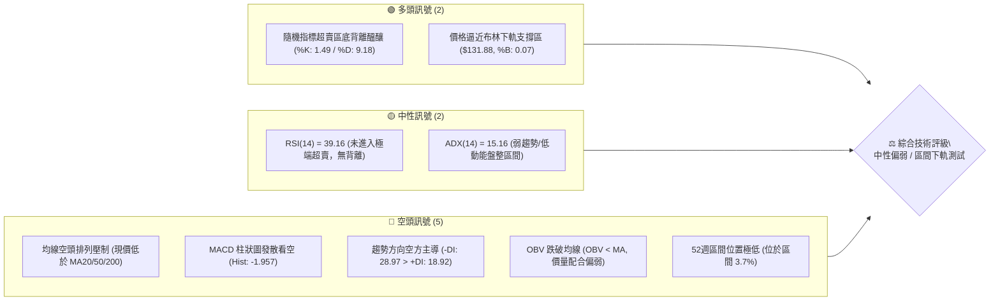

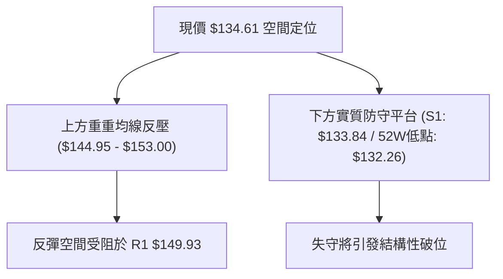

### 📊 核心指標速覽表

| 指標類別 | 指標名稱 | 當前數值 | 訊號 | 專業技術解讀 |
|----------|----------|----------|:----:|--------------|
| **價格** | 當前收盤價 | $134.61 | 🔴 | 位於 52 週高低區間 3.7% 極低分位，貼近波段底部 |
| **均線** | MA20 (月線) | $150.28 | 🔴 | 現價低於 MA20 達 -10.42%，短中期均線呈向下發散 |
| **均線** | MA50 (季線) | $144.95 | 🔴 | 現價低於 MA50 達 -7.13%，中期趨勢遭實質壓制 |
| **均線** | MA200 (年線) | $153.00 | 🔴 | 現價低於 MA200 達 -12.02%，長線多空分水嶺失守 |
| **動能** | RSI(14) | 39.16 | 🟡 | 位於偏弱中性區間（30–50），尚未進入極度超賣 |
| **動能** | MACD 柱狀圖 | -1.957 | 🔴 | DIF (-2.275) 低於 DEA (-0.319)，負柱持續放大中 |
| **動能** | KD (9,3,3) | %K: 1.49 / %D: 9.18 | 🟢 | 深度超賣鈍化，已具備超跌技術性反抽之必要條件 |
| **趨勢** | ADX(14) | 15.16 | 🟡 | ADX < 25 判定為非趨勢行情，屬於空方主導的箱體整理 |
| **方向** | DMI (±DI) | +DI: 18.92 / -DI: 28.97 | 🔴 | -DI 大幅高於 +DI，顯示下行賣壓佔據主導優勢 |
| **通道** | 布林通道 %B | 0.07 | 🟢 | 緊貼布林下軌 ($131.88)，下行空間遭遇統計學支撐帶 |
| **波動** | ATR(14) | $6.99 (5.19%) | 🟡 | 日內波動率適中，符合公用事業獨立發電商波動特徵 |
| **量能** | 20日成交量比 | 0.68x (4.78M / 7.05M) | 🔴 | 量能持續萎縮，OBV < MA 顯示資金流出尚未出現逆轉 |

### 🏆 技術評分卡

```
╔════════════════════════════════════════════════════════════════╗
║                   技術評分卡 — VST (2026-11-03)                ║
╠════════════════════════════════════════════════════════════════╣
║ 趨勢強度 (Trend)     ██████░░░░░░░░░░░░░░  32/100  🔴 弱勢空頭 ║
║ 動能指標 (Momentum)  ████████░░░░░░░░░░░░  42/100  🟡 弱勢背離 ║
║ 支撐穩定度 (Support) ████████████░░░░░░░░  60/100  🟡 考驗低點 ║
║ 成交量配合 (Volume)  ███████░░░░░░░░░░░░░  35/100  🔴 量能萎縮 ║
║ 形態完整度 (Pattern) ██████████░░░░░░░░░░  52/100  🟡 區間下緣 ║
║ 均線排列 (MAs)       ██████░░░░░░░░░░░░░░  31/100  🔴 全面壓制 ║
╠════════════════════════════════════════════════════════════════╣
║ 綜合評分 (Overall)   ████████░░░░░░░░░░░░  42/100  🟡 中性偏弱 ║
║ 計算依據：(32 + 42 + 60 + 35 + 52 + 31) ÷ 6 = 42.0 (規則 18)   ║
╚════════════════════════════════════════════════════════════════╝
```

---

## 2. 趨勢分析

### 🌐 多時框趨勢分析

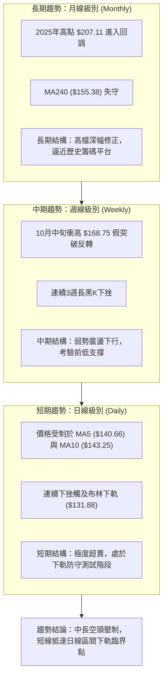

### 📈 長期趨勢 — 12個月走勢圖（Unicode）

```
VST 月線走勢圖（過去12個月：2025-11 至 2026-11）
價格軸 ($)
$180 ┤ ● (2025-11: $177.83)
$170 ┤             ● (2026-02: $173.13)
$160 ┤    ●     ●        ●     ●     ●
$150 ┤                 ●                 ● (2026-07: $147.95)
$140 ┤                                         ●     ●     ●
$130 ┤                                                           ●← 現價 ($134.61)
     └─┬─────┬─────┬─────┬─────┬─────┬─────┬─────┬─────┬─────┬─────┬─────┬───
      11月  12月  01月  02月  03月  04月  05月  06月  07月  08月  09月  10月  11月
     (2025)                                                       (2026)
```

#### 走勢特徵分析表格（過去12個月）

| 階段時間 | 起始月份 | 結束月份 | 區間收盤價變化 | 漲跌幅 | 走勢結構特徵與技術解讀 |
|:---------|:--------:|:--------:|:--------------:|:------:|:-----------------------|
| **第1階段：高檔震盪** | 2025-11 | 2026-02 | $177.83 → $173.13 | -2.64% | 於 $160–$175 構築次級頂部，反彈動能衰竭 |
| **第2階段：階梯下移** | 2026-02 | 2026-06 | $173.13 → $158.37 | -8.52% | 跌破 $160 整數關卡，MA50 由升轉平，形成盤跌通道 |
| **第3階段：加速探底** | 2026-06 | 2026-08 | $158.37 → $137.15 | -13.39%| 空方量能放大，跌破半年線支撐，直接下探 $135 水位 |
| **第4階段：築底整理** | 2026-08 | 2026-10 | $137.15 → $138.37 | +0.89% | 於 $135–$140 區間橫盤，量能萎縮，多空形成僵局 |
| **第5階段：邊界測試** | 2026-10 | 2026-11 | $138.37 → $134.61 | -2.72% | 11月初再度下壓，測試 52 週最低點 $132.26 之有效性 |

### 📊 中期趨勢（週線分析）

```
VST 週線關鍵技術位置結構示意圖
價格 ($)
$168.75 ┼──────────────────────────────────── 週線假突破高點 (2026-10-09 當週高)
        │                                  ▲
        │                                 ╱ ╲  (急跌反轉)
$152.02 ┼────────────────────────────────╱───╲────── 次高頸線 (2026-10-16 當週收)
        │                               ╱     ╲
$140.00 ┼─────────█████████████████████╱───────╲───████ 多空拉鋸分水嶺
        │        ╱                     │         ╲
$134.61 ┼───────╱──────────────────────┼──────────●── 當前收盤價
$132.26 ┼──────●───────────────────────┴───────────── 52週歷史低點 (強防守底線)
```

從週線級別觀察，2026年10月9日當週曾出現放量暴拉（成交量達 59,368,900 股，週高點觸及 $168.75），但隨後三週接連收出長黑 K 棒（收盤價分別為 $152.02、$140.16、$138.37），迅速吞噬所有漲幅，顯示高檔追價力道嚴重匱乏，且主力籌碼有顯著逢高減碼跡象。

### ⚡ 趨勢強度評估（ADX 解讀）

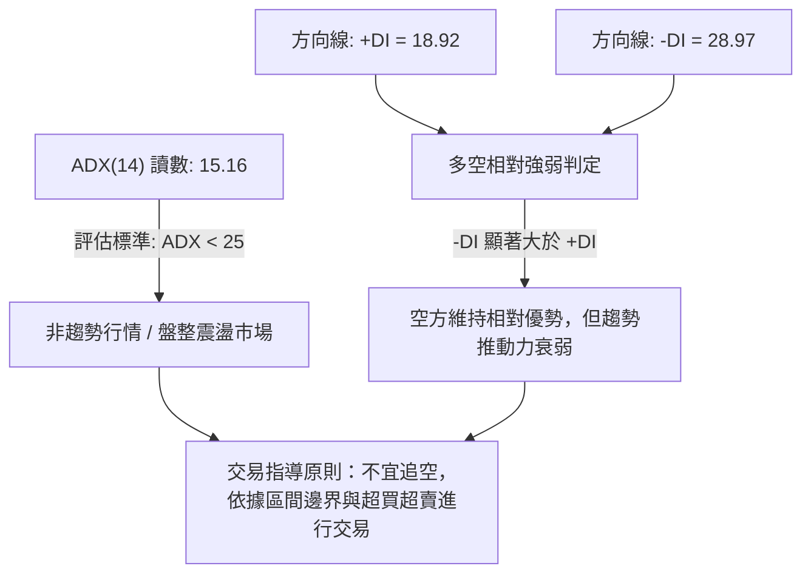

#### ADX 趨勢強度量化對照表

| 指標名稱 | 當前數值 | 臨界閾值 | 狀態判定 | 技術含義與操作指引 |
|:---------|:--------:|:--------:|:--------:|:-------------------|
| **ADX (14)** | **15.16** | 25.00 | 弱趨勢 / 盤整 | 處於無序波動或箱體震盪行情，趨勢跟隨策略（Trend Following）失效 |
| **+DI (14)** | **18.92** | 20.00 | 偏弱多頭 | 買盤力道低迷，缺乏發動單邊上漲的主動攻擊量 |
| **-DI (14)** | **28.97** | 25.00 | 空方佔優 | 空方具備結構主導權，但因 ADX 走平，未演化為恐慌性單邊崩跌 |
| **多空差值** | **-10.05** | 0.00 | 淨偏空 | 差值為負，確認當前走勢傾向反彈賣出而非突破做多 |

---

## 3. 圖表形態分析

### 🔍 形態識別系統

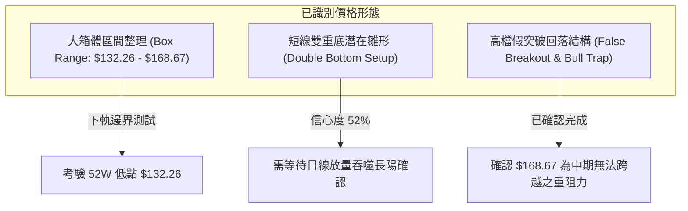

#### 形態識別與信心度評估表（依規則 15）

| 形態名稱 | 信心度 (%) | 判斷依據（引用技術數據） | 形態完成度 | 目標價計算式與推算結果（依規則 13） |
|:---------|:----------:|:-------------------------|:----------:|:-------------------------------------|
| **大型箱體整理** | **85%** | 價格在近半年反覆波動於 52W 低點 $132.26 與波段高點 $168.67 之間 | **90%** | 箱體上軌：$168.67（阻力位 R3）<br>箱體下軌：$132.26（52W Low） |
| **雙重底雛形** | **52%** | 前低為 2026-10-02 當週低點 $133.44，當前價格 $134.61 逼近 S1 ($133.84) 尋求支撐 | **40%** | 頸線為 MA20 ($150.28)<br>形態高度 = $150.28 − $132.26 = $18.02<br>破位向上目標 = $150.28 + $18.02 = **$168.30** |
| **假突破反轉** | **90%** | 2026-10-09 衝高 $168.75 後連續三週放量下挫，實體跌破起漲點 | **100%** | 形態已確認完成，下壓回吐目標即為區間起點 **$132.26** |

*備註：除上述三個具備嚴格數據支撐的形態外，其餘如頭肩底、旗形等「訊號不足，僅做指標型解讀」，不予強行標注。*

### 🕯️ 重要 K 線形態分析（依規則 19）

嚴格依據技術數據中「近 10 根日 K」與「近 8 根週 K」之實際開高低收數據進行客觀解讀：

#### 近 10 根日 K 棒解讀

| 日期（日K） | 開盤價 | 最高價 | 最低價 | 收盤價 | 成交量 | K 線形態名稱 | 專業技術解讀 | 訊號強度 |
|:-----------:|:------:|:------:|:------:|:------:|:------:|:-------------|:-------------|:--------:|
| 2026-10-20 | 148.90 | 151.34 | 147.10 | 150.32 | 3,336,500 | 窄幅小陽線 | 縮量橫盤，多空暫時均衡 | 🟡 |
| 2026-10-21 | 153.35 | 158.74 | 151.83 | 156.14 | 5,093,600 | 衝高中陽線 | 帶量突破前高，短線誘多特徵顯著 | 🟢 |
| 2026-10-22 | 153.00 | 154.27 | 139.10 | 140.83 | 12,469,400 | 放量長黑實體 | 暴跌 -9.80%，大單出逃，單日吞噬前4日漲幅 | 🔴 |
| 2026-10-23 | 139.06 | 141.52 | 136.17 | 140.16 | 6,740,500 | 下影小陽星 | 止跌回穩，下影線長達 $2.89 測試支撐 | 🟡 |
| 2026-10-26 | 140.90 | 143.52 | 139.07 | 141.73 | 4,299,400 | 低檔窄幅陽線 | 縮量弱勢反彈，受阻於上方均線 | 🟡 |
| 2026-10-27 | 143.95 | 147.45 | 143.40 | 146.66 | 4,107,900 | 修復型中陽線 | 向上回補缺口，但成交量持續低迷 | 🟢 |
| 2026-10-28 | 146.88 | 147.82 | 142.20 | 142.72 | 5,656,900 | 倒錘子/流星線 | 上影線長達 $5.10，高檔賣壓沉重，反彈夭折 | 🔴 |
| 2026-10-29 | 142.18 | 144.67 | 140.06 | 140.95 | 4,935,200 | 破位小陰線 | 重新跌破 $141，重心再度向下傾斜 | 🔴 |
| 2026-10-30 | 136.95 | 139.82 | 135.86 | 138.37 | 5,270,200 | 低開小陽星 | 跳空低開，試圖向上回補但量能不足 | 🟡 |
| 2026-11-02 | 140.00 | 140.50 | 134.21 | 134.61 | 4,785,300 | 實體中陰線 | 破底長陰收盤貼近當日最低 ($134.21)，空方完全掌控 | 🔴 |

#### 近 8 根週 K 棒解讀

| 日期（週K） | 開盤價 | 最高價 | 最低價 | 收盤價 | 週成交量 | K 線形態名稱 | 專業技術解讀 | 訊號強度 |
|:-----------:|:------:|:------:|:------:|:------:|:--------:|:-------------|:-------------|:--------:|
| 2026-09-18 | 143.76 | 145.87 | 139.39 | 140.44 | 23,879,600 | 震盪陰十字 | 均線附近多空糾結 | 🟡 |
| 2026-09-25 | 142.00 | 142.64 | 135.98 | 138.46 | 22,341,300 | 陰線測試低點 | 跌破 $140，探詢下檔支撐 | 🔴 |
| 2026-10-02 | 138.08 | 143.51 | 133.44 | 140.02 | 34,710,000 | 長下影鐵錘線 | 最低見 $133.44 後強力拉升，確認下檔買盤 | 🟢 |
| 2026-10-09 | 144.04 | 168.75 | 140.90 | 161.48 | 59,368,900 | 巨量衝高長陽 | 爆出近20週天量，高點衝擊 $168.75 | 🟢 |
| 2026-10-16 | 162.67 | 164.25 | 145.85 | 152.02 | 31,699,400 | 高位放量長黑 | 實體下跌 -5.86%，形成典型「多頭陷阱」 | 🔴 |
| 2026-10-23 | 154.10 | 158.74 | 136.17 | 140.16 | 31,911,100 | 空頭長黑吞噬 | 跌幅達 -7.80%，回吐前兩週大部分漲幅 | 🔴 |
| 2026-10-30 | 140.90 | 147.82 | 135.86 | 138.37 | 24,269,600 | 弱勢小陰線 | 連續第3週下挫，成交量萎縮，空方動能減弱 | 🔴 |
| 2026-11-02 | 140.00 | 140.50 | 134.21 | 134.61 | 4,785,300 | 週初破底中陰 | 當週第一天即跌破上週低點 ($135.86)，弱勢探底 | 🔴 |

### 📉 ASCII 走勢形態示意圖

```
VST 日線級別形態走勢與箱體結構
────────────────────────────────────────────────────────────────────────
$168.75 ┤           ▲ (假突破高點 10/09)
        │          ╱ ╲
$158.74 ┤         ╱   ● (10/21)
        │        ●     ╲
$150.28 ┤───────╱───────╲───────● (MA20 / 箱體中軌反壓)
        │      ╱         ╲     ╱ ╲
$146.66 ┤     ╱           ╲   ●   ╲ (10/27 反彈受阻於 10/28 流星線 $147.82)
        │    ╱             ╲ ╱     ╲
$140.00 ┤───●               ●       ╲
        │                            ● (10/30)
$134.61 ┤──────────────────────────────●← 當前收盤價 ($134.61)
$133.84 ┤································· 近期支撐 S1
$132.26 ┴───────────────────────────────── 52週歷史低點 (箱體下軌強防守)
────────────────────────────────────────────────────────────────────────
```

### 🎯 形態目標價計算

若當前在 $133.84–$132.26 構築雙重底反彈成功：
1. **箱體反彈第1目標（斐波那契 78.6%）**：**$145.83**
2. **箱體反彈第2目標（頸線 / MA20）**：**$150.28**（阻力位 R1 為 **$149.93**）
3. **等距形態測量目標**：若實體放量突破頸線 $150.28，向上測量幅度等於形態高度（$150.28 − $132.26 = $18.02），理論延伸目標價 = $150.28 + $18.02 = **$168.30**（與 R3 $168.67 高度吻合）。

---

## 4. 支撐與阻力

### 🗺️ 關鍵價位分布圖（Unicode）

```
╔═══════════════════════════════════════════════════════════════════╗
║                      VST 價位結構分布圖                           ║
╠═══════════════════════════════════════════════════════════════════╣
║ $195.66 ║██████████████████████████████║ 52週歷史最高點 (0.0% Fib)║
║ $180.70 ║████████████████████████      ║ 斐波那契 23.6% 回調位    ║
║ $171.44 ║████████████████████          ║ 斐波那契 38.2% 回調位    ║
║ $168.67 ║██████████████████████████████║ 強阻力 R3 (布林上軌)     ║
║ $163.96 ║██████████████████            ║ 斐波那契 50.0% 中軸位    ║
║ $156.48 ║████████████████              ║ 斐波那契 61.8% 黃金分割位║
║ $155.69 ║████████████████████          ║ 中期阻力 R2 (反彈高點)   ║
║ $150.28 ║████████████████████████      ║ 布林中軌 (MA20) 關鍵分水 ║
║ $149.93 ║██████████████████████████████║ 關鍵阻力 R1 (波段高點)   ║
║ $145.83 ║██████████████                ║ 斐波那契 78.6% 回調位    ║
║ ─────── ╫──────────────────────────────╫ ──────────────────────── ║
║ $134.61 ╠══════════════════════════════╣ ◄ 現價 (收盤價)          ║
║ ─────── ╫──────────────────────────────╫ ──────────────────────── ║
║ $133.84 ║▓▓▓▓▓▓▓▓▓▓▓▓▓▓▓▓▓▓▓▓▓▓▓▓▓▓▓▓▓▓║ 關鍵支撐 S1 (近期波段低點)║
║ $132.26 ║██████████████████████████████║ 52週最低點 (100.0% Fib)  ║
║ $131.88 ║▓▓▓▓▓▓▓▓▓▓▓▓▓▓▓▓▓▓▓▓▓▓        ║ 布林下軌 (極端波動統計底)║
╚═══════════════════════════════════════════════════════════════════╝
```

### 🚧 阻力位分析表

依規則 13，本報告所有阻力價位嚴格引用自技術數據中由 OHLCV 聚類計算得出之精確數值：

| 阻力級別 | 精確價位 | 距現價空間 | 技術形成原因與結構解讀 | 突破難度評估 | 重要性等級 |
|:---------|:--------:|:----------:|:-----------------------|:------------:|:----------:|
| **R1 (第一阻力)** | **$149.93** | +11.38% | 近一年波段高點聚類位，高度重合 MA20 月線 ($150.28) 與 MA120 ($149.03) | 🔴 高 | ★★★★★ |
| **R2 (第二阻力)** | **$155.69** | +15.66% | 中期密集套牢籌碼峰，緊鄰 240日年線 ($155.38) 與斐波那契 61.8% ($156.48) | 🔴 極高 | ★★★★☆ |
| **R3 (第三阻力)** | **$168.67** | +25.30% | 日線布林上軌，2026-10-09 當週高點 ($168.75) 之結構性大頂 | 🔴 極致 | ★★★★★ |

### 🛡️ 支撐位分析表

依規則 13 與 16，支撐位精確引用自數據中計算得出之數值；數據中未提供之層級明確註明：

| 支撐級別 | 精確價位 | 距現價空間 | 技術形成原因與結構解讀 | 守住機率評估 | 重要性等級 |
|:---------|:--------:|:----------:|:-----------------------|:------------:|:----------:|
| **S1 (關鍵支撐)** | **$133.84** | -0.57% | 近一年波段低點聚類位，近10日多空最後防線，多頭生命線 | 🟡 60% | ★★★★★ |
| **延伸支撐 (52W Low)**| **$132.26** | -1.75% | 52 週最低點，斐波那契 100.0% 絕對底部，與布林下軌 ($131.88) 構成共振 | 🟡 55% | ★★★★★ |
| **S2 / S3 (次級支撐)** | **N/A** | N/A | **數據中未偵測到獨立波段低點聚類**；若跌破 $132.26 則下方無一年內歷史籌碼參考位 | N/A | N/A |

### 📐 斐波那契回調位分析

依技術數據「52週區間 $132.26 → $195.66」精確計算之黃金分割回調結構如下：

| 斐波那契比例 | 精確價位 | 技術性質 | 當前價格相對位置與分析解讀 |
|:------------:|:--------:|:--------:|:---------------------------|
| **0.0%** | **$195.66** | 週期高點 | 52 週最高峰值，長期牛市延伸之阻力極限 |
| **23.6%** | **$180.70** | 弱勢回調 | 強勢多頭格局回踩位，當前已遠在此水平下方 |
| **38.2%** | **$171.44** | 初級支撐/阻力 | 曾為 2026 年初強支撐，跌破後轉化為中長期反壓位 |
| **50.0%** | **$163.96** | 多空分水嶺 | 整體波段中軸，10月中旬假突破受阻於此區域附近 |
| **61.8%** | **$156.48** | 黃金分割強防線 | 傳統牛熊分界線，失守宣告中期多頭結構徹底瓦解 |
| **78.6%** | **$145.83** | 深幅回調位 | 當前上方首要斐波那契反彈目標，重合 MA50 ($144.95) |
| **100.0%** | **$132.26** | 週期起點/底線 | 52 週最低點，現價 ($134.61) 僅高於此位 $2.35，回調已達 96.3% |

*現價落點解讀*：當前價格 $134.61 處於 78.6% 回調位 ($145.83) 與 100.0% 回調位 ($132.26) 之間的「深水探底區間」。由於回調幅度已吞噬前波上漲全部空間的 96.3%，此處繼續盲目殺跌的盈虧比極差，下檔隨時存在技術性均值回歸修復動力。

---

## 5. 技術指標深度解讀

### 🎛️ 指標訊號總覽

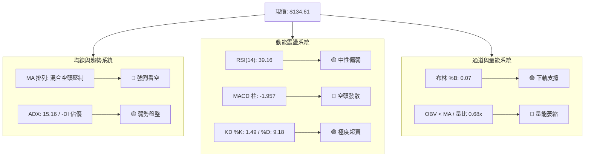

### 📈 移動平均線排列分析

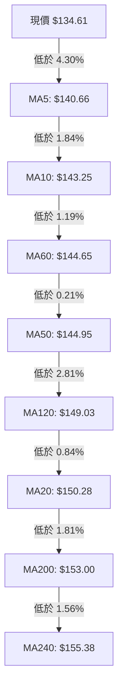

#### 移動平均線數據對照與排列狀態

| 均線名稱 | 精確數值 | 現價差距 ($) | 現價偏離率 (%) | 均線斜率與歷史軌跡 | 短期多空訊號 |
|:---------|:--------:|:------------:|:--------------:|:-------------------|:------------:|
| **MA5** | $140.66 | -$6.05 | -4.30% | 陡峭向下 (▁▁▁▁▁▁▁▁▁▁▃▅▆▇██▇▇) | 🔴 極弱空頭 |
| **MA10** | $143.25 | -$8.64 | -6.03% | 拐頭向下 (▂▂▁▁▁▁▁▁▁▁▂▃▄▅▆▇▇██) | 🔴 空頭壓制 |
| **MA20** | $150.28 | -$15.66 | -10.42%| 持續下行 (▁▁▁▁▁▁▁▁▁▁▁▂▂▃▃▄▅▅▆) | 🔴 中期反壓 |
| **MA50** | $144.95 | -$10.34 | -7.13% | 走平微跌，與 MA60 ($144.65) 糾結 | 🔴 季線失守 |
| **MA120** | $149.03 | -$14.42 | -9.67%| 長期走弱 (███▇▇▆▆▆▅▅▅▅▄▄▅▅▅▄▄) | 🔴 半年線受阻 |
| **MA200** | $153.00 | -$18.39 | -12.02%| 牛熊線下彎，長線牛市遭到破壞 | 🔴 年線失守 |
| **MA240** | $155.38 | -$20.77 | -13.36%| 歷史支撐轉壓力，長線資金離場 | 🔴 空方完勝 |

*均線排列定性*：當前移動平均線呈現「混合偏空排列」，短、中、長天期均線無一例外懸停於現價上方。最近阻力為 MA5 ($140.66)，若不能帶量收復 MA5 與 MA10，所有反彈均僅能視為均線乖離率過大所引發的技術性修正。

### 📉 RSI(14) 分析

```
RSI(14) 儀表盤
0       20      30              50              70      80     100
├───────┼───────┼───────────────┼───────────────┼───────┼───────┤
│ 極度超賣│ 超賣區 │    偏弱區間   │    偏強區間   │ 超買區 │ 極度超買│
└───────┴───────┴───────────────┴───────────────┴───────┴───────┘
                        ▲ (39.16)
進度條展示：███████████████░░░░░░░░░░░░░  39.16/100 (中性偏弱)
```

- **背離判斷結論**：技術數據中明確標示「無明顯背離（僅比較近20根K棒首尾價格與RSI方向）」。價格破底但 RSI 數值為 39.16，既未跌入 30 以下極度超賣區，亦未呈現清晰的底背離或頂背離結構。這代表當前的下行屬於指標跟隨價格下移的常態弱勢下跌，未出現反轉買訊。

### 📊 MACD(12/26/9) 訊號解讀

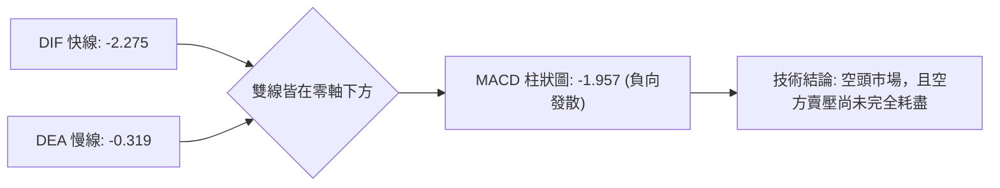

- **MACD 快線 (DIF)**：-2.275
- **訊號線 (DEA)**：-0.319
- **柱狀圖 (Histogram)**：-1.957（🔴 顯著看空）
- **詳細解讀**：DIF 與 DEA 均在 0 軸下方運行，顯示市場處於絕對的空頭主導週期。柱狀圖讀數達 -1.957，負柱長度在近幾日持續放大，說明短線下行動能正在釋放；在 DIF 拐頭向上穿過 DEA 形成「低位金叉」之前，左側盲目抄底將承擔較高動能慣性風險。

### 📦 布林通道分析

```
VST 日線布林通道 (Bollinger Bands, 20, 2) 結構示意圖
$168.67 ┼───────────────────────────────────────────── 上軌 (Upper Band)
        │
$150.28 ┼───────────────────●───────────────────────── 中軌 (MA20)
        │                  ╱ ╲
        │                 ╱   ╲
$134.61 ┼────────────────╱─────●← 現價 (%B = 0.07)
$131.88 ┴───────────────●───────────────────────────── 下軌 (Lower Band)
```

- **布林上軌**：**$168.67**
- **布林中軌 (MA20)**：**$150.28**
- **布林下軌**：**$131.88**
- **帶寬與 %B 指標**：%B 指標目前僅為 **0.07**，代表價格已緊貼布林帶下軌（0 代表下軌，$131.88；1 代表上軌，$168.67）。根據統計學原理，在非單邊強烈趨勢行情（ADX=15.16 < 25）中，價格運行在下軌之外的機率不足 5%，這意味著 $131.88–$134.61 區間具備強烈的均值回歸技術吸引力。

### 💹 成交量分析（量價配合度）

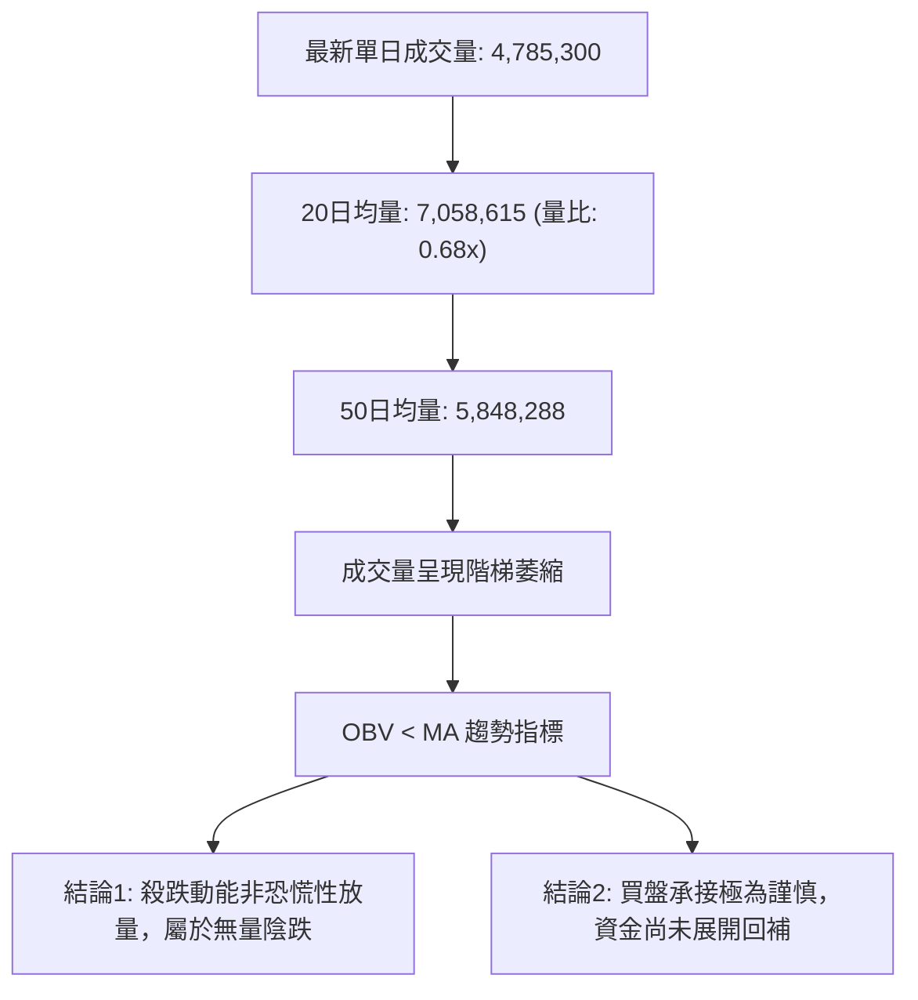

- **成交量量比**：0.68x（成交量 4,785,300 對比 20 日均量 7,058,615），顯示最新交易日之破底陰線並非機構恐慌性踩踏出逃，而是「買盤撤離導致的無量下滑」。
- **OBV 能量潮**：數據顯示「OBV < MA → 量能疲弱」，OBV 線受制於自身均線下方，說明籌碼積累過程尚未開始，大資金主要以觀望為主。

---

## 6. 動能與波動率

### ⚡ 動能評估四象限

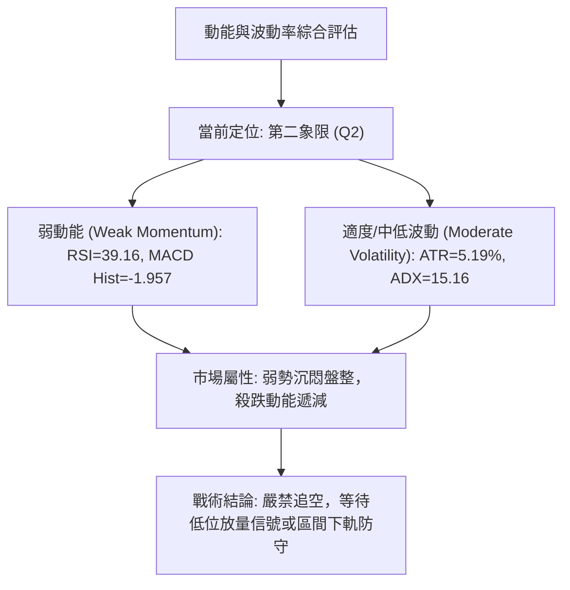

#### 動能與波動率狀態矩陣表

| 象限 | 動能維度 | 波動維度 | 典型市場特徵 | VST 當前狀態匹配度 | 技術應對策略 |
|:----:|:--------:|:--------:|:-------------|:------------------:|:-------------|
| **Q1** | 強動能 (Bullish) | 低波動 | 穩步單邊推升牛市 | 不符合 (0%) | 順勢持股，回踩加碼 |
| **Q2** | **弱動能 (Bearish)** | **低/中波動** | **陰跌打底或無序築底** | **完全符合 (85%)** | **防守型區間操作，嚴控倉位** |
| **Q3** | 強動能 (Bearish) | 高波動 | 恐慌崩盤或主跌浪 | 不符合 (10%) | 順勢破位做空，買入波動率 |
| **Q4** | 轉折動能 | 極高波動 | 頂底大反轉，爆量拉鋸 | 不符合 (5%) | 突破追單，嚴格停損 |

### 📊 ATR 波動率分析

- **ATR(14) 數值**：**$6.99**（佔當前股價之 **5.19%**，採 Wilder 平滑算法）。
- **ATR 技術解讀**：每日平均真實波幅近 $7.00 美元，顯示該標的雖然身處公用事業板塊，但因其獨立電力生產商（IPP）與資料中心 AI 供電炒作屬性，彈性顯著高於傳統防禦性公用事業股。
- **止損距離管理建議**：
  - *超短線波段操作*：建議採用 1.0 倍 ATR（$6.99），允許的正常日內雜訊空間為 $134.61 ± $7.00。
  - *波段防守操作*：建議採用 1.5 倍 ATR（$10.49），防範假跌破引發的洗盤。

### 📐 Beta 與市場相關性

- **Beta 係數**：**1.375**。
- **市場敏感度解讀**：VST 的 Beta 高達 1.375，表明該股對標普500指數（S&P 500）具備放大 37.5% 波動的特徵。在美股大盤處於高位回調或震盪整理期時，VST 的下行放大效應尤為明顯；然而一旦大盤情緒修復，其超額反彈彈性亦顯著優於公用事業指數（XLU）。

---

## 7. 多時框架總結

### 📋 時框架評分表

| 時框架 | 趨勢方向 | 動能狀態 | 均線排列 | 形態特徵 | 綜合評分 | 操作建議與導向 |
|:-------|:--------:|:--------:|:--------:|:--------:|:--------:|:---------------|
| **日線 (Daily)** | 🔴 弱勢盤整 | 🟡 深度超賣 | 🔴 空頭壓制 | 貼近布林下軌整理 | **38/100** | 考驗 S1 $133.84，短線博超賣反彈 |
| **週線 (Weekly)**| 🔴 震盪下行 | 🔴 負柱放大 | 🔴 跌破多條均線 | 衝高回落多頭陷阱 | **42/100** | 中期回調未結束，反彈逢高減碼 |
| **月線 (Monthly)**| 🟡 長期牛回 | 🟡 獲利了結 | 🟡 位於MA240邊緣 | 高位大幅回撤整理 | **50/100** | 觀察歷史高檔整固，保留長線底倉 |

### 🔲 綜合訊號矩陣

```
╔════════════════════════════════════════════════════════════════╗
║                  多維度多時框共振訊號矩陣                      ║
╠════════════════╦══════════════╦══════════════╦═════════════════╣
║ 維度 \ 週期    ║  短期 (日線) ║  中期 (週線) ║   長期 (月線)   ║
╠════════════════╬══════════════╬══════════════╬═════════════════╣
║ 趨勢方向 (DMI) ║  🔴 空方主導 ║  🔴 空方佔優 ║   🟡 震盪整理   ║
║ 動能指標 (MACD)║  🔴 負向發散 ║  🔴 死叉下行 ║   🟡 柱狀收縮   ║
║ 震盪擺動 (RSI) ║  🟡 弱勢中性 ║  🟡 偏空運行 ║   🟢 處於中軸上 ║
║ 支撐阻力 (S/R) ║  🟢 逼近 S1  ║  🟡 考驗低點 ║   🟢 遠高於起漲 ║
║ 量價結構 (OBV) ║  🔴 萎縮疲弱 ║  🔴 放量下挫 ║   🟢 長期累積   ║
╠════════════════╬══════════════╬══════════════╬═════════════════╣
║ 矩陣收斂結果   ║  🟡 超賣防守 ║  🔴 弱勢承壓 ║   🟡 箱體消化   ║
╚════════════════╩══════════════╩══════════════╩═════════════════╣
```

### ⚖️ 多時框收斂結論（依規則 14）

1. **行情定性優先級裁決**：
   - 當前 14 日趨勢強度 **ADX(14) 讀數為 15.16**，嚴格符合「**ADX < 25 判定為盤整行情**」之標準。
   - 依據規則 14，在非趨勢（盤整）行情中，以**日線布林通道上下軌（$131.88 – $168.67）為主要交易區間**。
2. **多時框矛盾化解**：
   - 儘管日線、週線級別均線系統呈現沈重之空頭壓制（中長期均線位於 $144.95–$153.00），但現價 $134.61 距離布林下軌 $131.88 僅一步之遙（%B = 0.07），且隨機指標 KD 已跌至極端低位（%K = 1.49）。
   - 在缺乏基本面突發崩壞放量砸盤的情況下，**盲目於區間下軌追空屬於極低勝率行為**。
3. **唯一方向性結論**：
   - **中性觀望 / 區間下緣防守操作（Neutral-Range Testing Support）**。本策略與第 1 章評分卡（綜合評分 42/100）及後續第 8 章之主策略完全閉環收斂。

---

## 8. 交易策略建議

### 🗺️ 策略決策流程圖

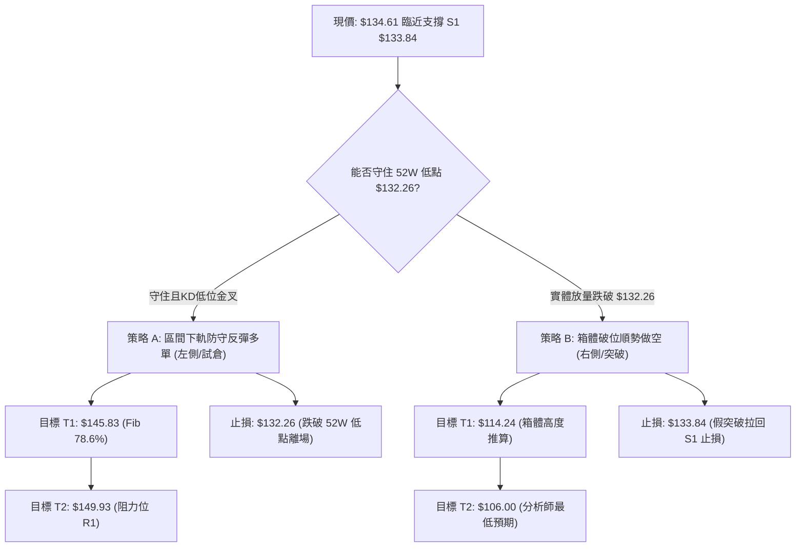

### 🧭 策略路由（依評分卡分流，規則 18）

> **當前主策略方向 = 中性區間操作（依第 1 章綜合評分 42/100，處於 40–60 區間操作通道）**
> 
> 由於綜合評分剛好落在 40–60 的中性區間，且 ADX 為 15.16 判定為非趨勢盤整市，當前操作嚴禁單邊激進追漲殺跌，必須嚴格以**「布林通道下軌防守、上方阻力位分批停利」**為核心邏輯。

### 🎯 價格情境階梯（Price Scenarios，嚴格引用第4章數值）

| 觸發條件 | 下一目標 | 後續延伸 | 情境技術含義與應對要點 |
|:---------|:--------:|:--------:|:-----------------------|
| **強勢突破 R1 $149.93** | **R2 $155.69** | **R3 $168.67** | 收復月線與半年線，短線全面轉強，空頭結構逆轉 |
| **站穩現價區間 ($133.84–$134.61)** | **$145.83** | **$149.93** | 區間下軌確認支撐有效，展開向布林中軌的均值回歸 |
| **跌破 S1 $133.84 與 52W 低點 $132.26** | **$114.24** | **$106.00** | 跌破 52 週大底，宣告箱體破位，開啟新一輪下行主跌段 |

### 📊 情境機率分佈

| 運行情境 | 發生機率 | 主要技術依據與數據支撐 |
|:---------|:--------:|:-----------------------|
| **情境一：區間下軌止跌反彈** | **55%** | KD 深度超賣 (%K 1.49)、布林 %B 僅 0.07、貼近 52W 底線與 S1 $133.84，殺跌量能縮竭 |
| **情境二：窄幅震盪橫盤築底** | **30%** | ADX 15.16 顯示趨勢極弱，成交量僅 0.68x 均量，市場缺乏主力主動性買賣盤 |
| **情境三：跌破支撐加速探底** | **15%** | 均線空頭排列，MACD 柱狀圖負向擴大 (-1.957)，基本面面臨三季報前夕避險賣壓 |

### 🟢 主策略詳情（依規則 5、13、17 嚴格計算）

本章所有價格完全引用第 4 章關鍵價位，進場價採用精確數值；風險報酬比計算公式嚴格遵循：`(目標價 T1 − 進場價) ÷ (進場價 − 止損價)`（做空時方向相反）。

| 策略要素 | 策略 A（主推：區間下軌反彈多單） | 策略 B（輔助：破位確認做空單） |
|:---------|:---------------------------------|:--------------------------------|
| **交易類型** | 左側防守型 / 均值回歸做多 | 右側突破型 / 破位跟隨做空 |
| **進場條件** | 現價或回踩 S1 企穩不破 | 跌破 52W 最低點確認破位 |
| **進場價格** | **$134.61**（當前收盤價） | **$132.26**（跌破 52W 低點進場） |
| **止損價格** | **$132.26**（跌破 52W 低點止損） | **$133.84**（拉回 S1 支撐位上方止損） |
| **目標價 T1** | **$145.83**（斐波那契 78.6% 回調位） | **$114.24**（由箱體高度推算：$132.26 − $18.02） |
| **目標價 T2** | **$149.93**（阻力位 R1 / 聚類高點） | **$106.00**（分析師目標價最低值） |
| **單位風險 (R)**| $134.61 − $132.26 = **$2.35** | $133.84 − $132.26 = **$1.58** |
| **單位回報 (T1)**| $145.83 − $134.61 = **$11.22** | $132.26 − $114.24 = **$18.02** |
| **風險報酬比** | **1 : 4.77（以 T1 計）**<br>*(以 T2 計: 1 : 6.52)* | **1 : 11.41（以 T1 計）**<br>*(以 T2 計: 1 : 16.62)* |
| **預估勝率** | **55%** | **40%** |
| **建議倉位** | **10%–15%**（輕倉試探） | **10%**（破位加空） |

*R:R 計算覆核驗證（規則 17）*：
- 策略 A：($145.83 − $134.61) ÷ ($134.61 − $132.26) = $11.22 ÷ $2.35 = **4.774** → `1 : 4.77（以 T1 計）`。以 T2 計：($149.93 − $134.61) ÷ $2.35 = $15.32 ÷ $2.35 = **6.519** → `1 : 6.52（以 T2 計）`。
- 策略 B：($132.26 − $114.24) ÷ ($133.84 − $132.26) = $18.02 ÷ $1.58 = **11.405** → `1 : 11.41（以 T1 計）`。以 T2 計：($132.26 − $106.00) ÷ $1.58 = $26.26 ÷ $1.58 = **16.620** → `1 : 16.62（以 T2 計）`。

### 🔴 反向風險觸發點（對沖提示）

- **多單失效風控點**：若日線級別收盤價實體**跌破 $132.26**，意味著支撐 S1 與一年大底徹底瓦解，必須無條件止損多單，不可心存僥倖攤平。
- **空單逼空逆轉點**：若價格帶量**收復 R1 $149.93**（或突破 MA20 $150.28），則確立日線級別底部形態構築成功，所有中長線空單必須強制離場對沖。

### ⭐ 整體訊號強度評星

```
做多訊號強度：★★☆☆☆  (2/5星 — 僅限區間下軌高盈虧比超賣反彈)
做空訊號強度：★★★☆☆  (3/5星 — 均線偏空但下方空間受制於強支撐)
整體可信度：  ★★★☆☆  (3/5星 — ADX 低迷，處於築底或破位臨界期)
```

---

## 9. 風險提示與監控

### ✅ 關鍵監控指標 Checklist

```
╔════════════════════════════════════════════════════════════════════╗
║                     VST 技術監控清單 (Checklist)                    ║
╠════════════════════════════════════════════════════════════════════╣
║ [ ] 1. 支撐有效性：收盤價是否守在 S1 ($133.84) 及 52W 底 ($132.26) 上 ║
║ [ ] 2. 指標超賣修復：Stoch %K 是否向上金叉穿過 %D (由 <10 向上突破)║
║ [ ] 3. 成交量配合：日成交量能否放大超越 20日均量 (7,058,615 股)   ║
║ [ ] 4. 首要阻力突破：反彈能否有效攻克 MA5 ($140.66) 展開短線反彈 ║
║ [ ] 5. MACD 綠柱收縮：柱狀圖能否縮短至 -1.000 以內停止向下發散    ║
║ [ ] 6. 外部基本面節點：關注 11月6日 財報公佈前後之電力產能預期變化 ║
╚════════════════════════════════════════════════════════════════════╝
```

### ⚠️ 風險場景分析

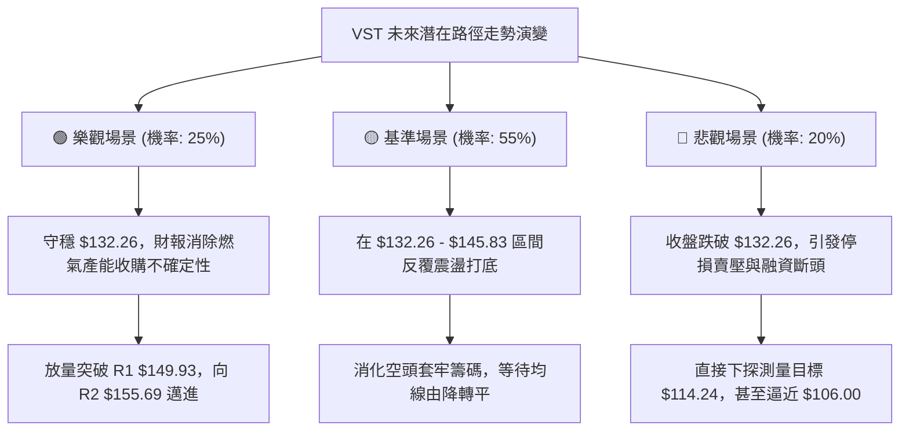

### 🛡️ 風險管理重要提醒

1. **財報事件風險（Earnings Event）**：
   - 根據技術數據與最新新聞，公司即將於 11 月 6 日公佈最新業績，且剛完成 Cogentrix 5.5GW 天然氣發電產能收購。最新季報數據顯示營收成長為 -5.5%，營業利益率降至 13.8%。在財報出爐前，引含波動率可能大幅拉升，需提防財報公佈引發的跳空風險。
2. **倉位控制紀律**：
   - 當前 VST 處於弱勢整理期，總持倉部位不宜超過投資組合之 15%。
   - 每一筆交易承擔之名義本金風險（Capital at Risk）嚴格限制在總資產的 1.0%–1.5% 範圍內。
3. **ATR 動態止損設置**：
   - 鑑於當前 ATR 達 $6.99，若使用市價單止損極易因早盤波動被「洗盤出場」。建議採用「收盤價確認原則」：僅當日線收盤價確鑿低於止損位（如 $132.26）時，於次日開盤執行止損。

---

## 📋 報告總結

```
╔════════════════════════════════════════════════════════════════════╗
║                      VST 技術分析報告總結                          ║
╠════════════════════════════════════════════════════════════════════╣
║ 報告日期：2026-11-03                                               ║
║ 當前價格：$134.61                                                  ║
║ 分析評級：⚖️ 中性偏弱 / 區間下軌測試 (綜合評分: 42/100)           ║
╠════════════════════════════════════════════════════════════════════╣
║ 關鍵結論：                                                         ║
║ ├─ 長期趨勢：🟡 月線高檔回撤，考驗一年多空底線 ($132.26)          ║
║ ├─ 中期趨勢：🔴 週線假突破後連續三週長陰下殺，受制於 $150 關卡    ║
║ ├─ 短期趨勢：🟡 極度超賣 (KD %K 1.49)，緊貼布林下軌 ($131.88) 探底 ║
║ ├─ 關鍵支撐：S1 $133.84 ｜ 52W 低點 $132.26 ｜ 下軌 $131.88        ║
║ ├─ 關鍵阻力：R1 $149.93 ｜ R2 $155.69 ｜ R3 $168.67 (布林上軌)     ║
║ └─ 分析師目標：均價 $205.41 (極端區間: $106.00 - $306.00)          ║
╠════════════════════════════════════════════════════════════════════╣
║ 最優策略組合：                                                     ║
║ 1. 🥇 最佳機會：策略 A (區間下軌防守反彈多單，現價 $134.61 進場，   ║
║                 止損 $132.26，目標 $145.83，風報比 1 : 4.77)       ║
║ 2. 🥈 次選機會：右側突破加碼 (待日線收盤站上 MA5 $140.66 後追單)   ║
║ 3. 🥉 避險選擇：破位對沖 (實體跌破 $132.26 執行策略 B 順勢開空)   ║
╚════════════════════════════════════════════════════════════════════╝
```

---

> ⚠️ **免責聲明**：本報告為依據量化技術指標與歷史走勢數據所生成之專業分析，所有價位均基於既定技術規則推算。本報告**僅供研究與學術參考**，**不構成任何要約、推薦或投資決策建議**。金融市場瞬息萬變，交易具備固有虧損風險，投資人應自行審慎評估風險承受能力並對交易結果自負全責。

---

*報告生成時間：2026-11-03 ｜ 數據來源：Yahoo Finance ｜ 分析框架：多時框技術分析體系（CMT 規範）*