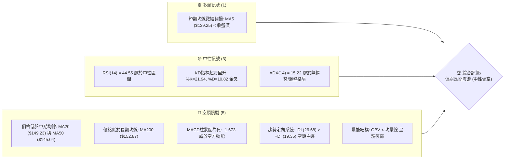
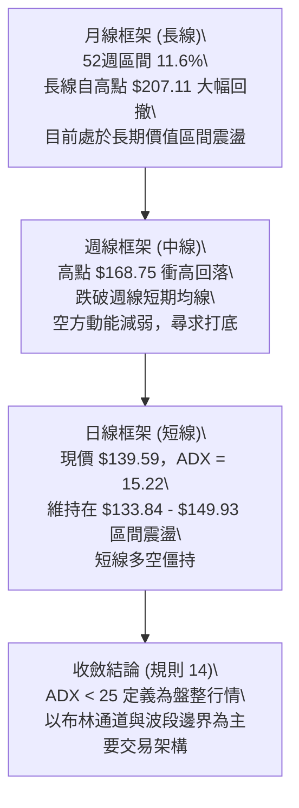
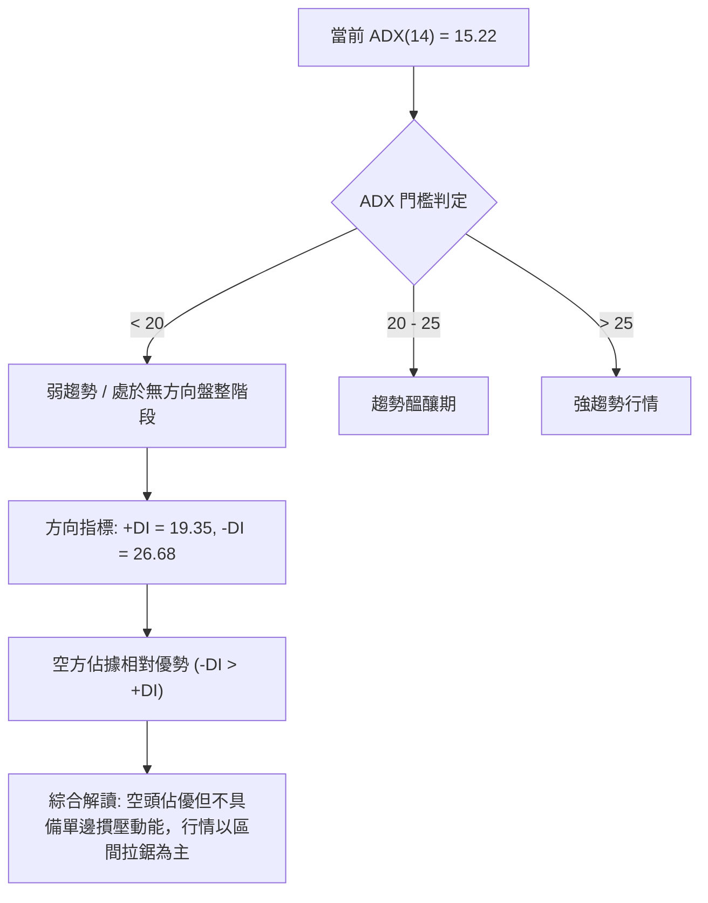
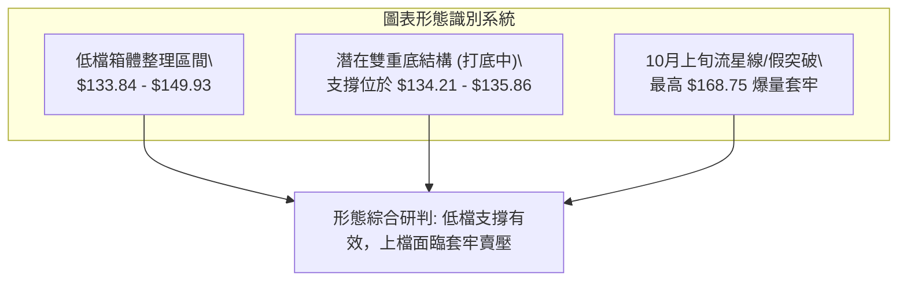
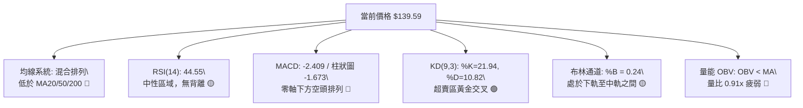
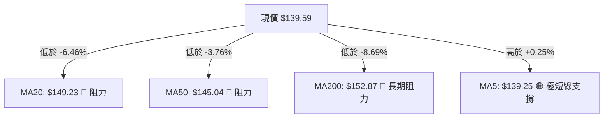
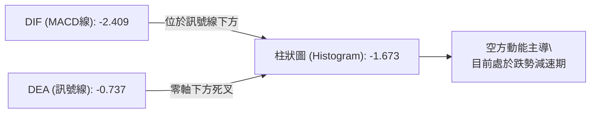
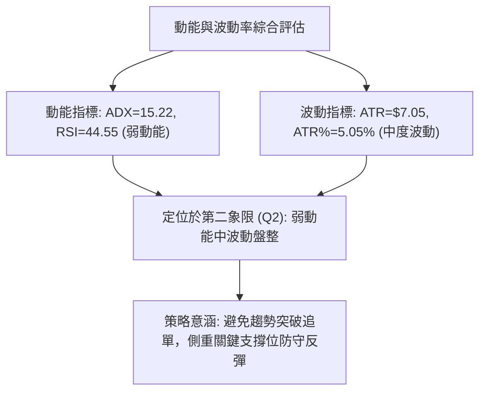
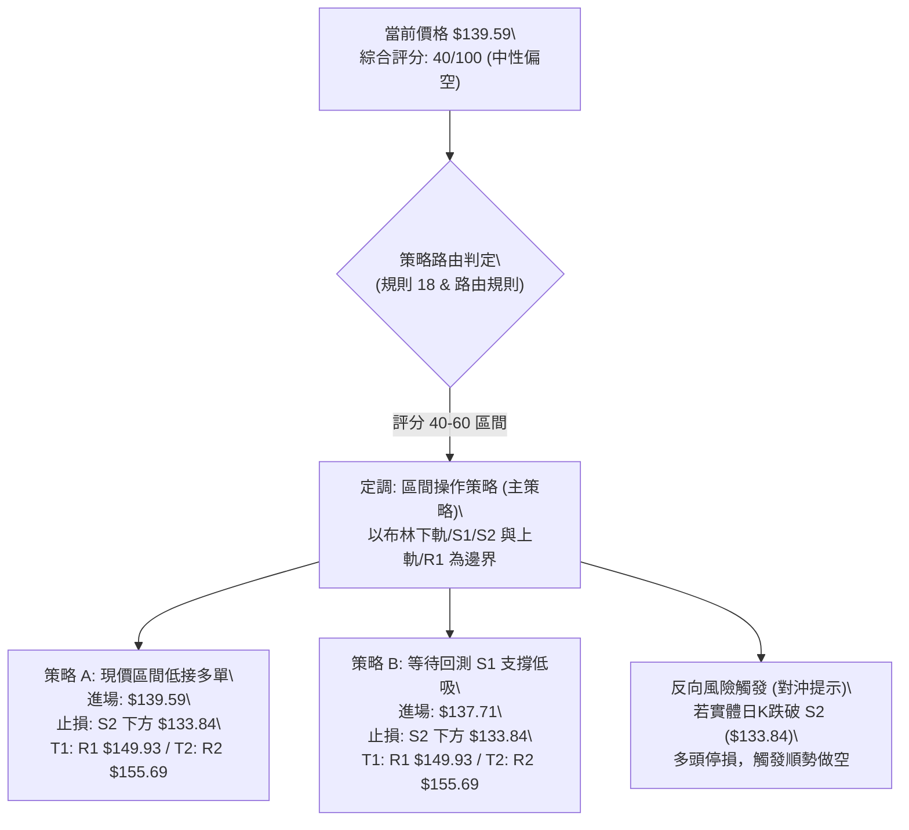
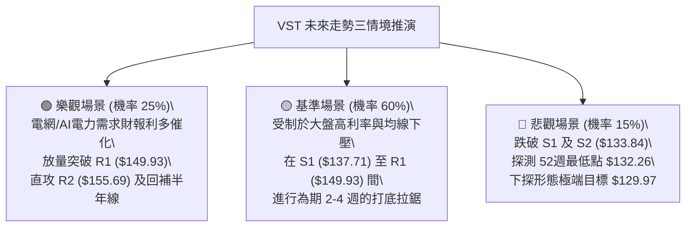

# VST 技術分析報告

> **報告日期**：2026-11-04 ｜ **語言**：繁體中文 ｜ **數據來源**：Yahoo Finance ｜ **當前價格**：$139.59

---

## 目錄

| 章節 | 內容 |
|------|------|
| [1. 技術面概覽](#1-技術面概覽) | 訊號儀表板、核心指標、評分卡 |
| [2. 趨勢分析](#2-趨勢分析) | 多時框趨勢、長中短期走勢 |
| [3. 圖表形態分析](#3-圖表形態分析) | 形態識別、K線組合、目標價 |
| [4. 支撐與阻力](#4-支撐與阻力) | 關鍵價位、斐波那契回調 |
| [5. 技術指標深度解讀](#5-技術指標深度解讀) | MA/RSI/MACD/布林/成交量 |
| [6. 動能與波動率](#6-動能與波動率) | 動能評估、ATR、Beta |
| [7. 多時框架總結](#7-多時框架總結) | 時框架評分矩陣 |
| [8. 交易策略建議](#8-交易策略建議) | 多空策略、風險報酬比 |
| [9. 風險提示與監控](#9-風險提示與監控) | 監控指標、風險場景 |

---

## 1. 技術面概覽

### 🎯 技術訊號儀表板



### 📊 核心指標速覽表

| 指標類別 | 指標名稱 | 當前數值 | 訊號 | 解讀 |
|:---|:---|:---|:---:|:---|
| **價格** | 當前收盤價 | $139.59 | 🟡 | 位於52週區間 11.6% 相對低檔區，接近波段底部 |
| **均線** | MA20 | $149.23 | 🔴 | 價格低於 MA20 達 -6.46%，短中期下行承壓 |
| **均線** | MA50 | $145.04 | 🔴 | 價格低於 MA50 達 -3.76%，波段架構偏弱 |
| **均線** | MA200 | $152.87 | 🔴 | 價格低於 MA200 達 -8.69%，中長期牛熊分界線失守 |
| **動能** | RSI(14) | 44.55 | 🟡 | 位於 30–70 之中性區間，無超買或極度超賣 |
| **動能** | MACD柱狀圖 | -1.673 | 🔴 | MACD線 (-2.409) 處於訊號線 (-0.737) 下方，空方佔優 |
| **動能** | KD(9,3) | %K 21.94 / %D 10.82 | 🟢 | KD 自極端超賣區低檔黃金交叉，短線具備技術反彈契機 |
| **趨勢** | ADX(14) | 15.22 | 🟡 | ADX < 25 表明處於弱趨勢/區間盤整行情，非單邊行情 |
| **波動** | ATR(14) | $7.05 | 🟡 | 波動率佔股價 5.05%，日振幅適中，風險與區間明確 |
| **通道** | 布林帶寬 | %B = 0.24 | 🟡 | 位於下軌 ($130.91) 與中軌 ($149.23) 之間，偏向通道下緣 |
| **量能** | 20日成交量比 | 0.91x | 🔴 | 最新量 5.87M 低於20日均量 6.45M，且 OBV < MA 量能疲弱 |

### 🏆 技術評分卡

```
╔══════════════════════════════════════════════════════════════╗
║              技術評分卡 — VST (2026-11-04)                   ║
╠══════════════════════════════════════════════════════════════╣
║ 趨勢強度 (Trend)     ██████░░░░░░░░░░░░░░  30/100  🔴 空頭主導║
║ 動能指標 (Momentum)  ████████░░░░░░░░░░░░  40/100  🟡 弱勢整理║
║ 支撐穩定度 (Support) ████████████░░░░░░░░  60/100  🟢 接近支撐║
║ 成交量配合 (Volume)  ████████░░░░░░░░░░░░  40/100  🟡 動能匱乏║
║ 形態完整度 (Pattern) ██████████░░░░░░░░░░  50/100  🟡 區間打底║
║ 均線排列 (MovingAvg) ████░░░░░░░░░░░░░░░░  20/100  🔴 空頭排列║
╠══════════════════════════════════════════════════════════════╣
║ 綜合評分 (Overall)   ████████░░░░░░░░░░░░  40/100  ⚖️ 中性偏空║
╚══════════════════════════════════════════════════════════════╝
```
*註：綜合評分 = (30 + 40 + 60 + 40 + 50 + 20) ÷ 6 = 40.0/100（依規則 18 算術平均四捨五入）。*

---

## 2. 趨勢分析

### 🌐 多時框趨勢分析



### 📈 長期趨勢 — 12個月走勢圖（Unicode）

依據月度歷史收盤價，VST 自 2025 年高點見頂後展開修正，過去 12 個月走勢呈現典型的震盪走低打底特徵：

```
VST 月線走勢圖（過去12個月：2025-11 至 2026-11）
價格軸 ($)
$180 ┤ ● (2025-11: $177.83)
$170 ┤                 ● (2026-02: $173.13)
$160 ┤     ●       ●               ●       ●
$150 ┤                                 ●       ●
$140 ┤                                             ●       ●       ●←現價 $139.59
$130 ┤                                                 ●
     └─┬───┬───┬───┬───┬───┬───┬───┬───┬───┬───┬───┬─
      11  12  01  02  03  04  05  06  07  08  09  10  11 (月份)
      (2025)            (2026)
```

#### 過去 12 個月走勢特徵分析表

| 階段區間 | 起始價 → 結束價 | 區間漲跌幅 | 走勢特徵與結構分析 |
|:---|:---:|:---:|:---|
| **2025-11 ~ 2026-01** | $177.83 → $157.65 | -11.35% | 高檔放量下挫，長線資金獲利了結，跌破前期平台支撐。 |
| **2026-01 ~ 2026-02** | $157.65 → $173.13 | +9.82%  | 次高點反彈測試阻力，未能創出新高，形成次級下降高點。 |
| **2026-02 ~ 2026-03** | $173.13 → $149.87 | -13.44% | 假突破後快速反轉，市場風險偏好急劇冷卻。 |
| **2026-03 ~ 2026-06** | $149.87 → $158.37 | +5.67%  | 在 $155-$160 狹幅平台橫盤整理，多空動能暫時平衡。 |
| **2026-06 ~ 2026-08** | $158.37 → $137.15 | -13.40% | 破位下行，8月收盤觸及 $137.15，確立波段探底架構。 |
| **2026-08 ~ 2026-11** | $137.15 → $139.59 | +1.78%  | 連續三個月收盤在 $138 附近橫盤（138.35、138.37、139.59），呈現階段性築底特徵。 |

### 📊 中期趨勢（週線分析）

中期走勢方面，近 20 週數據顯示股價在 2026 年 10 月 9 日當週曾劇烈放量衝高至 $168.75（收盤 $161.48，週成交量達 59.37M），隨後快速回落回吐全部漲幅，回測至 $138–$140 區間。

```
VST 中期週線支撐阻力結構示意圖
────────────────────────────────────────────────────────────────
$168.67 ── 波段極端高點阻力 (2026-10-09 週高 $168.75 衝高回落)
          │
$155.69 ── 中期回撤阻力 / 61.8% 斐波那契位 ($156.48)
          │
$149.93 ── 頸線阻力 / 近期整理中軸 (R1)
────────────────────────────────────────────────────────────────
$139.59 ◄── 當前收盤價（位於密集震盪整理區下沿）
────────────────────────────────────────────────────────────────
$137.71 ── 近一年波段低點支撐聚類 (S1)
          │
$133.84 ── 關鍵防守低點支撐聚類 (S2)
$132.26 ── 52週絕對低點 / 100.0% 斐波那契回調底線
────────────────────────────────────────────────────────────────
```

### ⚡ 趨勢強度評估（ADX 解讀）



#### ADX 趨勢強度對照解讀表

| 指標名稱 | 當前讀數 | 門檻區間 | 市場狀態解讀 |
|:---|:---:|:---:|:---|
| **ADX(14)** | **15.22** | < 20 (極弱) | 行情嚴重缺乏單邊趨勢動能，趨勢型突破策略易遭假突破洗盤，適合震盪逢低承接操作。 |
| **+DI** | **19.35** | 0 – 100 | 多頭向上推升力道偏弱，尚未形成買盤聚集效應。 |
| **-DI** | **26.68** | 0 – 100 | 空頭主導短期定價權，數值高於 +DI 達 7.33 點，表明短期賣盤仍占上風。 |
| **方向結論** | **-DI > +DI** | 空頭優勢 | 空方主控但無強趨勢支撐（ADX 低），價格主要表現為「下行抵抗式盤整」。 |

---

## 3. 圖表形態分析

### 🔍 形態識別系統

依據近 8 週及近 10 日 OHLCV 實際數據，股價自 10 月初暴量拉升後出現顯著的衝高回落，目前在低檔形成橫向打底箱體。



#### 形態信心度與目標價評估表

| 形態名稱 | 信心度 | 判斷依據（嚴格引用 OHLCV 數據） | 完成度 | 目標價（附精確計算式） |
|:---|:---:|:---|:---:|:---|
| **低檔震盪箱體** | **75%** | 箱底獲支撐位 S1 ($137.71) 與近期低點群 ($134.21-$135.86) 支撐；箱頂受阻於阻力位 R1 ($149.93)。 | 70% | 向上突破 R1 之目標價：<br>頸線 $149.93 + 箱高 ($149.93 − $137.71 = $12.22) = **$162.15**（由箱體形態推算） |
| **潛在雙重底** | **55%** | 第一隻腳：2026-10-02 當週低點 $133.44；第二隻腳：2026-11-02 日低 $134.21，低點逐步抬高。頸線為 10-28 高點 $147.82。 | 45% | 頸線突破目標價：<br>頸線 $147.82 + 形態高度 ($147.82 − $133.44 = $14.38) = **$162.20**（由雙底形態推算） |
| **高檔穿頭破腳空方反轉** | **85%** | 2026-10-09 週K衝高至 $168.75 後收 $161.48，次週 (10-16) 開 $162.67 收 $152.02，隨後連續兩週破位下行。 | 100% | 形態已完全展開，第一目標已達成近期低點 $134.21，當前處於空方跌勢竭盡階段。 |

### 🕯️ 重要K線形態分析

依規則 19，完全基於數據中近 10 根日 K 與近 8 根週 K 之實際數值進行解讀：

#### 近 10 根日 K 線形態解讀

| 日期 | 開盤價 | 最高價 | 最低價 | 收盤價 | 成交量 | K線形態名稱 | 技術解讀與訊號 |
|:---:|:---:|:---:|:---:|:---:|:---:|:---:|:---|
| **2026-10-21** | 153.35 | 158.74 | 151.83 | 156.14 | 5,093,600 | 衝高中陽線 | 上影線受阻於 $158.74，多頭試圖上攻但無續航量。🟢 |
| **2026-10-22** | 153.00 | 154.27 | 139.10 | 140.83 | 12,469,400 | 放量長黑破位 | 單日重挫放量至 12.47M，跌破 MA20/MA50，確立短線轉空。🔴 |
| **2026-10-23** | 139.06 | 141.52 | 136.17 | 140.16 | 6,740,500 | 低檔十字下影線 | 最低下探 $136.17 後收於 $140.16，在 S1 附近獲得短線買盤抵抗。🟡 |
| **2026-10-26** | 140.90 | 143.52 | 139.07 | 141.73 | 4,299,400 | 縮量小陽反彈 | 縮量震盪整理，多頭試探性回補，力道有限。🟡 |
| **2026-10-27** | 143.95 | 147.45 | 143.40 | 146.66 | 4,107,900 | 溫和上揚中陽 | 連續反彈測試上方壓力區，量能未放大。🟢 |
| **2026-10-28** | 146.88 | 147.82 | 142.20 | 142.72 | 5,656,900 | 上影倒錘長陰 | 盤中觸及 $147.82 後遭空頭狙擊，收盤跌破開盤，反彈受挫。🔴 |
| **2026-10-29** | 142.18 | 144.67 | 140.06 | 140.95 | 4,935,200 | 弱勢黑K實體 | 延續前日回落走勢，下測整數關卡 $140.00。🔴 |
| **2026-10-30** | 136.95 | 139.82 | 135.86 | 138.37 | 5,270,200 | 低開反彈下影線 | 探底 $135.86 逼近 S1 ($137.71)，多頭低接護盤收於 $138.37。🟡 |
| **2026-11-02** | 140.00 | 140.50 | 134.21 | 134.61 | 4,797,900 | 光頭下殺光腳黑K | 盤中下探 $134.21 逼近強支撐 S2 ($133.84)，空方宣洩賣壓。🔴 |
| **2026-11-03** | 135.99 | 142.40 | 135.99 | 139.59 | 5,867,800 | 光腳中陽線 (反轉) | 低開高走，實體陽線包覆前日陰線大部分實體，形成低檔反轉型態。🟢 |

#### 近 8 根週 K 線形態解讀

| 日期 | 開盤價 | 最高價 | 最低價 | 收盤價 | 成交量 | K線形態名稱 | 技術解讀與訊號 |
|:---:|:---:|:---:|:---:|:---:|:---:|:---:|:---|
| **2026-09-18** | 143.76 | 145.87 | 139.39 | 140.44 | 23,879,600 | 震盪收陰 | 中期均線下方整理，量能持平。🔴 |
| **2026-09-25** | 142.00 | 142.64 | 135.98 | 138.46 | 22,341,300 | 下測低點下影黑K | 測試 $136 支撐位獲得支撐。🟡 |
| **2026-10-02** | 138.08 | 143.51 | 133.44 | 140.02 | 34,710,000 | 放量錘頭線 (Hammer)| 探底 $133.44 後大幅拉升，爆出 34.71M 大量，波段起漲訊號。🟢 |
| **2026-10-09** | 144.04 | 168.75 | 140.90 | 161.48 | 59,368,900 | 暴量長上影大陽 | 單週爆量 59.37M 衝高至 $168.75，高檔多空劇烈分歧。🟡 |
| **2026-10-16** | 162.67 | 164.25 | 145.85 | 152.02 | 31,699,400 | 高位破位陰包陽 | 吞噬前週部分實體，確認上影線為階段性頂部。🔴 |
| **2026-10-23** | 154.10 | 158.74 | 136.17 | 140.16 | 31,911,100 | 下挫長黑線 | 單週下挫 11.86 元，完全吞噬 10-09 當週起漲點，空方完全回補。🔴 |
| **2026-10-30** | 140.90 | 147.82 | 135.86 | 138.37 | 24,269,600 | 縮量探底十字星 | 探底 $135.86 縮量收十字，賣壓趨於衰竭。🟡 |
| **2026-11-03** | 140.00 | 142.40 | 134.21 | 139.59 | 10,665,700 | 探底回升陽錘頭 | 截至 11-03 探低 $134.21 後回升收於 $139.59，低檔買盤浮現。🟢 |

### 📉 ASCII 走勢形態示意圖

```
VST 日K線低檔反轉走勢示意圖（2026-10-21 至 2026-11-03）
價格軸 ($)
$158.74 ┤  ● (10-21 高)
$152.00 ┤  │ █
$147.82 ┤  │ █           ▲ (10-28 倒錘頭高點)
$142.00 ┤  │ █ █       █ │ █       ▲ (11-03 盤中高 $142.40)
$139.59 ┤  │ │ │ █   █ │ │ │ █   │ █ ← 現價收盤
$136.00 ┤  │ │ █ │ █ │ │ │ │ │ █ │ │ 
$134.21 ┤  ┴ ┴ ┴ ┴ ┴ ┴ ┴ ┴ ┴ ┴ ┴ █ ┴ ← (11-02 探底 $134.21 / 雙底次低)
        └─┬───┬───┬───┬───┬───┬───┬───┬───┬───┬─
         10/21 22  23  26  27  28  29  30 11/02 03 (日期)
```

### 🎯 形態目標價計算

依據幾何形態學與數據中 OHLCV 確鑿極值計算：

1. **低檔箱體突破向上計算式**：
   - 箱體頂部（頸線）：阻力位 R1 = **$149.93**
   - 箱體底部：支撐位 S1 = **$137.71**
   - 箱體高度 $H = \$149.93 - \$137.71 = \$12.22$
   - 向上等距測幅目標價 $T_1 = \$149.93 + \$12.22 =$ **$162.15**（由箱體形態推算）

2. **區間破位下行測幅計算式（下行風險邊界）**：
   - 若有效跌破強支撐 S2 = **$133.84**
   - 下跌測幅空間 $H = \$137.71 - \$133.84 = \$3.87$
   - 下行延伸防守目標價 = $\$133.84 - \$3.87 =$ **$129.97**（由破位形態推算，緊鄰 52週低點 $132.26 下方）

---

## 4. 支撐與阻力

### 🗺️ 關鍵價位分布圖（Unicode）

```
╔══════════════════════════════════════════════════════════════════╗
║                   VST 價位結構分布圖                             ║
╠══════════════════════════════════════════════════════════════════╣
║ $195.66 ║████████████████████████████████║ 52週歷史最高點 (0.0%)║
║ $180.70 ║████████████████████████        ║ 斐波那契 23.6% 回調位 ║
║ $171.44 ║██████████████████              ║ 斐波那契 38.2% 回調位 ║
║ $168.67 ║██████████████████████████████  ║ 強阻力 R3 (波段高點)  ║
║ $163.96 ║████████████████                ║ 斐波那契 50.0% 回調位 ║
║ $156.48 ║████████████████████            ║ 斐波那契 61.8% / R2   ║
║ $155.69 ║██████████████████████          ║ 關鍵阻力 R2           ║
║ $149.93 ║████████████████████████████    ║ 近期第一阻力 R1 / MA20║
║ $145.83 ║████████████                    ║ 斐波那契 78.6% 回調位 ║
║ $139.59 ╠════════════════════════════════╣ ◄ 當前收盤現價        ║
║ $137.71 ║▓▓▓▓▓▓▓▓▓▓▓▓▓▓▓▓▓▓▓▓▓▓▓▓        ║ 第一關鍵支撐 S1       ║
║ $133.84 ║██████████████████████████████  ║ 強防守支撐 S2 (波段底)║
║ $132.26 ║████████████████████████████████║ 52週絕對低點 (100.0%)║
╚══════════════════════════════════════════════════════════════════╝
```

### 🚧 阻力位分析表

*嚴格引用數據「關鍵價位」區塊之阻力聚類數值：*

| 阻力級別 | 價位 | 距離現價幅度 | 形成原因與籌碼結構 | 突破難度 | 重要性 |
|:---|:---:|:---:|:---|:---:|:---:|
| **R1** | **$149.93** | +7.41% | 近一年波段高點聚類；高度重疊布林中軌/MA20 ($149.23) 及 MA120 ($149.00)，密集成交區解套賣壓集中。 | 🟡 中等 | ★★★★☆ |
| **R2** | **$155.69** | +11.53% | 近一年波段高點聚類；貼近斐波那契 61.8% ($156.48) 與 MA240 ($155.24)，為中期多空分水嶺。 | 🔴 較高 | ★★★★☆ |
| **R3** | **$168.67** | +20.83% | 2026-10-09 暴量長上影頂部聚類 ($168.75)；59.37M 單週巨量套牢頭部，為強烈實質阻力。 | 🔴 極高 | ★★★★★ |

### 🛡️ 支撐位分析表

*嚴格引用數據「關鍵價位」區塊之支撐聚類數值：*

| 支撐級別 | 價位 | 距離現價幅度 | 形成原因與籌碼結構 | 守住機率 | 重要性 |
|:---|:---:|:---:|:---|:---:|:---:|
| **S1** | **$137.71** | -1.35% | 近一年波段低點聚類；2026-10-30 日低點 $135.86 與近三個月月線收盤價群 ($138.35-$138.37) 之核心中樞。 | 🟢 70% | ★★★★☆ |
| **S2** | **$133.84** | -4.12% | 近一年波段低點聚類；2026-10-02 週低 $133.44 及 11-02 日低 $134.21 形成之複合雙重底護盤點。 | 🟢 85% | ★★★★★ |
| **S3 (52W底)** | **$132.26** | -5.25% | 數據提供之 52 週絕對最低價與斐波那契 100.0% 回調底線，年內終極多頭防線。 | 🟢 90% | ★★★★★ |

### 📐 斐波那契回調位分析

依據 52 週區間波段高點 **$195.66** 至波段低點 **$132.26** 計算（波段總垂直幅度 $63.40）：

```
斐波那契回調位與現價位置階梯
$195.66 ── 0.0%  (52W High)
$180.70 ── 23.6%
$171.44 ── 38.2%
$163.96 ── 50.0%
$156.48 ── 61.8%
$145.83 ── 78.6%
────────────────────────────────────────────────────────────────
$139.59 ◄── 【現價位置】：位於 78.6% ($145.83) 與 100.0% ($132.26) 之間
────────────────────────────────────────────────────────────────
$132.26 ── 100.0% (52W Low)
```

#### 斐波那契深度解讀
1. **現價所處位階**：現價 $139.59 處於斐波那契 78.6% ($145.83) 與 100.0% ($132.26) 之間，目前回撤幅度達到整個 52 週上升浪潮的 **88.4%**（位於 52W 區間的 11.6% 相對低位）。
2. **極端回調意涵**：在經典技術分析中，深度回撤跌破 61.8% ($156.48) 後，市場多頭結構已轉為防禦性築底；但在 78.6% 至 100.0% 之間往往具備強烈的「深度價值型技術買盤」，跌勢已呈現鈍化竭盡狀態。

---

## 5. 技術指標深度解讀

### 🎛️ 指標訊號總覽



### 📈 移動平均線排列分析



#### 均線架構詳細量化表

| 均線週期 | 當前數值 | 價格相對距離 | 斜率/走勢特徵 | 技術含義解讀 |
|:---|:---:|:---:|:---:|:---|
| **MA 5** | $139.25 | +$0.34 (+0.25%) | ▲ 微幅走平轉升 | 現價剛收復 MA5，極短線下行斜率趨緩，出現止跌微光。 |
| **MA 10** | $142.18 | -$2.59 (-1.82%) | ▼ 下行扣高 | 短線第一道動態壓制線，明日若能突破有助於擴大反彈。 |
| **MA 20** | $149.23 | -$9.64 (-6.46%) | ▼ 快速下彎 | 布林中軌所在，中期下壓趨勢明顯，多頭強攻之重要防線。 |
| **MA 50** | $145.04 | -$5.45 (-3.76%) | ▼ 震盪下行 | 季度成本線，目前對股價形成向下蓋頭反壓。 |
| **MA 60** | $144.60 | -$5.01 (-3.46%) | ▼ 平緩下移 | 中期均線下壓，限制反彈高度。 |
| **MA 120**| $149.00 | -$9.41 (-6.32%) | ▼ 緩步下移 | 半年線位於 $149 附近，與 MA20 及 R1 ($149.93) 形成三重共振阻力。 |
| **MA 200**| $152.87 | -$13.28 (-8.69%)| ▼ 下行趨勢 | 跌破牛熊分界線，長期走勢進入空方防禦修復週期。 |
| **MA 240**| $155.24 | -$15.65 (-10.08%)| ▼ 緩跌走平 | 年線阻力位於阻力位 R2 ($155.69) 附近。 |

**均線排列總結**：整體呈現空頭/混合排列。MA20、MA60、MA120、MA200 均壓制於價格上方，短期僅 MA5 提供支撐，反映出上檔層層套牢壓力沉重，難以出現單邊暴漲，唯有靠時間換取空間進行底部震盪消化。

### 📉 RSI(14) 分析

```
RSI(14) 數值儀表刻度
0 ──────────── 30 ────────────── 50 ────────────── 70 ─────────── 100
[  極度超賣區  ] [    弱勢區間   ]  ▲  [    強勢區間   ] [  極度超買區  ]
                                44.55 (當前讀數)
進度條: █████████░░░░░░░░░░░ 44.55%
```

- **當前數值**：44.55（Wilder 平滑法），位於 30–70 中性整理區間偏下方。
- **超買超賣研判**：並未觸及 30 以下的極端超賣，但自 10-09 週線高點時的 64.5 快速回落至 44 附近，表明高檔超買動能已被充分宣洩釋放。
- **背離分析判斷（依據數據）**：
  - 系統背離檢測（近 20 根 K 棒首尾方向）：**無明顯背離**。
  - 週線視角比對：2026-08-21 低點收盤 $135.99（週 RSI=37.2），2026-10-30 低點收盤 $138.37（週 RSI=42.0），價格低點抬高，RSI 亦隨之抬高，指標與價格維持正向同步，**未出現多頭或空頭背離**，走勢遵循正統區間震盪規律。

### 📊 MACD(12/26/9) 訊號解讀



- **MACD 線**：-2.409
- **MACD 訊號線**：-0.737
- **MACD 柱狀圖**：-1.673（紅色看空）
- **詳細解讀**：雙線皆處於零軸下方（負值區間），顯示大週期格局由空方掌控。柱狀圖讀數為 -1.673，較前一交易日（10-30 之 -1.735）出現輕微收斂跡象，表明空方砸盤動能開始減緩，短線有機會形成低檔止跌收斂，但距離零軸上方的實質多頭訊號仍有顯著距離。

### 📦 布林通道分析

```
VST 布林通道 (20日) 價格結構示意圖
────────────────────────────────────────────────────────────────
$167.55 ── 布林上軌 (Upper Band)
          │
          │
$149.23 ── 布林中軌 (Middle Band / MA20)
          │
          │
$139.59 ◄── 當前收盤價 (%B = 0.24，位於中軌與下軌之間下四分之一分位)
          │
$130.91 ── 布林下軌 (Lower Band)
────────────────────────────────────────────────────────────────
```

- **通道帶寬解讀**：帶寬為 $\$167.55 - \$130.91 = \$36.64$。
- **%B 指標分析**：當前 %B 為 **0.24**。%B 介於 0 與 0.5 之間，代表股價處於布林帶弱勢半區。但價格未擊穿下軌 ($130.91)，且自 11-02 低點 $134.21 反彈，說明布林通道下軌正向上提供彈性支撐，下行空間受限。

### 💹 成交量分析（量價配合度）

1. **成交量對比**：
   - 最新單日成交量：**5,867,800 股**
   - 20 日均量：**6,447,105 股**（量比：**0.91x**）
   - 50 日均量：**5,862,018 股**（量比：**1.00x**）
2. **OBV 能量潮解讀**：
   - 數據狀態：`OBV < MA → 量能疲弱`。能量潮位於其均線下方，顯示近期資金處於淨流出或觀望態度，買盤推升動能尚不充沛。
3. **量價關係總結**：
   - 10-22 下跌長黑棒伴隨 12.47M 巨量（放量下跌），隨後反彈與震盪期間成交量萎縮至 4M–5M 股（縮量整理）。11-03 上漲收陽成交量溫和回升至 5.87M 股，呈現「跌時放量、回彈縮量」之空方特徵，暗示多頭若欲展開有效反轉，必須放量突破 20 日均量（> 6.45M）方能確認。

---

## 6. 動能與波動率

### ⚡ 動能評估四象限

| 象限 | 動能維度 | 波動維度 | 典型特徵 | 當前狀態判定 | 操作評估 |
|:---:|:---:|:---:|:---|:---:|:---|
| **第一象限 (Q1)** | 強動能 (ADX>25, RSI>50) | 低波動 (ATR%<3%) | 穩定單邊牛市 | — | 最佳順勢追價加碼機會 |
| **第二象限 (Q2)** | **弱動能 (ADX<25, RSI<50)** | **中低波動 (ATR%=5%)** | **底部弱勢整理** | **✓ (當前處於此象限)** | **謹慎觀望 / 區間下沿高拋低吸** |
| **第三象限 (Q3)** | 強動能 (ADX>25, RSI>60) | 高波動 (ATR%>7%) | 主升浪或暴跌爆發期 | — | 高風險高報酬突破交易 |
| **第四象限 (Q4)** | 弱動能 (ADX<25, RSI<40) | 高波動 (ATR%>8%) | 恐慌崩跌流動性枯竭 | — | 極高風險，應嚴格空倉觀望 |



### 📊 ATR 波動率分析

- **ATR(14) 數值**：**$7.05**（採用 Wilder 平滑法）。
- **ATR 佔比**：佔當前股價之 **5.05%**。
- **波動特性解讀**：日均震盪幅度約為 $7.05 元，說明 VST 具備公用事業類股中偏高的交易彈性（主要因其獨立發電商與天然氣/核電題材驅動）。
- **風控止損距離建議**：
  - *短期交易（1.0 × ATR）*：止損緩衝空間應設定為 **$7.05**。
  - *波段交易（1.5 × ATR）*：止損緩衝空間應設定為 $1.5 \times \$7.05 =$ **$10.58**。
  - *窄幅保護（0.5 × ATR）*：區間震盪交易保護設為 $0.5 \times \$7.05 =$ **$3.53**。

### 📐 Beta 與市場相關性

- **Beta 係數**：**1.375**。
- **市場敏感度分析**：
  - VST 的 Beta 顯著高於傳統公用事業（傳統電力公用事業 Beta 通常介於 0.5–0.8 之間）。
  - 1.375 的 Beta 表明其股價對標普 500 指數與總體宏觀流動性的波動具有 **37.5% 的放大效應**。在大盤修正階段，VST 容易出現超額回撤；但在大盤風險偏好回暖時，其反彈動能亦將顯著超越防禦性公用事業板塊。

---

## 7. 多時框架總結

### 📋 時框架評分表

| 時框架 | 趨勢方向 | 動能狀態 | 均線排列 | 形態特徵 | 綜合評分 | 戰術建議 |
|:---|:---:|:---:|:---:|:---:|:---:|:---|
| **月線 (長線)** | 🟡 震盪整理 | 🟡 RSI 回測中軸 | 🔴 低於 MA200 | 52週高點大幅回撤築底 | **45/100** | 長線資金分批於價值區建底倉 |
| **週線 (中線)** | 🔴 偏空調整 | 🔴 MACD柱轉負 | 🔴 跌破短期均線 | 10月暴量長上影反轉跌勢 | **35/100** | 逢反彈減持高檔套牢部位 |
| **日線 (短線)** | 🟡 橫盤打底 | 🟢 KD低檔金叉 | 🔴 低於MA20/50 | S1/S2 雙底測試回升中陽 | **45/100** | 短線依據支撐進行區間波段操作 |

### 🔲 綜合訊號矩陣

```
時框架訊號一致性評估矩陣
────────────────────────────────────────────────────────────────
時框維度      趨勢訊號    均線排列    動能指標    成交量能    整體指向
長線 (月線)     🟡 中性     🔴 偏空     🟡 中性     🔴 疲弱     🟡 底部防禦
中線 (週線)     🔴 偏空     🔴 空頭     🔴 偏弱     🔴 出貨     🔴 下行修正
短線 (日線)     🟡 震盪     🔴 空頭     🟢 轉強     🟡 觀望     🟡 超跌反彈
────────────────────────────────────────────────────────────────
一致性研判：中長線偏弱承壓，短線指標出現超跌底背馳與反彈修復需求。
```

### ⚖️ 多時框收斂結論

依「嚴格要求 14」進行多時框架衝突收斂：
1. **行情模式判斷**：當前 ADX(14) 讀數為 **15.22**，遠低於趨勢行情臨界點（25.0），確認市場當前處於**典型的「盤整行情」**。
2. **時框主導優先級**：依規則，在 ADX < 25 的盤整格局下，不宜過度依賴中長期單邊均線追空，而**必須以日線布林通道上下軌 ($130.91 – $167.55) 以及波段高低點聚類 ($133.84 – $149.93) 為主要交易區間**。
3. **方向性最終結論**：**中性偏空、區間下沿防禦震盪（主策略定調：區間防守反彈操作）**。日線雖在 S1/S2 企穩，但週線與均線蓋頭壓力明確，因此不可追高，僅能在靠近 S1/S2 強支撐處低吸，並在觸及阻力位 R1 時果斷獲利了結。

---

## 8. 交易策略建議

### 🗺️ 策略決策流程圖



### 🧭 策略路由

**當前主策略方向 = 區間震盪低吸操作（依綜合評分 40/100，處於中性邊界 40–60 區間）**  
*依據規則，評分 40/100 屬於區間操作界限，以日線布林通道下軌與支撐聚類 S1/S2 作為防守基石，向上博弈超跌反彈至阻力位 R1。嚴禁單邊追高或在支撐位殺跌。*

### 🎯 價格情境階梯（Price Scenarios）

*全部價位嚴格引用第 4 章「關鍵價位」區塊之客觀數值：*

| 觸發條件 | 第一目標位 | 後續延伸目標 | 情境含義與操作指引 |
|:---|:---:|:---:|:---|
| **向上突破 R1 ($149.93)** | **R2 ($155.69)** | **R3 ($168.67)** | 短線全面轉強，收復布林中軌與半年線，反彈波段擴大。 |
| **站穩現價區間 ($137.71 - $139.59)** | **R1 ($149.93)** | **R2 ($155.69)** | 區間震盪築底，多空在底部反覆換手拉鋸。 |
| **實體跌破 S1 ($137.71)** | **S2 ($133.84)** | **S3 ($132.26)** | 中期弱勢探底，回測 10月初前低與 52週絕對低點。 |

### 📊 情境機率分佈

| 預測情境 | 機率 | 主要技術依據與指標佐證 |
|:---|:---:|:---|
| **區間下沿震盪反彈 (主情境)** | **60%** | KD 自極端超賣區低檔金叉；11-03 收陽包覆；現價緊鄰 S1 ($137.71) 與布林下軌，下跌動能耗盡。 |
| **橫盤窄幅拉鋸** | **25%** | ADX 僅 15.22 處於無趨勢狀態；成交量量比 0.91x 資金觀望，多空在 $137–$143 狹幅整理。 |
| **破位再探新低 (破底情境)** | **15%** | -DI (26.68) 仍高於 +DI；MACD 柱狀圖為負 (-1.673)；若市場總體重挫引發補跌跌破 S2 ($133.84)。 |

### 🟢 主策略詳情（區間多頭反彈策略）

*嚴格遵循規則 17 計算風險報酬比：(目標價 T1 − 進場價) ÷ (進場價 − 止損價)*

| 策略要素 | 策略 A（現價直接進場型） | 策略 B（掛單回測低吸型） |
|:---|:---:|:---:|
| **進場條件** | 11-03 中陽確認止跌，現價直接布局 | 掛單回踩支撐位 S1 獲得確認時進場 |
| **進場價格** | **$139.59**（現價） | **$137.71**（引用支撐位 S1） |
| **目標價 T1** | **$149.93**（引用阻力位 R1） | **$149.93**（引用阻力位 R1） |
| **目標價 T2** | **$155.69**（引用阻力位 R2） | **$155.69**（引用阻力位 R2） |
| **止損價格** | **$133.84**（引用強支撐 S2） | **$133.84**（引用強支撐 S2） |
| **潛在獲利 (T1)**| +$10.34 (+7.41%) | +$12.22 (+8.87%) |
| **承擔風險** | -$5.75 (-4.12%) | -$3.87 (-2.81%) |
| **風險報酬比** | **1 : 1.80（以 T1 計）**<br>*(另：1 : 2.80（以 T2 計）)* | **1 : 3.16（以 T1 計）**<br>*(另：1 : 4.65（以 T2 計）)* |
| **計算驗證** | ($149.93 − $139.59) ÷ ($139.59 − $133.84)<br>= 10.34 ÷ 5.75 = **1.80** | ($149.93 − $137.71) ÷ ($137.71 − $133.84)<br>= 12.22 ÷ 3.87 = **3.16** |
| **成功機率估計** | **60%** | **55%** (可能無法成交) |
| **建議配置倉位** | **15%** (標準波段倉位) | **20%** (風險回報優異) |

### 🔴 反向風險觸發點（對沖提示）

若發生意外系統性風險導致走勢惡化，以下為嚴格多頭平倉與反向風控觸發條件：
- **觸發價位**：日線收盤價**實體跌破強支撐 S2 ($133.84)**。
- **對沖處置**：多單無條件全數止損離場，並可動用 5%–10% 倉位反向建立空單對沖，空單目標直指 52 週低點 **$132.26**，終極破位測幅目標為 **$129.97**（由形態測幅推算）。
- **失效條件**：若盤中擊穿但收盤拉回 $133.84 之上，則視為假跌破，維持原區間多頭策略。

### ⭐ 整體訊號強度評星

```
做多訊號強度：★★☆☆☆  (2/5星 - 處於超跌反彈階段，非主升浪)
做空訊號強度：★★★☆☆  (3/5星 - 均線壓制強烈，但低檔跌勢鈍化)
整體可信度：  ★★★★☆  (4/5星 - 支撐阻力結構清晰，ADX驗證盤整特徵)
```

---

## 9. 風險提示與監控

### ✅ 關鍵監控指標 Checklist

```
╔══════════════════════════════════════════════════════════════╗
║               VST 交易部位關鍵監控 Checklist                  ║
╠══════════════════════════════════════════════════════════════╣
║ [ ] 每日收盤價是否持續站穩波段支撐 S1 ($137.71)              ║
║ [ ] 股價是否向上挑戰 MA10 ($142.18) 並帶動 MA5 翻揚向上       ║
║ [ ] 日成交量能否放大超越 20日均量 (6,447,105 股)              ║
║ [ ] MACD 柱狀圖是否收斂至 -1.000 之上並向零軸靠攏            ║
║ [ ] KD 指標 %K 線是否能維持在 %D 線上方延續多頭交叉           ║
║ [ ] 股價是否觸及波段關鍵阻力 R1 ($149.93) 執行第一批獲利了結 ║
║ [ ] 警報防線：若跌破 S2 ($133.84) 必須無條件執行風控止損      ║
╚══════════════════════════════════════════════════════════════╝
```

### ⚠️ 風險場景分析



### 🛡️ 風險管理重要提醒

1. **基本面事件風險提示**：
   - 根據最新消息，Vistra 即將於 11 月 6 日公布財報，且近期完成了 Cogentrix 5.5GW 天然氣資產的收購。財報發布前後隱含波動率通常會激增，極易出現跳空缺口。若在財報日前持倉，建議將單一標的倉位嚴格壓縮在總資產的 **10% 以內**。
2. **波動度適應**：
   - VST 的日 ATR 高達 **$7.05**，單日振幅逾 5%，切忌使用高槓桿工具，止損幅度必須保留至少 1.0 倍 ATR（約 $7.00）之緩衝空間，避免被正常的日內波動掃出場。
3. **高槓桿財務體質之宏觀敏感度**：
   - 數據顯示 VST 總負債高達 $20.51B，Net Cash 為 -$20.07B，流動比率為 0.973。身處高負債資本密集行業，其股價對於美國長天期公債殖利率上行高度敏感。若利率環境反彈，將加劇公用事業股的估值折價壓力。

---

## 📋 報告總結

```
╔══════════════════════════════════════════════════════════════════╗
║                    VST 技術分析報告總結                          ║
╠══════════════════════════════════════════════════════════════════╣
║ 報告日期：2026-11-04                                             ║
║ 當前價格：$139.59                                                ║
║ 分析評級：⚖️ 中性偏空（技術評分：40/100，定位於區間低吸操作）   ║
║                                                                  ║
║ 關鍵結論：                                                       ║
║ ├─ 長期趨勢：🟡 52週區間 11.6% 深度回調價值區，長線跌勢趨緩       ║
║ ├─ 中期趨勢：🔴 低於 MA50/MA200，10月巨量上影線壓制中期彈升空間 ║
║ ├─ 短期趨勢：🟢 S1/S2 支撐浮現，KD低檔超賣金叉，日線收陽反彈     ║
║ ├─ 關鍵支撐：S1 $137.71  /  S2 $133.84  /  52W低點 $132.26      ║
║ ├─ 關鍵阻力：R1 $149.93  /  R2 $155.69  /  R3 $168.67           ║
║ └─ 華爾街共識：Strong Buy（22位分析師目標均價 $204.32）          ║
║                                                                  ║
║ 最優策略組合：                                                   ║
║ 1. 🥇 最佳機會（策略 B）：掛單 S1 ($137.71) 低吸，止損 S2        ║
║      ($133.84)，目標 R1 ($149.93)，風報比 1:3.16。              ║
║ 2. 🥈 次選機會（策略 A）：現價 ($139.59) 輕倉進場，止損 S2       ║
║      ($133.84)，目標 R1 ($149.93)，風報比 1:1.80。              ║
║ 3. 🥉 保守選擇（右側交易）：耐心等待股價放量帶突破 R1 ($149.93)   ║
║      確認底部成形後，再順勢進場追隨波段。                        ║
╚══════════════════════════════════════════════════════════════════╝
```

---

> ⚠️ **免責聲明**：本報告為技術分析研究成果，所有價位、數據及模型計算均基於歷史市場資訊。本報告**僅供研究與學術參考**，**不構成任何要約、招攬或投資建議**。市場具有高度不確定性，投資人應獨立評估財務狀況並自負投資盈虧。

---
*報告生成時間：2026-11-04 ｜ 數據來源：Yahoo Finance ｜ 分析框架：多時框技術分析模型*