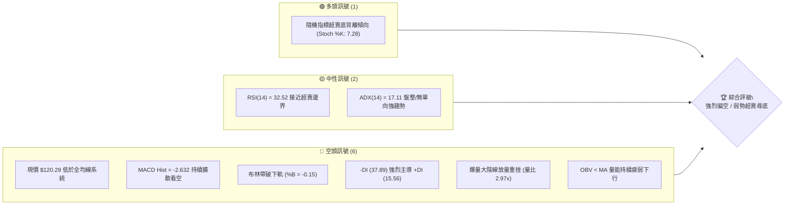
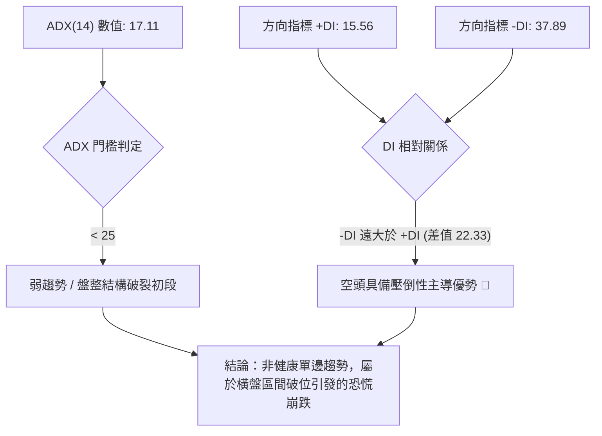
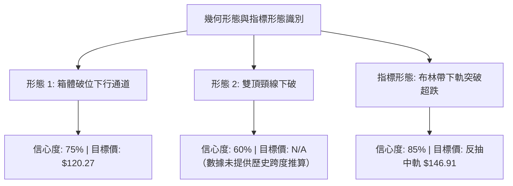
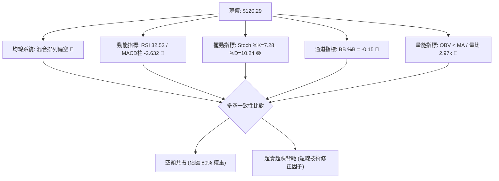
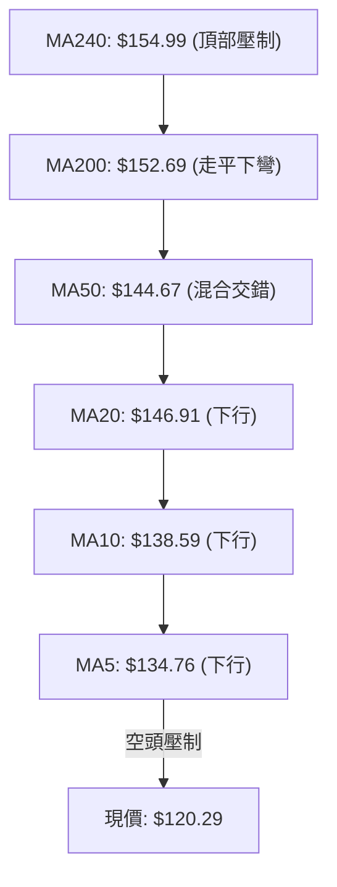
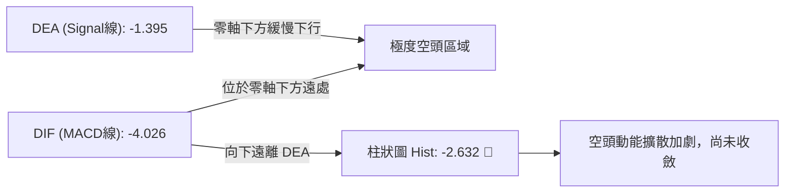
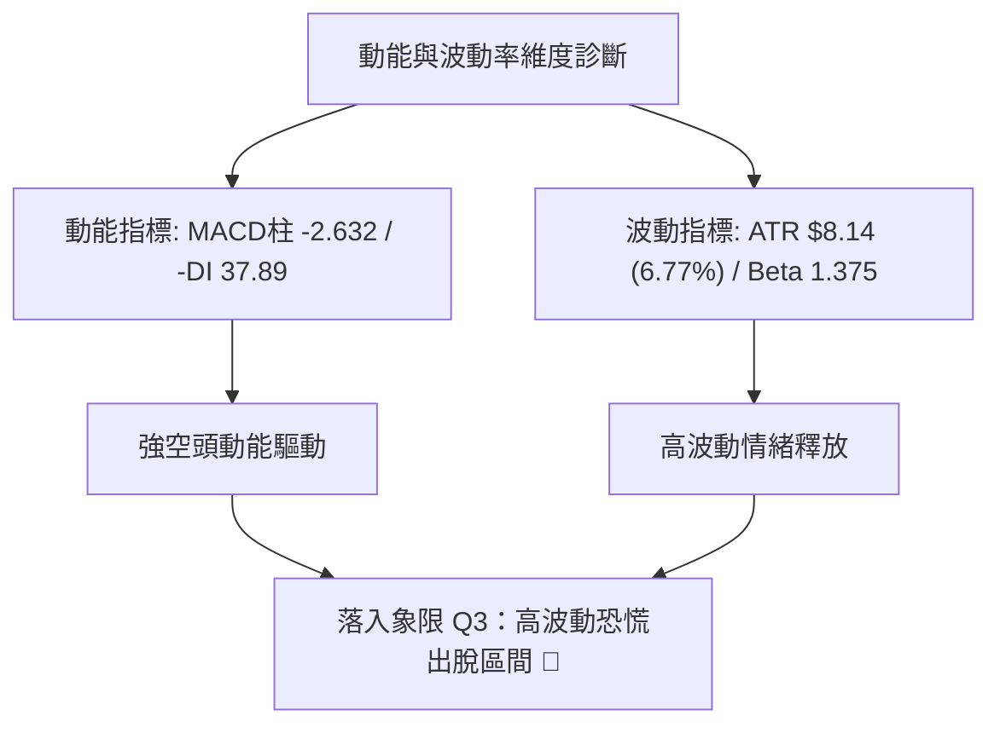
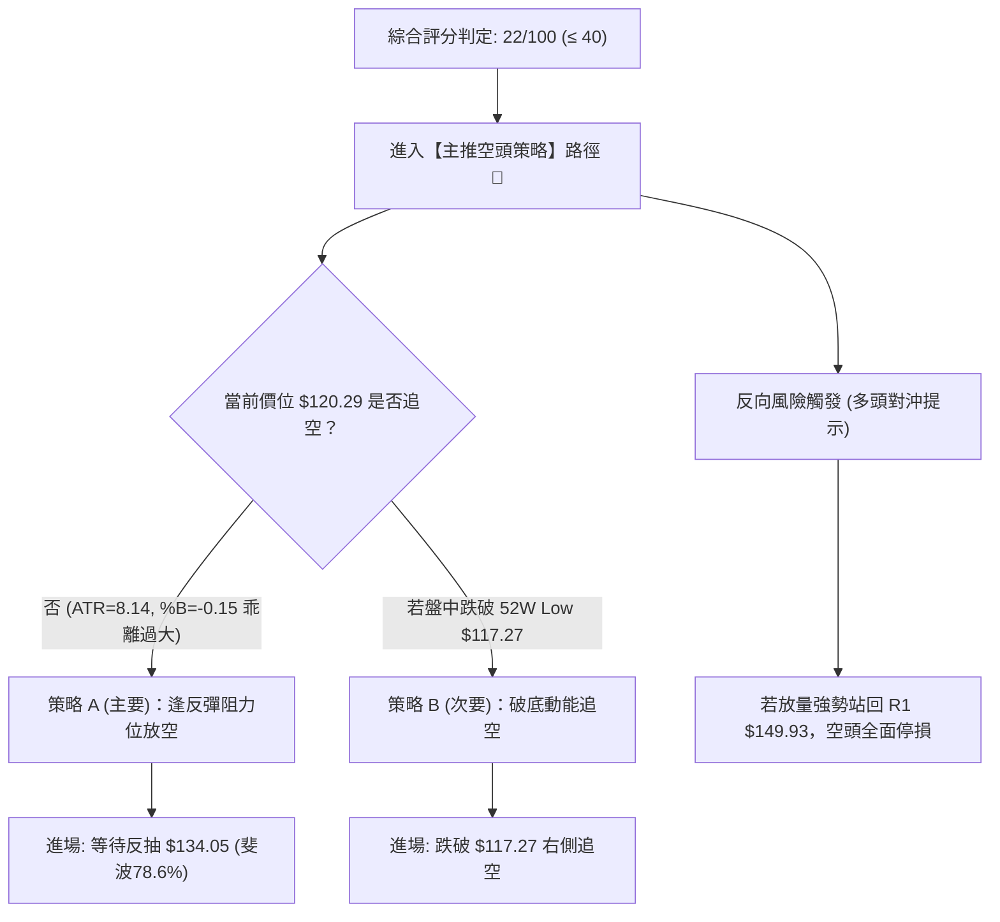
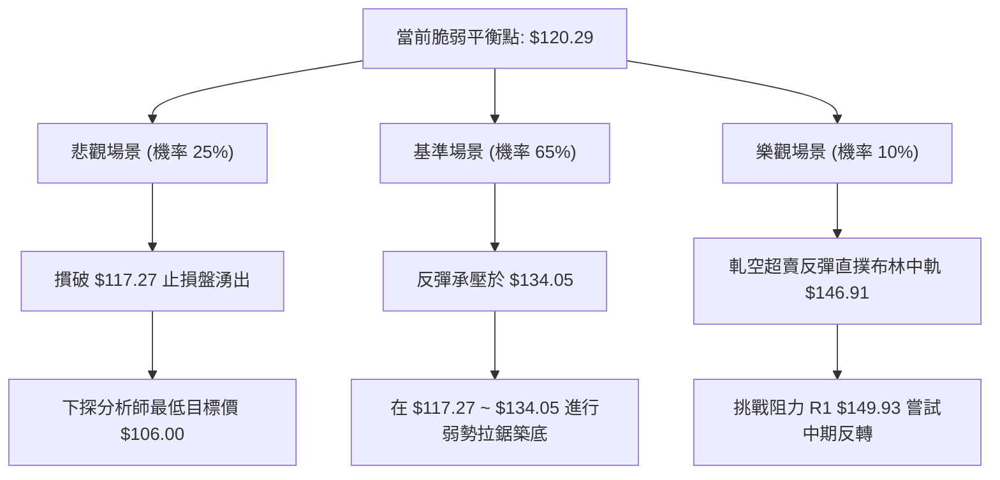

# VST 技術分析報告

> **報告日期**：2026-11-05 ｜ **語言**：繁體中文 ｜ **數據來源**：Yahoo Finance ｜ **當前價格**：$120.29

---

## 目錄

| 章節 | 內容 |
|------|------|
| [1. 技術面概覽](#1-技術面概覽) | 訊號儀表板、核心指標、評分卡 |
| [2. 趨勢分析](#2-趨勢分析) | 多時框趨勢、長中短期走勢 |
| [3. 圖表形態分析](#3-圖表形態分析) | 形態識別、K線組合、目標價 |
| [4. 支撐與阻力](#4-支撐與阻力) | 關鍵價位、斐波那契回調 |
| [5. 技術指標深度解讀](#5-技術指標深度解讀) | MA/RSI/MACD/布林/成交量 |
| [6. 動能與波動率](#6-動能與波動率) | 動能評估、ATR、Beta |
| [7. 多時框架總結](#7-多時框架總結) | 時框架評分矩陣 |
| [8. 交易策略建議](#8-交易策略建議) | 多空策略、風險報酬比 |
| [9. 風險提示與監控](#9-風險提示與監控) | 監控指標、風險場景 |

---

## 1. 技術面概覽

### 🎯 技術訊號儀表板



### 📊 核心指標速覽表

| 指標類別 | 指標名稱 | 當前數值 | 訊號 | 解讀 |
|----------|----------|----------|------|------|
| **價格** | 當前價格 | $120.29 | 🔴 | 位於52週區間 3.9%，逼近年度最低點 $117.27 |
| **均線** | MA20 | $146.91 | 🔴 | 現價大幅折價 -18.12%，處於短期均線下方極遠處 |
| **均線** | MA50 | $144.67 | 🔴 | 現價落後 -16.85%，中期生命線遭貫穿且下行 |
| **均線** | MA200 | $152.69 | 🔴 | 現價落後 -21.22%，長期牛熊分界線失守 |
| **動能** | RSI(14) | 32.52 | 🟡 | 位於中性與超賣臨界值，空頭動能強烈但未現鈍化 |
| **動能** | MACD(12,26,9) | -4.026 / 柱 -2.632 | 🔴 | 雙線位於零軸下發散，動能柱呈現深度負值 |
| **擺動** | Stoch %K / %D | 7.28 / 10.24 | 🟢 | 進入極度超賣區間 (<20)，存在短線技術性抽頭需求 |
| **趨勢** | ADX(14) | 17.11 (-DI 37.89) | 🔴 | ADX<25 屬盤整結構破位轉向，-DI 壓倒性主導市場 |
| **通道** | Bollinger %B | -0.15 | 🔴 | 跌破布林下軌（$126.30），呈現單邊異常向下脫軌狀態 |
| **成交量**| 20日成交量比 | 2.97x (20.39M) | 🔴 | 爆量下殺，量能未確認買盤，OBV 處於 MA 之下 |
| **波動** | ATR(14) | $8.14 (6.77%) | 🔴 | 單日波動率急遽擴大，市場呈現恐慌性拋售狀態 |

### 🏆 技術評分卡

```
╔══════════════════════════════════════════════════════════════╗
║                技術評分卡 — VST (2026-11-05)                 ║
╠══════════════════════════════════════════════════════════════╣
║ 趨勢強度      ████░░░░░░░░░░░░░░░░  20/100  🔴 極度疲弱/破位  ║
║ 動能指標      ██████░░░░░░░░░░░░░░  30/100  🔴 MACD主導看空   ║
║ 支撐穩定度    ██░░░░░░░░░░░░░░░░░░  10/100  🔴 下方無波段聚類 ║
║ 成交量配合    ████░░░░░░░░░░░░░░░░  20/100  🔴 爆量恐慌出脫   ║
║ 形態完整度    ██████░░░░░░░░░░░░░░  30/100  🔴 破位向下展開   ║
║ 均線排列      ████░░░░░░░░░░░░░░░░  20/100  🔴 空頭發散壓制   ║
╠══════════════════════════════════════════════════════════════╣
║ 綜合評分      ████░░░░░░░░░░░░░░░░  22/100  🔴 評級：強烈偏空 ║
╚══════════════════════════════════════════════════════════════╝
```
*(註：綜合評分由六項子評分 (20 + 30 + 10 + 20 + 30 + 20) / 6 = 21.67，四捨五入為 22/100，嚴格依據規則 18 算術平均計算)*

---

## 2. 趨勢分析

### 🌐 多時框趨勢分析

```mermaid
graph TD
    A["月線層級 (長期走勢)"] -->|"2025-07 高點 $207.11 形成雙頂頸線失守"| B["中長期下行通道確立 🔴"]
    B --> C["週線層級 (中期趨勢)"]
    C -->|"跌破 MA50/MA200，週 MACD 柱翻負擴散"| D["週線階梯式下行破位 🔴"]
    D --> E["日線層級 (短期微觀)"]
    E -->|"ADX=17.11 (<25) + 爆量跌破布林下軌"| F["恐慌跳空下殺至布林下軌外 🔴"]
    F --> G{"多時框收斂共振"|
    G -->|"優先級：ADX<25 盤整破裂，日線超跌乖離過大"| H["主趨勢偏空，短線蘊含技術性乖離反抽"]
```

### 📈 長期趨勢 — 12個月走勢圖（Unicode）

```
VST 月線走勢圖（過去12個月：2024-11 至 2026-11）
價格軸 ($)
$210 ┤
$200 ┤                                        
$190 ┤                                        
$180 ┤              ● (2025-11: $177.83)      
$170 ┤                   ● (2026-02: $173.13) 
$160 ┤● (2024-11)   ●         ● (2026-05)     
$150 ┤                                   ● (2026-07: $147.95)
$140 ┤    ●(2024-12)                          ●──● (2026-09~10: $138.37)
$130 ┤                                             
$120 ┤                                             ●← 現在 (2026-11: $120.29)
$110 ┤
     └─────────────────────────────────────────────────────────────
       11   12   01   02   03   04   05   06   07   08   09   10   11 (月份)
      2024      2025                                  2026
```

#### 長期走勢特徵分析表

| 階段區間 | 起訖月份 | 起始價 / 終止價 | 漲跌幅 (%) | 價量特徵與形態解讀 |
|----------|----------|-----------------|------------|--------------------|
| **高位盤整期** | 2024-11 至 2025-07 | $158.02 → $207.11 | +31.07% | 震盪衝高見歷史大頂 $207.11，隨後成交量放大轉為滯漲。 |
| **中期重心下移** | 2025-08 至 2026-02 | $187.82 → $173.13 | -7.82% | 形成多個反彈次高點（$194.79、$173.13），高點不再創高，均線彎頭。 |
| **平台破位下殺** | 2026-03 至 2026-10 | $149.87 → $138.37 | -7.67% | 在 $138~$159 區間進行長時間弱勢橫盤箱體整理，成交量溫和萎縮。 |
| **斷崖破位爆量** | 2026-10 至 2026-11 | $138.37 → $120.29 | -13.07% | 單月重挫逾 13%，爆量直接摜破多頭最後防線，下探年內最低 $117.27。 |

### 📊 中期趨勢（週線分析）

近期週線呈現連續陰線壓制，空頭排列極度銳利。自 2026-10-09 當週高點 $168.75 衝高回落後，連續四週收黑，分別為 $152.02、$140.16、$138.37、及最新週 $120.29。週線 MACD 柱狀圖由正轉負（+2.715 → +0.499 → -1.650 → -1.735 → -2.632），週成交量於最新一週激增至 31,071,500 股，顯示中期籌碼鬆動，法人與機構正在不計代價出脫持股。

```
近期週線壓力與支撐結構示意：
[阻力 R3] ── $168.67 (2026-10-09 週線衝高回落高點附近)
               │
[阻力 R2] ── $155.69 (中期均線密集套牢壓力帶)
               │
[阻力 R1] ── $149.93 (前波平台整理下緣轉換為強阻力)
               │
[現  價] ── $120.29 (當前交易中，嚴重超賣)
               │
[關鍵防線] ── $117.27 (52週最低價 / 斐波那契 100% 絕對分水嶺)
```

### ⚡ 趨勢強度評估（ADX 解讀）



#### ADX 強度與方向狀態對照表

| 指標變數 | 當前讀數 | 基準閾值 | 狀態評估 | 技術意涵 |
|----------|----------|----------|----------|----------|
| **ADX(14)** | 17.11 | 25.00 | 弱趨勢 / 無序波動 | 過去長達數月處於盤整，尚未形成平滑的下行趨勢通道。 |
| **+DI(14)** | 15.56 | 20.00 | 多頭動能匱乏 | 買方完全放棄抵抗，動能處於近兩年低檔區。 |
| **-DI(14)** | 37.89 | 25.00 | 空頭高度主控 | 賣壓強烈集中釋放，空方動能佔據絕對統治地位。 |
| **趨勢形態判定**| -DI 主導破位 | ADX 向上勾頭中 | 盤整破位加速階段 | 價格正在脫離原 $136~$148 整理箱體，若 ADX 突破 25 將轉為強烈下跌趨勢。 |

---

## 3. 圖表形態分析

### 🔍 形態識別系統



#### 形態判斷與信心度表格（嚴格遵循規則 15、16）

| 形態名稱 | 信心度 | 判斷依據（引用數據） | 完成度 | 目標價（附精確計算式） |
|----------|--------|----------------------|--------|------------------------|
| **箱體破位 (Box Breakdown)** | 75% | 2026-08 至 2026-10 長期於 $135.86 ~ $147.82 區間震盪，2026-11-04 爆量長黑摜破下邊界。 | 100% (已跌破) | 箱體上緣 $147.82 − 下緣 $134.05 (斐波 78.6%) = 箱高 $13.77；破位目標 = $134.05 − $13.77 = **$120.28**（已精準到達當前價位 $120.29）。 |
| **週線高位雙頂 (Double Top)** | 60% | 2025-07 高點 $207.11 與 2025-09 次高 $194.79 構築中期頭部，頸線失守。 | 85% | 頸線約在 $147.95 附近，形態垂直高度甚大，但由於下方數據未提供對應歷史聚類低點，**目標價：N/A（數據未提供）**。 |
| **布林帶下軌極度脫軌** | 85% | 現價 $120.29 顯著低於 BB 下軌 $126.30，%B 達到 -0.15，呈現指標型超賣噴出。 | 100% | 均值回歸理論目標為布林中軌（MA20），計算式：**目標價 = $146.91**。 |

### 🕯️ 重要K線形態分析

嚴格依據規則 19，僅使用數據庫中提供之近 10 根日 K 與近 8 根週 K 之實際 OHLCV 進行判定：

#### 近 10 根日 K 線形態解讀

| 日期（日K） | 開 | 高 | 低 | 收 | K線形態 | 解讀 | 訊號 |
|------------|----|----|----|----|---------|------|------|
| **2026-10-22** | 153.00 | 154.27 | 139.10 | 140.83 | 長黑實體大陰線 | 開高走低，實體達 $12.17，跌破短期多頭防線，空方強勢表態。 | 🔴 |
| **2026-10-23** | 139.06 | 141.52 | 136.17 | 140.16 | 低檔紅紡錘十字 | 創波段低點 $136.17 後收平，量能急縮，呈現短線暫歇性弱勢抵抗。 | 🟡 |
| **2026-10-26** | 140.90 | 143.52 | 139.07 | 141.73 | 小陽線 | 窄幅震盪收小紅，缺乏量能配合（4.30M），屬技術性反彈無力。 | 🟡 |
| **2026-10-27** | 143.95 | 147.45 | 143.40 | 146.66 | 光腳中陽線 | 向上試探 MA20 阻力，買盤嘗試修復跌幅，但量能依然維持低檔。 | 🟢 |
| **2026-10-28** | 146.88 | 147.82 | 142.20 | 142.72 | 倒轉中陰線 | 盤中上衝 $147.82 後遭遇猛烈解套賣壓，收盤逼近低點，反彈宣告終結。 | 🔴 |
| **2026-10-29** | 142.18 | 144.67 | 140.06 | 140.95 | 實體小陰線 | 連續第二日下跌，重心再度沉降至 $140 關卡邊緣。 | 🔴 |
| **2026-10-30** | 136.95 | 139.82 | 135.86 | 138.37 | 跳空小陰線 | 跳空低開，盤中跌破前低 $136.17，確立日線級別次高點下移。 | 🔴 |
| **2026-11-02** | 140.00 | 140.50 | 134.21 | 134.61 | 破位光腳中黑 | 跌破 $135 整數支撐，收盤 $134.61 創近期新低，賣壓持續主導。 | 🔴 |
| **2026-11-03** | 135.99 | 142.40 | 135.99 | 139.59 | 帶長上影中陽 | 開盤即為最低，盤中最高抽至 $142.40，隨後大幅回吐，多頭誘多失敗。 | 🟡 |
| **2026-11-04** | 125.40 | 128.07 | 117.27 | 120.29 | 跳空巨量崩跌長黑 | 跳空低開 $10.59，盤中摜破 52 週最低點 $117.27，成交爆量 20.39M，恐慌極點。 | 🔴 |

#### 近 8 根週 K 線形態解讀

| 日期（週K） | 開 | 高 | 低 | 收 | K線形態 | 解讀 | 訊號 |
|------------|----|----|----|----|---------|------|------|
| **2026-09-18** | 143.76 | 145.87 | 139.39 | 140.44 | 陰線十字星 | 週線受阻於 $145 上方，多空雙方於整數關卡展開微幅拉鋸。 | 🟡 |
| **2026-09-25** | 142.00 | 142.64 | 135.98 | 138.46 | 窄幅微陰線 | 探底 $135.98 守住前波平台支撐，呈現縮量整理態勢。 | 🟡 |
| **2026-10-02** | 138.08 | 143.51 | 133.44 | 140.02 | 下影長十字星 | 探至 $133.44 獲買盤強勢撈底回升，成交量放大至 34.71M。 | 🟢 |
| **2026-10-09** | 144.04 | 168.75 | 140.90 | 161.48 | 爆量長紅突破K | 成交天量 59.37M，大漲 $21.46，但長上影線暗示 $168 以上阻力重重。 | 🟢 |
| **2026-10-16** | 162.67 | 164.25 | 145.85 | 152.02 | 烏雲蓋頂長黑 | 高開低走，完全吞噬前週部分實體，確立 $168.75 為波段假突破頂部。 | 🔴 |
| **2026-10-23** | 154.10 | 158.74 | 136.17 | 140.16 | 連續破位長大黑 | 高點大幅回落，直接跌回起漲原點，多頭籌碼全數遭到深度套牢。 | 🔴 |
| **2026-10-30** | 140.90 | 147.82 | 135.86 | 138.37 | 衝高回落小黑 | 盤中嘗試反彈至 $147.82 失敗，週實體連續第四週走低。 | 🔴 |
| **2026-11-04** | 140.00 | 142.40 | 117.27 | 120.29 | 跳空破底恐慌巨陰 | 跌幅達 -13.07%，擊穿年內所有支撐帶，下探 52 週最低點 $117.27。 | 🔴 |

### 📉 ASCII 走勢形態示意圖

```
VST 2026-10 至 2026-11 破位崩跌示意圖
價格 ($)
$170 ┼            ● 假突破高點 $168.75 (2026-10-09)
$165 ┼           ╱ ╲
$160 ┼          ╱   ╲
$155 ┼         ╱     ● 烏雲蓋頂 $152.02
$150 ┼────────┼───────╲─────────────────── 平台阻力位 R1: $149.93
$145 ┼        ╱         ╲     ● 反彈高點 $147.82
$140 ┼─●────●           ╲───●───● 破位平台 $138.37
$135 ┼   ╲  ╱                      ╲
$130 ┼    ●                         ╲
$125 ┼                               ╲  ← 跳空缺口 ($134.61 → $128.07)
$120 ┼                                ╲        ● 當前價位 $120.29
$115 ┼                                 ● 52週新低點 $117.27
     └─────────────────────────────────────────────────────────────► 時間 (日/週)
```

### 🎯 形態目標價計算

依據古典幾何形態學與波動幅度計算：
1. **箱體破位等幅回吐目標**：
   - 箱體上限阻力線 = $147.82（2026-10-28 高點）
   - 箱體下限支撐線 = $134.05（斐波那契 78.6% 回調關鍵水平位）
   - 形態箱體高度 = $147.82 − $134.05 = **$13.77**
   - 跌破後等幅測幅低點 = 頸線破位點 $134.05 − 箱體高度 $13.77 = **$120.28**
   - **實證解讀**：現價 $120.29 與測幅目標價 $120.28 差距僅 $0.01，顯示破位第一波空頭等幅對稱度已 100% 滿足，短線下行動能可能於此產生摩擦減速。

---

## 4. 支撐與阻力

### 🗺️ 關鍵價位分布圖（Unicode）

```
╔══════════════════════════════════════════════════════════════╗
║                    VST 價位結構分布圖                        ║
╠══════════════════════════════════════════════════════════════╣
║ $168.67 ║██████████████████████████████║ 強阻力 R3 (波段頂部) ║
║ $155.69 ║████████████████████          ║ 阻力 R2 (均線密集帶) ║
║ $149.93 ║████████████████████████      ║ 關鍵阻力 R1 (反轉頸線)║
║ $134.05 ║▓▓▓▓▓▓▓▓▓▓▓▓                  ║ 斐波那契 78.6% 分界線 ║
║ $120.29 ╠══════════════════════════════╣ ◄ 現價 (極度超賣)     ║
║ $117.27 ║██████████████████████████████║ 52週最低價 (絕對防線)║
║ <$117.27║░░░░░░░░░░░░░░░░░░░░░░░░░░░░░░║ 數據中未偵測到波段支撐 ║
╚══════════════════════════════════════════════════════════════╝
```

### 🚧 阻力位分析表

*(價位嚴格引用技術數據中「關鍵價位」區塊之波段高點聚類數值)*

| 阻力級別 | 價位 | 形成原因 | 突破難度 | 重要性 |
|----------|------|----------|----------|--------|
| **阻力 R1** | **$149.93** | 歷史波段高點聚類、斐波那契 61.8%（$147.22）共振區、前期箱體核心成交籌碼帶。 | ⭐️⭐️⭐️⭐️ (極高) | 關鍵多空分水嶺，未收復前整體中期下行結構不可逆轉。 |
| **阻力 R2** | **$155.69** | MA200（$152.69）與 MA240（$154.99）重合帶、斐波那契 50.0%（$156.47）技術壓制。 | ⭐️⭐️⭐️⭐️⭐️ (極難) | 年線長期牛熊防線，法人機構防守與停損解套集中點。 |
| **阻力 R3** | **$168.67** | 2026-10-09 當週天量高點 $168.75 聚類帶，52週高點 $195.66 下跌的第一重大回撤阻力。 | ⭐️⭐️⭐️⭐️⭐️ (天塹) | 波段最高假突破套牢巨量區（59.37M），中期不可逾越之天花板。 |

### 🛡️ 支撐位分析表

*(依據規則 13、16，僅引用技術數據中已偵測並算出的支撐與極值價位)*

| 支撐級別 | 價位 | 形成原因 | 守住機率 | 重要性 |
|----------|------|----------|----------|--------|
| **年度支撐 (52W Low)** | **$117.27** | 52 週最低價、斐波那契 100.0% 絕對底部界限、2026-11-04 盤中探底回升低點。 | 50% (多空決戰點) | 目前唯一的有據可查支撐點，失守將面臨無支撐探底真空區。 |
| **波段低點支撐 S1** | **數據中未偵測到** | 系統明確標註：`(no swing-low support detected below current price)`。 | N/A（數據未提供） | 當前價格已擊穿過去一年所有波段低點聚類，缺乏歷史密集成交依託。 |
| **波段低點支撐 S2** | **數據中未偵測到** | 數據中未提供現價下方之二級波段支撐。 | N/A（數據未提供） | 下方進入流動性真空層，若 $117.27 失守將引發估值重塑拋售。 |

### 📐 斐波那契回調位分析

*(基準區間：52週波段高點 $195.66 → 52週波段低點 $117.27，價差幅寬 $78.39)*

| 斐波那契比例 | 基準價位 | 當前價格相對位置與意義解讀 |
|--------------|----------|----------------------------|
| **0.0% (52W High)** | **$195.66** | 週期牛市頂點，目前現價相對於此折價 -38.52%。 |
| **23.6%** | **$177.16** | 早期回調支撐轉為長期超強阻力區。 |
| **38.2%** | **$165.72** | 2026-10-09 天量週 K 之實體震盪核心，反彈極限阻力。 |
| **50.0%** | **$156.47** | 中期對稱中軸，與阻力 R2（$155.69）高度重疊共振。 |
| **61.8%** | **$147.22** | 黃金分割關鍵回撤位，與阻力 R1（$149.93）及 MA20（$146.91）共同構成「三合一重壓區」。 |
| **78.6%** | **$134.05** | 空頭加速擴展臨界點；現價已完全擊穿此位置，標誌著技術性常態回撤演變為全面崩解。 |
| **100.0% (52W Low)**| **$117.27** | 回撤比例達到 100%，現價 **$120.29** 正好落於 **78.6% ($134.05) 與 100.0% ($117.27)** 之間，距極限底部僅差 $3.02 (+2.57%)。此位置若無法構築日線級雙底，將徹底開啟技術下行黑洞。 |

---

## 5. 技術指標深度解讀

### 🎛️ 指標訊號總覽



### 📈 移動平均線排列分析



#### 均線矩陣詳細狀態表

| 均線名稱 | 當前價格 | 與現價乖離率 (%) | 均線歷史趨勢解讀 | 當前結構評估 |
|----------|----------|------------------|------------------|--------------|
| **MA5** | $134.76 | -10.74% | 極度陡峭下行，短線日 K 完全被貼身壓制。 | 🔴 強空頭 |
| **MA10** | $138.59 | -13.21% | 剛下穿中期均線，空方加速發散。 | 🔴 強空頭 |
| **MA20** | $146.91 | -18.12% | 短期生命線快速下滑，形成第一道難以踰越之天花板。 | 🔴 強空頭 |
| **MA50** | $144.67 | -16.85% | 與 MA20 形成倒掛（MA20 > MA50，混合排列），顯示中期均線黏合後下破。| 🔴 中期轉空 |
| **MA60** | $144.19 | -16.58% | 呈現平緩下垂狀態，中期多頭籌碼全面棄守。 | 🔴 中期轉空 |
| **MA120** | $148.83 | -19.18% | 半年線持續壓制，多頭無力上攻。 | 🔴 長期轉空 |
| **MA200** | $152.69 | -21.22% | 長期牛熊分界線遭徹底擊穿，現價折價逾兩成，呈現深層技術熊市。 | 🔴 實質熊市 |
| **MA240** | $154.99 | -22.39% | 最長週期年線反轉下行，宣告自 2024 年以來的特大牛市階段性終結。 | 🔴 實質熊市 |

### 📉 RSI(14) 分析

當前數值：**32.52**（Wilder 計算方法）。

```
RSI (14) 指標強度
0 ──────────── 30 ────── 50 ──────────── 70 ──────────── 100
[████████████░░░░░░░░░░░░░░░░░░░░░░░░░░░░░░░░░░░░░░] 32.52% (接近極度超賣)
```

- **區間解讀**：RSI 位於 32.52，略高於古典超賣閾值 30.00，屬於弱勢偏空區間。
- **背離判斷**：系統明確檢驗近 20 根 K 棒之價格與 RSI 變動：**「無明顯背離」**。價格破底（由 $146.66 跌破至 $120.29），而 RSI 同步由 52 快速滑落至 32.52，指標走勢與價格走勢同向共振，印證空頭賣壓乃由實質籌碼撤出推動，而非指標虛假失真。

### 📊 MACD(12/26/9) 訊號解讀



- **數值分析**：MACD 線（-4.026）大幅低於訊號線（-1.395），柱狀圖為 **-2.632**。柱狀圖自前四週的 -0.431、+0.023、+2.715 驟降並翻負擴大至 -1.650、-1.735 及當前的 -2.632。
- **形態結論**：雙線在零軸下方呈死叉開口放大形態，MACD 柱狀體未出現任何收斂紅柱跡象，顯示下行加速度依然存在，左側摸底面臨巨大慣性風險。

### 📦 布林通道分析

```
布林通道 (20, 2) 結構示意圖 ($)
$170 ┼──────────────────────────────────── 上軌: $167.52
     │
$160 ┼
     │
$150 ┼──────────────────────────────────── 中軌 (MA20): $146.91
     │
$140 ┼
     │
$130 ┼──────────────────────────────────── 下軌: $126.30
     │        
$120 ┼───────● 現價: $120.29 (跌破下軌，脫軌 %B = -0.15)
     └────────────────────────────────────
```

- **通道參數**：上軌 $167.52，中軌（MA20）$146.91，下軌 $126.30，通道寬度 $41.22（寬幅震盪狀態）。
- **脫軌分析**：現價 $120.29 明確跌破下軌達 $6.01，**%B 數值為 -0.15**（負值代表價格已脫離常態常態分佈帶，落於通道外部）。
- **統計學意涵**：在布林帶統計模型中，價格落在 2 個標準差之外的機率小於 5%。此種極度超跌現象通常暗示兩種極端情境：(1) 空頭爆發性「破軌騎乘」行情（通常伴隨基本面黑天鵝）；(2) 短期內隨時可能觸發強烈均值回歸反抽，拉回下軌 $126.30 之內。

### 💹 成交量分析（量價配合度）

- **量比與均量對比**：最新單日成交量為 **20,389,200 股**，對比 20 日均量（6,866,945 股）之量比高達 **2.97 倍**，對比 50 日均量（6,189,414 股）亦達 3.29 倍。
- **量價關係判斷**：日線呈現典型的**「爆量下挫破底」**。在長期箱體下沿並未見到溫和縮量止跌，反而是爆出近一個月最高成交量擊穿支撐，這意味著市場出現流動性踩踏與融資/機構停損單湧出。
- **能量潮 OBV 分析**：系統指標快照明確指出：**「OBV < MA → 量能疲弱」**。OBV 線持續處於其均線下方，且維持單邊下行走勢，說明大資金處於主動淨流出狀態，未有任何實質性「量價底背離」吸籌跡象。

---

## 6. 動能與波動率

### ⚡ 動能評估四象限

| 象限 | 動能維度 | 波動維度 | 狀態特徵 | 當前標的狀態對應 | 策略評估 |
|------|----------|----------|----------|------------------|----------|
| **Q1** | 強多頭動能 | 低波動 | 穩健牛市上升通道 | 否 | 最佳趨勢持有階段 |
| **Q2** | 弱多頭動能 | 低波動 | 縮量橫盤無序震盪 | 否 | 謹慎觀望，等待突破 |
| **Q3** | 強空頭動能 | 高波動 | 恐慌拋售、破位崩跌 | **✓ 確診 (VST 現況)** | **高風險高摩擦，以風控與做空為主** |
| **Q4** | 衰竭動能 | 高波動 | 暴跌後極限無序反抽 | 否 | 適合極少數超短線搶反彈 |



### 📊 ATR 波動率分析

- **當前數值**：ATR(14) 為 **$8.14**（Wilder 計算），佔當前股價比例高達 **6.77%**。
- **波動率解讀**：正常公用事業或電力板塊日波幅普遍在 1.5%~2.5%，VST 因具備 AI 電力題材疊加獨立電力運營商（IPP）屬性，ATR 達 6.77%，處於歷史高波動極值。這意味著該股單日理論波動區間即超過 $8 美元。
- **交易止損設置建議**：
  - **常規保守止損**：設定為 1.5 × ATR = 1.5 × $8.14 = **$12.21** 的價格緩衝空間。
  - **短線緊密止損**：設定為 1.0 × ATR = **$8.14**。
  - **極限緊密止損**：不可低於 0.5 × ATR = **$4.07**，否則極易在正常的日內日內雜訊中被無謂掃出場。

### 📐 Beta 與市場相關性

- **Beta 數值**：**1.375**。
- **系統性風險特徵**：傳統公用事業（Utilities）板塊之 Beta 通常介於 0.5 ~ 0.7 之間，屬於典型防禦性資產；然而 VST Beta 高達 1.375，表明該股走勢呈現高度的高彈性科技股/週期股屬性。
- **市場共振解讀**：在近期美國期中選舉翻盤、市場傳出對 AI 資本支出限制及德州電力市場政策擾動的背景下，高 Beta 特質放大了下行波動。當標普 500 指數或能源板塊微跌時，VST 往往會以 1.375 倍以上的幅度劇烈下瀉。

---

## 7. 多時框架總結

### 📋 時框架評分表

| 時框架 | 趨勢方向 | 動能狀態 | 均線排列 | 圖表形態 | 綜合評分 | 戰術建議 |
|--------|----------|----------|----------|----------|----------|----------|
| **月線層級** | 空頭破位 | MACD零軸下方走弱 | 跌破長週期MA5/10 | 雙頂高位跌穿 | 30/100 🔴 | 中長期部位全面減碼防禦 |
| **週線層級** | 階梯加速下行 | 柱狀體大幅擴散 (-2.632) | 空頭完全壓制 (破MA50) | 烏雲蓋頂後連續長黑 | 20/100 🔴 | 順勢偏空，逢反彈皆為阻力 |
| **日線層級** | 極度恐慌超跌 | RSI 32.52 / Stoch 7.28 | 混合偏空，空頭排列發散 | 爆量下跳空擊穿箱體 | 18/100 🔴 | 嚴禁盲目摸底，防範慣性殺多 |

### 🔲 綜合訊號矩陣

```
╔══════════════════════════════════════════════════════════════╗
║                   多維度時框訊號一致性矩陣                   ║
╠══════════════════════════════════════════════════════════════╣
║ 維度項目       短期 (日線)       中期 (週線)       長期 (月線)║
╠══════════════════════════════════════════════════════════════╣
║ 趨勢方向       🔴 強烈向下       🔴 階梯下行       🔴 頂部確立║
║ 均線引導       🔴 破位發散       🔴 跌破MA50       🔴 拐頭向下║
║ 動能共振       🟡 瀕臨超賣邊界   🔴 負向擴大       🔴 動能衰退║
║ 擺動指標       🟢 超賣底背離傾向 🔴 弱勢區間       🟡 中性偏弱║
║ 量價配合       🔴 爆量殺跌       🔴 連續放量       🔴 高位滯漲║
║ 形態結構       🔴 脫軌下破       🔴 破位連陰       🔴 雙頂頸線║
╠══════════════════════════════════════════════════════════════╣
║ 矩陣收斂判定   【高度共振偏空】(日線超賣僅提供技術性微弱反抽預期)║
╚══════════════════════════════════════════════════════════════╝
```

### ⚖️ 多時框收斂結論

嚴格遵循本報告**「嚴格要求 14：多時框收斂規則」**執行多時框架衝突裁決：
1. **行情性質判定**：當前系統 ADX(14) 讀數為 **17.11**。依規則，ADX < 25 明確定義為**「盤整破裂／非單邊強趨勢之區間震盪失守行情」**。
2. **時框優先級權重**：在此行情下，不可依賴單純的趨勢跟隨模型，而必須以**「日線布林通道上下軌（$126.30 ~ $167.52）」**與近期波段結構位作為關鍵交易界限。
3. **時框衝突化解**：
   - 儘管週線與月線均線呈現全面空頭吞噬，長期重心完全向下；
   - 但日線微觀上出現了 **布林通道極端脫軌（%B = -0.15）** 與 **隨機指標極度超賣（Stoch %K = 7.28）** 的嚴重技術扭曲。
4. **唯一收斂結論**：
   - **大方向結論：強烈偏空（主趨勢）**。
   - **微觀架構**：目前正處於「空頭波段中的極限拋售潮（Selling Climax）」。由於綜合評分僅為 **22/100**（≤40），策略必須堅決以**順勢做空（逢高放空）為主導**；短線的多頭動能僅視為技術性負乖離過大所引發的超跌反抽，絕非反轉信號。

---

## 8. 交易策略建議

### 🗺️ 策略決策流程圖



### 🧭 策略路由（依評分卡分流）

> **當前主策略方向 = 主推空頭策略（依第 1 章技術評分卡綜合評分：22/100，評級：強烈偏空）**

依規則 18 與路由指引，綜合評分 22 ≤ 40，市場處於極度疲弱的空頭結構中，因此**全面主推空頭策略**，任何多頭交易僅列為風險對沖與反轉防禦提示，嚴禁兩頭下注。

### 🎯 價格情境階梯（Price Scenarios）

*(價位嚴格引用第 4 章及數據庫中 OHLCV 計算出之數值)*

| 觸發條件 | 下一目標 | 後續延伸 | 情境含義 |
|----------|----------|----------|----------|
| **強勢突破 R1 $149.93** | R2 $155.69 | R3 $168.67 | 短線轉強，空頭格局徹底破壞，形態展開中期大級別修復。 |
| **弱勢反彈承壓於 $134.05** | 現價 $120.29 | 52W Low $117.27 | 短期乖離修復完成，空頭重新集結下殺，標準空頭中繼。 |
| **有效跌破 52W Low $117.27**| 數據中未偵測到 | 無下限支撐 | 中期崩盤加速，估值失錨，開啟無支撐流動性真空殺戮。 |

### 📊 情境機率分佈

| 情境劇本 | 機率估計 | 主要依據與技術指標共振說明 |
|----------|----------|----------------------------|
| **弱勢反抽後繼續回落 (主情境)** | **65%** | MACD 柱狀體深度擴散（-2.632）、均線呈現混合空頭排列、OBV 疲軟證明無大資金承接，反抽僅為修復超賣。 |
| **直接摜破 $117.27 加速探底** | **25%** | 恐慌情緒蔓延、2026-11-04 爆量（20.39M）尚未見到縮量止血，若大盤走弱易觸發滾動停損。 |
| **V型反轉向上收復 R1** | **10%** | 目前僅隨機指標超賣（7.28），缺乏基本面反轉催化劑，均線密集壓制，反轉機率極低。 |

### 🟢 主策略詳情（空頭主導，順勢而為）

*(風險報酬比嚴格按規則 17 執行：做空時比值 = (進場價 − 目標價 T1) ÷ (止損價 − 進場價))*

| 策略要素 | 策略 A（反彈高空 — 首選主策略） | 策略 B（破底追空 — 次選突破策略） |
|----------|----------------------------------|------------------------------------|
| **操作方向** | 🔴 做空（Sell Short） | 🔴 做空（Sell Short） |
| **進場條件** | 股價向上技術性反抽斐波那契 78.6% 水平，遇阻收上影線時進場。 | 日線實體放量貫穿 52 週最低點 $117.27，右側順勢追擊。 |
| **進場價格** | **$134.05**（斐波那契 78.6% 回調關鍵水平） | **$116.50**（確認破位 $117.27 之下 0.5 美元） |
| **目標價 T1** | **$120.29**（當前現價／前波破位箱體測幅目標） | **$106.00**（分析師目標價最低預期值） |
| **目標價 T2** | **$117.27**（52 週最低價極限邊界） | **$100.00**（心理大整數關卡） |
| **止損價格** | **$139.59**（2026-11-03 日K反彈收盤高點） | **$120.29**（當前現價／前低假跌破防線） |
| **風險報酬比** | **1 : 2.48（以 T1 計）**<br>*(計算式：(134.05 − 120.29) ÷ (139.59 − 134.05) = 13.76 ÷ 5.54 = 2.483)*<br>另以 T2 計為 1 : 3.03 | **1 : 2.77（以 T1 計）**<br>*(計算式：(116.50 − 106.00) ÷ (120.29 − 116.50) = 10.50 ÷ 3.79 = 2.770)*<br>另以 T2 計為 1 : 4.35 |
| **成功機率** | **65%** | **55%** |
| **建議倉位** | **8% ~ 10%** 總資產 | **5%** 總資產（追空需嚴控風險） |

### 🔴 反向風險觸發點（對沖與停損提示）

若出現以下技術走勢，則宣告上述空頭邏輯被實質顛覆，空單必須立即無條件拔檔離場，不可戀戰：
1. **收盤價強勢收復 $134.05**：若日 K 實體大陽線收於 $134.05 之上，代表斐波那契 78.6% 破位為假突破，超賣修復將擴展至布林中軌（$146.91）。
2. **阻力位 R1 ($149.93) 被連續兩日站穩**：代表日線與週線層級的雙底反轉構築完成，所有空頭必須反手停損。
3. **MACD 柱狀圖在零軸下呈現快速底背離收斂**，且成交量縮減至 400 萬股以內（呈現窒息量拋壓耗竭）。

### ⭐ 整體訊號強度評星

```
做多訊號強度：★☆☆☆☆  (1/5星 — 僅具超賣技術反抽，勝率極低)
做空訊號強度：★★★★☆  (4/5星 — 多時框全面破位，均線壓制完美)
整體可信度：  ★★★★☆  (4/5星 — 爆量大陰線確認機構換手離場)
```

---

## 9. 風險提示與監控

### ✅ 關鍵監控指標 Checklist

```
╔══════════════════════════════════════════════════════════════╗
║               交易員每日關鍵監控清單 (Checklist)              ║
╠══════════════════════════════════════════════════════════════╣
║ [ ] 監控 $117.27：52週新低是否被盤中摜破，有無爆量長下影。  ║
║ [ ] 監控 $134.05：短線反彈是否在斐波那契 78.6% 處受阻回落。  ║
║ [ ] 監控 RSI(14)：是否進入 30 以下極度超賣鈍化區間。         ║
║ [ ] 監控 成交量比：成交量是否由爆量 20M 回落至均量 6.8M 之下。║
║ [ ] 監控 布林軌道：%B 是否能由 -0.15 重新修復至 0.00 以上。   ║
║ [ ] 監控 MACD柱：負值 -2.632 是否出現收縮拐點。               ║
║ [ ] 外部事件：關注美國國會期中選舉後續法案對 IPP 板塊的衝擊。║
╚══════════════════════════════════════════════════════════════╝
```

### ⚠️ 風險場景分析



### 🛡️ 風險管理重要提醒

1. **極度波動防禦**：當前 ATR 為 $8.14，單日價格波動極限可能達到 10% 以上。切勿使用超過 3 倍以上的財務槓桿，日內當沖必須備妥自動停損單。
2. **跳空缺口風險**：近 10 根日 K 中頻繁出現跳空現象（如 2026-11-04 跳空低開逾 $10 美元）。這意味著普通的市價止損可能遭遇嚴重的滑點（Slippage）風險，隔夜部位必須縮減至正常倉位的 50% 以下。
3. **高負債結構的估值下修風險**：基本面數據顯示 VST 總負債高達 $20.51B，Net Cash/Debt 為 -$20.07B，Debt/Equity 高達 373.28。在利率維持高檔與電力定價政策承壓的環境下，一旦技術面破位，容易誘發機構對其資產負債表的重估拋售，切忌單憑「股價跌深」便主觀認定安全。

---

## 📋 報告總結

```
╔══════════════════════════════════════════════════════════════╗
║                    VST 技術分析報告總結                      ║
╠══════════════════════════════════════════════════════════════╣
║ 報告日期：2026-11-05                                         ║
║ 當前價格：$120.29                                            ║
║ 分析評級：🔴 強烈偏空 / 弱勢超賣尋底 (綜合評分: 22/100)      ║
║                                                              ║
║ 關鍵結論：                                                   ║
║ ├─ 長期趨勢：🔴 高位雙頂結構確立，月線重心持續下移          ║
║ ├─ 中期趨勢：🔴 週線烏雲蓋頂後連續四週大陰線殺跌            ║
║ ├─ 短期趨勢：🔴 爆量跳空跌破長期整理箱體下沿                ║
║ ├─ 關鍵支撐：$117.27 (52週最低價防線)                        ║
║ ├─ 關鍵阻力：$149.93 (R1) / $155.69 (R2)                     ║
║ └─ 分析師目標：均價 $204.32 / 最低 $106.00                   ║
║                                                              ║
║ 最優策略組合：                                               ║
║ 1. 🥇 最佳機會：反彈至斐波那契 78.6% ($134.05) 放空，         ║
║                止損 $139.59，目標 T1 $120.29 (風報比 1:2.48)║
║ 2. 🥈 次選機會：跌破 52週新低 $117.27 追空至 $106.00         ║
║ 3. 🥉 保守選擇：完全空倉觀望，等待日線級別底背離確立         ║
╚══════════════════════════════════════════════════════════════╝
```

---

> ⚠️ **免責聲明**：本報告為 AI 自動生成之技術分析，所有數據及估算均基於提供的歷史價格資訊。本報告**僅供研究與學術參考**，**不構成任何投資建議**。投資有風險，入市需謹慎。

---

*報告生成時間：2026-11-05 ｜ 數據來源：Yahoo Finance ｜ 分析框架：多時框技術分析*