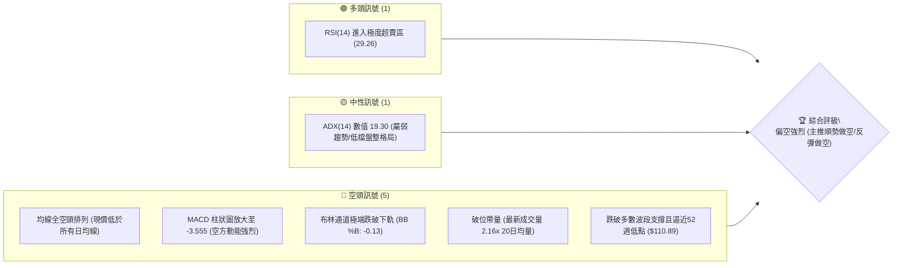
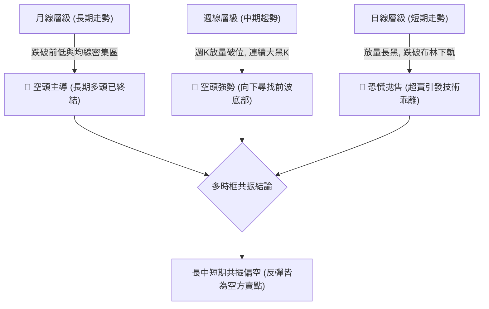
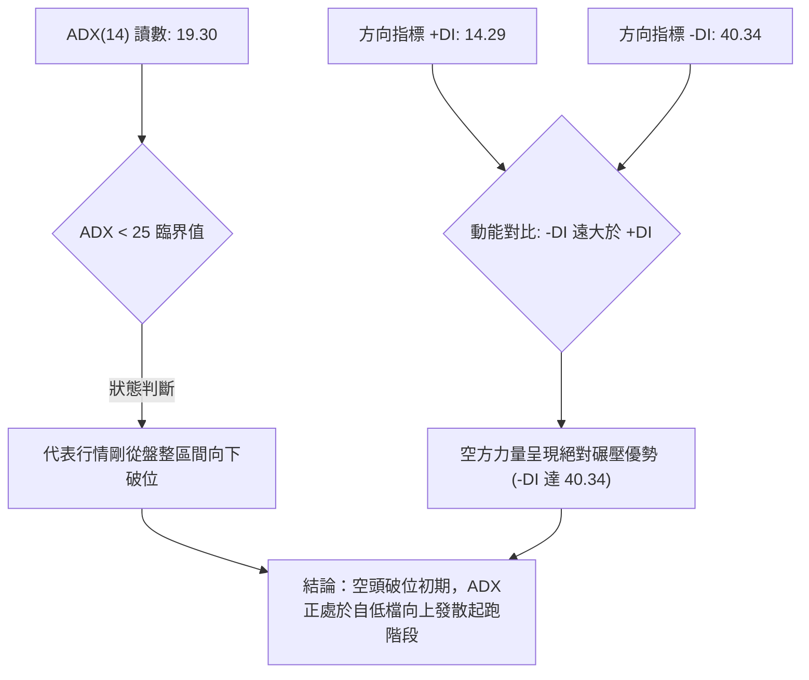
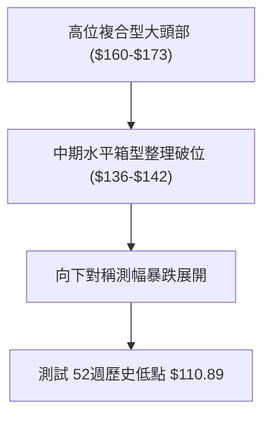
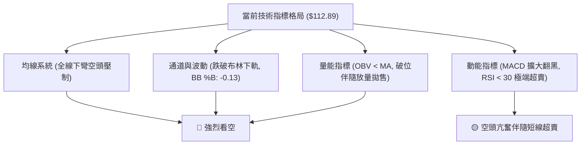
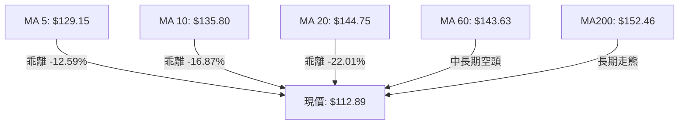
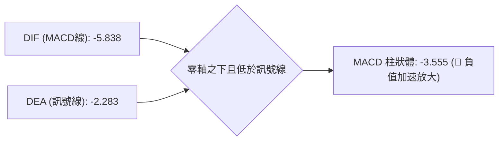
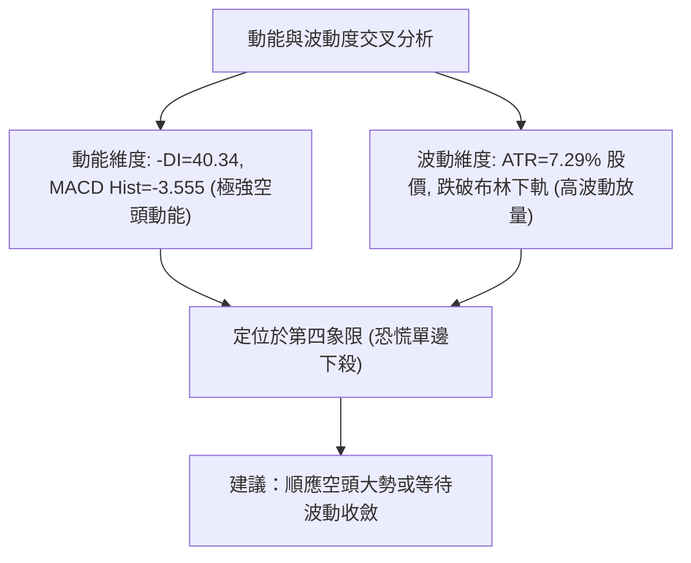
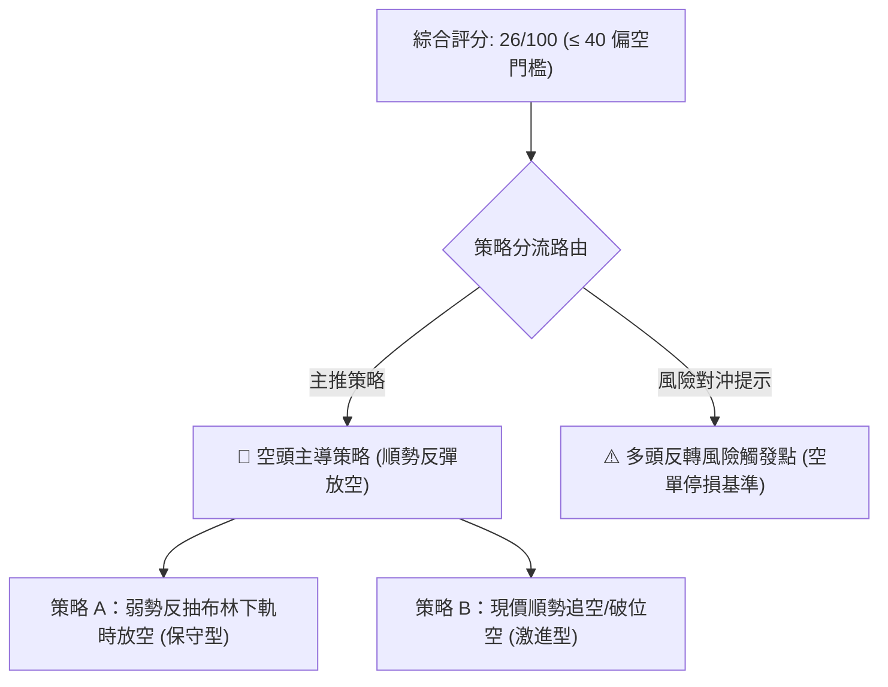
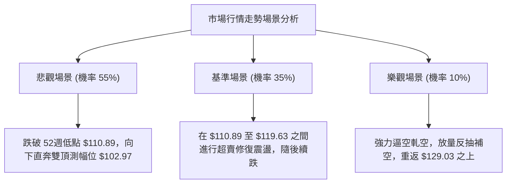

# VST 技術分析報告

> **報告日期**：2026-11-06 ｜ **語言**：繁體中文 ｜ **數據來源**：Yahoo Finance ｜ **當前價格**：$112.89

---

## 目錄

| 章節 | 內容 |
|------|------|
| [1. 技術面概覽](#1-技術面概覽) | 訊號儀表板、核心指標、評分卡 |
| [2. 趨勢分析](#2-趨勢分析) | 多時框趨勢、長中短期走勢 |
| [3. 圖表形態分析](#3-圖表形態分析) | 形態識別、K線組合、目標價 |
| [4. 支撐與阻力](#4-支撐與阻力) | 關鍵價位、斐波那契回調 |
| [5. 技術指標深度解讀](#5-技術指標深度解讀) | MA/RSI/MACD/布林/成交量 |
| [6. 動能與波動率](#6-動能與波動率) | 動能評估、ATR、Beta |
| [7. 多時框架總結](#7-多時框架總結) | 時框架評分矩陣 |
| [8. 交易策略建議](#8-交易策略建議) | 多空策略、風險報酬比 |
| [9. 風險提示與監控](#9-風險提示與監控) | 監控指標、風險場景 |

---

## 1. 技術面概覽

### 🎯 技術訊號儀表板



### 📊 核心指標速覽表

| 指標類別 | 指標名稱 | 當前數值 | 訊號 | 解讀 |
|----------|----------|----------|------|------|
| **價格** | 當前收盤價 | $112.89 | 🔴 | 位於52週區間 2.4% 底部邊緣，瀕臨52週低點 $110.89 |
| **均線** | MA20 | $144.75 | 🔴 | 現價大幅低於MA20達 -22.01%，短中期趨勢嚴重走空 |
| **均線** | MA50 | $144.13 | 🔴 | 現價低於MA50，中期支撐全面瓦解 |
| **均線** | MA200 | $152.46 | 🔴 | 現價低於長期生命線MA200，長期趨勢轉為空頭市場 |
| **動能** | RSI(14) | 29.26 | 🟢 | 跌破30超賣門檻，技術面存在超跌反彈需求但尚未反轉 |
| **動能** | MACD | -5.838 | 🔴 | 位於訊號線（-2.283）下方，MACD柱狀體 -3.555 擴大看空 |
| **波動** | ATR(14) | $8.23 | 🔴 | 佔股價 7.29%，屬於高波動恐慌拋售行情 |

### 🏆 技術評分卡

```
╔═══════════════════════════════════════════════════════════╗
║            技術評分卡 — VST (2026-11-06)                 ║
╠═══════════════════════════════════════════════════════════╣
║  趨勢強度      ██████░░░░░░░░░░░░░░  28/100  🔴 空頭主導  ║
║  動能指標      ██████░░░░░░░░░░░░░░  32/100  🔴 極度低迷  ║
║  支撐穩定度    ████░░░░░░░░░░░░░░░░  20/100  🔴 底部脆弱  ║
║  成交量配合    ███████░░░░░░░░░░░░░  35/100  🔴 放量破位  ║
║  形態完整度    █████░░░░░░░░░░░░░░░  25/100  🔴 頭部下破  ║
║  均線排列      ███░░░░░░░░░░░░░░░░░  16/100  🔴 均線死叉  ║
╠═══════════════════════════════════════════════════════════╣
║  綜合評分      █████░░░░░░░░░░░░░░░  26/100  🔴 強烈偏空  ║
║  評分公式：(28 + 32 + 20 + 35 + 25 + 16) ÷ 6 = 26/100   ║
╚═══════════════════════════════════════════════════════════╝
```

---

## 2. 趨勢分析

### 🌐 多時框趨勢分析



### 📈 長期趨勢 — 12個月走勢圖（Unicode）

依據月度收盤價數據（2025-12 至 2026-11）：
- 2025-12: $160.62 ｜ 2026-01: $157.65 ｜ 2026-02: $173.13 (階段高點) ｜ 2026-03: $149.87
- 2026-04: $157.36 ｜ 2026-05: $159.74 ｜ 2026-06: $158.37 ｜ 2026-07: $147.95
- 2026-08: $137.15 ｜ 2026-09: $138.35 ｜ 2026-10: $138.37 ｜ 2026-11: $112.89 (當前現價)

```
VST 月線走勢圖（過去12個月）
價格軸 ($)
$180 ┤              ● (2026-02: $173.13 高點)
$170 ┤             / \
$160 ┤●         ●/   \●───●───●
$150 ┤ \       /       \        \
$140 ┤  \     /         ●        ●───●───● (2026-08~10 箱型區 $138)
$130 ┤   \   /                            \
$120 ┤    \ /                              \
$110 ┤     ●                                ●← 當前收盤價 $112.89
     └─┬───┬───┬───┬───┬───┬───┬───┬───┬───┬───┬───
      12M 01M 02M 03M 04M 05M 06M 07M 08M 09M 10M 11M (2025-12 ~ 2026-11)
```

**走勢特徵分析表格**：

| 階段區間 | 時間跨度 | 起訖價位 | 漲跌幅 | 走勢結構與形態特徵 |
|----------|----------|----------|--------|--------------------|
| 階段一：次頂構築 | 2025-12 ~ 2026-02 | $160.62 → $173.13 | +7.79% | 衝高形成次級高點 $173.13，未能挑戰2025歷史高位 |
| 階段二：高位盤跌 | 2026-02 ~ 2026-06 | $173.13 → $158.37 | -8.52% | 跌破 $160 關鍵頸線，在 $150~$160 區間呈現弱勢拉鋸 |
| 階段三：下台階整理 | 2026-07 ~ 2026-10 | $147.95 → $138.37 | -6.48% | 跌破 $140 平台，連續三個月在 $137~$138 橫盤築平台 |
| 階段四：雪崩式下破 | 2026-10 ~ 2026-11 | $138.37 → $112.89 | -18.41% | 橫盤平台失守，放量長黑摜破布林下軌，測試52週低點 |

### 📊 中期趨勢（週線分析）

從近8週收盤價來看，VST 自 2026-10-09 當週高點 $168.75 衝高回落後，連續四週收黑（$152.02 → $140.16 → $138.37 → $112.89）。本週（2026-11-05 當週）錄得 46,399,300 股的爆量長陰棒，單週暴跌 -18.41%，徹底擊穿了過去三個月在 $136-$140 構築的所有支撐結構。

```
週線關鍵攻防示意圖
$170.00 ┤        ▲ 波段假突破頂點 $168.75
$160.00 ┤       / \
$150.00 ┤      /   ▼ 跌破 $150 阻力群
$140.00 ┤─────●─────●─────●──── 密集防守箱型底（已被摜破）
$130.00 ┤                       \
$120.00 ┤                        \
$110.89 ┤─────────────────────────●◄ 52週極限低點支撐（考驗中）
```

### ⚡ 趨勢強度評估（ADX 解讀）



**ADX 趨勢強度對照表**：

| 指標名稱 | 當前數值 | 參考門檻 | 當前技術含義 |
|----------|----------|----------|--------------|
| **ADX (14)** | 19.30 | < 25 (弱趨勢/低檔蓄勢) | 處於盤整剛被打破的初期階段，後續趨勢動能將迅速攀升 |
| **-DI (空方動能)** | 40.34 | > 30 (極強空方) | 空頭動能極度亢奮，空方力量牢固掌控盤面 |
| **+DI (多方動能)** | 14.29 | < 20 (極弱多方) | 多方完全失去抵抗能力，買盤嚴重匱乏 |
| **趨勢性質** | 空頭起跌破位 | -DI / +DI = 2.82x | 盤整區間向下破裂，空方趨勢展開 |

---

## 3. 圖表形態分析

### 🔍 形態識別系統



**形態識別信心度與測幅目標表**：

| 形態類別 | 信心度 | 判斷依據（引用數據） | 完成度 | 目標價（附計算式） |
|----------|--------|----------------------|--------|--------------------|
| **箱型平台向下破位** | 85% | 2026-08 至 2026-10 股價多次於 $135.86~$140 獲得支撐，2026-11-04 以 $120.29 跌穿箱底 | 100% (已破位) | 由形態高度推算：箱頂 $147.82 - 箱底 $135.86 = 高度 $11.96。破位目標 = 箱底 $135.86 - $11.96 = **$123.90**（已超額達成） |
| **雙重頂向下測幅** | 75% | 2026-06 高點 $168.75 與 2026-10 高點 $168.75 構築雙頂，頸線為 $135.86 | 90% | 由雙頂形態高度推算：頂部 $168.75 - 頸線 $135.86 = 形態高度 $32.89。向下對稱測幅目標 = 頸線 $135.86 - $32.89 = **$102.97**（未列入數據，僅做推算參考） |
| **指標型布林下軌破裂** | 95% | 現價 $112.89 跌破 BB 下軌 $119.63，%B 達 -0.13 | 100% | 指標型無幾何目標價，提示短線嚴重負乖離 |

### 🕯️ 重要K線形態分析

根據提供的「近10根日K」與「近8根週K」實際開高低收數據進行嚴格檢驗：

| 日期（日K/週K） | 開 | 高 | 低 | 收 | K線形態 | 解讀 | 訊號 |
|------------------|----|----|----|----|---------|------|------|
| **2026-10-27 (日K)** | 143.95 | 147.45 | 143.40 | 146.66 | 光腳中陽線 | 盤整區內反彈測試箱頂，多方最後一次上攻 | 🟡 |
| **2026-10-28 (日K)** | 146.88 | 147.82 | 142.20 | 142.72 | 倒轉長上影黑K | 上攻 $147.82 遇強大阻力回落，形成短頂反轉 | 🔴 |
| **2026-10-30 (日K)** | 136.95 | 139.82 | 135.86 | 138.37 | 下影收斂黑K | 再次測試箱底 $135.86，多空拉鋸緊繃 | 🟡 |
| **2026-11-03 (日K)** | 135.99 | 142.40 | 135.99 | 139.59 | 帶上影小陽線 | 破位前的弱勢誘多抽腳，高點未過前高 | 🟡 |
| **2026-11-04 (日K)** | 125.40 | 128.07 | 117.27 | 120.29 | 跳空放量大黑K | 跳空破位，成交量爆出 2,044 萬股，長黑貫穿支撐 | 🔴 |
| **2026-11-05 (日K)** | 116.86 | 118.91 | 110.89 | 112.89 | 長黑下探收低K | 續跌逼近52週低點 $110.89，收在 $112.89 低位 | 🔴 |
| **2026-10-09 (週K)** | 144.04 | 168.75 | 140.90 | 161.48 | 衝高爆量長影長陽 | 週量 5,936 萬股爆量天線，波段主力出貨確立 | 🔴 |
| **2026-11-05 (週K)** | 140.00 | 142.40 | 110.89 | 112.89 | 破位放量大陰棒 | 週跌 -18.41%，放量 4,639 萬股擊穿多月平台 | 🔴 |

### 📉 ASCII 走勢形態示意圖

```
VST 近日跳空破位走勢示意圖
價位 ($)
$148 ┤       ╭─╮ (10/28 高點 $147.82)
$144 ┤   ╭───╯ │
$140 ┤───╯     ╰───╭─╮ (11/03 誘多高點 $142.40)
$136 ├──────────────╯ ╰────── 跌破箱底頸線 $135.86
$128 ┤                 ░░░ 跳空缺口 ($135.99 - $128.07)
$120 ┤                 █ (11/04 長黑放量 20M)
$116 ┤                 █
$112 ┤                   █ (11/05 續殺至 $112.89)
$110 ┴────────────────────● 52週低點 $110.89
      10/27 10/28 10/30 11/03 11/04 11/05
```

### 🎯 形態目標價計算

1. **水平箱型整理測幅**：
   - 形態頂部：$147.82（2026-10-28 高點）
   - 形態底部頸線：$135.86（2026-10-30 低點）
   - 垂直形態高度：$147.82 - $135.86 = $11.96
   - 向下第一等幅測幅目標：$135.86 - $11.96 = **$123.90**（此目標已於 11/04 跌破達成）。
   - 向下第二倍測幅目標：$135.86 - (2 × $11.96) = **$111.94**（現價 $112.89 正在此目標區緊鄰 52週低點 $110.89 尋求微弱支撐）。

---

## 4. 支撐與阻力

### 🗺️ 關鍵價位分布圖（Unicode）

```
VST 價位結構分布圖
═══════════════════════════════════════════════════════════════
$168.67 ║██████████████████████████████║ 強阻力 R3 (前波波段巨量頂部)
$155.69 ║████████████████████          ║ 阻力 R2 (反彈高點聚類)
$149.93 ║████████████████████████      ║ 關鍵阻力 R1 (反彈強阻力)
$143.27 ║░░░░░░░░░░░░░░░░░░░░░░░░      ║ 斐波那契 61.8% 重合帶
$129.03 ║▒▒▒▒▒▒▒▒▒▒▒▒▒▒▒▒              ║ 斐波那契 78.6% 回調位
$112.89 ╠══════════════════════════════╣ ◄ 當前收盤價 ($112.89)
$110.89 ║██████████████████████████████║ 52週歷史低點 (最後防線 / 100% Fib)
(下方)  ║░░░░░░░░░░░░░░░░░░░░░░░░░░░░░░║ (數據中未偵測到波段低點支撐)
═══════════════════════════════════════════════════════════════
```

### 🚧 阻力位分析表

價位嚴格引用技術數據中「關鍵價位」區塊：

| 阻力級別 | 價位 | 形成原因 | 突破難度 | 重要性 |
|----------|------|----------|----------|--------|
| **R1** | $149.93 | 近一年波段高點聚類區，接近 MA200 ($152.46) 與斐波那契 50.0% ($153.28) | 極高 | ★★★★☆ |
| **R2** | $155.69 | 中期籌碼重度套牢區，反彈解套賣壓匯集 | 極高 | ★★★★☆ |
| **R3** | $168.67 | 2026-10 週K長上影線頂部與 52週高點聚類，波段大天花板 | 固若金湯 | ★★★★★ |

### 🛡️ 支撐位分析表

價位嚴格引用技術數據中「關鍵價位」與「52週區間」：

| 支撐級別 | 價位 | 形成原因 | 守住機率 | 重要性 |
|----------|------|----------|----------|--------|
| **近期支撐** | $110.89 | 52週歷史最低點（100.0% 斐波那契回調位），當前最後技術防線 | 35% | ★★★★★ |
| **下方支撐** | N/A（數據未提供） | 數據中明確標示「no swing-low support detected below current price」 | N/A | N/A |

> **說明**：若 $110.89 失守，股票將跌入無任何歷史成交密集區的空頭真空中，可能引發進一步技術性停損拋售。

### 📐 斐波那契回調位分析

依據 52週區間高點 $195.66 至低點 $110.89 計算之標準回調階梯：

| 回調比例 | 價位 | 技術意涵與現價關係 |
|----------|------|--------------------|
| **0.0% (52W High)** | $195.66 | 52週最高點，長期多頭終極阻力 |
| **23.6%** | $175.66 | 超強多頭維持線，已遠離 |
| **38.2%** | $163.28 | 強勢整理回檔位，失守代表多頭架構轉弱 |
| **50.0%** | $153.28 | 多空平衡中軸線，與 MA200 ($152.46) 重合 |
| **61.8%** | $143.27 | 黃金分割防守位，與 MA20 ($144.75) 重合，失守確立空頭市場 |
| **78.6%** | $129.03 | 空頭深度回撤位，日前已被跳空大黑K實體擊穿 |
| **100.0% (52W Low)**| $110.89 | 52週最低點，當前現價 ($112.89) 距離僅 $2.00 (+1.80%) |

**現價落點解讀**：現價 $112.89 目前運行於 **78.6% ($129.03)** 與 **100.0% ($110.89)** 之間，且極度貼近 100.0% 極限位（位於52週區間僅 2.4% 分位）。這表明自 $195.66 以來的全部多頭漲幅已經回撤殆盡，整體走勢屬於最嚴重的弱勢空頭格局。

---

## 5. 技術指標深度解讀

### 🎛️ 指標訊號總覽



### 📈 移動平均線排列分析



**均線系統詳細數據與解讀表**：

| 均線規格 | 當前數值 | 與現價乖離 | 排列狀態 | 走勢微型趨勢圖 | 解讀 |
|----------|----------|------------|----------|----------------|------|
| **MA 5** | $129.15 | -12.59% | 空頭排列 | `▃▃▃▄▆▇███▇▆▅▄▃▂▁` | 短期直線崩跌，下行斜率極大 |
| **MA 10** | $135.80 | -16.87% | 空頭排列 | `▂▂▂▃▄▅▆▇██▇▆▅▄▃▂▁` | 短期反彈首道重壓 |
| **MA 20** | $144.75 | -22.01% | 空頭排列 | `▁▁▂▂▃▃▄▅▆▇████▇▅▃` | 月線級別生命線加速下彎 |
| **MA 60** | $143.63 | -21.40% | 空頭排列 | `██▇▇▆▅▅▆▆▅▄▄▃▃▃▂▁` | 季線轉為下行，中線空頭壓制 |
| **MA 120** | $148.61 | -24.04% | 空頭排列 | `███▇▆▆▆▆▅▅▄▄▃▃▂▁▁` | 半年線持續滑落 |
| **MA 200** | $152.46 | -25.95% | 空頭排列 | 數據顯示全面跌破 | 牛熊分界線失守，長期空頭確立 |
| **MA 240** | $154.74 | -27.05% | 空頭排列 | `███▇▆▆▅▅▄▄▃▃▂▂▁▁` | 年線級別構成難以逾越之天花板 |

### 📉 RSI(14) 分析

- **當前讀數**：`29.26`（Wilder 計算法）
- **RSI 強度進度條**：
  ```
  [0] ──────────────[30 超賣]────────────────[70 超買]────────────── [100]
  ▓▓▓▓▓▓▓▓░░░░░░░░░░░░░░░░░░░░░░░░░░░░░░░░░░░░░░░░░░░░░░░░░░░  29.26
  ```
- **超買超賣狀態**：低於 30 閾值，進入**極端超賣區**。
- **背離判斷**：數據明確註明「無明顯背離（僅比較近20根K棒首尾的價格與RSI方向）」。價格創下波段新低，RSI 同步滑落至新低，顯示為**純粹的空方順勢暴跌**，並未出現多頭底背離跡象，嚴防空頭鈍化。

### 📊 MACD(12/26/9) 訊號解讀



- **MACD 線**：-5.838
- **Signal 線**：-2.283
- **MACD 柱狀圖**：-3.555
- **解讀**：DIF 於零軸下方加速下穿 DEA，柱狀圖放大至 -3.555，代表空頭動能進入恐慌性加速釋放期。兩線無收斂跡象，空方訊號明確。

### 📦 布林通道分析

```
布林通道現狀示意圖 (寬度收窄後向下單邊開口)
$169.86 ┬──────────────────────────────────────────── BB 上軌
        │
$144.75 ┼──────────────────────────────────────────── BB 中軌 (MA20)
        │
$119.63 ┴──────────────────────────────────────────── BB 下軌
  ░░░░░░│░░░░░░░░░░░░░░░░░░░░░░░░░░░░░░░░░░░░░░░░░░░░░ 超出通道下軌外
$112.89   ●◄── 現價位於軌道外部 (%B = -0.13)
```

- **布林上軌**：$169.86
- **布林中軌 (MA20)**：$144.75
- **布林下軌**：$119.63
- **帶寬與位置 (%B)**：`-0.13`。%B 數值小於 0，意味著股價已經脫離常態分佈跌破布林下軌，呈現極端「下軌破裂開口」形態，技術上具有回抽下軌 $119.63 的反抽動能，但在強趨勢中常以橫盤代替反彈。

### 💹 成交量分析（量價配合度）

- **最新日成交量**：15,275,600 股
- **20日平均量**：7,067,120 股（**量比：2.16x**）
- **前一日成交量 (11-04)**：20,441,400 股（量比近 3.0x）
- **OBV 能量潮**：數據顯示 `OBV < MA → 量能疲弱`。
- **量價配合診斷**：突破/跌破需要放量確認。VST 在 11-04 與 11-05 跌破箱底與下軌時，成交量分別放大至 2,044 萬與 1,527 萬股，呈現**標準的「帶量破位」**，量能完全確認價格走勢，空方拋售力量極為真實且具機構拋盤特徵。

---

## 6. 動能與波動率

### ⚡ 動能評估四象限

| 象限 | 動能方向與強度 | 波動率水平 | 當前股票狀態 | 戰略應對方針 |
|------|----------------|------------|--------------|--------------|
| **Q1 (順風多頭)** | 強多頭 | 低波動 | — | 穩定持股、逢低做多 |
| **Q2 (盤整築底)** | 弱動能 | 低波動 | — | 區間高拋低吸 |
| **Q3 (極端狂熱)** | 強多頭 | 高波動 | — | 追漲高風險高收益 |
| **Q4 (恐慌出逃)** | **極強空頭** | **高波動** | **✓ (VST 當前所處位置)** | **順勢做空，嚴禁盲目摸底抄底** |



### 📊 ATR 波動率分析

- **ATR(14) 讀數**：`$8.23`（佔股價比例高達 **7.29%**）
- **波動特徵**：屬於極高波動狀態。日均震幅超過 8 美元，單日波動極其劇烈。
- **風控與止損建議**：
  - 做空操作常規止損距離：1.5 × ATR = 1.5 × $8.23 = **$12.35**。
  - 緊縮止損距離：1.0 × ATR = **$8.23**。
  - 由於波動劇烈，若未給予足夠的 ATR 緩衝空間，極易被短線超跌反抽震盪洗出場，倉位必須大幅縮減以控管絕對金額風險。

### 📐 Beta 與市場相關性

- **Beta 係數**：`1.375`
- **特性分析**：身處公用事業（Utilities）板塊，但其 Beta 高達 1.375，顯示 VST 具備強烈的獨立發電商（IPP）高槓桿與 AI/數據中心用電題材炒作屬性。其波動幅度為標普500大盤的 1.375 倍，在市場情緒不佳或板塊修正時，跌幅往往顯著放大。

---

## 7. 多時框架總結

### 📋 時框架評分表

| 時框架 | 趨勢方向 | 動能狀態 | 均線排列 | 形態特徵 | 綜合評分 | 戰略建議 |
|--------|----------|----------|----------|----------|----------|----------|
| **短期 (日線)** | 🔴 極度偏空 | RSI超賣 / MACD擴大翻黑 | 全空頭排列 (現價低於MA5~MA240) | 帶量跳空下破 | 25/100 | 反彈即是空點，嚴禁左側抄底 |
| **中期 (週線)** | 🔴 強烈偏空 | 週K MACD -3.555, 週RSI 29.3 | 跌破所有中短期週均線 | 雙頂與箱型平台同步跌破 | 25/100 | 空頭主導，尋找更低支撐 |
| **長期 (月線)** | 🔴 轉入熊市 | 月收盤連續下台階 | 失守月線中樞，回測長期低點 | 2025高點以來的深度回撤 | 28/100 | 避開長期多頭瓦解風險 |

### 🔲 綜合訊號矩陣

```
時框共振檢驗矩陣
──────────────────────────────────────────────────────────
維度            短期 (日線)      中期 (週線)      長期 (月線)
──────────────────────────────────────────────────────────
趨勢方向        🔴 下行破位      🔴 順勢走熊      🔴 結構轉弱
均線壓制        🔴 全面壓制      🔴 均線反壓      🔴 跌破年線
動能指標        🟡 超賣有反抽    🔴 空方擴大      🔴 動能失速
量價確認        🔴 放量暴跌      🔴 帶量破位      🔴 高位出貨
──────────────────────────────────────────────────────────
結論共振度      90% 高度共振偏空（無任何週期發出轉折翻多訊號）
──────────────────────────────────────────────────────────
```

### ⚖️ 多時框收斂結論

依據多時框收斂規則第 14 條：
- 當前 ADX(14) 讀數為 **19.30 (<25)**，技術定義雖處於低值盤整/趨勢醞釀期，但觀察日線與週線，係因前期三個月在 $136-$140 橫盤導致 ADX 走低，隨後股價在近兩日以 **2.16倍均量爆量向下擊穿布林下軌（%B: -0.13）**。
- 日線、週線、月線在方向上**無任何衝突，三時框全部呈現壓倒性偏空共振**。
- **唯一方向性結論**：**極度偏空**。當前不存在多空矛盾，日線之極端超賣（RSI 29.26）僅構成技術性超跌反抽之誘因，在均線全面空頭排列壓制下，任何反抽均為空頭提供絕佳之「反彈逢高做空」機會。

---

## 8. 交易策略建議

### 🗺️ 策略決策流程圖



### 🧭 策略路由（依評分卡分流，不得兩頭下注）

> **當前主策略方向 = 強烈偏空（依綜合評分 26/100，嚴格依規定主推空頭策略）**

### 🎯 價格情境階梯（Price Scenarios）

價位嚴格引用第 4 章「關鍵價位」與技術數據之精確數值：

| 觸發條件 | 下一目標 | 後續延伸 | 情境含義 |
|----------|----------|----------|----------|
| **跌破 52週低點 $110.89** | 探底尋求市場心理整數關口 | 下方無 swing-low 支撐 | 空頭主升段延續，進入加速無支撐真空殺跌 |
| **弱勢弱反彈承壓於 $119.63 (BB下軌)** | 回測 $110.89 | 破底探尋未知底 | 空頭中繼正常修正超賣，最佳放空點 |
| **強勢反抽突破 $129.03 (78.6% Fib)** | R1 $149.93 | R2 $155.69 | 空頭結構遭遇強烈軋空，多頭反攻展開 |

### 📊 情境機率分佈

| 情境劃分 | 機率 | 主要依據 |
|----------|------|----------|
| **情境一：破位續跌 / 跌破 $110.89** | **55%** | -DI 高達 40.34，成交量 2.16x 放量破位，均線全面下彎死叉 |
| **情境二：超賣引發弱勢反彈震盪** | **35%** | RSI(14) 達 29.26 進入超賣，布林通道 %B 達 -0.13 嚴重外擴 |
| **情境三：強勢 V 型反轉上行** | **10%** | OBV 趨勢向下疲弱，大跌帶量顯示機構出逃，V轉機率極低 |

### 🟢 主策略詳情（方向依上方路由：空頭策略）

> **計算規則說明（規則 17）**：
> 做空風險報酬比 = (進場價 − 目標價 T1) ÷ (止損價 − 進場價)。
> 進場價為區間時，以區間中點計算並註明。

| 策略要素 | 策略 A（保守型：反抽布林下軌做空） | 策略 B（激進型：破位追空） |
|----------|-----------------------------------|----------------------------|
| **進場條件** | 股價超跌反抽測試布林下軌 $119.63 附近阻力停滯時進場 | 跌破 52週低點 $110.89 後順勢追空進場 |
| **進場價格** | **$119.63**（以布林下軌精確價位進場） | **$110.50**（跌破 52週低點 $110.89 後約半檔進場） |
| **目標價 T1** | **$110.89**（52週最低點支撐位） | **$102.97**（由雙頂形態高度推算之測幅目標） |
| **目標價 T2** | **$102.97**（由雙頂形態高度推算之測幅目標） | N/A（數據未提供更低支撐） |
| **止損價格** | **$123.90**（箱型測幅滿足位，跌破轉阻力點） | **$114.61**（止損設於半個 ATR 距離：$110.50 + $4.11） |
| **風險報酬比** | **1 : 2.05（以 T1 計）**<br>計算式：($119.63 - $110.89) ÷ ($123.90 - $119.63) = $8.74 ÷ $4.27 = 2.05 | **1 : 1.83（以 T1 計）**<br>計算式：($110.50 - $102.97) ÷ ($114.61 - $110.50) = $7.53 ÷ $4.11 = 1.83 |
| **成功機率** | **65%** | **55%** |
| **建議倉位** | **8%**（輕倉分批佈局） | **5%**（突破嚴格控管倉位） |

### 🔴 反向風險觸發點（對沖提示）

若出現以下情況，說明空頭主策略被推翻，空單必須全數停損離場，嚴禁硬扛：
1. **反轉關鍵價位**：收盤價強勢收復 **$129.03**（斐波那契 78.6% 回調位）之上。
2. **量價異動訊號**：日K線在 $110.89 之上爆出 2,500 萬股以上之長下影巨量錘頭線，且隔日高開確認底背離。
3. **指標翻多**：日線 RSI 重新站上 45，且 MACD 柱狀圖由負轉正出現黃金交叉。

### ⭐ 整體訊號強度評星

```
╔═══════════════════════════════════════════════════════════╗
║  做多訊號強度：★☆☆☆☆  (1/5星)  — 極端超賣僅具反抽誘因    ║
║  做空訊號強度：★★★★☆  (4/5星)  — 順應多時框大勢與破位量  ║
║  整體可信度：  ★★★★☆  (4/5星)  — 價崩量增且趨勢極明朗    ║
╚═══════════════════════════════════════════════════════════╝
```

---

## 9. 風險提示與監控

### ✅ 關鍵監控指標 Checklist

```
╔══════════════════════════════════════════════════════════════╗
║              VST 關鍵技術監控清單 (Checklist)                 ║
╠══════════════════════════════════════════════════════════════╣
║ [ ] 52週低點防守：盤中是否跌破 $110.89 極限支撐？           ║
║ [ ] 乖離修復反抽：反彈能否觸及並承壓於 BB 下軌 $119.63？    ║
║ [ ] 成交量能動態：日成交量是否回落至 700萬股均量以下（縮量）？║
║ [ ] 動能背離觀察：日線 RSI(14) 回升至 30 以上是否伴隨量縮？  ║
║ [ ] MACD 柱狀體：柱狀體負值是否停止放大（目前為 -3.555）？    ║
║ [ ] 阻力轉換防線：斐波那契 78.6% 回調位 $129.03 是否有效阻絕？║
╚══════════════════════════════════════════════════════════════╝
```

### ⚠️ 風險場景分析



### 🛡️ 風險管理重要提醒

1. **極度波動風險（ATR 高達 7.29%）**：當前每日震幅逾 $8.23，任何交易部位必須將單筆交易虧損限制在總投資組合資金的 1.0% 以內。換算倉位不可超過總部位的 5%~8%。
2. **空頭擠壓（Short Squeeze）風險**：由於目前 RSI 處於 29.26 之超賣狀態，且當前價格超出布林下軌（%B: -0.13），任何突發利多皆可能引發暴烈之短線軋空反彈，空單進場必須設定硬停損，嚴禁不帶止損進場。
3. **無支撐真空風險**：若跌破 $110.89，下方缺乏波段低點支撐聚類，盲目進行左側「抄底」買入的多頭部位可能面臨無限回撤風險。

---

## 📋 報告總結

```
╔════════════════════════════════════════════════════════════════╗
║                   VST 技術分析報告總結                         ║
╠════════════════════════════════════════════════════════════════╣
║ 報告日期：2026-11-06                                          ║
║ 當前價格：$112.89                                             ║
║ 分析評級：🔴 強烈偏空（綜合評分：26/100）                    ║
║                                                                ║
║ 關鍵結論：                                                     ║
║ ├─ 長期趨勢：🔴 跌破年線與斐波那契關鍵位，長期上升軌道終結     ║
║ ├─ 中期趨勢：🔴 箱型破位與雙頂測幅展開，空頭排列向下發散       ║
║ ├─ 短期趨勢：🔴 放量長黑破布林下軌，短線進入嚴重超賣恐慌區     ║
║ ├─ 關鍵支撐：$110.89 (52週極限低點)                           ║
║ ├─ 關鍵阻力：$119.63 (布林下軌)、$129.03 (78.6% Fib)、$149.93 ║
║ └─ 分析師目標：均價 $204.32 / 最低 $106.00 / 最高 $306.00      ║
║                                                                ║
║ 最優策略組合：                                                 ║
║ 1. 🥇 最佳機會：等待反抽布林下軌 $119.63 附近阻力，佈局空單    ║
║    （目標 T1: $110.89，止損: $123.90，風報比 1 : 2.05）         ║
║ 2. 🥈 次選機會：跌破 52週低點 $110.89 順勢空至 $102.97         ║
║    （目標 T1: $102.97，止損: $114.61，風報比 1 : 1.83）         ║
║ 3. 🥉 保守選擇：空倉觀望，等待日線級別底背離或重新收復 $129.03 ║
╚════════════════════════════════════════════════════════════════╝
```

---

> ⚠️ **免責聲明**：本報告為 AI 自動生成之技術分析，所有數據及估算均基於提供的歷史價格資訊。本報告**僅供研究與學術參考**，**不構成任何投資建議**。投資有風險，入市需謹慎。

---

*報告生成時間：2026-11-06 ｜ 數據來源：Yahoo Finance ｜ 分析框架：多時框技術分析*