# VST 技術分析報告

> **報告日期**：2026-11-07 ｜ **語言**：繁體中文 ｜ **數據來源**：Yahoo Finance ｜ **當前價格**：$124.80

---

## 目錄

| 章節 | 內容 |
|------|------|
| [1. 技術面概覽](#1-技術面概覽) | 訊號儀表板、核心指標、評分卡 |
| [2. 趨勢分析](#2-趨勢分析) | 多時框趨勢、長中短期走勢 |
| [3. 圖表形態分析](#3-圖表形態分析) | 形態識別、K線組合、目標價 |
| [4. 支撐與阻力](#4-支撐與阻力) | 關鍵價位、斐波那契回調 |
| [5. 技術指標深度解讀](#5-技術指標深度解讀) | MA/RSI/MACD/布林/成交量 |
| [6. 動能與波動率](#6-動能與波動率) | 動能評估、ATR、Beta |
| [7. 多時框架總結](#7-多時框架總結) | 時框架評分矩陣 |
| [8. 交易策略建議](#8-交易策略建議) | 多空策略、風險報酬比 |
| [9. 風險提示與監控](#9-風險提示與監控) | 監控指標、風險場景 |

---

## 1. 技術面概覽

### 🎯 技術訊號儀表板

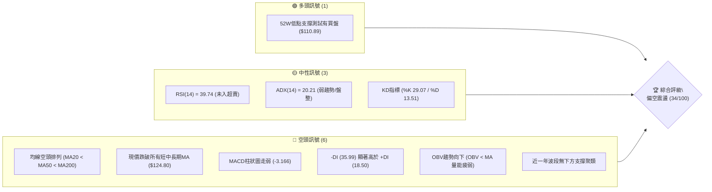

### 📊 核心指標速覽表

| 指標類別 | 指標名稱 | 當前數值 | 訊號 | 解讀 |
|----------|----------|----------|------|------|
| **價格** | 當前收盤價 | $124.80 | 🔴 | 位於52週區間16.4%低位，短線重挫後弱勢反彈 |
| **均線** | MA20 | $142.91 | 🔴 | 價格在MA20下方 -12.67%，中期空頭主導 |
| **均線** | MA50 | $143.83 | 🔴 | 價格在MA50下方 -13.23%，中期防線失守 |
| **均線** | MA200 | $152.28 | 🔴 | 價格在MA200牛熊線下方 -18.05%，長期結構轉空 |
| **動能** | RSI(14) | 39.74 | 🟡 | 處於30–70中性偏弱區，尚未進入極端超賣區 (<30) |
| **動能** | MACD | -6.240 | 🔴 | 快慢線均在零軸下方，且柱狀圖為 -3.166 持續擴散 |
| **趨勢** | ADX(14) | 20.21 | 🟡 | 數值 <25 顯示單邊趨勢動能趨緩，進入盤整/弱趨勢 |
| **方向** | +DI / -DI | 18.50 / 35.99 | 🔴 | -DI 大幅壓制 +DI，空方完全掌握盤面控制權 |
| **通道** | 布林通道 %B | 0.14 | 🔴 | 貼近布林下軌 ($117.58)，通道呈現擴張下跌態勢 |
| **成交量** | 量比 (vs 20MA) | 1.70x | 🔴 | 放量下挫後縮量小彈，OBV < MA 顯示資金流出 |
| **波動** | ATR(14) | $8.56 | 🔴 | 佔價格比例高達 6.86%，單日波動劇烈 |

### 🏆 技術評分卡

```
╔══════════════════════════════════════════════════════════════╗
║                 技術評分卡 — VST (2026-11-07)                ║
╠══════════════════════════════════════════════════════════════╣
║ 趨勢強度 (Trend)       ██████░░░░░░░░░░░░░░  32/100  🔴      ║
║ 動能指標 (Momentum)    ███████░░░░░░░░░░░░░  34/100  🔴      ║
║ 支撐穩定度 (Support)   ███████░░░░░░░░░░░░░  36/100  🔴      ║
║ 成交量配合 (Volume)    ████████░░░░░░░░░░░░  42/100  🟡      ║
║ 形態完整度 (Pattern)   ████████░░░░░░░░░░░░  38/100  🔴      ║
║ 均線排列 (MA System)   ████░░░░░░░░░░░░░░░░  22/100  🔴      ║
╠══════════════════════════════════════════════════════════════╣
║ 綜合評分 (Overall)     ███████░░░░░░░░░░░░░  34/100  🔴 偏空 ║
╚══════════════════════════════════════════════════════════════╝
```
*(註：綜合評分由六項子評分算術平均所得：(32 + 34 + 36 + 42 + 38 + 22) ÷ 6 = 34.0)*

---

## 2. 趨勢分析

### 🌐 多時框趨勢分析

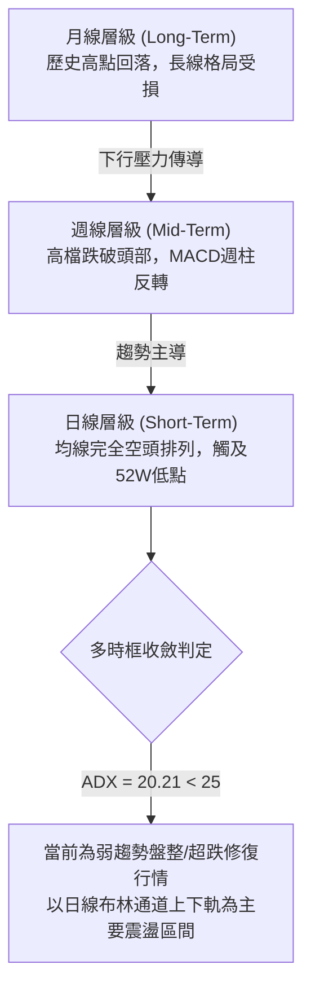

### 📈 長期趨勢 — 12個月走勢圖（Unicode）

```
VST 月線走勢圖（2025-11 至 2026-11）
價格軸 ($)
$190 ┤
$180 ┤● (2025-11: $177.83)
$170 ┤          ● (2026-02: $173.13)
$160 ┤    ●            ●      ●      ●
$150 ┤       ●            ●             ●
$140 ┤                                         ●      ●      ●
$130 ┤
$120 ┤                                                              ●←現價 $124.80
     └─────────────────────────────────────────────────────────────────
      11  12  01  02  03  04  05  06  07  08  09  10  11 (月份)
```

#### 走勢特徵分析表格

| 階段區間 | 起止月份 | 收盤價變化 | 區間漲跌幅 | 走勢特徵與結構分析 |
|----------|----------|------------|------------|--------------------|
| **高檔震盪** | 2025-11 ~ 2026-02 | $177.83 → $173.13 | -2.64% | 於 $170–$178 高檔築頂，多頭動能開始衰竭 |
| **平台整理** | 2026-03 ~ 2026-06 | $149.87 → $158.37 | +5.67% | 回落至 $150–$160 形成橫盤整理平台 |
| **破位下行** | 2026-07 ~ 2026-10 | $147.95 → $138.37 | -6.47% | 跌破 $140 關口，反彈無力，重心持續下移 |
| **放量重挫** | 2026-10 ~ 2026-11 | $138.37 → $124.80 | -9.81% | 跌破均線防線，週線探底至 $110.89 創52週新低 |

### 📊 中期趨勢（週線分析）

```
週線級別價格壓力與支撐示意圖
$168.75 ┬────────────────────────────────────────── 2026-10-09 波段高點 (強阻力 R3: $168.67)
        │
$152.02 ┼───────────────────────── 2026-10-16 收盤價 (阻力 R2: $155.69 區域)
        │
$140.00 ┼────────────── 2026-10-30 週收盤 / 斐波 61.8% ($143.27)
        │
$124.80 ┼───────► 【當前收盤價】
        │
$110.89 ┴────────────────────────────────────────── 2026-11-06 週低點 (52週最低點)
```

週線指標顯示，2026-10-09 當週在巨量（59,368,900 股）衝高至 $168.75 後迅速反轉，形成長上影線的「避雷針」形態。隨後四週連續收陰，MACD柱狀圖由 +2.715 驟降至 -3.166，週線RSI由 64.5 快速回落至 39.74，確立中期頂部已於 $168.75 形成。

### ⚡ 趨勢強度評估（ADX 解讀）

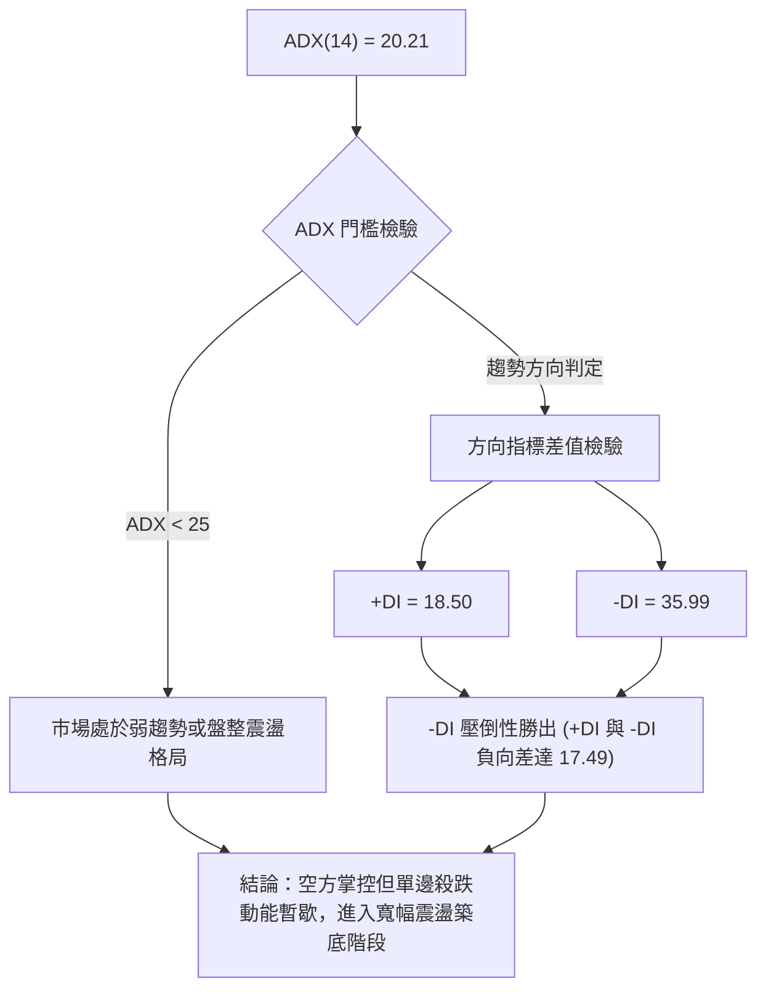

#### ADX 強度對照與解讀表

| 指標變數 | 當前數值 | 參考標準 | 狀態評定 | 交易含義 |
|----------|----------|----------|----------|----------|
| **ADX(14)** | 20.21 | < 25 (弱趨勢/盤整) | 🟡 盤整狀態 | 單邊主跌段暫告段落，不宜盲目低位追空 |
| **+DI(14)** | 18.50 | 基準線 20.00 | 🔴 多頭匱乏 | 多方買盤不足以發動持續性反彈 |
| **-DI(14)** | 35.99 | > 30 (強勢空頭) | 🔴 空方主導 | 盤面任何反彈皆面臨強烈解套賣壓 |

---

## 3. 圖表形態分析

### 🔍 形態識別系統

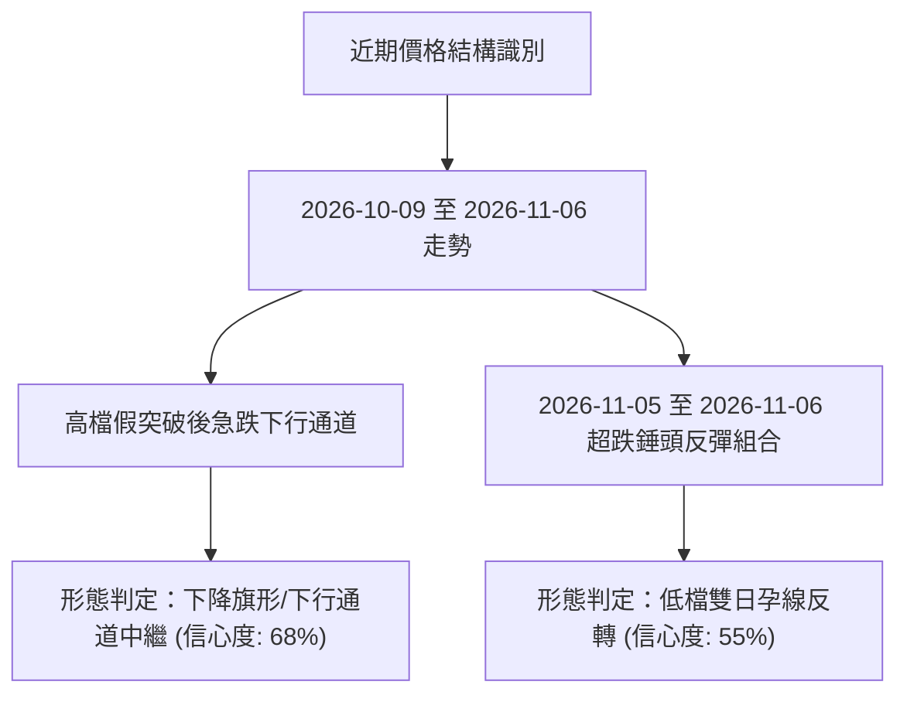

#### 形態識別與信心度評估表

| 形態名稱 | 信心度 | 判斷依據（引用數據） | 完成度 | 目標價（附計算式） |
|----------|--------|----------------------|--------|--------------------|
| **波段下行通道** | 68% | 2026-10-09 高點 $168.75 與 2026-10-28 高點 $147.82 連線成下行壓力；2026-10-02 低點 $133.44 與 2026-11-05 低點 $110.89 連線成下行軌道 | 85% | 由通道下軌破位測算：頸線 $120.29 − 通道高度 ($147.82 − $134.21 = $13.61) = **$106.68** |
| **低檔雙日母子/看漲吞噬** | 55% | 2026-11-05 創 $110.89 低點後收 $112.89，次日 2026-11-06 開盤 $119.57 跳空高開並收大陽線於 $124.80，完全覆蓋前日實體 | 70% | 反彈目標推算：形態低點 $110.89 + 形態高度 ($124.80 − $110.89 = $13.91) = **$138.71** |
| **頭肩頂形態** | 42% | 數據時間跨度不足，左肩與右肩不對稱 | 30% | *訊號不足，僅做指標型解讀* |

### 🕯️ 重要K線形態分析

根據提供的近 10 根日 K 線與近 8 根週 K 線之開、高、低、收數據，分析關鍵 K 棒形態：

#### 近10根日K線形態分析

| 日期 | 開盤價 | 最高價 | 最低價 | 收盤價 | K線形態名稱 | 技術解讀 | 訊號 |
|------|--------|--------|--------|--------|-------------|----------|------|
| **2026-10-26** | 140.90 | 143.52 | 139.07 | 141.73 | 小陽十字線 | 多空於均線下方膠著，量能萎縮 | 🟡 |
| **2026-10-27** | 143.95 | 147.45 | 143.40 | 146.66 | 光腳中陽線 | 向上試探 MA20/MA50 壓力，多頭試盤 | 🟢 |
| **2026-10-28** | 146.88 | 147.82 | 142.20 | 142.72 | 倒錘黑K線 | 上衝 $147.82 遇阻回落，長上影線確認壓力 | 🔴 |
| **2026-10-29** | 142.18 | 144.67 | 140.06 | 140.95 | 小陰收跌線 | 跌破 $141，重心開始失守 | 🔴 |
| **2026-10-30** | 136.95 | 139.82 | 135.86 | 138.37 | 跳空低開小陽線 | 跳空開低，反彈無力補缺口，空方掌控 | 🔴 |
| **2026-11-02** | 140.00 | 140.50 | 134.21 | 134.61 | 實體光頭陰線 | 破位收於最低點附近，加速下行信號 | 🔴 |
| **2026-11-03** | 135.99 | 142.40 | 135.99 | 139.59 | 長上影紡錘陽線 | 盤中衝高 $142.40 遭遇暴擊賣壓 | 🟡 |
| **2026-11-04** | 125.40 | 128.07 | 117.27 | 120.29 | 放量長黑破位棒 | 2044萬股巨量跳空暴跌，恐慌拋盤湧現 | 🔴 |
| **2026-11-05** | 116.86 | 118.91 | 110.89 | 112.89 | 長下影錘頭黑棒 | 下探 52W 低點 $110.89 後獲抄底資金托底 | 🟡 |
| **2026-11-06** | 119.57 | 125.80 | 118.86 | 124.80 | 多頭吞噬中陽線 | 放量反彈覆蓋前日實體，確立短線止跌契機 | 🟢 |

#### 近8根週K線形態分析

| 週結算日 | 開盤價 | 最高價 | 最低價 | 收盤價 | 週K線形態名稱 | 技術解讀 | 訊號 |
|----------|--------|--------|--------|--------|---------------|----------|------|
| **2026-10-09** | 144.04 | 168.75 | 140.90 | 161.48 | 巨量天線巨震棒 | 週量近6000萬股，長上影爆量出貨警訊 | 🔴 |
| **2026-10-16** | 162.67 | 164.25 | 145.85 | 152.02 | 高檔大陰線 | 確認高檔反轉，主力出脫 | 🔴 |
| **2026-10-23** | 154.10 | 158.74 | 136.17 | 140.16 | 中長陰吞噬線 | 連續跌破多條週均線支撐 | 🔴 |
| **2026-10-30** | 140.90 | 147.82 | 135.86 | 138.37 | 下探弱勢整理線 | 嘗試反彈受制於 $147.82 壓力 | 🔴 |
| **2026-11-06** | 140.00 | 142.40 | 110.89 | 124.80 | 長下影極端巨震線 | 單週振幅逾 31.5 美元，5897萬巨量完成換手 | 🟡 |

### 📉 ASCII 走勢形態示意圖

```
日線近 10 日暴跌與超跌反撲走勢圖
價格 ($)
$148 ┤       ●(10/28 高 $147.82)
$144 ┤   ●       ●
$140 ┤ ●           ●   ●(11/03 高 $142.40)
$136 ┤               ●
$132 ┤                   ●(11/02 收 $134.61)
$128 ┤                       ● 
$124 ┤                           ●             ●(11/06 收 $124.80 現價)
$120 ┤                             ●(11/04 收 $120.29)
$116 ┤
$112 ┤                                   ●(11/05 收 $112.89)
$110 ┴─────────────────────────────────────●(11/05 低 $110.89 - 52W低點支撐)
      26  27  28  29  30  02  03  04  05  06 (日期: 10/26 - 11/06)
```

### 🎯 形態目標價計算

1. **下降通道量度跌幅（由 10/28 高點至 11/02 平台破位推算）**：
   - 形態上軌高點：$147.82
   - 形態突破前低點：$134.21
   - 形態高度：$147.82 − $134.21 = $13.61
   - 頸線破位點（11/04 收盤）：$120.29
   - 量度下行目標 = $120.29 − $13.61 = **$106.68**（與分析師最低預期 $106.00 極度吻合）。

2. **雙日止跌吞噬反彈量度升幅（由 11/05 低點至 11/06 實體高點推算）**：
   - 形態低點：$110.89
   - 形態高點：$124.80
   - 形態高度：$124.80 − $110.89 = $13.91
   - 向上等距拓展目標 = $124.80 + $13.91 = **$138.71**（接近 10/30 收盤價 $138.37 阻力帶）。

---

## 4. 支撐與阻力

### 🗺️ 關鍵價位分布圖（Unicode）

```
VST 價位結構分布圖（OHLCV 聚合計算）
═══════════════════════════════════════════════════════════════
$168.67 ║██████████████████████████████║ 強阻力 R3 (2026-10波段極值)
$163.28 ║▓▓▓▓▓▓▓▓▓▓▓▓▓▓▓▓▓▓▓▓▓▓        ║ 斐波那契 38.2% 回調位
$155.69 ║████████████████████          ║ 阻力 R2 (反彈解套強賣壓帶)
$153.28 ║▓▓▓▓▓▓▓▓▓▓▓▓▓▓▓▓              ║ 斐波那契 50.0% 多空分水嶺
$149.93 ║████████████████████████      ║ 關鍵阻力 R1 (前波破位平台)
$143.27 ║▓▓▓▓▓▓▓▓▓▓▓▓▓▓                ║ 斐波那契 61.8% / MA60 ($143.27)
$129.03 ║▓▓▓▓▓▓▓▓▓▓                    ║ 斐波那契 78.6% 近端阻力位
$124.80 ╠══════════════════════════════╣ ◄ 現價 (收盤價)
$117.58 ║░░░░░░░░                      ║ 布林帶下軌動態支撐
$110.89 ║██████████████████████████████║ 斐波那契 100.0% / 52W 最低點
═══════════════════════════════════════════════════════════════
```

### 🚧 阻力位分析表

*(註：價位完全引用數據「關鍵價位」區塊聚類計算之數值)*

| 阻力級別 | 價位 | 形成原因 | 突破難度 | 重要性 |
|----------|------|----------|----------|--------|
| **R1** | $149.93 | 近一年波段高點聚類、斐波 50% ($153.28) 下方緩衝平台，多重均線匯聚區 | ★★★★☆ | 極高。若無法收復 $150 關卡，中期弱勢結構無法逆轉 |
| **R2** | $155.69 | 近一年密集成交高點聚類、MA200 ($152.28) 上方套牢籌碼峰 | ★★★★☆ | 高。牛熊轉換之重型防守區 |
| **R3** | $168.67 | 2026-10-09 當週高點 $168.75 聚類，巨量歷史套牢套牢頂 | ★★★★★ | 極致。年內多頭天花板 |

### 🛡️ 支撐位分析表

*(註：依數據「關鍵價位」區塊顯示，當前價格下方無近一年波段低點聚類支撐)*

| 支撐級別 | 價位 | 形成原因 | 守住機率 | 重要性 |
|----------|------|----------|----------|--------|
| **S1 (動態)** | $117.58 | 日線布林通道下軌動態軌道支撐 | 55% | 中。通道收縮前之動態防線，跌破則重啟下行擴軌 |
| **S2 (極值)** | $110.89 | 52週最低點（2026-11-05 打出之年度極值）及斐波 100% 絕對底部 | 65% | 極高。年內多頭最後防線，失守將開啟估值深水區修復 |
| **S3 (聚類)** | N/A（數據未提供） | 數據中未偵測到現價下方之近一年波段低點聚類 | N/A | 警訊：現價與 $110.89 之間缺乏密集成交籌碼墊 |

### 📐 斐波那契回調位分析

依據 52 週波段高點 $195.66 至 52 週波段低點 $110.89 測算之回調位體系：

| 斐波那契回調位 | 對應價格 | 與現價距離 (%) | 技術解讀與籌碼意義 |
|----------------|----------|----------------|--------------------|
| **0.0% (52W High)** | $195.66 | +56.78% | 歷史牛市波段頂點 |
| **23.6%** | $175.66 | +40.75% | 多頭強勢回檔防守位（已徹底失守） |
| **38.2%** | $163.28 | +30.83% | 週線反彈關鍵分水嶺，接近 R3 ($168.67) |
| **50.0%** | $153.28 | +22.82% | 多空中樞平衡線，與 MA200 ($152.28) 形成共振阻力 |
| **61.8%** | $143.27 | +14.80% | 黃金分割強壓力位，與 MA20 ($142.91)、MA60 ($143.27) 完美重合 |
| **78.6%** | $129.03 | +3.39% | **短線第一反彈阻力位**，現價正向上逼近此關卡 |
| **100.0% (52W Low)**| $110.89 | -11.15% | **波段終極基石**，11/05 測試後引發強烈空頭回補 |

**位置解讀**：現價 $124.80 嚴格落於 **78.6% ($129.03)** 與 **100.0% ($110.89)** 之間。技術上屬於深度回撤後的極弱勢反彈空間，上方 $129.03 為多方短線推進的第一道天花板。

---

## 5. 技術指標深度解讀

### 🎛️ 指標訊號總覽

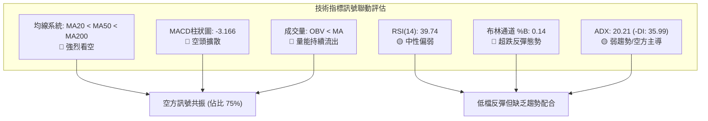

### 📈 移動平均線排列分析

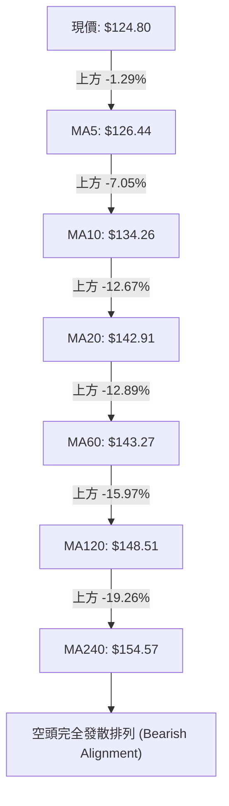

#### 均線數據明細解讀

- **MA5 ($126.44) / MA10 ($134.26)**：短線壓制極重，現價尚無法有效站穩 5 日線。
- **MA20 ($142.91) / MA50 ($143.83)**：已形成死亡交叉（MA20 < MA50），中期趨勢下傾斜率陡峭。
- **MA200 ($152.28)**：價格遠離年線達 18.05%，確認跌破牛熊分界線。均線系統給出全面做空訊號。

### 📉 RSI(14) 分析

```
RSI(14) 當前數值進度條
超賣 (0-30)           中性區間 (30-70)                 超買 (70-100)
├──────────────┼───────────────────────────────┼──────────────┤
███████████████░░░░░░░░░░░░░░░░░░░░░░░░░░░░░░░░░░░░░░░░░░░░░░░░
0              30     ▲39.74                    70            100
```

- **當前數值**：39.74（Wilder平滑）。
- **區間評定**：處於中性偏空弱勢區。值得注意的是，即便股價創下 $110.89 52週新低，日線 RSI 僅觸及約 30 附近即回升至 39.74，並未形成 <20 的極端恐慌性超賣，顯示下行動能並非瞬間宣洩，而是持續性的陰跌出貨。
- **背離分析結論**：經檢驗近 20 根 K 棒首尾價格與 RSI 走勢，**無明顯頂背離或底背離**。價格走弱與動能指標走弱步伐一致，為正常的弱勢趨勢，無指標底背離支持多頭大反轉。

### 📊 MACD(12/26/9) 訊號解讀

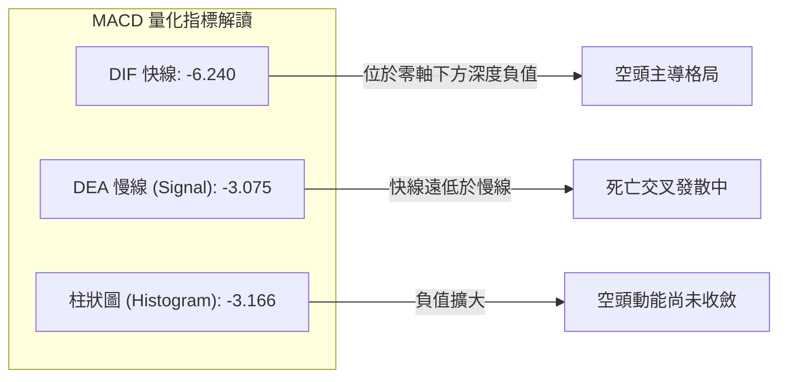

- **快慢線位置**：DIF (-6.240) 與 Signal (-3.075) 均深陷零軸之下，屬於典型的「水下死叉」惡性看空形態。
- **柱狀圖動態**：當前 Hist 為 -3.166 🔴。儘管 11/06 收陽，但柱狀體負值依然顯著放大，表明空方控盤實力未受根本性動搖。

### 📦 布林通道分析

```
日線布林通道 (20, 2) 結構示意圖
$168.24 ┬────────────────────────────────────────── 上軌 (Upper Band)
        │
        │
$142.91 ┼────────────────────────────────────────── 中軌 (MA20 Baseline)
        │
$124.80 ┼──────────────► 【現價 $124.80 (%B = 0.14)】
        │
$117.58 ┴────────────────────────────────────────── 下軌 (Lower Band)
```

- **通道寬度**：上軌 $168.24，下軌 $117.58，頻寬高達 $50.66（約佔股價 40.6%），表明近期波動極劇。
- **%B 指標**：%B 當前為 **0.14**，價格從 11/05 擊穿下軌外緣（最低 $110.89）強行拉回下軌上方，觸發標準的「布林通道極限超跌抽軌反應」。依照布林通道均值回歸理論，反彈第一阻力目標即為中軌 **$142.91**。

### 💹 成交量分析（量價配合度）

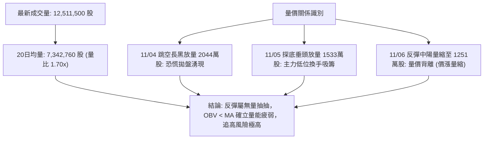

- **OBV (能量潮指標)**：數據明確標示 **OBV < MA**，代表資金流向長期處於淨流出階段。11/06 股價反彈 +10.55%，成交量反而由 15.3M 縮減至 12.5M，量價出現負背離，確認反彈僅屬空頭獲利回補而非實質機構建倉。

---

## 6. 動能與波動率

### ⚡ 動能評估四象限

| 象限 | 動能強度 | 波動率水準 | 當前狀態標註 | 策略意涵與環境評估 |
|------|----------|------------|--------------|--------------------|
| **Q1 (高動能·低波動)** | 強 (Bull) | 低 (Low Vol) | — | 穩定多頭趨勢，主升浪持有 |
| **Q2 (弱動能·低波動)** | 弱 (Bear) | 低 (Low Vol) | — | 窄幅無聊震盪，觀望為主 |
| **Q3 (強動能·高波動)** | 強 (Bull) | 高 (High Vol) | — | 狂熱多頭突破，高風險高收益 |
| **Q4 (弱動能·高波動)** | 弱 (Bear) | 高 (High Vol) | **✓ 當前 VST 處於此象限** | **下行空頭釋放期，防禦避險、逢高沽空** |

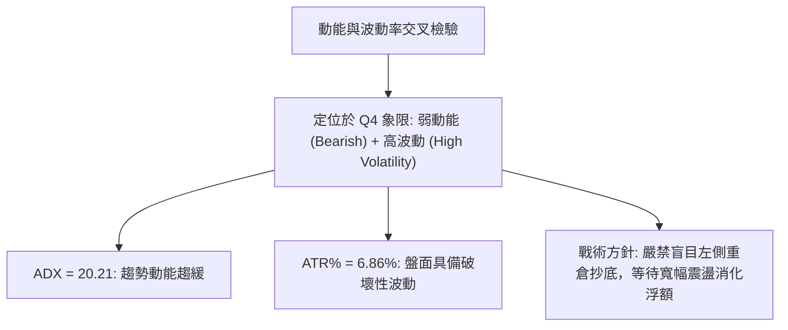

### 📊 ATR 波動率分析

- **ATR(14) 數值**：**$8.56**（Wilder計算）。
- **ATR 佔比**：高達現價的 **6.86%**，顯著高於美股大型公用事業板塊通常的 1.5%–2.5% 水準，顯示 VST 兼具電力獨立發電商與資料中心概念的高投機波動屬性。
- **止損距離建議**：
  - *短線當沖/隔夜止損*：1.0 × ATR = **$8.56**。
  - *波段交易止損*：1.5 × ATR = **$12.84**。
  - *防守底線*：任何多頭進場均不得承受低於 52W 低點 $110.89 之下超過 0.5 ATR 的回撤（$110.89 − $4.28 = $106.61）。

### 📐 Beta 與市場相關性

- **Beta 係數**：**1.375**。
- **市場特徵解讀**：作為公用事業板塊個股，其 Beta 遠高於 1.0，表明其對標普500指數波動具有 137.5% 的高放大槓桿效應。在美股大盤回調背景下，其下行貝塔將加劇賣壓釋放；反之在大盤強勢反彈時具備更高彈性。

---

## 7. 多時框架總結

### 📋 時框架評分表

| 時框架 | 趨勢方向 | 動能狀態 | 均線排列 | 圖表形態 | 綜合評分 | 操作建議 |
|--------|----------|----------|----------|----------|----------|----------|
| **長期 (月線)** | 偏空 🔴 | 減弱 🔴 | 跌破 MA20 🔴 | 歷史高位雙重頂部破位 | 35/100 | 長期投資者縮減部位 |
| **中期 (週線)** | 空頭 🔴 | MACD死叉 🔴 | MA20向下勾頭 🔴 | 倒V字形反轉暴跌 | 30/100 | 中期反彈逢高減碼 |
| **短期 (日線)** | 超跌反彈 🟡 | RSI低檔回升 🟡 | 空頭排列 MA5<MA20 🔴 | 低位雙日孕線反彈 | 38/100 | 僅供激進者短線博弈 |

### 🔲 綜合訊號矩陣

```
訊號維度矩陣檢驗
維度項目        短期 (日線)    中期 (週線)    長期 (月線)    全時框共振度
─────────────────────────────────────────────────────────────
趨勢方向        🟡 弱勢反彈    🔴 破位下跌    🔴 震盪盤跌    80% 偏空
均線系統        🔴 空頭排列    🔴 死叉成形    🟡 測試年線    85% 偏空
動能指標        🟡 中性修復    🔴 水下發散    🔴 動能衰退    75% 偏空
成交量能        🔴 價漲量縮    🔴 高檔放量    🔴 OBV持續流出 90% 偏空
─────────────────────────────────────────────────────────────
整體訊號收斂評定：🔴 偏空格局，短期反彈屬次級逆向波
```

### ⚖️ 多時框收斂結論

依據多時框收斂原則（規則 14）：
1. **行情性質判定**：當前 ADX(14) 為 **20.21**（嚴格小於 25），確立當前**非單邊趨勢主升/主跌行情，而轉入盤整震盪行情**。
2. **主導維度依歸**：在 ADX < 25 條件下，交易邏輯應以**日線布林通道（下軌 $117.58 至 上軌 $168.24）**作為核心邊界，中軌 $142.91 則為多空分界線。
3. **時框衝突取捨**：雖然短期日線自 $110.89 展開強勁反彈，但中期週線與長期月線均線呈現全面空頭排列，且均線壓頂。因此，**日線的反彈訊號僅能視為「空頭行情中的超跌均值回歸」**，絕不可判定為牛市重啟。
4. **方向性結論**：**整體格局維持【偏空】（評分 34/100）**，策略以「逢高布局空單」或「空倉觀望」為主導，堅決規避追高多頭部位。

---

## 8. 交易策略建議

### 🗺️ 策略決策流程圖

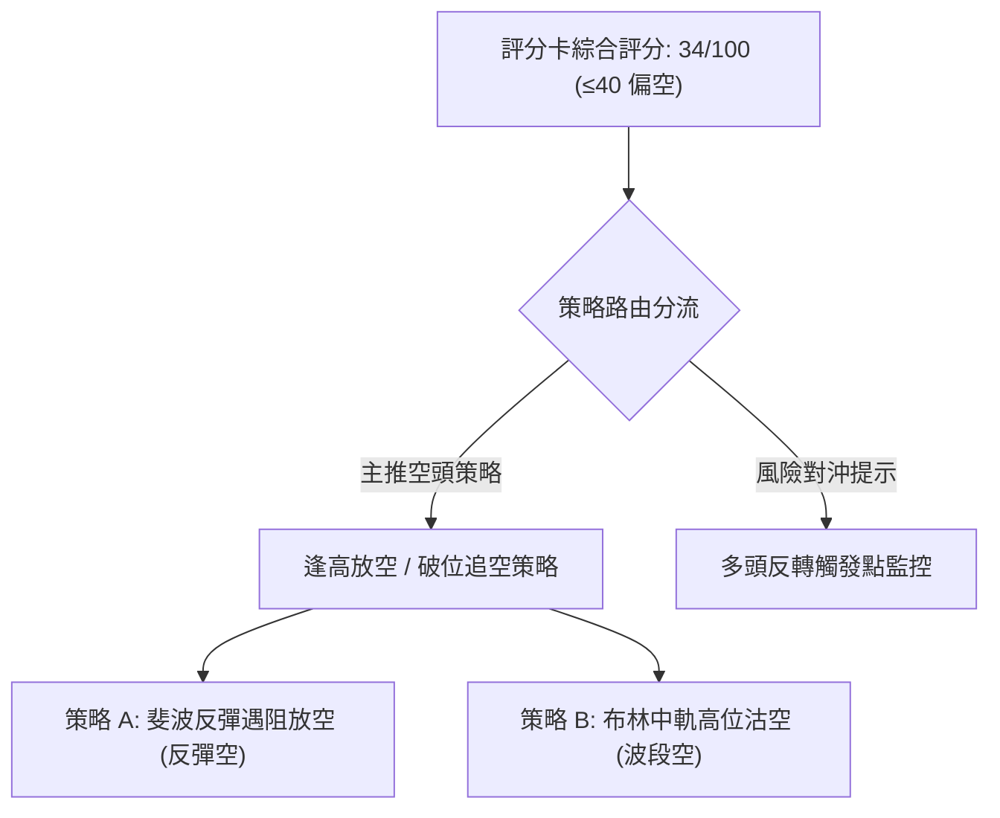

### 🧭 策略路由（依評分卡分流）

> **當前主策略方向 = 【主推空頭策略】（依評分 34/100，規則 18）**

綜合評分 34 分處於 ≤40 偏空區間，依規範嚴格主推空頭策略，多頭僅列為反轉風險對沖提示，不作為首選推薦。

### 🎯 價格情境階梯（Price Scenarios）

*(註：所有價位完全引用第 4 章數據與關鍵價位區塊)*

| 觸發條件 | 下一目標 | 後續延伸 | 情境含義 |
|----------|----------|----------|----------|
| **反彈受阻於 78.6% $129.03** | 布林下軌 $117.58 | 52W低點 $110.89 | 短線反彈夭折，重回下行探底 |
| **突破 78.6% $129.03** | 斐波 61.8% $143.27 | 阻力 R1 $149.93 | 超跌反彈擴大，測試中軌均線群 |
| **跌破 52W低點 $110.89** | 分析師底標 $106.00 | 通道目標 $106.68 | 創下年內新低，引發新一輪止損狂潮 |

### 📊 情境機率分佈

| 情境劇本 | 機率 | 主要依據 |
|----------|------|----------|
| **情境一：弱反彈後受阻回落** | **55%** | MACD負值達 -3.166 仍深，OBV < MA 量能萎縮，均線全面空頭向下壓制 |
| **情境二：布林帶區間寬幅震盪** | **30%** | ADX = 20.21 顯示單邊動能不足，股價於 $117.58 至 $142.91 區間來回拉鋸 |
| **情境三：強勢反轉直接收復MA20** | **15%** | 需每日放量逾 2000 萬股強行消化上方套牢籌碼，當前量能水準極難達成 |

### 🟢 主策略詳情（空頭主導，規則 17 精確計算）

#### 策略 A：斐波那契 78.6% 壓力位遇阻放空（短線首選）
- **進場條件**：價格反彈至斐波 78.6% 回調位 $129.03 附近出現日線滯漲長上影線
- **進場價格**：**$129.03**
- **目標價 T1**：**$117.58**（布林通道下軌）
- **目標價 T2**：**$110.89**（52週最低點 / 斐波 100%）
- **止損價格**：**$134.26**（跌破之短線阻力 MA10）
- **風險報酬比計算**：
  - 潛在風險 = $134.26 − $129.03 = $5.23
  - 潛在回報 (T1) = $129.03 − $117.58 = $11.45
  - **風險報酬比 = 1 : 2.19（以 T1 計）**
  - 潛在回報 (T2) = $129.03 − $110.89 = $18.14
  - **風險報酬比 = 1 : 3.47（以 T2 計）**
- **成功機率**：60%
- **建議倉位**：15%

#### 策略 B：布林中軌 / MA20 均線阻力做空（波段勝率型）
- **進場條件**：強反彈觸及布林中軌 $142.91 與斐波 61.8% $143.27 共振阻力帶
- **進場價格**：**$142.91**
- **目標價 T1**：**$124.80**（當前收盤價位置）
- **目標價 T2**：**$110.89**（52週最低點）
- **止損價格**：**$149.93**（關鍵阻力位 R1）
- **風險報酬比計算**：
  - 潛在風險 = $149.93 − $142.91 = $7.02
  - 潛在回報 (T1) = $142.91 − $124.80 = $18.11
  - **風險報酬比 = 1 : 2.58（以 T1 計）**
  - 潛在回報 (T2) = $142.91 − $110.89 = $32.02
  - **風險報酬比 = 1 : 4.56（以 T2 計）**
- **成功機率**：65%
- **建議倉位**：20%

### 🔴 反向風險觸發點（對沖提示）

若出現以下情境，主推之空頭策略將被**嚴格推翻**，交易者須立即執行空單止損並轉向防禦：
1. **多頭突破點**：日 K 線帶量（單日成交量 > 15,000,000 股）突破並連續兩日收於 **$143.27**（斐波 61.8% / MA60）之上。
2. **動能逆轉點**：MACD 柱狀圖在零軸下方完成黃金交叉，且 RSI 站穩 50.0 以上。
3. **風控應對**：若觸發上述條件，空單全數離場；激進多頭可於回踩確認時小倉位跟進，目標上看 R1 **$149.93**。

### ⭐ 整體訊號強度評星

```
做多訊號強度：★★☆☆☆  (2/5星 - 僅屬跌深反抽)
做空訊號強度：★★★★☆  (4/5星 - 順應大級別均線壓制)
整體可信度：  ★★★★☆  (4/5星 - 多指標高度共振)
```

---

## 9. 風險提示與監控

### ✅ 關鍵監控指標 Checklist

```
╔══════════════════════════════════════════════════════════════╗
║                    交易風險即時監控清單                      ║
╠══════════════════════════════════════════════════════════════╣
║ [ ] 價格突破監控：密切關注現價能否突破斐波 78.6% ($129.03)    ║
║ [ ] 下方支撐警報：52W 最低點 ($110.89) 是否再次被試探          ║
║ [ ] 成交量閥值：日成交量是否異常放大至 20,000,000 股以上       ║
║ [ ] 動能背離監控：RSI 能否突破 50 中性水位或跌破 30 超賣線     ║
║ [ ] 波動率警戒：單日振幅是否超過 1.5 ATR ($12.84)              ║
║ [ ] 均線交叉驗證：MA5 ($126.44) 與 MA10 ($134.26) 短期交叉方向 ║
╚══════════════════════════════════════════════════════════════╝
```

### ⚠️ 風險場景分析

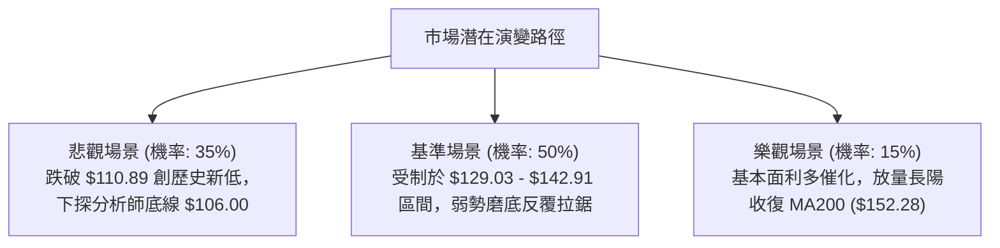

### 🛡️ 風險管理重要提醒

1. **財務結構與高槓桿風險**：VST 總負債高達 $20.51B，負債權益比 (D/E) 高達 373.28，流動比率僅 0.973，速動比率為 0.258。在宏觀利率維持高位的環境下，高槓桿特質使其基本面極易放大技術面拋壓。
2. **高波動率部位管控**：當前 ATR 為 $8.56（6.86%），單一交易部位建議不超過總投資組合的 **5%–8%**，嚴防黑天鵝缺口風險。
3. **止損紀律**：禁止在無預設止損的情況下持倉過夜，所有進場單必須嚴格掛設條件單。

---

## 📋 報告總結

```
╔════════════════════════════════════════════════════════════════╗
║                   VST 技術分析報告總結                         ║
╠════════════════════════════════════════════════════════════════╣
║ 報告日期：2026-11-07                                           ║
║ 當前價格：$124.80                                              ║
║ 分析評級：🔴 偏空震盪（技術評分卡：34/100）                    ║
║                                                                ║
║ 關鍵結論：                                                     ║
║ ├─ 長期趨勢：🔴 月線高位回落，均線全線潰敗                      ║
║ ├─ 中期趨勢：🔴 週線 MACD 水下死叉，下降通道成形               ║
║ ├─ 短期趨勢：🟡 52W 低點 $110.89 獲支撐，觸發技術性超跌反彈    ║
║ ├─ 關鍵阻力：$129.03 (78.6%) / $142.91 (MA20) / $149.93 (R1)   ║
║ ├─ 關鍵支撐：$117.58 (BB下軌) / $110.89 (52W最低點)            ║
║ └─ 分析師目標：均價 $203.71 / 低標 $106.00 / 高標 $306.00      ║
║                                                                ║
║ 最優策略組合：                                                 ║
║ 1. 🥇 最佳機會：策略 A — 反彈至 $129.03 遇阻做空 (RRR 1:2.19)  ║
║ 2. 🥈 次選機會：策略 B — 反彈至 MA20 $142.91 布局做空 (RRR 1:2.58)║
║ 3. 🥉 保守選擇：空倉觀望，等待日線布林通道明顯收口再行介入     ║
╚════════════════════════════════════════════════════════════════╝
```

---

> ⚠️ **免責聲明**：本報告為 AI 自動生成之技術分析，所有數據及估算均基於提供的歷史價格資訊。本報告**僅供研究與學術參考**，**不構成任何投資建議**。投資有風險，入市需謹慎。

---

*報告生成時間：2026-11-07 ｜ 數據來源：Yahoo Finance ｜ 分析框架：多時框技術分析*