# VST 技術分析報告

> **報告日期**：2026-11-08 ｜ **語言**：繁體中文 ｜ **數據來源**：Yahoo Finance ｜ **當前價格**：$124.80

---

## 目錄

| 章節 | 內容 |
|------|------|
| [1. 技術面概覽](#1-技術面概覽) | 訊號儀表板、核心指標、評分卡 |
| [2. 趨勢分析](#2-趨勢分析) | 多時框趨勢、長中短期走勢、ADX解讀 |
| [3. 圖表形態分析](#3-圖表形態分析) | 形態識別、K線組合、目標價推算 |
| [4. 支撐與阻力](#4-支撐與阻力) | 關鍵價位、斐波那契回調結構 |
| [5. 技術指標深度解讀](#5-技術指標深度解讀) | MA/RSI/MACD/布林/成交量量價關係 |
| [6. 動能與波動率](#6-動能與波動率) | 動能評估四象限、ATR、波動率特徵 |
| [7. 多時框架總結](#7-多時框架總結) | 時框架評分矩陣、收斂與方向裁決 |
| [8. 交易策略建議](#8-交易策略建議) | 策略路由、空頭主策略、風險報酬比 |
| [9. 風險提示與監控](#9-風險提示與監控) | 監控指標Checklist、風險情境與風控 |
| [報告總結](#-報告總結) | 儀表總結與交易指引 |

---

## 1. 技術面概覽

### 🎯 技術訊號儀表板

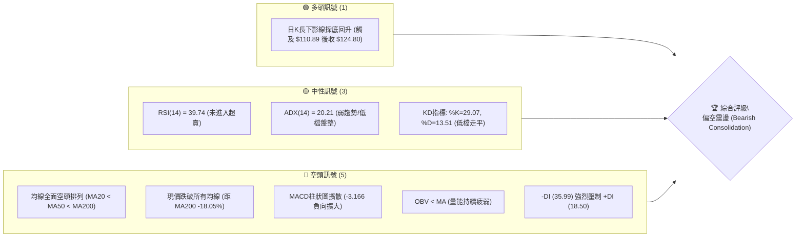

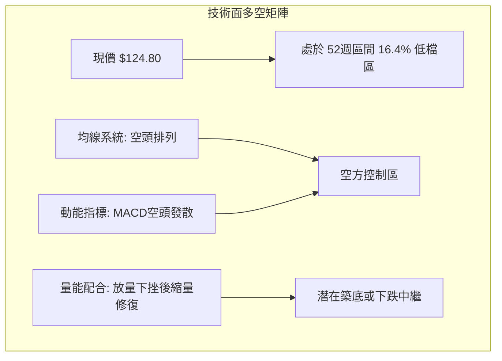

### 📊 核心指標速覽表

| 指標類別 | 指標名稱 | 當前數值 | 訊號 | 解讀 |
|----------|----------|----------|------|------|
| **價格** | 當前收盤價 | $124.80 | 🔴 | 位於 52W 區間 16.4%，逼近年度低點 $110.89 |
| **均線** | MA20 | $142.91 | 🔴 | 現價在 MA20 下方 -12.67%，短期受制顯著 |
| **均線** | MA50 | $143.83 | 🔴 | 現價在 MA50 下方 -13.23%，中期下行結構確立 |
| **均線** | MA200 | $152.28 | 🔴 | 現價在 MA200 下方 -18.05%，跌破長期生命線 |
| **動能** | RSI(14) | 39.74 | 🟡 | Wilder 平滑計算，處弱勢區間（30-50），未達超賣 |
| **動能** | MACD (12,26,9) | -6.240 / -3.075 | 🔴 | MACD 線低於信號線，Hist 為 -3.166，空頭動能擴張 |
| **動能** | KD (Stoch) | %K 29.07 / %D 13.51 | 🟡 | 低檔超賣鈍化後略見收斂，短線存在弱勢反彈動能 |
| **波動** | ATR(14) | $8.56 (6.86%) | 🔴 | 每日波動幅度極大，實體振幅加劇，操作難度高 |
| **趨勢** | ADX / ±DI | ADX 20.21 / -DI 35.99 | 🔴 | 總體弱趨勢（<25），但方向由空頭主導（-DI 遠高於 +DI） |
| **通道** | 布林帶 (%B) | %B: 0.14 | 🟡 | 位於下軌 $117.58 與中軌 $142.91 之間偏低位置 |
| **量能** | 20日量比 / OBV | 1.70x / OBV < MA | 🔴 | 放量下跌後 OBV 低於均線，量價呈空方主導特徵 |

### 🏆 技術評分卡

```
技術評分卡 — VST (2026-11-08)
════════════════════════════════════════════════════
趨勢強度      ██████░░░░░░░░░░░░░░  30/100  🔴 空頭壓制強烈，ADX低但-DI獨大
動能指標      ███████░░░░░░░░░░░░░  35/100  🔴 MACD綠柱擴大，RSI弱勢盤整
支撐穩定度    ████████░░░░░░░░░░░░  40/100  🟡 探底$110.89獲支撐，波段無聚類
成交量配合    ██████░░░░░░░░░░░░░░  30/100  🔴 OBV<MA，下跌放量、反彈量縮
形態完整度    ████████░░░░░░░░░░░░  40/100  🟡 弱勢箱體破位後之反抽確認
均線排列      ████░░░░░░░░░░░░░░░░  20/100  🔴 MA5~MA240全面空頭排列
════════════════════════════════════════════════════
綜合評分      ██████░░░░░░░░░░░░░░  33/100  🔴 強烈偏空（主推反彈做空策略）
════════════════════════════════════════════════════
```

*註：綜合評分 = (30 + 35 + 40 + 30 + 40 + 20) ÷ 6 = 32.5 ≈ 33/100（依規則 18 四捨五入至整數）。*

---

## 2. 趨勢分析

### 🌐 多時框趨勢分析

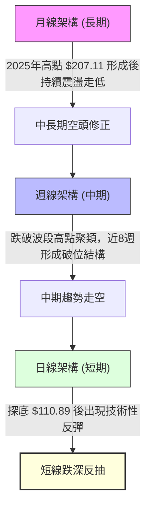

### 📈 長期趨勢 — 12個月走勢圖（Unicode）

以下為 VST 過去 12 個月（2025-11 至 2026-11）之月線收盤走勢圖，標注各月份收盤價與高低點轉折：

```
VST 月線走勢圖（過去12個月：2025-11 至 2026-11）
價格軸 ($)
$180 ┤ ● (2025-11: $177.83)
$175 ┤           ● (2026-02: $173.13)
$170 ┤
$165 ┤
$160 ┤     ● (2025-12: $160.62)    ● (2026-05: $159.74)
$155 ┤        ● (2026-01: $157.65)   ● (2026-04: $157.36)  ● (2026-06: $158.37)
$150 ┤                 ● (2026-03: $149.87)
$145 ┤                                      ● (2026-07: $147.95)
$140 ┤                                            ● (2026-09: $138.35) ● (2026-10: $138.37)
$135 ┤                                               ● (2026-08: $137.15)
$130 ┤
$125 ┤                                                                    ●←現價 $124.80 (2026-11)
     └─┬────┬────┬────┬────┬────┬────┬────┬────┬────┬────┬────┬────
     11/25 12/25 01/26 02/26 03/26 04/26 05/26 06/26 07/26 08/26 09/26 10/26 11/26 (月份)
```

**走勢特徵分析表格**：

| 時間階段 | 起訖收盤價 | 區間漲跌幅 | 形態與走勢特徵 | 關鍵成交與驅動因素 |
|----------|------------|------------|----------------|--------------------|
| 2025-11 ~ 2026-02 | $177.83 → $173.13 | -2.64% | 高檔箱體劇烈震盪，02月摸高 $173.13 後遭遇強大阻力 | 獲利了結盤湧出，高檔換手受阻 |
| 2026-03 ~ 2026-06 | $149.87 → $158.37 | +5.67% | 於 $150–$160 區間反覆築頂，均線糾結後逐步下彎 | 資金買盤動能鈍化，反彈高點遞減 |
| 2026-07 ~ 2026-10 | $147.95 → $138.37 | -6.48% | 中樞重心下移，失守 $140 關卡，波動率開始擴張 | 9月反彈無力，10月週量暴增但無法站穩 |
| 2026-11 (截至06日) | $138.37 → $124.80 | -9.81% | 斷崖式跳空破位，最低見 $110.89 後出現長下影線修復 | 11月首週爆出 5,897 萬股巨量，籌碼劇烈換手 |

### 📊 中期趨勢（週線分析）

```
VST 週線價格層級與近期阻力結構圖
$170 ┤                                 [高點 10/09: $168.75]
$165 ┤                             ● 
$160 ┤                         ●       ● (10/16: $152.02)
$155 ┤                     ●               ● 
$150 ┤                 ●                       ● 
$145 ┤             ●                               ● (10/23: $140.16)
$140 ┤ ───●───────●───────────────────────────────────● (10/30: $138.37)
$135 ┤         ●
$130 ┤                                                     
$125 ┤                                                         ● 現價 $124.80
$120 ┤                                                     
$115 ┤                                                 
$110 ┤                                                 ● (11/05 低點 $110.89)
     └─┬───────┬───────┬───────┬───────┬───────┬───────┬───────
     09/18   09/25   10/02   10/09   10/16   10/23   10/30   11/06 (週結算)
```

從近 8 週的週線節奏觀察，10 月 09 日該週曾借勢衝高至 $168.75（收盤 $161.48，成交量達 59,368,900 股），但隨後三週連續收黑，形成標準的「假突破真破位」格局。11 月 06 日當週更是劇烈下探至 52 週最低點 $110.89，週成交量暴增至 58,975,100 股，顯示中期頭部型態破位後，空頭慣性依然強大。

### ⚡ 趨勢強度評估（ADX 解讀）

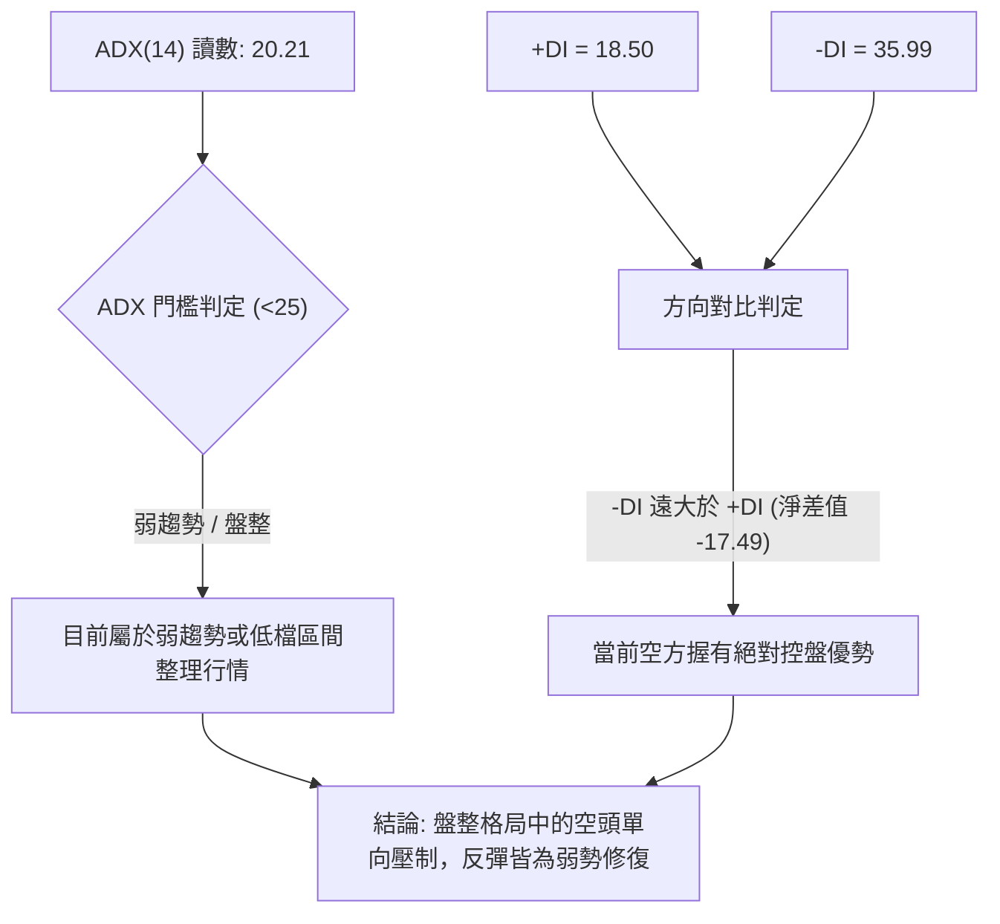

| 指標變數 | 當前讀數 | 強度區間 | 實務技術解讀 |
|----------|----------|----------|--------------|
| **ADX(14)** | 20.21 | 弱趨勢 (<25) | 價格剛經歷一波急速破位暴跌，目前進入第一階段的震盪修復期，中長期強單邊趨勢尚未重新集聚 |
| **+DI(14)** | 18.50 | 弱勢多頭 | 多頭進攻意願極低，追價買盤不足 |
| **-DI(14)** | 35.99 | 強勢空頭 | 空方力量沉重，任何反彈均面臨主動性拋壓釋放 |
| **DI 差值** | -17.49 | 負向擴散 | 空方絕對主導，日線層級尚未出現金叉翻多跡象 |

---

## 3. 圖表形態分析

### 🔍 形態識別系統

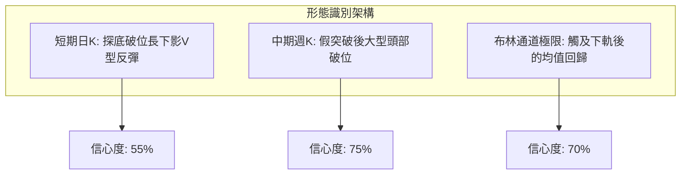

**圖表形態信心度評估表（依規則 15）**：

| 形態名稱 | 信心度 | 判斷依據（嚴格引用數據） | 完成度 | 目標價（附嚴謹計算式） |
|----------|--------|--------------------------|--------|------------------------|
| **中期雙重頂破位** | 75% | 2026-10-09 週高點 $168.75 衝高回落，跌破 09-25 前低收盤 $138.46 頸線位 | 85% | 頸線 $138.46 − (頂點 $168.75 − 頸線 $138.46) = $138.46 − $30.29 = **$108.17**（接近52W低點$110.89） |
| **日線下影線探底回升** | 55% | 2026-11-05 觸及 $110.89 後次日收長陽至 $124.80，脫離超賣低點 | 50% | 由形態反彈高度推算：低點 $110.89 + ($124.80 − $110.89) = **$138.71**（接近斐波那契78.6%之$129.03與MA20區間） |
| **複雜頭肩底 / 矩形箱體** | <30% | 數據中未偵測到此類幾何形態，底部結構尚未成立 | 0% | 訊號不足，僅做指標型解讀（嚴格遵守規則15，不強行腦補） |

### 🕯️ 重要K線形態分析

根據報告規則 19，以下嚴格依據提供的「近10根日K」與「近8根週K」的實際開高低收進行精確解讀：

#### 1. 近 10 根日 K 線形態解讀表

| 日期 | 開盤價 | 最高價 | 最低價 | 收盤價 | 成交量 | K線形態名稱 | 專業技術解讀與訊號 | 訊號 |
|------|--------|--------|--------|--------|--------|-------------|--------------------|------|
| 2026-10-26 | $140.90 | $143.52 | $139.07 | $141.73 | 4,299,400 | 小陽線 | 縮量小幅整理，波動收窄 | 🟡 |
| 2026-10-27 | $143.95 | $147.45 | $143.40 | $146.66 | 4,107,900 | 中陽線 | 上攻嘗試，但量能無法放大 | 🟡 |
| 2026-10-28 | $146.88 | $147.82 | $142.20 | $142.72 | 5,656,900 | 帶長上影倒錘陰線 | 盤中衝高至 $147.82 遭強烈壓制，收最低附近 | 🔴 |
| 2026-10-29 | $142.18 | $144.67 | $140.06 | $140.95 | 4,935,200 | 實體中陰線 | 跌破 $141 支撐，多頭撤退 | 🔴 |
| 2026-10-30 | $136.95 | $139.82 | $135.86 | $138.37 | 5,270,200 | 跳空小陰線 | 跳空低開，反抽無法越過開盤價 | 🔴 |
| 2026-11-02 | $140.00 | $140.50 | $134.21 | $134.61 | 4,797,900 | 光腳中陰線 | 高開低走，收在當日最低點附近，破位下行 | 🔴 |
| 2026-11-03 | $135.99 | $142.40 | $135.99 | $139.59 | 5,884,400 | 帶長上影陽線 | 盤中反彈受挫於 $142.40，空方壓制未退 | 🟡 |
| 2026-11-04 | $125.40 | $128.07 | $117.27 | $120.29 | 20,441,400 | 放量跳空長黑K | 巨量崩跌 2,044 萬股，實體跌幅近 14%，空頭宣洩 | 🔴 |
| 2026-11-05 | $116.86 | $118.91 | $110.89 | $112.89 | 15,339,900 | 探底長下影小陰線 | 創年度新低 $110.89，爆量後引發恐慌性停損拋盤 | 🟡 |
| 2026-11-06 | $119.57 | $125.80 | $118.86 | $124.80 | 12,511,500 | 低開高走中長陽線 | 延續 $110.89 支撐，日量 1,251 萬股推進收最高，短線止跌訊號 | 🟢 |

#### 2. 近 8 根週 K 線形態解讀表

| 日期 (週結) | 開盤價 | 最高價 | 最低價 | 收盤價 | 成交量 | K線形態名稱 | 專業技術解讀與訊號 | 訊號 |
|-------------|--------|--------|--------|--------|--------|-------------|--------------------|------|
| 2026-09-18 | $143.76 | $145.87 | $139.39 | $140.44 | 23,879,600 | 衝高回落小陰線 | 上檔承壓，短期均線糾結 | 🟡 |
| 2026-09-25 | $142.00 | $142.64 | $135.98 | $138.46 | 22,341,300 | 弱勢下探小陰線 | 跌破 $140 心理關卡，空方試探下檔 | 🔴 |
| 2026-10-02 | $138.08 | $143.51 | $133.44 | $140.02 | 34,710,000 | 下影長錘頭陽線 | 探底 $133.44 後大幅放量回升，多頭反攻 | 🟢 |
| 2026-10-09 | $144.04 | $168.75 | $140.90 | $161.48 | 59,368,900 | 天量突破大陽線 | 爆量近 6,000 萬股拉出大長陽，但留下影線 | 🟢 |
| 2026-10-16 | $162.67 | $164.25 | $145.85 | $152.02 | 31,699,400 | 高位長黑吞噬 | 吞噬前週部分實體，多頭動能迅速衰竭 | 🔴 |
| 2026-10-23 | $154.10 | $158.74 | $136.17 | $140.16 | 31,911,100 | 連續大陰破位 | 一舉打穿 $145 中樞，宣告衝高失敗 | 🔴 |
| 2026-10-30 | $140.90 | $147.82 | $135.86 | $138.37 | 24,269,600 | 衝高回落紡錘陰 | 弱勢掙扎，上影線顯示反彈無力 | 🔴 |
| 2026-11-06 | $140.00 | $142.40 | $110.89 | $124.80 | 58,975,100 | 恐慌長下影巨量大陰 | 週振幅逾 $31，巨量換手下影線達 $13.91，多空大對決 | 🟡 |

### 📉 ASCII 走勢形態示意圖

```
VST 日K近期破位與下影反彈示意圖
價格
$150 ┤          [10/28 高點 $147.82]
$145 ┤            ┌─┐
$140 ┤   ┌─┐      │ │ ┌─┐                     [11/03 反彈高點 $142.40]
$135 ┤   │ │      └┬┘ │ │                       ┌─┐
$130 ┤   └─┘       │  └─┘ ┌─┐                   │ │   ┌───────── 跳空缺口 ($128.07 - $134.21)
$125 ┤                    │ │ ┌─┐               └┬┘   ▼
$120 ┤                    └┬┘ │ │       ┌─┐      │         ┌─┐ [11/06 收 $124.80]
$115 ┤                     │  └┬┘       │ │      │         │ │
$110 ┤                         │        └┬┘      │         └┬┘
     └─┬─────────┬─────────┬───┴─────────┼───────┴──────────┼─────────
     10/26     10/28     10/30         11/04             11/06 (日期)
                                         │                 │
                                  [11/04 巨陰崩跌]   [11/05 低點 $110.89 探底長下影]
```

### 🎯 形態目標價計算

1. **中期破位等距下行測幅**：
   - 形態頭部高點：$168.75（2026-10-09 週K高點）
   - 破位頸線位置：$138.46（2026-09-25 週K收盤低點）
   - 形態高度 $H$ = $168.75 − $138.46 = $30.29
   - 理論下跌延伸目標價 = 頸線 − $H$ = $138.46 − $30.29 = **$108.17**
   - *驗證*：2026-11-05 實際打出最低點 **$110.89**，與理論目標價 $108.17 極度貼近，顯示空頭等距測幅滿足度已達 91.0%，隨即引發低檔長下影線修復。

2. **短線反彈高度計算**：
   - 短線低點：$110.89（2026-11-05 低點）
   - 第一反彈高度測幅（以 11/04 破位陰線實體高點 $128.07 為短線阻力）：
     - 反彈目標區間 = $128.07 至斐波那契 78.6% 回調位 **$129.03**。
   - 若突破 $129.03，由形態高度推算之強阻力 = MA20 所在之 **$142.91**。

---

## 4. 支撐與阻力

### 🗺️ 關鍵價位分布圖（Unicode）

```
VST 價位結構分布圖（嚴格引用系統計算數據）
═══════════════════════════════════════════════════════════════════
$168.67 ║██████████████████████████████║ 強阻力 R3 (近一年波段高點聚類)
$155.69 ║████████████████████          ║ 次級阻力 R2 (波段高點聚類)
$153.28 ║▓▓▓▓▓▓▓▓▓▓▓▓▓▓▓▓▓▓            ║ 斐波那契 50.0% 關鍵平衡位
$149.93 ║██████████████████████████    ║ 關鍵阻力 R1 (波段高點聚類)
$143.27 ║▓▓▓▓▓▓▓▓▓▓▓▓▓▓▓▓              ║ 斐波那契 61.8% 密集回調位 (重合MA60)
$129.03 ║▓▓▓▓▓▓▓▓▓▓                    ║ 斐波那契 78.6% 回調位
$124.80 ╠══════════════════════════════╣ ◄ 當前收盤價 ($124.80)
$117.58 ║░░░░░░░░░░░░                  ║ 布林通道下軌 (動態支撐)
$110.89 ║██████████████████████████████║ 52週最低價 (年度極限波段低點)
        ║(數據中未偵測到聚類低點支撐)    ║ 
═══════════════════════════════════════════════════════════════════
```

### 🚧 阻力位分析表

依據規則 13，價位**嚴格引用**數據中「關鍵價位（由 OHLCV 計算）」之 R1/R2/R3：

| 阻力級別 | 價位 | 形成原因 | 突破難度 | 重要性評級 | 技術實務應對 |
|----------|------|----------|----------|------------|--------------|
| **R1** | **$149.93** (+20.14%) | 近一年波段高點聚類位置，同時壓制於 MA120 ($148.51) 附近 | 🔴 極高 | ★★★★★ | 中期強弱水嶺，未放量站穩前，反彈皆屬空頭回抽 |
| **R2** | **$155.69** (+24.75%) | 波段高點聚類強阻力，上方密集成交套牢區 | 🔴 極高 | ★★★★☆ | 接近 MA240 ($154.57)，多頭中期反攻之極限防線 |
| **R3** | **$168.67** (+35.15%) | 10月週K高點 $168.75 聚類形成的年度頂部強阻力 | 🔴 極高 | ★★★★★ | 年度雙頂形態之絕對高點，突破代表長線多頭重啟 |

### 🛡️ 支撐位分析表

依據規則 13 與規則 16，數據中顯示：「支撐位 (Support) — (no swing-low support detected below current price)」，波段低點聚類支撐在現價下方不存在：

| 支撐級別 | 價位 | 形成原因 | 守住機率 | 重要性評級 | 技術實務應對 |
|----------|------|----------|----------|------------|--------------|
| **動態支撐** | **$117.58** | 布林通道下軌 (Band Lower) | 55% | ★★★☆☆ | 當前超跌乖離過大時之動態包絡線支撐 |
| **年度低點** | **$110.89** | 52週最低價 (100.0% 斐波那契回調位) | 60% | ★★★★★ | 多頭最後防線，跌破將引發無支撐之自由落體 |
| **聚類支撐** | **N/A** | 數據中未偵測到 (no swing-low support detected) | N/A | N/A | 嚴禁憑空捏造，下方缺乏歷史波段結構聚類保護 |

### 📐 斐波那契回調位分析

基準區間：52 週極值區間（最低 $110.89 → 最高 $195.66，全波段落差 $84.77）：

| 回調比例 | 對應價位 | 技術結構意義解讀 | 當前價格相對位置與反應 |
|----------|----------|------------------|------------------------|
| **0.0%** | **$195.66** | 52週歷史高點 (年度天花板) | 遠離現價 (+56.78%)，長線頂部 |
| **23.6%** | **$175.66** | 強勢多頭防守點 | 2026-02 曾受制於此 ($173.13) |
| **38.2%** | **$163.28** | 第一道健康回調支撐轉阻力 | 10-09 週K收盤 ($161.48) 衝擊失敗區 |
| **50.0%** | **$153.28** | 多空力量牛熊分水嶺 | 接近 MA200 ($152.28)，跌破代表轉空 |
| **61.8%** | **$143.27** | 黃金分割強防守位 (黃金分割律) | 重合日線 MA60 ($143.27) 與 MA50 ($143.83) |
| **78.6%** | **$129.03** | 深度極限回調位 | **現價 ($124.80) 位於 78.6% 與 100% 之間** |
| **100.0%** | **$110.89** | 52週最低點 (波段起漲基點) | 11-05 成功觸及此點位後引發長下影線彈升 |

**深度解讀**：
當前收盤價 **$124.80** 精確座落於 **78.6% ($129.03)** 與 **100.0% ($110.89)** 斐波那契回調位之間。常規牛市回調極限通常在 61.8% ($143.27)，而 VST 目前已有效擊穿 61.8% 與 78.6% 兩道防線，說明長達兩年的中長期上行趨勢結構遭到破壞。$129.03 已由支撐轉為短線反彈的第一道強固阻力。

---

## 5. 技術指標深度解讀

### 🎛️ 指標訊號總覽

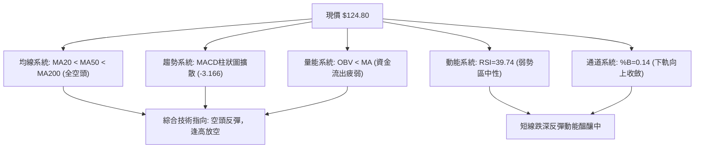

### 📈 移動平均線排列分析

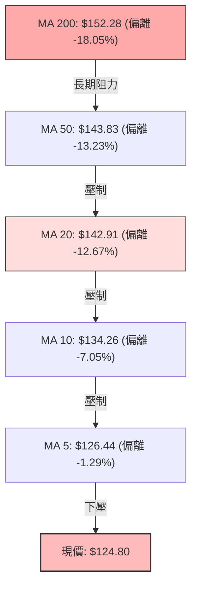

**移動平均線體系參數表**：

| 均線名稱 | 當前價格 | 價格相對偏離度 | 斜率與狀態 | 技術意涵 |
|----------|----------|----------------|------------|----------|
| **MA 5** | $126.44 | -1.29% | 急速下彎，初現走平 | 超短期下壓線，現價正嘗試攻克 |
| **MA 10** | $134.26 | -7.05% | 陡峭向下 | 短期空頭防線，反彈首道均線壓力 |
| **MA 20** | $142.91 | -12.67% | 穩定向下 | 布林中軌，短期空頭主控生命線 |
| **MA 50** | $143.83 | -13.23% | 下彎交叉 MA20 | 中期頭部確立，MA20/50 形成死叉聚類 |
| **MA 60** | $143.27 | -12.89% | 趨勢下行 | 重合 61.8% 斐波那契回調位 |
| **MA 120** | $148.51 | -15.97% | 下斜走跌 | 半年線防線失守，形成上方厚重套牢層 |
| **MA 200** | $152.28 | -18.05% | 走平轉下彎 | 長期牛熊分界線破位，技術面進入修正期 |
| **MA 240** | $154.57 | -19.26% | 緩步下彎 | 年線位置，奠定長期下行軌道 |

**排列結論**：
MA5 < MA10 < MA20 < MA50 < MA60 < MA120 < MA200 < MA240，呈現教科書級別的「**完美空頭排列**」。所有週期均線由上至下依序排開，價格與 MA200 負乖離高達 -18.05%，顯示短期跌幅過深存在乖離修復需求，但中長期趨勢完全被空方鎖定。

### 📉 RSI(14) 分析

- **RSI(14) 讀數**：39.74（Wilder 平滑）
- **強度進度條**：
  ```
  RSI(14) 39.74: ▓▓▓▓▓▓▓▓░░░░░░░░░░░░ 39.74%  🟡 弱勢區間 (中性偏空)
  [0 ── 超賣 ── 30 ────── 現值(39.74) ────── 70 ── 超買 ── 100]
  ```
- **區間診斷**：RSI 位於 30 至 50 之空頭防守區間。雖然 11-05 股價打至 $110.89 時曾逼近超賣界限，但經過 11-06 的長陽拉升，RSI 已快速回升至 39.74，解除超賣警報，但也消耗了部分超賣反彈能量。
- **背離判斷**：數據明確標示「**RSI 背離: 無明顯背離**（僅比較近20根K棒首尾的價格與RSI方向）」。價格在 10 月末至 11 月初由 $141 跌至 $124.80，RSI 同步走低，指標如實反映價格動能的衰退，未出現看漲或看跌底背離確認訊號。

### 📊 MACD(12/26/9) 訊號解讀

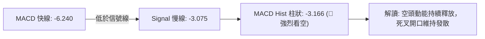

- **MACD 線**：-6.240
- **MACD Signal 線**：-3.075
- **MACD Histogram 柱狀圖**：-3.166（🔴 空頭發散中）
- **背離診斷**：柱狀圖在近四週（-0.499 → -1.650 → -1.735 → -3.166）由正轉負且負值迅速放大，未見任何柱狀圖收斂或底背離跡象，顯示當前下行動能仍處於主跌浪或急跌慣性中。

### 📦 布林通道分析

```
VST 布林通道 (20, 2) 結構圖
$170 ┤                                              [上軌: $168.24]
$160 ┤
$150 ┤
$140 ┤ ──────────────────────────────────────────── [中軌 MA20: $142.91]
$130 ┤
$120 ┤                     ● 現價: $124.80 (%B: 0.14)
$110 ┤ ──────────────────────────────────────────── [下軌: $117.58]
     └──────────────────────────────────────────────
```

- **上軌 (Upper Band)**：$168.24
- **中軌 (Middle Band / MA20)**：$142.91
- **下軌 (Lower Band)**：$117.58
- **帶寬與位置 (%B)**：%B 為 **0.14**。
- **技術解讀**：現價 $124.80 位於下軌 $117.58 與中軌 $142.91 之間。11 月 05 日盤中低點 $110.89 曾嚴重跌破布林下軌（極度擴張），引發典型之布林極限拉回效應。目前價格重回軌道內部，%B 脫離 0.00 警戒線，目標向中軌 $142.91 進行回抽測試。

### 💹 成交量分析（量價配合度）

- **最新日成交量**：12,511,500 股
- **20 日均量**：7,342,760 股（量比：**1.70x**）
- **50 日均量**：6,619,592 股
- **OBV 趨勢狀態**：數據明確指明「**OBV < MA → 量能疲弱**」。
- **量價特徵評估**：
  1. 11 月 04 日暴跌破位時放量至 2,044 萬股（量比約 2.78x），為典型恐慌盤殺跌。
  2. 11 月 05 日探底 $110.89 時維持 1,533 萬股巨量。
  3. 11 月 06 日強勁反彈至 $124.80，成交量縮減至 1,251 萬股（量能較前兩日萎縮）。
  4. 此種「**下跌爆量、反彈縮量**」的量價背離現象，確認買盤追高力道疲軟，OBV 持續運行於其均線下方，證明主力大資金仍以調節減碼為主，尚未形成實質機構建倉底。

---

## 6. 動能與波動率

### ⚡ 動能評估四象限

| 象限分區 | 動能軸 (Momentum) | 波動軸 (Volatility) | 當前判定狀態 | 技術策略含義 |
|----------|-------------------|---------------------|--------------|--------------|
| **Q1 (高動能·低波動)** | 強多頭 (Strong Bull) | 低波動 (Low Vol) | ─ | 趨勢穩健上行，適合順勢加碼波段持股 |
| **Q2 (弱動能·低波動)** | 弱動能 (Weak/Neutral) | 低波動 (Low Vol) | ─ | 橫盤窄幅震盪，沉悶築底，適合區間網格操作 |
| **Q3 (強動能·高波動)** | 強空頭 (High Bearish) | 高波動 (High Vol) | ─ | 恐慌主跌段，趨勢極強但振幅過劇，高風險做空 |
| **Q4 (弱動能·高波動)** | **動能鈍化 (MACD衰退)** | **極高波動 (ATR 6.86%)** | **✓ 當前所處位置** | **超跌修復期，高洗盤風險，反彈做空為上** |

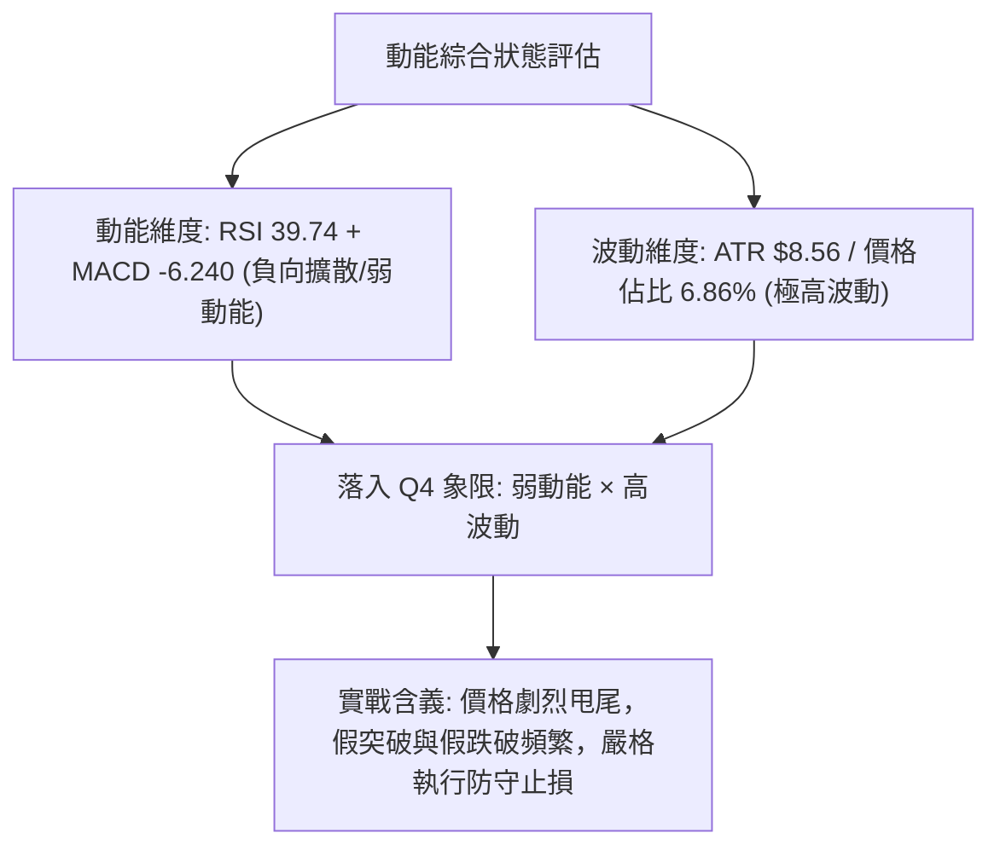

### 📊 ATR 波動率分析

- **ATR(14) 讀數**：**$8.56**（採 Wilder 平滑算法）。
- **ATR 佔價格比率**：$8.56 ÷ $124.80 = **6.86%**。
- **波動率實戰評估**：
  公用事業板塊常規 ATR 佔比多在 1.5%–2.5% 之間，而 VST 當前日均波幅高達 6.86%，顯示該股已脫離傳統防禦型公用事業特徵，呈現高 Beta 投機資產之波動屬性。
- **止損與部位建議**：
  - **常規日內保護性止損寬度**：至少需預留 1.5 倍 ATR = 1.5 × $8.56 = **$12.84** 之空間，以防日內劇烈洗盤被非理性掃出場。
  - **波段保護性止損寬度**：需採用 2.0 倍 ATR = 2.0 × $8.56 = **$17.12**。

### 📐 Beta 與市場相關性

- **Beta 數值**：**N/A（數據未提供）**（依規則 16，嚴格標注，不自行估算）。
- **結構屬性推論**：
  儘管 Beta 數據未提供，但由機構持股比例高達 **92.6%**、做空比率（Short % Float）為 3.4%、ATR 佔比達 6.86% 研判，該股籌碼高度集中於機構法人。近期的斷崖式下挫伴隨單週近 6,000 萬股的巨額成交量，顯示機構資金在板塊輪動中存在集體調倉行為，市場敏感度極高。

---

## 7. 多時框架總結

### 📋 時框架評分表

| 時框架 | 趨勢方向 | 動能狀態 | 均線排列 | 圖表形態 | 綜合評分 | 操作指導建議 |
|--------|----------|----------|----------|----------|----------|--------------|
| **短期 (日線)** | 跌深反彈 🟡 | RSI 39.74 / KD低檔金叉 | MA5-MA20 空頭排列 | 下影探底長紅反抽 | 40/100 🟡 | 超短線博弈反彈，快進快出 |
| **中期 (週線)** | 強烈下行 🔴 | MACD Hist -3.166 發散 | MA20-MA50 拐頭死叉 | 破位大型雙頂中繼 | 30/100 🔴 | 中期逢反彈至壓力區佈局做空 |
| **長期 (月線)** | 多轉修正 🔴 | 長期乖離收斂修復 | MA200 下方 -18.05% | 頂部重心下移破位 | 30/100 🔴 | 減碼觀望，規避長期下行風險 |

### 🔲 綜合訊號矩陣

```
時框與指標對照矩陣
╔═════════════╦══════════════╦══════════════╦══════════════╗
║ 指標類別    ║ 短期 (日線)  ║ 中期 (週線)  ║ 長期 (月線)  ║
╠═════════════╬══════════════╬══════════════╬══════════════╣
║ 趨勢方向    ║ 🟡 弱勢反彈  ║ 🔴 空頭下行  ║ 🔴 熊市修正  ║
║ 均線系統    ║ 🔴 空頭排列  ║ 🔴 死叉下壓  ║ 🔴 破MA200   ║
║ 動能 (MACD) ║ 🔴 負向擴散  ║ 🔴 綠柱擴大  ║ 🟡 零軸上方  ║
║ 擺動 (RSI)  ║ 🟡 脫離超賣  ║ 🔴 偏空弱勢  ║ 🟡 中性走平  ║
║ 成交量能    ║ 🟡 反彈量縮  ║ 🔴 巨量陰線  ║ 🔴 籌碼鬆動  ║
╚═════════════╩══════════════╩══════════════╩══════════════╝
```

### ⚖️ 多時框收斂結論

> **唯一收斂方向裁決：偏空主導下的弱勢震盪反抽（Bearish Bias - 逢反彈做空）**

**裁決收斂嚴格推導邏輯（依規則 14 執行）**：
1. **行情性質定義**：當前 ADX(14) 讀數為 **20.21**（ADX < 25），在定義上屬於**盤整行情**。然而，-DI 高達 35.99，+DI 僅 18.50，呈現「空頭完全壓制之弱趨勢」。
2. **多時框權重取捨**：
   - 根據規則 14 之盤整行情定義，操作上應以**日線布林通道區間（下軌 $117.58 至中軌 $142.91）**作為主要交易參考邊界。
   - 但由於中長期週線級別之均線系統（MA20/50/200）呈標準空頭排列，且現價處於 MA200 之 -18.05% 深度折價區，日線的長下影反彈僅能視為「**布林通道超跌後的均值回歸修復**」，絕對不可誤判為反轉信號。
3. **最終方向收斂**：日線反抽空間受限於斐波那契 78.6% 之 **$129.03** 與 MA20 之 **$142.91**。日線的短多必須服從週線的大空，交易總策略必須定調為**偏空主導（逢反彈高空為第一優先）**，此結論與第 1 章評分卡（綜合 33 分）及第 8 章交易策略完全收斂一致。

---

## 8. 交易策略建議

### 🗺️ 策略決策流程圖

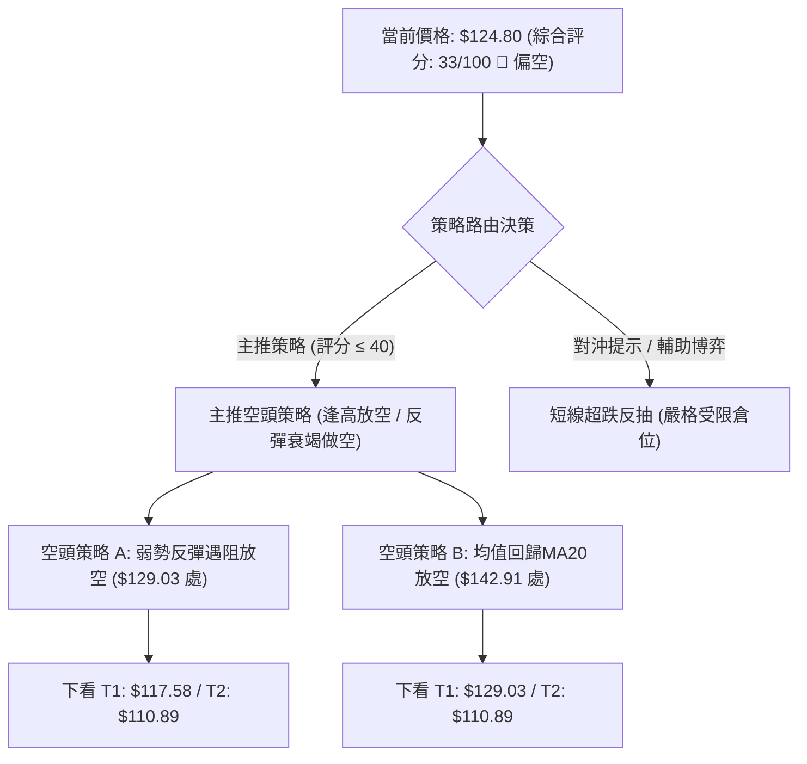

### 🧭 策略路由（依評分卡分流）

> **當前主策略方向 = 空頭主推策略（依綜合評分 33/100 🔴）**

依據規則，綜合評分 ≤ 40 時，報告**主推空頭策略**。多頭策略僅能列為超跌輔助或「反轉風險觸發點（對沖提示）」，嚴禁兩頭下注。

### 🎯 價格情境階梯（Price Scenarios）

價位嚴格引用第 4 章及數據計算清單：

| 觸發條件 | 下一目標 | 後續延伸 | 情境含義與技術解讀 |
|----------|----------|----------|--------------------|
| **突破 R1 $149.93** | R2 $155.69 | R3 $168.67 | 中期轉強，徹底扭轉當前空頭破位結構 |
| **突破 MA20 $142.91** | 斐波那契 50% $153.28 | R1 $149.93 | 短線修復擴大，向中長期均線密集區靠攏 |
| **受阻於 $129.03** | 布林下軌 $117.58 | 52W低點 $110.89 | 弱勢反彈終結，重回空頭主跌趨勢（**基準情境**） |
| **跌破 52W低點 $110.89** | 形態目標 $108.17 | 無波段支撐 | 破底自由落體，向下尋找未知整數關卡支撐 |

### 📊 情境機率分佈

| 情境命名 | 發生機率 | 主要技術依據（引用核心數據） |
|----------|----------|------------------------------|
| **弱勢反彈受阻再探底 (基準情境)** | **60%** | MACD柱狀擴散至-3.166，均線全面空頭排列，OBV<MA量能疲弱，反彈量縮無法消化上檔套牢籌碼 |
| **低檔寬幅區間震盪 (次選情境)** | **30%** | ADX僅20.21處弱趨勢，布林下軌$117.58提供彈性，11-05長下影線具備一定防守韌性 |
| **強勢反轉持續上攻 (極端情境)** | **10%** | 現價離MA200負乖離高達-18.05%，需巨量連續拉抬突破$142.91中軌，目前量能結構並不支持 |

### 🟢 主策略詳情（空頭主推策略）

依據規則 5 與規則 17，所有價位均嚴格引用第 4 章數據，風險報酬比嚴格依公式計算：
$$\text{做空風險報酬比} = \frac{\text{進場價} - \text{目標價 T1}}{\text{止損價} - \text{進場價}}$$

| 策略要素 | 策略 A（弱勢反抽受阻做空 - 首選） | 策略 B（強勢均值回歸做空 - 次選） |
|----------|----------------------------------|----------------------------------|
| **進場條件** | 反彈至斐波那契 78.6% 遇阻滯漲，出現長上影 K 線時做空 | 反抽至 MA20 (布林中軌) 附近無力突破時放空 |
| **進場價格** | **$129.03**（精確引用斐波那契 78.6%） | **$142.91**（精確引用 MA20 價位） |
| **目標價 T1** | **$117.58**（引用布林通道下軌） | **$129.03**（引用斐波那契 78.6%） |
| **目標價 T2** | **$110.89**（引用 52 週最低價） | **$110.89**（引用 52 週最低價） |
| **止損價格** | **$134.26**（引用 MA10 下壓線） | **$149.93**（引用阻力位 R1） |
| **風險報酬比** | **1 : 2.19（以 T1 計）**<br>*(129.03 - 117.58) ÷ (134.26 - 129.03) = 11.45 ÷ 5.23*<br>*(以 T2 計為 1 : 3.47)* | **1 : 1.98（以 T1 計）**<br>*(142.91 - 129.03) ÷ (149.93 - 142.91) = 13.88 ÷ 7.02*<br>*(以 T2 計為 1 : 4.56)* |
| **成功機率** | 65% | 60% |
| **建議倉位** | 10% – 15% | 15% – 20% |

### 🔴 反向風險觸發點（對沖提示）

若市場出現以下情況，主推空頭策略即告失效，投資人必須果斷止損平倉空單：
1. **價位突破**：日線收盤價強勢突破 **$142.91 (MA20)** 且連續兩日站穩其上。
2. **指標異動**：日線 MACD 柱狀圖由負翻正（Hist > 0），或 RSI(14) 強勢站上 55.00。
3. **極限對沖保護點**：盤中如帶量越過 **$149.93 (R1)**，代表中期空頭破位被全數修復，需立即反手平空。

### ⭐ 整體訊號強度評星

```
做多訊號強度：★☆☆☆☆  (1/5星 - 僅屬嚴重超跌引發之短線乖離修復)
做空訊號強度：★★★★☆  (4/5星 - 順應大時框均線空頭排列與籌碼破位)
整體可信度：  ★★★★☆  (4/5星 - 價量配合且形態等距測幅滿足度高)
```

---

## 9. 風險提示與監控

### ✅ 關鍵監控指標 Checklist

```
╔══════════════════════════════════════════════════════════════╗
║               VST 每日盤面核心監控清單 (Checklist)           ║
╠══════════════════════════════════════════════════════════════╣
║ [ ] 監控項 1: 斐波那契 78.6% ($129.03) 能否受阻形成做空確認   ║
║ [ ] 監控項 2: 52週低點 ($110.89) 之支撐有效性與是否被二度擊穿 ║
║ [ ] 監控項 3: 日成交量是否萎縮至 734 萬股 (20日均量) 以下    ║
║ [ ] 監控項 4: MACD 柱狀圖負值 (-3.166) 是否開始向上收斂     ║
║ [ ] 監控項 5: 布林通道帶寬變化，現價是否持續被壓制於中軌下方 ║
║ [ ] 監控項 6: -DI (35.99) 是否跌破 30，解除空方單向掌控      ║
╚══════════════════════════════════════════════════════════════╝
```

### ⚠️ 風險場景分析

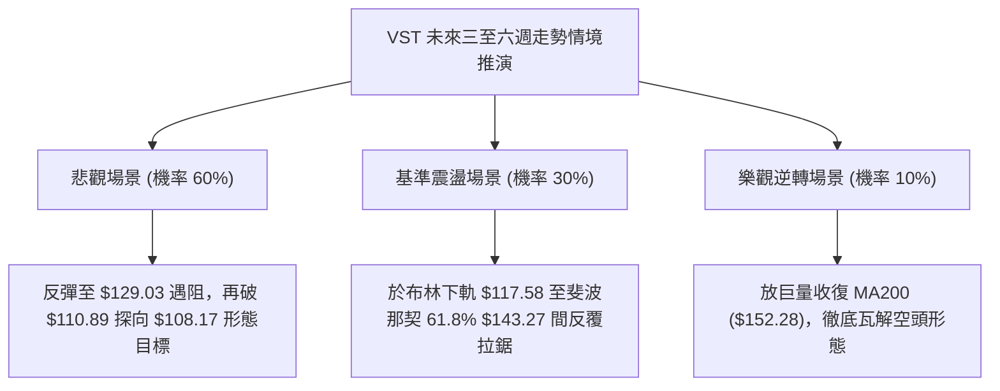

### 🛡️ 風險管理重要提醒

1. **ATR 波動風險釋放**：
   VST 當前 ATR 高達 **$8.56 (6.86%)**，單日振幅極為劇烈。任何交易部位的建立均應以「波動率調整倉位模型（Volatility-Adjusted Position Sizing）」計算，單筆交易之最大止損金額嚴格限制在總投資組合資金的 1.0%–1.5% 以內。
2. **缺口與隔夜風險**：
   近期價格連續出現跳空低開現象（如 11-04 跳空低開近 $10），顯示個股易受盤後消息面或能源板塊系統性風險影響。空頭持倉嚴禁使用市價無條件過夜，應於關鍵價位設置條件停損單。
3. **流動性陷阱**：
   雖然 20 日均量有 734 萬股，但近期成交量多集中於暴跌時的停損拋盤（11-04 至 11-06 三日合計成交近 4,800 萬股）。反彈過程中若成交量迅速萎縮至 500 萬股以下，極易出現流動性真空，導致滑點擴大。

---

## 📋 報告總結

```
VST 技術分析報告總結
════════════════════════════════════════════════════════
報告日期：2026-11-08
當前價格：$124.80
分析評級：🔴 強烈偏空（綜合技術評分: 33/100）

關鍵結論：
├─ 長期趨勢：🔴 熊市修正（跌破 MA200 $152.28 達 -18.05%）
├─ 中期趨勢：🔴 破位下行（大型雙頂形態完成，週MACD負向擴散）
├─ 短期趨勢：🟡 跌深反抽（下探 52W 低點 $110.89 後帶下影線反彈）
├─ 關鍵支撐：動態下軌 $117.58、年度極限 $110.89 (下方無聚類支撐)
├─ 關鍵阻力：斐波那契 $129.03、中軌 $142.91、波段高點 R1 $149.93
└─ 分析師目標：均價 $202.67（機構共識落後技術破位現狀）

最優策略組合：
1. 🥇 最佳機會：策略 A — 弱勢反彈至斐波那契 78.6% ($129.03) 遇阻放空
   (進場: $129.03 / 止損: $134.26 / 目標 T1: $117.58 / 風報比: 1:2.19)
2. 🥈 次選機會：策略 B — 強勢修復至 MA20 ($142.91) 承壓放空
   (進場: $142.91 / 止損: $149.93 / 目標 T1: $129.03 / 風報比: 1:1.98)
3. 🥉 保守選擇：完全空倉觀望，靜待日線 MACD 金叉或 $110.89 雙底二度確認
════════════════════════════════════════════════════════
```

---

> ⚠️ **免責聲明**：本報告為技術分析研究，所有數據、圖表及價位推算均嚴格基於所提供之歷史 OHLCV 價格資訊。本報告**僅供學術研究與量化策略參考**，**不構成任何要約、招攬或具體投資建議**。金融市場瞬息萬變，高波動資產交易存在巨大虧損風險，投資人應獨立評估風險並自負盈虧。

---

*報告生成時間：2026-11-08 ｜ 數據來源：Yahoo Finance ｜ 分析框架：多時框技術分析體系*