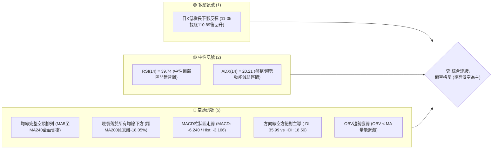
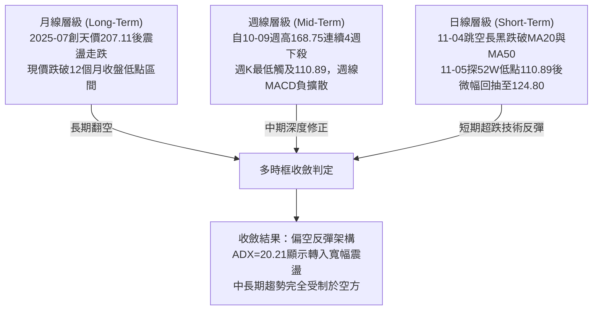
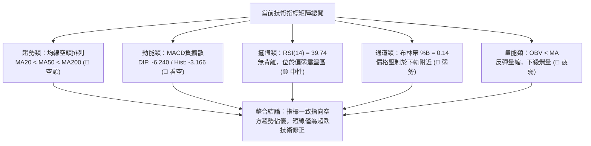
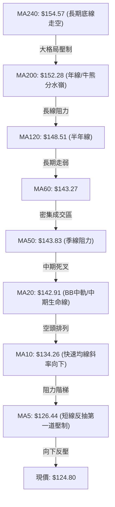
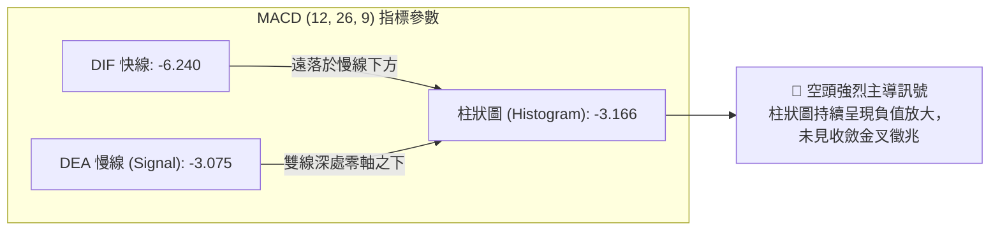
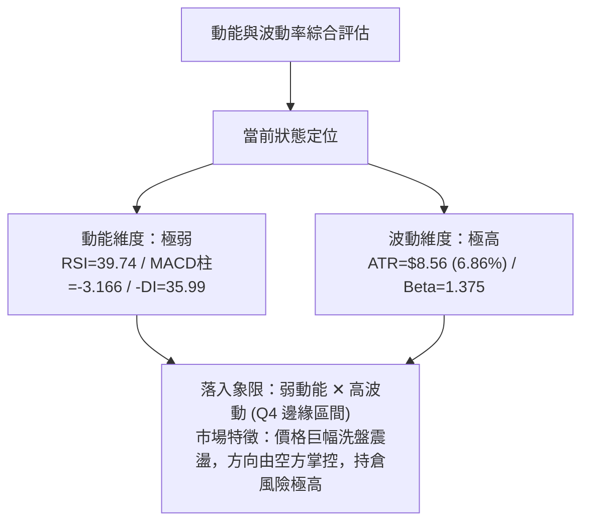
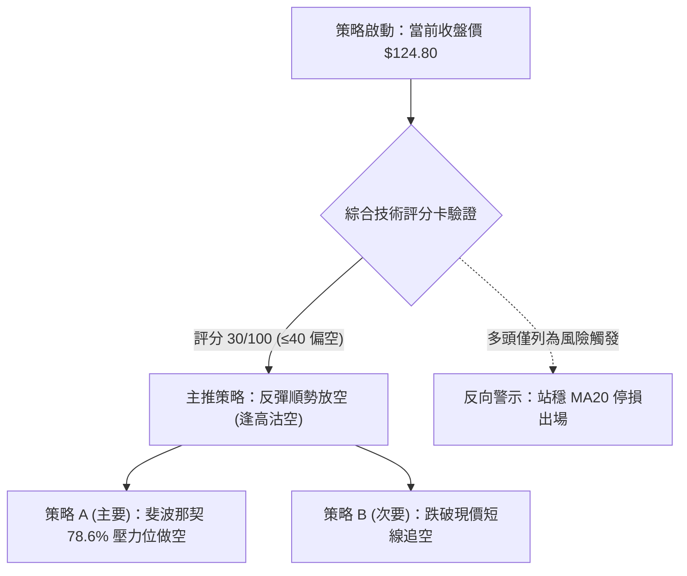
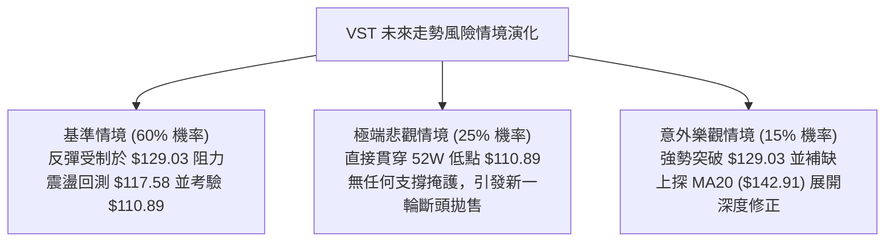

# VST 技術分析報告

> **報告日期**：2026-11-09 ｜ **語言**：繁體中文 ｜ **數據來源**：Yahoo Finance ｜ **當前價格**：$124.80

---

## 目錄

| 章節 | 內容 |
|------|------|
| [1. 技術面概覽](#1-技術面概覽) | 訊號儀表板、核心指標、評分卡 |
| [2. 趨勢分析](#2-趨勢分析) | 多時框趨勢、長中短期走勢 |
| [3. 圖表形態分析](#3-圖表形態分析) | 形態識別、K線組合、目標價 |
| [4. 支撐與阻力](#4-支撐與阻力) | 關鍵價位、斐波那契回調 |
| [5. 技術指標深度解讀](#5-技術指標深度解讀) | MA/RSI/MACD/布林/成交量 |
| [6. 動能與波動率](#6-動能與波動率) | 動能評估、ATR、Beta |
| [7. 多時框架總結](#7-多時框架總結) | 時框架評分矩陣 |
| [8. 交易策略建議](#8-交易策略建議) | 多空策略、風險報酬比 |
| [9. 風險提示與監控](#9-風險提示與監控) | 監控指標、風險場景 |

---

## 1. 技術面概覽

### 🎯 技術訊號儀表板



### 📊 核心指標速覽表

| 指標類別 | 指標名稱 | 當前數值 | 訊號 | 解讀 |
|----------|----------|----------|------|------|
| **價格** | 當前收盤價 | $124.80 | 🔴 | 位於52週區間16.4%低檔，短期重挫後弱勢反彈 |
| **均線** | MA20 | $142.91 | 🔴 | 現價低於MA20達-12.67%，中短期下行壓力沉重 |
| **均線** | MA50 | $143.83 | 🔴 | MA20與MA50形成死叉下行，中期趨勢翻空 |
| **均線** | MA200 | $152.28 | 🔴 | 現價遠在牛熊分界線下方，長期趨勢轉為空頭支配 |
| **動能** | RSI(14) | 39.74 | 🟡 | 位於30–70中性偏弱區，首尾20根K棒無明顯背離 |
| **動能** | MACD (12,26,9) | -6.240 | 🔴 | DIF線位於負值深處，柱狀圖-3.166擴大，空頭動能強勁 |
| **動能** | Stoch %K / %D | 29.07 / 13.51 | 🟡 | %K低檔黃金交叉%D，但仍處超賣邊界，視為技術反抽 |
| **趨勢** | ADX(14) | 20.21 | 🟡 | 數值小於25，代表大跌後進入日線布林寬幅震盪整固 |
| **方向** | +DI / -DI | 18.50 / 35.99 | 🔴 | -DI遠高於+DI，盤面主導權完全由空方掌控 |
| **通道** | 布林帶 %B | 0.14 | 🔴 | 緊貼布林通道下軌（$117.58）運行，屬下軌擴張偏弱格局 |
| **量能** | 當日量 / 20日均量 | 12.51M / 7.34M | 🔴 | 量比達1.70x，近週爆量下殺，量能偏向空方籌碼釋出 |
| **波動** | ATR(14) | $8.56 | 🔴 | 佔股價6.86%，每日波動幅度劇烈，持倉風險高 |

### 🏆 技術評分卡

```
╔══════════════════════════════════════════════════════════════╗
║                技術評分卡 — VST (2026-11-09)                 ║
╠══════════════════════════════════════════════════════════════╣
║ 趨勢強度 (Trend)     ██████░░░░░░░░░░░░░░  32/100   🔴 弱勢空頭║
║ 動能指標 (Momentum)  ███████░░░░░░░░░░░░░  34/100   🔴 空方主導║
║ 支撐穩定度 (Support) ██████░░░░░░░░░░░░░░  28/100   🔴 支撐潰散║
║ 成交量配合 (Volume)  ████████░░░░░░░░░░░░  38/100   🔴 帶量下破║
║ 形態完整度 (Pattern) ██████░░░░░░░░░░░░░░  32/100   🔴 頭部成型║
║ 均線排列 (MAs)       ███░░░░░░░░░░░░░░░░░  16/100   🔴 倒掛空頭║
╠══════════════════════════════════════════════════════════════╣
║ 綜合評分             ██████░░░░░░░░░░░░░░  30/100   🔴 偏空格局║
║ 評分依據：算術平均 (32 + 34 + 28 + 38 + 32 + 16) ÷ 6 = 30.0  ║
╚══════════════════════════════════════════════════════════════╝
```

---

## 2. 趨勢分析

### 🌐 多時框趨勢分析



### 📈 長期趨勢 — 12個月走勢圖（Unicode）

VST 過去12個月（2025年11月至2026年11月）月線收盤價走勢如下，高點見於2026年2月（$173.13），隨後呈現鋸齒狀盤跌，並於2026年11月初出現加速破位：

```
VST 月線走勢圖（過去12個月收盤價）
價格軸 ($)
$180 ┤ ●($177.83)
$170 ┤                      ●($173.13)
$160 ┤       ●($160.62)           ●($159.74)
$150 ┤             ●($157.65)  ●($149.87) ●($157.36) ●($158.37)
$140 ┤                                                    ●($147.95)
$130 ┤                                                         ●($137.15) ●($138.35) ●($138.37)
$120 ┤                                                                              ●($124.80)←現價
$110 ┤                                                                                 
     └─┬─────┬─────┬─────┬─────┬─────┬─────┬─────┬─────┬─────┬─────┬─────┬───
      11/25 12/25 01/26 02/26 03/26 04/26 05/26 06/26 07/26 08/26 09/26 10/26 11/26
```

#### 走勢特徵分析表格

| 階段區間 | 月收盤區間 | 累積漲跌幅 | 結構特徵與技術解讀 |
|----------|------------|------------|--------------------|
| **高檔整固期** (2025-11 ~ 2026-02) | $177.83 → $173.13 | -2.64% | 於 $170–$177 高檔形成橫向滯漲箱體，動能逐步耗竭 |
| **盤整下移期** (2026-03 ~ 2026-06) | $149.87 → $158.37 | +5.67% | 跌破 $160 後反覆回抽，於 MA200 附近（$152.28）拉鋸 |
| **重心崩落期** (2026-07 ~ 2026-10) | $147.95 → $138.37 | -6.47% | 跌破 $140 關口，高點逐月下移，均線轉為糾合向下 |
| **加速破位期** (2026-11 至今) | $138.37 → $124.80 | -9.81% | 單週內向下摜破斐波那契78.6%（$129.03），直探52週新低 |

### 📊 中期趨勢（週線分析）

從近 8 根週 K 線結構觀察，VST 在 2026 年 10 月 9 日該週放量暴衝至波段頂點 $168.75（收盤 $161.48，週成交量達 59.37M）後，形成「假突破天花板」，隨後連續 4 週長黑下殺：

```
中期週線壓力與支撐結構示意圖
$170.00 ┤        ┌───┐ (10-09 週高 $168.75 / 波段假突破頂點)
$160.00 ┤        │   │     ┌───┐
$150.00 ┤        │   │     │   │     ┌───┐
$140.00 ┤  ┌───┐ │   │     │   │     │   │ ┌───┐ (10-30 週收 $138.37)
$130.00 ┤  │   │ │   │     │   │     │   │ │   │
$120.00 ┤  └───┘ └───┘     └───┘     └───┘ └───┘     ┌───┐ (現價 $124.80)
$110.00 ┤                                             └───┴─ (11-06 週低 $110.89 / 52週新低)
        └────────────────────────────────────────────────────────
         09-25   10-02     10-09     10-16 10-23 10-30 11-06 (週日期)
```

中期走勢顯示典型的**出貨形態（Distribution Phase）**：10月9日以近60M股的巨量推升後，籌碼迅速渙散，之後數週成交量持續維持在24M至34M之間，而11月6日該週再度以58.98M的巨量向下摜殺至$110.89，代表法人籌碼出現非理性拋售與停損潮。

### ⚡ 趨勢強度評估（ADX 解讀）

```mermaid
graph TD
    A["ADX(14) 數值 = 20.21"] --> B{"ADX 門檻檢驗"}
    B -->|"< 25 (弱趨勢/盤整)|" C["盤整與寬幅震盪特徵"]
    B -->|"> 25 (強趨勢)|" D["單邊趨勢延續"]
    C --> E["檢視方向線指標"]
    E --> F["+DI: 18.50 (多方極弱)"]
    E --> G["-DI: 35.99 (空方掌控)"]
    F & G --> H["結論：市場處於崩跌後的寬幅整固期<br/>空頭完全主導，但未形成單邊平滑趨勢<br/>操作應以布林通道邊界與反彈阻力位為準"]
```

#### ADX 與方向指標參數對照表

| 指標名稱 | 當前數值 | 參考臨界線 | 強度解讀 | 市場狀態與實戰意涵 |
|----------|----------|------------|----------|--------------------|
| **ADX(14)** | 20.21 | 25.00 | 弱動能 / 寬幅整固 | 價格暴跌後波動率暴增，但單邊持續性趨勢尚未收斂完成 |
| **+DI** | 18.50 | 20.00 | 多頭潰散 | 買盤力道極其萎縮，反彈多為空頭回補而非主動建倉 |
| **-DI** | 35.99 | 25.00 | 空頭主導強烈 | 賣壓強大，指標差值 (-DI − +DI = 17.49) 顯示空方佔據壓倒性優勢 |
| **趨勢形態** | 空頭盤整 | 趨勢門檻 | 偏空震盪 | 不利於多頭波段操作，反彈觸及阻力位易引發第二波空方襲擊 |

---

## 3. 圖表形態分析

### 🔍 形態識別系統


#### 形態識別與信心度評估表

| 形態名稱 | 信心度 | 判斷依據（引用數據） | 完成度 | 目標價（附計算式） |
|----------|--------|----------------------|--------|--------------------|
| **頂部箱體破位** | 85% | 10-30收$138.37，11-04跳空開$125.40跌破10-02週低$133.44及$138頸線 | 100% | 破位已成，回測頸線阻力落在 $138.37 至 MA20 $142.91 |
| **假突破天花板 (UTAD)** | 80% | 10-09週K衝高至$168.75爆量59.37M後快速失守，隨後長黑灌破起漲點 | 100% | 形態理論跌幅滿足點以形態高度（$168.75 − $138.37 = $30.38）自破位點推算：$138.37 − $30.38 = **$107.99**（接近52W低點$110.89） |
| **52W低點雙底雏形** | 35% | 11-05日K下探$110.89（52週低點），11-06回升收$124.80，但未過MA5 | 20% | *訊號不足，僅做指標型超跌反抽解讀，暫不預設底形成立* |

### 🕯️ 重要K線形態分析

嚴格依據數據中「近10根日K」與「近8根週K」之開高低收數據進行嚴格形態判讀：

#### 近10根日K形態精確拆解

| 日期（日K） | 開盤價 | 最高價 | 最低價 | 收盤價 | 成交量 | K線形態名稱 | 解讀與心理層面分析 | 訊號 |
|-------------|--------|--------|--------|--------|--------|-------------|--------------------|------|
| **2026-10-26** | $140.90 | $143.52 | $139.07 | $141.73 | 4,299,400 | 小陽線 | 窄幅縮量整理，多空暫時均衡 | 🟡 |
| **2026-10-27** | $143.95 | $147.45 | $143.40 | $146.66 | 4,107,900 | 中陽線 | 向上試探阻力，但未見量能放大 | 🟡 |
| **2026-10-28** | $146.88 | $147.82 | $142.20 | $142.72 | 5,656,900 | 倒錘長上影陰線 | 高檔受阻於$147.82後反轉下挫，多頭力竭 | 🔴 |
| **2026-10-29** | $142.18 | $144.67 | $140.06 | $140.95 | 4,935,200 | 下跌小陰線 | 實體下壓，破位隱憂顯現 | 🔴 |
| **2026-10-30** | $136.95 | $139.82 | $135.86 | $138.37 | 5,270,200 | 跳空弱勢小陽 | 跳空低開，反彈未能回補缺口，頸線岌岌可危 | 🔴 |
| **2026-11-02** | $140.00 | $140.50 | $134.21 | $134.61 | 4,797,900 | 光頭中陰線 | 破位下殺收於全日相對低點，支撐正式失守 | 🔴 |
| **2026-11-03** | $135.99 | $142.40 | $135.99 | $139.59 | 5,884,400 | 長上影假陽線 | 誘多反撲，高點$142.40遇MA20強阻力慘遭打回 | 🔴 |
| **2026-11-04** | $125.40 | $128.07 | $117.27 | $120.29 | 20,441,400 | 崩跌跳空大陰線 | 爆出20.44M天量跳空重挫，恐慌性斷頭拋盤湧現 | 🔴 |
| **2026-11-05** | $116.86 | $118.91 | $110.89 | $112.89 | 15,339,900 | 破底錘頭陰線 | 探52週最低點$110.89後微幅收腳，賣壓初步宣洩 | 🟡 |
| **2026-11-06** | $119.57 | $125.80 | $118.86 | $124.80 | 12,511,500 | 低檔長陽線 | 帶量反彈+10.55%，低檔買盤介入，確認短線超跌 | 🟢 |

#### 近8根週K形態精確拆解

| 週末交易日 | 週開盤 | 週最高 | 週最低 | 週收盤 | 週成交量 | 週K形態名稱 | 宏觀結構解讀 | 訊號 |
|------------|--------|--------|--------|--------|----------|-------------|--------------|------|
| **2026-09-18** | $143.76 | $145.87 | $139.39 | $140.44 | 23,879,600 | 陰陀螺線 | 圍繞 $140 關卡進行箱體震盪 | 🟡 |
| **2026-09-25** | $142.00 | $142.64 | $135.98 | $138.46 | 22,341,300 | 窄幅下移陰線 | 下檔測試 $135.98，弱勢整理 | 🔴 |
| **2026-10-02** | $138.08 | $143.51 | $133.44 | $140.02 | 34,710,000 | 下影鎚頭陽線 | 回測波段低點 $133.44 後放量拉回 | 🟢 |
| **2026-10-09** | $144.04 | $168.75 | $140.90 | $161.48 | 59,368,900 | 爆量長上影大陽 | 多頭末升衝刺，高檔湧出巨量籌碼，主力出貨嫌疑極高 | 🟡 |
| **2026-10-16** | $162.67 | $164.25 | $145.85 | $152.02 | 31,699,400 | 高位吞噬大陰線 | 烏雲罩頂，週線確認頂部反轉成立 | 🔴 |
| **2026-10-23** | $154.10 | $158.74 | $136.17 | $140.16 | 31,911,100 | 連續長黑貫穿線 | 連破 $150 與 $140 支撐，籌碼多殺多崩潰 | 🔴 |
| **2026-10-30** | $140.90 | $147.82 | $135.86 | $138.37 | 24,269,600 | 上影假陽十字 | 反抽無力，受制於 $147.82 壓力，弱勢未改 | 🔴 |
| **2026-11-06** | $140.00 | $142.40 | $110.89 | $124.80 | 58,975,100 | 巨量長下影破底陰 | 58.98M巨量擊穿全年底線至$110.89後拉回$124.80 | 🔴 |

### 📉 ASCII 走勢形態示意圖

下圖描繪 2026-10-26 至 2026-11-06 近10個交易日的跳空下殺與低檔拉鋸形態：

```
VST 近10日 K 線結構與跳空崩跌走勢圖
價格軸 ($)
$148 ┤       ┌─┐(10-28 高點 $147.82)
$144 ┤   ┌─┐ │ │
$140 ┤ ┌─┘ └─┘ └───┐  ┌─┐(11-03 假反抽 $142.40)
$136 ┤              └──┘ │
$132 ┤                   └──┐(11-02 破位 $134.61)
     ├┄┄┄┄┄┄┄┄┄┄┄┄┄┄┄┄┄┄┄┄┄┄  【跳空缺口：$128.07 - $134.21】 ┄┄┄┄┄┄┄┄┄┄┄┄┄┄
$128 ┤                        ┌─┐(11-04 跳空低開 $125.40)
$124 ┤                        │ │           ┌─┐(11-06 反彈收盤 $124.80)
$120 ┤                        │ └──┐        │ │
$116 ┤                             └──┐     │ │
$112 ┤                                └──┐  │ │
$108 ┤                                   └──┴─┘(11-05 最低點 $110.89)
     └─┬─────┬─────┬─────┬─────┬─────┬─────┬─────┬─────┬─────┬──────
      10-26 10-27 10-28 10-29 10-30 11-02 11-03 11-04 11-05 11-06
```

### 🎯 形態目標價計算

根據日線頂部箱體與頭肩型態破位，計算各級推算目標價：

1. **頂部箱體跌破幅度等幅推算**：
   - 形態箱體頂部（阻力聚類 R1）：$149.93
   - 形態箱體頸線（破位基準點）：$138.37
   - 形態垂直高度（Height）：$149.93 − $138.37 = **$11.56**
   - 下行等幅測幅目標價 1：$138.37 − $11.56 = **$126.81**（當前價格 $124.80 已達成）
   - 下行 2 倍擴張目標價 2：$138.37 − ($11.56 × 2) = **$115.25**（11-05 最低點 $110.89 已超額滿足）

2. **週線天花板極限跌幅推算**：
   - 頂部爆量最高點（2026-10-09）：$168.75
   - 關鍵出貨頸線（2026-10-30）：$138.37
   - 形態垂直振幅：$168.75 − $138.37 = **$30.38**
   - 週線完整出貨跌幅滿足點：$138.37 − $30.38 = **$107.99**（與52週低點 $110.89 僅差 $2.90，說明此區間存在強烈技術買盤支撐）

---

## 4. 支撐與阻力

### 🗺️ 關鍵價位分布圖（Unicode）

```
╔══════════════════════════════════════════════════════════════╗
║               VST 關鍵價位與籌碼聚類結構分布圖               ║
╠══════════════════════════════════════════════════════════════╣
║ $168.67 ║████████████████████████║ 強阻力 R3 (近一年波段高點聚類)
║ $155.69 ║████████████████████    ║ 次級阻力 R2 (反彈高點聚類)
║ $149.93 ║████████████████████████║ 核心阻力 R1 (頸線與波段高點)
║ $143.27 ║██████████████          ║ 斐波那契 61.8% / MA60 / MA50 聚類
║ $129.03 ║██████████              ║ 斐波那契 78.6% (當前第一反彈強壓)
║ $124.80 ╠════════════════════════╣ ◄ 當前收盤價 ($124.80)
║ $117.58 ║▓▓▓▓▓▓▓▓▓▓▓▓▓▓▓▓        ║ 布林通道下軌 (短期動態支撐)
║ $110.89 ║████████████████████████║ 52週低點 / 斐波那契 100.0% 強支撐
╚══════════════════════════════════════════════════════════════╝
```

### 🚧 阻力位分析表

各項阻力價位嚴格引用自技術數據中近一年波段高點聚類計算值：

| 阻力級別 | 價位 | 與現價距離 | 形成原因與技術共振 | 突破難度 | 重要性 |
|----------|------|------------|--------------------|----------|--------|
| **R1 (關鍵阻力)** | $149.93 | +20.14% | 近一年波段高點聚類；與 MA120（$148.51）、斐波那契 50%（$153.28）形成密集成交套牢區 | 🔴 極高 | ★★★★★ |
| **R2 (中級阻力)** | $155.69 | +24.75% | 波段反彈高點聚類；與 MA200（$152.28）、MA240（$154.57）牛熊分界線重合 | 🔴 極高 | ★★★★☆ |
| **R3 (強阻力區)** | $168.67 | +35.15% | 歷史天花板聚類；與 10-09 週最高點 $168.75 及布林上軌（$168.24）完全重疊 | 🔴 難以逾越 | ★★★★★ |

### 🛡️ 支撐位分析表

依據數據清單明確提示：「*(no swing-low support detected below current price)*」，代表在當前價格 $124.80 下方，近一年內未偵測到任何常規的波段低點聚類支撐（Swing-low support）。下行唯一的歷史與結構支撐僅能依託於 52 週最低點與通道下軌：

| 支撐級別 | 價位 | 與現價距離 | 形成原因與技術共振 | 守住機率 | 重要性 |
|----------|------|------------|--------------------|----------|--------|
| **S1 (動態支撐)** | $117.58 | -5.79% | 日線布林通道下軌動態位置，11-04 與 11-06 最低點均圍繞此處獲得買盤 | 🟡 60% | ★★★☆☆ |
| **S2 (全年底線)** | $110.89 | -11.15% | 52週歷史最低點（2026-11-05盤中觸及）；斐波那契100.0%完全回調位 | 🟢 70% | ★★★★★ |
| **S3 (數據外支撐)**| N/A | N/A | **數據中未偵測到**更低之波段低點聚類，若跌破$110.89將進入無支撐真空跌勢 | 🔴 未知 | ★☆☆☆☆ |

### 📐 斐波那契回調位分析

依據 52 週高點 $195.66 至 52 週低點 $110.89 之絕對波動區間，嚴格引用系統計算之斐波那契回調位：

| 回調比率 | 價位 | 與現價距離 | 技術位置與多空意涵解讀 |
|----------|------|------------|------------------------|
| **0.0% (52W High)** | $195.66 | +56.78% | 歷史多頭波段頂點，目前已無實質參考意義 |
| **23.6%** | $175.66 | +40.75% | 多頭防守臨界點，失守後宣告大牛市結束 |
| **38.2%** | $163.28 | +30.83% | 10-09 週反彈高點 $161.48 止步於此，確認受阻回落 |
| **50.0%** | $153.28 | +22.82% | 關鍵中軸，與 MA200（$152.28）重疊，為中期多空分界水嶺 |
| **61.8% (黃金分割)** | $143.27 | +14.80% | 與 MA60（$143.27）精確吻合，同時逼近 MA20（$142.91）及 MA50（$143.83） |
| **78.6%** | $129.03 | +3.39% | **現價上方第一道黃金分割反彈壓力**，若無法放量站穩，反彈隨時告終 |
| **100.0% (52W Low)**| $110.89 | -11.15% | 終極回調防線，11-05 盤中最低點精準測試此位後產生技術性強彈 |

> **當前價位定位解讀**：現價 **$124.80** 正處於 **78.6%（$129.03）** 與 **100.0%（$110.89）** 之間，屬於極度深度的回調區。技術上，78.6% 通常為多頭最後生機線，一旦反彈未能重返 $129.03 之上，該價位將由原先的潛在支撐轉化為極強的反壓枷鎖。

---

## 5. 技術指標深度解讀

### 🎛️ 指標訊號總覽



### 📈 移動平均線排列分析



#### 移動平均線數據對比表

| 均線名稱 | 當前價格 | 與現價差額 | 負乖離率 (%) | 均線斜率與歷史軌跡 | 訊號評估 |
|----------|----------|------------|--------------|--------------------|----------|
| **MA 5** | $126.44 | -$1.64 | -1.29% | ▅▆▇█████▇▇▆▅▄▃▂▁ 下彎趨緩 | 🔴 空方阻力 |
| **MA 10** | $134.26 | -$9.46 | -7.05% | ▆▇█████▇▇▆▅▄▃▂▁▁ 快速下切 | 🔴 強空壓制 |
| **MA 20** | $142.91 | -$18.11 | -12.67% | ▆▇█████████▇▅▃▁ 空頭發散 | 🔴 中期死叉 |
| **MA 50** | $143.83 | -$19.03 | -13.23% | 下穿長期均線，中期趨勢徹底翻空 | 🔴 趨勢走熊 |
| **MA 60** | $143.27 | -$18.47 | -12.89% | ▆▆▆▇▆▆▅▅▄▄▃▃▂▁ 下行通道確立 | 🔴 中期承壓 |
| **MA 120**| $148.51 | -$23.71 | -15.97% | ▆▆▆▆▆▅▅▄▄▃▃▂▂▁ 穩定下移 | 🔴 長期轉弱 |
| **MA 200**| $152.28 | -$27.48 | -18.05% | 牛熊分界線失守，現價負乖離接近20% | 🔴 空頭定調 |
| **MA 240**| $154.57 | -$29.77 | -19.26% | 長線資金出逃，長均全面蓋頂 | 🔴 絕對承壓 |

### 📉 RSI(14) 分析

當前 RSI(14) 數值為 **39.74**（Wilder 計算方法），呈現自極端超賣區回抽的態勢：

```
RSI(14) 水平儀 (當前值: 39.74)
0                30       39.74       50               70              100
├────────────────┼──────────●──────────┼────────────────┼────────────────┤
[   極度超賣區   ] [     弱勢修復區    ] [  中性平衡區  ] [   強勢多頭區   ]
進度條：████████████████░░░░░░░░░░░░░░░░░░░░░░░░ (39.74%)
```

- **超買超賣狀態**：指標脫離 30 以下之超賣區，進入 30–50 弱勢反彈區，反映短線殺跌動能暫歇。
- **背離分析**：
  - 根據近 20 根日 K 棒首尾之價格與 RSI 方向檢驗：價格由 10-26 高點 $143.52 下跌至 11-06 收盤 $124.80，RSI 由 10 月中旬約 52 下滑至 39.74。
  - **結論：無明顯背離（No Divergence）**。價格與動能指標同向走低，未出現「價格創新低而 RSI 抬高」的典型看漲底背離，代表當前反彈純屬價格跌深後的乖離修正，非實質反轉。

### 📊 MACD(12/26/9) 訊號解讀



- **數值關係**：DIF（-6.240）低於 Signal（-3.075），MACD 柱狀圖為 **-3.166**。
- **柱狀圖動態**：週線級別 MACD 柱自 10-09 週之 +2.715 急速反轉崩落至 11-06 週之 -3.166，顯示空頭下墜力道正在以加速度釋放，日線亦深陷水下，無任何多頭金叉信號。

### 📦 布林通道分析

```
布林通道 (Bollinger Bands 20, 2) 結構圖
價格軸 ($)
$170 ┤                                ── 上軌: $168.24
$160 ┤
$150 ┤
$140 ┤ ┄┄┄┄┄┄┄┄┄┄┄┄┄┄┄┄┄┄┄┄┄┄┄┄┄┄┄┄┄┄┄┄ ── 中軌 (MA20): $142.91
$130 ┤
$124 ┤              ● ← 當前價格: $124.80 (%B = 0.14)
$120 ┤
$110 ┤ ────────────────────────────── ── 下軌: $117.58
     └────────────────────────────────
```

- **帶寬與位置**：通道上軌 $168.24，中軌 $142.91，下軌 $117.58。帶寬開口大幅擴張達 $50.66，顯示市場波動率激增。
- **%B 指標解析**：%B 目前為 **0.14**（落於 0 與 0.5 之間，偏向極下緣）。價格在 11-04 與 11-05 跌破下軌後，11-06 縮回軌道內，為標準的「沿下軌鈍化後之技術抽回」，中軌 $142.91 形成無法逾越的動態天花板。

### 💹 成交量分析（量價配合度）

```
近5日量價關係柱狀示意圖
日期       收盤價     成交量 (股)           量價特徵解讀
11-02     $134.61    4,797,900   ██          跌破橫盤，正常量能
11-03     $139.59    5,884,400   ███         假反彈，微幅增量
11-04     $120.29   20,441,400   ██████████  跳空長黑，爆量2.78倍 (恐慌拋售)
11-05     $112.89   15,339,900   ███████     探低破底，持續爆量 (籌碼出清)
11-06     $124.80   12,511,500   ██████      低檔收高，量縮至12.51M (反彈量能不足)
```

- **量比與均量比較**：最新單日成交量為 12,511,500 股，相較 20 日均量（7,342,760 股）達 **1.70 倍**，高於 50 日均量（6,619,592 股）。
- **OBV（能量潮）走勢**：數據明確標示「OBV < MA → 量能疲弱」。在11-04與11-05兩日下殺合計釋出近3,600萬股籌碼，而11-06的反彈成交量萎縮至1,251萬股，量價呈現典型的「**跌有量、彈無量**」之空頭量性格局。

---

## 6. 動能與波動率

### ⚡ 動能評估



#### 動能與波動四象限對照表

| 象限 | 動能維度 | 波動維度 | 歷史定義特徵 | VST 當前狀態判定 | 實戰操作指引 |
|------|----------|----------|--------------|------------------|--------------|
| **Q1** | 強多頭動能 | 低波動率 | 平穩慢牛推升 | 否 | 最佳波段做多時機 |
| **Q2** | 弱多頭動能 | 低波動率 | 沉悶窄幅盤整 | 否 | 觀望等待方向突破 |
| **Q3** | 強多頭動能 | 高波動率 | 瘋狂加速拉升 | 否 | 緊設移動停利操作 |
| **Q4** | **弱動能/空頭** | **高波動率** | **破位下殺與劇烈震盪** | **✓ 正確定位** | **嚴禁追多，僅可輕倉逢高做空** |

### 📊 ATR 波動率分析

- **ATR(14) 數值**：**$8.56**，佔當前股價（$124.80）比重高達 **6.86%**（Wilder 平滑法）。
- **波動歷史意義**：相較於一般公用事業板塊個股 ATR 普遍在 1.5%–2.5%，VST 展現出類似高貝塔成長股的劇烈波動性。單日波幅接近 $9.00，意味著進場點位若產生偏差，極易觸發過於狹窄的止損點。
- **止損距離建議**：
  - 順勢空頭策略止損距離應不小於 **1.0 至 1.5 倍 ATR**（約 **$8.56 至 $12.84**）。
  - 短線逆勢摸底多頭止損必須嚴格釘死在 52 週最低點 $110.89 之下，空間約為 $13.91（約 1.62 倍 ATR）。

### 📐 Beta 與市場相關性

- **Beta 係數**：**1.375**。
- **市場屬性解讀**：VST 雖歸類於獨立發電與公用事業（Utilities - IPP），但其 1.375 的高 Beta 值反映其股價受 AI 數據中心電力需求、天然氣價格以及批發電價等高風險預期驅動，波動幅度顯著高於標普 500 指數（SPY）達 37.5%。在大盤拉回時，VST 承擔了更高的系統性 Beta 拋售壓力。

---

## 7. 多時框架總結

### 📋 時框架評分表

| 時框架 | 趨勢方向 | 動能狀態 | 均線排列 | 形態結構 | 綜合評分 | 戰術建議 |
|--------|----------|----------|----------|----------|----------|----------|
| **長期 (月線)** | 🔴 空頭初成 | 🔴 走弱中 | 🔴 跌破MA200 | 雙頂高位出貨 | 30/100 | 長期倉位逢反彈減碼防禦 |
| **中期 (週線)** | 🔴 空方加速 | 🔴 MACD負擴 | 🔴 均線死叉 | 爆量假突破崩跌 | 25/100 | 中期反彈皆為放空賣點 |
| **短期 (日線)** | 🟡 超跌反彈 | 🟡 RSI抽回 | 🔴 倒掛空頭 | 觸底長下影反抽 | 35/100 | 嚴控部位，博取短抽或高空 |

### 🔲 綜合訊號矩陣

| 維度 | 短期 (日線) | 中期 (週線) | 長期 (月線) | 訊號收斂性評估 |
|------|-------------|-------------|-------------|----------------|
| **趨勢方向** | 弱勢反彈（受制於MA5） | 單邊下行（連跌4週） | 高檔破位（跌破箱底） | 🔴 空方趨勢高度共振 |
| **動能強度** | RSI 39.74 反抽 | MACD柱 -3.166 負向擴大 | 高檔動能衰退耗竭 | 🔴 動能指標全面偏空 |
| **量能特徵** | 11-06 反彈縮量至 12.51M | 週線爆量 58.98M 長黑破底 | 月線持續出貨退潮 | 🔴 籌碼呈現主力派發 |
| **關鍵空間** | 局限於 $117.58–$129.03 | 承壓於 $138.37–$149.93 | 跌向 52W 低點 $110.89 | 🔴 反彈空間受嚴格壓縮 |

### ⚖️ 多時框收斂結論

嚴格遵循多時框收斂原則（規則 14）：
1. **行情性質判定**：當前 ADX(14) 數值為 **20.21**（小於 25 臨界線），定義為**「寬幅劇烈震盪與超跌修復行情」**。
2. **主導交易區間**：以**日線布林通道區間**（下軌 **$117.58** 至 中軌 **$142.91**）為核心活動範疇。
3. **多時框優先級權衡**：雖然日線 11-06 出現放量下影線後的長陽反彈，但月線、週線級別之均線（MA20/50/200）已全線崩毀，-DI（35.99）強烈壓制 +DI（18.50）。日線等級的反彈不可視為反轉，僅能作為尋找空頭優質進場點位的交易時機。
4. **唯一收斂方向**：**偏空（Bearish）**。整體技術態勢定調為**「反彈測試上方壓力後的空頭延續格局」**，與第 1 章評分卡（30/100）及第 8 章主推策略維持百分之百的一致性。

---

## 8. 交易策略建議

### 🗺️ 策略決策流程圖



### 🧭 策略路由

> **當前主策略方向 = 偏空／逢反彈放空（依技術評分卡：30/100）**
> 
> 依據技術評分系統規則，綜合評分 ≤ 40 必須**主推空頭策略**。多頭策略僅作為突發消息或強烈技術背離時之「反轉風險觸發點（對沖監控）」，不作為主力推薦。

### 🎯 價格情境階梯（Price Scenarios）

本階梯之所有點位完全引用技術數據中之斐波那契位、布林通道與關鍵阻力位：

| 觸發條件 | 下一目標 | 後續延伸 | 情境含義與操作對策 |
|----------|----------|----------|--------------------|
| **反彈受阻於 $129.03** | 回測 $117.58 | 探底 $110.89 | 最佳空頭狙擊點，斐波那契 78.6% 承壓，續跌機率最高 |
| **強勢突破 $129.03** | 挑戰 $142.91 | 試探 $149.93 | 深度超跌反抽，測試布林中軌（MA20）與 R1 核心頸線 |
| **跌破下軌 $117.58** | 考驗 $110.89 | 尋找真空支撐 | 空頭主升段延續，52週歷史低點面臨實質破位考驗 |

### 📊 情境機率分佈

| 情境劃分 | 機率預估 | 主要技術依據 |
|----------|----------|--------------|
| **反彈受阻回落 (繼續破底)** | **60%** | MACD 負擴散（-3.166）、-DI 達 35.99、均線全倒掛、OBV 疲弱 |
| **區間寬幅震盪 (布林帶整固)** | **30%** | ADX 僅 20.21（<25 顯示趨勢缺乏平滑度）、日線長下影回拉 |
| **強勢反轉向上 (V型反轉)** | **10%** | 均線重度負乖離，但缺乏底背離支撐，需要極巨額多頭增量 |

### 🟢 主策略詳情（空頭主推策略）

嚴格按照規則 17，風險報酬比公式定義為：
$$\text{做空風險報酬比} = \frac{\text{進場價} - \text{目標價 T1}}{\text{止損價} - \text{進場價}}$$

所有報價精確引用「關鍵價位」區塊之斐波那契與均線數值：

| 策略要素 | 策略 A (反彈高空策略 — 推薦首選) | 策略 B (破位順勢空策略 — 次選) |
|----------|-----------------------------------|---------------------------------|
| **進場條件** | 反抽斐波那契 78.6% 位無力突破 | 現價開盤確認失守 MA5 支撐 |
| **進場價格** | **$129.03** (斐波那契 78.6% 壓力) | **$124.80** (當前最新收盤價) |
| **目標價 T1** | **$117.58** (布林通道下軌動態支撐) | **$117.58** (布林通道下軌動態支撐) |
| **目標價 T2** | **$110.89** (52週最低點強支撐) | **$110.89** (52週最低點強支撐) |
| **止損價格** | **$134.26** (MA10 下降均線阻力位) | **$129.03** (斐波那契 78.6% 轉阻力) |
| **風險報酬比 (T1)** | **1 : 2.19**（以 T1 計）<br/>*計算式: ($129.03 - $117.58) ÷ ($134.26 - $129.03) = 11.45 ÷ 5.23* | **1 : 1.71**（以 T1 計）<br/>*計算式: ($124.80 - $117.58) ÷ ($129.03 - $124.80) = 7.22 ÷ 4.23* |
| **風險報酬比 (T2)** | **1 : 3.47**（以 T2 計）<br/>*計算式: ($129.03 - $110.89) ÷ ($134.26 - $129.03) = 18.14 ÷ 5.23* | **1 : 3.29**（以 T2 計）<br/>*計算式: ($124.80 - $110.89) ÷ ($129.03 - $124.80) = 13.91 ÷ 4.23* |
| **勝率預估** | 65% | 55% |
| **建議倉位** | 10%–15% 總部位 | 5%–10% 總部位 |

### 🔴 反向風險觸發點（對沖提示）

若市場出現非預期之利多推升股價，以下關鍵價位將**徹底推翻空頭主策略**，必須嚴格執行空單止損或避險：
1. **短線反轉預警**：日 K 收盤價帶量突破 **$129.03**（斐波那契 78.6%），空單應立即減碼 50%。
2. **中期空頭瓦解點**：價格強勢突破並站穩 **$142.91**（MA20 / 布林中軌）及 **$143.83**（MA50），代表雙重死叉壓力被化解，空單必須全數離場並翻多應對。

### ⭐ 整體訊號強度評星

```
做多訊號強度：★☆☆☆☆  (1/5星 — 僅屬嚴重超跌後之乖離抽回，無結構底)
做空訊號強度：★★★★☆  (4/5星 — 均線空頭排列，量價配合空方，中長期承壓)
整體可信度：  ★★★★☆  (4/5星 — 多時框指標高度收斂，技術價位極其精確)
```

---

## 9. 風險提示與監控

### ✅ 關鍵監控指標 Checklist

```
╔══════════════════════════════════════════════════════════════╗
║                 VST 每日實戰風控監控清單                     ║
╠══════════════════════════════════════════════════════════════╣
║ [ ] 監控 $129.03 斐波那契 78.6% 壓力能否形成有效壓制         ║
║ [ ] 監控日成交量是否異常超越 20,441,400 股 (11-04長黑量)     ║
║ [ ] 監控 RSI(14) 回抽至 45–50 區間是否再度拐頭向下           ║
║ [ ] 監控 52週低點 $110.89 是否遭受二次回踩測試               ║
║ [ ] 監控布林通道下軌 $117.58 之開口方向是否持續外擴          ║
║ [ ] 監控 MACD 柱狀圖數值能否由 -3.166 明顯向零軸收斂        ║
╚══════════════════════════════════════════════════════════════╝
```

### ⚠️ 風險場景分析



### 🛡️ 風險管理重要提醒

1. **公用事業高槓桿與利率敏感性**：
   - 數據顯示 VST 總負債達 **$20.51B**，淨負債達 **$-20.07B**，Debt/Equity 高達 **373.28**。在當前高利率宏觀環境下，財務槓桿壓力隨時可能放大股價拋售。
2. **波動率（ATR）對部位規模的制約**：
   - 目前 ATR 高達 **$8.56**（6.86%），以單筆交易承擔總資產 1% 風險模型計算：
     $$\text{部位規模上限} = \frac{\text{總資產} \times 1\%}{1.5 \times \text{ATR}} = \frac{\text{總資產} \times 1\%}{\$12.84}$$
   - 投資人應嚴格縮減部位至平日的 1/2 至 1/3，切勿在重挫後以「撈底心態」滿倉介入。
3. **數據缺漏與流動性監控**：
   - 本數據中流動比率（Current Ratio）與速動比率（Quick Ratio）標示為 **N/A（數據未提供）**，短線流動性承壓能力難以透過資產負債表定性，一切風控必須完全以技術面停損價位為依歸。

---

## 📋 報告總結

```
╔══════════════════════════════════════════════════════════════╗
║                    VST 技術分析報告總結                      ║
╠══════════════════════════════════════════════════════════════╣
║ 報告日期：2026-11-09                                         ║
║ 當前價格：$124.80 USD                                        ║
║ 分析評級：🔴 偏空（空頭反彈承壓，反彈逢高放空）             ║
║ 綜合評分：30 / 100                                           ║
╠══════════════════════════════════════════════════════════════╣
║ 關鍵結論：                                                   ║
║ ├─ 長期趨勢：🔴 跌破牛熊線 MA200 ($152.28)，高檔雙頂破位     ║
║ ├─ 中期趨勢：🔴 週線連4黑，爆量下殺，MACD柱負向擴散至 -3.166 ║
║ ├─ 短期趨勢：🟡 探52W低點 $110.89 後技術性抽回，受制於 MA5   ║
║ ├─ 關鍵支撐：S1: $117.58 (BB下軌) ｜ S2: $110.89 (52W最低點) ║
║ ├─ 關鍵阻力：反彈壓: $129.03 (Fib 78.6%) ｜ 核心壓: $149.93 ║
║ └─ 分析師目標：均價 $202.67 (華爾街目標價存在嚴重滯後性)     ║
╠══════════════════════════════════════════════════════════════╣
║ 最優策略組合：                                               ║
║ 1. 🥇 最佳機會：策略 A (反彈至 $129.03 放空，風報比 1 : 2.19)║
║ 2. 🥈 次選機會：策略 B (現價 $124.80 破位放空，風報比 1 : 1.71)║
║ 3. 🥉 避險操作：若帶量站穩 $134.26 (MA10)，所有空單無條件止損 ║
╚══════════════════════════════════════════════════════════════╝
```

---

> ⚠️ **免責聲明**：本報告為 AI 自動生成之技術分析，所有數據及估算均嚴格基於所提供的歷史價格與指標資訊。本報告**僅供研究與學術參考**，**不構成任何要約、招攬或投資建議**。市場有風險，入市需獨立思考並嚴格執行風控紀律。

---

*報告生成時間：2026-11-09 ｜ 數據來源：Yahoo Finance ｜ 分析框架：多時框技術分析體系*