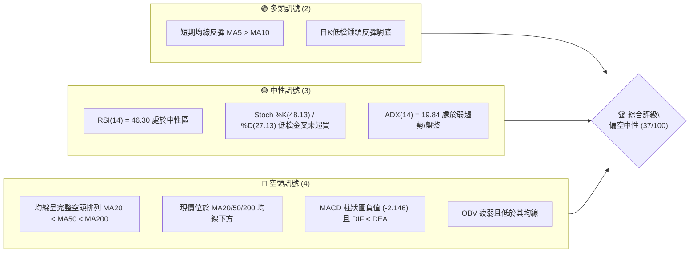
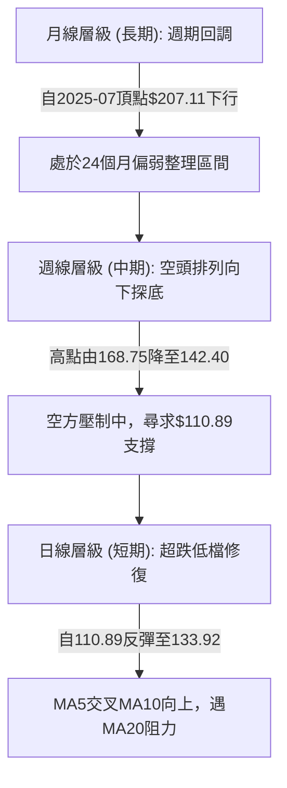
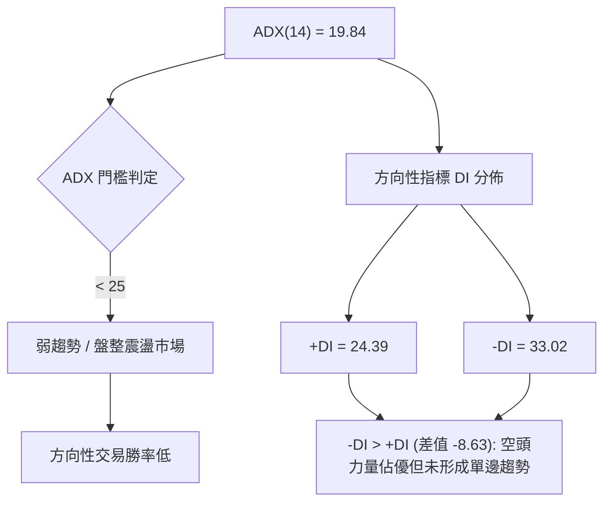
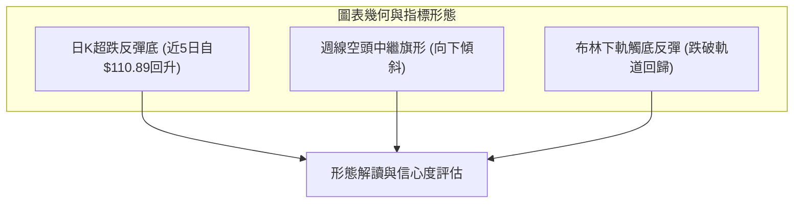
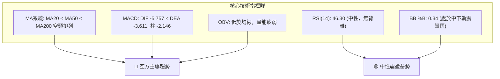
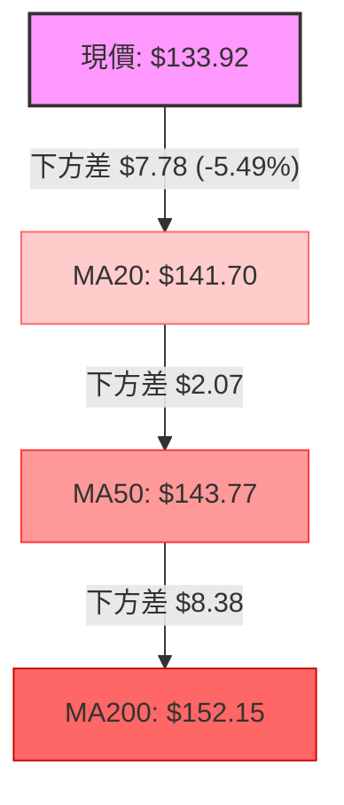
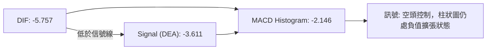
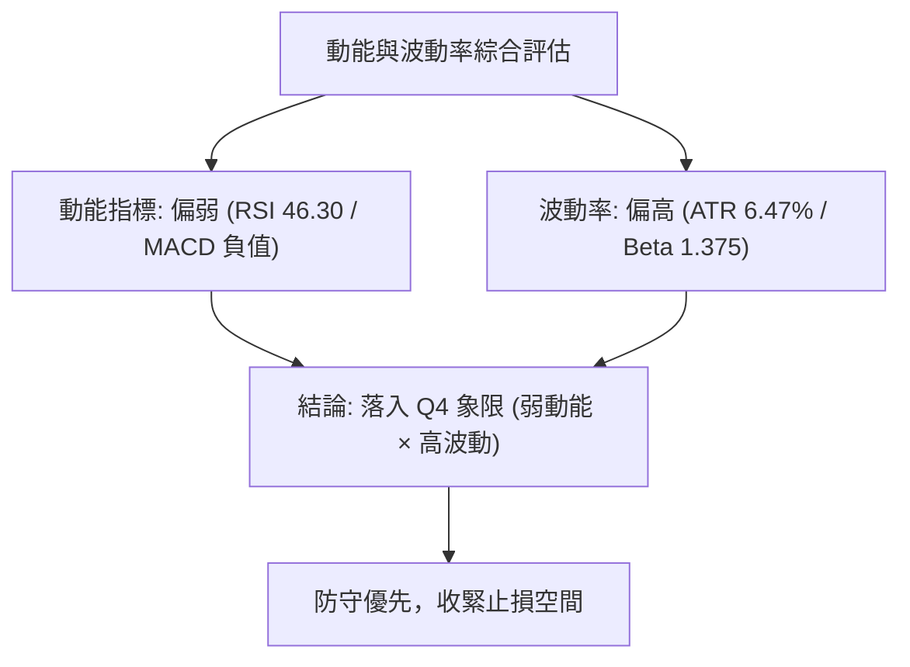
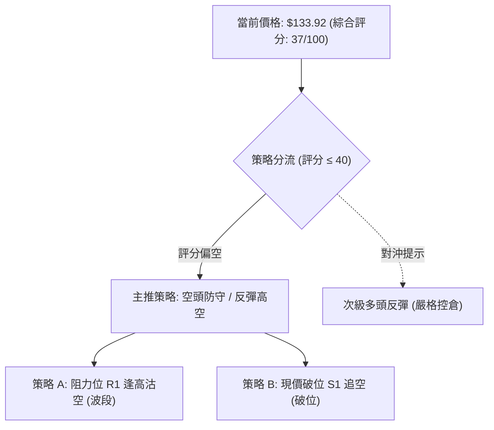
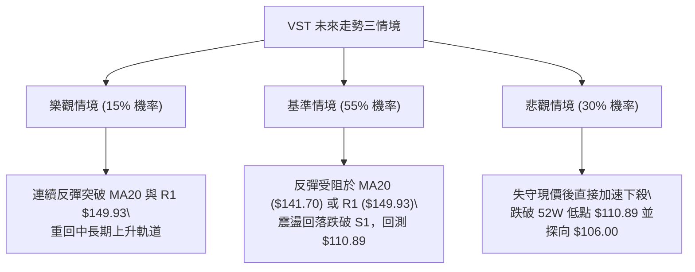

# VST 技術分析報告

> **報告日期**：2026-11-10 ｜ **語言**：繁體中文 ｜ **數據來源**：Yahoo Finance ｜ **當前價格**：$133.92

---

## 目錄

| 章節 | 內容 |
|------|------|
| [1. 技術面概覽](#1-技術面概覽) | 訊號儀表板、核心指標、評分卡 |
| [2. 趨勢分析](#2-趨勢分析) | 多時框趨勢、長中短期走勢 |
| [3. 圖表形態分析](#3-圖表形態分析) | 形態識別、K線組合、目標價 |
| [4. 支撐與阻力](#4-支撐與阻力) | 關鍵價位、斐波那契回調 |
| [5. 技術指標深度解讀](#5-技術指標深度解讀) | MA/RSI/MACD/布林/成交量 |
| [6. 動能與波動率](#6-動能與波動率) | 動能評估、ATR、Beta |
| [7. 多時框架總結](#7-多時框架總結) | 時框架評分矩陣 |
| [8. 交易策略建議](#8-交易策略建議) | 多空策略、風險報酬比 |
| [9. 風險提示與監控](#9-風險提示與監控) | 監控指標、風險場景 |

---

## 1. 技術面概覽

### 🎯 技術訊號儀表板



### 📊 核心指標速覽表

| 指標類別 | 指標名稱 | 當前數值 | 訊號 | 解讀 |
|----------|----------|----------|------|------|
| **價格** | 當前價格 | $133.92 | 🔴 | 位於52週區間27.2%，低於主要中長期均線 |
| **均線** | MA20 | $141.70 | 🔴 | 價格低於MA20（-$7.78，-5.49%），短期承壓 |
| **均線** | MA50 | $143.77 | 🔴 | 價格低於MA50，中期趨勢向下 |
| **均線** | MA200 | $152.15 | 🔴 | 價格顯著低於年線MA200，長期格局偏弱 |
| **動能** | RSI(14) | 46.30 | 🟡 | 位於30-70中性區間，無超買超賣，短線動能溫和 |
| **動能** | MACD | -5.757 / 柱 -2.146 | 🔴 | DIF低於信號線（-3.611），柱狀圖為負，空方控盤 |
| **動能** | 隨機指標 (Stoch) | %K 48.13 / %D 27.13 | 🟡 | %K自低檔穿過%D回升，短線超賣反彈但尚未突破中軸 |
| **趨勢** | ADX(14) | 19.84 | 🟡 | ADX < 25 表明趨勢動能微弱，當前處於震盪打底 |
| **方向** | +DI / -DI | 24.39 / 33.02 | 🔴 | -DI 大於 +DI，空頭力量依然主導日線行情 |
| **通道** | 布林帶 %B | 0.34 | 🟡 | 位於中軌（$141.70）與下軌（$117.13）之間震盪偏弱 |
| **量能** | 量比 / OBV | 1.00x / OBV < MA | 🔴 | 成交量未明顯放大，OBV弱於均線，量能未確認反轉 |
| **波動** | ATR(14) | $8.67 | 🔴 | 波動佔股價6.47%，日內振幅偏大，風險溢價較高 |

### 🏆 技術評分卡

```
╔══════════════════════════════════════════════════════════════════╗
║                 技術評分卡 — VST (2026-11-10)                   ║
╠══════════════════════════════════════════════════════════════════╣
║ 趨勢強度 (Trend)      ██████░░░░░░░░░░░░░░  30/100  🔴 空頭佔優  ║
║ 動能指標 (Momentum)   ████████░░░░░░░░░░░░  40/100  🟡 中性偏弱  ║
║ 支撐穩定度 (Support)  ██████████░░░░░░░░░░  50/100  🟡 考驗S1    ║
║ 成交量配合 (Volume)   ██████░░░░░░░░░░░░░░  30/100  🔴 量能疲弱  ║
║ 形態完整度 (Pattern)  ████████░░░░░░░░░░░░  40/100  🟡 築底未定  ║
║ 均線排列 (Moving Avg) ██████░░░░░░░░░░░░░░  30/100  🔴 空頭排列  ║
╠══════════════════════════════════════════════════════════════════╣
║ 綜合評分 (Overall)    ███████░░░░░░░░░░░░░  37/100  🔴 偏空弱勢  ║
╚══════════════════════════════════════════════════════════════════╝
```

*註：綜合評分由六項子評分取算術平均：(30 + 40 + 50 + 30 + 40 + 30) / 6 = 36.67 ≈ 37/100。*

---

## 2. 趨勢分析

### 🌐 多時框趨勢分析



### 📈 長期趨勢 — 12個月走勢圖（Unicode）

以下展示自 2025-11 至 2026-11 之 12 個月收盤走勢：

```
VST 月線走勢圖（2025-11 至 2026-11）
價格軸 ($)
$180 ┤ ● (2025-11: 177.83)
$170 ┤      ● (2026-02: 173.13)
$160 ┤  ●       ● (2025-12: 160.62 / 2026-05: 159.74)
$150 ┤    ●   ●   ●   ● (2026-01: 157.65 / 2026-04: 157.36 / 2026-06: 158.37)
$140 ┤              ●       ●   ● (2026-03: 149.87 / 2026-07: 147.95)
$130 ┤                      ●   ●   ● ← 現在 (2026-11: 133.92)
     └────────────────────────────────────────────────────────────────
       11  12  01  02  03  04  05  06  07  08  09  10  11 (月份)
```

**走勢特徵分析表格**：

| 週期階段 | 涵蓋月份 | 區間高/低收盤 | 區間累積漲跌 | 特徵與技術意義 |
|----------|----------|---------------|--------------|----------------|
| **高檔震盪回調** | 2025-11 ~ 2026-01 | $177.83 / $157.65 | -11.35% | 多頭力竭，自2025年夏季高點（$207.11）顯著回撤，確立頭部形成。 |
| **反彈受阻次頂** | 2026-02 ~ 2026-06 | $173.13 / $149.87 | -8.52% | 2月反彈至$173.13形成次級高點，隨後在$158附近橫盤築中繼平台。 |
| **平台破位下行** | 2026-07 ~ 2026-11 | $147.95 / $133.92 | -9.48% | 連續跌破$140心理關卡，最低曾見$110.89，當前收盤處於低檔防守階段。 |

### 📊 中期趨勢（週線分析）

中期技術面以週線形態觀察，自 2026-10-09 衝高至高點 $168.75 後，引發帶量重挫（週成交量達 59,368,900 股），其後連續三週下跌（收盤自 $161.48 殺至 $124.80）。

```
中期阻力支撐通道示意：
[阻力 R3: $168.67] ────────────────────────── (10月波段反彈極值高點聚類)
       │
[阻力 R1: $149.93] ────────────────────────── (10月中旬跌破之頸線支撐轉阻力)
       │
[現價:    $133.92] ───────► (正考驗支撐 S1)
       │
[支撐 S1: $133.84] ────────────────────────── (近期波段低點聚類，極度貼近)
       │
[52W低點: $110.89] ────────────────────────── (2026-11-05 探底極限防線)
```

### ⚡ 趨勢強度評估（ADX 解讀）



**ADX 狀態對照表**：

| ADX 數值區間 | 趨勢分類 | VST 當前狀態 (19.84) | 交易策略意涵 |
|--------------|----------|----------------------|--------------|
| 0 – 20 | 缺乏趨勢 / 弱盤整 | **目前落入此區間 (19.84)** | 擺動交易、高拋低吸為主，避免盲目追單 |
| 20 – 25 | 潛在趨勢醞釀 | 接近但未突破臨界點 | 觀察均線與布林帶是否收斂蓄勢 |
| 25 – 40 | 強趨勢形成 | 否 | 當前不宜使用純趨勢突破系統 |
| 40 – 60 | 極強單邊趨勢 | 否 | 排除極端單邊下殺 |

---

## 3. 圖表形態分析

### 🔍 形態識別系統



**形態信心度與目標價評估表**：

| 形態類別 | 信心度 (%) | 判斷依據（引用數據） | 完成度 (%) | 目標價（附計算式） |
|----------|------------|----------------------|------------|--------------------|
| **V型低檔超跌反彈** | 55% | 2026-11-05 觸及 52W 低點 $110.89 後連續三日放量回升至 $133.92 | 70% | 阻力 R1 $149.93（由波段高點聚類確立） |
| **短線雙重底形態** | 40% | 數據中未偵測到完整的第二隻腳，僅有單一日線低點 $110.89 | 30% | 訊號不足，僅做指標型解讀（規則15） |
| **均線空頭壓制中繼** | 75% | MA20($141.70) < MA50($143.77) < MA200($152.15)，日K反彈逼近MA20 | 85% | 回測支撐 S1 $133.84，下破則見 52W 低點 $110.89 |

### 🕯️ 重要K線形態分析

嚴格依據提供的「近10根日K」與「近8根週K」實體數據進行解讀：

| 日期與時框 | 開盤價 | 最高價 | 最低價 | 收盤價 | K線形態名稱 | 技術解讀 | 訊號方向 |
|------------|--------|--------|--------|--------|-------------|----------|----------|
| **2026-11-04 (日K)** | 125.40 | 128.07 | 117.27 | 120.29 | 大陰線破位 | 爆量長黑，跌破前低，恐慌拋壓湧現 | 🔴 空頭 |
| **2026-11-05 (日K)** | 116.86 | 118.91 | 110.89 | 112.89 | 探底長下影小陰線 | 創52W低點$110.89後獲逢低承接，形成錘頭雛形 | 🟡 止跌 |
| **2026-11-06 (日K)** | 119.57 | 125.80 | 118.86 | 124.80 | 實體陽線反包 | 低開高走覆蓋前日跌幅，短線確認超跌反彈 | 🟢 多頭 |
| **2026-11-09 (日K)** | 128.00 | 134.80 | 125.09 | 133.92 | 續漲光頭陽線 | 收盤逼近當日最高點，短線動能延續 | 🟢 多頭 |
| **2026-10-09 (週K)** | 144.04 | 168.75 | 140.90 | 161.48 | 帶長上影放量巨陽 | 上衝 R3 附近受阻，5936萬股天量引發主力出貨 | 🔴 頂背離 |
| **2026-11-06 (週K)** | 140.00 | 142.40 | 110.89 | 124.80 | 巨幅震盪長下影陰線 | 單週下探 110.89 後收回，下影線長達 $13.91，支撐強烈 | 🟡 低檔買盤 |

### 📉 ASCII 走勢形態示意圖

```
VST 近期價格走勢與關鍵形態示意：
$168.75 ┤        ▲ (10-09 波段高點，天量受阻 R3 聚類區)
$155.00 ┤       / \
$145.00 ┤      /   \      (跌破 MA200 關鍵防線)
$140.00 ┤─ ─ ─/─ ─ ─ \─ ─ ─ ─ ─ ─ ─ ─ ─ ─ ─ ─ ─ ─ ─ ─ ─ ─ 
$133.92 ┤    /         \        ▲ 現價 $133.92 (貼近支撐 S1: $133.84)
$124.80 ┤   /           \      /
$110.89 ┤  /             \____/ (11-05 觸及 52W 低點 $110.89，V型短彈)
        └──────────────────────────────────────────────
         09-25   10-09   10-23   11-05   11-09
```

### 🎯 形態目標價計算

根據日線自 $110.89 展開之短線超跌反彈形態推算：
- **形態基準低點**：$110.89（2026-11-05 最低價）
- **形態反彈中繼壓力**：MA20（$141.70）
- **理論第一目標價**：數據關鍵阻力位 **R1: $149.93**
- **波段極限回調目標價**：斐波那契 50.0% 回調位 **$153.28**（或阻力位 **R2: $155.69**）
- **推算下行風險目標價**：若失守支撐位 **S1: $133.84**，則回測 52週低點 **$110.89**。

---

## 4. 支撐與阻力

### 🗺️ 關鍵價位分布圖（Unicode）

```
╔══════════════════════════════════════════════════════════════════╗
║                   VST 關鍵價位分佈結構圖                         ║
╠══════════════════════════════════════════════════════════════════╣
║ $195.66 ║██████████████████████████████║ 52W High (0.0% 回調位)   ║
║ $175.66 ║████████████████████          ║ Fib 23.6% 回調位        ║
║ $168.67 ║████████████████████████      ║ 強阻力 R3 (波段高點聚類) ║
║ $163.28 ║████████████████              ║ Fib 38.2% 回調位        ║
║ $155.69 ║████████████████████          ║ 中期阻力 R2             ║
║ $153.28 ║██████████████                ║ Fib 50.0% 回調平衡位     ║
║ $149.93 ║████████████████████████      ║ 關鍵阻力 R1             ║
║ $143.27 ║██████████                    ║ Fib 61.8% 黃金分割位     ║
║ $133.92 ╠══════════════════════════════╣ ◄── 現價 ($133.92)       ║
║ $133.84 ║▓▓▓▓▓▓▓▓▓▓▓▓▓▓▓▓▓▓▓▓▓▓▓▓▓▓▓▓▓▓║ 近期支撐 S1 (-0.06%)    ║
║ $129.03 ║████████                      ║ Fib 78.6% 回調位        ║
║ $110.89 ║██████████████████████████████║ 52W Low (100.0% 回調位) ║
╚══════════════════════════════════════════════════════════════════╝
```

### 🚧 阻力位分析表

所有阻力數值完全引用自歷史波段高點聚類數據：

| 阻力級別 | 價位 ($) | 距現價幅動 | 形成原因與技術聚集 | 突破難度 | 重要性 |
|----------|----------|------------|--------------------|----------|--------|
| **R1** | **$149.93** | +11.96% | 近一年多次波段反彈頂點聚類；接近 MA120 ($148.51) 與 Fib 50.0% ($153.28) 前沿 | 🟡 中等偏高 | 關鍵短線反轉分水嶺 |
| **R2** | **$155.69** | +16.26% | 次級高點聚類密集區；上方壓制 MA200 ($152.15) 與 MA240 ($154.40) 長期生命線 | 🔴 極高 | 中期多空趨勢牛熊線 |
| **R3** | **$168.67** | +25.95% | 2026-10-09 週線衝高引發天量套牢之頂部聚類 ($168.75) | 🔴 極高 | 長期大頂壓制 |

### 🛡️ 支撐位分析表

所有支撐數值完全引用自歷史波段低點聚類數據：

| 支撐級別 | 價位 ($) | 距現價幅動 | 形成原因與技術聚集 | 守住機率 | 重要性 |
|----------|----------|------------|--------------------|----------|--------|
| **S1** | **$133.84** | -0.06% | 近一年波段低點聚類，與當前現價 $133.92 幾乎完全重疊 | 🟡 50% | 當前防守底線，日內不容失守 |
| **S2** | **N/A（數據未提供）** | N/A | 數據中未偵測到S2層級之獨立聚類價位 | N/A | N/A（數據未提供） |
| **S3** | **N/A（數據未提供）** | N/A | 數據中未偵測到S3層級之獨立聚類價位 | N/A | N/A（數據未提供） |
| **極限支撐** | **$110.89** | -17.20% | 52W Low 最低點（2026-11-05 探底回升點）兼 100% 回調位 | 🟢 80% | 年度終極護城河防線 |

### 📐 斐波那契回調位分析

依據 52週區間最低點 **$110.89** 至最高點 **$195.66**（波幅 $84.77）之黃金分割架構：

| 斐波那契層級 | 精確價位 ($) | 當前價格相對位置與意義解讀 |
|--------------|--------------|----------------------------|
| **0.0% (52W High)** | $195.66 | 歷史多頭波段極致終點 |
| **23.6%** | $175.66 | 強勢回調極限，此前失守後加速下挫 |
| **38.2%** | $163.28 | 中期走勢強弱轉換分界線 |
| **50.0%** | $153.28 | 多空平衡分水嶺，緊鄰 MA200 ($152.15) |
| **61.8%** | $143.27 | 黃金分割強防守轉阻力位，緊鄰 MA50 ($143.77) 與 MA20 ($141.70) |
| **當前現價** | **$133.92** | **落於 61.8% ($143.27) 與 78.6% ($129.03) 之間，偏向深度回調弱勢區** |
| **78.6%** | $129.03 | 深度調整防線，下破將考驗 100% 低點 |
| **100.0% (52W Low)**| $110.89 | 52週最低點，整輪週期的絕對起漲基石 |

---

## 5. 技術指標深度解讀

### 🎛️ 指標訊號總覽



### 📈 移動平均線排列分析



均線體系呈現典型之**標準空頭排列**（MA20 < MA50 < MA200），且長天期均線亦全面走空：
- MA60: $143.04 (現價低 $9.12)
- MA120: $148.51 (現價低 $14.59)
- MA240: $154.40 (現價低 $20.48)
- 唯超短期均線 MA5 ($126.30) 向上穿越，因近三日自 $110.89 大幅彈升所致，但整體上方均線壓力層層堆疊，未扭轉中期偏空架構。

### 📉 RSI(14) 分析

```
RSI(14) 數值展示：
0       30            50    70          100
├───────┼─────────────┼─────┼───────────┤
        [█████████████░░░░░░] 46.30 (中性區間)
```

- **當前數值**：46.30（Wilder 平滑法），位於 30 至 70 之常態中性區。
- **背離分析**：比對近 20 根 K 棒價格與 RSI 方向，**無明顯頂背離或底背離**。價格在 11-05 跌破低點至 $110.89 時，RSI 同步滑落至約 39-40 區間，未產生背離訊號，表明此波回調為實質性拋壓驅動，而非動能衰竭式誘空。

### 📊 MACD(12/26/9) 訊號解讀



日線 MACD 兩線均處於零軸下方深處，DIF（-5.757）小於 DEA（-3.611），柱狀圖為 -2.146。雖然 11-06 至 11-09 柱狀圖負值略有收斂（由週五 -3.166 縮小至 -2.146），顯示短線下跌動能有所減緩，但在零軸以下未形成黃金交叉前，中線做空壓力依然沉重。

### 📦 布林通道分析

```
布林通道結構示意 ($)：
$166.27 ┤ ────────────────────────────────── 上軌 (Upper Band)
        │
$141.70 ┤ ────────────────────────────────── 中軌 (MA20)
        │       ▲ 現價: $133.92 (%B = 0.34)
$117.13 ┤ ────────────────────────────────── 下軌 (Lower Band)
```

- **通道帶寬**：上軌 $166.27，下軌 $117.13，中軌 $141.70。
- **位置與形態**：現價 $133.92 位於下半軌，%B 數值為 0.34。在 11-05 股價最低下探 $110.89 時曾短暫摜破布林下軌，隨後迅速收回通道內，觸發均值回歸反彈。當前上行首要壓制即為布林中軌（$141.70）。

### 💹 成交量分析（量價配合度）

- **量比與均量**：最新成交量為 7,371,600 股，與 20日均量（7,386,160 股）基本持平（量比 1.00x），略高於 50日均量（6,705,996 股）。
- **量能結構**：在 11-04 與 11-05 破位探底時，日成交量分別爆出 2,044 萬及 1,533 萬巨量；而近兩日反彈過程中，量能萎縮至 1,253 萬及 737 萬股，呈現典型的「**放量下跌、縮量反彈**」量價背離特徵。
- **能量潮 (OBV)**：當前 OBV < 均線，資金淨流出格局尚未逆轉，缺乏長線機構持續承接的積極買盤確認。

---

## 6. 動能與波動率

### ⚡ 動能評估四象限

| 象限 | 動能強度 (Momentum) | 波動率水平 (Volatility) | VST 判定 | 狀態意義與交易指引 |
|------|----------------------|-------------------------|----------|--------------------|
| **Q1** | 強動能 (Bullish) | 低波動 (Low Vol) | — | 穩定多頭趨勢，最適追隨 |
| **Q2** | 弱動能 (Bearish) | 低波動 (Low Vol) | — | 陰跌盤整，資金關注度低 |
| **Q3** | 強動能 (Trend) | 高波動 (High Vol) | — | 劇烈單邊行情，盈虧比極端 |
| **Q4** | **弱動能 (Bearish)** | **高波動 (High Vol)** | **✓ (當前)** | **下行修正伴隨劇烈振幅，易引發洗盤與雙巴風險** |



### 📊 ATR 波動率分析

- **ATR(14) 數值**：**$8.67**（佔現價 $133.92 之 **6.47%**，Wilder 計算）。
- **波動特性**：日均振幅超過 $8.6，顯示 VST 屬於高彈性、高震盪個股。單日內股價波動劇烈，進出場點位若未能精確卡位，極易觸發過於狹窄的止損點。
- **止損距離建議**：
  - **一般波段策略**：建議止損設定於 1.5 倍 ATR = $13.00。
  - **緊湊短線策略**：建議止損設定於 1.0 倍 ATR = $8.67。

### 📐 Beta 與市場相關性

- **Beta 係數**：**1.375**。
- **意涵解讀**：VST 雖然身處公用事業板塊（Utilities），但其獨立電力生產商（IPP）以及與 AI 資料中心用電需求高度掛鉤的題材屬性，賦予其遠超傳統公用事業（Beta 通常 < 0.6）的高貝塔特徵。大盤標普500每變動 1%，VST 理論同向波動 1.375%，呈現高彈性科技成長股的波動輪廓。

---

## 7. 多時框架總結

### 📋 時框架評分表

| 時框架 | 趨勢方向 | 動能狀態 | 均線排列 | 圖表形態 | 綜合評分 | 戰術建議 |
|--------|----------|----------|----------|----------|----------|----------|
| **月線 (長期)** | 震盪偏弱 | MACD零軸上走平 | MA200之上回調 | 高檔長線構築雙頂次高點 | 45/100 | 長線逢低關注，不急於大舉建倉 |
| **週線 (中期)** | 空頭向下 | RSI跌至40以下回抽 | 均線反轉死叉向下 | 旗形破位向下延伸 | 35/100 | 反彈遇均線阻力為減碼點 |
| **日線 (短期)** | 超跌反彈 | RSI低檔回升至46.30 | 空頭排列 (MA5上翹) | 52W低點V型修復 | 40/100 | 短線波段反彈操作，以中軌為限 |

### 🔲 綜合訊號矩陣

```
時框訊號一致性評估：
長期 (月線):  🟡 週期性調整中
中期 (週線):  🔴 明顯空頭壓制
短期 (日線):  🟡 反彈但受制於整體空頭架構
======================================================
整體訊號一致性：🔴 中短期偏空共振，僅短超跌引發技術修正
```

### ⚖️ 多時框收斂結論

嚴格執行「**多時框收斂規則（規則 14）**」：
1. **趨勢/盤整判定**：當前日線 ADX(14) 為 **19.84**（**ADX < 25**），明確屬於**弱趨勢 / 盤整震盪行情**。
2. **主導維度**：在 ADX < 25 之盤整行情下，市場缺乏單邊推動力，應以**日線布林通道區間（下軌 $117.13 至 中軌 $141.70 / 上軌 $166.27）**為主要交易邊界。
3. **時框取捨**：週線空頭排列（MA20/50/200 下壓）構成上方不可逾越的實質壁壘；日線自 $110.89 展開的連續反彈本質為**均值回歸**。
4. **唯一方向性結論**：**中性偏空觀望（反彈逢阻力做空，或等待打底確認）**。第 1 章評分卡得分為 **37/100（≤ 40）**，因此交易策略嚴格分流為**以做空/防守主導**。

---

## 8. 交易策略建議

### 🗺️ 策略決策流程圖



### 🧭 策略路由

**當前主策略方向 = 主推空頭策略（依綜合評分 37/100，規則嚴格分流偏空）**

由於綜合評分低於 40 分，技術結構由中長期空頭排列主導，且 ADX 處於盤整區，做多勝率與盈虧比受限於上方密集均線。主策略採「**逢反彈測試壓力沽空**」或「**跌破關鍵支撐順勢沽空**」，多頭僅作為逆向對沖參考。

### 🎯 價格情境階梯（Price Scenarios）

價位完全採用第 4 章中確定之聚類與斐波那契點位：

| 觸發條件 | 下一目標 | 後續延伸 | 情境技術含義 |
|----------|----------|----------|--------------|
| **向上突破 R1 $149.93** | R2 $155.69 | R3 $168.67 | 空頭排列被實質扭轉，日線反轉確立，進入牛熊轉換區 |
| **站穩現價 $133.92 ~ MA20 $141.70** | R1 $149.93 | — | 延續低檔超跌反彈修復，於布林中軌附近盤整 |
| **有效跌破 S1 $133.84** | Fib 78.6% $129.03 | 52W Low $110.89 | 反彈衰竭，重歸空頭主跌段，回測年度起漲點 |

### 📊 情境機率分佈

| 走勢情境 | 發生機率 | 主要技術依據 |
|----------|----------|--------------|
| **反彈受阻回落 / 跌破 S1 再探底** | **55%** | 均線空頭排列未變、MACD處於零軸下負值區、OBV未獲量能確認 |
| **區間弱勢震盪 ($129.03 ~ $141.70)** | **30%** | ADX = 19.84 表明缺乏單邊趨勢動能，布林通道進入收斂整固 |
| **強勢突破反轉 (站上 R1 $149.93)** | **15%** | 需連續爆量突破 MA20/MA50/MA120 重重防線，短期難度極高 |

### 🔴 主策略詳情（空頭主導策略）

依規則 17 嚴格計算風險報酬比（做空時：風險報酬比 = (進場價 − 目標價 T1) ÷ (止損價 − 進場價)）：

| 策略要素 | 策略 A（反彈阻力位沽空 - 首選） | 策略 B（跌破支撐 S1 順勢跟空） |
|----------|----------------------------------|--------------------------------|
| **進場條件** | 反彈至阻力位 R1 附近受阻滯漲 | 日K收盤有效摜破關鍵支撐 S1 |
| **進場價格** | **$149.93**（精確引用 R1） | **$133.84**（精確引用 S1） |
| **目標價 T1** | **$133.84**（回測 S1 支撐） | **$110.89**（考驗 52W 低點） |
| **目標價 T2** | **$110.89**（考驗 52W 低點） | **$106.00**（分析師目標最低價） |
| **止損價格** | **$155.69**（精確引用 R2 阻力） | **$141.70**（精確引用 MA20 / 布林中軌） |
| **風險報酬比** | **1 : 2.79（以 T1 計）**<br>*(149.93-133.84)/(155.69-149.93) = 16.09/5.76* | **1 : 2.92（以 T1 計）**<br>*(133.84-110.89)/(141.70-133.84) = 22.95/7.86* |
| **成功機率** | 60% | 55% |
| **建議倉位** | 10% - 15% 總資金 | 8% - 10% 總資金 |

### 🟢 反向風險觸發點（多頭反轉對沖提示）

若市場出現以下情況，主空頭策略宣告失效，應嚴格停損並轉為觀望或跟隨反彈：
1. **日K實體陽線收盤突破 R1: $149.93**，且伴隨成交量突破 2,000 萬股。
2. **MACD 日線在零軸下方出現金叉**，且 RSI(14) 站穩 55 之上。
3. 若以此建立極輕倉逆勢多單，進場點為現價 **$133.92**，止損點設為 **$125.09**（11-09 當日低點），第一目標價為 **$141.70**（MA20），風險報酬比為 (141.70 − 133.92) ÷ (133.92 − 125.09) = 7.78 ÷ 8.83 = **1 : 0.88（以 T1 計）**，盈虧比不佳，故不列為推薦策略。

### ⭐ 整體訊號強度評星

```
做多訊號強度：★★☆☆☆  (2/5星 — 僅屬低檔超跌技術反彈)
做空訊號強度：★★★★☆  (4/5星 — 均線與中長線趨勢壓制明確)
整體可信度：  ★★★☆☆  (3/5星 — ADX盤整環境下需慎防來回掃損)
```

---

## 9. 風險提示與監控

### ✅ 關鍵監控指標 Checklist

```
╔══════════════════════════════════════════════════════════════════╗
║                   關鍵技術監控指標 CHECKLIST                     ║
╠══════════════════════════════════════════════════════════════════╣
║ [ ] 支撐 S1 ($133.84) 防守狀況：日線收盤若跌破則觸發破位賣壓    ║
║ [ ] MA20 ($141.70) 扣抵壓制：反彈是否在此遇阻形成長上影線        ║
║ [ ] 日線成交量：成交量能否放大至 1,500 萬股以上支撐實質反轉      ║
║ [ ] RSI(14) 動態：能否有效站穩 50 多空中軸線                     ║
║ [ ] ADX(14) 趨勢閾值：若自 19.84 向上突破 25，單邊行情將再次展開 ║
║ [ ] MACD 柱狀圖：負值若持續縮減並翻正，空單必須立即收緊止損      ║
╚══════════════════════════════════════════════════════════════════╝
```

### ⚠️ 風險場景分析



### 🛡️ 風險管理重要提醒

1. **ATR 波動風險溢價**：當前 ATR(14) 為 $8.67（佔股價 6.47%）。日內波動幅度極大，任何隔夜持倉均須預留至少 $8.7 以上的價格緩衝空間，切忌重倉使用緊密止損。
2. **財報與電力基本面事件**：公司負債率較高（Debt/Equity: 373.28），且近期市場對 AI 資料中心用電題材的短期預期產生分歧（新聞提及政策變動與需求風險），消息面引發跳空缺口的風險偏高。
3. **倉位管理守則**：單筆交易風險敞口不應超過總賬戶淨值的 1.5% 至 2.0%。在 ADX < 25 且均線處於空頭排列的市場環境下，總體曝險部位建議控制在 30% 以下，保留高比例現金以應對潛在的二次探底洗盤。

---

## 📋 報告總結

```
╔══════════════════════════════════════════════════════════════════╗
║                   VST 技術分析報告總結                          ║
╠══════════════════════════════════════════════════════════════════╣
║ 報告日期：2026-11-10                                             ║
║ 當前價格：$133.92                                                ║
║ 技術評分：37 / 100                                               ║
║ 分析評級：🔴 偏空弱勢（反彈沽空為主，防守優先）                 ║
║                                                                  ║
║ 關鍵結論：                                                       ║
║ ├─ 長期趨勢：🔴 弱勢修正，自 2025 年高點大幅回撤，均線壓制       ║
║ ├─ 中期趨勢：🔴 週線帶量破位，空頭排列向下尋求支撐              ║
║ ├─ 短期趨勢：🟡 自 52W 低點 $110.89 超跌反彈，逼近 MA20 阻力    ║
║ ├─ 關鍵支撐：S1: $133.84 ｜ 極限防線: $110.89                    ║
║ ├─ 關鍵阻力：R1: $149.93 ｜ R2: $155.69 ｜ R3: $168.67           ║
║ └─ 52W 區間：$110.89 ~ $195.66 (現處 27.2% 低檔分位)             ║
║                                                                  ║
║ 最優策略組合：                                                   ║
║ 1. 🥇 最佳機會：等待反彈至 R1 $149.93 受阻進場做空 (盈虧比 1:2.79)║
║ 2. 🥈 次選機會：破位跌穿 S1 $133.84 順勢追空至 $110.89 (1:2.92)  ║
║ 3. 🥉 保守選擇：空倉觀望，等待日線 ADX>25 且打出明確雙底再行介入 ║
╚══════════════════════════════════════════════════════════════════╝
```

---

> ⚠️ **免責聲明**：本報告為技術分析研究，所有數據、圖表及價位推算均嚴格基於所提供的歷史與即時市場資訊。本報告**僅供學術研究與參考**，**不構成任何要約、招攬或具體投資建議**。市場有風險，交易需嚴格執行資金管理與止損紀律。

---

*報告生成時間：2026-11-10 ｜ 數據來源：Yahoo Finance ｜ 分析框架：多時框技術分析體系*