# VST 技術分析報告

> **報告日期**：2026-11-11 ｜ **語言**：繁體中文 ｜ **數據來源**：Yahoo Finance ｜ **當前價格**：$131.18

---

## 目錄

| 章節 | 內容 |
|------|------|
| [1. 技術面概覽](#1-技術面概覽) | 訊號儀表板、核心指標、評分卡 |
| [2. 趨勢分析](#2-趨勢分析) | 多時框趨勢、長中短期走勢 |
| [3. 圖表形態分析](#3-圖表形態分析) | 形態識別、K線組合、目標價 |
| [4. 支撐與阻力](#4-支撐與阻力) | 關鍵價位、斐波那契回調 |
| [5. 技術指標深度解讀](#5-技術指標深度解讀) | MA/RSI/MACD/布林/成交量 |
| [6. 動能與波動率](#6-動能與波動率) | 動能評估、ATR、Beta |
| [7. 多時框架總結](#7-多時框架總結) | 時框架評分矩陣 |
| [8. 交易策略建議](#8-交易策略建議) | 多空策略、風險報酬比 |
| [9. 風險提示與監控](#9-風險提示與監控) | 監控指標、風險場景 |

---

## 1. 技術面概覽

### 🎯 技術訊號儀表板

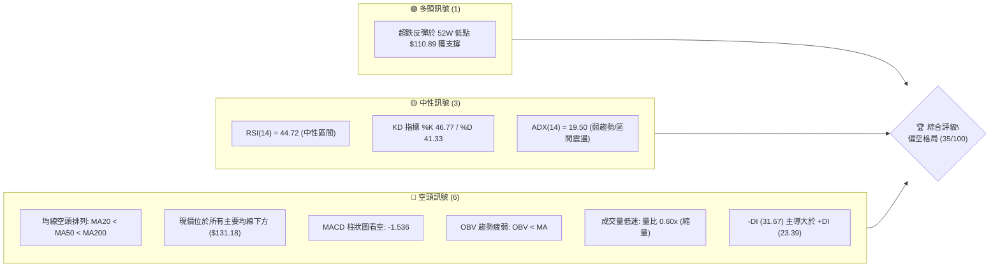

### 📊 核心指標速覽表

| 指標類別 | 指標名稱 | 當前數值 | 訊號 | 解讀 |
|----------|----------|----------|------|------|
| **價格** | 當前收盤價 | $131.18 | 🔴 | 位於 52 週區間 23.9% 低位，承壓於多重均線 |
| **均線** | MA20 (短) | $140.14 | 🔴 | 價格低於 MA20 (-6.39%)，短線反彈遭遇首道動態均線壓力 |
| **均線** | MA50 (中) | $143.65 | 🔴 | 價格低於 MA50 (-8.68%)，中期結構偏空抑制多頭上攻 |
| **均線** | MA200 (長) | $152.02 | 🔴 | 價格低於牛熊分界線 (-13.71%)，中長期多頭趨勢完全瓦解 |
| **動能** | RSI(14) | 44.72 | 🟡 | 位於中性偏弱區間 (30–50)，反彈動能衰竭尚未進入超買 |
| **動能** | MACD | -5.532 / -3.995 | 🔴 | 雙線位於零軸下方，柱狀圖 -1.536 持續維持空方發散 |
| **趨勢** | ADX(14) | 19.50 | 🟡 | 數值小於 25，單邊下跌暫歇，轉入布林寬幅區間盤整震盪 |
| **波動** | ATR(14) | $8.39 | 🔴 | 佔股價 6.40%，日均波動劇烈，洗盤風險高 |
| **通道** | 布林 %B | 0.30 | 🟡 | 現價自下軌 ($117.19) 反彈，朝中軌 ($140.14) 靠攏受阻 |
| **量能** | 量比 (20MA) | 0.60x | 🔴 | 日量 4,375,100 遠低於均量 7,340,605，反彈無量面臨誘多風險 |

### 🏆 技術評分卡

```
╔════════════════════════════════════════════════════════════════════════╗
║                     技術評分卡 — VST (2026-11-11)                       ║
╠════════════════════════════════════════════════════════════════════════╣
║  趨勢強度      ███████░░░░░░░░░░░░░  35/100  🔴 空頭主導 (-DI > +DI)    ║
║  動能指標      ████████░░░░░░░░░░░░  38/100  🔴 MACD負向/RSI弱勢        ║
║  支撐穩定度    █████████░░░░░░░░░░░  45/100  🟡 52W低點短撐/無結構支撐   ║
║  成交量配合    ██████░░░░░░░░░░░░░░  32/100  🔴 縮量反彈/OBV<均線       ║
║  形態完整度    ███████░░░░░░░░░░░░░  36/100  🔴 跳空破位後微弱修復      ║
║  均線排列      █████░░░░░░░░░░░░░░░  24/100  🔴 典型空頭排列            ║
╠════════════════════════════════════════════════════════════════════════╣
║  綜合評分      ███████░░░░░░░░░░░░░  35/100  🔴 偏空弱勢 (算術平均值)   ║
╚════════════════════════════════════════════════════════════════════════╝
```
*(註：綜合評分 = (35 + 38 + 45 + 32 + 36 + 24) ÷ 6 = 35.0，依規則 18 四捨五入取整)*

---

## 2. 趨勢分析

### 🌐 多時框趨勢分析

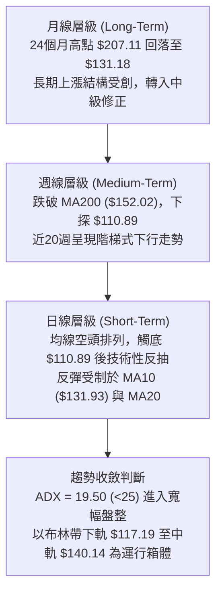

### 📈 長期趨勢 — 12個月走勢圖（Unicode）

依據 24 個月收盤數據中最近 12 個月（2025-12 至 2026-11）之歷史軌跡繪製如下：

```
VST 月線走勢圖（過去12個月：2025-12 至 2026-11）
價格 ($)
$180 ┤
$173 ┤         ●(2026-02 高點: $173.13)
$160 ┤●(2025-12)      ●       ●(2026-05: $159.74)
$150 ┤    ●       ●       ●       ●
$140 ┤                                ●   ●   ●
$130 ┤                                            ●(當前: $131.18)
$120 ┤
$110 ┤                                        *(波段低點: $110.89)
     └──────────────────────────────────────────────────────────
       12  01  02  03  04  05  06  07  08  09  10  11 (月份)
```

#### 走勢特徵分析表格

| 階段 | 期間 | 起點收盤 | 終點收盤 | 區間漲跌幅 | 走勢特徵解讀 |
|------|------|----------|----------|------------|--------------|
| **年初反彈** | 2025-12 ~ 2026-02 | $160.62 | $173.13 | +7.79% | 延續歷史高點後之次級反彈，於 $173.13 形成年度次高點 |
| **春季下探** | 2026-02 ~ 2026-03 | $173.13 | $149.87 | -13.44% | 迅速失守 $150 心理關卡，放量回落確認頭部成形 |
| **夏季箱體** | 2026-04 ~ 2026-06 | $157.36 | $158.37 | +0.64% | 價格在 $157–$160 窄幅橫盤，動能指標收斂，主力派發籌碼 |
| **秋季破位** | 2026-07 ~ 2026-08 | $147.95 | $137.15 | -7.30% | 連續跌破各期均線支撐，中長期多頭均線結構遭到破壞 |
| **平台整理** | 2026-09 ~ 2026-10 | $138.35 | $138.37 | +0.01% | 雙月平價收盤於 $138.37，形成脆弱的弱勢整理中繼平台 |
| **破底反抽** | 2026-10 ~ 2026-11 | $138.37 | $131.18 | -5.20% | 11月初重挫探底 $110.89 後出現技術性反彈，目前收在 $131.18 |

### 📊 中期趨勢（週線分析）

週線近 20 週呈現高點遞減（Lower Highs）格局。2026-10-09 當週曾衝高至 $168.75（收盤 $161.48，成交量爆量至 59,368,900），隨後連續 4 週大幅走低，並在 2026-11-06 當週打出 $110.89 的 52 週新低（單週週量高達 58,997,800）。目前雖然自低位回彈至 $131.18，但週 MACD 柱狀圖仍為 -1.536，週 RSI 為 44.7，反彈尚未扭轉中期空頭架構。

```
週線關鍵壓力與支撐階梯
┌────────────────────────────────────────────────────────┐
│ [強阻力 R3] $168.67 (2026-10-09 當週高點聚類)           │
│      ▲                                                 │
│ [阻力位 R2] $155.69 (中期波段密集成交反壓)              │
│      ▲                                                 │
│ [關鍵阻力 R1] $149.93 (日線波段高點/接近MA200 $152.02)  │
│      ▲                                                 │
│ ───現價 $131.18 ────────────────────────────────────── │
│      ▼                                                 │
│ [斐波那契 78.6%] $129.03 (短線下檔關鍵支撐)             │
│      ▼                                                 │
│ [布林通道下軌]   $117.19 (動態下檔包絡線)              │
│      ▼                                                 │
│ [52週歷史低點]   $110.89 (2026-11-05 波段絕對底部)      │
└────────────────────────────────────────────────────────┘
```

### ⚡ 趨勢強度評估（ADX 解讀）

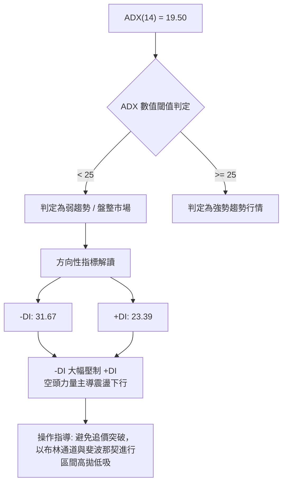

| ADX 區間 | 趨勢狀態 | VST 當前數值 | 交易策略意涵 |
|----------|----------|--------------|--------------|
| 0 – 20 | 弱勢盤整 / 無趨勢 | **19.50 (當前)** | **單邊趨勢動能衰減，處於破底後的無方向震盪或基底構築期** |
| 20 – 25 | 趨勢醞釀中 | — | 突破或破位邊緣，等待方向明朗 |
| 25 – 40 | 強勢趨勢確立 | — | 順應中長期均線方向單邊操作 |
| 40 – 60 | 極強單邊行情 | — | 趨勢主升段或主跌段 |

---

## 3. 圖表形態分析

### 🔍 形態識別系統

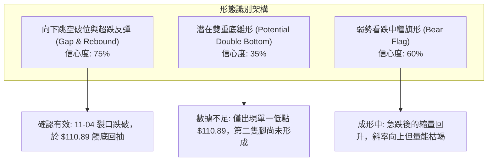

#### 形態信心度與目標價評估表

| 形態名稱 | 信心度 | 判斷依據（引用數據） | 完成度 | 目標價（附計算式） |
|----------|--------|----------------------|--------|--------------------|
| **向下跳空破位與反抽** | 75% | 2026-11-04 開盤 $125.40 跳空跌破 11-03 低點 $135.99，並在下探 $110.89 後展開超跌反抽 | 85% | 反彈測試跳空缺口下緣與 MA20 ($140.14)。依形態量度：現價 $131.18 至阻力位 R1 $149.93 |
| **弱勢看跌旗形 (Bear Flag)** | 60% | 11-04 至 11-05 長黑摜壓（旗桿高度：11-03高點 $142.40 − 11-05低點 $110.89 = $31.51），隨後 3 日縮量向上飄移（旗面） | 50% | 若跌破旗面下緣 $125.09：旗桿起跌點 $134.80 − 旗桿高度 $31.51 = **$103.29**（註：數據未提供該歷史點位，僅依幾何推算） |
| **潛在雙重底** | 35% | 僅有 2026-11-05 單日低點 $110.89，目前尚未出現二次探底與不破測試 | 20% | 訊號不足，僅做指標型解讀（頸線設定為 R1 $149.93，若能突破則高度為 $149.93 − $110.89 = $39.04，目標為 $188.97） |

### 🕯️ 重要K線形態分析

#### 近 10 根日 K 棒明細解析

| 日期（日K） | 開 | 高 | 低 | 收 | 成交量 | K線形態 | 解讀 | 訊號 |
|-------------|----|----|----|----|--------|---------|------|------|
| 2026-10-28 | 146.88 | 147.82 | 142.20 | 142.72 | 5,656,900 | 中黑棒 | 開高走低，失守 MA200，空方下壓 | 🔴 |
| 2026-10-29 | 142.18 | 144.67 | 140.06 | 140.95 | 4,935,200 | 小黑棒 | 連續破底，跌破 MA20，空頭防線前移 | 🔴 |
| 2026-10-30 | 136.95 | 139.82 | 135.86 | 138.37 | 5,270,200 | 帶上下影陽線 | 嘗試抵抗但受制於 $140 整數關卡 | 🟡 |
| 2026-11-02 | 140.00 | 140.50 | 134.21 | 134.61 | 4,797,900 | 實體中黑棒 | $140 抵抗失敗，收盤創波段新低 | 🔴 |
| 2026-11-03 | 135.99 | 142.40 | 135.99 | 139.59 | 5,884,400 | 長紅反彈棒 | 衝高觸及 $142.40 後收長上影，誘多盤 | 🟡 |
| 2026-11-04 | 125.40 | 128.07 | 117.27 | 120.29 | 20,441,400 | 跳空放量長大黑 | 跳空低開暴跌，爆量恐慌拋售，破位確立 | 🔴 |
| 2026-11-05 | 116.86 | 118.91 | 110.89 | 112.89 | 15,339,900 | 鎚頭狀黑K (低點探測) | 探測 52W 低點 $110.89，下影線引發極端買盤 | 🟡 |
| 2026-11-06 | 119.57 | 125.80 | 118.86 | 124.80 | 12,534,200 | 長陽實體回升 | 吞噬前日收盤，短線空頭回補帶動反抽 | 🟢 |
| 2026-11-09 | 128.00 | 134.80 | 125.09 | 133.92 | 7,382,300 | 跳空高開陽棒 | 延續超跌反彈，但成交量降至 738 萬 | 🟢 |
| 2026-11-10 | 130.90 | 134.13 | 129.30 | 131.18 | 4,375,100 | 高檔十字小陰星 | 衝高 $134.13 遇阻，量能萎縮至 437 萬，反彈乏力 | 🔴 |

#### 近 8 根週 K 棒明細解析

| 日期（週K最後日） | 開 | 高 | 低 | 收 | 週成交量 | K線形態 | 解讀 | 訊號 |
|-------------------|----|----|----|----|----------|---------|------|------|
| 2026-09-25 | 142.00 | 142.64 | 135.98 | 138.46 | 22,341,300 | 下跌小陰棒 | 震盪偏弱，考驗下檔支撐 | 🔴 |
| 2026-10-02 | 138.08 | 143.51 | 133.44 | 140.02 | 34,710,000 | 下影小陽棒 | 低位探底 $133.44 獲承接，成交量放大 | 🟢 |
| 2026-10-09 | 144.04 | 168.75 | 140.90 | 161.48 | 59,368,900 | 巨量衝高長上影 | 爆量 5936 萬衝刺 $168.75，主力趁利多出貨 | 🔴 |
| 2026-10-16 | 162.67 | 164.25 | 145.85 | 152.02 | 31,699,400 | 長陰回吐棒 | 吞噬前週實體過半，確認 $168.75 為波段頂部 | 🔴 |
| 2026-10-23 | 154.10 | 158.74 | 136.17 | 140.16 | 31,911,100 | 連續長黑棒 | 跌破所有短均，直逼 $140 平台 | 🔴 |
| 2026-10-30 | 140.90 | 147.82 | 135.86 | 138.37 | 24,269,600 | 弱勢十字星 | 抵抗無力，量能萎縮，醞釀破位 | 🟡 |
| 2026-11-06 | 140.00 | 142.40 | 110.89 | 124.80 | 58,997,800 | 巨量恐慌長下影 | 暴跌至 52W 新低 $110.89，週量近 5900 萬爆出恐慌盤 | 🟡 |
| 2026-11-10 | 128.00 | 134.80 | 125.09 | 131.18 | 11,757,400 | 反彈小陽線 | 破底後短線喘息，成交量急劇萎縮，多頭謹慎 | 🟡 |

### 📉 ASCII 走勢形態示意圖

```
VST 日線形態示意圖（2026-10-28 至 2026-11-10）
價格 ($)
$148 ┤  ● (10-28 高: $147.82)
$144 ┤    ●       ● (11-03 高: $142.40)
$140 ┤      ●   ● -------------------------- 跳空缺口上緣
$136 ┤        ●
$132 ┤                                ●(11-10 收: $131.18 遇阻十字星)
$128 ┤                      ●   ●(11-09 高: $134.80)
$124 ┤                    ●(11-06 收: $124.80)
$120 ┤            ●(11-04 破位收: $120.29)
$116 ┤
$112 ┤              ●(11-05 收: $112.89)
$110 ┤              └───── *(11-05 極端低點: $110.89 獲支撐)
     └─────────────────────────────────────────────────────────────
       28  29  30  02  03  04  05  06  09  10 (交易日)
```

### 🎯 形態目標價計算

根據跳空長黑與近期反彈結構：
1. **反彈第一阻力目標**：測試 11-04 跳空裂口下緣與 MA10 ($131.93)，目前已於 11-10 高點 $134.13 觸及並回落。
2. **中期多空頸線目標**：波段阻力位 R1 為 **$149.93**（接近 MA200 的 $152.02）。
3. **破位測幅滿足點**：
   - 形態起跌點：2026-11-03 高點 $142.40
   - 破位低點：2026-11-05 低點 $110.89
   - 第一波跌幅：$142.40 − $110.89 = $31.51
   - 反彈高點確認：2026-11-09 高點 $134.80
   - 若反彈結束並跌破 $110.89，等長對稱測幅目標：$134.80 − $31.51 = **$103.29**（幾何推算，無歷史成交支撐）。

---

## 4. 支撐與阻力

### 🗺️ 關鍵價位分布圖（Unicode）

```
╔══════════════════════════════════════════════════════════════════╗
║                     VST 價位結構分布圖                           ║
╠══════════════════════════════════════════════════════════════════╣
║  $168.67 ║██████████████████████████████║ 強阻力 R3 (波段頂部聚類) ║
║  $163.28 ║██████████████████████        ║ 斐波那契 38.2% 回調位    ║
║  $163.09 ║██████████████████████        ║ 布林通道上軌反壓         ║
║  $155.69 ║██████████████████            ║ 阻力位 R2 (密集套牢反壓) ║
║  $153.28 ║████████████████              ║ 斐波那契 50.0% 關鍵位    ║
║  $152.02 ║███████████████               ║ 長期均線 MA200 生命線    ║
║  $149.93 ║██████████████████████████████║ 關鍵阻力 R1 (高點聚類)   ║
║  $143.27 ║████████████                  ║ 斐波那契 61.8% 回調位    ║
║  $140.14 ║██████████                    ║ 布林中軌 (MA20 短壓)     ║
║  $131.93 ║██████                        ║ MA10 短線動態反壓        ║
║  $131.18 ╠══════════════════════════════╣ ◄ 當前收盤價 ($131.18)   ║
║  $129.03 ║▓▓▓▓▓▓▓▓▓▓▓▓▓▓▓▓▓▓▓▓▓▓        ║ 斐波那契 78.6% 近端支撐  ║
║  $117.19 ║▓▓▓▓▓▓▓▓▓▓▓▓▓▓                ║ 布林通道下軌包絡線       ║
║  $110.89 ║██████████████████████████████║ 52週歷史低點 (100% 斐波) ║
║  N/A     ║░░░░░░░░░░░░░░░░░░░░░░░░░░░░░░║ (下方無波段低點聚類支撐) ║
╚══════════════════════════════════════════════════════════════════╝
```

### 🚧 阻力位分析表

*(註：R1、R2、R3 嚴格引用數據中近一年波段高點聚類數值)*

| 阻力級別 | 價位 | 形成原因（數據依據） | 突破難度 | 重要性 |
|----------|------|----------------------|----------|--------|
| **R1** | **$149.93** | 近一年波段高點聚類，距現價 +14.30%；貼近 MA200 ($152.02) | 🔴 極高 | ★★★★★<br/>中長期多空分水嶺 |
| **R2** | **$155.69** | 近一年次高密集成交反壓聚類，距現價 +18.68% | 🔴 極高 | ★★★★☆<br/>中期波段解套賣壓區 |
| **R3** | **$168.67** | 近一年頂部巨量聚類（2026-10-09 週高 $168.75 處），距現價 +28.58% | 🔴 極難 | ★★★★★<br/>歷史天花板強壓 |

### 🛡️ 支撐位分析表

*(註：依數據紀律，數據中明確標示「no swing-low support detected below current price」，因此聚類支撐記錄為 N/A，改以數據提供的斐波那契與統計指標對齊)*

| 支撐級別 | 價位 | 形成原因（數據依據） | 守住機率 | 重要性 |
|----------|------|----------------------|----------|--------|
| **S1 (近端)** | **$129.03** | 52 週區間之 78.6% 斐波那契回調位，昨日低點 $129.30 守於其上 | 🟡 55% | ★★★☆☆<br/>短線反彈生命線 |
| **S2 (動態)** | **$117.19** | 日線布林通道下軌（20日 2倍標準差動態包絡線） | 🟡 60% | ★★★☆☆<br/>極端超賣防禦線 |
| **S3 (絕對)** | **$110.89** | 52週最低價 (52W Low / 100% 斐波那契基點，2026-11-05 創下) | 🟢 70% | ★★★★★<br/>全年中長線最後防線 |
| **波段聚類** | **N/A（數據未提供）** | 數據明載：現價下方未偵測到波段低點聚類 (no swing-low) | N/A | ⚠️ 警示無結構性密集群支撐 |

### 📐 斐波那契回調位分析

依據 52 週極值區間（最低點 **$110.89** → 最高點 **$195.66**，總極差 **$84.77**）之精確計算：

| 斐波那契比例 | 價位 | 當前價位相對位置與意義解讀 |
|--------------|------|----------------------------|
| **0.0% (52W High)** | **$195.66** | 週期頂部，長期多頭極致 |
| **23.6%** | **$175.66** | 強勢回檔位，跌破後確認長期上升趨勢終結 |
| **38.2%** | **$163.28** | 與布林上軌 ($163.09) 高度重疊，為反彈強壓力位 |
| **50.0%** | **$153.28** | 多空均衡軸心，緊鄰 MA200 ($152.02) |
| **61.8%** | **$143.27** | 黃金分割防守位，現已轉為強烈反壓，貼近 MA50 ($143.65) |
| **78.6%** | **$129.03** | **現價 ($131.18) 位於 61.8% 與 78.6% 之間**；$129.03 為回調最深支撐線 |
| **100.0% (52W Low)**| **$110.89** | 週期基底，跌破將引發無支撐之估值重估 |

---

## 5. 技術指標深度解讀

### 🎛️ 指標訊號總覽

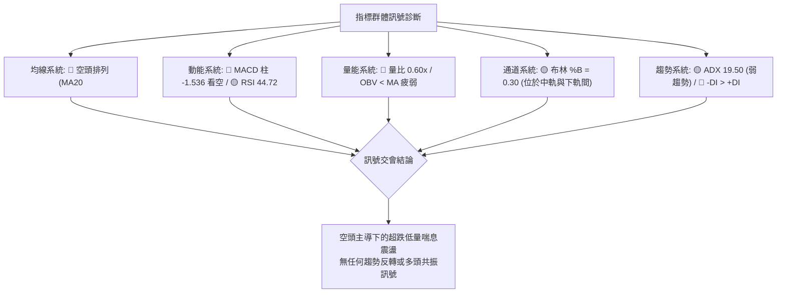

### 📈 移動平均線排列分析

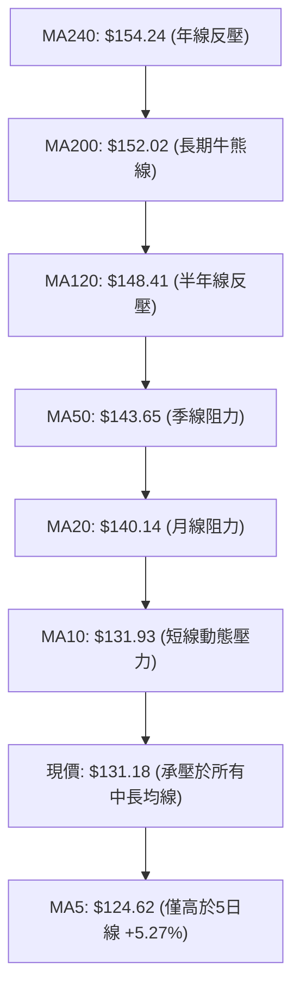

- **排列狀態**：當前所有主要均線呈現標準的**空頭排列**（MA20 $140.14 < MA50 $143.65 < MA200 $152.02）。
- **價格偏離度**：現價 $131.18 距 MA20 偏離 -6.39%，距 MA50 偏離 -8.68%，距 MA200 偏離 -13.71%。
- **短線訊號**：現價雖站上 MA5 ($124.62，乖離 +5.27%)，但今日收盤 ($131.18) 恰好受制於下彎的 MA10 ($131.93，-0.57%)，顯示反彈在短均線即遇阻，未能引發均線由下而上的金叉扭轉。

### 📉 RSI(14) 分析

```
RSI(14) Wilder: 44.72
0 ──────────── 30 ────────────────────── 50 ────────── 70 ────────── 100
[  極端超賣區  ] [       空方偏弱區      ] [   多方強勢區  ] [  極端超買區  ]
                  ▲
               現值 44.72
進度條: █████████░░░░░░░░░░░ 44.72%
```

- **區間評估**：RSI(14) 數值為 **44.72**，脫離 11-05 極度超賣區，回升至 30–50 之空方控盤區間。未站上 50 中軸前，市場仍由賣方主導。
- **背離判斷**：
  - 根據系統提供之背離檢驗結論：「**無明顯背離**（僅比較近20根K棒首尾的價格與RSI方向）」。
  - 檢視近 20 週收盤軌跡：2026-11-06 當週股價收 $124.80，RSI 為 39.7；2026-11-10 股價收 $131.18，RSI 為 44.7。價格與指標同步回升，**不存在底背離**，亦**無頂背離**，為單純的超跌後數值修復。

### 📊 MACD(12/26/9) 訊號解讀

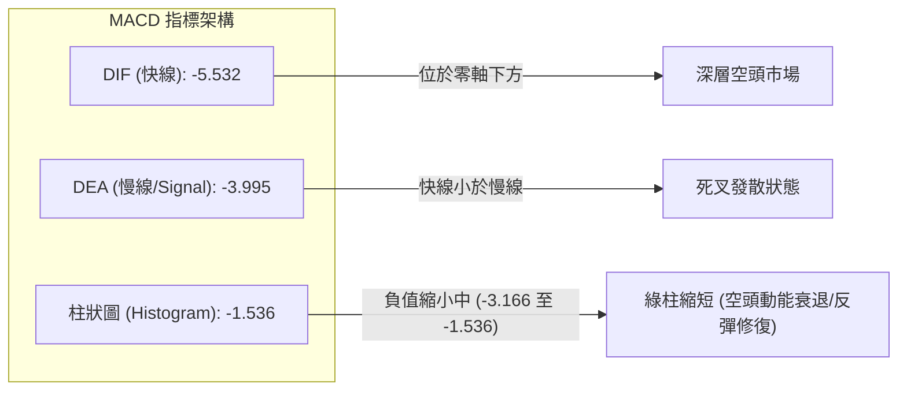

- **絕對位置**：DIF (-5.532) 與 Signal (-3.995) 雙雙深陷零軸之下，反映中期波段具有極深的空頭慣性。
- **微觀動能**：週線 MACD 柱狀圖由 2026-11-06 的 **-3.166** 收窄至當前的 **-1.536**，顯示短線殺跌賣壓暫告一段落，但因快慢線尚未金叉，隨時有於零軸下方再度二次向下發散的風險。

### 📦 布林通道分析

```
布林通道結構 (BB 20, 2)
$163.09 ──────────────────────── 上軌 (BB Upper)
                   
$140.14 ┄ ┄ ┄ ┄ ┄ ┄ ┄ ┄ ┄ ┄ ┄ ┄ ┄ 中軌 (BB Mid / MA20)
                  ▲
$131.18 ═════════ █ ════════════ 當前價格 (BB %B = 0.30)
                   
$117.19 ──────────────────────── 下軌 (BB Lower)
進度條: ██████░░░░░░░░░░░░░░ (%B = 0.30)
```

- **通道帶寬與形態**：上軌 $163.09、下軌 $117.19、中軌 $140.14，帶寬高達 $45.90。
- **%B 指標解讀**：%B 為 **0.30**，代表股價位於下軌至中軌之間 30% 位置。股價自 11-05 跌破下軌處（最低 $110.89）被強烈拉回通道內，目前反彈行進至通道下半區，中軌 $140.14 構成極強之動態磁吸反壓。

### 💹 成交量分析（量價配合度）

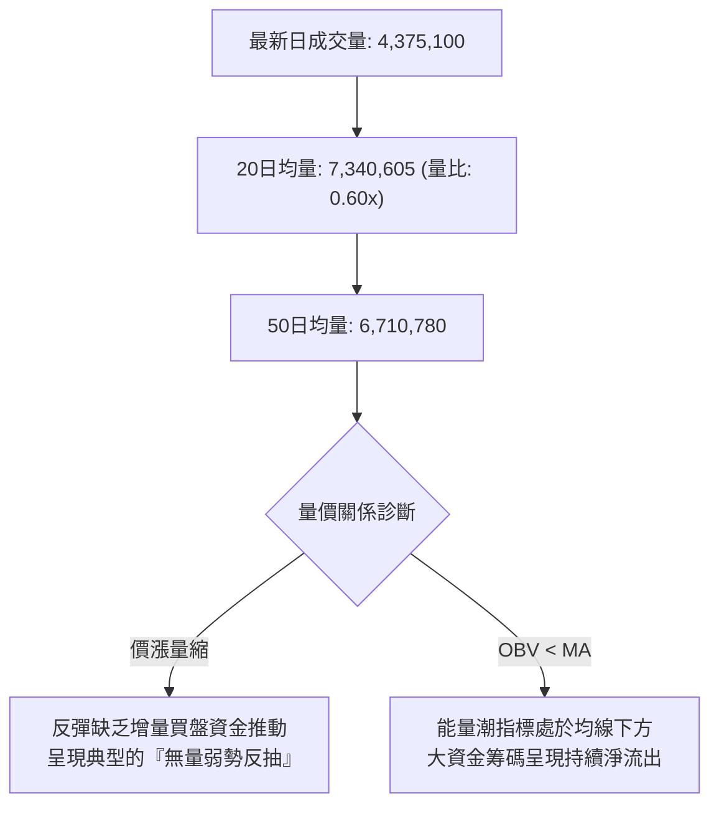

- **量價背離分析**：
  - 11-04 暴跌放量至 20,441,400，11-06 止跌放量至 12,534,200。
  - 然而反彈至今，11-09 成交量驟降至 7,382,300，11-10 更僅剩 **4,375,100**（量比僅 **0.60x**）。
  - **典型量價量能背離**：價格向上反抽，量能反而持續大幅萎縮，暗示上漲主要由「空頭回補」帶動，而非「主動性多頭進場掃貨」。
- **OBV 趨勢**：OBV 指標明確標示「OBV < MA」，量能線受制於均量線，籌碼流向呈淨流出，不支持突破行情。

---

## 6. 動能與波動率

### ⚡ 動能評估四象限

| 象限 | 動能強度 | 波動率水準 | 當前狀態標註 | 特徵與操作評估 |
|------|----------|------------|--------------|----------------|
| **Q1 (爆發動能)** | 強 (RSI>60, MACD>0) | 低 (ATR%<3%) | — | 最佳趨勢鎖定機會，單邊順勢推進 |
| **Q2 (盤整修復)** | 弱 (RSI<50, MACD<0) | 低 (ATR%<3%) | — | 低波低動能，窄幅築底或沉悶盤整 |
| **Q3 (極限博弈)** | 強 (RSI突破, 巨量) | 高 (ATR%>5%) | — | 高風險高收益，主升或主跌段急拉急洗 |
| **Q4 (弱勢高波)** | **弱 (RSI 44.72, MACD<0)** | **高 (ATR% 6.40%)** | **✓ (VST 當前落點)** | **避免追高進場；波動劇烈但動能向下，易遭洗盤與破位套牢** |

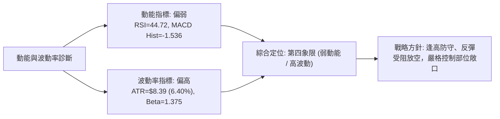

### 📊 ATR 波動率分析

- **ATR 數值**：當前 ATR(14) 為 **$8.39**（佔現價比例高達 **6.40%**，採 Wilder 平滑算法）。
- **止損距離設定建議**：
  - **保守型（波段交易）**：建議給予 1.5 倍 ATR 緩衝 = $8.39 × 1.5 = **$12.59**。
  - **積極型（日內/短線）**：建議給予 1.0 倍 ATR 緩衝 = **$8.39**。
  - 現價 $131.18 的日均真實波動區間高達 $8.39，意味著單日振幅極易突破 $10，任何進場點若無精確支撐防護，極易被洗出場。

### 📐 Beta 與市場相關性

- **Beta 係數**：**1.375**。
- **市場意涵**：VST 相較於標普 500 指數具備 1.375 倍之超額波動性。當美股大盤走弱時，VST 將承受放大 37.5% 的下行衝擊；反之在公用事業或電力板塊面臨拋壓時，高 Beta 特性導致其股價回撤劇烈，投機資金流出迅速。

---

## 7. 多時框架總結

### 📋 時框架評分表

| 時框架 | 趨勢方向 | 動能狀態 | 均線排列 | 形態結構 | 綜合評分 | 建議方針 |
|--------|----------|----------|----------|----------|----------|----------|
| **月線 (長)** | 🔴 中級修正 | 🔴 柱狀轉弱 | 🟡 測試年線均值 | 歷史高點 $207 回撤 | 35/100 | 長線資金減碼觀望 |
| **週線 (中)** | 🔴 空頭主導 | 🔴 MACD柱負向 | 🔴 跌破MA200生命線 | 階梯破位跌探新低 | 30/100 | 中期反彈逢高減磅 |
| **日線 (短)** | 🟡 弱勢反抽 | 🟡 RSI低位反彈 | 🔴 均線標準空頭 | 跳空暴跌後無量修復 | 40/100 | 短線區間震盪嚴守停損 |

### 🔲 綜合訊號矩陣

```
時框與指標訊號矩陣
┌──────────────┬────────────┬────────────┬────────────┬────────────┐
│   維度 / 時框 │  移動平均  │  MACD動能  │  RSI相對強弱│  量能與結構 │
├──────────────┼────────────┼────────────┼────────────┼────────────┤
│   短期 (日線) │  🔴 空頭   │  🔴 柱負   │  🟡 44.72  │  🔴 縮量反彈│
│   中期 (週線) │  🔴 破位   │  🔴 -1.536 │  🟡 44.70  │  🔴 放量破位│
│   長期 (月線) │  🔴 偏空   │  🔴 轉弱   │  🟡 45-50  │  🔴 高位派發│
└──────────────┴────────────┴────────────┴────────────┴────────────┘
訊號共振結論：日、週、月在「均線系統」與「動能結構」上高度共振偏空。
```

### ⚖️ 多時框收斂結論

依據多時框收斂規則（規則 14）：
1. **行情類型判定**：當前日線 ADX(14) 為 **19.50 (<25)**，嚴格定義為**盤整行情（震盪行情）**。
2. **主要交易區間收斂**：在盤整行情中，不可追高殺跌，以**日線布林通道上下軌**（下軌 **$117.19** 至 上軌 **$163.09**）為核心活動邊界，當前中軌為 **$140.14**。
3. **時框優先級權重**：雖然當前處於無趨勢盤整（ADX<25），但中長期週線跌破 MA200 ($152.02) 且均線呈空頭排列，代表上方反壓沉重。
4. **唯一確定結論**：**【偏空觀望，反彈逢高放空】**。日線之向上反彈僅視為對中軌 ($140.14) 與跳空缺口之技術性抽搐，而非反轉；綜合評分為 **35/100**，全面契合第 8 章之空頭策略路由。

---

## 8. 交易策略建議

### 🗺️ 策略決策流程圖

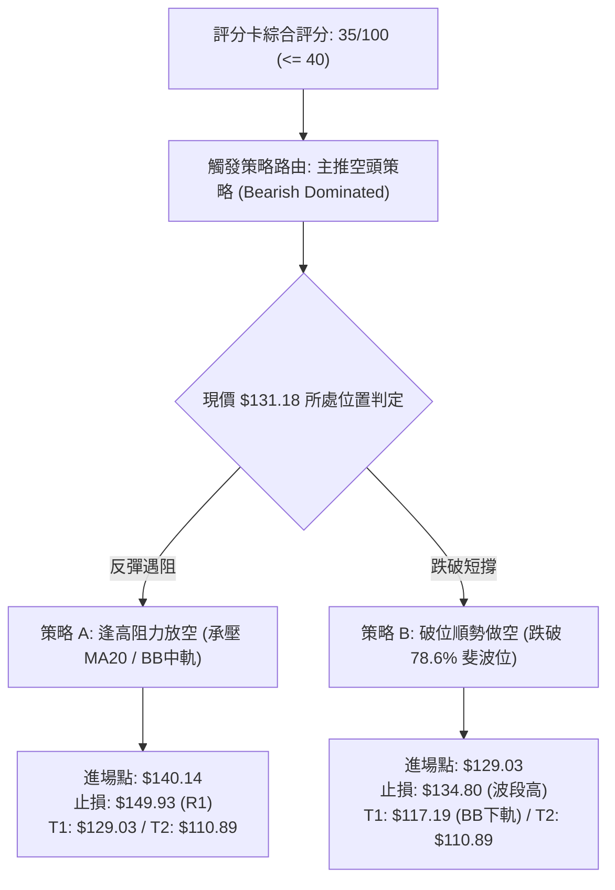

### 🧭 策略路由（依評分卡分流）

> **當前主策略方向 = 【主推空頭策略】（依評分卡綜合評分 35/100，低於 40 門檻）**
>
> 理由：技術面呈現典型空頭排列，量能萎縮，現價反彈至 MA10 ($131.93) 隨即停滯。主推逢高放空與破位做空策略；多頭僅列為風險對沖觸發提示。

### 🎯 價格情境階梯（Price Scenarios）

*(註：價位嚴格引用第 4 章及數據提供之實際數值)*

| 觸發條件 | 下一目標 | 後續延伸 | 情境含義 |
|----------|----------|----------|----------|
| **強勢突破 R1 $149.93** | 測試 R2 **$155.69** | 衝擊 R3 **$168.67** | 多頭超強反轉，空頭停損離場，重回中長期上升軌道 |
| **弱勢反彈承壓 $140.14** | 回測 **$129.03** | 下探下軌 **$117.19** | 盤整格局中軌遇阻，空方重新控盤，重回布林下半部 |
| **有效跌破 S1 $129.03** | 探測下軌 **$117.19** | 考驗新低 **$110.89** | 反彈確認結束，順勢展開二次探底，測試 52 週絕對底部 |

### 📊 情境機率分佈

| 情境代號 | 行情發展情境 | 機率估計 | 主要指標依據 |
|----------|--------------|----------|--------------|
| **情境 I** | **受阻回落 / 二次探底** | **55%** | 均線空頭排列未變、MACD柱狀圖仍為負值 (-1.536)、OBV疲弱且量比僅0.60x |
| **情境 II** | **布林區間寬幅震盪** | **35%** | ADX 僅 19.50 顯示單邊動能不足、52週低點 $110.89 短線承接力道猶存 |
| **情境 III**| **向上連續突破強反轉** | **10%** | 上方遭遇 R1 $149.93 與 MA200 $152.02 重磅反壓，縮量狀態下難以達成 |

### 🟢 主策略詳情（方向：主推空頭策略）

*(註：風險報酬比嚴格按規則 17 計算：(進場價 − T1) ÷ (止損價 − 進場價))*

| 策略要素 | 策略 A（反彈逢高阻力放空） | 策略 B（跌破關鍵斐波位追空） |
|----------|----------------------------|------------------------------|
| **策略定位** | 逢反彈測試布林中軌受阻做空 | 跌破反彈生命線之順勢追空 |
| **進場條件** | 價格反彈至 MA20 / 中軌受阻出黑K | 價格實體收盤跌破 78.6% 斐波位 |
| **進場價格** | **$140.14** (BB中軌/MA20) | **$129.03** (78.6% 斐波那契位) |
| **目標價 T1** | **$129.03** (78.6% 斐波位) | **$117.19** (布林通道下軌) |
| **目標價 T2** | **$110.89** (52W歷史低點) | **$110.89** (52W歷史低點) |
| **止損價格** | **$149.93** (波段阻力 R1) | **$134.80** (2026-11-09 反彈高點) |
| **風險報酬比** | **1 : 1.13（以 T1 計）**<br/>*(以 T2 計為 1 : 2.99)* | **1 : 2.05（以 T1 計）**<br/>*(以 T2 計為 1 : 3.14)* |
| **數學計算式** | T1: (140.14−129.03)÷(149.93−140.14)=11.11÷9.79<br/>T2: (140.14−110.89)÷(149.93−140.14)=29.25÷9.79 | T1: (129.03−117.19)÷(134.80−129.03)=11.84÷5.77<br/>T2: (129.03−110.89)÷(134.80−129.03)=18.14÷5.77 |
| **成功機率** | 60% | 65% |
| **建議倉位** | 10% – 15% 總資金 | 10% 總資金 |

### 🔴 反向風險觸發點（對沖提示）

- **多頭反轉翻轉點**：若市場出現放量長紅棒，收盤價**強勢站穩阻力位 R1 $149.93**（且突破 MA200 $152.02），則空頭形態完全失效。
- **對沖應變機制**：觸發 R1 突破時，所有空單必須無條件停損出場，並可建立 5% 倉位之動量多單對沖，上看 R2 **$155.69** 及 R3 **$168.67**。

### ⭐ 整體訊號強度評星

```
做多訊號強度：★☆☆☆☆  (1/5星 - 僅存超跌反抽，無實質籌碼推動)
做空訊號強度：★★★★☆  (4/5星 - 均線空頭排列，量價持續背離)
整體可信度：  ★★★★☆  (4/5星 - 數據完整，價位結構吻合度高)
```

---

## 9. 風險提示與監控

### ✅ 關鍵監控指標 Checklist

```
╔════════════════════════════════════════════════════════════════════════╗
║                      關鍵監控指標日常 Checklist                         ║
╠════════════════════════════════════════════════════════════════════════╣
║  [ ] 價位破位警報：日收盤價跌破 $129.03 (確認反彈結束，重回跌勢)        ║
║  [ ] 極限防守監控：日盤中價觸及 $110.89 (若破底將引發斷頭止損潮)        ║
║  [ ] 動態反壓測試：價格觸及 MA20 $140.14 時是否出現放量滯漲或長上影     ║
║  [ ] 空頭停損警戒：收盤價突破 R1 $149.93 (空頭最後防線)                ║
║  [ ] 動能背離觀察：日線 MACD 柱狀圖是否跌破 -3.166 創出新低             ║
║  [ ] 量能異動跟蹤：單日成交量是否放大至 15,000,000 以上 (放量表態)     ║
║  [ ] 波動範圍評估：單日高低振幅是否超過 ATR $8.39 (異常擴大警報)       ║
╚════════════════════════════════════════════════════════════════════════╝
```

### ⚠️ 風險場景分析

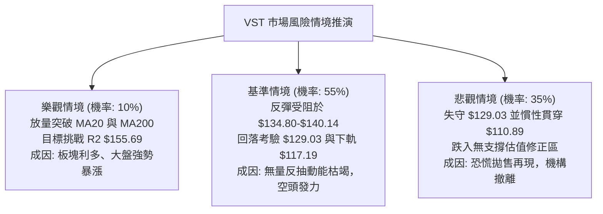

### 🛡️ 風險管理重要提醒

1. **ATR 劇烈波動與倉位限制**：
   - 由於 VST 當前 ATR(14) 高達 **$8.39 (6.40%)**，標的具備極高波動性。任何單筆交易之名義本金不宜超過總投資組合的 **15%**。
   - 單筆交易所承受的最大帳戶淨值虧損風險（Account Risk）必須嚴格鎖定在 **1.0% – 1.5%** 之內。
2. **無波段低點聚類支撐之風險**：
   - 系統數據特別示警：「no swing-low support detected below current price」。現價下方除 52 週最低點 **$110.89** 與計算之斐波那契點位外，缺乏過去一年換手累積的密集支撐籌碼。一旦 $129.03 跌破，下檔滑價（Slippage）風險極高。
3. **跳空缺口回補陷阱**：
   - 11-04 形成的跳空裂口（$125.40 – $135.99）具有極強的套牢阻力，當前股價反抽至 $131.18 且今日盤中高點見 $134.13 即顯露疲態，切忌在此位置盲目追高多單。

---

## 📋 報告總結

```
╔════════════════════════════════════════════════════════════════════════╗
║                     VST 技術分析報告總結                                ║
╠════════════════════════════════════════════════════════════════════════╣
║  報告日期：2026-11-11                                                  ║
║  當前價格：$131.18                                                     ║
║  分析評級：🔴 偏空弱勢 (綜合評分: 35/100)                               ║
║                                                                        ║
║  關鍵結論：                                                            ║
║  ├─ 長期趨勢：🔴 中級回調，跌破 MA200 生命線 ($152.02)                 ║
║  ├─ 中期趨勢：🔴 弱勢階梯下跌，近 20 週高點持續遞減                     ║
║  ├─ 短期趨勢：🟡 超跌反彈至 MA10 ($131.93) 遇阻，縮量滯漲               ║
║  ├─ 關鍵支撐：$129.03 (近端斐波) / $117.19 (布林下軌) / $110.89 (52W低) ║
║  ├─ 關鍵阻力：$140.14 (MA20中軌) / $149.93 (R1) / $155.69 (R2)         ║
║  └─ 分析師目標：均價 $202.48 (低標: $106.00 / 高標: $306.00)           ║
║                                                                        ║
║  最優策略組合：                                                        ║
║  1. 🥇 最佳機會：策略 B 破位做空 (跌破 $129.03 進場，風報比 1:2.05)    ║
║  2. 🥈 次選機會：策略 A 逢高放空 (反彈承壓 $140.14 放空，風報比 1:1.13)║
║  3. 🥉 保守選擇：空倉觀望，等待股價確認回踩 $110.89 或突破 R1 $149.93   ║
╚════════════════════════════════════════════════════════════════════════╝
```

---

> ⚠️ **免責聲明**：本報告為 AI 自動生成之技術分析，所有數據及估算均基於提供的歷史價格資訊。本報告**僅供研究與學術參考**，**不構成任何投資建議**。投資有風險，入市需謹慎。

---

*報告生成時間：2026-11-11 ｜ 數據來源：Yahoo Finance ｜ 分析框架：多時框技術分析*