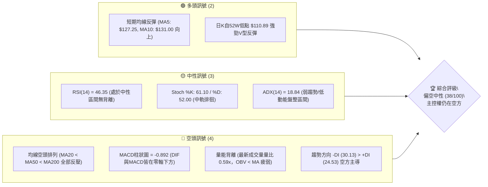
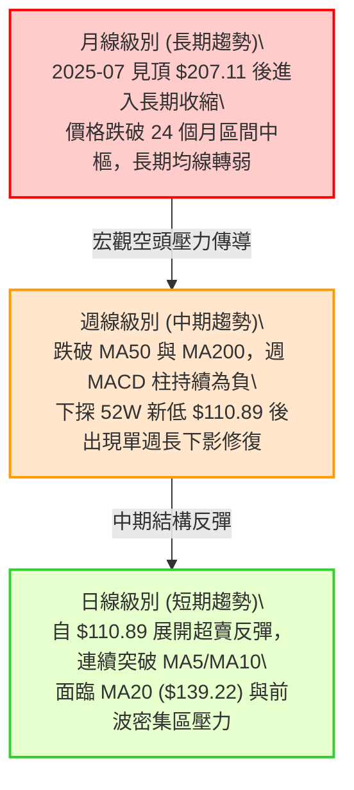
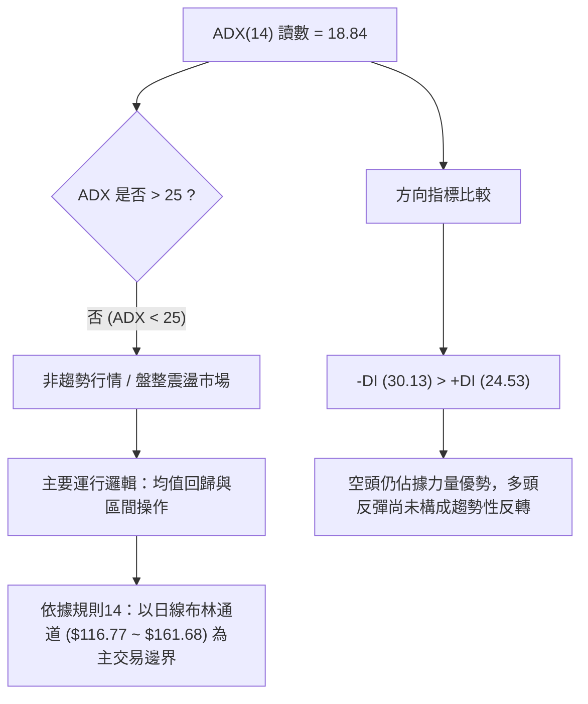
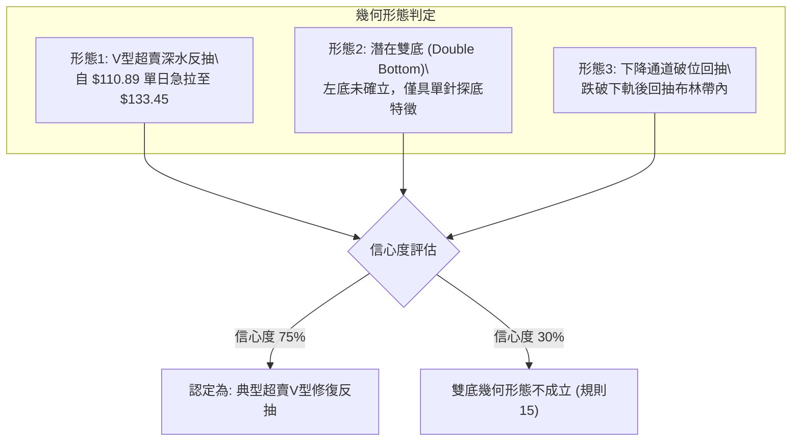
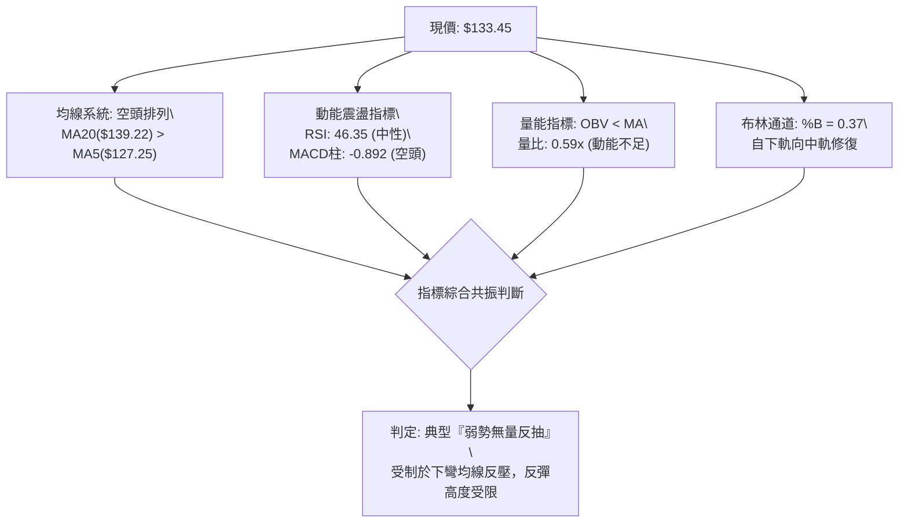
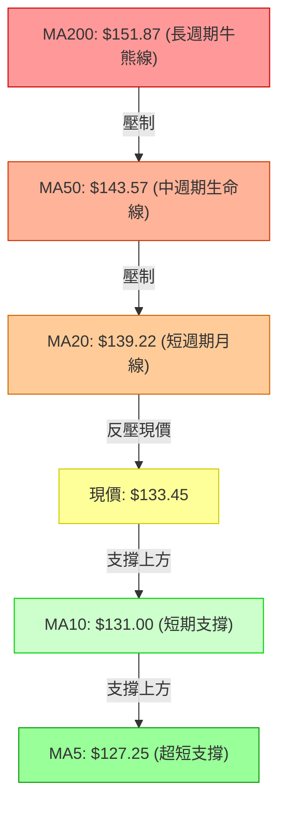
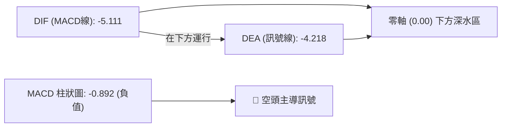
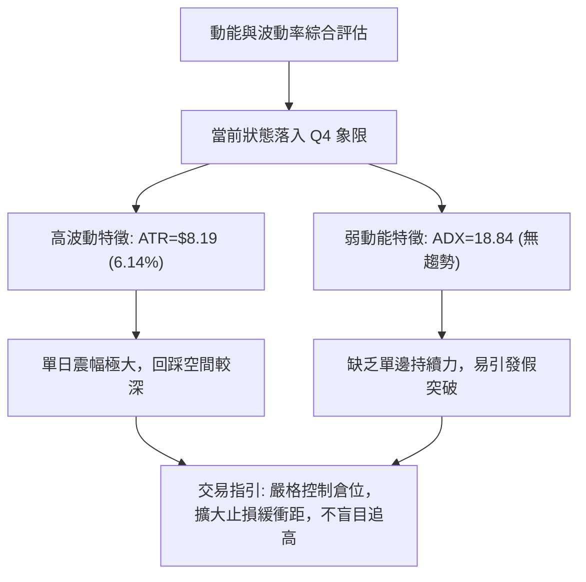
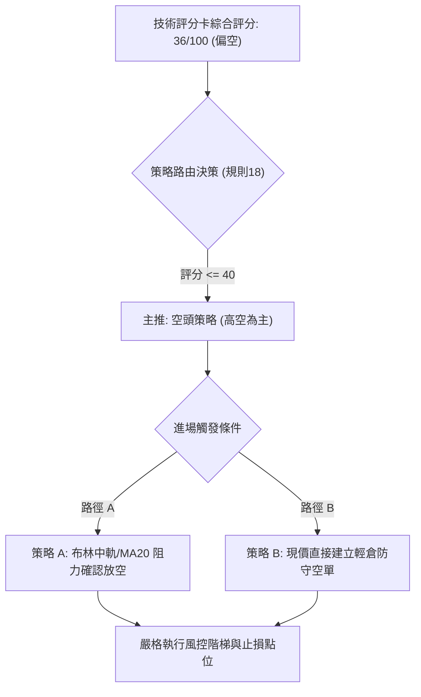
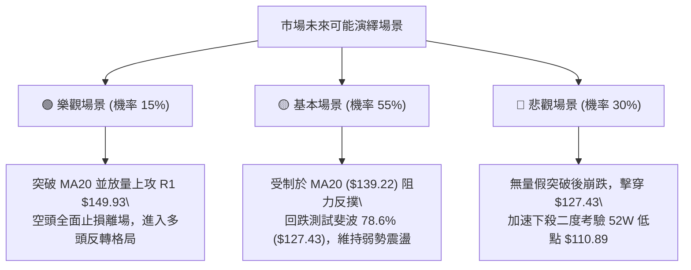

# VST 技術分析報告

> **報告日期**：2026-11-12 ｜ **語言**：繁體中文 ｜ **數據來源**：Yahoo Finance ｜ **當前價格**：$133.45

---

## 目錄

| 章節 | 內容 |
|------|------|
| [1. 技術面概覽](#1-技術面概覽) | 訊號儀表板、核心指標、評分卡 |
| [2. 趨勢分析](#2-趨勢分析) | 多時框趨勢、長中短期走勢 |
| [3. 圖表形態分析](#3-圖表形態分析) | 形態識別、K線組合、目標價 |
| [4. 支撐與阻力](#4-支撐與阻力) | 關鍵價位、斐波那契回調 |
| [5. 技術指標深度解讀](#5-技術指標深度解讀) | MA/RSI/MACD/布林/成交量 |
| [6. 動能與波動率](#6-動能與波動率) | 動能評估、ATR、Beta |
| [7. 多時框架總結](#7-多時框架總結) | 時框架評分矩陣 |
| [8. 交易策略建議](#8-交易策略建議) | 多空策略、風險報酬比 |
| [9. 風險提示與監控](#9-風險提示與監控) | 監控指標、風險場景 |

---

## 1. 技術面概覽

### 🎯 技術訊號儀表板



---

### 📊 核心指標速覽表

| 指標類別 | 指標名稱 | 當前數值 | 訊號 | 解讀 |
|----------|----------|----------|------|------|
| **價格** | 當前價格 | $133.45 | 🔴 | 位於52週區間 29.2% 位置，受制於所有中長期均線之下 |
| **均線** | MA20 | $139.22 | 🔴 | 價格低於MA20達 -4.15%，短期面臨第一道下彎均線反壓 |
| **均線** | MA50 | $143.57 | 🔴 | 中期生命線下彎，現價遠低於MA50，空頭中期壓制明確 |
| **均線** | MA200 | $151.87 | 🔴 | 長期牛熊分界線下行，現價落後 -12.13%，長期格局轉弱 |
| **動能** | RSI(14) | 46.35 | 🟡 | 位於 30–70 中性走勢，自極端低位回彈後動能放緩 |
| **動能** | MACD | -5.111 / -4.218 (柱 -0.892) | 🔴 | 雙線位於零軸深水區，空頭排列，柱狀圖持續呈現負值 |
| **波動** | ATR(14) | $8.19 (6.14%) | 🟡 | 波動率處於中高水平，單日震幅較大，須拓寬防守邊界 |
| **擺動** | Stoch %K / %D | 61.10 / 52.00 | 🟡 | 自超賣區交叉向上穿過中軸，短線出現超賣修復跡象 |
| **趨勢** | ADX(14) | 18.84 (+DI: 24.53 / -DI: 30.13) | 🟡 | ADX < 25 指示當前為非趨勢的寬幅震盪/超賣反彈階段 |
| **通道** | 布林帶 (%B) | $116.77 ~ $161.68 (%B: 0.37) | 🟡 | 價格脫離下軌往中軌（MA20）修復，處於下半通道運行 |
| **量能** | 20日成交量比 | 0.59x (4.25M vs 7.18M) | 🔴 | 反彈過程成交量明顯萎縮，量價出現背離，買盤跟進謹慎 |

---

### 🏆 技術評分卡

```
╔══════════════════════════════════════════════════════════════╗
║                技術評分卡 — VST (2026-11-12)                 ║
╠══════════════════════════════════════════════════════════════╣
║ 趨勢強度 (ADX=18.84, -DI主導)   ███████░░░░░░░░░░░░░  35/100 🔴 ║
║ 動能指標 (RSI=46.35, MACD柱負)   ████████░░░░░░░░░░░░  40/100 🟡 ║
║ 支撐穩定度 (無波段低點聚類支撐)   ██████░░░░░░░░░░░░░░  30/100 🔴 ║
║ 成交量配合 (量比0.59x, OBV疲弱)  ███████░░░░░░░░░░░░░  35/100 🔴 ║
║ 形態完整度 (V型反彈, 雙底未成形) █████████░░░░░░░░░░░  45/100 🟡 ║
║ 均線排列 (MA20<MA50<MA200空排)  ██████░░░░░░░░░░░░░░  30/100 🔴 ║
╠══════════════════════════════════════════════════════════════╣
║ 綜合評分 (六項算術平均四捨五入)   ████████░░░░░░░░░░░░  36/100 🔴 ║
║ 評級結論：技術面偏空 (Bearish Defensive)                       ║
╚══════════════════════════════════════════════════════════════╝
```

*註：綜合評分 = (35 + 40 + 30 + 35 + 45 + 30) ÷ 6 = 35.83，四捨五入取整為 36/100。*

---

## 2. 趨勢分析

### 🌐 多時框趨勢分析



---

### 📈 長期趨勢 — 12個月走勢圖（Unicode）

```
VST 月線走勢圖（過去12個月：2025-11 至 2026-11）
價格軸 ($)
$180 ┤ ● (2025-11: $177.83)
$170 ┤             ● (2026-02: $173.13)
$160 ┤     ●       │   ●   ●   ● (2025-12至2026-06 頂部盤整平台: $157~$160)
$150 ┤     │       │   │   │   │
$140 ┤     │   ●   │   │   │   │   ● (2026-07: $147.95)
$130 ┤     │   │   │   │   │   │   │   ●   ●   ● (2026-08至10 探底: $137~$138)
$120 ┤     │   │   │   │   │   │   │   │   │   │   ● (2026-11 當前: $133.45)
$110 ┤─────┴───┴───┴───┴───┴───┴───┴───┴───┴───┴───┴─────── (52W Low: $110.89)
     11  12  01  02  03  04  05  06  07  08  09  10  11 (月份: 2025-11 ~ 2026-11)
```

#### 長期月線走勢特徵分析

| 階段區間 | 起訖月份 | 起訖價格 | 區間漲跌幅 | 形態與量價特徵 |
|----------|----------|----------|------------|----------------|
| **高檔震盪期** | 2025-11 ~ 2026-02 | $177.83 → $173.13 | -2.64% | 於 $160–$175 構築次級頭部，未能挑戰歷史高點 $207.11 |
| **中樞破位期** | 2026-03 ~ 2026-06 | $149.87 → $158.37 | +5.67% | 跌破 $160 頸線後展開中繼橫盤，MA20 開始下彎穿過 MA50 |
| **加速崩跌期** | 2026-07 ~ 2026-10 | $147.95 → $138.37 | -6.48% | 跌破 $140 關口，籌碼持續鬆動，量能隨陰跌而漸次萎縮 |
| **破底反抽期** | 2026-11 ~ 當前 | $138.37 → $133.45 | -3.56% | 月內一度狂瀉至 52W 新低 $110.89，隨後快速抽回，留長下影線 |

---

### 📊 中期趨勢（週線分析）

```
週線級別阻力與支撐分佈架構
══════════════════════════════════════════════════════════════════
$168.67 ─────────────────────────────────────────── [R3 強阻力 / 10月高點聚類]
              ▲
$155.69 ──────┼──────────────────────────────────── [R2 波段阻力]
              │     ▲
$149.93 ──────┼─────┼────────────────────────────── [R1 關鍵阻力 / 斐波 50%]
              │     │     ▲
$139.22 ──────┼─────┼─────┼──────────────────────── [布林中軌 / MA20 空頭防線]
              │     │     │
$133.45 ══════╧═════╧═════╧════════════════════════ [◄ 當前現價]
              │
$127.43 ──────┴──────────────────────────────────── [斐波那契 78.6% 回調支撐]
              │
$110.89 ─────────────────────────────────────────── [52W 絕對低點支撐]
══════════════════════════════════════════════════════════════════
```

從近 20 週收盤走勢可見，2026-10-09 當週在爆出 59,368,900 股的天量下拉出一根高點 $168.75、收盤 $161.48 的長上影爆量紅棒後，股價隨即見頂重挫。隨後 4 週連續下跌，並於 2026-11-06 當週再度爆出 58,997,800 股巨量，收盤殺至 $124.80，盤中最低摜破至 $110.89。當前週（截至 2026-11-11）成交量急凍至 16,007,900 股，週線上呈現典型的放量下殺後的縮量反抽。

---

### ⚡ 趨勢強度評估（ADX 解讀）



#### ADX 強度對照表

| 指標變數 | 當前讀數 | 門檻區間 | 趨勢屬性判定 | 操作指引 |
|----------|----------|----------|--------------|----------|
| **ADX(14)** | **18.84** | 0 – 20 | 極弱趨勢 / 處於無趨勢休眠期 | 嚴禁使用順勢追價策略，採用高出低進 |
| **+DI** | **24.53** | — | 多方動能回升（自低點抬頭） | 短線空頭回補，但未達優勢閥值（>30） |
| **-DI** | **30.13** | — | 空方掌控主要動能結構 | 賣壓雖鈍化但仍高於多方，反彈易受壓 |
| **方向差 (-DI - +DI)** | **+5.60** | > 0 | 空方差值佔優 | 反彈皆視為技術性修正，非反轉確立 |

---

## 3. 圖表形態分析

### 🔍 形態識別系統



#### 圖表形態信心度判定表（嚴格依據規則 15）

| 形態類別 | 信心度 | 判斷依據（引用數據） | 完成度 | 目標價（附計算式） |
|----------|--------|----------------------|--------|--------------------|
| **超賣V型反抽** | **75%** | 2026-11-05 觸及 52W 低點 $110.89 後連收 4 根陽線，收復至 $133.45 | 85% | 依反彈回撤斐波那契 50.0% 水平推算目標價 = **$149.54** |
| **均線死叉空排** | **90%** | MA20 ($139.22) < MA50 ($143.57) < MA200 ($151.87) | 100% | 空頭排列反壓，下行空間指針維持 52W 低點 = **$110.89** |
| **雙底形態** | **25%** | 僅有 2026-11-05 單一低點 $110.89，數據中未偵測到第二隻腳，信號不足 | 0% | **訊號不足，僅做指標型解讀（規則15）** |

---

### 🕯️ 重要K線形態分析（嚴格依據規則 19）

以下分析嚴格限定於數據中提供的「近10根日K」與「近8根週K」，列出其實際開高低收數據：

#### 近10根日K分析表

| 日期 | 開 | 高 | 低 | 收 | K線形態名稱 | 解讀與量能狀態 | 多空訊號 |
|------|----|----|----|----|-------------|----------------|----------|
| **2026-10-29** | 142.18 | 144.67 | 140.06 | 140.95 | 小陰星線 | 窄幅橫盤，承接盤觀望，成交量 4.94M | 🟡 中性偏弱 |
| **2026-10-30** | 136.95 | 139.82 | 135.86 | 138.37 | 跳空低開小陰線 | 跳空破位，多頭反抗無力，成交量 5.27M | 🔴 空方控盤 |
| **2026-11-02** | 140.00 | 140.50 | 134.21 | 134.61 | 高開低走中陰線 | 盤中嘗試衝高遭逢強烈反壓，實體收低 | 🔴 空方續殺 |
| **2026-11-03** | 135.99 | 142.40 | 135.99 | 139.59 | 帶長上影長陽線 | 試圖反抽 MA20，但高檔受阻，成交量略增 | 🟡 多空交戰 |
| **2026-11-04** | 125.40 | 128.07 | 117.27 | 120.29 | 跳空破位大黑K | 恐慌性重挫，成交量暴增至 20.44M，崩跌殺多 | 🔴 極度看空 |
| **2026-11-05** | 116.86 | 118.91 | 110.89 | 112.89 | 探底長下影大陰線 | 破底創 52W 新低 $110.89，成交量 15.34M 爆出恐慌底 | 🟢 賣壓竭盡 |
| **2026-11-06** | 119.57 | 125.80 | 118.86 | 124.80 | 低開高走中陽線 | 吞噬前日收盤，短線多頭抄底介入，成交量 12.53M | 🟢 止跌吞噬 |
| **2026-11-09** | 128.00 | 134.80 | 125.09 | 133.92 | 跳空高開大陽線 | 突破 $130 關卡，多頭動能強勁，但量縮至 7.38M | 🟢 短多推進 |
| **2026-11-10** | 130.90 | 134.13 | 129.30 | 131.18 | 高檔十字小陰線 | 面臨整數反壓，漲勢放緩，量能續降至 4.38M | 🟡 滯漲整理 |
| **2026-11-11** | 135.98 | 136.73 | 133.20 | 133.45 | 高開低走帶上影小黑K | 衝擊 $136.73 受阻，量能萎縮至 4.25M，動能鈍化 | 🔴 短線遇阻 |

#### 近8根週K分析表

| 週末日期 | 開 | 高 | 低 | 收 | 週K線形態 | 解讀與量能狀態 | 多空訊號 |
|----------|----|----|----|----|-----------|----------------|----------|
| **2026-09-25** | 142.00 | 142.64 | 135.98 | 138.46 | 震盪收斂十字星 | 整理格局，成交量 22.34M | 🟡 中性 |
| **2026-10-02** | 138.08 | 143.51 | 133.44 | 140.02 | 探底回升長下影陽星 | 下測 $133.44 獲支撐回升，成交量放大至 34.71M | 🟢 築底蓄勢 |
| **2026-10-09** | 144.04 | 168.75 | 140.90 | 161.48 | 衝高回落天量長陽 | 爆出 59.37M 巨量衝至 $168.75，留 7.27 元長上影 | 🔴 爆量見頂 |
| **2026-10-16** | 162.67 | 164.25 | 145.85 | 152.02 | 高開低走大陰線 | 獲利了結賣壓湧現，長黑吃掉前週大半漲幅 (31.70M) | 🔴 空頭反撲 |
| **2026-10-23** | 154.10 | 158.74 | 136.17 | 140.16 | 連續破位長黑K | 擊穿所有短期週均線，週量 31.91M 持續沉重 | 🔴 空頭宣洩 |
| **2026-10-30** | 140.90 | 147.82 | 135.86 | 138.37 | 衝高受阻小陰線 | 週反彈觸及 $147.82 遭壓制，量能 24.27M 萎縮 | 🔴 弱勢反抽 |
| **2026-11-06** | 140.00 | 142.40 | 110.89 | 124.80 | 長下影極限恐慌釘子線 | 狂瀉至 $110.89 後抽回收 $124.80，週量高達 59.00M | 🟢 巨量換手 |
| **2026-11-11** | 128.00 | 136.73 | 125.09 | 133.45 | 低開上衝反彈陽線 | 延續長下影反彈，量能降至 16.01M，進入阻力區 | 🟡 反抽滯漲 |

---

### 📉 ASCII 走勢形態示意圖

```
日K線近10日破底反抽結構圖
價格
$145.00 ┤        [10-29 高:144.67]
$140.00 ┤ ┌─┐    ┌─┐         [11-03 高:142.40]
        │ │ │    │ │          ┌─┐
$135.00 ┤ │ │    │ │    ┌─┐   │ │                      ┌─┐
        │ └─┘    └─┘    │ │   │ │                ┌─┐   │ │ [11-11 收:133.45]
$130.00 ┤               │ │   │ │          ┌─┐   │ │   │ │
        │               └─┘   └─┘          │ │   └─┘   └─┘
$125.00 ┤                                  │ │
        │                      ┌─┐         │ │
$120.00 ┤                      │ │   ┌─┐   └─┘
        │                      │ │   │ │
$115.00 ┤                      │ │   │ │
        │                      └─┘   │ │
$110.00 ┤                            └─┘ [11-05 低:110.89 絕對低點]
        └─────────────────────────────────────────────────────────────
         10-29  10-30  11-02  11-03  11-04  11-05  11-06  11-09  11-10  11-11
```

---

### 🎯 形態目標價計算

依據幾何形態學與斐波那契回撤原理，計算當前 V 型反彈之推演目標價（嚴格依據規則 13 與規則 15）：

1. **反彈第 1 目標價 (T1)**：
   - 計算依據：由 52 週低點 $110.89 反彈至 52 週區間之 50.0% 斐波那契回調位聚類。
   - 計算式：$110.89 + [($188.20 − $110.89) × 50.0%] = **$149.54**（與波段阻力 R1 $149.93 極度契合）。
2. **反彈第 2 目標價 (T2)**：
   - 計算依據：由波段阻力位聚類 R2 決定。
   - 計算式：直接引用關鍵價位區塊已計算之 R2 = **$155.69**。

---

## 4. 支撐與阻力

### 🗺️ 關鍵價位分布圖（Unicode）

```
VST 價位結構分布圖 (由 OHLCV 與斐波那契精確計算)
══════════════════════════════════════════════════════════════
$188.20 ║████████████████████████║ 52W 歷史最高點 / 斐波 0.0%
$169.95 ║████████████████████    ║ 斐波那契 23.6% 回調位
$168.67 ║████████████████████████║ 強阻力 R3 (近一年波段高點聚類)
$158.67 ║████████████████        ║ 斐波那契 38.2% 回調位
$155.69 ║████████████████████    ║ 阻力 R2 (近一年波段高點聚類)
$149.93 ║████████████████████████║ 關鍵阻力 R1 (波段高點聚類 / 斐波 50%: $149.54)
$140.42 ║████████████            ║ 斐波那契 61.8% 關鍵黃金分割位
$139.22 ║██████████████          ║ 布林中軌 / MA20 動態反壓
$133.45 ╠════════════════════════╣ ◄ 現價 ($133.45)
$127.43 ║▓▓▓▓▓▓▓▓▓▓▓▓▓▓▓▓        ║ 斐波那契 78.6% 深度回調支撐
$116.77 ║▓▓▓▓▓▓▓▓▓▓▓▓            ║ 日線布林通道下軌動態支撐
$110.89 ║████████████████████████║ 強支撐 (52W 絕對低點 / 斐波 100.0%)
══════════════════════════════════════════════════════════════
```

---

### 🚧 阻力位分析表（嚴格引用關鍵價位數據）

| 阻力級別 | 精確價位 | 形成原因（波段聚類依據） | 突破難度 | 重要性權重 |
|----------|----------|--------------------------|----------|------------|
| **R1 (關鍵阻力)** | **$149.93** | 近一年波段高點聚類，高度重合 50% 斐波那契回調位 ($149.54) 與 MA120 ($148.28) | 🔴 極高 | ★★★★★ |
| **R2 (波段阻力)** | **$155.69** | 近一年波段密集成交高點聚類，鄰近 MA240 ($154.06) 與 MA200 ($151.87) 均線密集防壓區 | 🔴 高 | ★★★★☆ |
| **R3 (強阻力)** | **$168.67** | 2026-10-09 天量長上影頂部聚類 ($168.75)，重合斐波那契 23.6% ($169.95) | 🔴 極難跨越 | ★★★★★ |

---

### 🛡️ 支撐位分析表（嚴格引用數據規則 13 & 16）

> ⚠️ **數據說明**：依據提供的 OHLCV 關鍵價位數據，波段低點聚類明確標示 `(no swing-low support detected below current price)`。因此，下方無歷史波段聚類支撐，所有下方支撐嚴格依據數據中已計算之「斐波那契回調位」與「指標動態價位」陳列。

| 支撐級別 | 精確價位 | 形成依據（數據來源） | 守住機率 | 重要性權重 |
|----------|----------|----------------------|----------|------------|
| **S1 (回調支撐)** | **$127.43** | 斐波那契 78.6% 回調位（距現價 -4.51%），為多頭首要防線 | 🟡 55% | ★★★☆☆ |
| **S2 (動態下軌)** | **$116.77** | 布林通道下軌動態支撐位，極限波動安全閥 | 🟢 70% | ★★★★☆ |
| **S3 (絕對強支撐)** | **$110.89** | 52週絕對低點 (52W Low / 斐波那契 100.0%)，破位則開啟無底深淵 | 🟢 85% | ★★★★★ |

---

### 📐 斐波那契回調位分析

| 斐波那契比例 | 官方精確計算價位 | 與現價 ($133.45) 相對位置 | 技術意義與多空攻防解讀 |
|--------------|------------------|---------------------------|------------------------|
| **0.0% (52W High)** | **$188.20** | +41.03% | 過去一年的歷史峰值，終極強阻力 |
| **23.6%** | **$169.95** | +27.35% | 緊鄰 R3 阻力 ($168.67)，屬於牛市完全重啟閥值 |
| **38.2%** | **$158.67** | +18.90% | 鄰近 2026 年初多次盤整平台頸線位置 |
| **50.0%** | **$149.54** | +12.06% | **多空中樞嶺**：與 R1 ($149.93) 形成強大共振阻力帶 |
| **61.8%** | **$140.42** | +5.22% | 黃金分割強防線，當前與下彎 MA20 ($139.22) 形成共振反壓 |
| **78.6%** | **$127.43** | -4.51% | **現價下方第一道實體斐波防線**，短線拉回不可跌破之基準 |
| **100.0% (52W Low)**| **$110.89** | -16.90% | 2026-11-05 恐慌低點，全波段最後防守底線 |

**現價落點解讀**：當前收盤價 **$133.45** 處於 **78.6% ($127.43)** 與 **61.8% ($140.42)** 之間。這代表股價雖然脫離了 100% 的極端低點危機，但仍處於深度回撤區（>61.8%），在技術形態上被歸類為「弱勢超賣反彈」，尚未進入 50%–61.8% 的健康修復常態區間。

---

## 5. 技術指標深度解讀

### 🎛️ 指標訊號總覽



---

### 📈 移動平均線排列分析



#### 移動平均線系統參數表

| 均線名稱 | 當前價格 | 與現價乖離率 | 排列狀態 | 走勢特徵解讀 |
|----------|----------|--------------|----------|--------------|
| **MA 5** | $127.25 | +4.87% | ▲ 向上反彈 | 超短線快速拉升，提供反彈動能支撐 |
| **MA 10** | $131.00 | +1.87% | ▲ 向上拐頭 | 短線穿越，支撐現價不跌回超賣區 |
| **MA 20** | $139.22 | -4.15% | ▼ 持續下行 | 中短線關鍵分水嶺，當前首要蓋頂壓制位 |
| **MA 60** | $142.68 | -6.47% | ▼ 持續下行 | 季線下壓，中期趨勢向下傾斜 |
| **MA120** | $148.28 | -10.00% | ▼ 持續下行 | 半年線反壓，與 R1 形成雙重阻力壁壘 |
| **MA200** | $151.87 | -12.13% | ▼ 持續下行 | 年線空頭壓制，確立中期格局偏空 |
| **MA240** | $154.06 | -13.38% | ▼ 持續下行 | 超長期均線下彎，上方套牢籌碼極重 |

**均線格局總結**：中長期均線呈現標準的 **MA20 < MA50 < MA200**「完全空頭排列」。短線僅為 MA5、MA10 向上交叉的「正乖離修復」，在觸及下彎的 MA20（$139.22）前，空頭結構並未發生任何實質性反轉。

---

### 📉 RSI(14) 分析

#### RSI 數值強度展示
```
超賣區 (0-30)           中性區 (30-70)             超買區 (70-100)
├──────────────┼────────────────────────┼──────────────┤
0             30         46.35          70            100
[░░░░░░░░░░░░░░██████████░░░░░░░░░░░░░░░░░░░░░░░░░░░░░░] 46.35%
```

- **當前讀數**：46.35（處於 30–70 中性平衡區間偏弱側）。
- **背離分析**：**無明顯背離**。依據 20 根 K 棒首尾判定，價格自 $140 跌破至 $110.89 後反彈至 $133.45，RSI 自低檔同步回升至 46.35，動能走勢與價格軌跡完全吻合，未出現頂背離或底背離。
- **結論**：指標擺脫超賣，但未能有效跨越 50 多空分界線，顯示買盤力道僅為空頭回補性質。

---

### 📊 MACD(12/26/9) 訊號解讀



- **雙線數值**：DIF (-5.111) < DEA (-4.218)，雙線均深處於零軸下方（<-4.0），表明中期動能仍被深水區空方牢牢主導。
- **柱狀圖解讀**：柱狀圖為 -0.892，雖較前期低點有所收斂（週線柱由 -3.166 收斂至 -0.892），但仍持續處於負向區域，且日線級別並未出現黃金交叉。多頭切勿在零軸下死叉或負柱期間盲目猜底。

---

### 📦 布林通道分析（Bollinger Bands）

```
VST 日線布林通道運行示意圖 (帶寬: $116.77 ~ $161.68)
$161.68 ┬─────────────────────────────────────────────── 上軌 (Upper Band)
        │
$150.00 ┤
        │
$139.22 ┼ - - - - - - - - - - - - - - - - - - - - - - - 中軌 (MA20 基準線)
        │                       ● 現價 ($133.45, %B = 0.37)
$130.00 ┤                     ╱
        │                   ╱
$116.77 ┴─────────────────●───────────────────────────── 下軌 (Lower Band)
                          11-05
```

- **軌道邊界**：上軌 $161.68 ｜ 中軌 $139.22 ｜ 下軌 $116.77。
- **通道指標 (%B)**：**0.37**（處於中下軌之間）。
- **帶寬與形態解讀**：11-05 股價最低探至 $110.89 穿透下軌（極限超賣），引發均值回歸效應。當前股價反彈至 %B = 0.37，正向中軌（$139.22）逼近。依據布林通道規則，在下降趨勢中，中軌 MA20 為天然第一道指針壓力，未能放量突破中軌前，通道仍維持向下擴張或橫向走平偏弱格局。

---

### 💹 成交量分析（量價配合度）

```
近三日成交量 vs 20日均量對比
現量 (11-11):  4.25M  [████████░░░░░░░░░░░░] 0.59x
前量 (11-10):  4.38M  [████████░░░░░░░░░░░░] 0.61x
大前量(11-09): 7.38M  [██████████████░░░░░░] 1.03x
20日均量:      7.18M  [██████████████░░░░░░] 基準 (1.00x)
```

- **量比萎縮**：最新成交量為 4,250,500 股，相較於 20 日均量 7,183,545 股，量比僅 **0.59x**。
- **量價背離特徵**：股價自 11-06 至 11-11 連續三日推升，但成交量從 12.53M → 7.38M → 4.38M → 4.25M 呈現**階梯式急劇遞減**。
- **OBV 趨勢解讀**：數據明確提示「OBV < MA → 量能疲弱」。這表明此波自 $110.89 的強勁反抽，本質上是「無量空頭回補（Short Covering）」引發的流動性真空上彈，而非機構主力大舉進場的買盤換手。量能的匱乏意味著反彈隨時會在遭遇空頭第一道密集拋盤時無功而返。

---

## 6. 動能與波動率

### ⚡ 動能評估四象限

| 象限 | 動能維度 | 波動維度 | 歷史定義特徵 | VST 當前狀態判定與評估 |
|------|----------|----------|--------------|------------------------|
| **Q1 (爆發區)** | 強動能 (ADX>25, RSI>60) | 低波動 (ATR%<3%) | 主升浪推進 | 否 |
| **Q2 (盤整區)** | 弱動能 (ADX<25, RSI:40-60) | 低波動 (ATR%<4%) | 區間休眠 | 否 |
| **Q3 (風險投機區)**| 強動能 (ADX>25, RSI<30) | 高波動 (ATR%>6%) | 主跌段恐慌 | 否 |
| **Q4 (修復退潮區)**| **弱動能 (ADX:18.84, RSI:46.35)**| **高波動 (ATR%:6.14%)**| **高震盪反彈修復** | **✓ (VST 當前落點：弱動能 + 高波動)** |



---

### 📊 ATR 波動率分析

- **ATR(14) 數值**：**$8.19**（佔現價比率達 **6.14%**，Wilder 平滑法）。
- **市場意義**：VST 具備極高的日內與跨日波動屬性。單日平均波動 $8.19 代表任何小於該幅度的窄幅防守極易被噪音洗出場。
- **風控參數具體建議**：
  - **超短線日間防守閥**：1.0 × ATR = **$8.19**。
  - **波段交易標準止損距**：1.5 × ATR = **$12.29**（若以現價 $133.45 進場，防守底限應設在 $121.16 之下）。
  - **順勢追空防守閥**：1.0 × ATR = **$8.19**（若空在反彈高點 $139.22，止損應至少拉出至 $147.41）。

---

### 📐 Beta 與市場相關性

- **Beta 係數**：**1.375**（高貝塔公用事業電力股）。
- **屬性解讀**：相較於傳統公用事業（Beta 通常 < 0.6），VST 因涉及獨立發電商（IPP）與資料中心電力商業協議，呈現高科技成長股的波動特性。大盤 S&P 500 若波動 1.0%，VST 平均同向放大波動 1.375 倍。在當前空頭排列下，若大盤回檔，VST 的跌幅擴大效應將非常顯著。

---

## 7. 多時框架總結

### 📋 時框架評分表

| 時框架 | 趨勢方向 | 動能指標狀態 | 均線排列特徵 | 形態判定 | 綜合評分 | 操作指引 |
|--------|----------|--------------|--------------|----------|----------|----------|
| **月線 (長期)** | 🔴 偏空 | 下行收縮，高點下移 | 跌破 12 個月均值中樞 | 長期圓弧頂回落 | **35/100** | 宏觀倉位減持 |
| **週線 (中期)** | 🔴 偏空 | 週 MACD 柱持續為負 (-0.892) | 擊穿週 MA50/MA200 | 放量長陰後縮量反抽 | **30/100** | 中期嚴禁做多 |
| **日線 (短期)** | 🟡 震盪反彈 | RSI 46.35 脫離超賣 | MA5/MA10 向上金叉 | V型超賣修復，遇阻滯漲 | **45/100** | 逢高減碼 / 偏空操作 |

---

### 🔲 綜合訊號矩陣

```
時框維度與信號一致性熱力矩陣
══════════════════════════════════════════════════════════════
維度項目        短期 (日線)      中期 (週線)      長期 (月線)
──────────────────────────────────────────────────────────────
趨勢方向        🟡 震盪弱反彈    🔴 單邊偏弱      🔴 下行通道
均線排列        🟡 短均金叉反彈  🔴 空頭發散      🔴 均線死叉
動能指標        🟡 中性修復      🔴 負值深水區    🔴 走軟下沉
量價配合        🔴 嚴重量價背離  🔴 放量下殺量縮  🔴 缺乏推升量
──────────────────────────────────────────────────────────────
跨時框一致性    衝突 (短線反抽 VS 中長線堅決看空)
══════════════════════════════════════════════════════════════
```

---

### ⚖️ 多時框收斂結論（嚴格遵守規則 14）

1. **行情本質定性**：當前 ADX(14) 讀數為 **18.84**（明確低於 25 臨界線），定義為**「典型盤整震盪 / 均值回歸行情」**。
2. **優先級收斂原則**：
   - 依據規則 14：「盤整行情（ADX<25）：以日線布林通道上下軌（$116.77 ~ $161.68）為主要交易區間。」
   - 然而，在中長期（週線/MA200）方向上，均線排列為堅定的空頭排列，且週 MACD 仍深陷負值。
   - 日線自 $110.89 的強烈反彈僅能定位為「下軌極度超賣引發的均值回抽」，日線的向上僅提供逢高尋找空頭進場的機會，絕不能外推為趨勢反轉。
3. **唯一方向性收斂結論**：**【偏空中性觀望，逢高偏空防守】**。
   - 核心結論必須與第 1 章綜合評分（**36/100**，偏空）保持絕對一致。短多空間極其狹窄，主戰場應鎖定在中軌反壓處的高勝率放空或觀望。

---

## 8. 交易策略建議

### 🗺️ 策略決策流程圖



---

### 🧭 策略路由（依規則 18 嚴格分流）

> 🚨 **當前主策略方向 = 主推空頭策略（依綜合評分 36/100 偏空，嚴格執行規則 18，絕不兩頭下注）**。多頭訊號僅作為空方回補與風控對沖之觸發參考。

---

### 🎯 價格情境階梯（Price Scenarios，嚴格引用第 4 章數據）

| 觸發條件 | 下一目標 | 後續延伸 | 情境技術含義與應對策略 |
|----------|----------|----------|------------------------|
| **突破 R1 $149.93** | R2 $155.69 | R3 $168.67 | 短線轉強，空頭必須完全止損離場，空翻多 |
| **受阻 MA20 $139.22** | 斐波 78.6% $127.43 | 布林下軌 $116.77 | 均值回歸結束，空頭重啟下行主波段 |
| **跌破 S1 $127.43** | 布林下軌 $116.77 | 52W低點 $110.89 | 弱勢反彈瓦解，空單全力向下加碼貫通 |

---

### 📊 情境機率分佈

| 情境劃分 | 機率估計 | 主要指標與技術依據 |
|----------|----------|--------------------|
| **情境一：衝高中軌受阻回落 (空頭成形)** | **55%** | 均線空頭排列未變，MACD柱為負 (-0.892)，量比萎縮至 0.59x 嚴重背離 |
| **情境二：布林帶內窄幅震盪 (時間換空間)** | **30%** | ADX 僅 18.84，動能匱乏，股價在 $127.43 ~ $139.22 之間來回拉鋸 |
| **情境三：強勢突破 50% 阻力 (小機率反轉)**| **15%** | 機構大單強行介入，需單日成交量放大至 15M 以上並收復 R1 $149.93 |

---

### 🔴 主策略詳情（空頭主推策略）

嚴格依據規則 13、16、17 計算所有價位與風險報酬比：

| 策略要素 | 策略 A（保守型：布林中軌阻力位做空） | 策略 B（激進型：現價直接偏空佈局） |
|----------|----------------------------------------|------------------------------------|
| **進場條件** | 反彈至 MA20 承壓且日K出現滯漲長上影 | 現價直接建倉，防範反彈提前結束 |
| **進場價格** | **$139.22** (精確引用 MA20 / 布林中軌) | **$133.45** (精確引用當前收盤價) |
| **目標價 T1** | **$127.43** (精確引用斐波那契 78.6%) | **$127.43** (精確引用斐波那契 78.6%) |
| **目標價 T2** | **$110.89** (精確引用 52W 絕對低點) | **$110.89** (精確引用 52W 絕對低點) |
| **止損價格** | **$149.54** (精確引用斐波那契 50.0%) | **$139.22** (精確引用 MA20 阻力位) |
| **風險報酬比 (以 T1 計)** | **1 : 1.14** [(139.22 - 127.43) ÷ (149.54 - 139.22)] | **1 : 1.04** [(133.45 - 127.43) ÷ (139.22 - 133.45)] |
| **風險報酬比 (以 T2 計)** | **1 : 2.75** [(139.22 - 110.89) ÷ (149.54 - 139.22)] | **1 : 3.91** [(133.45 - 110.89) ÷ (139.22 - 133.45)] |
| **成功機率** | **65%** | **55%** |
| **建議倉位** | **15% - 20%** 總部位 | **10%** 總部位 (輕倉試探) |

---

### 🟢 反向風險觸發點（對沖與止損提示）

若市場出現以下情況，主空頭策略即刻失效，必須嚴格執行空單止損或啟動多頭對沖：
1. **價位突破閥值**：日線收盤價強勢實體突破 **R1 $149.93**（斐波那契 50.0% 回調位），表明超賣修復升級為多頭反轉。
2. **量能暴增訊號**：單日成交量突破 20 日均量 2 倍（> 14.36M 股），且日線收於 MA20 之上。
3. **指標翻多共振**：日線 MACD 於零軸下方形成黃金交叉，且 RSI 突破 60 關口。

---

### ⭐ 整體訊號強度評星

```
做多訊號強度：★★☆☆☆  (2/5星，短線超賣修復，勝率偏低)
做空訊號強度：★★★★☆  (4/5星，順應大週期空頭與均線壓制)
整體可信度：  ★★★★☆  (4/5星，量價與均線共振指向偏空)
```

---

## 9. 風險提示與監控

### ✅ 關鍵監控指標 Checklist

```
╔══════════════════════════════════════════════════════════════╗
║               VST 交易風險即時監控 Checklist                  ║
╠══════════════════════════════════════════════════════════════╣
║ [ ] 監控點 1：現價是否向 MA20 ($139.22) 逼近時出現量竭滯漲？   ║
║ [ ] 監控點 2：成交量是否持續低於 20日均量 (7.18M)？          ║
║ [ ] 監控點 3：斐波那契 78.6% ($127.43) 是否跌破形成多殺多？  ║
║ [ ] 監控點 4：MACD 柱狀圖是否持續處於負向區域 (-0.892 以下)？║
║ [ ] 監控點 5：日線布林通道是否出現開口再度向下擴張？         ║
║ [ ] 監控點 6：ATR(14) 是否突破 $10.00 放大單日劇震風險？     ║
╚══════════════════════════════════════════════════════════════╝
```

---

### ⚠️ 風險場景分析



---

### 🛡️ 風險管理重要提醒

1. **波動率緩衝管理**：當前 ATR 高達 **$8.19**（佔股價 6.14%），市場雜訊巨大，日內振幅極易觸發過於緊密的止損。任何策略進場務必保留至少 1.5 倍 ATR（約 $12.29）的防守餘裕。
2. **防範無量陷阱**：近期上漲量比僅 0.59x，顯示機構大資金並未積極回補，切忌在無量推升中追價做多。
3. **倉位配置上限**：鑑於 Beta 值達 1.375 且均線處於完全空頭排列，總倉位敞口嚴格控制在 15%–20% 以內，並嚴禁在破位時向下加碼攤平。

---

## 📋 報告總結

```
╔══════════════════════════════════════════════════════════════╗
║                    VST 技術分析報告總結                      ║
╠══════════════════════════════════════════════════════════════╣
║ 報告日期：2026-11-12                                         ║
║ 當前價格：$133.45                                            ║
║ 綜合評分：36 / 100                                           ║
║ 分析評級：🔴 偏空中性 (Bearish Defensive)                    ║
╠══════════════════════════════════════════════════════════════╣
║ 關鍵結論：                                                   ║
║ ├─ 長期趨勢：🔴 跌破 12 個月均值中樞，高檔圓弧頂成立          ║
║ ├─ 中期趨勢：🔴 均線呈現標準空頭排列 (MA20 < MA50 < MA200)   ║
║ ├─ 短期趨勢：🟡 自 52W 低點 $110.89 展開超賣反彈，量能嚴重匱乏║
║ ├─ 關鍵支撐：$127.43 (斐波78.6%) ｜ $110.89 (52W絕對低點)     ║
║ ├─ 關鍵阻力：$139.22 (MA20中軌) ｜ $149.93 (R1波段阻力)      ║
║ └─ 分析師目標：均值 $202.48 (華爾街共識 Strong Buy，與技術面背離)║
╠══════════════════════════════════════════════════════════════╣
║ 最優策略組合 (主推空頭)：                                     ║
║ 1. 🥇 最佳機會：等待反彈至 MA20 ($139.22) 阻力確認後逢高放空   ║
║ 2. 🥈 次選機會：跌破 $127.43 順勢追空，下看 $110.89           ║
║ 3. 🥉 保守選擇：完全空倉觀望，等待 ADX > 25 且突破中軌再行定奪 ║
╚══════════════════════════════════════════════════════════════╝
```

---

> ⚠️ **免責聲明**：本報告為 AI 自動生成之技術分析，所有數據及估算均基於提供的歷史價格資訊。本報告**僅供研究與學術參考**，**不構成任何投資建議**。投資有風險，入市需謹慎。

---

*報告生成時間：2026-11-12 ｜ 數據來源：Yahoo Finance ｜ 分析框架：多時框技術分析*